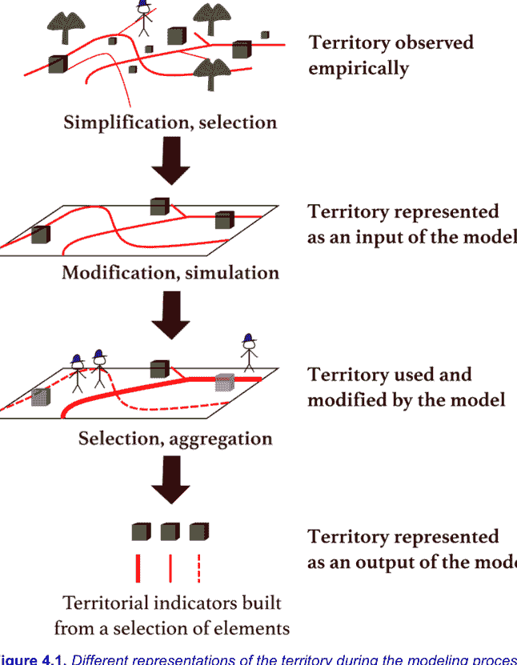
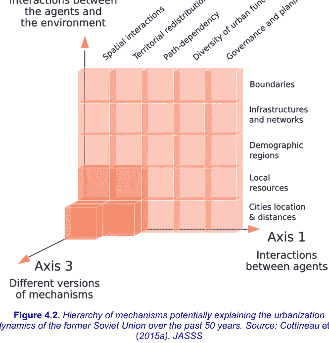

## 增量领土建模

城市和领土是复杂的实体，地理学以介于社会个体层级与区域或大陆群体层级之间的中观尺度来研究。因此，城市和领土既被视为源于局部社会互动的涌现产物，也被视为支撑更高层级互动的“集体代理”，例如城市间互动。例如，虽然此类互动最初源于个体选择，但它们是根据城市的聚合和涌现属性来组织的。这种二元性在城市的动态建模以及地理领土的动态建模中很重要¹。

因此，一个核心问题是如何在模型中表示城市和领土。象征性表示选项，例如密度的分布、功能、规模和网格大小，是地理学科的核心，但这一问题在建模历史上却鲜有思考。对地理模型中领土表示讨论相对缺乏，很可能是由于借用了其他学科的理论、方法和模型，而这些学科的关注点并非领土。在本章中，我们试图通过参照更贴近该学科的基础，即制图建模，来说明领土表示的重要性。事实上，地图中表示的选择，地理学家所熟悉的，可以构成领土建模的第一个指导。

本章由 Clémentine Cottineau、Paul Chapron、Marion Le Texier 和 Sébastien Rey-Coyrehourcq 撰写。
1 此处动态建模指所有产生时间演化的模型，如微分方程或动态模拟，与统计和静态模型相对，例如。

在此情况下，制图者必须通过减少待表示的信息量来进行信息概括化（选择）并根据地图目标简化定性信息（概化）。

> “概括化 [...] 既适用于底图创建，也适用于信息处理。概括化同时结合了选择、概化和协调，其各自作用因地图类型（地形图、专题图）、地图目的（传播图、科学图、教学图）以及出版比例尺（格式）而异，后者决定了整个过程”（Béguin and Pumain 2017, p. 27）。

在实践中，制图选择过程包括选择哪些要素进行表示，哪些要素省略。以道路图为例，道路布局以及收费站和城市的位置通常已足够，而地质、农学或气象要素则未被选择，因为在道路图常规使用情境下这些信息不相关。在领土或城市的动态建模情境中，选择操作对应于建模者对研究现象中涉及的基本要素和代理的识别。模型在研究过程中可以变得更复杂，但它始终与现实相比是概化的。因此，问题在于优先考虑与研究问题最相关的要素；否则，模型可能无法提供充分的答案。

为指导选择操作，文献区分了两种标准方法。第一种是众所周知的简约原则（或奥卡姆剃刀原则）：能够再现目标动态的最简单模型始终被优先考虑。相反的方法则在于更真实地详细表示所研究的领土系统及其假设机制。根据建模目标（以及建模者的方法论偏见），折中方案可以偏向其中一种方法。SIR 模型²的传统版本与 MicMac 模型（Banos et al. 2017）之间的比较说明了这一点。这两个模型都旨在模拟疾病在人群中的传播。在第一种情况下，该人群被划分为

仓室（易感、感染和康复个体）由一系列描述群体间转换率的微分方程连接。这一数学模型使我们能够考察污染的影响，并预测随时间推移属于这三个群体中每一个的个体数量。它是一个聚合模型（将总人口细分为三个群体，研究其特征，而不明确描述构成这些群体的个体），也是一个非空间模型（不对个体和群体的位置进行建模）。基于微分方程的经典 SIR 模型的解析求解需要对时间进行连续表示。在 MicMac 模型中，一般流行病学模型的规则仍然根据聚合的 SIR 模型定义，但 MicMac 还以非聚合的方式描述了一些导致传播的个体的流动性，即通过对个体进行空间化。流动性定义在城市之间的长距离范围内，而对于每个城市，SIR 模型模拟在给定时间内被感染、易受感染或已从感染中恢复的个体数量。城市之间的相对邻近性由图表示（其链接是航空路线，节点是城市），其拓扑和规模可以修改。该模型通过模拟进行数值求解，使用离散时间步长，即在每个时间步长（间隔）计算种群的状态。其他模型在模拟流行病传播所需的细节水平上走得更远。例如，MOMA 模型（埃及伊蚊模型，Maneerat 和 Daudé 2017）就是如此，它代表了登革热、黄热病、基孔肯雅热和寨卡病毒的传播媒介——埃及伊蚊的生物学和行为特征。这个基于个体的模型在微观地理层面上定义：即运动中的蚊子所感知的环境。蚊子个体的行为取决于其自身属性以及环境属性，因此当地的地理模式（例如池塘的存在）会影响蚊子的扩散。值得注意的是，尽管细节水平相对较高，该模型仍然具有通用性，因为它可以从一个地理环境迁移到另一个地理环境。

制图简化操作包括在改变比例尺或向地图添加更多信息时，对某些要素的布局或符号表示进行图式化。例如，在挪威地图上，在大比例尺下，海岸线会很复杂，峡湾的轮廓可能会出现。然而，在欧洲比例尺下，挪威通常被概化，其边界由大约一百个或多或少笔直的线段勾勒出来。同样地，领土建模对这些对象的动态和表示进行图式化和简化。例如，"直线"距离经常用于邻里感知和交通成本评估操作中，尽管人们认识到大规模的人类出行很少符合欧几里得距离。类似地，在空间交互模型（Wilson 1971）中，"直线"距离通常在地理单元的质心之间计算，而不是在人口重心之间计算，这被认为是一个简化建模和计算的微小差异。建模者的主要困难在于知道这种图式化何时可以被认为相对于模型的功能及其目标而言是中性的，何时不是，尽管它简化了计算和模拟的时间管理。这个问题被称为"假设相对于目标的可代表性"，一般而言很难评估（Rey-Coyrehourcq 2015; Varenne 2013），尤其是在当前建模实践中存在多元形态化的趋势，即在同一模型内混合各种形式体系（例如微分方程和基于个体的模型）。

因此，地理学中开发的动态领土模型往往不同于视觉和程序化建模方法，这些方法除其他外，旨在从激光成像和扫描（Musialski et al. 2013）重建城市景观，或使用生成语法（Parish and Müller 2001）生成具有真实形状和外观的城市空间。这些方法主要面向电影或视频游戏中的应用，然而可能构成地理学和规划领域的重要发展。UrbanSim 模型（Waddell 2002）也许是这一趋势的最佳例证。在其最新版本中，UrbanSim 提供了一个 3D 可视化平台，其既定目标是促进决策者和公众对领土动态的理解。最近，C. Slager 和 B. de Vries（2013）提出了一种自动化生成高细节水平和真实感空间配置的工具，用于评估城市发展项目，而 SimPLU3D（Brasebin 2014）旨在通过形式化地方城市规划法规来模拟逼真的住宅建筑形态。后者的领土动态模型基于无形信息（预测、规划和法规），这些信息需要专门的建模，不能通过简单地选择或映射可用数据来完成。更普遍地说，对于一个领土模型要发挥作用，其空间组成部分必须被建模、形式化，然后作为模型的输入使用，之后才能模拟模型动态过程。

### 4.1.2. 作为模型输入的领土表示

地理模型具有表示领土的要素，这些要素或多或少，且或详或略。从历史上看，城市地理学建模中的模型从其他学科中汲取了灵感。这从此影响了城市和领土在模型中的表示方式。特别是，城市模型受益于"系统项目"的许多分支（Poyreau 2013; Rey-Coyrehourcq 2015; Varenne 2017）。例如，1970 年代的物理学和化学对法国城市地理学产生了特别强烈的影响：

> "一方面，艾伦在普里戈金耗散结构理论框架内的工作；另一方面，魏德利希和哈格（1983）在哈肯（1983）发展的协同学框架内的工作；最后是威尔逊（2000）的工作，他为经典的空间交互模型提供了基于熵概念的理论基础"（Sanders 2013, p. 834）。

由于这一学科遗产，"尽管系统项目的'控制论'阶段[已经]使得将焦点从实体转向它们的交互成为可能，并清楚地区分了对演化的简单测量（动力学）与动力学本身（包括对控制这种演化的因素的解释）"（Pumain 2013, p. 13），早期的城市地理学模型³ 倾向于在一个虚构和抽象的空间中过度表示领土的存量特征（例如人口和工作岗位数量）。这些早期模型也倾向于未能充分表示严格的领土特征，将城市简化为相互连接的点，将其间的空间简化为均匀的欧几里得场。这些点通常由取决于点之间几何距离的流连接，并且模型中通常甚至没有必要表示空间，城市点的坐标足以计算距离，从而计算流。这一遗产促进了地理模型的发展，在这些模型中，地理空间是各向同性和均匀的，与其经验上的对应物不同。事实上，人文地理学的大部分科学文献旨在强调人类活动的异质性分布以及支撑它们的空间的"粗糙性"。

³ 例如，在劳瑞或福雷斯特的模型中。

将显式的地理结构重新引入动态模型，因此对于领土建模而言是一个重要问题，既因为它属于地理学家-建模者的工作职责，也因为作为主体交互的框架和支撑，这样的地理结构以及模型初始化时的变化会影响模拟输出。例如，A. Banos（2012）揭示了在参数值恒定的情况下，城市网络的形状和结构对 Schelling 模型中获得的空间隔离程度的影响。J. Raimbault 等人（2019）在改变 Schelling 模型模拟所依据的居住密度初始分布时得出了类似的结论。这种地理结构整合的挑战也延伸到对这些结构上作用的现象的观察方式：I. Thomas 等人（2017）例如展示了在 LUTI 模型中，系统所代表的边界和尺度的选择如何影响所获得的结果，而 M. Le Texier 和 G. Caruso（2017）揭示了聚合水平对欧元硬币扩散动态的影响。

除了模型对初始空间条件的敏感性，即将支撑建模交互的领土的表示作为模拟过程的完整输入之外，经验事实抽象程度的改变也会改变领土模型的要求。A. Banos 和 L. Sanders（2013）确定了区分动态模型的两个主要维度：一个抽象维度，以及在二维平面上与其正交的节俭维度。节俭维度通常简化为 B. Edmonds 和 S. Moss（2004）提出的 KISS⁴ 与 KIDS⁵ 模型之间的对立，将节俭模型（如 Schelling 模型⁶）与更复杂、更完整的模型（如 MATSIM⁷）相对比。光谱的一端旨在理解并以示意方式解释基本过程，而另一端则倾向于有利于系统现实主义的表征以及在某些条件变化下未来或替代结果的预测（情景方法）。Banos 和 Sanders 的正交维度——见第 2 章——将一般和抽象模型（如隔离模型）与特定模型（如 2000 年代巴黎地区社会群体分布模型）相对比。事实上，过程的抽象并不必然意味着领土的抽象，正如将 Schelling 模型应用于 Yaffo 城市所示，其数字化的建筑足迹以宗教人口的现实分布为特征（Benenson 等 2009）。相反，完整模型可以应用于风格化空间。这种做法的一个例子是将新的地理经济学应用于线性城市或两区域世界模型（Fujita 等 1999）。

最后，城市和领土作为模型输入的表征可以是混合的。与其以相同方式表征给定地理层级的所有元素，建模者可以选择根据与所模拟主体或对象的行动的距离来改变表征层级。例如，在国家间贸易模型中，使用“世界其他地区”类别以及单一国家合作伙伴可能对应于这种混合策略。出于计算原因，A. Hagen-Zanker 和 Y. Jin（2012）提出了类似的策略：他们的空间交互模型实现了自适应分区。远离所考虑区域的区域被聚合为组，且距离越远组越大，以便产生与附近区域之间流量相当大小的流量。这种自适应分区可能比领土模型中通常使用的统一网格尺寸更适合表征人类地理感知。因此，从概念和计算角度来看，它都构成了一个有趣的研究方向。

### 4.1.3. 领土作为模型输出的表征

尽管领土建模通常以对所代表城市或领土的保真度为目标，但领土动态的模拟可以基于现实中不存在或无法评估的对象和概念，而这些对象和概念充当解释观察过程的“垫脚石”。换句话说，模型可用于探索可能导致经验观察到的配置的动态，使用类比解释的方式（Workman 1964）。建模者选定用于模型的对象和动态必须作为重建复杂现实的尝试纳入反思，而这种现实的整体运作无法被观察。在承认这种偏差的前提下，更重要的是关注这种选择的连贯性及其对模型结果的可能影响，而非单个元素的现实性。换句话说，不应忘记我们是在电子基质（模拟器）上操作，所选元素的意义和动态与它们在现实中运作的复杂性几乎没有关系（Bulle 2005）。此类评估必须通过测试（敏感性分析）来确认。然而，无论从输入领土建模的动态的现实性如何，无论其状态如何（过去某个时期的经验领土、抽象空间、以及最初未分化的领土），模型产生的输出领土都根据其满足建模者预先定义（或通过迭代）设定的某些要求的能力来评估。这些要求可以有两种类型。

一方面，模型的目的是再现经验观察到的轨迹。在这种情况下，有必要定义要模拟的元素选择，以及在偏离该经验情况的意义上什么是“好的模拟”。例如，在 MATSIM 交通模型中，要生成的配置是每日出行流的分布，通过其活动日程和地点的组织来实现。估计不佳的流量份额和最大延迟被用来区分“好”与“坏”模拟。在 Anasazi 模型的情况下，要生成的配置是定居点的灭绝（Dean 等 2000）。生成观察到的轨迹是必要的，但不足以验证模型（Amblard 等 2006；Hermann 1967；Rey-Coyrehourcq 2015）。

另一方面，模型的目的是，而不是模拟经验轨迹，而是生成一个或多个“风格化事实”。自 N. Khaldor（1961）以来，某个领域的典型规律性被称为风格化事实。风格化事实虽然不是科学定律，但可以与经典科学方法中的概括或经验定律相比较（Harvey 1969）。城市地理中风格化事实的一个例子是其规模的等级分布，更精确地说是根据其排名按幂函数分布，指数 a ≈ 1，排名是城市按人口递减顺序排列的列表中的位置（Zipf 1949）。对该幂函数的解释（Sanders 2012）及其参数的期望值因学科、领土、时间段和估计方式而异（Rosen 和 Resnick 1980），但分布的总体特征和等级的规律性仍然存在。这就是为什么一些模型将该风格化事实的生成作为成功模拟的指标（Cottineau 2017）。在这种情况下，即使

4 保持简单，傻瓜！
5 保持描述性，傻瓜！
6 Schelling 模型是经典的、非常节俭的城市隔离多主体模型。它有两个机制：1）主体评估其对邻里构成的满意度，2）如果其当前居住地未达到最低满意度，则搬迁到新地点。
7 在 MATSIM 中，城市以不同大小和租金的住宅、可变租赁水平的商业场所、按地理位置描述的交通网络、公交时刻表、具有不同时间预算的个人以及许多其他属性来表示。

被建模的城市具有一些经济、社会和技术属性，可用于反映模拟配置；所选定的用于限定模型输出的特征被归结为其规模分布（Sanders et al. 1997）。正是在这个意义上，作为模型输出表征的地域可能不同于作为模型输入表征的地域，也不同于模型所使用并因模拟动态而被转化的地域。因此，作为输出表征的地域只是经模型修改的中间地域的一个子集（图4.1）。

图4.1. 建模过程中地域的不同表征

*设计或转化*（Varenne 2008）。这一观念在建模地理学家中早已存在（Sanders 2000），对他们而言，在解释时，模型的内容才是最重要的。

## 4.2. 一般性与特殊性：通过地理模型进行解释

尽管对社会系统进行建模的原因多种多样，包括学习、交流和形式化假设（Varenne 2013），但主要原因是解释被建模的现象（Epstein 2008）。

> “从字面意思看，解释（法语‘expliquer’）就是从你的褶皱（法语‘plis’）中出来（法语‘ex’），而提出假设则是提出一种‘展开方式’（法语‘déplier’）。但提出一种展开方式，就是将自己置于一个建构的世界——地理世界之中，并尽可能使用毫不含糊的语言，以使展开过程连贯一致”（Raffestin 1976, pp. 85–86）。

C. Raffestin 将地理学中的定量革命视为明确所选展开方式的一种途径，从而使地理解释具有可证伪性和可预测性。此外，随着控制论原理以及自组织与复杂性理论的融入，与地域多样性及其起源的关系也发生了变化（Pumain 2003）。因此，通过地域建模进行解释，承载了历史偶然性与非遍历性的概念（第4.2.1节），并对一般、特殊和独特轨迹加以区分（第4.2.2节）。

### 4.2.1. 历史偶然性与非遍历性

任何科学解释都应产生可证伪的陈述和预测。在社会科学中，理论和解释的一般性与可预测性有时会受到挑战，理由是一般规律既不能适用于人类行为，也不能适用于其在空间和时间中的集体表达。在地理学中，由于学科对象的多变量性质，解释不仅必须说明所研究的现象（城市化、人口转变等），还必须说明这些现象在时间和空间上表达的变化。因此，解释往往是多方面的，综合了系统性、生态、功能和因果分析（Harvey 1969）。

> “即使它们产生不同的地理格局，空间框架也是由时间过程所组织的，这些过程在结构的各个组成部分中再生产或维持其稳定性。对一种组合持久性的解释，与其说在于将其各组成部分联系在一起的关联强度，不如说在于演化原则的精细性——结构通过这种原则，在增量且持续的过程中，在所有组成部分上适应变化，有时也有助于引发变化。因此，这一理论探索很快就意味着要知道如何从对规律性的观察转向对过程的分析，从对‘组合’或结构的识别转向对可能产生并改变它们的变化的研究”（Pumain 2003, pp. 7–8）。

关于时间不可逆性和未来不可预测性的假设，是地域模型非遍历性质的基础（Pumain 2010b）。这一性质意味着，*所有城市[和所有地域]的所有可能状态都[不]是它们各自能够达到的*（Pumain 2010b, p. 60），因为扩散和专业化的演化过程引导地域沿着演化“路径”前进，而不是趋向于一个可预测的最终状态。例如，在给定时间观察不同规模的城市，并不等于观察一个典型城市在其历史增长路径中的过程。

通过采用协同学和复杂性范式，即一个 *相同的方程能够生成极其多样的形式和演化* 的建模宇宙（Pumain 2005, p. 15），所观察模式的偶然性不再对应于那种通过一系列独特事件产生地域完整轨迹的历史偶然性，而是对应于一种受分岔任意支配、将系统导向其某一条可能轨迹的偶然性，这种偶然性正是复杂模型所允许探索的。

> “自组织理论使我们理解，相同的一般过程如何可能产生不同的效应和结构，这取决于控制相互作用及其演化的初始条件和参数值”（Pumain 2003, pp. 16–17）。

因此，复杂性范式促使我们重新思考一般、特殊和独特轨迹之间的区分（Durand-Dastès 1991），以及模型的情境性或局部性——这些模型只适用于单一案例研究，或只预测一种结果。当地域模型在略微改变其初始条件和参数值时产生的结果具有多样性，这使我们能够在结果与已知经验情境相符时强化其适用性范围，为尚未实现的可能未来提供信息，并识别该理论被证伪的情境。

> “当然，确保模型能够再现其旨在解释的模式十分重要。同样重要的是，遵循波普尔的论证，去寻找可能具有证伪模型能力的模拟，即那些表现出输入值与输出模式之间关联且与数据相矛盾的模拟”（Chérel et al. 2015, p. 1）。

地理学家并非像 Passeron（1991）对社会学那样整体拒绝波普尔-亨佩尔的假说-演绎（HD）和法则-演绎（ND）模型，而是更倾向于依赖多元知识，构建各种机制以增强所谓“定性”和“定量”工作的工具集和方法（Pumain 2005; Rey-Coyrehourcq 2015; Sanders 2000; Varenne 2014）。换言之，演绎推理绝不是产生科学推理的唯一途径。例如，J.-M. Besse（2000）提出重视溯因逻辑¹¹，允许“意义的推进”和“阐释的推进”，在保留还是拒绝某个假设时，为推理过程中的认知方面留下解释空间：

> “因此，科学的大部分任务将主要不在于寻求演绎性的原因和序列，而在于组织各种观点和框架，以表征它所旨在的

11 据 S. Catellin（2004）所述：溯因的起点是一个被感知为令人惊讶的事实，因此它违背预期、违背习惯，或违背先前被视为理所当然的东西。溯因在于选择一个可能解释事实C的假说A，使得如果A为真，C就被解释为一个正常事实。换言之，溯因是对一个令人惊讶的事实进行规范化的程序。当我们的期望系统出现断裂时，就会进行这种推理努力；这是一种利用我们知识的“想象性”推理。溯因属于过程逻辑而非计算逻辑，它涉及一种情境、一种文化，以及一种社会惯习。S. Rey-Coyrehourcq（2015）讨论了其他溯因定义及其与建模的关系。

account for. 换句话说，在寻求解释和展示因果序列之前，科学关注的是通过溯因的方式建立有意义的联系来阐明情境。科学不仅寻求证明，也寻求启发”（Besse 2000）。

该逻辑已为地理学家的建模实践所解释并操作化（例如参见 Banos 2013）。

### 4.2.2 一般/特定/单一

一般与特殊特征或轨迹之间的对立是科学理论构建的根源，因为理论旨在通过解释过程将特殊案例与一般“规律”联系起来。 然而，在社会科学领域，甚至在地质学也可能属于其中的“历史”科学领域（Harvey 1969），A. Bouvier（2011）对个体与单一（或独特）之间所作的区分至关重要。 事实上，虽然一般案例源于模型在抽象案例中的标准应用，但它只能与经验现实的特殊案例进行比较。 这些特殊案例可能表现出源于一般模型的特征，即基于共同属性存在的共享特征（例如，首都共享一个共同的特殊属性，并且往往比给定国家中的平均城市更大）。 单一案例*逃脱了概括*（Sanders 2013，第 12 页），需要使用历史解释来理解其演变（例如，维也纳比其他奥地利城市更大，但我们需要一些关于奥匈帝国的知识来理解原因）。 一般、特殊和单一之间的这种区分在处理城市和领土的建模时很有趣，因为它使我们能够将模型的结果与*特殊*的地理配置进行比较，这些配置可以在经验数据上观察和测量，同时也可以在模型复杂化迭代过程的末尾突出某些轨迹的独特性。 虽然对特殊案例的经验分析旨在通过识别或分类共同类别来提高一般性，但复杂化方法反映了相反的路径：“从一般性下降”。 在这条路径的末端，模型无法预测的残余轨迹被视为单一。

因此，模型及其构建方法可以促进对地理现象的一般性解释（例如，一个国家城市规模的差异化），特殊性（社会主义国家、发展中国家等城市规模的演变）以及“单一性”（当代中国演变）。 在第 4.3 节中，我们提出了一种基于 MARIUS 建模经验的增量和模块化建模方法。 我们详细说明了这种构建所涉及的步骤和问题。

## 4.3 增量领土建模

> “传统模型在把握现在方面是正确的，然后被用来预测未来。 相比之下，[...] 模拟使[复杂系统模型]能够产生不同的结果，这些结果在某些情况下可能看起来像是不同的未来，但实际上定义了不同的模型结果空间。 这种空间的生成方式不仅仅是通过参数值的系统变化，这是在传统模型校准情况下的久经考验的方法，而是通过在一定限制内改变模型结构，即通常改变将不同过程编码到模型中的规则，从而在一种虚拟实验室中模拟不同的实验”（Batty and Torrens 2001，第 32 页）。

在这种纲领性引用的精神下，我们提出的方法旨在将所研究地理模式的解释分离为或多或少独立的机制，这些机制对所建模的地理对象或多或少是一般或特定的，以便将它们组合成一个单一的、模块化的模型。 该模型在两个方面进行评估：它必须模拟的经验地理配置，以及它与所研究对象更一般的风格化事实的匹配程度。 这种增量方法提出的方法论问题如下：我们如何构建“现实”的模型，使其相对于经验数据和风格化事实而言是现实的，并依次（同时）整合对其过程及其地理表达多样性的更丰富信息？

我们提出了一种六步方法。 首先，我们考虑分析尺度的识别、要模拟的配置以及风格化事实（第 4.3.1 节）。 随后，我们解决收集和分类各种现有解释的问题（第 4.3.2 节），然后根据其解释力的一般性对其进行优先排序（第 4.3.3 节和第 4.3.4 节）。 最后，我们描述了模型如何以模块化方式实现（第 4.3.5 节）、组合、模拟并与为其评估准备的经验数据和风格化事实进行比较（第 4.3.6 节）。

### 4.3.1 识别对象、尺度、配置和风格化事实

增量领土建模的第一步包括定义研究问题并识别模型应描绘的对象、地理尺度以及目标配置。 由于存在无限多的地理问题，因此存在大量的领土模型。 例如，存在面向紧急疏散分析的行人流动模型（Zheng *et al.* 2009），它们与旨在优化车站等密集区域的行人模型不同（Hoy *et al.* 2016）。 其他行人模型侧重于城市骚乱的出现，特别是在英国伦敦（Davies *et al.* 2013）或肯尼亚基贝拉（Pires and Crooks 2017）的应用。 所产生的模型有时相似、通常不兼容，并且始终取决于生产它们的科研团队。 因此，我们建议，除了记录 ODD 模型（Grimm *et al.* 2010）以允许其交流、传播和他人潜在重用之外，建模者在开始构建*又一个模型*之前（O’Sullivan *et al.* 2016），应对现有理论和应用模型进行广泛的模型学（Schmitt and Pumain 2013）。 模型的重用通常不能直接进行，因为每个模型都回答特定的研究问题。 在这方面，*模型对接*这种并不常见的实践很有趣（Wilensky and Rand 2007），因为它包括重新调整以不同目标开发的模型，表明它们可以产生，因此可以部分解释相似的*模式*。 重用并修改的做法，肯定要求很高，因为它涉及可重复性工作（Grimm *et al.* 2010, 2014; Rey-Coyrehourcq *et al.* 2017），应该比现在更频繁，因为它促进了知识的积累（Pumain 2005, 2009; Rey-Coyrehourcq 2015）。

一旦确定了模型的主题，就有必要决定模型是期望模拟单一的经验配置、该配置的特殊性，还是通过地理配置表达的一般潜在过程。 双重雄心可能是构建一个能够同时再现促使其发展的特殊配置以及该现象的经验变化的模型，从而证明其一般解释力。 在这种情况下，评估模型的目标必须确定这两个要求并描述其一般性/特殊性的水平，例如通过区分一般目标（“获得符合幂律的城市规模分布”）、特殊目标（“获得社会主义国家的凹形分布”）和单一目标（“再现前苏联在特定日期的分布”）。 这种模式的定义/解释对于寻找要建模的机制以及进行严格和可重复的评估至关重要，特别是对于 POM 类型的评估。

### 4.3.2 收集不同的理论解释

具体而言，针对目标现象的解释及其建模的搜索也可以从所研究的对象和文献中报告的现有模型和理论开始（无论是关于城市骚乱、海上洪水风险或社会隔离等），也可以从该对象的地理尺度或所涉及的演变类型开始。 在从尺度开始的方法中，对给定尺度（例如城市、农田或地球）的现有模型的回顾使我们能够探索未直接考虑但可能对要模拟的模式产生影响并在解释中发挥作用的过程和主题。 在按演变类型的方法中，不同学科之间的模型比较可能是有益的。 例如，相互作用元素的规模层级化过程在数学中由随机动力学产生，在网络物理学中由优先连接动力学产生，或在经济学中由递增回报产生。 这些不同的方法可以作为竞争和互补的模型候选者来解释城市、公司或考古定居点之间的人口差异化（Pumain 2006; Sanders 2012）。

竞争和互补解释的“制图”并不新鲜，也不一定与领土建模有关：20 世纪 60 年代动态建模的先驱（Hermann 1967; Levins 1966）已经考虑了多种机制以及动态建模在它们之间做出决定的优势。 例如，R. Levins（1966）列出了并联系了 Lotka-Volterra 类型的捕食者-猎物模型、提出物种间竞争效应的理论以及食物链模型，以绘制能够表现出生态群落出现的“模型集群”。

一般而言，通过比较替代性解释来验证理论是一种常见的认识论实践，虽然不同于波普尔和库恩的方法，但同样适用于地理学以及其他科学（Harvey 1969）。例如，在城市地理学中，C. Cottineau 等人（2015a）识别出五种可以解释城市规模随时间分化的机制：空间相互作用和等级创新扩散的影响；城市规模差异的自我强化效应；区位效应和自然资源储量的存在；情境效应（尤其是对交通网络的影响）；以及领土效应，即与特定空间（如地区或国家）的政治团结组织相关联。

列出机制后，我们认为对其假定重要性进行分层排序以组织模型的实施非常重要，特别是为了对不同机制的解释力做出可检验的假设。这样做的一种方式可能是根据其一般性或系统特异性的主观（尽管并非任意）评估来优先排序机制，并将地理主体之间的相互作用机制与主体与其地理环境之间的相互作用机制区分开来。

### 4.3.3. 分层主体之间的相互作用过程

对主体之间相互作用机制的分层排序是大多数建模方法中的重要步骤，但在模型发表结果中却很少提及。一个显著的反例是 J. Epstein 和 R. Axtell（1996）著作中对 Sugarscape 模型的介绍。作者从一个简单模型出发，在后续章节中描述了模拟主体可用的行为复杂性的不断增加，从采集本地资源的静态主体到能够建立食物储备并传递、交易、繁殖和污染的移动的、有性别区分的主体。在模拟前苏联城市人口差异化演化的 MARIUS 模型示例中（Cottineau 等人 2015b），城市主体之间的相互作用机制从最一般的一种（即根据引力模型交换价值）分层到最特定于研究空间的一种（即社会主义经济计划和城市在为整个国家生产商品方面的排他性专业化）。中间我们发现领土均等化机制、交换记忆或城市功能的分化机制（见图 4.2 中的轴 1）。这种分层使我们能够选择首先实现和评估哪些机制。

图 4.2. 过去 50 年前苏联城市化动态的潜在解释机制层级。来源：Cottineau 等人（2015a），JASSS

### 4.3.4. 分层主体与其环境之间的相互作用过程

对主体与其环境之间相互作用过程的分层排序对于领土建模而言是一个特别重要的方面。事实上，这种分化维度既涉及模型环境表示的详细程度（从简单的均匀网格到代表单个地块的实证地籍），也涉及主体的地理行为的丰富性。对城市环境的详细描述使得能够建模更真实的导航行为（如 Camden 警务模型中的 Wise 和 Cheng 2016 或传染模型 Perez 和 Dragicevic 2009），而对耕作地块农业潜力的本地化数据的增加则使得能够准确再现美洲原住民社会的农业生产动态（Dean *et al.* 2000）。

在 MARIUS 模型的示例中，城市主体与苏联环境之间的相互作用机制从最一般的一种（距离对相互作用的影响）分层到最特定于研究区域的一种（随时间推移边界的修改）。中间存在诸如原材料的地方性存在、人口制度的宏观区域分化以及交通基础设施对时间距离计算的影响等中间机制（参见图 4.2 中的轴 2）。该层级是在对这些城市在长期内的演化进行先前的统计分析的基础上产生的。

### 4.3.5. *实现机制及其形式替代方案*

图 4.2 展示了机制组织的第三个轴，对于主体、其相互作用和环境的给定表示水平：给定理论解释的形式替代方案的维度。探索引力模型数学变体的开创性示例来自 S. Openshaw（1983b, 1988）。在 1980 年代，他实现了一个“自动地理机器”，该机器自动生成引力模型的组合（例如，使用分配给人口的对数、指数或幂函数）以使用区域间流动的经验数据进行估计。此后，模型对接运动已朝类似方向发展，尽管系统性较弱，通过将来自不同学科和问题的模型进行对齐，但产生等效结果（Axtell *et al.* 1996）。最近，J. C. Thiele 和 V. Grimm（2015）建议生态学家应更系统地探索现有模型，将其分解并探索其修改，以便利用先前的努力，并提高由多个研究团队重新实现和测试的模型的稳健性。

我们可以再增加一个第四维度，即经常被忽略的维度：机制的技术实现，因为将机制分解为计算机算法自然会产生解释性变异。当建模领土中相互作用的社会实体（行动者或集体主体）的行为时，机制可以不同的一个额外维度是主体的认知能力。层级可以根据它们所拥有的信息量（完整或有限）或其个体推理或行为的复杂性来组织：从纯粹的反应性主体到基于感知并与信念对照、根据预期效果规划其行动的主体。最后，对于基于“高度”社会主体的模型，我们可以根据社会组织的复杂性考虑一个额外维度，从未分化主体的群体到由角色、群体和规则结构化的组织，这些组织本身也是分层的（Bouquet et al. 2015）。

我们假设，对机制的替代形式主义的评估可以与对具有不同结构（具有更多或更少描述主体之间以及与环境之间相互作用的机制）的模型的评估并行进行。为此，有必要建立一种尽可能稳健的策略来组合、模拟和评估模型。

### 4.3.6. 组合、模拟和比较

将解释细分为不同机制的好处在于，我们可以实现基本的“构建模块”，其中每个模块代表一个候选机制（及其形式化），并将其组合成模块化模型。因此，模型的模块化必须使用编程语言转录，该语言允许自动组合积木并传达每个组合执行模型所需的参数信息。

在这方面，在我们对 MARIUS 模型的实验中，我们使用了 Scala 编程语言的“trait”和“依赖注入”（也称为 Cake Pattern¹²）计算机概念来生成所有可能的构建模块组合（本例中为 64 种组合），并为其分配结构标识符（Cottineau et al. 2015a）。该标识符是

12 这是一种根据调用上下文（此处：构成模型的特定积木组合）扩展对象类方法（此处：机制）功能的方式。另请参阅（Rey-Coyrehourcq 2015）关于这些技术使用的示例。

### 4.4.1. 组合爆炸的诅咒

“组合爆炸”是建模者长期面临的挑战之一。大量可能的模型组合意味着需要耗费漫长的计算时间来评估模型（校准、敏感性分析和稳健性），同时也要耗费大量时间分析和解释这些结果。实际上，建模越是描述性强、越完整，形式化的备选方案就越多，可组合的构件数量也就越大。组合的数量呈几何级数增长。在 MARIUS 案例中，一个基础机制加上五个附加机制，多模型最终产生 2⁶ = 64 种可能的组合[^13]。其校准所需的计算时间超过 40 万小时[^14]。

如果我们按照 C. Cottineau（2018，第 20 页）的项目设想，基于文献中确定的 12 个作为城市经济不平等动力学解释候选的机制来研究城市不平等，我们将得到 2¹² = 4,096 种可能的模型结构。为 MARIUS 开发的结果分析与交互式可视化工具（Pumain and Reuillon 2017）将不足以管理如此高的复杂性。因此，这种方法应被设想为一种原型和方法论路径，而非通用的建模标准。

### 4.4.2. 人力和技术成本

自 20 世纪 80 年代的先驱者以来，计算基础设施方面取得了巨大进步，无论是硬件还是软件。尽管如此，社会科学研究在获取计算资源方面的困难（Banos 2013; Rey-Coyrehourcq 2015），以及模型探索相关的计算成本持续存在，仍然是需要面对的约束。设计和实现一条软件链——其支持 (a) 从众多异构构件自动生成可能的组合树，(b) 在分布式计算平台上采用适配方法论评估该组合树，以及 (c) 基于相关评估标准对 (a) 中所述组合树的构件进行自动重组——迄今为止仍是特定建模过程的产物。要使这种复杂工程变得可负担，就必须将其整合为建模平台（NetLogo、GAMA 等）中的新型构建原语。这同样让我们能够讨论此类事业的人力成本。事实上，像 MARIUS 这样的项目需要三名青年研究人员（博士和博士后）在 ERC GeoDiverCity 项目资助下花费约两年时间。这种跨学科经验在 Chapron et al.（2014）、Pumain and Reuillon（2014）、Rey-Coyrehourcq（2015）以及 Pumain（2019）中有详细描述。

### 4.4.3. 构件选择中的主观性

多建模的另一个弱点是，它建立在一种部分主观的增量（或构件）选择之上。实际上，尽管过程的层级安排遵循科学论证，但结果不太可能获得一致认可，这本身既是弱点也是优点。此外，鉴于组合爆炸问题，试图探索多模型中所有可能机制的穷举集合似乎并不明智。因此，我们对新手多建模者的建议是，在尽可能依据经验规律和强有力的理论论证，证明第 4.3 节所述过程层级安排的合理性之后，构件选择时应倾向于简约原则。我们也有理由期待，通过对不同机制模块的重复使用和重新评估，能够刻画这些机制在建模所关注的地理对象时的稳健性和价值，从而有助于在后续模型的测试应用中选择稳健且高效的增量（Thiele and Grimm 2015）。

### 4.4.4. 比较不同结构的模型

多建模的另一个问题是，在比较评估中需要考虑构件的内容。事实上，由于无法定义每个模型的似然值，传统的统计模型选择工具（如赤池信息准则或贝叶斯信息准则）在复杂的领土模拟中不再适用。

如果我们更简单地推理，试图在模拟目标距离与简约性之间做出权衡，不妨设想对三个模型的比较。模型 A 仅包含一个机制，例如经济企业的随机增长。该机制有两个参数：企业平均增长率和其分布的方差。模型 B 仅包含一个机制，即企业基于与其他企业互动而增长。该机制基于三个参数：互动范围、规模的乘数效应和企业平均增长率。模型 C 包含模型 A 和 B 的机制组合，因此总共有四个参数。我们很容易认为模型 C 比模型 A 和 B 更复杂。然而，A 和 B 是等效的（因为它们具有相同数量的机制），还是不等效（因为 B 具有更多参数，并且可能具有更多代码行[^15]）？MARIUS 实验（Cottineau et al. 2015a）将它们视为等效，这可能过于简单了。然而，当不同模型结构的数量和复杂性增长时，如何总能对其简约程度进行排序并不清楚。

C. Piou et al.（2009）的方法则有很大不同：这些作者使用 POM 方法并定义了称为 POMIC 的信息准则。该指标基于模型输出熵与实地数据熵之间偏差的估计。这种解决方案应用于不同的数学形式时，能够反映参数数量上的差异，但无法反映内容上的差异。因此，将涉及模型外部数据考量的机制与在该方面更简约的机制进行比较，仍然十分困难。

尽管我们希望强调多建模方法在领土应用中的局限性，但我们仍然认为，这种方法最符合社会科学、尤其是地理学的科学路径。此外，这种方法的一个优点在于，它鼓励形式化和经过评估的知识积累，从而能够在多种配置中复现典型化事实，反映领土的多样性。这种机会必然要求模型及其评估协议的共享，并需要一种理论化事业：一种关于复杂模型本身的元理论。

### 4.4.5. 知识共享与积累

这种多智能体模型的元理论是 U. Berger、V. Grimm、I. Lorscheid 和 M. Meyer 领导的研究小组的主题[^16]。该小组设想的第一条路径是，在通用计算机语言实现的机制目录中，对“子模型”进行文档化、评估和共享。就像 R 软件的包操作或 NetLogo 软件的模型库一样，我们可以设想与领土建模对象和尺度相关的机制（构件）库，建模者可以从中选择对其研究问题最有趣的组合。随之而来的挑战则是标准化实验条件：输入和输出数据格式、方法和工具、模型源代码文档[^17]，以及让这些标准在一个迄今为止以实践、语言和研究主题多样性为特征的共同体中获得认可。

## 4.5. 结论

本章指出了在复杂模拟模型中恰当表征城市和领土、以及模拟主体与模拟领土之间动态互动的重要性。这种领土路径提出了特定问题。因此，我们详细描述了领土在建模过程中可能呈现的不同状态。首先，领土从现实中抽象出来，建模者评估哪些特征与研究问题最相关——正如制图学中的做法。其次，领土设定通过形式化程序进行描述，即被转译为代数系统，其结构、尺度和细节层次是建模过程的核心。我们强调，这种首要领土表征的初始条件对模拟过程具有巨大的技术和理论影响。因此，领土既是模拟的输入，也是模拟的输出。在模拟过程中，它首先被模型机制改变；在模拟结束时，当建模者选择哪些领土组成部分用于描述模拟输出并衡量其与经验数据和/或典型化事实的一致性时，它被再次抽象。

[^13]: 数字 2 指机制的可能状态，即在模型中是激活还是未激活；数字 6 指不同机制的数量。

[^14]: 使用 OpenMOLE 平台（Reuillon et al. 2013）在计算网格上分布式完成。

[^15]: 这是一个棘手度量，只有在模型开发过程中语言、编程经验和程序员保持不变时才有效。

[^16]: http://abm-theory.org/。

[^17]: 更不用说其开放性和自由获取、执行和修改，如 Cybergeo 杂志 GeOpenMod 专栏所提议的 https://journals.openedition.org/cybergeo/26452。

本章进一步探讨了领土模拟中解释本质的问题。此类模型旨在通过将参数机制组合并转化为数学结构或计算机程序来解释地理现象。这种形式化确保了对其独立效应和综合效应的精确分析。这种监控使建模者能够评估潜在领土动态的多样性，并通过将其与由相同机制产生的替代结果集合进行比较来刻画特定的历史轨迹。这种方法促使我们在研究领土及其模型时区分一般、特定和 singular 条件。

最后，我们提出了一种建模策略，它超越了将模型定义为直接源于研究问题的固定机制集合的经典定义。相反，该策略将模型视为从大量潜在机制中挑选出的机制的 singular 组合。根据其普遍程度（即从最一般到最具体）和复杂性（即从最简单到最复杂）进行分类。这使我们能够更好地理解模型结构变化对其动态和输出的影响，从而更好地说明其提供的信息的丰富性。可以根据研究问题使用其他排序标准。在本章中，我们例如选择根据两个维度排列增量机制：实体之间的相互作用（此处为城市）以及相互作用发生的环境的空间分辨率。然而，这种方法意味着巨大的成本，我们已在最后一部分详细说明。

对现有建模方法和增量建模策略的分析旨在为读者-建模者-地理学家提供指南，以渐进且合理的方式呈现领土复杂性，以便开发可重复的领土模型和评估协议。增量多模型方法解决了模型与所研究地理对象之间的适用性问题，并在存在替代解释的情况下澄清了科学争论的要素，因为它要求对模拟目标、模型运行的条件及其实现细节进行精细说明。它为从模拟模型中检验和对照经验和理论假设奠定了基础。我们认为，这种增量和多建模策略非常有前景，并且符合智能体建模社区的更广泛关切。然而，该方法意味着高昂的实现成本，因为模块化构建块的自动化组合及其系统校准依赖于重要的技术和计算机资源，我们已在最后一部分部分讨论了这些资源，并在下一章中将进一步详细说明。
