## 模型可视化

## 6.1. 引言

地理学家深知制图学在分析、理解和描述他们所研究的空间中的基本作用。对于菲利普·潘舍梅尔（Philippe Pinchemel，1979，第246-247页）而言，“只有制图表示才能凸显地理组织、结构和系统。地图和制图语言也体现为地理的表达，作为地理的特权发展者。地理思维可以在制图表示中得以体现”。因此，在地理建模¹中，制图以及更广义的数据可视化对于模型的表达力而言是不可或缺的媒介。在将基于代理建模（ABM）与地理信息系统（GIS）联系起来的最新手册中，Crooks 等人（2019）描述了可视化的重要性，这里应用于模拟结果：

> 构建空间分析和建模结果的有效可视化，无论这些结果源自 GIS 还是基于代理建模，都是分析过程的重要最终组成部分。高质量的地图和可视化不仅解释分析结果，还通过让观察者轻松得出见解来帮助解释。（Crooks *et al.* 2019，第117页）

本章由 Robin Cura 撰写。

¹ 在本章中，我们将使用建模一词来指代计算机建模，以算法形式形式化，而非数学形式，从而排除了统计和数学建模（如博弈论相关），以及地理学中更常见的建模类型，如图形建模（“chorematic”）或定性系统建模（通常形式化为例如矢状图）。在计算机建模类型中，应注意这里的重点是模拟模型，并且与本书的大部分内容一样，重点是基于代理的模拟模型。

此外，即使建模并非地理性的，地理空间与建模环境之间也存在许多语义上的平行关系：代理在虚拟“世界”中相互作用，这个世界指代一个连续的、地理的空间，或更常见的是，一个离散化的空间，由 *patches* 或单元组成，这些单元本身也可以构成代理（如细胞自动机模型中）。在基于代理模型领域，代理通常与它们所操作的支撑空间不可分割，而该支撑空间本身也可以独立演化。基于代理建模平台清楚地说明了 ABM 与可视化甚至制图之间的紧密关系：这些平台的主页大多突出显示屏幕截图，其中大多数提供了正在运行的模拟模型的制图表示。

然而，尽管基于代理建模与地理学之间，以及地理学与可视化之间存在密切联系，但在科学文献中，对图形表示方法，特别是制图表示方法的引用却很少，包括在最合适的文章中（Kornhauser *et al.* 2009；Lee *et al.* 2015）。文献综述显示了这一点（Angus and Hassani-Mahmooei 2015，表4）：在基于代理社会模拟领域占主导地位的期刊 *JASSS*（*Journal of Artificial Societies and Social Simulation*）中，表格（识别出233个）、示意图（218个）和代码摘录（111个）远多于统计图形（43个）或地图（29个）²。

在 ABM 世界中，数据可视化因此似乎被很大程度上忽视且处于边缘地位，即使研究人员承认其重要性（Kornhauser *et al.* 2009）。此外，可视化更常用于传达结果，而不是作为模型分析或展示的工具（Angus and Hassani-Mahmooei 2015），而研究人员普遍同意可视化在模型构建过程中的重要性³。

因此，在本章中，我们希望介绍并说明使用数据可视化，无论是统计的还是制图的，在地理数据建模实践中可以获得的优势。为此，建立建模实践与可视化实践之间存在的平行关系似乎很重要。这些方法在实践和目标方面似乎在很大程度上相似。一旦建立了这些平行关系，就有可能突出地理模型可视化在其设计各个阶段中的特殊性和主要应用。我们将看到可视化如何帮助验证模型，既在自身方面，也相对于其所建立的数值假设方面，更一般地对其进行评估。通过将这些优势从模型可视化中推断出来，可以说明在何时以及如何可视化有助于比较模型、理解其特殊性，以及在模型族内区分模型（参见第4章，第4.4节）。最后，可视化在已完成模型的传播各个阶段中都相关，即在展示、科学增值和传播方面。然而，正确可视化 ABM 模拟数据仍存在一些障碍和限制，我们将提出一些解决这些问题的思路。

## 6.2. 可视化即建模

模拟和可视化是被非常不同且相当封闭的学科共同体研究的科学领域。在这两个领域中，计算和计算机科学家发挥着主要作用：他们设计和构建技术概念、方法论和工具，实践者可以依靠这些工具来建模所需系统或（地理）可视化可用信息。

然而，聚焦于这些实践者时，学科多样性更大。在建模方面，实践者可以是生态学家、工程师、社会学家、考古学家等等。他们共享定量方法来研究人类与其环境（自然或社会）之间的关系。在可视化研究方面（这里指数据可视化，或信息可视化 – InfoVis），社区正朝着创造性和艺术性以及技术性方法发展，汇集了例如设计师、数据记者或与数据相关的新学科从业者、数据科学家。

对建模感兴趣的地理学家（广义上包括图形建模形式）在这些方法中相当分散，也许出于历史原因，也许出于主题兴趣。

然而，可视化与建模之间存在许多相似性和平行关系。从广义上讲，两者之间存在紧密联系，因为可视化是一种模型，无论采用 Minsky（1965）的定义还是更一般的定义。可视化因此是对数据集的表示，必然是部分的且专用于特定任务（参见例如第4章第4.2.1节）。与模型一样，可视化使用主题和技术知识——因此通常涉及跨学科——但它也关注等效终点（可能有与可视化设计者一样多的可视化数据集的方式）或评估（某些可视化将比其他可视化更有效，以揭示代表系统的某个数据集的某个方面）。

总体而言，Banos（2013，第76-84页）确定的九条“强原则”至少同样适用于数据可视化，也适用于计算机建模：不遵守其顺序或不深入细节，这些原则可以为描绘建模与可视化之间的相似性提供切入点，而且当设计可视化作为建模活动的一部分时更是如此。

| 原则 |  | 是否适用于可视化？ |
|---|---|---|
| 原则1 | 建模即学习 | 是 |
| 原则2 | 建模者并非全能 | 是 |
| 原则3 | 模拟模型必须植根于数据 | 是 |
| 原则4 | 每个模型的行为必须以精确的方式被知晓 | 否 |
| 原则5 | 建模者必须停止为复杂问题提出唯一和最优的解决方案 | 是 |
| 原则6 | 建模者不是“已证实真理的守护者”；他们及其模型必须完全可访问以便重现 | 是 |
| 原则7 | 模型不再只是孩子 | 是 |
| 原则8 | 模型应被耦合 | 是 |
| 原则9 | 数学不是通用的建模语言 | 否 |

*表6.1.* *Banos（2013）提出的建模“强原则”及其与数据可视化问题的相关性*

### 6.2.1. 可视化作为跨学科的工具

建模者知道对话在构建模型中的重要性。在他的第二条原则中，Banos（2013）做出了以下澄清：

> 模型者必须意识到其技能本质上有限的性质。对我来说，可以被视为弱点的事情是一种优势。假设这种现实自然会导致协作。以非常概括的方式，我甚至会说对复杂系统的建模是一个本质上协作的行为（p. 77）。

同样，似乎显而易见的是，可视化是一个“本质上协作的行为”。可视化是信息传递和扩散的沟通工具。如果不考虑其读者对它的接收，就有很大风险设计出一个不太易懂、因此也不太有用的媒介。因此，目标受众的反馈非常重要，尤其是在可视化必须帮助支撑或传递需要主题专业知识的复杂信息时，正如建模项目中经常出现的情况。因此，可视化设计者不能单独行动，就像模型者不能仅满足于自己的专业知识一样。

#### 6.2.1.1. 可视化与共建

可视化与建模一样，也鼓励真正的协同设计实践，利用他人的知识。在仿真模型的构建中，设计者背景的多样性使得能够得到一个更丰富的模型，而且最重要的是，一个旨在满足其作者的主题和方法论研究的模型：每个人都必须找到自己的收益。视角越多元化，模型在各个方面就越稳健。

这可以通过一次跨学科共建实验来说明——在地理学、地理信息科学 GISc、考古学和历史学之间——一个关于时空动态的仿真模型。该模型名为 SimFeodal（Cura et al. 2017b），旨在研究欧洲地区在 9 世纪至 13 世纪之间是如何重组的，从以分散的农民人口为主转变为集中在小村庄、村庄和小城镇的空间分布。项目成员的共同点是希望检验一般性假设；例如，城堡和新兴人口聚集体的极化效应，或宗教体系在教区周围建立对人口固定化影响。每个人都有自己的学科和主题专长，模型的逻辑和机制在共识与妥协之间被采纳，尤其是在模型细节程度的选择上，以及在特殊性与一般性之间。一旦模型构建完成，为了探索其运行方式，模型数据的可视化使得能够反映整体逻辑，并且也使每个主题专家都希望在不同层面上观察结果。对于教区专家考古学家而言，模型结果必须与当时教区数量、空间分布和间距测量的经验知识相符至关重要。对于中世纪农业社区专家历史学家而言，观察其出现并理解它们为其成员带来的优势以及对新兴封建制度权力的优势是很有趣的。对于建模地理学家而言，人口聚集体规模的分布是一个重要问题，例如判断模型是否导致整个聚落系统的层级化。为了回答这些问题，可视化设计者（和建模者）必须设计大量图形输出，既说明模型的总体趋势，也说明具体的主题方面。为此，与模型以共建方式创建相同，（地）可视化也必须协同设计，以保证其对每个成员的有用性，以及对其各自学科实践的适应性，以便例如在专业期刊中重复使用它们。

#### 6.2.1.2. 可视化作为中介工具

与模型可以通过富有表现力地形式化对所建模系统的每一次观察而成为中介工具一样（关于原则 9），可视化也发挥相同的作用。数据可视化对所表示的内容及其表示方式施加了高度的透明度。模型解释并形式化希望表示的系统的组成部分，而可视化则解释并形式化模型本身。可视化使得围绕直观的共同语言（图形表示）来解释模型的输入、机制、行为和输出成为可能。在此基础上，例如，可能有用的是表示一组智能体属性随时间的变化。

在 SimFeodal 模型中，“农民家庭”智能体被赋予一个满意度变量，并在满意度过低时倾向于迁移。这种推动机制，与 Schelling 模型（Schelling 1971）的精神相似，被一种拉动机制补充，迁移的智能体更倾向于被最具吸引力的极点（人口聚集体、教区教堂、城堡等）吸引。支配这些一般规则的机制的细节是复杂的，可能仅归因于实现上的特殊性。然而，当我们尝试以图形形式研究一个地方的吸引力与被吸引的农民家庭数量之间的相关性时，许多问题就会出现：农民家庭所陈述的满意度是在迁移前还是迁移后计算并记录的？极点的吸引力，特别是取决于集中在那里的农耕家庭数量，其代表的是迁移前还是迁移后的状态？可视化在很大程度上提出了这些问题，因为我们必须决定要表示什么。与建模需要对所建模的一切进行精确和解释一样，可视化也需要对如何建模的一切进行精确和解释（Amblard et al.（2006）称之为“内部验证”）。

因此，可视化增强了模型的中介作用，使其运行能够得到更普遍的中介澄清。A. Banos 坚持认为，数学形式主义不适合交流（原则 9）。我们可以在此更进一步，补充说，由代码行或伪代码组成的计算机形式主义也不根本更易于获取，而可视化使得所有参与理解和描述模型的科研人员处于平等地位。用 Banos（2013，p. 83）的话来说，当他表达智能体形式主义相对于数学形式主义的兴趣时：“我确信，通过视觉揭示甚至复杂方法的运行，并允许用户操纵它们、与之交互，我们可以部分打破这种形式语言的壁垒。给方法一个良好的直觉是最好的方式来确保它们被正确使用，但也确保其使用者最终会为自己提供更正式的手段来理解它们”。

#### 6.2.1.3. 可视化与跨学科性

应该注意的是，这种与可视化相关的平等在某种程度上具有误导性：许多当代研究强调视觉素养或数据素养的存在，这表达了理解视觉或数字信息能力的差异。撇开这些差异不谈，这些差异通常与对图形可视化的文化适应有关（即阅读某些类型图表的习惯，因此能够快速理解其信息——地理学家也必须学会阅读地图），可以注意到，不同的学科文化在可视化类型方面也有不同的习惯。

在气候学中，评估数值气候模型的一种常见做法是在图表上表示与观测数据的偏差，称为 Taylor 图（Taylor 2001），它将与该偏差相关的三个统计指标总结为单一的二维图表。对于地理学家来说，这种类型的表示至少是不寻常的，因此需要强烈的文化适应才能直观地进行模型结果的视觉评估。在运输地理学、基于智能体的建模和气候学之间进行博士论文研究的 Emery（2016）开展了跨学科工作来评估他正在开发的模型，特别基于这种类型的图表（图 6.1）。为了使该图表对项目成员可理解，因此有必要解释它，即详细说明其构建方式、阅读方式，当然还要展示许多应用，在其视觉分析变得直观并因此能够构成适用于所开发模型的评估工具之前。这个关于模型表示的跨学科性的例子说明了可视化在建模项目的背景下如何可以作为跨学科转移的催化剂。

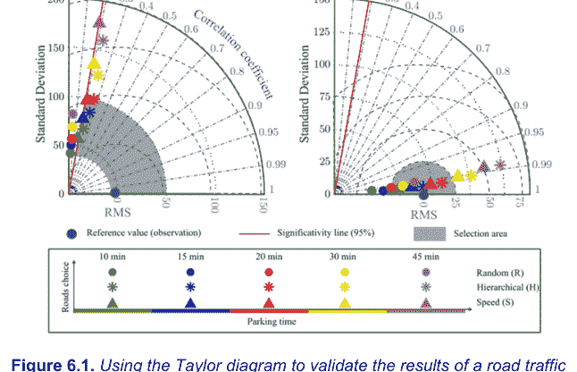

图 6.1. 使用 Taylor 图来验证法国第戎道路交通仿真模型的结果（Emery 2016，p. 256）。彩色版本请参见 www.iste.co.uk/pumain/geographical.zip

即使与可视化相关的学科习惯相似，可视化也有助于促进对话并鼓励明确性。我们可以以秩-规模曲线为例（参见第3章和图6.2）：定量地理学家等经常会遇到它们，因此习惯于这种基于双对数图的表示。他们阅读起来不会有困难，并且会迅速在曲线的斜率或其演变中看到关于聚落系统层级的有价值线索。然而，这些曲线对于不同学科的研究人员可能意义不大，甚至会被某些人逆向理解（Pumain 2012，第36页）。因此，虽然地理学家传统上在横坐标上表示秩的常用对数（以10为底），在纵坐标上表示人口，但经济学家和物理学家经常调换这两个轴。此外，至少对于图6.2所示的示例，可以注意到经济学家使用自然对数（以2为底）而不是常用对数，这又可能导致重大的误解。因此，有必要在阅读这些曲线时特别谨慎，并更清晰地解释其内容和所包含的结果。

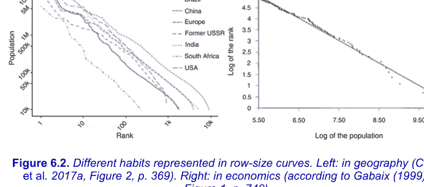

图6.2. 秩-规模曲线中体现的不同习惯。左：地理学中（Cura et al. 2017a，图2，第369页）。右：经济学中（根据Gabaix（1999），图1，第740页）

由于我们无法设想没有真正协作的模型可视化，而在跨学科框架中这只能导致主题和方法上的转移以及对每个个体的特殊性的文化适应，因此可视化因此是一个重要的跨学科工具。可视化要求对所表示的对象和表示方法进行解释，从而构成一个共同且通用的形式主义，须对表示模式进行文化适应。此外，

与基于代理的建模一样，它不需要任何显著的数学前提，而这些在社会科学领域往往是有限的（Banos 2013）。

### 6.2.2. 可视化与可重复性

在第六原则（表6.1，Banos 2013）中，回顾了模型实践和理论可重复性的重要性。对于基于代理的建模，描述模型的拟议标准“ODD”（Grimm et al. 2017）已被广泛采用，尽管其作者强调该方法的不足以及还需要传达模型的数值要素的必要性：输入数据、源代码、软件依赖项等等。

可视化世界并没有这样一个被普遍采用的标准，即使在实践中，专门用于可视化的工具现在通常是可视化设计和规范的形式化、语法逻辑的一部分：图形语法（Wilkinson 2006 [1999]）。

#### 6.2.2.1. 根植于数据

这种对图形表示类型的形式化方式与当前可视化中的主要趋势相一致，即与数据紧密相连的数据可视化或数据可视化。这种实践在很大程度上仍基于1960年代和1970年代的遗产——例如John Tukey和探索性数据分析（Tukey 1977），或Jacques Bertin（1973）的图形符号学，地理学家熟知——得益于免费软件的可用性，这些软件特别从图形语法中汲取灵感，因此能够以相对不依赖于所用软件和技术平台的方式对数据进行图形表示⁴。

这些与数据密切相关的工具使得能够快速适应数据的更新或新数据集的纳入——如果其结构相似——这在建模背景下极其宝贵

4 基于图形语法，很容易在R中使用ggplot2图形库（Wickham 2016）生成可视化，或在Python中通过Altair模块（VanderPlas et al. 2018）生成，或通过Vega（Satyanarayan et al. 2016）生成网络可视化（JavaScript）。从这些库中的每一个生成绘图的描述代码极其接近，并且在任何情况下，都可以被使用其中一种或另一种工具的用户系统地理解。

在模型者执行数百或数千次模拟（甚至数百万次——参见第5章第5.3.4节）时，可能因此需要可视化其中很大一部分。在可重复性方法中，这也意味着可视化不能单独存在，而应系统地附带其计算机代码，特别是附带其有助于理解的数据。

#### 6.2.2.2. 可视化探索的可重复性

第5章（第5.3.4节）介绍了探索模拟模型行为的专用方法，Banos（2013，第4原则）认为这是必不可少的。如果第5章中提到的平台使得这些探索能够基于有据可查且可重复的做法，例如推动其源代码的交流，那么由此产生的可视化的赌注也是相同的。使用不可重复的图形结果对模型进行交流会使使模型可访问的整个过程失效。

Sébastien Rey-Coyrehourcq等人（2017）比较了模型的可复制性（图6.3A）和其实际探索的可复制性（图6.3B），并将可重复性实验（概念上以及实践上在这项研究中）进行到底，从而提出对再现模型、其探索以及由此探索产生的结果的可视化所需的所有要素的完全可用性（Rey-Coyrehourcq et al. 2017，第429–433页）。

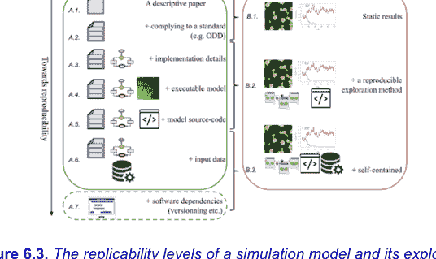

图6.3. 模拟模型及其探索的可复制性水平（Rey-Coyrehourcq et al. 2017，图3，第427页）。彩色版本请参见 www.iste.co.uk/pumain/geographical.zip

### 6.2.3. 可视化模型意味着学习

在他的全文中，Arnaud Banos强调了建模的一个主要兴趣（原则1）：建模即学习（Banos 2016）。Banos通过将建模建立在迭代和溯因方法之上来解释这种学习：“建模确实是一个根本性的迭代过程——并且如果它由溯因原则指导则更是如此——它意味着模型开发与所研究现象的逐步构建的视野之间存在强烈的互动”（Banos 2013，第77页）。我们认为迭代过程概括了建模过程的一般特征。它并不比与Livet等人（2014）关联的KISS模型等溯因方法更具特征，也不如经验归纳（或演绎）模型如KIDS模型（参见第2章）那样。迭代是任何建模方法的核心，无论它是从假设到概念，从数据到假设，还是在三者之间交替。

模型数据的可视化属于非常可比的逻辑，也通过促进这种迭代、溯因的立场本身（Banos 2005，第239–40页）。即使模型的数据不太可能演变，我们也可以设想以与建模过程相同的术语来实现可视化或可视化探索过程（Andrienko et al. 2018）。因此，模型数据的可视化本身就是一个迭代过程。它还通过允许模型随着可视化对其理解的阐明而演进来强化这种迭代。因此，可视化使得能够理解模型——这正是它最初被动员的原因——以及被建模系统本身，通过将建模-可视化过程纳入反馈循环，从而产生关于目标系统的新知识（图6.4）。

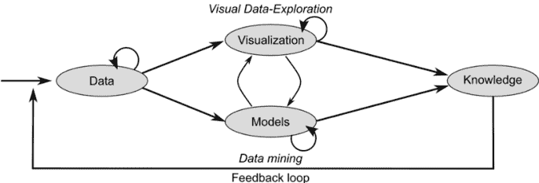

**图6.4.** *模型与可视化之间的迭代以丰富知识*  
*（摘自Keim et al. 2008，图1，第156页）*

还需要注意操作（即与模型交互）的重要性。正是通过与模型交互，例如通过拨动其参数的滑块，人们才能深入了解这些参数对模型机制的影响。在地理学之外，正是在这些与模拟近乎可触摸的交互基础上，多个研究途径得以发展，涉及计算机科学、设计和教育学的交叉领域，尤其是围绕“可探索的解释”社区（Case 2015）。对于这些方法的支持者来说，正是通过直接操作参数、输入和输出，我们才能以纯粹视觉的方式理解系统如何运作，正如布雷特·维克多（Bret Victor，2009）所总结的：“建模、观察、学习”。虽然被建模的系统可以采取多种形式（数学、物理或统计模型），但围绕谢林模型（Schelling 1971）有一个极好的教学体验。该实验将谢林模型呈现为一个交互式计算机游戏（《多边形的寓言》，Hart and Case 2014）。这使得从该模型中获得的启示比传统研究文章直观得多。

应用于模拟模型时，可视化意味着在模型中创建模型：它使我们能够丰富建模所提供的很大一部分内在品质。因此，可视化可以扩大模型的跨学科范围，提高其可重复性，并加深对模型本身以及被建模的空间现象的理解。

## 6.3. 可视化以评估

在建模过程中，可视化最频繁（或最常被记载）的用途是在模型评估的不同阶段。首先应当指出，这里的“评估”一词是在最广泛的意义上使用的，即作为一组旨在定性和定量衡量模拟模型再现被建模系统所选元素能力的过程和技术。因此，评估被记录为一个通用术语，对应于校核（verification）、认证（accreditation）（Balci 1997）、内部或外部确认（validation）（Amblard et al. 2006）或评估⁵（Augustiak et al. 2014）。

通常的做法是将评估实践分为与待评估对象相关的两大类：要么是已实现模型与其所基于的经验、理论或概念模型之间的对应关系（模型校核或内部确认⁶），要么是已实现模型与其试图再现的系统的典型事实之间的对应关系（模型确认或外部确认⁷）。然而，本章并不关注模型评估本身，因此不会遵循这一区分。我们更倾向于按时间顺序划分⁸，识别建模过程中可视化可能成为重要资产的阶段。因此，有必要描述在模拟之前、期间和之后应用可视化的潜力。

### 6.3.1. 建模前可视化

有些模型将其假设建立在基于统计数据的实证研究之上（例如表6.1中的原则3）。在这些情况下，可视化使得验证数字处理的结果成为可能，这些结果可能因缺乏对数据的足够详细的视觉观察而不准确，甚至无效。事实上，许多分析人员为了速度，往往局限于检查数据聚合或建模所产生的数值结果，并将这些结果作为制定假设的基础。然而，他们忘记了这些数值模型由于其核心的降维特性，必然会使底层数据变得贫乏，将其概括为少数几个指标，从而为错误的解释铺平了道路。应当指出，这个问题并不新鲜。正是为了回应同样的观察，统计学的一个主要领域应运而生：探索性数据分析。

> 曾几何时，统计学家只进行探索。然后他们学会了精确地确认——在非常特定的条件下精确地确认少数几件事。随着他们强调精确确认，他们的技术不可避免地变得不那么灵活。最常用的技术与过去见解之间的联系被削弱了。任何没有明确附属于确认程序的东西都被贬为“纯粹的描述性统计”，无论我们从中获得了多少知识。[...] 如今，探索和确认可以——而且应该——齐头并进（Tukey 1977，前言，第vii页）。

在这本书中，约翰·怀尔德·图基（John Wilder Tukey）特别介绍了使用箱线图表示分布形状的方法，箱线图能够识别离群值，并将其与分布的整体形状（四分位数和十分位数）分离开来。同样，安斯库姆（Anscombe，1973）的研究表明，与中心值和离散值相关的指标以及相关系数可能会产生误导，使非常不同的点模式看起来相似（图6.5）。

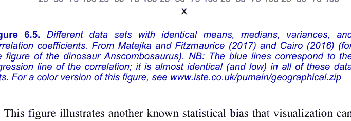

图6.5 具有相同均值、中位数、方差和相关系数的不同数据集。来自马特伊卡和菲茨莫里斯（2017）以及凯罗（2016）（关于恐龙Anscombosaurus的图）。注意：蓝色线对应于相关性的回归线；在所有这些数据集中，它几乎相同（且较低）。有关此图的彩色版本，请参见www.iste.co.uk/pumain/geographical.zip

此图说明了可视化可以帮助识别的另一个已知统计偏差：slant_up数据集显示总体负相关（回归线具有负斜率），而该数据集在视觉上似乎由五个子集组成，每个子集独立地具有正斜率。这就是辛普森悖论（Simpson，1951），它可能在智能体建模中产生极其有害的影响：如果总体趋势与个体趋势相反，在没有验证这些统计偏差的情况下，建模者可能会设计出与经验知识和观察相悖的机制。

这几个例子说明了当不同的统计偏差和效应（也可以引用斯坦·奥彭肖（Stan Openshaw）的MAUP（1983a））可能导致建模者在智能体的个体或聚合行为方面错误地构想其模型时，可视化的重要性。对所有输出数据的可视化可以改进对建模现象的验证，从而丰富建模之前的步骤。

### 6.3.2. 模拟过程中的可视化

在模型评估过程中，涉及可视化的阶段中，最著名的可能是表面有效性（face validation）步骤。该步骤是确保已实现模型具有一定合理性（至少在外观上）的首选实践之一（图6.6）。表面有效性是一种视觉验证，基于对预期行为的直觉，检验模型的合理性，即模拟的进展和结果与被建模系统的专家知识之间的潜在一致性。

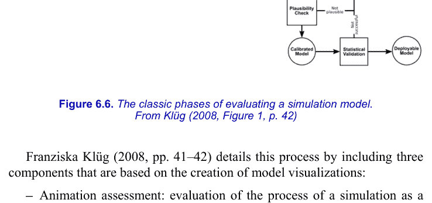

图6.6 评估模拟模型的经典阶段。
来自克吕格（2008，图1，第42页）

弗朗齐斯卡·克吕格（Franziska Klüg，2008，第41–42页）详细描述了这一过程，包括三个基于模型可视化创建的组成部分：

- 动画评估：对整个模拟过程的评估。这涉及通过实时观察模拟，判断模拟中再现的动态（在系统整体或其组成部分的尺度上）的合理性。

- 输出评估：对模拟产生的输出进行定性评估，要么通过数值验证（这种方法见于更正式的评估方法，通过自动化这些类型的评估）

6 根据专用表述：“模型校核关注的是正确地构建模型”（Balci 1994，第165页）。

7 “模型确认关注的是构建正确的模型”（Balci 1994）。

8 至少就模型进展而言，纯粹的年代顺序被建模的迭代性质所削弱。

由专家进行，或通过分析不同输出指标之间的共变和时间变化来进行。对输出的评估不仅可以应用于整个建模系统，还可以应用于所涉及的每一类代理。

- **沉浸式评估：** 其目的是通过与该模型交互的代理个体行为和反应的可能性来评估模型。因此，重点在于代理行为的合理性（微观层面），而非由此产生的宏观动态。

各种基于代理的建模软件都强调了两种直接从模拟中执行的方法，即过程评估和沉浸式评估（见6.1节）。因此，所提出的可视化工具被设计得尽可能直观，并从模型实现之初（例如在原型设计阶段）就提供模型的可视化。这些可视化几乎系统地包括一张或多张（图6.8）建模世界的地图，其中代理被表示出来，因此它们的移动和属性变化可以被可视化，例如通过将它们表示为比例符号（定量属性）或为代理分配不同的符号（定性属性）（图6.7）。这些地图通常辅以统计图，例如模拟过程中某个指标的演变（图6.7和图6.8中图像左侧部分的不同图）。

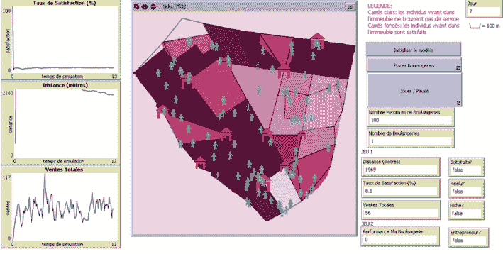

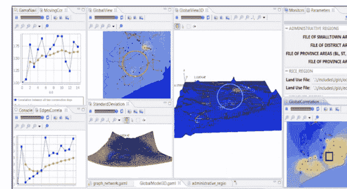

图6.8. BSNM（褐飞虱监测网络模型）（Truong等，2012），使用GAMA软件开发（Taillandier等，2018）。有关此图的彩色版本，请参见 www.iste.co.uk/pumain/geographical.zip

实时可视化（根据Grignard和Drogoul（2017a）的说法，即在线可视化）必然受到呈现给建模者的视觉空间的限制。由于我们希望细化对模型行为的观察，我们倾向于添加新的可视化，从而增加模拟期间需要监控的指标数量。因此，进行事后观察可能是有用的，即在模拟完成后，通过可视化不同的指标及其演变。模拟平台采用不同的策略来满足这一反复出现的需求。有些平台（如GAMA）建议增加专门用于可视化的选项卡，用户可以在这些选项卡之间切换，以进行更高级的表面验证（图6.8）。这确保了模型的整体显示不会过载，并保持其汇总作用。其他平台（NetLogo等）提供了一种非常实用的机制，即能够重放模拟，也就是说，在模型执行完成后，允许建模者在时间步长中来回移动。这样，建模者可以专注于少数几个指标，甚至在平台允许时以交互方式添加新指标。

无论如何，由于建模是一项高度迭代的任务，强烈建议建模者在模型输出中保存每个模拟时间步长上不同代理的状态。这不仅使得后续可以进行更深入的分析（例如，使用通用基于代理的建模软件中未实现的空间分析方法），而且即使在此期间已经实现了模型的新版本，也允许随后重新检查过去的模拟。

### 6.3.3. 模拟后的可视化

回顾性可视化在模型评估中非常重要：如果在模拟执行过程中保存了所有元素（例如代理和属性），它允许我们随时回到模拟结果，无论是为了明确分析，还是为了将结果与其他模拟的结果进行比较。

#### 6.3.3.1. 模拟结果分析

基于代理的建模平台越来越多地提供统计和地统计分析方法、（地理）可视化能力以及集成的数据挖掘工具。因此，对于内部验证或表面验证任务，大量分析已经可以在不离开建模平台技术环境的情况下进行。然而，这并不是这些平台的主要目的，对于更高级的分析，专用的分析工具和环境要合适得多。当模拟数据具有很强的空间成分时，在GIS等专用软件中分析它们将更加高效。然而，GIS也有其缺点。一方面，它们可能是集成和处理空间数据最简单、最强大的工具，特别是因为它们基于直观且用户友好的点击式图形界面。另一方面，交互式操作阻碍了分析步骤的自动化（和可重复性）。因此，每次新的模拟，都需要以相同的方式手动、交互地重现应用于模拟数据的处理链，以获得可比的结果。在模型的构建阶段，每天可能要分析许多模拟，这类工具的局限性很快就会显现出来。

为此，以较低的交互性为代价，建模者和/或评估者将受益于使用基于命令行界面（即源代码行）的数据分析工具，无论是否地理相关。随着现在广泛使用的自动报告创建工具（笔记本），可以一劳永逸地创建一系列高级分析，生成表格和（制图）图形输出，甚至可以为所有这些元素添加交互性。专门用于数据分析的语言（R、Python、Julia等）都简化了这些交互式自动报告的创建（R Markdown、Jupyter Notebooks、Weave.jl），只需单击一下即可针对新模拟的结果重新生成。

#### 6.3.3.2. 多次重复模拟的结果分析

这些可重复和自动化的报告实践还使得考虑模型的随机性成为可能，即模型所包含的随机性程度。在基于代理的建模中，代理执行一组行为，通常按预定义顺序进行。然而，代理被调用的顺序，即每个代理执行自身行为的优先级，通常是随机性的函数，这种随机性允许根据生成的结果来检验模型的稳定性。

例如，在谢林模型（Schelling 1971）中，不满意的代理在每个时间步长都会移动到一个空位置。根据代理被调用的顺序，模型的结果（例如，就达到均衡的速度而言）可能会发生相当大的变化：如果最不满意的代理首先迁移，那么所有代理更快达到可接受的满意水平的可能性就更大。相反，如果在每个时间步长移动略微不满意的代理，则存在钟摆现象的风险，即一些代理陷入无限迁移循环。通过在代理调用顺序中引入随机性，即在每个时间步长修改顺序而不考虑任何确定性（这里是它们的满意度），我们获得了一种可能平均的行为，既不是最优化的，也不是过度不稳定的。然而，一旦引入了随机性，就不能依赖单次模拟的结果来判断模型的整体行为：另一次随机模拟可能会产生不同的结果。因此，必须通过进行重复模拟（即随机种子变化的多次不同模拟）来考虑模拟模型的随机性。

回顾性可视化使我们能够考虑这种随机性，从而突出模型的主要中心趋势。虽然存在离散度和/或变异性的数值指标，但像通常的统计摘要（图6.5）一样，它们并不能反映模拟模型结果的多样性。相反，对每次重复模拟输出的可视化分析，使我们能够在视觉上把握输出的多样性以及它们之间的共同点（图6.9）。

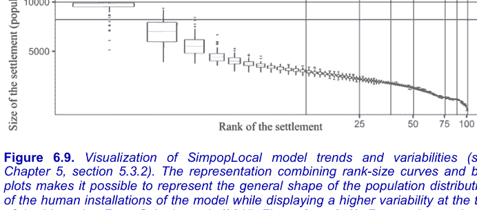

图 6.9. SimpopLocal 模型趋势与变异性的可视化（参见第 5 章，第 5.3.2 节）。结合秩-规模曲线和箱线图的表示方式，使得能够呈现模型中人类聚落的人口分布的总体形状，同时显示层级顶部存在更高的变异性。引自 Schmitt 等人（2015，第 3 图，第 312 页）。彩色版本请见 www.iste.co.uk/pumain/geographical.zip

#### 6.3.3.3. 迈向视觉评估

然而，许多作者对面部验证分析的定性基础提出了质疑。例如对 Charles Hermann 而言：

> 尽管面部效度在模型构建的早期阶段或在实际运行期间进行快速检查时具有价值，但其严重的局限性应被认识到。[...] 如果模拟器预先明确说明哪些观察结果将构成成功捕捉可观测宇宙某一方面的指标，则将面部效度作为粗略的、第一近似的接受度可能会得到改善。总之，通常形式的面部效度因缺乏明确的效度标准而受损（Hermann 1967，第 222 页）。

然而，他提出的改进建议可能导致基于可视化的真正评估程序。通过预先设定模拟结果的准则和期望网格（见第 4 章第 4.2.3 节讨论的 POM 方法），并确保评估者各自是待评估模型部分的专家⁹，可以在视觉分析中获得一定的严谨性。最传统的

9 模型的整体行为分析，在宏观尺度上，可以基于与所涉及每个智能体的微观行为不同的专业知识。

定量评估方法量化模型行为与预期目标之间的差异（例如适应度函数的优化）。视觉比较，通过定性估计模型结果与专家主题知识之间的差异，也可以在关于模型运行所获得的知识以及关于模型系统本身的知识方面提供一种完全严谨且富有启发性的方法。

所提出的方法因此与任何非正式的评估程序类似，均基于经验知识与模拟理论结果之间的比较。就比较而言，可视化可以表现出色：

> “定量推理的核心只有一个问题：与什么相比？小型多重设计、多变量且数据丰富，通过视觉强制执行变化的比较、对象之间的差异、替代方案的范围，直接作出了回答” （Tufte 1998 [1990]，第 67 页）。

## 6.4. 可视化以进行比较

如果使用的方法合适，可视化是比较统计结果的良好工具。作为建模活动的一部分，必须识别可比较的元素，并使用适当的视觉模式进行比较。

### 6.4.1. 应比较哪些模型？

图 6.10. 迭代与增量性之间差异的图形表示，引自 Patton（2017）。彩色版本请见 www.iste.co.uk/pumain/geographical.zip

建模本质上是迭代与增量性之间的混合过程（图 6.10）。因此，模型的构建只能通过依次添加构成它的不同部分（智能体类型、机制等）来实现（增量性，图 6.10，右），但同时它也是对已实现内容的精炼和改进过程的一部分（迭代，图 6.10，左）。这两种方法可以相互对立，并且各自对视觉比较构成障碍，例如在尝试比较同一模型的不同的连续或替代版本时。

#### 6.4.1.1. 比较模型的不同的版本

在开发模型时，为了对每次添加进行内部验证，首先遇到的困难是比较连续版本（迭代）。正如机制随时间被精炼一样，指标和分析过滤器也趋向于被具体化和澄清。例如，在一个由 Gibrat 过程概括的简单演化模型中（Cura et al. 2017a），在模型早期版本中，只需验证人口结构是否趋向于良好排序。为此，我们可以简单地测量秩-规模曲线斜率随模型展开的演变：如果起始斜率与模拟结束时的斜率之间的差异为正，我们就可以说系统是有序的。然而，随着版本的开发以接近经验观察，则可以比较模拟结束时获得的模拟斜率与数据中观察到的斜率之间的差异。

如果我们仅记录斜率演变的相对值，而现在观察模拟结束时的精确值，我们将得到两种在视觉上或数值上都不可比较的指标。因此，在开发模型时，从一开始就非常重要的是考虑到我们希望比较的指标的复杂性。这与前面描述的视觉评估建议的逻辑一致：最好在模型构建开始时就提前明确定义模型的评估标准并在模型中实现其记录。

#### 6.4.1.2. 比较不同的模型

建模的增量性导致了另一个问题：几个模型的版本的结果不能在 ceteris paribus 的条件下进行比较，因为它们不会全部整合相同的机制和/或智能体类型，无论实现和设计变体如何。这也是在模型族的开发或多模型实践中遇到的问题。第 4 章的作者将比较所产生的不同模型的困难识别为一个重要限制（第 4.5.4 节）。在这些情况下，很难进行严格的定量比较，因为可用的信息本质上是不同的。我们认为，更加定性的视觉比较，至少可以提供对特定机制或子模型的效力的见解，如果只是关注全局结构的视觉化。这可以然后充当最低公分母的作用。

### 6.4.2. 如何进行视觉比较？

这些障碍促使我们从图形和概念上明确视觉比较的手段。我们假设模型数据的视觉分析与常规数据的视觉分析在根本上没有不同，因此视觉信息寻求的格言同样适用：

> 先总览，再缩放和过滤，然后按需显示细节（Shneiderman 1996，第 2 页）。

通过将这一格言转用到地理建模数据的可视化，我们可以因此鼓励自上而下的数据探索，即首先将首次视觉分析用于模型产生的全局、空间和社会结构，然后在必要时再分析模型更具体的部分。

#### 6.4.2.1. 比较总览

许多方法允许对数据进行视觉比较，无论是统计数据还是空间数据（图 6.11）。

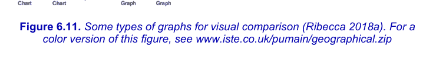

图 6.11. 用于视觉比较的某些类型的图表（Ribecca 2018a）。彩色版本请见 www.iste.co.uk/pumain/geographical.zip

然而，可视化模拟数据的一个困难是模型的随机性。就可视化而言，这意味着两个模型版本的比较不能基于两个数据集的比较，而应基于两个数据集集合的比较。在大多数手册中，对比较目的的表示与数据聚合的表示之间做出了强区分，而模拟数据的可视化则涉及将两者联系起来。例如，因此将需要比较定量属性在模拟持续时间内的演变，并在经典的时间序列表示中添加不确定性或方差的表示——参见例如 Wilke（2019，第 13 章和第 16 章）——例如通过箱线图表示（图 6.9）。

同样，对于地理数据，不确定性的视觉词汇也可以用于在地图上表示，例如在比例符号中，表示空间对象根据复制而可能达到的最小值和最大值，或用指示这种变异性的迷你图替换比例符号（图 6.12）。

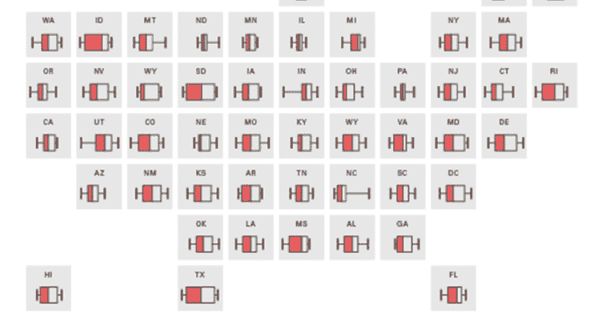

图 6.12. 使用集成图在离散化空间卡托图上显示变异性的地图示例。引自 Ribecca（2018b）

#### 6.4.2.2. 过滤器和按需细节

与模型评估方法通常先进行宏观分析再深入微观行为细节的方式相同，Shneiderman（1996）建议通过缩放、过滤和与可视化交互，逐步细化对数据集的视觉探索。在面部验证分析中，这是基于代理的建模平台力求尽可能直观的经典方法。静态数据分析框架并不适合这种做法，尤其当它属于使用命令行界面的工具时，而这在前面是推荐的。

然而，这一观察很可能会迅速改变，鉴于许多工具¹⁰的出现和普及，这些工具使得创建交互式图形界面变得可访问且相当简单——例如允许我们以关联的方式呈现数据的不同可视化，即将对一个视图的交互（过滤、缩放等）反映到其他视图上。这些工具是当前创建交互式仪表板过程的一部分，仪表板旨在特别促进这一过滤和对复杂指标集的视觉评估过程；参见例如 Few（2006）的一般论述，以及 Kitchin 等人（2015）关于城市地理的论述。

从静态角度来看，这种视觉探索可以通过呈现代表不同粒度级别的插图来实现。图 6.13 说明了这种方法：它提供了有关可通过 MARIUS 模型（Cottineau 2014）获得的前苏联城市系统演变模式多样性的信息。为此，左侧的图表总结了可能结果的可变性，使用了两个指标（人口增长和系统排名）。模拟相对位置的强烈抽象在第二个图表中得到了解释和详细说明，该图表显示了所研究系统人口轨迹的九个示例；这些示例位于第一个图表的不同象限和末端。这样，通过举例说明最不同的最终配置，我们通过视觉比较的方式理解了该模型可能产生的配置的全部多样性。

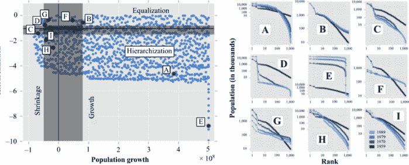

**图 6.13。** *使用 Chérel 等人（2015）的 PSE（模式空间探索）方法，可视化并表征 MARIUS 模型（Cottineau 2014）所表达的不同行为（模式）。彩色版本请参见 www.iste.co.uk/pumain/geographical.zip*

无论是为了探索模型的连续版本、随机复制集，还是一个模型族潜在行为的大规模探索，视觉比较方法都能够提供关于模型本身的知识，并迫使人们对所建模的内容进行反思。可视化工具多种多样且分散，但总体上趋向于简化，围绕着日益共享的图形概念和技术，大多是免费的，正在朝着表示和交互可能性的一致化发展。前面的例子（图 6.13）说明了视觉比较的重要性，特别是它能够为建模者——或科学受众——提供对模型不同观察层面的洞察。

这一点使我们能够回到可视化的一个基本属性：我们不一定为自己可视化，并且根据目标受众（模型设计者、主题专家、科学家、利益相关者或公众）不同，我们可视化的对象不同，表示方式也不同。例如在制图领域，这已通过著名的制图实践立方体（图 6.14）得到说明。在该图中，三个显示的维度（任务、交互水平以及用户专业水平）相互关联，并且只有一条可视化路径是可能的，从探索性可视化到呈现性可视化。因此，可视化的使用作为一种图形语言，可以帮助在模型的整个生命周期中传达模型的思想和结果，从其初始设计到其作为意识工具的动员，只要在每一步都根据新的目标受众进行调整。

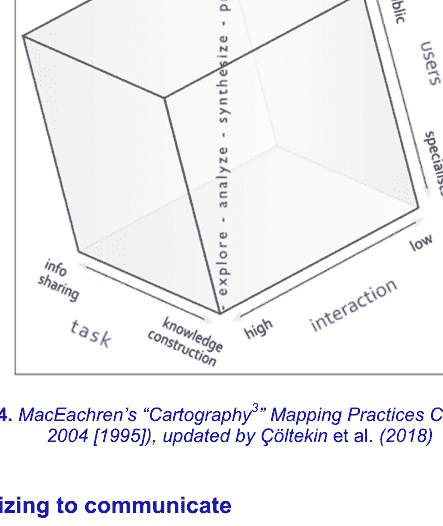

图 6.14. MacEachren 的“制图³”制图实践立方体（Livet 等人 2004 [1995]），由 Çöltekin 等人（2018）更新

## 6.5. 可视化以进行沟通

与数据可视化相关的概念通常植根于语言的词汇领域：从 Jacques Bertin（1973）的图形符号学到 Leland Wilkinson（2006 [1999]）的图形语法，经由 Nelson Goodman（1968）的“艺术语言”和 Edward Tufte（1997）的“视觉解释”，许多研究人员在可视化中发现了与语言相似的特征。无需详述，我们仍可以保留一个强有力的共同点：在使用方面，与语言一样，可视化被用来——或至少允许我们——传递信息。通过指出可视化在跨学科建模过程中的重要性，已经表明可视化能够与参与共同项目的专家受众进行沟通。然而，我们希望强调可视化作为传达模型的一种手段的其他用途：首先，作为传播工具——即在科学界或非科学界范围内围绕模型结果进行展示和对话——以及作为提高意识的工具，或者换句话说，作为教授模型所引发的社会问题的工具。

### 6.5.1. 可视化以进行传播

第 6.1 节提到的建模文章中可视化实践的研究（Angus and Hassani-Mahmouei 2015）认为，大多数可视化用于模型结果的展示。建模者因此习惯于对其结果进行图形表示，即说明其模型产生的过程。

我们希望在此为超越这些结果的简单静态可视化而倡导。我们指出，创建交互式可视化并将其安排在交互式仪表板中已变得相对容易（第 6.4.2 节）。我们认为，将这种做法系统化地应用于模型的呈现，将会结合许多优势。

首先，将与模型相关的所有数据和可视化集中在一个地方，将使建模者本人拥有一个独特的、交互式的、可访问的资源，以便提取要插入到围绕其模型的各种沟通渠道中的可视化（静态或交互式）：通过建立一个模型输出的可视化和探索平台，可以保证自己轻松访问这些数据及其表示。这种对自己的易访问性与不同参与成员之间的交流和沟通的便利性相结合，无论其参与的程度和性质如何，都参与模型的构建和设计：有什么工具比一个汇集所有参与者围绕快速可访问的相同可视化的共同平台更适合内部讨论模型的结果和需要改进之处呢？

其次，这些对建模者的内部收益可以转化为外部沟通收益：通过展示一个与数据挖掘工具、评估者、同事或公众任何成员相关联的模型，他们可以自行探索结果，从而理解模型传达的信息（与“可探索解释”相同的逻辑——参见第 6.2.3 节）。通过提供一个探索平台，公众因此能够真正把握所呈现的内容，这很可能会使他们比如果给出静态描述时更关注模型及其结果：通过直观且用户友好的工具将受众从外部观察者转变为参与式探索者，只能增加他们对所呈现内容的兴趣。

最后一点与前面讨论过的建模要求之一有关：让模型的数据（包括输入和输出）可见且可操作，能够提高其可复现性。通过仅使用任何人都可以在类似的交互式可视化平台上忠实复现的图形表示，所呈现分析的可复现性便得到了保证；此外，如果平台本身的源代码也予以公开（图6.15）。

这些实践对于建模者来说似乎非常有益且具有优势，我们相信，社区将受益于对这些实践更深入的掌握¹¹。

**VARIUS**

*可视化（帝国）俄罗斯与苏联的经验与模拟集聚*

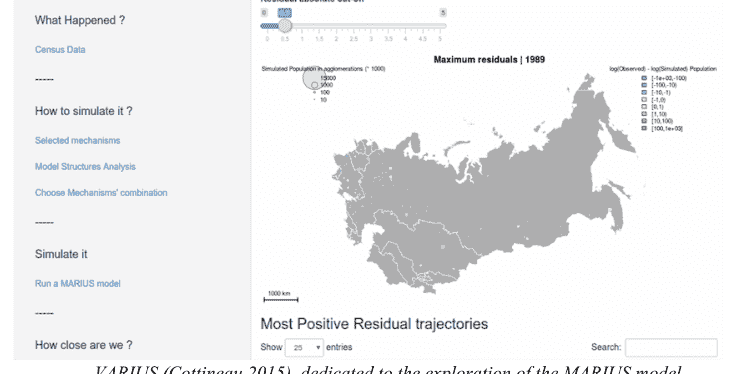

*VARIUS（Cottineau 2015），致力于探索MARIUS模型（Cottineau 2014）*

¹¹ 据我们所知，无论是从绝对数量还是从与模型相关的出版物数量来看，这类工具仍然非常罕见。图6.15中给出了一些示例。

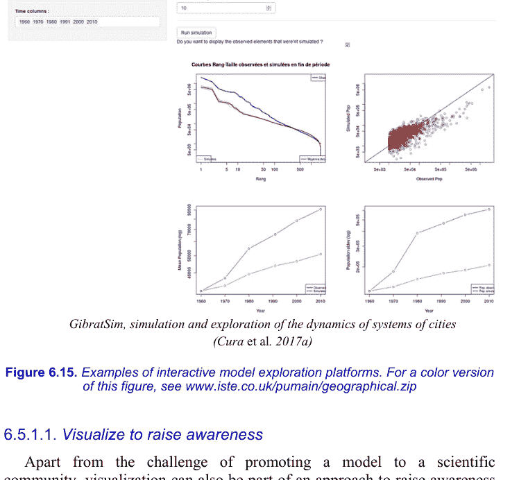

*GibratSim，城市系统动态的模拟与探索（Cura 等 2017a）*

*图6.15 交互式模型探索平台示例。如需本图的彩色版本，参见 www.iste.co.uk/pumain/geographical.zip*

#### 6.5.1.1. 可视化以提高认知

除了向科学界推广模型的挑战之外，可视化也可以是提高更广泛、更具异质性公众认知的一种方法。一系列建模本身就以这些目标为重点，特别是在行动-研究趋势中，这些方法被称为同伴建模或ComMod（2015）、参与式基于主体的模拟（Le Page and Perrotton 2018）或严肃游戏（例如 Banos 等 2018）。这些方法支持基于模型使用的认知推广方法（涉及气候、公民和发展问题等），这些模型由建模者构建，有时也与目标受众共同构建。模型可以有不同的形式（当然包括模拟模型，也包括图形模型甚至棋盘游戏），但它们始终被用作一种调解工具，一方面连接领域专家，另一方面连接正在提高认知的更广泛受众（公民、风险人群、公共或私人利益相关者等）。

这些方法虽然由来已久，但如今似乎又重新回到了科学的前沿，期刊*NetCom*最近发布的征文通知（Henriot and Molines 2019）便证明了这一点。在该通知中，我们尤其发现一个与上述评论产生共鸣的方向：

> 期待投稿：涉及严肃游戏与其载体之间的关系，以及指标表的重要性。如果纸质形式能使游戏易于携带，数字形式则通过绘图或快速构建玩家意图来确保一定的可玩性。总体而言，期待投稿讨论模型、模拟和实时指标贡献的问题，以优化那些力求可信且属于技术方法一部分的游戏中的决策；或者相反，通过引入随机性来迫使玩家走出“一切皆可控制”的乌托邦。

这似乎充分说明了有必要创建并反思专门用于模型可视化和结果探索的图形化、交互式界面，特别是它能带来的认知和参与，面向更广泛的受众，而不仅仅是关注建模的科学界。

## 6.6. 模型可视化中固有的一些障碍

在本章中，我们已经展示了可视化（无论是静态还是交互式）如何以及何时能够有助于更好地认识模型。我们选择的方法论角度更侧重于鼓励建模者实践可视化，而非就其具体实现方式提供技术性建议。为此，我们参考了大量现有资源，其中一些已在上述页面中被引用，从最概念性的著作（Bertin 1973；Keim *等* 2008；Tufte 1998 [1990]；Tukey 1977；Wilkinson 2006 [1999]）到最应用性的著作（Kornhauser *等* 2009；Ribecca 2018a；Wilke 2019）。在这些参考文献和本章中，模拟数据、变量和输入均被视为常规时空数据。然而，似乎有必要指出模拟数据相对于地理学家习惯于操作和可视化的传统数据所具有的特殊性——或至少是独特性。

### 6.6.1. *生成和可视化海量数据*

模拟数据的分析和可视化很快就可以基于大数据。这是指数据量可能太大，无法使用传统方法和工具在个人计算机上处理。模拟数据很难与来自新数据源的大数据相提并论，其规模只是分析人员所面临的困难之一¹²。

在本章中，我们已经多次强调需要保留与模拟相关的所有数据，无论是为了可复现性，还是仅仅为了确保能够回溯探索那些最初可能不认为有必要研究的行为。在这种情况下，仿真模型设计和评估期间产生的数据规模会显著增大，以至于如果不使用最新的数据库管理和高性能计算（HPC）分析方法，这些数据在很大程度上将无法使用（表6.2）。有人可能会说，个人计算机和计算机服务器的计算能力正在稳步提升，尤其是现在使用图形处理单元（GPU）而非传统处理器（CPU），因此如此大量的数据并不是真正的问题。然而，这种观点忽略了这样一个事实：模型探索方法的增长幅度同样大，甚至更大，由此产生的工具让我们能够越来越深入地了解模型，但代价是需要执行的模拟数量大幅增加（例如，参见第5章介绍的方法）。此外，广大受众可用的存储容量其增长速度远比产生大数据的能力要慢。

大规模生产因此在多个层面提出了问题。我们无法在这里假装解决了这些问题，但仍将尝试提出一些我们认为值得尝试的建议。

¹² *大数据*的特征可以用著名的3V来概括：体量（Volume）、速度（Velocity）和多样性（Variety），我们还常常加上真实性（Veracity）和可变性（Variability）。模拟模型会产生大量但变化缓慢且差异不大的数据，因为它们是在需求驱动下（模拟过程中）产生的，并按照建模者决定的模式（他们以自己希望的数据格式和结构编程记录输出）生成。

联合体¹³，或使用内存数据库格式以便在模拟结束时序列化（例如，SQLite¹⁴）。但应注意，这些方法必须在基于主体的建模软件中实现才能提高效率，因此对于这些工具的开发者而言，实现这些方法十分重要。这只能通过用户需求来推动。

#### 6.6.1.2. *数据的结构化、持久性和查询*

问题并不止于数据记录：无论数据以传统文本格式还是以更高效的文件格式生成，它们逐次模拟地进行结构化，都会使其持久和高效的使用变得困难。当我们逐一分析模拟，甚至聚合它们的重复实验时，存储介质并不重要：所查询的数据量和异质性仍在合理范围内。当我们想要记录一个模型的版本历史，或者只是比较连续版本或不同模型（例如，多建模过程中产生的多个模型）时，情况就变得更加复杂：数据量增加，模型实现和输出出现细微差异的可能性也随之增加。如果在模型演化的不同阶段进行了若干敏感性分析或校准分析，那么数据的规模及其异质性甚至可能成为同时分析的主要障碍。

为了防止此类瓶颈，我们认为，从建模项目一开始就思考数据如何随时间结构化是很重要的。这在地理数据领域如今已很常见，抽象数据模型的实现是其中一种已教授并鼓励的做法，但在建模领域仍然很少见，在该领域，模型的计算机实现带来的需求多于对其产出的存储。

表6.2给出了可能达到的数据量：要应对这些数据，传统的数据重新组织和后续重构方法似乎并不可取或不可行。使用数据组织的方法论核心，例如关系数据库，仍然是可复现性和外部可访问性的保证，因而也是存储和归档数据持久性的保证。然而，传统上，所调动的

tools – personal and centralized databases, such as Access, SQLite, or traditional relational database management systems (DBMS) such as MySQL and PostgreSQL – do not easily meet the constraints imposed by the need for efficient querying and massive storage that simulation data impose¹⁵.

Modelers are therefore increasingly forced to turn to high-performance DBMS, for example NoSQL mobility or online analytical processing environments (OLAP, column-oriented DBMS, etc.).

#### 6.6.1.3. Data visualization

From a thematic point of view, the (geo)visualization of data is relatively unaffected by the amount of input data. The rules and modes of representation or interaction with data do not change significantly, whether the data are big or more traditional. From a technical point of view, however, this poses many problems that any cartographer will have noticed: it is trivial to create a choropleth map of the cities of a U.S. state, whatever the technical solution chosen, but much more difficult to produce such a map on the scale of all 30,000 U.S. incorporated cities: when the software succeeds, the time needed to create the map in practice is considerably longer. These are problems of graphic rendering, i.e. drawing on one canvas all the elements that must be represented. When the data increase, the number of elements that will have to be drawn and rendered (displayed) also increases, sometimes in a more than proportional way.

Overall, while visualization, including in geography, has gradually freed itself from display resolution problems by turning to vector representations (pdf, svg, etc.) rather than rasters (images in the most common sense), increasingly big data now often require us to go back using hybrid solutions such as tiling (tile grids, vector or raster) or graphics rendering solutions based on the computing power of graphics processing units (GPUs), such as OpenGL and WebGL. To be able to mobilize such technologies, the practice of visualization cannot be based on traditional tools (e.g. CAD) and will necessarily be rendered on external platforms with strong graphic computing capabilities.

15 For example, with a database composed of 100 million lines, the slightest query in a classic DBMS will take several tens of seconds (indexed PostgreSQL) or even minutes (classic, unoptimized MySQL).

### 6.6.2. Visualization of aggregated data

The replication dimension of simulation data is another major obstacle to their visual exploration by conventional methods. It has been mentioned above that there are graphical methods for reporting the variability of different replications of a simulation, for example by showing their extremes or by representing the values of dispersion measures (e.g. with box plots). However, it will appear to the modeling geographer that these solutions do not allow them to look at all of the information produced by a model, and therefore to understand the specifics of each replication.

#### 6.6.2.1. Aggregation and variability

This is the intrinsic problem in data aggregation processes: it is used to summarize all the modalities of a data distribution into a single (or a few) measure(s). To do this, the overall trend is usually to summarize into central values: mean or median. Sometimes, as in box plots, we also show some additional values, relative to the dispersion of distributions. However, all these measures characterize the average behavior of a model rather than the variability of its outputs. We can thus be more interested in the diversity of results, for example the extreme cases that a model can produce, than in a necessarily smoothed average. This is typically what automated model exploration methods, based on pattern recognition, try to emphasize (see Chapter 5). However, in terms of visualization, most productions remain limited to the representation of average trends or at best to the exemplification of unexpected behaviors (Figure 6.13).

To succeed in representing the diversity of the trajectories produced by a model, whether they are simply temporal or spatiotemporal, is thus a difficult exercise. Typologies of spatiotemporal aggregation operations exist (Bach et al. 2014), but their implementation is not easy and tends to apply to ad hoc tools more than to generic models. Figure 6.16 shows an example of such a platform, closely linked to the data of the HU.M.E. empty space colonization model (Coupé et al. 2017a), of which it sought to facilitate exploration. The ambition of the described platform (VisuAgent) was thus to focus the exploration on the diversity of aggregation methods and types of rendering more than on the construction of the usual spatiotemporal evolution indicators.

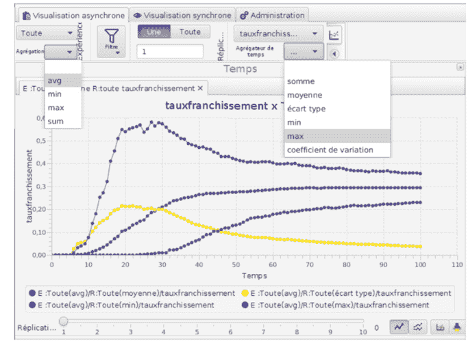

Figure 6.16. Visualization of different aggregation methods, on replicative and temporal dimensions, with VisuAgent software (Cura et al. 2014), on HU.M.E. model outputs (Coupé et al. 2017a). For a color version of this figure, see www.iste.co.uk/pumain/geographical.zip

It seems that in a discipline such as geography, which is built by articulating the study of the general and the particular, modelers would do well to consider visual ways of reflecting the full diversity of the trajectories that the models they design can take, in order to always enrich knowledge about what these models say about the systems they represent.

#### 6.6.2.2. Aggregation of geographical data

In terms of aggregation, geographical data from simulation can pose a particular problem that is, to our knowledge, very specific to it. Many models are based on a theoretical space, often isotropic, where the likelihood of the spatial configuration as a whole is studied rather than the precise location of the elements. In the Schelling model, for example, the modeled space is not intended to correspond exactly to a real space but constitutes an abstraction of it. The pattern of segregation is more important than its absolute positioning on the plane. Space does not count as such, but it is a relative benchmark against which to judge the spatial relationships,

distances, gaps, and clusterings that the model shapes. On the other hand, the map is probably the most effective way to communicate information on the spatial configuration to which this model can lead, allowing us to understand the spatial structure generated at a glance: segregated or uniform, made up of large homogeneous groups or islets of segregation, expressing radial segregation or concentric gradients, and so on.

However, even if two results are similar in terms of their spatial structure, it is difficult to represent a synthesis map: the specificities of two-dimensional statistical distributions complicate the aggregation process. An example is shown in Figure 6.17: the four spatial configurations represented are identical in terms of spatial structure indicators. The first three configurations result from axial rotations and symmetries and are, therefore, strictly transitive. The last configuration is part of the same report as long as the support space is designated as toric, as commonly adopted in the agent-based simulation in theoretical spaces.

Mathematically, these four patterns are therefore analogous, a mathematical transformation that allows passage from one to the other. In terms of representation, however, it is extremely difficult to account for an aggregation of these four situations: in practice, any of these maps could be suitable for this role, but the human eye is necessary to achieve it¹⁶.

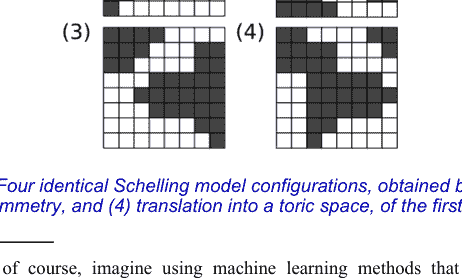

Figure 6.17. Four identical Schelling model configurations, obtained by (2) rotation, (3) axial symmetry, and (4) translation into a toric space, of the first pattern (1)

16 One could, of course, imagine using machine learning methods that would test the similarities between these spatial configurations by automatically rotating, translating, reducing, and so on. However, the complexity of the analysis would increase considerably, considering all possible mathematical operations, as in the Geographical Analysis Machine (GAM) of Openshaw et al. (1987).

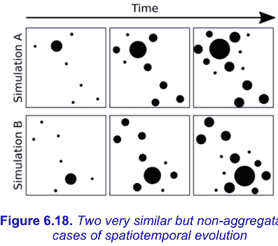

在抽象程度较低的理论空间中，情况更加困难，例如在连续空间而非离散空间中。图6.18展示了刻画城市增长的理论模型两次重复运行的演变过程。间隔、增长率、新城市出现的地点以及所有指标几乎完全相同¹⁷。同样，必须表示大量指标才能显示这两次重复运行的相似性，而地图构图在很大程度上概括了这些信息。然而，据我们所知，我们再次认为，要建立一张能够汇总这两次重复运行信息的通用地图是绝对不可能的。因此，对于建模者来说，有两种选择：要么满足于统计指标，这些指标可以汇总但不能充分反映空间状况；要么对重复运行产生的不同数据所对应的每一幅地图进行观察。

对于一维数据，例如方向统计，也会出现类似的问题（参见例如 Laloux 2015）。特别是在角度测量的情况下，传统的聚合操作无法进行：两个角度30°和330°的平均值不是180°，而是0°，这在罗盘玫瑰图上一目了然，但与通常的统计逻辑相悖。

> 17 这不是简单的数学变换，因此对应关系并不完美：模拟A中的三个东南部城市在模拟B中被转置为相对于西北部的相同配置，而所有其他城市则经历了简单的180°旋转。然而，在地理学家看来，这两个生成的空间将大体相似。

## 参考文献

Abler, R., Adams, J. S., and Gould, P. (1977). *空间组织*. Prentice-Hall, Englewood Cliffs, NJ.

Aghion, P., Howitt, P. W., Howitt, P., Brant-Collett, M., and García-Peñalosa, C. (1998). *内生增长理论*. MIT Press, Cambridge.

Alivon, F. and Guillain, R. (2018). 城市隔离与失业：法国马赛-普罗旺斯地区艾克斯城市区域案例研究. *区域科学与城市经济学*, 72(C), 143–155.

Allen, P. M. (2012). *城市与区域作为自组织系统：复杂性模型*. Routledge, Abingdon.

Allen, P. M. and Sanglier, M. (1981). 城市演化、自组织与决策制定. *环境与规划A*, 13(2), 167–183.

Amblard, F. (2003). 理解个体中心的社会模拟运作：应用于意见动态模型. 博士论文, Université Blaise Pascal-Clermont-Ferrand II.

Amblard, F. and Phan, D. (编). (2006). *多主体建模与模拟：人文与社会科学应用*. Hermès-Lavoisier, Paris.

Amblard, F., Rouchier, J., and Bommel, P. (2006). 多主体模型的评估与验证. 载于 *多主体建模与模拟：人文与社会科学应用*. Hermès-Lavoisier, Paris, 103–140.

Andrienko, N., Lammarsch, T., Andrienko, G., Fuchs, G., Keim, D., Miksch, S., and Rind, A. (2018). 将可视分析视为模型构建. *计算机图形学论坛*. 可查阅于：https://doi.org/10/gdv9s7.

Angus, S. D. and Hassani-Mahmooei, B. (2015). “无政府”盛行：JASSS 2001-2012年基于主体建模出版实践的定量分析. *人工社会与社会模拟杂志*, 18(4), 16. 可查阅于：https://doi.org/10/gfw9n7.

Banos, A. (2012). 谢林隔离模型中的网络效应：来自基于主体模拟的新证据. 环境与规划B：规划与设计, 39(2), 393–405.

Banos, A. (2013). 为地理学与人文社会科学中解放的建模与模拟实践. 巴黎第一大学，先贤祠-索邦大学，HDR. 可查阅于：https://halshs.archives-ouvertes.fr/tel-01112668/document.

Banos, A. (2016). *建模即学习：一位地理学家的旅程*. Editions Matériologiques, Paris. 可查阅于：https://www.decitre.fr/livres/modeliser-c-est-apprendre-9782373610802.html.

Banos, A. (2017). 地理学与社会科学中的知识加速器：更远更快，但也更深更广. 载于 *城市动态与模拟模型*, Pumain, D. and Reuillon, R. (编). Springer, 119–123.

Banos, A. and Sanders, L. (2013). 地理学中空间系统的建模与模拟. 载于 *建模与模拟*, Varenne, F. and Silberstein, M. (编). Editions Matériologiques, Paris, 833–863.

Banos, A., Corson, N., Daudé, E., Gaudou, B., and Rey-Coyrehourcq, S. (2017). 宏观模型、微观模型与基于网络的耦合. 载于 *基于NetLogo的主体空间模拟*, Banos, A., Lang, C., Marilleau, N. (编). 2, 63–84, ISTE Press, London, and Elsevier, Oxford.

Banos, A., Commenges, H., Debrie, J., and Maulat, J. (2018). 城市交通流动性建模的挑战……严肃地说：法兰西岛后汽车项目. 载于 Rencontres Francophones Transport Mobilité. Lyon, France. 可查阅于：https://hal-paris1.archives-ouvertes.fr/hal-01861660.

Barnsley, M. (1988). *无处不在的分形*. Academic Press, San Diego.

Baron, M., Cunningham-Sabot, E., Grasland, C., Rivière, D., and Van Hamme, G. (编) (2010). *衰退中的欧洲城市与区域：维持领土凝聚力*. Hermès-Lavoisier, Paris.

Barton, C. M. and Riel-Salvatore, J. (2012). 变革的动因：西欧亚大陆晚更新世生物文化演化建模. *复杂性系统进展*, 15(1–2), 1150003.

Batty, M. (2019). 城市分析学的定义. *环境与规划B：城市分析与城市科学*, 46, 403–405.

Baveye, P. and Boast, C. W. (1998). 分形几何、破碎过程与尺度不变性物理：导论. 载于 *土壤科学中的分形*, Baveye, P., Parlinge, J.-Y., and Stewart, B. A. (编). CRC Press and Taylor & Francis, Boca Raton, 第1–54页.

Béguin, M. and Pumain, D. (2017). *地理数据表示*, 第4版. Armand Colin, Paris.

Benenson, I., Hatna, E., and Or, E. (2009). 从谢林到城市种族与经济居住动态的空间显式建模. *社会学方法与研究*, 37(4), 463–497.

Berry, B. J. L. (1976). *城市化与逆城市化* (第11卷). SAGE Publications, Incorporated, Beverly Hills, CA.

Berry, B. L. L. and Pred, A. (1961). *中心地研究：理论与应用书目*. Regional Science Research Institute, Philadelphia.

Bertin, J. (1973). *图形符号学：图表—网络—地图*. Gauthier-Villars, Mouton & Cie, Paris.

Besse, J.-M. (2000). 解释的认识论问题. 载于 *Geopoint*. Avignon, Groupe Dupont, 11–18.

Bettencourt, L. M., Lobo, J., Helbing, D., Kühner, C., and West, G. B. (2007). 城市中的增长、创新、标度与生活节奏. *美国国家科学院院刊*, 104(17), 7301–7306.

Blau, P. M. (1977a). *不平等与异质性*. Free Press, New York.

Blau, P. M. (1977b). 社会结构的宏观社会学理论. *美国社会学杂志*, 83(1), 26–54.

Bokeh Development Team. (2014). Bokeh：用于交互式可视化的Python库.

Bonhomme, C., Commenges, H., and Deroubaix, J.-F. (编). (2017). *城市建模的激情词典*. Editions l’Oeil d’Or et Jean-Luc André d’Asciano, Paris.

Bonnafous, A. and Plassard, F. (1974). 交通供给结构效应研究中的常用方法论. *经济评论*, 25(25), 208–232.

Bouquet, F., Sheeren, D., Becu, N., Gaudou, B., Lang, C., Marilleau, N., and Monteil, C. (2015). 主体模型描述形式体系. *基于NetLogo的空间主体模拟*, 1, 37–72.

Bourgine, P., Chavalarias, D., and Cohen-Boulakia, C. (2008). *决定论与复杂性：从物理到伦理：围绕亨利·阿特朗*. La Découverte, Paris.

Bouvier, A. (2011). 个体知识与普遍科学. 载于 *人文科学是科学吗？*, Martin, T. (编). Vuibert, Paris, 35–52.

Brasebin, M. (2014). 三维地理数据用于模拟城市规划法规对建筑形态的影响. 博士论文, 科学与地理信息技术专业, Université Paris-Est.

- Bretagnolle, A. (1996). 人口集中指数研究. 《地理空间》, 25(2), 145–157.
- Bretagnolle, A. (1999). 时空中的城市系统：出行速度增加对城市规模和间距的影响. 博士论文，巴黎第一大学.
- Bretagnolle, A. and Franc, A. (2018). 走向整合的城市系统. 载于《居住地球：从史前到都市时代》，Sanders, L. (编). 弗朗索瓦-拉伯雷大学出版社，图尔，法国.
- Bretagnolle, A. and Pumain, D. (2010). 通过多尺度时空动态模拟城市网络（欧洲和美国，17至20世纪）. 《城市研究》, 47(13), 2819–2839.
- Brunsdon, C., Fotheringham, A. S., and Charlton, M. E. (1996). 地理加权回归：探索空间非平稳性的一种方法. 《地理分析》, 28(4), 281–298.
- Bulle, N. (2005). 形式模型与社会科学中的解释. 《社会学年鉴》, 55(1), 19.
- Bura, S., Guérin-Pace, F., Mathian, H., Pumain, D., and Sanders, L. (1996). 多智能体系统与聚落系统的动态. 《地理分析》, 2, 161–178.
- Cairo, A. (2016, August 29). 下载datasaurus：永远不要只相信汇总统计；始终可视化你的数据. 可访问于：http://www.thefunctionalart.com/2016/08/download-datasaurus-never-trust-summary.html.
- Case, N. (2015). 可探索的解释. 可访问于：http://explorabl.es/.
- Castiglione, F., Pappalardo, F., Bernaschi, M., and Motta, S. (2007). 利用遗传算法和基于智能体的HIV感染模型优化HAART疗法. 《生物信息学》, 23(24), 3350–3355.
- Catellin, S. (2004). 溯因：科学和文学发现的一种实践. 《赫尔墨斯杂志》, 2(39), 179-185.
- Cavalli-Sforza, L. (1984). 欧洲的新石器时代转型与人口遗传学. 普林斯顿大学出版社，普林斯顿.
- Champion, T. and Hugo, G. (编). (2004). 城市化新形式：超越城乡二分法. 阿什盖特出版社，奥尔德肖特，伦敦.
- Chang, W., Cheng, J., Allaire, J. J., Xie, Y., and McPherson, J. (2017). Shiny：R的Web应用程序框架. 可访问于：https://CRAN.R-project.org/package=shiny.
- Chapron, P., Cottineau, C., Reuillon, R., Rey-Coyrehourcq, S., and Schmitt, C. (2014). 面向城市系统研究的跨学科多模型构建，Rochebrune. 可访问于：https://www.gemass.fr/dphan/rochebrune14/propositions/rochebrune14-4.pdf.
- Chaudhuri, G. and Clarke, K. (2013). SLEUTH土地利用变化模型：综述. *环境建模与软件*, 1(1), 88–105.
- Chen, Y. (2009). 一种指示潜在分形结构的城市人口密度新模型. *国际城市可持续发展杂志*, 1, 89–110.
- Chérel, G., Cottineau, C., and Reuillon, R. (2015). 超越确证：通过寻找意外模式来加强模型验证. *公共科学图书馆·综合*, 10(9), e0138212. 可访问于：https://doi.org/10/gddwr3.
- Chorley, R. J. (1962). 地貌学与一般系统论. 美国内政部地质调查专业论文，500 B.
- Chorley, R. J. and Haggett, P. (1967). *地理学中的模型*. 梅休因出版社，伦敦.
- Christaller, W. (1933). *德国南部中心地*. 菲舍尔出版社，耶拿. (由Baskin, C. C. (1966)翻译，南德中心地，新泽西：普伦蒂斯-霍尔出版社.)
- Clark, W. and Fossett, M. (2007). 理解谢林隔离模型的社会背景. *美国国家科学院院刊*, 105(11), 4109–4114.
- Clarke, M. and Wilson, A. G. (1983). 城市空间结构的动态：进展与问题. *区域科学杂志*, 23(1), 1–18.
- Cliff, A. D. and Ord, J. (1973). *空间自相关*. 皮昂出版社，伦敦.
- Cliff, A. D., Haggett, P., and Smallman-Raynor, M. (2004). *流行病世界地图集*. 阿诺德出版社，伦敦.
- Colomb, M. (2019). 从建筑尺度到整个城市区域尺度的现实住宅开发形态模拟. 博士论文，巴黎东大学.
- Colomb, M., Brasebin, M., Perret, J., and Tannier, C. (2017). 整合两个现有模型模拟现实住宅开发. *欧洲理论与定量地理学研讨会*, 约克，9月7–11日.
- Çöltekin, A., Janetzko, H., and Fabrikant, S. (2018). 地理可视化. *地理信息科学与技术知识体系*, Q2. 可访问于：https://doi.org/10.22224/gistbok/2018.2.6.
- ComMod. (2015). *参与式建模：共享表征，模拟动态*, Étienne, M. (编). INRA 4 研究员学校. 布艾：FormaSciences, FPN, INRA. 可访问于：https://www.cabdirect.org/cabdirect/abstract/20163154613.
- Cottineau, C. (2014). 后苏联空间城市的演变：观察与建模. 博士论文，巴黎第一大学先贤祠-索邦，巴黎.
- Cottineau, C. (2015). *可视化（帝国）俄罗斯和苏联的经验与模拟城市群*. 可访问于：https://github.com/ClementineCttn/VARIUS.
- Cottineau, C. (2017). Metazip：城市规模分布的动态元分析. *公共科学图书馆·综合*, 12(8), 1–22.
- Cottineau, C. (2018). 城市不平等的尺度. 研究与文献 017. 可访问于：https://www.cmh.ens.fr/Les-echelles-de-l-inegalite-1601.
- Cottineau, C., Chapron, P., and Reuillon, R. (2015a). 自下而上地生长模型：一种基于评估的增量建模方法应用于城市系统模拟. 人工社会与社会模拟杂志, 18(4), 1–9.
- Cottineau, C., Reuillon, R., Chapron, P., Rey-Coyrehourcq, S., and Pumain, D. (2015b). 用于城市化模拟中假设检验的模块化建模框架. 系统, 3(4), 348–377.
- Coupé, C., Hombert, J.-M., Le Néchet, F., Mathian, H., and Sanders, L. (2017a). 过渡1：模拟智人迁徙和新领土的殖民. 载于《居住地球：从史前到都市时代》，Sanders, L. (编). 弗朗索瓦-拉伯雷大学出版社，图尔，113–142. 可访问于：https://doi.org/10.4000/books.pufr.10467.
- Coupé, C., Hombert, J.-M., Le Néchet, F., Mathian, H., and Sanders, L. (2017b). 过渡2：模拟班图人在已有狩猎采集者居住地区的扩张. 载于《居住地球：从史前到都市时代》，Sanders, L. (编). 弗朗索瓦-拉伯雷大学出版社，图尔，143–172.
- Courgeau, D. (1970). 法国的迁移场. 《人口》, 25(6), 1179–1182.
- Crooks, A., Malleson, N., Manley, E., and Heppenstall, A. (2019). 基于智能体的建模与地理信息系统：实用入门. SAGE出版公司，千橡市，加利福尼亚州. 可访问于：https://uk.sagepub.com/en-gb/eur/agent-based-modelling-and-geographical-information-systems/book250134.
- Csilléry, K., Blum, M. G., Gaggiotti, O. E., and François, O. (2010). 近似贝叶斯计算（ABC）实践. 《生态学与进化趋势》, 25(7), 410–418.
- Cura, R., Boukhechba, M., Mathian, H., Le Néchet, F., and Sanders, L. (2014). VisuAgent——一种用于探索模拟产生的时空数据的可视化环境. 载于演示环节，格勒诺布尔. 可访问于：http://rcura.github.io/VisuAgent/.
- Cura, R., Cottineau, C., Swerts, E., Ignazzi, A. C., Bretagnolle, A., Vacchiani-Marcuzzo, C., and Pumain, D. (2017a). 旧与新：用经典模型和新数据界定世界城市系统. 《地理分析》, 49(4), 363–386. 可访问于：https://doi.org/10/gb45hw.
- Cura, R., Tannier, C., Leturcq, S., Zadora-Rio, E., Lorans, E., and Rodier, X. (2017b). 过渡8：800-1100年. 西北欧农村聚落的固定、极化与层级化. 载于《居住地球：从史前到都市时代》，Sanders, L. (编). 弗朗索瓦-拉伯雷大学出版社，图尔，301–332. 可访问于：https://doi.org/10.4000/books.pufr.10620.
- Cuyala, S. (2014). 一个科学运动的时空分析：以欧洲法语区理论和定量地理学为例. 博士论文，巴黎第一大学，巴黎.

达西·汤普森，W.（1917，再版1971）。*论生长与形态*。节选版，剑桥大学出版社，剑桥。

多德，E.（2004）。多智能体模拟在扩散过程研究中的贡献。*网络地理学，欧洲地理杂志*，255。doi: 10.4000/cybergeo.3835.

多菲内，A.（2003）。*地理学家中的复杂性理论*。经济出版社，巴黎。

戴维斯，T. P.，弗莱，H. M.，威尔逊，A. G.，与毕晓普，S. R.（2013）。伦敦骚乱及其治安管理的数学模型。*科学报告*，3，1303。

迪恩，J. S.，古默曼，G. J.，爱泼斯坦，J. M.，阿克斯泰尔，R.，斯韦德隆德，A. C.，帕克，M. T.，与麦卡罗尔，S.（2000）。通过基于主体的建模理解阿纳萨齐文化变迁。收录于《人类与灵长类社会动力学：社会与空间过程的基于主体建模》。科勒，T. A.和古默曼，G. G.编。牛津大学出版社，牛津，179–205。

德富安，G.，安布拉尔，F.，杜博兹，R.，与拉马特，E.（2003）。一种面向个体中心模拟的实验方法。收录于《第十届罗什布吕讷会议论文集，关于自然与人工复杂系统的跨学科会议，模拟的认识论地位》，45–64。

德富安，G.，巴诺斯，A.，沙瓦拉里亚斯，D.，贝尔泰勒，C.，布罗杜，N.，詹森，P.，与瓦雷纳，F.（2015）。复杂性的愿景。拉普拉斯妖的各种状态。*自然·科学·社会*，23(1)，42–53。

德拉热，M.，勒内谢，F.，卢艾勒，T.，马蒂安，H.，与雷-科雷胡尔克，S.（2009）。城市可达性模拟与教学实验：AccesSim模型。收录于《第九届Théo Quant研讨会》，1–11。可查阅：https://halshs.archives-ouvertes.fr/halshs-00607754。

德穆勒，J.-P.，加西亚，D.，与施纳普，A.（编）（2018）。*一部文明史*。发现出版社，法国国家预防性考古研究所，巴黎。

戴蒙德，J.（1997）。*枪炮、病菌与钢铁：人类社会的命运*。诺顿公司，纽约。

德雷，W.（编）（1966）。*哲学分析与历史*。哈珀与罗出版社，纽约。

德雷，W.（2000）。历史中的解释。收录于《科学、解释与理性：卡尔·G·亨佩尔哲学面面观》，费策尔，J.编，牛津大学出版社，牛津，217–242。

杜博兹，R.，韦尔米斯，D.，特拉弗斯，M.，拉马特，E.，与申，Y.-J.（2010）。进化算法在基于个体模型反向参数估计中的应用。*生态建模*，221，840–849。

杜布吕勒，B.，格拉内，F.，与索尔内特，D.（1997）。前言：尺度不变性及其超越。收录于《尺度不变性及其超越（1997年3月10–14日莱苏什研讨会）》，杜布吕勒，B.，格拉内，F.，与索尔内特，D.编。施普林格出版社，柏林，海德堡，1–21。

迪皮伊，G.与本吉吉，L. G.（2015）。城市科学：被动、朴素、传递、进攻性的跨学科性。*大都市*，16。可查阅：http://journals.openedition.org/metropoles/5107。

迪朗-达斯特，F.（1989）。论一个知识空间。*地理空间*，XVIII(2)，86–89。

迪朗-达斯特，F.（1991）。地理学中的特殊与一般。收录于《第六届地理历史与社会科学的学科教学法研讨会论文集》，奥迪吉耶，F.与巴亚，G.编。法国国家教育研究院，巴黎，207–216。

迪朗-达斯特，F.（1992）。关于模型的问题。收录于《Geopoint 92：地理学中的模型与建模》。阿维尼翁大学Groupe Dupont，法国阿维尼翁，9–17。

迪朗-达斯特，F.（2001）。时间、地理学及其模型。*列日地理学会公报*，40(1)，5–13。

埃德蒙兹，B.与莫斯，S.（2004）。从KISS到KIDS——一种“反简化”的建模方法。国际多智能体系统与基于主体模拟研讨会，《计算机科学讲义》，施普林格，3415，130–144。

埃利奥特，E.与多德，E.（2006）。流行病传播与地理复杂性。*空间·人口·社会*，2–3。可查阅：http://journals.openedition.org/eps/1867。doi: 10.4000/eps.1867。

埃默里，J.（2016）。电极下的城市：从测量到汽车大气污染评估：面向城市环境中道路交通的多智能体模拟。博士论文，勃艮第大学，第戎。

恩格伦，G.，怀特，R.，乌利耶，I.，与德拉赞，P.（1995）。使用元胞自动机对社会-环境系统进行综合建模。*环境监测与评估*，34(2)，203–214。

爱泼斯坦，J. M.（1999）。基于主体的计算模型与生成性社会科学。*复杂性*，4(5)，41–60。

爱泼斯坦，J. M.（2006）。*生成性社会科学：基于主体的计算建模研究*。普林斯顿大学出版社，普林斯顿，新泽西州。

爱泼斯坦，J. M.（2008）。为什么建模？*人工社会与社会模拟杂志*，11(4)，12。

爱泼斯坦，J. M.与阿克斯泰尔，R.（1996）。*培育人工社会：自下而上的社会科学*。布鲁金斯学会出版社，华盛顿特区。

埃斯皮诺萨，O.（2012）。用于微观模拟模型校准的遗传算法，arXiv，预印本arXiv:1201.3456。可查阅：http://arxiv.org/ftp/arxiv/papers/1201/1201.3456.pdf。

尤班克，S.，古楚，H.，阿尼尔·库尔马，V.，马拉特，M.，斯里尼瓦桑，A.，托罗茨卡伊，Z.，与王，N.（2004）。在真实城市社交网络中模拟疾病爆发。*自然*，429，180–184。

弗兰克豪泽，P.（2004）。比较欧洲城市形态的结构。一种分形方法。收录于《欧洲城市：关于边缘与结构的洞见》，博尔斯多夫，A.与泽姆布里，P.编。欧洲科学基金会COST办公室，布鲁塞尔，79–105。

弗兰克豪泽，P.（2017）。分形性与城市事实。从空间结构分析到规划概念。全体会议。*第十三届Théo Quant研讨会*，贝桑松，5月17–19日。

弗兰克豪泽，P.，坦尼耶，C.，维德尔，G.，与乌奥，H.（2018）。面向城市与区域规划的综合多重分形建模。*计算机、环境与城市系统*，67，132–146。

弗兰科潘，P.（2017）。*丝绸之路：世界中心的历史*。Nevicate出版社，伦敦。

弗雷蒙，M.（2015）。卢森堡规划的一种规范性方法。通过模拟进行评估。地理学博士论文，弗朗什-孔泰大学。

藤田，M.，克鲁格曼，P.，与维纳布尔斯，A.（1999）。*空间经济：城市、区域与国际贸易*。麻省理工学院出版社，剑桥，马萨诸塞州。

加拜，X.（1999）。城市齐夫定律的一种解释。*经济学季刊*，114(3)，739–767。可查阅：https://doi.org/10.cz8rgj。

高尔顿，A.与沟口理一郎，R.（2009）。水流下但瀑布不流下：关于对象、过程与事件的新视角。*应用本体论*，4(2)，71–107。

乔治，P.（1972）。地理学中的定量幻觉。收录于《安德烈·迈尼耶纪念文集》，集体编。布列塔尼大学出版社，雷恩，88–103。

乔治，P.（1976）。地理学的困难与不确定性。*地理年鉴*，467，48–63。

吉布拉，R.（1931）。*经济不平等：一项新定律——比例效应定律在财富不平等、企业集中、城市人口、家庭统计等方面的应用*。西雷出版社，巴黎。

格莱兹，J. F.（2005）。风险背景下的交通网络结构脆弱性。博士论文，巴黎狄德罗大学-巴黎第七大学，巴黎。

古德柴尔德，M.（1980）。分形与地理测量的精度。*数学地质学*，12(2)，85–98。

古德柴尔德，M.（2001）。尺度的模型与建模的尺度。收录于《地理信息科学中的尺度建模》，泰特，N.和阿特金森，P. M.编。约翰·威利父子有限公司，英格兰奇切斯特，3–10。

古德柴尔德，M.（2007）。公民作为传感器：志愿地理的世界。*地理杂志*，69(4)，211–221。

古德柴尔德，M.（2016）。地理学中的定律。在国际领土科学学院会议上的报告，巴黎。

古德曼，N.（1968）。*艺术的语言：符号理论的一种进路*。哈克特出版公司，印第安纳波利斯。

戈特曼，J.（1961）。*巨型城市：美国东北沿海的城市化地带*。二十世纪基金会，纽约。

格拉斯兰，C.（2009）。社会事实的空间分析。收录于《理论与定量地理学手册》，巴沃，F.和马热尔，C.编。FGSE，洛桑，117–174。

格里尼亚尔，A.与德罗古尔，A.（2017a）。基于主体的可视化：一种同时应用于数据和模拟输出的实时可视化工具。收录于 *AAAI-17人机协作学习研讨会*。

格里尼亚尔，A.与德罗古尔，A.（2017b）。基于主体的可视化：一种同时应用于数据和模拟输出的实时可视化工具。收录于 *第三十一届AAAI人工智能会议研讨会*。

格里尼亚尔，A.，塔扬迪耶，P.，戈杜，B.，沃，D. A.，黄，N. Q.与德罗古尔，A.（2013）。GAMA 1.6：推进复杂基于主体建模与模拟的艺术。收录于 *多智能体系统原理与实践国际会议*。施普林格，柏林，海德堡，117–131。

格里姆，V.与贝格尔，U.（2016a）。鲁棒性分析：解构生态学理论与应用中的计算模型。*生态建模*，326，162–167。

格里姆，V.与贝格尔，U.（2016b）。下一代生态建模中的结构实在论、涌现与预测：来自特刊的综合。*生态建模*，326，177–187。

格里姆，V.，雷维利亚，E.，贝格尔，U.，耶尔奇，F.，莫伊，W. M.，雷尔斯巴克，S. F.，图尔克，H.-H.，魏纳，J.，维甘德，T.，与德安杰利斯，D. L.（2005）。基于主体的复杂系统的模式导向建模：来自生态学的启示。*科学*，310(5750)，987–991。

格里姆，V.，贝格尔，U.，德安杰利斯，D. L.，波尔希尔，J. G.，吉斯克，J.，与雷尔斯巴克，S. F.（2010）。ODD协议：回顾与首次更新。*生态建模*，221(23)，2760–2768。

格里姆，V.，奥古西亚克，J.，福克斯，A.，弗兰克，B. M.，加布西，F.，约翰斯顿，A. S.，刘，C.，马丁，B. T.，梅利，M.，拉德丘克，V.，托贝克，P.，与雷尔斯巴克，S. F.（2014）。迈向更好的建模与决策支持：使用TRACE记录模型开发、测试与分析。*生态建模*，280，129–139。

格里姆，V.，波尔希尔，G.，与图扎，J.（2017）。记录社会模拟模型：作为标准的ODD协议。收录于 *模拟社会复杂性：手册*，埃德蒙兹，B.和迈耶，R.编。理解复杂系统丛书，施普林格国际出版公司，尚，349–365。可查阅：https://doi.org/10.1007/978-3-319-66948-9_15。

盖尔蒙，Y.（编）（2005）。*地理学中的建模：决定论与复杂性*。埃尔梅斯-拉沃瓦西耶出版社，巴黎。

盖罗瓦，M.（2003）。从天空看欧洲城市的形态——CORINE土地覆盖图像对西欧大城市形态比较的贡献。博士论文，巴黎第一大学先贤祠-索邦大学，巴黎。

哈根-赞克，A.与金，Y.（2012）。一种用于空间交互模型的自适应分区新方法。*地理分析*，44(4)，281–301。

Hägerstrand, T. (1952). The propagation of innovation waves. *Lund Studies in Geography: Series B, Human Geography*, 4.

Hägerstrand, T. (1957). Migration and area, migration in Sweden. *Lund Studies in Human Geography*, 13, 112–155.

Hägerstrand, T. (1967 [1953]). *Innovationsförloppet ur korologisk synpunkt [Innovation diffusion as a spatial process]*. Postscript and translation by A. Pred; translated with the Assistance of G. Haag. University of Chicago Press, Chicago, IL, USA.

Haggett, P. (1965). *Locational Analysis in Human Geography*. E. Arnold, London.

Haken, H. (1977). Synergetics. *Physics Bulletin*, 28(9), 412.

Hart, V. and Case, N. (2014). Parable of the polygons: a playable post on the shape of society. Explorabl e explanations. Available at: https://ncase.me/polygons/.

Harvey, D. (1969). *Explanation in geography*. E. Arnold, London.

Harvey, D. (1973). *Social Justice and the City*. E. Arnold, London.

Harvey, D. (1982). *The Limits to Capital*. The University of Chicago Press, Chicago.

Heckbert, S. (2013). MayaSim: an agent-based model of the ancient Maya social-ecological system. *Journal of Artificial Societies and Social Simulation*, 16(4), 11.

Hedström, P. and Ylikoski, P. (2010). Causal mechanisms in the social sciences. *Annual Review in Sociology*, 36, 49–67.

Hempel, C. G. and Hook, S. (1963). *Reasons and Covering Laws in Historical Explanation*. New York University Press, New York.

Henriot, C. and Molines, N. (2019). Jeux sérieux urbains et numérique. *NetCom – Réseaux, communication et territoires*. Netcom Association, February. Available at: http://journals.openedition.org/netcom/3643.

Heppenstall, A. J., Evans, A. J., and Birkin, M. H. (2007). Genetic algorithm optimisation of an agent-based model for simulating a retail market. *Environment and Planning B: Planning and Design*, 34(6), 1051–1070.

Hermann, C. (1967). Validation problems in games and simulations with special reference to models of international politics. *Behavioral Science*, 12(3), 216–231. Available at: https://doi.org/10/bgxt27.

Hotelling, H. (1929). Stability in competition. *The Economic Journal*, 39(153), 41–57.

Hoy, G., Morrow, E., and Shalaby, A. (2016). Use of agent-based crowd simulation to investigate the performance of large-scale intermodal facilities: case study of union station in Toronto, Ontario, Canada. *Transportation Research Record: Journal of the Transportation Research Board*, 2540(1), 20–29.

Hung, L. H., Kristiyanto, D., Lee, S. B., and Yeung, K. Y. (2016). GUIDock: using docker containers with a common graphics user interface to address the reproducibility of research. *PLoS ONE*, 11(4), e0152686.

Iannone, R., Allaire, J. J., and Borges, B. (2018). Flexdashboard: R Markdown Format for Flexible Dashboards. Available at: https://CRAN.R-project.org/package=flexdashboard.

Isard, W. (1960). *Methods of Regional Analysis, an Introduction to Regional Science*. MIT and Wiley, Cambridge and New York.

Janelle, D. G. (1969). Spatial reorganization: a model and concept. *Annals of the Association of American Geographers*, 59(2), 348–364.

Jensen, P. (2018). *Pourquoi la société ne se laisse pas mettre en équations*. Le Seuil, Paris.

Joliveau, T. (2011). Le géoweb, un nouveau défi pour les bases de données géographiques. *L’Espace Géographique*, 40(2), 154–163.

Joly, F. (1976). *La cartographie*. Presses universitaires de France, Paris.

Kaldor, N. (1961). Capital accumulation and economic growth. In *The Theory of Capital*. Springer, 177–222.

Keim, D., Andrienko, G., Fekete, J.-D., Görg, C., Kohlhammer, J., and Melançon, G. (2008). Visual analytics: definition, process, and challenges. In *Information Visualization*. Springer, Lecture Notes in Computer Science, vol. 4850, 154–175.

Kitchin, R., Lauriault, T. P., and McArdle, G. (2015). Knowing and governing cities through urban indicators, city benchmarking and real-time dashboards. *Regional Studies, Regional Science*, 2(1), 6–28. Available at: https://doi.org/10/gc92g7.

Klüg, F. (2008). A validation methodology for agent-based simulations. In *Proceedings of the 2008 ACM Symposium on Applied Computing*. SAC’08, ACM, New York, NY, USA, 39–43. Available at: https://doi.org/10/dpkh42.

Kohler, T. A. and Crabtree, S. (2017). Village and polity formation in pueblo societies: how population growth channels social processes in neolithic societies. the “village” model. In *Peupler la terre: de la préhistoire à l’ère des métropoles*, Sanders, L. (ed.). Presses universitaires François Rabelais, Tours, 173–192.

Kohler, T. A. and Varien, M. D. (2012). Emergence and collapse of early villages in the Central Mesa Verde: an introduction. In *Emergence and Collapse of Early Villages: Models of Central Mesa Verde Archaeology*, Kohler, T. A. and Varien, M. D. (eds). University of California Press, Berkeley, CA, 1–14.

Kornhauser, D., Wilensky, U., and Rand, W. (2009). Design guidelines for agent based model visualization. *Journal of Artificial Societies and Social Simulation*, 12(2). Available at: http://jasss.soc.surrey.ac.uk/12/2/1.html.

Kurtzer, G. M., Sochat, V., and Bauer, M. W. (2017). Singularity: scientific containers for mobility of computation. *PLoS ONE*, 12(5), e0177459.

Lafuerza, L. F., Dyson, L., Edmonds, B., and McKane, A. J. (2015). Simplification and analysis of a model of social interaction in voting. *European Physical Journal B*, 89, 159.

Lafuerza, L. F., Dyson, L., Edmonds, B., and McKane, A. J. (2016). Staged models for interdisciplinary research. *PLoS ONE*, 11(6), e0157261.

Lake, M. W. (2014). Trends in archaeological simulation. *Journal of Archaeological Method and Theory*, 21(2), 258–287.

Laloux, M. (2015). Les statistiques directionnelles (ou pourquoi la moyenne de 350° et 10° n’est pas égale à 180°): introduction dans le domaine des SIGs (moyenne angulaire, interpolations angulaires, etc.). PortailSIG. May 4. Available at: http://www.portailsig.org/content/les-statistiques-directionnelles-ou-pourquoi-la-moyenne-de-350-et-10-n-est-pas-egale-180-int.

Lam, N. (1990). Description and measurement of landsat TM images using fractals. *Photogrammetric Engineering and Remote Sensing*, 56(2), 187–195.

Lam, N. and Quattrochi, D. (1992). On the issues of scale, resolution, and fractal analysis in the mapping sciences. *Professional Geographer*, 44(1), 88–98.

Lee, J.-S., Filatova, T., Ligmann-Zielinska, A., Hassani-Mahmooei, B., Stonedahl, F., Lorscheid, I., Voinov, A., Polhill, J. G., Sun, Z., and Parker, D. C. (2015). The complexities of agent-based modeling output analysis. *Journal of Artificial Societies and Social Simulation*, 18(4). Available at: https://doi.org/10.18564/jasss.2897.

Lenclud, G. (2011). L’explication historique dans les sciences de l’homme. In *Les sciences humaines sont-elles des sciences?*, Martin, Th. (ed.). Vuibert, Paris, 93–118.

Lenormand, M., Jabot, F., and Deffuant, G. (2013). Adaptive approximate bayesian computation for complex models. *Computational Statistics*, 28(6), 2777–2796.

Le Page, C. and Perrotton, A. (2018). KILT: a modelling approach based on participatory agent-based simulation of stylized socio-ecosystems to stimulate social learning with local stakeholders. In *Multi-Agent Based Simulation XVIII*, Pereira Dimuro, G. and Antunes, L. (eds). Lecture Notes in Computer Science. Springer International Publishing, 156–169.

Le Texier, M. and Caruso, G. (2017). Assessing geographical effects in spatial diffusion processes: the case of euro coins. *Computers, Environment and Urban Systems*, 61, 81–93.

Levins, R. (1966). The strategy of model building in population biology. *American Scientist*, 54(4), 421–431.

Liu, L. (1996). Settlement patterns, chiefdom variability, and the development of early states in North China. *Journal of Anthropological Archaeology*, 15, 237–288.

Livet, P. (1983). Interférence entre civilisations ou dialogue autoréférent, l’ambiguïté heideggerienne. *Les Études philosophiques*, 469.

Livet, P., Phan, D., Sanders, L., and MacEachren, A. M. (2004 [1995]). *How Maps Work: Representation, Visualization, and Design*. Guilford Press, New York.

Livet, P., Müller, J.-P., Phan, D., and Sanders, L. (2010). Ontology, as a mediator for agent-based modeling in social science. *Journal of Artificial Societies and Social Simulation*, 13(1), 3.

Livet, P., Phan, D., and Sanders, L. (2014). 多智能体模型在社会科学中的多样性与互补性. *Revue Française de Sociologie*, 55(4), 689–729. 可获取于: https://doi.org/10/gfw9pr.

Longley, P. A. and Batty, M. (eds.). (1996). *空间分析：地理信息系统环境中的建模*. John Wiley & Sons Ltd, Chichester.

Longley, P. A. and Batty, M. (2003). *高级空间分析：CASA地理信息系统丛书*. ESRI, Inc., Redlands.

Lowry, I. S. (1964). *大都市模型*. Pittsburgh Regional Planning Association, Rand Corporation, Santa Monica.

Macy, M. W. and Flache, A. (2009). 自下而上的社会动态：社会互动的基于智能体的模型. In *牛津分析社会学手册*, Hedström, P. and Bearman, P. (eds). Oxford University Press, Oxford, 245–268.

Madelin, M., Grasland, C., Mathian, H., Sanders, L., and Vincent, J.-M. (2009). “MAUP”：可修改的面积单元问题还是进步？ *Informationen zur Raumentwicklung*, Heft November 10, 645–660.

Mandelbrot, B. (1982). *自然的分形几何*. Freeman, San Francisco.

Maneerat, S. and Daudé, E. (2017). 通过基于智能体的模拟研究德里城市内部不连续性对登革热、黄热病、基孔肯雅热和寨卡病毒传播媒介埃及伊蚊扩散的影响. *Cybergeo: European Journal of Geography*, 819.

Manski, C. (2000). 社会互动的经济分析. *The Journal of Economic Perspectives*, 14(3), 115–136.

Manzo, G. (2005). 变量、机制与模拟：三种方法能否综合？对文献的批判性分析. *Revue Française de Sociologie*, 46(1), 37–74.

Marchionni, C. and Ylikoski, P. (2013). 生成性解释与基于智能体模拟中的个体主义. *Philosophy of the Social Sciences*, 43(3), 323–340.

Marcus, J. and Sabloff, J. A. (eds). (2008). *古代城市：旧世界和新世界城市化的新视角*. School for Advanced Research Press, Santa Fe.

Mareï, N. and Richard, Y. (2018). *世界区域化词典*. Atlande, Paris.

Marsden, P. V. and Friedkin, N. E. (1994). 社会影响的网络研究. In *社会网络分析进展：社会与行为科学研究*, Wasserman, S. and Galaskiewicz, J. (eds). Sage, Thousand Oaks, 3–25.

Martin, Th. (2011). *人文科学是科学吗？* Vuibert, Paris.

Matejka, J. and Fitzmaurice, G. (2017). 相同统计，不同图表：通过模拟退火生成外观各异但统计相同的数据集. In Proceedings of the 2017 CHI Conference on Human Factors in Computing Systems. CHI’17. ACM, New York, NY, USA, 1290–1294. 可获取于: https://doi.org/10/gdtg2w.

Mathian, H. and Sanders, L. (2014). 时空方法：地理对象与变化过程. ISTE Ltd, London, and Wiley, New York.

Mathian, H. and Tannier, C. (2015). 基于智能体模型中空间交互的形式化：比较分析尝试. Revue internationale de géomatique, 25(3), 393–414.

Maurel, M. C. (2004). 中欧领土的分化与重构. Annales de géographie, 113, 124–144.

Minsky, M. (1965). 物质、思想与模型. Proceedings of IFIP Congress 65, 1, 45–49.

Moriconi-Ebrard, F. (1993). 世界的城市化. Anthropos, Paris.

Morrill, R. L. (1962). 迁移模型的发展与电子处理机的作用. Entretiens de Monaco, Human Displacement, Monaco, May.

Morrill, R. L. (1963). 迁移距离的分布. Papers of the Regional Science Association, 11(1), 73–84.

Muller, J.-C. (1978). 地图网格化与制图误差：一个反复出现的论点. Canadian Cartographer, 14, 152–167.

Musialski, P., Wonka, P., Aliaga, D. G., Wimmer, M., van Gool, L., and Purgathofer, W. (2013). 城市重建综述. Computer Graphics Forum, 32(6), 146–177.

Nadeau, R. (2007). 历史中的理性解释：Dray、Collingwood 与 Hempel. In La philosophie de l’histoire au XXe siècle, Nadeau, C., and Lapointe, A. (eds). Hommages offerts à Maurice Lagueux, Presses de l’Université Laval, Quebec, 165–221.

Neutens, T., Schwanen, T., Witlox, F., and De Maeyer, P. (2010). 城市服务供给的公平性：不同可达性度量的比较. Environment and Planning A: Economy and Space, 42, 1613–1635.

Odersky, M. and Zenger, M. (2005). 可扩展的组件抽象. ACM SIGPLAN Notices, 40(10), 41–57.

Offner, J. M. (1993). 交通的“结构效应”：政治神话，科学误导. L’espace géographique, 22(3), 233–242.

Offner, J. M., Beaucire, F., Delaplace, M., Frémont, A., Ninot, O., Bretagnolle, A., and Pumain, D. (2014). 交通基础设施的结构效应. Espace géographique, 43(1), 51–67.

Oliveira, B. C. and Gibbons, J. (2010). 面向通用程序员的 Scala：比较 Haskell 与 Scala 对通用编程的支持. Journal of Functional Programming, 20(3–4), 303–352.

OpenMole. (s.d.). 可获取于: https://www.openmole.org/.

Phan, D. (2010). 人文社会科学多智能体建模的本体论框架为何？ Nouvelles perspectives en sciences sociales: Revue internationale de systémique complexe et d’études relationnelles, 5(2), 101–133.

Phan, D. (2014). 本体论与人文社会科学中的基于智能体的建模. In Ontologies et modélisation par SMA en SHS, Phan, D. (ed.). Hermes-Lavoisier, Paris.

Pietro, A. D., While, L., and Barone, L. (2004). 将进化算法应用于具有噪声、耗时适应度函数的难题, Proceedings of the 2004 Congress on Evolutionary Computation, 2, 1254–1261.

Pinchemel, P. (1979). 地理与制图，历史与认识论反思. Bulletin de l’Association de Géographes Français, 56(462), 239–247. 可获取于: https://doi.org/10/gfw9n6.

Piou, C., Berger, U., and Grimm, V. (2009). 在模式导向建模框架中开发的基于个体的模型信息准则建议. Ecological Modelling, 220(17), 1957–1967.

Pires, B. and Crooks, A. T. (2017). 骚乱的涌现建模：地理模拟方法. Computers, Environment and Urban Systems, 61, 66–80.

Plotly. (2017). Dash – 在 Python 中构建精美的基于 Web 的界面. 可获取于: https://dash.plot.ly/.

Poupeau, F. and François, J.-C. (2008). 居住选择之意. 居住隔离与学校隔离. Raisons d’Agir, Paris.

Pouvreau, D. (2013). 论路德维希·冯·贝塔朗菲的“一般系统论”历史. Social Sciences PhD thesis, EHESS, Paris.

Premo, L. S. (2007). 探索性基于智能体的模型：迈向实验性民族考古学. In Digital Discovery: Exploring New Frontiers in Human Heritage, Proceedings of the CAA 34th Conference, Clark, J. T. and Hagemeister, E. M. (eds), 29–36.

Prigogine, I. and Nicolis, G. (1971). 生物学秩序、结构与不稳定性. Quarterly Reviews of Biophysics, 4(2–3), 107–148.

Pumain, D. (1997). 为城市的演化理论. L’Espace géographique, 26(2), 119–134.

Pumain, D. (2003). 地理学中复杂性的一个方法. Géocarrefour, 78(1), 25–31.

Pumain, D. (2005). 知识的累积性. Revue Européenne Des Sciences Sociales. European Journal of Social Sciences, XLIII(131), 5–12. 可获取于: https://doi.org/10.4000/ress.357.

Pumain, D. (2006). 自然与社会科学中的层级. Springer, The Netherlands.

Pumain, D. (2007). 地理学中尺度律与不平等测度. Revue européenne des sciences sociales, XLV(138), 55–65.

Pumain, D. (2008). 城市系统与创新过程的社会空间动态：多层次模型. In *复杂城市系统的动态：跨学科方法*, Albeverio, S., Andrey, D., Giordano, P., and Vancheri, A. (eds). Physica Verlag, Heidelberg, 373–389.

Pumain, D. (2009). 空间，地理学螺旋式建构的媒介，在社会与环境之间. In *社会科学中知识的累积性*, Walliser, B. (ed.). EHESS, 163–197.

Pumain, D. (2010a). 评论：分形-非分形转变与地理对象. *L’Espace Géographique*, 39(2), 113–116.

Pumain, D. (2010b). 地理实体动态与复杂系统中的尺度律：遍历性问题. *Mathématiques et sciences humaines*, 191, 51–63.

Pumain, D. (2012).  Zipf 定律的地理理论. *Région et Développement*, 36(125–150), 31–54.

Pumain, D. (2019). 地理学与计算机科学：结合的理由，理性的结合？ In *Methods and Interdisciplinarity*, Waldeck, R. (ed.). ISTE Ltd, London, and Wiley, New York, 29–45.

Pumain, D. and Reuillon, R. (2014). 研究中的跨学科与创新：Geodivercity 与 OpenMOLE 之间双赢的冒险. In *Rochebrune*. 可获取于: https://www.gemass.fr/dphan/rochebrune14/propositions/rochebrune14-19.pdf.

Pumain, D. and Reuillon, R. (2017). *城市动态与模拟模型*. Lecture Notes in Morphogenesis, Springer, International. doi: 10.1007/978-3-319-46497-8_3.

Pumain, D. and Robic, M.-C. (2002). 数学在理论与定量“革命”中的作用：1970 年代以来的法国地理学. *Revue d’histoire des sciences humaines*, 6, 123–144.

Pumain, D. and Saint-Julien, T. (1978). *城市变化的维度*. CNRS, Paris.

Pumain, D. and Saint-Julien, T. (1997). *空间分析：空间定位*, vol. 1. Armand Colin, Paris.

Pumain, D. and Sanders, L. (2013). 城市间模拟模型中的理论原则：比较. *Environment and Planning A: Economy and Space*, 45(9), 2243–2260.

Pumain, D., Saint-Julien, T. and Sanders, L. (1989). *城市与自组织*. Economica, Paris.

Pumain, D., Paulus, F., Vacchiani-Marcuzzo, C., and Lobo, J. (2006). 解释城市尺度律的演化理论. *Cybergeo: European Journal of Geography*, 343, 1278–3366.

Quattrochi, D. A., Emerson, C. W., Lam, N. S.-N., and Qiu, H.-L. (2001). 多时相遥感数据的分形表征. In *Modelling Scale in Geographical Information Science*, Tate N. and Atkinson, P. M. (eds). John Wiley & Sons Ltd, Chichester, 13–34.

- Raffestin, C. (1976). 人文地理学中的问题与解释. *地理点，76*, 97–104.
- Raimbault, J. (2017a). 一个用于研究复杂系统的应用知识框架. In *复杂系统设计与管理*, 31–45.
- Raimbault, J. (2017b). 时空数据中的因果关系识别. In *2017年空间分析与地理信息学*.
- Raimbault, J. (2018a). 城市体系中网络效应的间接证据. *环境与规划B：城市分析与城市科学*. doi: 10.1177/2399808318774335.
- Raimbault, J. (2018b). 交通网络与地域之间相互作用的建模：一种共同演化的方法. In *JJC Pacte-Citeres：网络在地域建构中的转化能力*.
- Raimbault, J. (2019a). 复杂地域系统中的层级内生性. In *地理研究所青年研究者日：计数、分类、归类*. Available at: halshs.archives-ouvertes.fr.
- Raimbault, J. (2019b). 城市与网络共同演化的模型. In *城市与网络手册*, Rozenblat, C. and Neal, Z. (eds). Edward Elgar Publishing.
- Raimbault, J. (2019c). 地域系统的空间与复杂性. *罗什布吕讷研讨会*, 法国梅杰夫.
- Raimbault, J. (2019d). 揭示城市体系中的共同演化模式：对SimpopNet模型的系统探索. *arXiv预印本 arXiv:1809.00861*.
- Raimbault, J. and Perret, J. (2019). 大规模生成城市形态. In *2019年人工生命会议*, 31, 179–186.
- Raimbault, J., Cottineau, C., Le Texier, M., Le Néchet, F., and Reuillon, R. (2018). 空间至关重要：将敏感性分析扩展到地理模拟模型中的初始空间条件. *环境与规划B*. *arXiv预印本 arXiv:1812.06008*.
- Rakshit, P., Konar, A., and Das, S. (2017). 带噪声的进化优化算法——综合综述. *群体与进化计算，33*, 18–45.
- Ravenstein, E. G. (1885). 迁移法则. *伦敦统计学会杂志，48*(2), 167–235.
- Reilly, W. J. (1931). *零售引力法则*. Knickerbocker出版社，纽约.
- Reuillon, R., Chuffart, F., Leclaire, M., Faure, T., Dumoulin, N., and Hill, D. (2010). OpenMOLE中的声明式任务委托. In *2010年国际高性能计算与仿真会议*, IEEE, 法国卡昂, 55–62.
- Reuillon, R., Leclaire, M., and Rey-Coyrehourcq, S. (2013). OpenMOLE，一个专为模拟模型分布式探索定制的工作流引擎. *未来一代计算机系统，29*(8), 1981–1990.
- Reuillon, R., Schmitt, C., De Aldama, R., and Mouret, J. B. (2015). 一种评估仿真模型的新方法：校准剖面（CP）算法. *人工社会与社会模拟杂志*, 18(1), 12.
- Rey-Coyrehourcq, S. (2015). 一个用于构建和评估多主体仿真模型的集成平台. 博士论文, 巴黎第一大学–索邦大学, 巴黎.
- Rey-Coyrehourcq, S., Cura, C., Nuninger, L., Gravier, J., Nahassia, L., and Hachi, R. (2017). 迈向跨学科框架中的可再生产研究：概念框架转移与模型复制的挑战与建议. In *居住地球：从史前到大都市时代*, Sanders, L. (ed.). 弗朗索瓦·拉伯雷大学出版社, 图尔, 409–434. Available at: https://doi.org/10.4000/books.pufr.10647.
- Reymond, H. (1971). 为理论问题框架而作. In *地理学的问题框架*, Isnard, H., Racine, J. B., and Reymond, H. (eds). 法国大学出版社, 巴黎.
- Reynaud, J. (1841). 城市. In *新百科全书*, C. Gosselin (ed.). VIII, 670–687.
- Ribecca, S. (2018a). 数据可视化目录. Available at: https://datavizcatalogue.com.
- Ribecca, S. (2018b). 图表组合：瓦片网格地图. 数据可视化目录博客. 6月27日. Available at: http://datavizcatalogue.com/blog/chart-combinations-tile-grid-maps/.
- Rist, R. C. (1970). 学生社会阶层与教师期望：贫民区教育中的自我实现预言. *哈佛教育评论*, 40(3), 411–451.
- Robic, M.-C. (1982). 克里斯塔勒之前一百年：一种中心地理论. *地理空间*, 1, 5–12.
- Robic, M.-C. (1992). *从环境（milieu）到环境（environnement）*. Economica出版社, 巴黎.
- Robic, M.-C., Mendibil, D., Gosme, C., Orain, O., and Tissier, J.-L. (2006). 覆盖世界：法国地理学的伟大20世纪. ADPF-法国外交部, 巴黎.
- Rosen, K. T. and Resnick, M. (1980). 城市的规模分布：对帕累托法则与首位度的检验. *城市经济学杂志*, 8(2), 165–186.
- Rozenblat, C. (1995). 欧洲城市散布的肌理. *地图世界*, 4(95), 22–27.
- Rozenfeld, H. D., Rybski, D., Andrade, J. S., Batty, M., Stanley, H. E., and Makse, H. A. (2008). 人口增长法则. *美国国家科学院院刊*, 105(48), 18702–18707.
- Ruas, A. and Sanders, L. (2015). 对空间动态建模的交叉视角. *国际地理信息学杂志*, 25(3), 275–300.
- Saaty, T. L. (1977). 层次结构中优先级的标度方法. *数学心理学杂志*, 15, 234–281.
- Saaty, T. L. (1990). 冲突管理中的层次分析法. *国际冲突管理杂志*, 1(1), 47–68.
- Sanders, L. (1992). *城市体系与协同学*. Anthropos出版社, 巴黎.
- Sanders, L. (2000). 解释在空间分析中的地位. In *地理点*, 19–30.
- Sanders, L. (ed.). (2001). *空间分析中的模型*. Hermès-Lavoisier出版社, 巴黎.
- Sanders, L. (2012). 地理学家、经济学家和考古学家对聚落体系层级的交叉视角：从经验事实到复杂系统. *区域与发展*, 36, 127–146.
- Sanders, L. (2013). 城市体系建模的三十年：灵感来源、概念与形式化. *区域与城市经济评论*, 5, 833–856.
- Sanders, L. (2018). 社会现象的空间分析：简单模型与复杂模型. In *建模：成功与局限*, Pavé, A., Bonnaillie-Noël, V., Dollet, A., and Gelenbe, E. (eds). 法国国家科研中心-技术研究院, 会议录, 99–116.
- Sanders, L., Pumain, D., Mathian, H., Guérin-Pace, F., and Bura, S. (1997). SIMPOP：用于城市主义研究的多主体系统. *环境与规划B：城市分析与城市科学*, 24, 287–305.
- Sanders, L., Favaro, J.-M., Glisse, B., Mathian, H., and Pumain, D. (2007). 人工智能与集体主体：EUROSIM模型. *网络地理*, 392, 15.
- Satyanarayan, A., Russell, R., Hoffswell, J., and Heer, J. (2016). 反应式Vega：用于声明式交互可视化的流式数据流架构. *IEEE可视化与计算机图形学汇刊*, 22(1), 659–668. Available at: https://doi.org/10/gdqd7v.
- Satyanarayan, A., Moritz, D., Wongsuphasawat, K., and Heer, J. (2017). Vega-Lite：交互式图形语法. *IEEE可视化与计算机图形学汇刊*, 23(1), 341–350.
- Schaefer, F. K. (1953). 地理学中的例外主义：方法论考察. *美国地理学家协会年鉴*, 43(3), 226–249.
- Schelling, T. C. (1969). 隔离模型. *美国经济评论*, 59(2), 488–493.
- Schelling, T. C. (1971). 隔离的动态模型. *数理社会学杂志*, 1(2), 143–186.
- Schmitt, C. (2014). 聚落体系动态建模：从SimpopLocal到SimpopNet. 博士论文, 巴黎第一大学–索邦大学, 巴黎.
- Schmitt, C. and Pumain, D. (2013). 社会-环境相互作用与城市涌现模拟的多主体模型学. *网络地理：欧洲地理杂志*, 643.
- Schmitt, C., Rey-Coyrehourcq, S., Reuillon, R., and Pumain, D. (2015). 用于校准SimpopLocal地理模型的五亿次模拟、进化算法与分布式计算. *环境与规划B*, 42(2), 300–315. Available at: https://doi.org/10.1068/b130064p.
- Sémécurbe, F., Tannier, C., and Roux, S. G. (2019). 应用两种分形方法来表征法国本土建筑格局相对于尺度不变性的局部和全局偏差. *地理系统杂志*, 21(2), 271–293.
- Sharma, S. and Singh, H. (2006). 用于疏散模拟中人类行为仿真的多主体系统. In *NAACSOS论文集，北美计算社会与组织科学协会年会*, 印第安纳州圣母镇.
- Shneiderman, B. (1996). 眼睛决定一切：面向信息可视化的按数据类型任务分类法. In *1996年IEEE可视化语言研讨会论文集*, 336–343.
- Simpop (2014). Simpop项目. Available at: http://www.simpop.parisgeo.cnrs.fr/.
- Simpson, E. H. (1951). 列联表中交互作用的解释. *皇家统计学会杂志：B辑（方法学）*, 13(2), 238–241. Available at: https://doi.org/10/gfw6f6.
- Slager, C. T. J. and de Vries, B. (2013). 景观生成器：为空间规划生成景观配置的方法. *计算机、环境与城市系统*, 39, 1–11.
- Sloane, T. (2008). Scala中领域特定语言嵌入的经验. In *领域特定程序开发*, 7.
- Solomatine, D. P., Dibike, Y. B., and Kukuric, N. (1999). 使用全局优化技术自动校准地下水模型. *水文科学杂志*, 44(6), 879–894.
- Stewart, J. Q. (1948). 人口引力：证据与应用. *社会测量学*, 11(1/2), 31–58.
- Stonedahl, F. (2011). 基于主体模型中参数空间探索的遗传算法. 博士论文, 西北大学, 埃文斯顿, 伊利诺伊州. Available at: http://forrest.stonedahl.com/thesis/forrest_stonedahl_thesis.pdf.
- Stonedahl, F. and Wilensky, U. (2010a). 演化病毒式营销策略. In *第12届遗传与进化计算年会论文集*. ACM, 纽约, 1195–1202.
- Stonedahl, F. and Wilensky, U. (2010b). 人工阿纳萨齐模型中的演化稳健性检验. In *AAAI秋季研讨会论文集：复杂自适应系统：弹性、稳健性与可演化性*. AAAI出版社, 门洛帕克, 加利福尼亚州, 120–129.
- Stouffer, S. A. (1940). 中介机会：一种联系流动与距离的理论. *美国社会学评论*, 5, 845–867.

Sugden, R. (2000). Credible worlds: the status of theoretical models in economics. *Journal of Economic Methodology*, 7(1), 1–31.

Sugden, R. (2002). Credible worlds: the status of theoretical models in economics. In *Fact and Fiction in Economics. Realism, Models, and Social Construction*, Mäki, U. (ed.). Cambridge University Press, Cambridge, 107–136.

Taillandier, P., Grignard, A., Gaudou, B., and Drogoul, A. (2014). Des données géographiques à la simulation à base d’agents: application de la plate-forme GAMA. *Cybergeo: European Journal of Geography*, 671. 可获取于： http://journals.openedition.org/cybergeo/26263; doi: 10.4000/cybergeo.26263.

Taillandier, P., Gaudou, B., Grignard, A., Huynh, Q.-N., Marilleau, N., Caillou, P., Philippon, D., and Drogoul, A. (2018). Building, composing and experimenting complex spatial models with the GAMA platform. *GeoInformatica*, 23(2), 299–322. 可获取于： https://doi.org/10/gfw9nz.

Tannier, C. (2009). Formes de villes optimales, formes de villes durables. Réflexions à partir de l’étude de la ville fractale. *Espaces et sociétés*, 3, 153–171.

Tannier, C. (2017). Analyse et simulation de la concentration et de la dispersion des implantations humaines de l’échelle micro-locale à l’échelle régionale – Modèles multi-échelles et trans-échelles. HDR, Université de Franche-Comté, Besançon.

Tannier, C. (2018). À propos des modèles fractals en géographie urbaine et en aménagement: réfutation de l’esthétique et de la norme universelle. *Cybergeo Conversation* (Blog), February 14. 可获取于： https://cybergeo.hypotheses.org/209.

Tannier, C., Vuidel, G., Houot, H., and Frankhauser, P. (2012). Spatial accessibility to amenities in fractal and non-fractal urban patterns. *Environment and Planning B: Planning and Design*, 39(5), 801–819.

Tannier, C., Bourgeois, M., Houot, H., and Foltête, J.-C. (2016a). Impact of urban developments on the functional connectivity of forested habitats: a joint contribution of advanced urban models and landscape graphs. *Land Use Policy*, 52, 76–91.

Tannier, C., Hirtzel, J., Stephenson, R., Couillet, A., Vuidel, G., and Youssoufi, S. (2016b). Conception and use of an individual-based model of residential choice in a planning decision process. Feedback from an experimental trial in the city of Besançon, France. *Progress in Planning*, 108, 1–38.

Tannier, C., Franc, A., Ouriachi, M.-J., and Zadora-Rio, E. (2017a). Entre modèles et récits, les transitions dans les systèmes de peuplement. In *Peupler la terre: de la préhistoire à l’ère des métropoles*, Sanders, L. (ed.). Presses universitaires François Rabelais, Tours, 387–407.

Tannier, C., Bourgeois, M., and Frémond, M. (2017b). Simulation de scénarios fractals d’urbanisation et des mobilités quotidiennes résultantes. In *Villes, réseaux et transport. Le défi fractal*, Dupuy, G. (ed.). Economica, Paris, 155–189.

Tate, N. and Atkinson, P. M. (eds). (2001). *Modelling Scale in Geographical Information Science*. John Wiley & Sons Ltd, Chichester.

Ullman, E. L. (1954). Geography as spatial interaction. *Interregional Linkages (Proceedings of the Western Committee on Regional Economic Analysis)*, Berkeley (Boyce, ed., 1979), 63–71.

Vallée, J., Lecomte, C., Le Roux, G., and Commenges, H. (2017). *La ville à toute heure: le Mobiliscope.* 可获取于： https://cybergeo.hypotheses.org/.

Van den Berg, L., Drewett, R., Klaassen, L. H., Rossi, A., and Vijverberg, C. H. (1982). *Urban Europe: A Study of Growth and Decline.* Pergamon Press, Oxford.

VanderPlas, J., Granger, B., Heer, J., Moritz, D., Wongsuphasawat, K., Satyanarayan, A., Lees, E., Timofeev, I., Welsh, B., and Sievert, S. (2018). Altair: interactive statistical visualizations for python. *Journal of Open Source Software*, 3(32), 1057. 可获取于： https://doi.org/10/cxrt.

Van Deursen, A. and Klint, P. (2002). Domain-specific language design requires feature descriptions. *Journal of Computing and Information Technology*, 10(1), 1–17.

Varenne, F. (2008). Epistémologie des modèles et des simulations: Tour d’horizon et tendances. In *Les modèles: possibilités et limites.* 可获取于： https://hal.archives-ouvertes.fr/hal-00674144/file/Epistemologie_des_modeles_et_des_simulations_BNF_10_decembre_2008.pdf.

Varenne, F. (2013). Chains of reference in computer simulations. Technical report, Fondation Maison des sciences de l’homme.

Varenne, F. (2014). La sous-détermination des modèles explicatifs par les lois empiriques: Un problème récurrent mais fécond en géographie de modélisation. In *Modélisations et sciences humaines – Figurer, interpréter, simuler.* L’Harmattan, Paris, 1–24.

Varenne, F. (2017). *Théories et modèles en sciences humaines – Le cas de la géographie.* Éditions Matériologiques, Paris.

Varenne, F. and Silberstein, M. (2013). *Epistémologies et Pratiques de La Modélisation et de La Simulation.* Éditions Matériologiques, Paris.

Veyne, P. (1971). *Comment on écrit l’histoire.* Le Seuil/Points, Paris.

Victor, B. (2009). Simulation as a practical tool. Bret Victor, Beast of Burden. October 19. 可获取于： http://worrydream.com/#!/SimulationAsAPracticalTool.

von Hirschhausen, B. (2017). De l’intérêt heuristique du concept de «fantôme géographique» pour penser les régionalisations culturelles. *L’Espace Géographique*, 46(2), 106–125.

Waddell, P. (2002). Urbansim: modeling urban development for land use, transportation, and environmental planning. *Journal of the American Planning Association*, 68(3), 297–314.

Weidlich, W. (2006). *Sociodynamics: A Systematic Approach to Mathematical Modelling in the Social Sciences.* Courier Corporation, Chelmsford.

West, G. B. (2017). *Scale. The Universal Laws of Growth, Innovation, Sustainability, and the Pace of Life in Organisms, Cities, Economies, and Companies.* Penguin Press, New York.

## 作者列表

- Paul CHAPRON
  IGN
  Laboratoire des Sciences et Technologies de l'Information Géographique (LaSTIG)
  Saint-Mandé
  France

- Denise PUMAIN
  Université Paris 1 Panthéon-Sorbonne
  CNRS UMR 8504
  Géographie-cités
  France

- Clémentine COTTINEAU
  CNRS UMR 8097
  Centre Maurice Halbwachs
  Paris
  France

- Juste RAIMBAULT
  Institut des Systèmes Complexes
  Paris-Île-de-France
  France

- Robin CURA
  Université Paris 1 Panthéon-Sorbonne
  CNRS UMR 8504
  Géographie-cités
  France

- Sébastien REY-COYREHOURCQ
  Université de Rouen
  CNRS UMR 6266, IDEES
  France

- Marion LE TEXIER
  Université de Rouen
  CNRS UMR 6266, IDEES
  France

- Lena SANDERS
  CNRS UMR 8504
  Géographie-cités
  Paris
  France

- Cécile TANNIER
  CNRS UMR 6049, Théma
  Besançon
  France

## 索引

### A, B, C

- accessibility, 11, 13, 17, 34, 38, 55, 63, 64, 66–70, 72, 76, 78, 107, 121, 132, 145, 146, 154, 157, 161, 176, 179, 185
- aggregation, 15, 58–60, 79, 80, 83, 93, 95, 98, 101, 102, 141, 155, 157, 165, 175, 185, 187–191
- artificial society, 133, 152
- big data, 183
- calibration, 39, 110, 118, 123, 128, 130, 132, 139, 141–144, 147, 148, 184, 185
- 38–41, 43, 53, 55, 57, 66, 69, 72, 76–80, 83, 84, 88, 93, 94, 99, 102–105, 107, 109–111, 120, 129, 141, 147, 148, 176, 188–190

### D, E

- determinism, 4, 8, 128, 170
- distance, 4, 6, 8, 10–15, 21, 23, 25–29, 53, 98–100, 102, 115, 117, 119, 128, 135, 138
- dynamics, 12, 18, 23, 30, 31, 62, 95–97, 99, 102, 104, 114, 121, 122, 125, 127, 129–131, 135, 139, 140, 143, 144, 155, 166, 167, 181
- emergence, 1, 2, 4, 7, 9, 14, 16–18, 28–30, 32, 37, 40, 41, 44, 45, 78, 93–96, 111, 112, 125, 128, 131, 133–135, 137, 140, 142, 144, 146, 150, 155, 157, 164, 176, 191

### F, G

- flow, 3, 6, 7, 12, 13, 16, 25, 37, 53, 54, 61, 77, 93, 100, 102, 103, 111, 115, 131, 132, 144, 163, 164, 166, 169, 170, 180, 183, 186

### R

- risk, 43, 112, 127, 155, 170, 181

### S

- scale, 2, 3, 10, 13–17, 19, 20, 22, 26, 27, 29, 30, 37, 43–46, 49, 53, 95–99, 101, 110–112, 121, 127, 131, 132, 135, 141, 148, 166, 171, 186
  - dependence, 53
- scaling laws, 19, 20, 83
- self-organization, 1, 2, 16, 34, 106, 107
- semiology of graphics, 160, 178
- space–time compression, 25–28
- spacing, 5, 11, 14, 34, 66, 128, 146, 156, 190
- spatial
  - analysis, 55, 151, 168
  - autocorrelation, 58, 129
  - inequality, 60, 136
  - interaction, 55–57, 99–102, 113, 129, 135, 136, 138
  - segregation, 101, 189
- stochasticity, 128, 170, 174
- system of cities, 5, 16, 17, 19, 22, 25, 27, 30, 34, 40, 84, 96, 131–136, 140, 142, 144, 176, 181

### T, U, V

- territorialization, 19, 21
- trace, 37
- trajectory, 2, 20, 21, 25, 37, 50, 51, 55, 66, 93, 103, 106–109, 122, 129, 130, 135, 143, 147, 176, 187, 188
- transport, 12, 13, 16, 17, 26, 27, 53, 63, 64, 66–68, 71, 73–76, 78, 80, 91, 99, 101, 103, 113, 115, 130, 137, 143, 144, 158
- urban functions, 113, 129, 136
- urbanization, 23, 28, 63, 66, 68, 79, 88, 89, 91, 106, 114, 117
- validation, 6, 86, 103, 105, 125, 126, 139, 143, 152, 157, 158, 161, 163, 164, 166, 168, 169, 171, 173, 176

Other titles from

in

## Science, Society and New Technologies

## 2019

BRIANÇON Muriel
The Meaning of Otherness in Education: Stakes, Forms, Process, Thoughts and Transfers
(Education Set – Volume 3)

DESCHAMPS Jacqueline
Mediation: A Concept for Information and Communication Sciences
(Concepts to Conceive 21st Century Society Set – Volume 1)

DOUSSET Laurent, PARK Sejin, GUILLE-ESCUET Georges
Kinship, Ecology and History: Renewal of Conjunctures
(Interdisciplinarity between Biological Sciences and Social Sciences Set – Volume 3)

DUPONT Olivier
Power
(Concepts to Conceive 21st Century Society Set – Volume 2)

GUAAYBESS Tourya
The Media in Arab Countries: From Development Theories to Cooperation Policies

HAGÈGE Hélène
*Education for Responsibility*
*(Education Set – Volume 4)*

LARDELLIER Pascal
*The Ritual Institution of Society*
*(Traces Set – Volume 2)*

LARROCHE Valérie
*The Dispositif*
*(Concepts to Conceive 21st Century Society Set – Volume 3)*

LATERRASSE Jean
*Transport and Town Planning: The City in Search of Sustainable Development*

LENOIR Virgil Cristian
*Ethically Structured Processes*
*(Innovation and Responsibility Set – Volume 4)*

LOPEZ Fanny, PELLEGRINO Margot, COUTARD Olivier
*Local Energy Autonomy: Spaces, Scales, Politics*
*(Urban Engineering Set – Volume 1)*

METZGER Jean-Paul
*Discourse: A Concept for Information and Communication Sciences*
*(Concepts to Conceive 21st Century Society Set – Volume 4)*

MICHA Irini, VAIOU Dina
*Alternative Takes to the City*
*(Engineering, Energy and Architecture Set – Volume 5)*

PÉLISSIER Chrysta
*Learner Support in Online Learning Environments*

PIETTE Albert
*Theoretical Anthropology or How to Observe a Human Being*
*(Research, Innovative Theories and Methods in SSH Set – Volume 1)*

PIRIOU Jérôme
The Tourist Region: A Co-Construction of Tourism Stakeholders
(Tourism and Mobility Systems Set – Volume 1)

WALDECK Roger
Methods and Interdisciplinarity
(Modeling Methodologies in Social Sciences Set – Volume 1)

## 2018

BARTHES Angela, CHAMPOLLION Pierre, ALPE Yves
Evolutions of the Complex Relationship Between Education and Territories
(Education Set – Volume 1)

BÉRANGER Jérôme
The Algorithmic Code of Ethics: Ethics at the Bedside of the Digital Revolution
(Technological Prospects and Social Applications Set – Volume 2)

DUGUÉ Bernard
Time, Emergences and Communications
(Engineering, Energy and Architecture Set – Volume 4)

GEORGANTOPOULOU Christina G., GEORGANTOPOULOS George A.
Fluid Mechanics in Channel, Pipe and Aerodynamic Design Geometries 1
(Engineering, Energy and Architecture Set – Volume 2)

GEORGANTOPOULOU Christina G., GEORGANTOPOULOS George A.
Fluid Mechanics in Channel, Pipe and Aerodynamic Design Geometries 2
(Engineering, Energy and Architecture Set – Volume 3)

GUILLE-ESCUET Georges
Social Structures and Natural Systems: Is a Scientific Assemblage Workable?
(Social Interdisciplinarity Set – Volume 2)

LARINI Michel, BARTHES Angela
Quantitative and Statistical Data in Education: From Data Collection to Data Processing
(Education Set – Volume 2)

LELEU-MERVIEL Sylvie
*Informational Tracking*
*(Traces Set – Volume 1)*

SALGUES Bruno
*Society 5.0: Industry of the Future, Technologies, Methods and Tools*
*(Technological Prospects and Social Applications Set – Volume 1)*

TRESTINI Marc
*Modeling of Next Generation Digital Learning Environments: Complex Systems Theory*

## 2017

ANICHINI Giulia, CARRARO Flavia, GESLIN Philippe,
GUILLE-ESCUET Georges
*Technicity vs Scientificity – Complementarities and Rivalries*
*(Social Interdisciplinarity Set – Volume 2)*

DUGUÉ Bernard
*Information and the World Stage – From Philosophy to Science, the World of Forms and Communications*
*(Engineering, Energy and Architecture Set – Volume 1)*

GESLIN Philippe
*Inside Anthropotechnology – User and Culture Centered Experience*
*(Social Interdisciplinarity Set – Volume 1)*

GORIA Stéphane
*Methods and Tools for Creative Competitive Intelligence*

KEMBELLEC Gérald, BROUDOUS EVELYNE
*Reading and Writing Knowledge in Scientific Communities: Digital Humanities and Knowledge Construction*

MAESSCHALCK Marc
*Reflexive Governance for Research and Innovative Knowledge*
*(Responsible Research and Innovation Set - Volume 6)*

PARK Sejin, GUILLE-ESCURET Georges
*Sociobiology vs Socioecology: Consequences of an Unraveling Debate*
*(Interdisciplinarity between Biological Sciences and Social Sciences Set – Volume 1)*

PELLÉ Sophie
*Business, Innovation and Responsibility*
*(Responsible Research and Innovation Set – Volume 7)*

## 2016

BRONNER Gérald
*Belief and Misbelief Asymmetry on the Internet*

EL FALLAH SEGHROUCHNI Amal, ISHIKAWA Fuyuki, HÉRAULT Laurent,
TOKUDA Hideyuki
*Enablers for Smart Cities*

GIANNI Robert
*Responsibility and Freedom*
*(Responsible Research and Innovation Set – Volume 2)*

GRUNWALD Armin
*The Hermeneutic Side of Responsible Research and Innovation*
*(Responsible Research and Innovation Set – Volume 5)*

LAGRAÑA Fernando
*E-mail and Behavioral Changes: Uses and Misuses of Electronic*
*Communications*

LENOIR Virgil Cristian
*Ethical Efficiency: Responsibility and Contingency*
*(Responsible Research and Innovation Set – Volume 1)*

MAESSCHALCK Marc
*Reflexive Governance for Research and Innovative Knowledge*
*(Responsible Research and Innovation Set – Volume 6)*

PELLÉ Sophie, REBER Bernard
*From Ethical Review to Responsible Research and Innovation*
*(Responsible Research and Innovation Set – Volume 3)*

REBER Bernard
*Precautionary Principle, Pluralism and Deliberation: Sciences and Ethics*
*(Responsible Research and Innovation Set – Volume 4)*

VENTRE Daniel
*Information Warfare – 2nd edition*

## WILEY END USER LICENSE AGREEMENT

Go to www.wiley.com/go/eula to access Wiley’s ebook EULA.

## MODELING METHODOLOGIES IN SOCIAL SCIENCES SET

Coordinated by Roger Waldeck

The modeling of cities and territories has progressed greatly in the last 20 years. This is firstly due to geographic information systems, followed by the availability of large amounts of georeferenced data – both on the Internet and through the use of connected objects. In addition, the rise in performance of computational methods for the simulation and exploration of dynamic models has facilitated advancement.

*Geographical Modeling* presents previously unpublished information on the main advances achieved by these new approaches. Each of the six chapters builds a bibliographic review and precisely describes the methods used, highlighting their advantages and discussing their interpretations. They are all illustrated by many examples.

The book also explains with clarity the theoretical foundations of geographical analysis, the delicate operations of model selection, and the applications of fractals and scaling laws. These applications include gaining knowledge of the morphology of cities and the organization of urban transport, and finding new methods of building and exploring simulation models and visualizations of data and results.

**Denise Pumain** is Professor at the University of Paris I Pantheon-Sorbonne (France), co founder of the CNRS Geographie-cités laboratory and Director of *Cybergeo: European Journal of Geography*. She participates in the development of numerous models for an evolutionary theory of cities.

