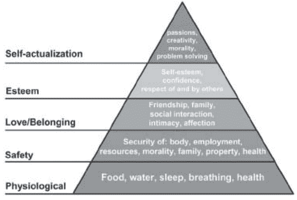
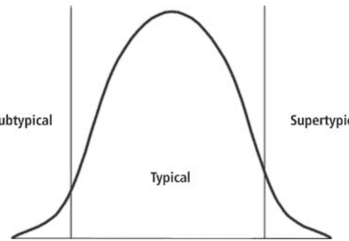

# 第1章：共同需求：归属与区分

花点时间思考一下，你的生活中哪些元素是离不开的。看看那些让你的生活有价值的东西——不是最新款的设备或神奇的化妆品，而是那些一旦消失就会留下明显空白的必需品。有些是不言而喻的，比如你最基本的人类需求：食物、衣物和住所。就人类驱动力而言，你最基本的需求是什么——食物、衣物和住所的无形等价物？

无论你的性格偏向内向还是外向，无论你对人的感受使你成为厌世者还是慈善家，人际陪伴都是人类行为的主要驱动力。陪伴对不同的人可能意味着不同的事物，但除了最反常的心灵之外，这个前提对所有人都是一致的：人需要人。

玛丽安和她的合著者特雷弗·克罗（穆利诺）在《铸造健康连接》一书开篇就提出了这个事实："我们为关系而生。与他人连接的需求渗透于整个人体。"² 这本书的其余部分致力于科学记录和指导人们如何通过与他人的连接来治愈和延长生命。无论从马斯洛需求层次理论还是医生的视角来看，这都是事实：人需要人。

1943年，心理学家亚伯拉罕·马斯洛在一篇题为《人类动机理论》的论文中提出了他的需求层次理论。其前提是，除非与生存和安全相关的较低层次的人类需求得到满足，否则个体在心理上不会具备追求所谓成长需求的条件。金字塔的底层由我们熟知的生物组成部分构成：食物、睡眠和其他对生命至关重要的元素。向上走一层，你会发现所有提供安全的事物。可以说，前两个层次中的每一层都可以在不需要他人的情况下得到满足，但独自完成的能力到此为止。在第三层，你会看到与归属感和爱相关的无形事物的光谱：情感、关系和友情。上升到第四层，你会发现尊重需求，如成就和声誉；而在顶端，则是自我实现。

马斯洛的理论是，人类只有在底层需求得到满足后，才能进入需求层次的下一层。二十一世纪的行为科学对马斯洛提出了批评，比以往更重视人际连接作为一种"基本"需求。但问问自己：如果你快要饿死了——不是仅仅饥饿，而是快要饿死了——你会想要一个拥抱还是一块饼干？

我们所谓的成就和声誉，只有当一个人感觉自己有所归属——真正与他人建立连接——时才能实现。与自我实现相关的个人成长和满足感，只有在满足了成就和声誉的需求之后才能到来。

让我们在此稍作停顿，因为理解人类需求层次是本书实用信息部分的核心。一个人选择背后的动机，是根据哪些较低层次的需求已得到满足以及哪些较高层次的需求尚未得到满足而形成的。人类行为最有趣的属性之一是，这些需求往往从外部比从内部更容易被看到。他人可以清楚地看到你自己看不到的东西，但也有例外。

看看自我实现的顶层。你如何能看到、理解或操纵另一个人的自我实现感？经过多年与人打交道的经验，我们仍然不知道一个人如何能开始理解自我实现对另一个人意味着什么，尤其是当很少有人能为自己定义它时。我们将在本书后面探讨这个难题，届时我们会审视自我实现中的内部和外部激励因素——本质上，是一个人的核心原则和价值观的力量与金钱和权力等事物的力量之间的对比。

格雷格作为战场审讯员和SERE（生存、躲避、抵抗与逃脱）学校教官的背景让他明白，审讯员很少能基于掌握情报源自我实现的标准来建立互动。审讯员是赶时间的。审讯的科学在于提出问题和在尽可能短的时间内获取尽可能多的信息。这个过程涉及使用捷径来切入正题。首先，采用审讯员的方法来审视一个人在通往自我实现道路上的进展：

1. 假设这个人尚未达到自我实现。大多数人都是如此。
2. 即使她已经自我实现，将她转移到需求层次中较低的一层也会迅速改变这一点。当审讯员对某人的声誉发动成功攻击时，随后为恢复声誉而进行的抗争会将受害者降至低于自我实现的层次。如果你想看一个日常例子，关注一下总统大选中的抹黑运动。观察为捍卫一个花了几十年建立起来的声誉而进行辩护的效果。你看到那个原本沉着自信的候选人展现出了不同的一面吗？
3. 如果你想让他降到金字塔更低的位置，就攻击他的归属感。当他在试图抓住这个最基本、最无形的人类需求时，他的反应就是向需求层次下降一步。如果他技艺娴熟或防护得很好，他重新站稳脚跟的速度可能很快，但这给了操纵者一个瞬间占据上风的机会。

### 驱动因素：归属与区分

归属的概念很简单。每个人都需要感觉自己在一个群体中有一席之地，这并不意味着像在郊区有一块土地、两个孩子和一辆SUV这样肤浅的东西。从根本上说，这意味着你与他人体验到了某种纽带。这可以范围从为解决问题而临时组成的团体，到复杂的兄弟组织和社团。

> 读到此处时，你可能在想："我有社交纽带，但我当然不同于我的朋友、熟人、同事和家人。我是不同的。每个人都知道这一点。其中很多人甚至因此高看我。"

你是通过归属才达到那一点的。如果你首先没有被接纳，你会是一个陌生人，你的不同之处对群体没有任何意义，也不会引起群体的兴趣。你不会像群体成员那样成为讨论的对象。那些不同之处——你所珍视的身份特质——被称为"区分因素"，它们是自尊和他人尊重的核心。它关乎成就、声誉、地位和责任。无论是什么群体，无论是什么造就了群体的身份认同，归属之后的区分驱动着一个人获得的尊重感。区分的方式可以像指纹一样因人而异，并且很大程度上取决于一个人的自我形象，而自我形象是高度主观且不稳定的。

### 自我形象

参考框架决定了我们看待世界的眼光。我们知道的事实越多，经验越丰富，我们的参考框架就越宽广，看到的图景就越完整。那个参考框架也把你放在了图景中的某个位置。

在那幅图景中，你是什么样子的？你可能没有考虑过你的自我形象是如何与他人联系在一起的。别人对你的评价会影响你在框架中如何看待自己。在某些情况下，他们公开表达了观点，但在其他情况下，他们只是暗示了这一点——或者你以为他们暗示了。（你的心理有时会虚构出他人对你的评判或看法。）

从身体开始说起。你是比平均水平更高还是更矮？相对于什么样的人群？我们认识一位身高五英尺三英寸的女性，她曾讲述过自己曾经"很高"的时期。这个故事很有趣，因为小时候，她在同龄人中总是算高的。后来在生活中，当她告诉朋友们她很高兴自己天生拥有身高时，人们戳破了她的幻想。她一直带着自己"很高"的错觉长大成人。这种扭曲的视角是如何形成的？她的自我形象是在她低头看着童年朋友们头顶的过程中形成的，而后变得更加固化，因为那些朋友们在长高而她没长高的过程中从未质疑过她。她的身高从来都不是讨论的话题。当一个人在封闭的环境中将自己区分出来，并在有限的人群中塑造出卓越形象时，同样类型的迁就就会经常发生。你总能在小镇高中看到这种现象：最有天赋的橄榄球球员身材矮小但跑得很快。一旦他进入一所充满比他更高大、跑得比他更快的球员的大学，他的自我形象就会受到打击。

也许你比群体中的其他人更有吸引力或更擅长运动。问问自己，你的群体标准是什么，如果你的族群突然改变了会发生什么？如果你换了工作，最终来到尤卡坦半岛，与身高最高约五英尺的玛雅后裔在一起会怎样？或者，如果你带着自己略显丰满、晒成古铜色的身材——在你现在居住的地方被认为是美丽的——去挪威长期居留呢？这些例子有点

极端，但它们凸显出你对一个群体的归属感以及在该群体中的与众不同，是一种相对的判断。

这同样适用于成就方面。许多人成为小池塘里的大鱼，并坚信自己有能力做到更多。他们转而进入更大的池塘，却发现自己的差异化群体被抛在了后面。突然间，他们不再更好或正常，更不用说卓越了。这种新的期望，无论是职业上的还是社会上的，都改变了游戏规则。

## 自我形象与审讯——极端

审讯的科学在于提问并在尽可能短的时间内获取尽可能多的信息（假设对方配合）。审讯的艺术则在于以如此微妙的方式运用一套极端的 interpersonal 技巧，以至于不熟练的观察者很少知道发生了什么。审讯者和信息来源都敏锐地意识到这种交流；对双方来说，这比他们在任何其他情况下可能遇到的都要更具压力。这种审讯艺术在很大程度上依赖于管理一个人的自我形象。

在审讯业务中，合作的信息来源的委婉说法是“被打破”的来源。这意味着审讯打破了她抵抗的意志，她会合作。一个“直接就被打破”的来源意味着她回答了被问到的问题。没有喧哗或操纵。是什么机制让一个人以这种方式向他的敌人透露敏感信息，这一点不容忽视。考虑一下被俘士兵被送往营地接受审讯的经典场景。

当士兵进入军旅生涯时，他接受了灌输，充满了责任、荣誉、国家和战友情谊。这种团队合作、使命和更高目标的体系使他免于思考敌人会是什么样子。很简单：另一边的人是敌人；他必须被消灭，而审讯者有能力做到这一点。士兵的自我形象是被制造并注入他的；无论他在群体中处于什么位置，他都是一个士兵。他属于其中，所以现在他所需要做的就是区分自己。士兵越年轻，就越容易让他吸收这种自我形象。战友情、凝聚力训练、良好领导和适当的纪律使他免受自我审视的需要。他不需要评估自己是傻瓜还是智者。无论他是否理解政府的政策以及它是否符合他的意识形态，或他是否在为多个主人服务，都无关紧要。他的形象是由生存所需、保持使命专注以及照顾他的团队所建立并强化的。

他军事生活的仪式在他的决定和反应中起着核心作用。人类是非常复杂的生物，背景中有许多“子程序”在运行。通过仪式、成人礼和复杂的意象来短路这一切是确定的方法。它在社交俱乐部和像共济会和美国军团这样的正式组织中上演，也在像军队这样的正式训练中上演。

在更阴险的层面上，它在非正式的政治集会上上演，比如美国为准备与另一党派的仪式性“战争”而进行的红队（共和党）和蓝队（民主党）的集会。观看新闻报道：美国政治集会往往具有战争的意象。党的仪式将人们与那些除了候选人或单一议题（如移民）之外几乎没有其他共同点的人联系在一起。

你甚至可以看到纳粹第三帝国充满戏剧性和形象的仪式如何如此彻底地压倒性地凝聚了一个感到被“不公平”条约压迫的人民。

当士兵被俘时，一切都颠倒了。他不再有维持战士、专业人士和国家高尚仆人形象的输入。当他第一次以人的身份看到敌人时，他在各个方面都受到现实改变的意象的冲击。创造了他士兵角色的自我形象输入逐渐消失在遗忘中。不再是战斗人员，他现在依赖俘虏者提供从食物和住所到与家人联系的一切。来自他世界的其他士兵现在同样依赖，而曾经拥有如此多力量的制服不见了，或者更糟，它们只是对早期自我形象的嘲弄性提醒。他唯一能与之交流的人是审讯者，因此囚犯经常对问题做出反应以维持对话并重新获得某种形式的稳定。一个好的审讯者会以这样的方式开始对话，使得第一个问题就能让他知道系统是否已经完成了“打破”囚犯的艰苦工作。在21世纪之前的战争中，绝大多数人——高达90%——直接就被打破了，或者简单地在没有操纵的情况下回答审讯者的问题。

对审讯者拥有的杠杆感到好奇的人会发现，他们是焦虑经纪人，依靠对未知的恐惧并管理这种恐惧以获得期望的结果。人们最害怕的未知是个人消亡——这并不指身体死亡。我们所指的个人消亡是心理上的，是身份的一个方面，类似于自我实现，因为它非常个人化，只有个人知道它由什么定义。审讯者的魔力在于找到能引发这种恐惧的词语组合，然后同样有效地消除恐惧。

根据 Maryann 及其合著者 Trevor Mullineaux 的研究，“例如，一名想要与囚犯建立融洽关系的战场审讯者可能会通过确保他有东西吃，并且有一种不会受到身体虐待的感觉来开始这一过程。”³

Maryann 和 Trevor 提到的食物并不是为了消除极度饥饿的食物；战俘寻找的不是食物，而是确定性。这种确定性以一小块食物或施舍的形式出现。

将传统士兵作为战俘的场景与最近涉及恐怖分子的情况形成对比。美国和大多数西方世界的新敌人似乎不像传统模式的士兵那样容易被打破。虽然敌人已经改变，但打破他的工具却没有。目前“批准的技术”源自纳粹德国一位出色的非强制性审讯者 Hanns Scharff。他的技术（我们稍后会讨论）很出色，但似乎对非传统战斗人员没有预期的效果。令人不满意的结果是可以预测的。

恐怖分子没有建立在战友群体上的形象。 often，他独立行动并自我隔离。他的自尊来自于他秘密行动的事实，他的自我形象深深植根于对其行为的正当化。当被俘时，他作为更大力量的事业中的战士面对敌人。他第一次在生命中看到异教徒并经历被俘的体验。那对他心理的冲击强化了他由信仰磨练的自我形象，以及对西方异教徒的形象。真正的信徒获得了进一步的正当化；他与他的中心权威交流——或者用西方术语来说，他冥想——而圣战者则增强了他的自我形象。有句老话说军队不断地打上一次战争。通过用这些相同的工具无限期地拘留一群面临审讯的人并允许他们重新集中注意力，西方大国创造了难以想象的事情：禁欲主义的圣战者。我们并不是在贬低让恐怖分子远离目标的必要性；相反，西方世界需要针对新敌人采取不同的方法。当前系统的效果是加强了圣战者的自我形象，并夺走了审讯者通过展示他对恐怖分子个人消亡感受的理解来经纪焦虑的任何机会。

ISIS 战斗人员可能被视为在恐怖分子在细胞中独立行动和士兵的凝聚力单位之间。ISIS 囚犯的情况，非强制性技术在某些情况下似乎有效。根据中东报道和分析中心执行主任 Seth J. Frantzman 的说法，审讯者有时对囚犯的坦率感到惊讶。Frantzman 自 2015 年以来一直报道 ISIS——通常作为随军记者——他简单地指出：“许多 ISIS 战斗人员和成员似乎并不认为支持 ISIS 是犯罪。”⁴ 他们对自己在战场上的活动赋予合法性，就像美国士兵一样。一个关键因素：在 Frantzman 的经验中，他们对与库尔德斯坦地区政府有关的审讯者感到特别安全。他们使用非强制性技术的做法与伊拉克人的风格形成鲜明对比，伊拉克人的什叶派民兵以折磨囚犯并让他们消失而闻名。他们根本不担心被库尔德斯坦地区政府处决。

你可能永远不会遇到这两种极端情况，但请考虑审讯者的处境与你之间存在哪些共同点。当有人反对你，并且得到内部或外部力量的支持时，你几乎没有机会让他按你想要的方式行事。但当那个人感到受到威胁时——无论威胁是因为她觉得自己像个局外人、像团体中的无名小卒，还是担心会被取代成为 alpha——你就有了杠杆。如何运用这个杠杆就是一门艺术，因为你会根据情况和个人，创造性地同时依赖正向和负向的杠杆。

我们要强调的是，向某人的自我形象中注入毒素是极其危险的。你这样做可能会把人逼到暴力报复的地步。如果你操纵某人到她感到失去了自我感——也就是个人灭绝的临界点——而你又不知道如何处理这种情况，你可能会严重伤害她的心理。当审讯者这样做时，他们要么把人拉出来并恢复其自我感，要么就置之不理，不在乎自己刚刚造成了什么样<|start|>assistant [content]

你可能永远不会遇到这两种极端情况，但请考虑审讯者的处境与你之间存在哪些共同点。当有人反对你，并且得到内部或外部力量的支持时，你几乎没有机会让他按你想要的方式行事。但当那个人感到受到威胁时——无论威胁是因为她觉得自己像个局外人、像团体中的无名小卒，还是担心会被取代成为 alpha——你就有了杠杆。如何运用这个杠杆就是一门艺术，因为你会根据情况和个人，创造性地同时依赖正向和负向的杠杆。

我们要强调的是，向某人的自我形象中注入毒素是极其危险的。你这样做可能会把人逼到暴力报复的地步。如果你操纵某人到她感到失去了自我感——也就是个人灭绝的临界点——而你又不知道如何处理这种情况，你可能会严重伤害她的心理。当审讯者这样做时，他们要么把人拉出来并恢复其自我感，要么就置之不理，不在乎自己刚刚造成了什么样的伤害。但日常生活不是审讯，结局也不是生死攸关。用于正确目的并适度使用，你可以让人们做你想让他们做的事；使用不当，这些工具会带来你真的不想要的结果。

一位父母可能会选择“错误”的方式惩罚行为不端的孩子，拿走他生命中最重要的东西——他的小狗。在试图操纵孩子改正行为时，父母无意中在他心理上留下了创伤。

Brandy Vela 在 2016 年的自杀凸显了玩弄他人自我形象所导致的最坏情况。作为一名超重、十八岁的女孩，她在学校里遭受了同学的身体羞辱，也遭受了使用假 Facebook 账号发送欺凌信息的网暴。Brandy 更换了电话号码，甚至向警方报告了严重的欺凌，但警方无法追踪信息，被迫等待肢体冲突发生。当骚扰持续时，她崩溃了。在父母面前，Brandy 开枪自杀——这正是她经历了个人灭绝的文字表达。

当我们撰写本书的原版时，根据美国疾病控制与预防中心的数据，自杀是 15 至 24 岁人群的第三大死因。截至本文撰写时，它已上升为该年龄段的第二大死因。年轻的心理未必有足够的韧性来应对恋爱结束或尴尬的处境。你认为尴尬还不够成为自杀的理由吗？在酒驾或与法律的轻微冲突后——这种违规不会毁掉一个人的生活——有些人选择自杀而不是忍受监禁的尴尬。如果他们把做一个体面、有尊严的人的自豪感视为个人身份的核心，入狱的可能性就会把他们推向个人灭绝。他们的体面和尊严定义中不允许勾选入狱这一项。快速的 Google 搜索会列出数十个例子，而且许多人是在成年后才这样做的。

## 自我形象与封闭团体

每个团体都会形成一种规范，或对其成员的典型概念。这种规范可能与整体文化的主流一致，也可能狭隘、怪异到只有内部人才能识别。团体对外部人员越开放，它就越会保持主流。随着团体变得越封闭，团体内部的个人获得的权力和影响力就越大。邪教领袖就是最典型的例证：人民圣殿的吉姆·琼斯、曼森家族的查尔斯·曼森、天堂之门的马歇尔·艾普怀特，以及大卫教派的大卫·科雷什。这些“大人物”往往会如此扭曲和混淆团体的规范，以至于到最后——在这些案例中，就是生命的终结——其他人再也无法认出这是如何发生的。那些受其蛊惑的人形容他们极具魅力，甚至神圣。剩下的我们这些不属于那个部落的人只需看一眼就会问一个问题：他们当时在想什么？奇怪的是，他们的反应正是马斯洛所预测的那样：先是归属，然后是区分。

他们归属是因为每个人都参与了一个团体。无论它是否提供了一个远离反对嬉皮生活方式的父母、一个不理解种族和谐的世界，或只是感觉在现实世界中没有同龄人的避风港，每个人都找到了一个拥有自己认同的想法和信仰的团体——一个提供慰藉的地方。

他们通过追随一位领袖而实现区分，这位领袖不断增加他对“家人”的控制力，并扭曲了团体规范的形成方式。通过试图融入，每个人都越来越远离社会的规范，因为他们变得越来越相似，甚至试图成为这个父辈人物的宠儿。这些人不太可能一开始就报名参加集体自杀或多起凶杀案，但他们中的许多人最终确实做了这些事。可以说，通过如此戏剧性地结束自己的生命和他人的生命，他们在精神上都是有病的，但其他事件——一些受控实验和另一些源于常见做法——表明并非如此。

1971 年，心理学家菲利普·津巴多邀请一群健康、中产阶级的男性大学生参加为期两周的研究，以探究监狱生活对心理的影响。他随意地将 18 人分成两半：9 名狱警和 9 名囚犯。津巴多的团队把斯坦福大学校园内一栋建筑的地下室改造成监狱环境，还特意安装了视频和音频录音设备，以便监控发生的事情。被“逮捕”后，“囚犯”被当作真正的囚犯对待，从听取米兰达权利到除虱。 “狱警”没有接受特殊训练，但他们知道自己的工作是维持监狱秩序，并做他们认为必要的事情来赢得囚犯的尊重。囚犯穿着宽松像裙子一样的服装，狱警则穿着卡其色制服和墨镜，并配备哨子和警棍。狱警轮班工作，每班三小时，但囚犯全天候扮演角色。

第一天平安无事。第二天，发生了暴动。九名狱警全部上岗，决定用武力镇压暴动，首先用灭火器喷射囚犯以制服他们。囚犯遭受了冰伤，造成疼痛和皲裂，足以让狱警占据上风。他们剥光囚犯，收走他们的床，并把煽动者关进 solitary confinement。

第三天，狱警采取了一些新战术。他们通过挑出三名表现良好的人给予特权——如食物和床——而剥夺其他人的任何舒适感，在情感和心理上分裂囚犯。为了证明他们真正的控制力，他们交换了好囚犯和坏囚犯。囚犯们感到困惑，认为其中一些人“变节”了。他们之间互不信任。与此同时，囚犯作为一个团体变得更加分裂，而狱警则更加团结。一名囚犯崩溃得如此严重，以至于被从实验中释放。三天后，在囚犯被迫用赤手清洁厕所后，实验结束。夜班狱警认为没人会在常规时间外监控视频，于是设计了如此羞辱和色情的惩罚，以至于研究人员知道他们的存在通常已无法遏制他们的行为。

> 在他关于监狱实验的网站上，津巴多问道：“健康、‘普通’的聪明人怎么会如此迅速地成为邪恶的施害者？”

他对 bonding 和 fracturing 的根本问题得出了以下结论：

到研究结束时，囚犯在团体和个人层面都已瓦解。已不再有团体团结；取而代之的只是一群孤立的个体在苦苦挣扎，就像战俘或因精神疾病住院的人一样。狱警赢得了监狱的完全控制权，并命令每个囚犯盲目服从。

从心理学角度来看，狱警的行为可以用 *去个性化* 的概念来解释：一个人沉浸在团体规范中以至于失去身份感和个人责任感的状态。

在入会仪式中，兄弟会通过利用学生渴望归属的欲望，通过同伴压力强化领导者的要求，并通过保密掩盖即将到来的入会真实性质，产生类似的结果。许多导致悲剧的入会虐待案件都涉及强迫学徒互相拼酒。大多数时候，这涉及酒精。然而，在 2005 年的奇科州立大学，入会仪式涉及让学徒喝大量水，其中一名学徒 Matthew

卡林顿死于水中毒。你可能会想：“他们为什么不说‘够了就是够了’？”那些负有责任的联谊会兄弟做了一些阴险的事情，很可能根本没有意识到这会有多有效。他们将两名新成员身体上隔离，并通过身体上的施压让他们精神崩溃。

这些“实验”各自为什么会失控？这又与让别人做你想做的事有什么关系？首先让我们看看失败的原因。

## 定义群体——从外向内看

钟形曲线为我们提供了一个分析群体的简单模型。在任何群体中，你都可以选择用钟形曲线来表示人群。

这段叙述大致是这样的：无论语言或文化，你与黑猩猩共享大约95%的DNA。

你还共享一些其他特质。不管我们喜不喜欢，我们许多最基本的驱动力都映射出我们毛茸茸的表亲的驱动力。黑猩猩是社会性生物，生活在具有明确等级制度的小群体中。这种安排似乎与人类部落的治理非常相似。有一个通常并非“选举”产生的统治阶级，而群体中的其他成员明白自己的位置。

黑猩猩形成一种以顺从为基础的生活节奏。一只阿尔法黑猩猩在他选择的任何事情上都是阿尔法。其他黑猩猩不会质疑他关于哪些叶子适合筑巢的选择：如果他是阿尔法，他可以指挥群体栖息在任何他喜欢的叶子上。这种灵长类动物的行为在人类中同样普遍。一旦某人在会计方面证明自己比你更聪明，她很可能在其他领域也会获得顺从。这类似于泰勒·斯威夫特在推特上的受欢迎程度：她能唱关于前男友的好歌，所以她“赢得”了推特上8200万粉丝的顺从；谁在乎她对购物和政治的看法呢？

你以为自己能超脱于此？你是否曾听从演员关于缓解疼痛的建议？或者听从音乐家关于哪位候选人应该入主白宫的指导？这种模式根本没有根本性错误，因为我们并非与世隔绝。我们可以从其他来源获得关于同一问题的信息。他们只是从远处利用我们的驱动力——除非我们选择不获取替代来源的信息。

这就是我们通过媒体接触阿尔法人物的阴暗面。取决于我们对媒体明星及其信息的反应，我们可能会变得与世隔绝。

美国心理学会中发展最快的分支之一是第46分会——媒体心理学分会，致力于研究媒体对人的影响。扎克·斯坦博（Zak Stambor）2006年为美国心理学会撰写的一篇文章指出，在某些媒体体验中，我们会上瘾，将其作为放松和逃避的手段。在另一些体验中，我们渴望联系。我们奇怪地与名人以及与自己有某种亲近感的人“建立联系”，即使我们可能永远不会见到他们。

在越来越大的程度上，这些虚拟联系正在塑造我们在这个世界上的位置感。我们如何解读信息、我们对问题和候选人的看法、谁是英雄行为、谁是怪物——媒体都有影响，而我们越是让自己成为媒体的海绵，就越可能退回到志同道合者的封闭圈子里。媒体会“帮助”我们在混乱的世界中找到安全、舒适的地方。这是一种复合的归属感和新的虚拟隐居。

## 不断演变的行为标准

当人类处于封闭状态，且没有主流的外部影响来提醒什么是正常时，正常就开始变得越来越像钟形曲线上那些超越正常的人——我们称之为*超典型者*——心智中的样子。有时这种群体形象会被强迫性的遵从（如暴力或暴力威胁）所扭曲，但更多时候是被人性所扭曲。

当集体思维开始朝着对超典型者来说是正常的方向移动时，他会变得更加权威。为了更像他，群体中的其他人不断努力模仿超典型者，其行为和品味成为新标准。这种行动反映了将自我与群体区分开并彰显个人独特性的自然驱动力。超典型者会奖励这种行为——除非追随者试图绕过主人，在这种情况下，这个新贵可能会发现自己被狠狠打下地位阶梯的一级。朝着群体标准的这种进步被视为一种成就，它直接带来尊重和成就感。

这种动态在伊拉克战争中丑陋地展现出来；阿布格莱布监狱的虐待是最臭名昭著的事件之一。当查尔斯·格兰纳扭曲其团队的价值观时，没有人监督。他认为对囚犯的公平待遇如何，就成为该群体的正常标准。一个鲜为人知的事实是，所有看管囚犯的宪兵都是预备役人员。为什么？我们只在有战争时才需要狱警。其副产品是一群教师、银行出纳、快餐厨师和电工可能会来守卫囚犯。如果其中有一人的本职工作是监狱看守，正如格兰纳那样呢？想象一下从一开始就存在的顺从。撇开军衔不谈，他获得了非正式领导者的角色。

超典型者可以利用两种基本驱动力——归属感和差异化——来得到他们想要的东西。许多人不确定自己在群体中的位置，或者*是否*属于这个群体，而事实上他们完全属于典型。这可能源于糟糕或畸形的自我形象，或者单纯的不安全感，即使有外部输入，也会产生扭曲的看法。超典型者会让他们感到被需要或想要，从而创造一种社区感。稳定、适应良好的领导者利用这一点来打造和谐的团队；不稳定或精神失常的领导者则创造一个不断变化的现实，逐渐让追随者与社会分离。这种对积极工具的负面使用是查尔斯·曼森的主要机制。

在社交媒体上，一种常见做法是与“朋友”进行简短对话，然后抛弃那些对某一观点持不同意见的“朋友”。相比之下，同意者会得到“点赞”和肯定其观点的视频作为奖励。如果运用得当，社交媒体平台可以让人将这些平台武器化。

那些在群体中勉强维持亚典型地位的人会寻找其他途径来让自己变得特别。为了差异化，一个人需要归属感。例如，因为一个人没有完全投入职场群体，他在另一个群体中找到归属感，并尽可能地进行差异化。乔在工作中是个无名小卒，但在办公室外，他变成了当地酒吧的冷知识冠军，或者胜利保龄球馆的最佳投球手。这种差异化可能比工作中的任何事情都重要——至少目前如此。

在组织内达到成功的顶峰后，人们通常会到别处寻找同类。环顾四周，你认识多少成功人士会通过娱乐活动来创造归属感？在某些情况下，这些人在群体内过度差异化，以至于几乎不再是成员，却依然留在原地。他们非常不愿意离开小池塘，因为害怕在更大的池塘里不够典型，从而停滞不前。对于像“天堂之门”邪教领袖马歇尔·阿普尔怀特这样的人，超典型者创造了一个新群体：一个让流离失所者感到宾至如归的地方。

## 将这种动态机制付诸实践

你拿起这本书是为了学习如何让别人做你想做的事，而到目前为止你所知道的是，操纵人类行为取决于理解人类的归属感和差异化需求。

你在这条连续体中处于什么位置？你在试图归属吗？还是差异化的需求超过了它？

也许在马斯洛的需求层次中，你已经超越了那个层级，你的关注点是自我实现。无论如何，你的自我意识会帮助你理解自己所在群体的动态，以及成员在钟形曲线上的位置。通过分析这些群体，你可以磨练所需的分析工具，用以审视那些你并非其中一员的群体，以及这些群体的成员。

我们引用的例子也帮助你了解了影响力是如何被兜售的。如果吉姆·琼斯——一位引发了集体自杀的自封宗教领袖——那扭曲的头脑，在没有总体计划指导行动的情况下，都能说服他人做出可怕的事情，那么想象一下，你若要实施一个计划来得到你想要的东西，该是多么简单。

## 人性——王牌

吉姆·琼斯的例子完美地将话题引向了另一个关键的群体动态：分裂。这是一种自然情况，即使在一个具有说服力的模式运作时，群体也会四分五裂。社会动态越复杂，就越难让每个人都明白自己归属于何处。一些成员与“大人物”的距离变得如此之远，以至于他们创建了自己的小团体，并拥有其内部的超级典型成员。（这种情况在公司里屡见不鲜，因为大多数员工无法接触到CEO或部门负责人。）尽管我们永远不会确切知道圭亚那琼斯镇的人民圣殿教到底发生了什么，但我们确实知道该群体发生了分裂。有关虐待的指控促使一位美国国会议员前往调查，结果酿成了悲剧。如果人民圣殿教的每个人都认同琼斯的想法，那么国会议员利奥·瑞安就不会被谋杀，909人也不会死于自己手中——但他们并没有这样做。他们中的许多人也是因为不服从或做出对邪教构成公开威胁的行为而被谋杀。

这可以预测吗？分裂总是可以预测的。无论你是黑猩猩还是人类，政治都会造成分裂。灵长类动物学家珍·古道尔在与黑猩猩相处的多年中也观察到了这种分裂。即使在其相对简单的组织结构中，黑猩猩也不会只是乖乖排队，建立一个由仁慈的阿尔法统治至死的田园诗般和谐社区。以黑猩猩兄弟弗洛伊德和弗罗多为例，弗洛伊德一直统治到自己患上疥癣，然后弗罗多推翻了他。弗罗多统治严苛，所以一旦他出现虚弱的时刻，他就不得不躲避那些厌倦了他作风的群体。谢尔顿带着自己的权力基础介入，取代了弗罗多。

尽管由于我们更发达、进化得更好的大脑，人类可能不会如此公开地诉诸暴力，但我们在政治上的表现却毫不逊色，而且我们的政治游戏同样危险。人生中一些最残酷的政治斗争围绕着这样一个真正沮丧的人：他无法实现自己的真正目标，于是将所有能量转移到替代目标上。这可能从良性的爱好到连环犯罪行为不等。

为了运用那些让别人做你想让他们做的事情的技巧，你必须能够预测这些分裂点，利用它们，同时了解归属与区分的动态。

### 审讯的关联

从心理学上讲，每个人内心都有一部分需要被触碰。她可能有亲密的朋友和家人，他们对她了解很多，但他们并非无所不知。如果你，一个完全陌生的人，出现并触发了她想要暴露自己秘密一面的需求，她会告诉你一些她从未告诉过任何人的事情。

通过肢体语言赢得一个人的信任，以引导她沿着你设计路径的方式提问，以及运用某些心理杠杆，这些都将促使那个人与你建立联系。

这是积极的一面。你为她提供了一个机会。

在消极方面，你可以使用所有相同的工具来产生一种无助感，这可以说是一种比信任或乐观更强大的情感。

正如美国社会哲学家埃里克·霍弗（*《狂热分子》*，1951年）所指出的，当真正的信徒面对绝望，并意识到除非信任你（或者就宗教而言，信任牧师、拉比或其他宗教领袖），否则他们别无选择来改善自己的处境时，他们就会成形。宗教领袖提供了一个新生信徒无法企及或比拟的榜样，然后不断削减选项，直到真正的信徒出现；换句话说，这个人相信通往成功的唯一道路就是领袖的道路。道路越宽，门就越窄。

审讯者深谙这种激励方法。这是秘密武器。
