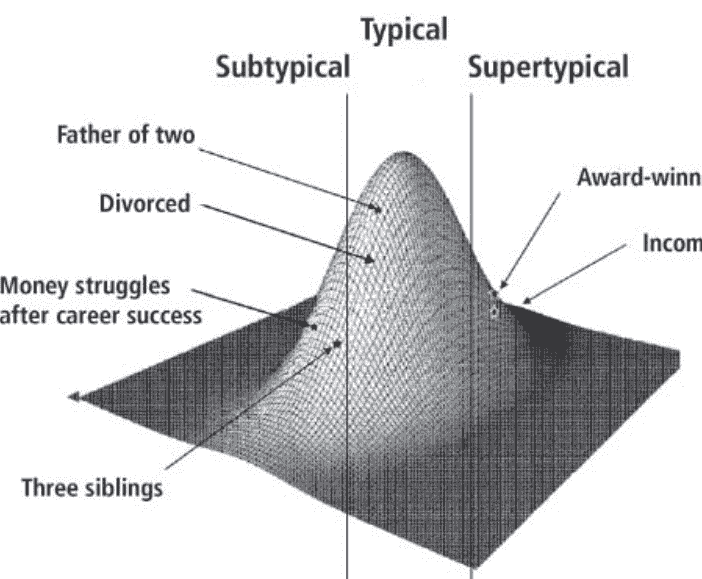

# 第5章：人类建模

你即将研究自然栖息地中的动物。把自己想象成灵长类动物学家珍·古道尔那样的敏锐观察者，只不过你还能说黑猩猩语。

你在本章学到的人类建模过程，将帮助你理解陌生人和亲近的人，让你获得影响他们行为所需的信息。它将帮助你建立对一个人的整体认知，凸显其需求与动机。

无论怎样强调这种建模能力的重要性都不为过。通过精确识别一个人的关键特质，并判断它们是优点还是缺点、普通还是非凡的能力，你就能清晰地了解将要操纵的对象。跳过这一步意味着你可能运气好，在试图操纵他的过程中碰巧触及他的敏感点或发现相关线索，但结果将难以预料。你只是在黑暗中乱开枪。

每次审讯都始于尽可能多地了解囚犯个人，包括从抓捕他的人、给他送饭的人以及管理他日常生活的人那里收集到的信息。然后我们进入审讯，通过提问为他的画像添加更多细节。这幅画像展现了他性格中的高峰和低谷，让我们知道他与我们的共同点，以及他的优势和恐惧。

缺乏这些知识，我们试图管理他的归属感或差异化需求可能会带来灾难性后果。

格雷格离开军队多年，一直在跨国公司工作。这与军队有着强烈的相似之处。人们每天开会，讨论天底下所有事情，却对谈话对象毫不在意。他们推进议程，却不考虑维系商业运转的人性纽带。

格雷格花大量时间教导、辅导和指导人们在会议的共同时空里关注他人。他推动使用军事审讯领域中的同样工具，以取得更好的会议效果和打造更强的团队。

这之所以奏效，原因很简单：通过理解人们说了什么和没说什么，你能更准确地定位他们的动机。一旦掌握这些信息，你就能建立更牢固的纽带——或者削弱它们。听起来熟悉吗？

本章的工具旨在为你提供另一种观察人的视角——既理解一个人如何看待自己，也理解他人如何看待他。这是一项值得的投资。除非你能读懂他人的心思，否则你不能省略这一步。

你将使用第4章学到的工具来收集与绘制目标人物详细画像相关的信息。如果你熟练运用这些工具，那么你就拥有了一支足够锋利的铅笔来描绘细节。当你与目标人物互动，让她做你希望她做的事情时，这些工具也会再次派上用场。

绘制画像的第一步，是承认你并非无所不知地了解你的目标。无论这个人是你的母亲、一起工作了十五年的同事，还是你最好的朋友，都没有区别。你并不掌握关于这个人的某些事实，而这些事实对于影响她的行为可能极为重要。

### 练习：近与远

列出三个你几乎不认识的人，以及三个你自认为非常了解的人。对每个人，列出你认为的主要特质，例如聪明、虔诚、有艺术气质、热情好客、性感、爱评判等等。再对每个人，列出你认为的主要需求，例如尊重、接纳、奉承、宽恕等等。

读完本章关于人类建模的内容后，回到这个列表。想想有哪些场合可以让你运用新工具来验证、修正或推翻你最初的假设。

### 个人操作系统

根据维基百科，操作系统管理资源并为计算机程序提供“公共服务”。想象一下，一个人的思维和行为由一个操作系统驱动。该操作系统运行在由基因定义的硬件上。只有某些程序能够运行，而且有些程序的运行方式会与在别人的硬件或操作系统上运行时不同。

要检查这个操作系统，你需要一台fMRI（功能性磁共振成像）系统。fMRI会向你展示，当一个人参与某种……时，她大脑相应区域的活动。

审讯者总是以建立控制和融洽关系来开始接触。能否迅速做到这一点，取决于审讯者能否对情报源的“操作系统”进行编码归类。这种能力的实现，依赖于军事体系中固有的机制：部署警卫、摄像头和麦克风，确保营地里没有任何私人时刻。你对目标信息的需求并无不同，尽管你获取信息的手段不同。你需要掌握目标人物的特质、习惯和心态。你需要感知对他来说恒定不变的事物连续体，以及那些持续变化的要素。

每个人都有一种主导人格类型，即使不是贯穿整个成熟人生，也会在很长一段时间内保持稳定。我们给你的只是一些对比类型的示例。你应该以此为跳板，创建你自己的列表，这些列表很可能会反映出你自己的文化、族裔、国籍等等。目前，先从理解这些性格类型开始，以及它们如何助力你构建对人的建模。当我们在后续章节讨论技能应用时，会回到这些类型，让你看到如何调整战略战术以获得想要的结果。那将为你提供所需的示例和框架，以便你定制策略去影响不属于这里所涵盖类别的人。

这些配对可以用辐射状图来可视化。正如你可能在政治体系中观察到的那样，当你走向一个极端时，就会接近另一个极端。理解这一点最重要的原因是，你可以获得与自我形象相关的洞察，从而掌控和预测结果。如果你的行为挑战了目标人物的自我形象，你按照自己想要的方式推动他的能力……

他只能远远窥视的人——重要吗？你需要理解他如何处理输入并排列信息优先级，才能知道如何最好地与他互动。

同样，如果质朴的人对别人的看法毫不在意，你该如何吸引她？你能因为她不懂就居高临下地对她说话，并期待有任何改变吗？你需要基于对这种人格类型多么根深蒂固、浑然一体的理解来采取行动，以确定这个人是在走向尊重需求，还是试图获得归属感。这将影响你如何帮助她差异化或归属的决策。例如，矫饰的人可能正在转变，变得与质朴非常接近，以至于只需简单的几句自我表露就会让她显得古怪。知道这一点，你可以通过提问和评论轻松地将她推向那里，或者至少向她展示你有能力做到，然后再救她，以换取一个恩惠。

### 顺从与反体制

顺从的人因成为某事物的一部分而感到舒适。他们努力完全融入群体。他们可能会表达观点，但范围将由群体可接受的正常范围来界定。这类似于国家政党政治：你可以持有截然不同的观点，只要党内其余人接受它们。这些人遵守规则，因为规则很重要；规则让世界保持秩序。由此带来的隔绝感让他们感到安定。

对他们来说，通过这种行为感受到自己是某事物的一部分，会涌起巨大的安全感，他们通过避免任何偏离来强化这种感觉并完善自我形象。按这个逻辑推导下去：顺从者与某个具体问题贴得太近，以至于他看不到全局，并且……

开始分化到分歧点。那时，他变成了反体制者。一些持枪权利活动家就属于这一类型。虽然携带武器的权利对任何士兵来说都是神圣的，但在某些人的心理中，这种权利可能根深蒂固，以至于他们成为最严厉的反体制类型。

反体制者回避规则，认为结构是为没有想象力的人准备的，或者相信存在比现状更好的方式。他们相信，如果由合适的人来制定规则，规则会更好，因此实际上，他们只是在倡导另一套规则。如果他们得偿所愿，规则突然变得完全不同——恰好如他们所愿，那会怎样？当反体制者如此执着于规则，以至于发起群众运动时，他们就越界了。他们转而成为体制本身。一旦他们掌权，就会为了坚守自己神圣的理念而变得更加保守和顺从。

当一个理想主义者成为执行者时，他根本无法想象自己的想法是错误的；问题一定出在那些执行它的人身上。看看20世纪的伟大改革运动，就能找到理想主义者转变为顺从者的政府模式。在大多数情况下，反体制的定义源于一种戏剧性的企图，即为了自身利益而夺取权力并建立新秩序。这些人会成为那些阴险而光明正大的领导者的绝佳追随者。

在实际应用中，你需要了解你的目标是出于自身利益而顺从，还是当她在决策中没有发言权时会反击。这种理解让你有机会把握她的驱动力。如果她是一个顺从者，而你想让她做某事，最简单的方法是建立一个联盟，带着她与整个房间的人一起行动。建立联盟比直接冲突容易得多。通过改变群体规范，你能轻松地带动一个顺从者。毕竟，她要么改变，要么变成反体制者。当分化发生时，她的驱动力是成为群体中更坚定的参与者；当她分化到不再属于这个群体时，她将需要一个新地方来“归属”。归属感是强大的。

如果他是一个反体制者，让他了解“愿景”以及你的计划。如果你能让他成为真正的信徒，他就能成为事业的战士。仅仅理解反体制者的心理，你就能同样针对他。大多数反体制者相信存在更好的方式。一旦这些人真正投入到群体的结果中并面临失去的风险，他们很少会继续搅局。套用社会作家埃里克·霍弗的话说，拥有开心乐园餐和有线电视的人不会造反。让反体制者完全归属于群体，并允许他“从内部改变事物”，你就能收编他的热情，为体制创造一名战士。你只需要记得照料他的火焰，否则他会停滞不前，变成对手。

## 万事通与求师者

万事通会把零散的信息——无论是否相关——应用到当前情境中。在许多情况下，他这样做依赖于一个事实：过去他比其他人“更正确”（就像我们那位五英尺三英寸的朋友，过去他个子更高）。尽管他可能确实在某些事情上比其他人懂得更多，但他的需求是比所有人在所有事情上都懂得更多。毫不奇怪，当他遇到一个实际上可能比他懂得更多的人时，他会变得紧张不安。无论是因为他上过更好的学校（或者只是住在普林斯顿或哈佛附近），有更多经验，还是只是比你“更懂行”，你在日常工作中经常会遇到这种人。他是一个原型；他是*《欢乐酒店》*里的邮递员克利夫。这类人的归属感和自尊来自他人因其信息宝库而给予的尊重。这塑造了他的自我认同。在某些情况下，他并非患有知识自恋，而是缺乏安全感，并且很清楚自己满口胡言，但私下希望别人没有注意到。通过使用第4章描述的工具，你可以探知他的真实状态，并相应制定计划，让他在层级中上升或下降。

求师者希望从公认的来源获得启迪，以便将这种认可视为自己的成就。无论多少知识、基于表现的成绩或成功，都无法给这个人带来像引用大君的话那样多的喜悦和认可。他需要知道，自己所说的话来自一位觉醒者。这类人的危险在于，大师可能来自各行各业，而他的大师的可信度取决于他的选择标准。这位大师可能只是一个万事通，因他人的尊崇而被抬高，并利用滚雪球效应，将自己提升到大师地位。另一个极端是，如果求师者满足了自身需求，并从他接近的智者那里持续获得认可，他可能会发展到看不起那些没有接触过大师的人的地步。

一个实际的例子是玛丽安的一位熟人，他曾在一个推广巴克敏斯特·“巴奇”·富勒可持续与可再生能源技术的工作团体任职。富勒以设计网格球顶而闻名，但在这位熟人参与这项工作时已经去世，所以他甚至从未见过自己的大师。尽管如此，巴奇的福音支配了他的生活，也几乎支配了他所说的每一句话。他对批评他的人最常见的回应是：“巴奇是个天才。你不会懂的。”

当求师者达到这种程度时，他开始比任何人都更理解大师眼中的世界。实际上，他变成了一种半大师，因为他觉得自己有资格去启迪低等众生。实际上，他可以充当大师的守门人，确保道路虽宽，门却窄得几乎无人能通过。

如果你告诉一个对自己的想法有着盲目自信的人他搞错了某件事，那么三件事之一会发生。第一，他会采取防御姿态，在错误周围打转，很可能试图让你以为是你误解了。第二，他会跌穿自己所处的马斯洛需求层次的地板——也许是声誉——现在只寻求归属感。第三，他会变得咄咄逼人，攻击你，但很可能不针对你质疑的那一点。你告诉他关于大象的说法是错的，并解释原因，他却猛烈反击说你是高中辍学生。那位崇拜巴奇的熟人就是这样做的；结果，他不得不迅速从一个“低等众生”的圈子转向另一个。

理解这些类型在层级中的位置将帮助你确定最佳行动方案。基于若干因素，她的个性将决定这些信息是否有价值、是否可行。这些因素包括：来源的权威性、与来源之间的顺从关系（双向），以及传递方式。当一个万事通被允许将新知识纳入她自己的话语体系时，通常更容易让她做出让步，因此提出引导性问题，让她自己说出你所知内容的重要性，这符合她的理解方式，而不会遇到抵触。

对于求师者，将自己确立为她应当遵从的对象，或者引用诺查丹玛斯式的预言，会比脱口而出事实更有效。想想那些传道者，他们不提供任何事实或个人见解，却通过引用经文赢得人心。通过表明你的知识只是从智者那里借来的，你会比试图宣称自己就是大师获得更多认可。求师者只追随那些有追随者的人——直到他们明白自己不过是个信使。

## 传统与潮流

在极端情况下，传统和潮流都是矫饰的近亲。这更多地与人如何脚踏实地有关，而不是他们的品味。他们需要过去英雄的认可来验证自己的选择，还是今天在世超典型人物的意见足以凌驾于几代人的判断之上？有些人可能陷入潮流之中，却仍将自己标榜为传统。社会压力是强大的。

雪莉吹捧古典音乐永恒的至高无上。她说，因为古典音乐比同时代的音乐多存活了几百年，所以显然比现代音乐更有价值。对此的反驳是，Spotify上的任何东西理论上都能存在同样久。

传统主义者信任已知的事物，相信事物之所以如此演变自有其道理。无论他们是否意识到，他们秉持着一种信念：历史上涉及群体思维的偶然事件比今天的群体思维更为深刻。这个群体的外在表现是倾向于传统的着装方式和权威标志，倾向于旧式的商业、礼仪和饮食方式。当其他人采用商务休闲风时，他们坚持高端路线，穿着浆过的衬衫和西裤，而不是卡其裤和高尔夫衫。

潮流光谱的极端一端认为当前的舆论比奶奶的更有分量。这个群体成员的论点是，这一世代比所有过去的世代知道得更多——也许是因为我们积累的知识——因此，更有能力做出决定。表面上看，他们的关注点停留在当下最热门的东西以及采纳最新的潮流。在极端情况下，他们会思考自己今天所做的事情的长期结果，因为其他人都在做同样的事情。一个潮流的活动家可能会（讽刺地）抗议拆除一座历史建筑，因为每个其他潮流人士都将其作为优先活动。这种行为会促使传统主义者问道：“如果其他人全都从桥上跳下去，你也会吗？”

因此，传统和潮流不仅仅是关于时尚感或偏好的陈述。诸如衣服和装饰之类的外在事物说明了某人如何看待自己在特定环境中的角色。传统的人公开宣称过去是有价值的，并且她证明自己价值的一部分方式就是延续传统。她是历史的守护者，是经典外观、声音和气味的推广者。一个极端的传统主义者可能无法超越纹身和舌钉等差异化因素来与某人建立联系。

当被推向极端时，一个人开始看起来像另一个人。将传统推向极端可能会变成一种潮流，并否定运动的原始目的。很少有人了解传统从何而来以及它们变得多么复杂。拿一个传统并无休止地遵循它可能会导致潮流行为，因为所谓的传统不过是创造潮流的薄薄伪装。看看政治上极左和极右的评论员就能看到这种混淆的实际结果：他们都把民主的神圣传统作为行动的可靠模式，同时赞颂“变革”是我们问题的唯一答案。

潮流也可能变得如此普遍，以至于它们成为传统；而在几代之后，没有人会察觉。纹身作为个性的指标早已超过了与传统的断裂点，现在可能被视为归属的标志，而不是与社会区分的标志。所以我们必须问：在两代之后，腰部以下的纹身是否会被视为年长、守旧女性的标准？

农业部长 Sonny Purdue 在 2018 年选举期间从他的南方词汇中拿出一个传统短语，当他在为共和党候选人助选时，他告诉佛罗里达人民，他们的州长竞选是“cotton-pickin' important”。这个短语让人想起对非裔美国人进行歧视和嘲弄的传统，而竞选公职的民主党候选人是黑人——这不是任何人应该推到聚光灯下的传统。

在处理这两种类型时，请记住每个人如何看待她与组织的关系，因为她被迫害为先锋派或因为她是老派而受到尊重，或反之亦然。任何极端都给你一个独特的机会来操纵归属感和差异化的感受，但你必须首先了解那个勉强归属的十八岁员工在何处才适合，然后再尝试进行区分，否则你会将她孤立。

## 正当化与开放式

正当化思维者和开放式思维者与传统主义者和潮流者有关，你可能已经可以看到这些其他示例类别如何显示出类似的关系。

正当化者占据了教会和政党的极端派别，但他们也会出现在公司中，并坚持认为精益六西格玛是所有企业困境的答案。他们是生活在政治自由主义飞地里的人，他们说：“就因为你是共和党人，你就不懂这个，”或是某个宗教的人，他们对无神论者感到如此多怜悯，以至于用圣经经文纠缠他。正当化者觉得他们有充分的理由和权利宣扬他们版本的正确性——而且他们常常让讲逻辑的人有点抓狂，非常愤怒。你可能会想到你认识的那些正当化者，并对自己平衡的观点感到优越。但想想有什么事情每次你想到它时都会激起你的热情，你认为它极大地贡献于你生活的质量。也许是书籍。你会像正当化者一样行事，如果出版业突然决定所有书籍都只能以数字格式出版吗？

极端的开放式思维者有“什么都行”的心态——生活中没有基本规则。每个人都应该被允许在……什么都没有的界限内做他们想做的事。这个群体符合 Ayn Rand 的客观主义模式。这些人认为基督教基要主义运动，对同性恋和婚外生育有明确的观点，是偏斜和错误的。

他们还指出整个系统的不宽容，以及事物必须改变，人们必须被允许按自己的意愿生活。在健康的剂量下，这意味着没有宗教或政府干预的自由。不幸的是，极端情况期望政府创造一个限制教会的程序，从而干涉宗教极端分子的信仰。当这种情况发生时，政府告诉宗教他们的教条限制是什么。走向开放式极端的结果是，开放式思维者变得在做事方式上像一个正当化者。

在我们涵盖的所有群体中，这两个是最密切相关的。它们的核心是基本的信仰，即自由地相信他们想相信的任何东西。具有讽刺意味的是，从开放式到正当化再返回只需要很少的步骤。未做好准备地接近这两种类型是有风险的。用问题来探索这个人如何看待自己。避开这个人有热点的问题区域，除非是为了证明他不理性并使他与群体分裂。

你对操作系统进行定位的能力给了你获得第一块关键信息所需的钥匙，以便让特定类型的人做你想让他做的事情。

如果你熟悉其他描述人格的系统，你可能会倾向于质疑这些类别——它们是样本，而非全面列表——与 Myers-Briggs Type Indicator 或 Enneagram 系统的关系。这两种标准都是通过应用某些评估标准来深入了解人类人格的有价值方式。它们会告诉你你如何与世界以及某些情况相关。

我们提出这种“系统”来对比带有常识标签的类型，其目的有二：1) 指出各种极端最终会汇合，因此可以被非常相似地影响；2) 将讨论集中在自我形象上，以及塑造它并维持它的因素。

在他的书 *The Power of Risk* 中，Jim McCormick 发现了来自调查的证据支持这种极端在一点相遇的概念，但他将其置于优势和劣势的背景下。他的 *strength/weakness paradox* 指出：“我们的最大优势和劣势是同一个。你的所有优势都有可能变成劣势。”¹³ 简而言之，任何积极特质，如果应用到极端，就可能变成消极。拿任何你立即认为积极的先前类别并将其推向极端，你就会得到消极。持续寻找导师会让好奇的人变成自以为是的人。地球母亲的狂热会让她变成极其自命不凡的人。

清楚地看到每一个事物本来的面目，让你能够预测这个人将如何收集、处理和优先考虑信息。虽然大多数人生活在连续体的中心附近，但那些接近边缘的人给你一个机会推动他们朝向他们认为与自己完全对立的人的方向——而这种推动随后进行的检索可能正是你需要得到你想要的东西。

## 什么让 Johnny 跑起来？

这个人决定加载到他的“系统”上的东西是什么？程序加载后，这个人在哪里表现出色？他中等地做些什么，或在哪些方面低于常态？这些事情中哪些让他感到自豪，哪些让他感到羞耻？

了解角色的所有方面以及影响自我形象的所有因素，可以告诉你这个人为什么会这样行为，以及他在哪里有优势和劣势。一旦你将每个特质的信息绘制在你的心理钟形曲线上，你就把它们组合起来，构成一个三维图像，显示这个人在哪里平均或典型，在哪里低于常态，在哪里高于人群。这幅视觉表现让你能够相对于他认同的人群中的其他人来定义这个整体的人。

让我们从远处看一个众所周知的名人，并谈谈我们在不接近他的情况下可以看到什么。

## 你对瑞恩·雷诺兹了解多少？

你可能认为自己是他电影《死侍》、《绿灯侠》和《求爱假期》的大粉丝，甚至还知道一些非电影方面的趣事，比如他拥有 Aviation Gin，但你能描绘出他的完整形象吗？以下是一些你可能不知道的事实，它们为你对瑞恩的骨架式认知增添了血肉：

- **出生国家：** 加拿大
- **家庭宗教：** 天主教
- **教育：** 中途辍学于一所理工科大学
- **早期职业：** 主演过一部青少年肥皂剧
- **第一任妻子：** 斯嘉丽·约翰逊
- **女儿的名字：** 詹姆斯和伊内兹
- **金钱困境：** 在电视工作后，为维持生计曾在超市上夜班
- **关注事业：** 环境和癌症治愈

当你看整体画面时——而关于瑞恩·雷诺兹还有很多需要了解——你会发现他在很多方面都很典型（结婚并离婚，有两个孩子，曾在大学待过一段时间）。作为一位获奖的喜剧和戏剧演员，他或许可以被称为超典型。然而，挣扎着维持生计这一点，在许多人眼中会使他变得亚典型。已经取得一定职业成功的人，本不应该为了维持生计而去超市做夜班工作。

简而言之，你如何将瑞恩·雷诺兹与四十岁左右的西方男性进行分类，很大程度上取决于你将聚光灯照向画面的哪一部分。

仅以两个特征来看，瑞恩·雷诺兹在钟形曲线上的位置是：

这个例子，只要看看孩子们在高中如何自行分组。

我们在猿类王国中的灵长类近亲就是这样行为的。超典型者通过建立等级制度，其中阿尔法男性为王，从而组成统治阶级。其他人则为位置而竞争。群体包括超典型的阿尔法男性、阿尔法女性、大众和亚典型，但最后一组几乎不属于群体的一部分。人类在不同规模上复制了这一模式。

作为一条规则，人类会模仿他们群体中的超典型。看看你工作场所的人。如果你的老板——能够提拔你、认可你的行动计划并授权圣诞奖金的人——每天都穿着西装去办公室，你很可能会模仿这种风格，希望能提高她对你的认可度。由超典型名人 X 引发的最新潮流，无论是时尚潮流还是与行为或言语相关的潮流，是否会在人群中引发模仿？你可能认为自己免疫，但试着躲避关于名人的某些无处不在的事实，这些事实会渗入最严肃的对话中，例如：汤姆·克鲁斯是科学教的活跃成员；布兰妮·斯皮尔斯被送往精神病院；希斯·莱杰在二十八岁时突然去世。名人追星蓬勃发展，有一个价值十亿美元的产业为流行文化天才的智力好奇心服务。

## 新的钟形曲线：你有多独特？

几个世纪以来，专家们开发了各种各样的测试，为人类提供简洁的相互描述方式。迈尔斯-布里格斯和大五人格系统提供了描述人格的方式；情绪智商（EQ）测试让你了解你感知和处理情绪的能力与人口其余部分相比如何；智商（IQ）测试据说告诉你你的智力如何。所有这些测试都有严重的局限性。例如，智力测试评估的只是非常狭窄的能力范围，这就是为什么它们几乎无法评估一个人的真实智力。这就像根据一系列平坦的钟形曲线来评估一个人，以确定什么是正常的。评估与什么是正常的毫无关系，只与特定群体的规范有关。

一个人可以在工作中获得很高的声望和很棒的名声。另一个人可以在与工作无关的活动中达到同样的声望水平。前者是拥有能激励她的职业，或至少是一份工作的人。她每天都迫不及待地想展示自己的能力，因为她热爱这份工作。她可能每晚回家后都面对电视和花生酱果酱三明治，或者她可能回家到一个充满活力、充满爱的家庭。后者是今天做 A 工作、明天做 B 工作谋生，然后在晚上和周末专注于完全不同的活动的人。这就是演员兼职做服务员，或竞技跳伞运动员兼职做咖啡师的人。你怎么知道这个人的生活另一半是什么样的，除非你在两种环境下都认识她？

如果你只从单一维度看这两个人，你可能会看到一个不满足的人。而你可能大错特错。

对于你想要影响的每一个人，你需要的不仅仅是来自平坦钟形曲线的资讯。你想要提出揭示深度的提问，以便钟形曲线的各个侧面都能成形。你的工作是找到他们超典型的地方并抚摸他们的自尊。如果你使用负面方法，你的工作就是找到他们的弱点并提供帮助，让他们从亚典型中提升。了解他们独特的性格特征和能力的组合，是你需要的信息，才能让他们做你想让他们做的事。

这就是审讯者所做的：在他们感到强大和感到脆弱的地方工作人。

莉比是一位长期失业的演员。演戏是她的热情和她的“夜班工作”；她通常从事智力要求不高且时间固定的行政工作。如果你是莉比的老板，想要她在办公室完成一项任务，如果你专注于她在工作环境中的角色，你将一事无成。她不会动一根手指。相反，她会辞职并转到下一份行政工作，而你永远得不到你想要的。在将激励或鼓励与她的日常工作联系起来时，你的最佳策略是发现她的优先事项：登上舞台。在了解她的热情后，你可以用她会倾听的方式与她交谈。你可以阐述为什么专注于她日常工作中的某些部分可以帮助她成为更好的演员；然后你就抓住了她的注意力并获得了与她的杠杆。

从核心来看，这种方法是对整个人尊重，而钟形曲线的形象则作为视觉提醒。

大多数人是平衡的。如果他们在某些方面很强，那么在其他方面就很弱，因为人类只有这么多带宽。关键是弄清楚哪些事情让他们感到痛苦，哪些事情为他们的生活增添价值。为了扮演伊丽莎白一世，我们大多数人记得她因辉煌的成功而闻名，凯特·布兰切特试图捕捉女王人格中的空洞。她在一篇在 www.50connect.co.uk 上的采访中解释了她的过程：“我在这部电影中试图做的，是创造一种空洞女人的感觉——没有伴侣、丈夫、孩子——寻找填补那种空虚的东西。”

## 绘制动画场景

- 1. 打开动画场景
  - 在Animate中创建或打开一个动画场景。动画场景是包含3D模型的场景。
- 2. 绘制动画草图
  - 使用笔工具在场景中绘制草图。草图将作为动画的参考。
- 3. 添加动画关键帧
  - 在时间轴中添加动画的关键帧。关键帧是动画中重要的位置。
- 4. 创建动画补间
  - 在两个关键帧之间的中间帧，或者自动创建
- 5. 绘制动画
  - 设置动画参数并绘制动画。
- 6. 预览动画
  - 使用播放按钮预览动画。
- 7. 保存文件
  - 使用快捷键Ctrl+S保存文件。
- 8. 导出动画
  - 使用导出命令将动画导出为视频或GIF格式。可导出为GIF动图

除非你有一个更强大的模型来评估某个人，否则你将无法确定一个人是否已经达到其环境的巅峰，还是需要被引诱超出其环境——这两者都是获得你想要的东西的基础——。你必须整体地看待这个人，以便可靠地知道他在哪里强大、弱小和平均。简而言之，他有多平衡？

通过将多个平坦图表协调成一个 3-D 表示，你会得到一个看起来像自由钟的图像。你甚至可以想象钟上的裂缝，在那里你表面上超人类的目标在某些领域表现不佳。

审讯者会在一个人强壮的地方抚摸他的自尊，并在他弱小的地方推到疼痛的程度。你基本上也会做同样的事情，但首先以在商业环境和其他日常生活的各个方面更有相关性的方式将其可视化；这就是为什么 3-D 钟是有用的。

- *Step 1:* 你需要查看构成你研究对象钟形曲线的无数线条，并看看他处于何处。
- *Step 2:* 你将使用第 2 章中描述的工具，沿着这条线移动他——到更超典型的位置，到更亚典型的姿势（如果你选择负面方法），或完全不同的钟形曲线。后者是你想要产生的结果，当这个人已经达到钟形曲线的绝对巅峰时。
- *Step 3:* 你现在已经让他处于“成交”的位置，我们将在下一节中描述这个过程。

为了向你展示步骤 1 和 2 *可能*如何运作，让我们回到瑞恩·雷诺兹的个人资料。首先，这里是如何选择

traits 看起来像钟形曲线，可以叠加成 3-D 图像：

如果你想在这个获奖的表演者和成就卓著的商人身上获得杠杆——他几乎处于电影演员和商人类别的巅峰——你可能会关注他的事业。你能做什么来提升他作为环保主义者或癌症根除倡导者的知名度？如果你采用积极的方式让某人做你想让他做的事，你将他推向名人中这些事业的“超典型”领域的行为，可能会给你带来一些独特的影響力。我们说“可能”是因为我们仅将其作为这个过程如何运作的例子，而不是它对瑞恩·雷诺兹具体如何运作。

你可以在办公室环境中对 CEO 这样做，通过针对她的事业，然后邀请她在该慈善机构的筹款活动上发表主题演讲。玛丽安的朋友采取了另一种方法：她关注老板对身体健康的热爱，邀请他作为她的客人去一家拥有顶级教练的健身房。此后她收到了他很多午餐邀请，以及圣诞奖金。这就是差异化的积极面。消极面就是在健身房里跑得比他快、举得比他多。

以创建 3-D 钟形曲线所需的审视程度来剖析一个人的练习，也可能对你产生一些令人惊讶的结果。你可能会意识到或发现关于一个人的某些事情，让你对与他合作有不同的看法。你可能会决定，旨在建立联系的尊重方式比把他推开更自然，反之亦然。

某人在 3-D 钟形曲线中看起来很平衡的原因是，他们通过在某些领域排名超典型，而在其他领域处于次典型来补偿。瑞恩·雷诺兹的例子暗示了这一点。看看你所熟知的人——无论是通过名声还是个人——在成就和未竟事业之间的这种混合。托马斯·杰斐逊，例如，不仅担任美国第三任总统，而且还在园艺、建筑、考古学、古生物学、文学和教育等领域脱颖而出。他在个人生活中的超典型程度要低得多：在结婚十年后，他的妻子去世，他再也没有再婚；与她的六个孩子中，有四个在出生时或婴儿时期去世。简而言之，他可以将大部分黄金岁月奉献给一切，除了家庭和家。如果你在大型办公室工作，你可能至少遇到过一个自愿加班并在生产上表现出色的人，但回家时没有人等他（或不想回家等在那里的人）。

你对这样的人超典型领域的了解更多，因为人们通常会以他们希望别人看到的优势为先导。所以当你看到某人投射出近乎超人的成就量时，就要寻找他表现不佳的领域。很多时候，最平衡的人在任何特定领域都不会是过度成就者，因为他们一生都在做各种事情的少量。

当你在大脑中绘制一个人的 3-D 钟形曲线，而超典型领域的跨度似乎巨大时，你需要继续探究以完成全貌。他们在次典型领域的范围可能同样广泛。他们在其他事情上表现出色，并在别处为此付出代价。

## 创建钟形曲线

我们告诉过你，审讯人员会用警卫、摄像头和麦克风收集信息，但由于你没有这些，你需要魔法。这种魔法就是熟练使用第 4 章中介绍的工具。在本节中，你将练习它们来建立融洽关系、建立基线并收集信息，以便为你的目标创建 3-D 钟形曲线。

不显眼地应用这些技巧。如果你探究和强求信息，你会遇到从怀疑的眼神到严厉的咒骂的抵制。这意味着你应该从广泛的对话开始，让你的信息源引导你提问。不要一开始就破坏你的计划，去问你的老板，“那么，是什么驱动你？”或“什么最让你尴尬，先生？”

你的目标的回应将由他的操作系统驱动。如果你问一个自命不凡的人他最自豪的是什么，你可以保证他会给出一个答案——一个完整的答案。他也可能会借此机会回答同一个问题，给你讲一个与鳄鱼一起游泳并在刚果弄丢钥匙的轶事。在光谱的另一端，你可能会发现一个心态良好、接地气的人给你一个讽刺的回答，并问你为什么在意。

保持你的收集工作为典型的对话，但有两个不同之处。你有一个使命，而且是你主导对话。你将遵循以下步骤：

- 1. 建立融洽关系。
- 2. 建立基线。
- 3. 了解阈值。
- 4. 收集信息。
- 5. 强化融洽关系。

## 建立融洽关系

这座名为 *融洽关系* 的桥梁只能连接有共同点的人。这可能是像年龄或对工作场所的共同痛苦这样简单的事情。或者它可能是独特的东西，比如对意大利跑车的热爱。所有这些都只是为了满足你开始对话而不显得刻意的愿望。

## 建立基线

聆听他在无压力状态下的用词选择、节奏、音调和语气。观察他在随意交谈中的肢体语言和眼动模式。注意任何你认为对他来说正常的“故障”。它可能是微妙的，比如某种使用停顿的方式，也可能是你觉得相当奇怪的东西，比如注视你的侧面而不是进行眼神接触。

当你知道什么是正常的，你就能看到异常。随着对话的开始，你会在肢体语言中检测到线索，并在他对某些词的压力中听到提示，了解什么很重要。利用基于他基线的积极倾听技巧，你可以知道什么是信息源线索；你跟随它并让对话自然流动。如果你未能使用信息源线索，你的跟进方式会显得生硬。他可能会怀疑你在探究，这会触发抵制的本能。

## 了解阈值

当你在保镖行业工作时，你会被教导使用一种称为 *阈值制动* 的技巧。这涉及踩刹车到你的车正在减速，但车头没有可感知的下沉。你学习这个是因为它允许你在制动时转向，这对于始终保持对车辆的控制至关重要。

当你提问并跟随他的线索时，想想阈值制动的比喻。你注意他感觉你在探究的迹象。你不想推到看到反应的程度。你唯一能发现和调整情绪变化的方法就是以没有人察觉你在制动的方式踩刹车。如果有迹象表明他感觉你做的不仅仅是聊天，你必须立即转换到威胁性较小的话题。回到他之前提到过的一些无害的事情。

## 练习：找到阈值

你可以用你很熟悉的人或你永远不会再见的人做这个练习。选一个热门话题。用宽泛的术语与此人交谈，并逐步走向那个热门话题。当你开始走这条路时，观察和倾听你是否接近情绪反应，但始终保持在它之前一点。

如果此人是好朋友，就刹车并向他简报你正在做什么。如果此人是陌生人，就刹车并谈论一些积极的事情。注意新闻采访者如何采取这种方法。注意有时他们会越界，你可以在爆炸前看到他们信息源的反应正在酝酿。不要让你的信息源达到那种程度。

## 收集信息

当你跟随对话线索时，诉诸他的自豪感。当你明显进入自豪感领域时，恭维他。你会在男性和女性身上看到类似的迹象——下巴抬起、姿势挺直、肩膀可能变宽、发音清晰，声音音量稍大，兴奋感增加。为了让他提供更多细节，指出成就并抚摸他的自尊。隐藏在这些细节中将是其他让你能够使用好问题跟进的线索。你将能够发现事情，比如为什么他对这一特定成就如此自豪。也许他战胜了几率。也许他扭转了他有史以来最大的失败之一。

当你收集信息时，从你的工具箱中取出各种工具。这些会给你一些快速结果：

- **_重复词语。** 重复你希望他提供更多信息的词语。人类自然会丢弃我们想要谈论的词语，并且非常愿意教育那些不了解我们热衷的事情的人。利用这种自然倾向。跟随他的

顺着他的谈话风格，谈他想谈论的话题，但要在对话过程中通过重复那个词来锚定你希望返回的地方，并引导他的思维回到那里。如果你在语境之外使用这个词，他会自动为你修正。

- *依靠这对有用的姊妹：奉承与批评。* 通过使用这些被称为审讯术语中*自尊与自负的抬升/压低*的杠杆，你可以在对话中撬动行为。问“你做*那件事*的时候在想什么？”是一种温和的批评形式，很可能引出他平时不会轻易透露的更多细节。奉承也是如此。人们感到需要被理解，当你表现出不理解时，他们会澄清。当你被视为志同道合的人时，他们会给你更多好东西。

随着你的三维人物模型逐渐成形，你会开始理解这个个体，以及他如何融入他所属的各种群体。他在工作中可能平平无奇，但在圣地兄弟会中却是英雄和领袖。如果只关注前者，你可能会错过他真正的根基，就像大多数与玛丽安的演员朋友共事的人那样；这位朋友在正职工作中常年得不到重用。了解你的谈话对象后，你就能在一个对他意义重大的层面上激励目标。如果你基于收集到的信息（既包括公开提问，也包括暗中观察）获得整体图景，就不会只是空谈他的需求和欲望。

## 巩固融洽关系

这些交流中不应有压力——只有信息收集。这些步骤是为了理解你的目标，而不是操控他。随着你推进对话并逐渐轻松，记住情感在强化融洽关系中的作用。无论某人高尔夫打得多么出色或歌唱得多好，客观意见并不如球员或歌手对其所附着的感情重要。我们都见过名人在公共舞台上崩溃，因为他们*觉得*自己的表现不够好——无论那是在运动、电影还是音乐会上。

因此，你可以把某人标注在钟形曲线上，但并不能真正了解她在某个表现领域中的亚典型、典型或超典型地位如何影响她的自尊，或如何塑造她对自我实现的渴望。这些主观信息——图像的色彩和质地——能让你巩固已经建立的融洽关系。

## 进入原型人物

当你阅读所有这些人物类型时——无论是与群体中的地位有关，还是与极端行为有关——你可能会觉得缺了点什么。这些人物就像约翰·F·肯尼迪和戴安娜王妃那样规模宏大，或者如同你在社区甚至家族中极为钦佩、但曾以为遥不可及的人。

你可能认为自己并不认识符合这种描述的人，但事实可能并非如此。上高中时，你是否认识某个你觉得注定会成就非凡的人？某个成功并不会让你嫉妒的人？换句话说，那个人不是你的竞争对手，而是远远超出竞争范围的人？你今天可能不知道那个人在哪里，但你对她的积极记忆是神圣不可侵犯的。我们每个人在人生的不同阶段、不同位置上都认识过这样的人。他们几乎就像是另一种人类。

这些就是原型人物。一旦一个人成为原型，她就不再是文化的一部分。你绝不会把她归入你的同类。她就像一种新的存在类别：是人类，但其余人类的存在方式不同。

希腊诸神是原型人物的经典代表。他们是人，只是不同阶层的人。根据神话，他们表现出与人类一样的小气、愤怒、非理性行为、浪漫爱情和欲望，但他们拥有超人的力量，值得一个帝国的崇拜。他们和戴安娜王妃有什么区别？区别不大。

我们一直需要寻找比我们更优秀的人物，但持续地需要这些人是我们的同类。我们寻找与他们建立联系的方式。他们越具有原型性，我们就越不为他们的毁灭而高兴。然而，正如我们在近来的许多英雄身上所见，一个人可能从恩宠中跌落得如此彻底，以至于原型地位永远无法恢复。

其中一个例子是O.J.辛普森——从足球明星和电影明星，沦为疑似血腥手套的主人——尽管迈克尔·杰克逊、伊丽莎白·泰勒和比尔·科斯比也是很好的例子。伊丽莎白·泰勒曾是好莱坞皇室成员，直到她嫁给了参议员约翰·华纳。出席政治筹款活动而不是奥斯卡颁奖典礼，使她在一些美国人眼中的地位跌落了几分。迈克尔·杰克逊从未停止作为音乐天才，但当关于他的天才伴有变态的指控沸沸扬扬时，他的地位也一落千丈。比尔·科斯比，这位让Coogi毛衣风靡一时的电视经典居家男人，如今作为性侵犯者而声名狼藉。

当这类原型人物跌落神坛时，那些将他们视为近乎神灵的人很可能会经历悲伤的几个阶段。伊丽莎白·库伯勒-罗斯在*《论死亡与临终》*中描述了这一点。为什么人们会关心像O.J.辛普森这样的人的命运——仿佛这是一种死亡？我们不希望他们跌落，因为如果他们掉下来，我们会怎么样？当像O.J.辛普森这样的人经历一系列法律创伤和可耻行为时，我们会感到“错”，因为我们一直崇拜的是错误的“神”。

涉及原型人物的社交动态与“正常”人的不同。例如，你们公司那位一走进房间就赢得尊重的无畏领导，可能高尔夫打得很糟糕。但是，他打出三倍于他年龄的杆数这一事实，却一点也不困扰他。

他无需证明什么，他会继续赢得尊重——即使在高尔夫球场上——仅仅因为他的形象就是原型人物的形象。

你大概在想：“如果你是原型人物，生活一定很惬意。”远非如此。你仍然有对同类人的基本需求，只是你发现自己被那些视你为无与伦比的人包围。这可能是一个极其脆弱的处境，正如许多原型人物因建立了不明智的关系而陷入灾难性的、被剥削的婚姻和商业伙伴关系所示。

无论那个人在钟形曲线上的位置如何，如果你使用消极方式得到你想要的，关键问题是：我如何让那个人感觉他正在失去对归属感的把握？这种归属感可能来自他的公司、俱乐部、朋友圈，甚至家庭。甚至不一定是绝对意义上的归属，而是他对自己在那个群体中所扮演角色的感知。

## 你的目标：是谁以及如何

你选择影响的人是否有能力给你想要的东西？如果没有，那人在你的宏观计划中能做什么？是帮助还是阻碍？

一旦你确定某个人有能力满足你的愿望，你就可以制定计划来实现目标。这个计划始于人性建模练习，以了解个体的核心人格类型及其在群体中的地位。随着进展，你可能突然发现他不是能给你想要之物的人，反而是帮助你让正确的人做你想做的事的关键人物。建模练习为你提供信息，让你朝着新的方向前进。

在建模他人时，不要戴上你的墨镜、玫瑰色眼镜，或任何通常扭曲你视野的滤镜。基于需求产生的意图、动机和人性品质的投射，会摧毁你理解他人的能力。如果你让这些因素过滤你对目标人物的感知，你将成为自身偏见、压力和情感包袱的牺牲品。

你需要对他的群体也做同样的分析。你可能倾向于高估他所在群体的价值——例如门萨——或者根据你的观点嘲笑它。把这些放在一边，因为你对群体价值的评估不是关键因素：你需要知道你的目标在其群体等级中的位置。一个在不寻常环境中以超典型姿态占据主导地位的人，已经获得了成功并给予自己安全感：他满足了归属需求，进而获得了声誉和地位感，甚至可能已经实现了自我实现。这就是

这些基本要素为你提供了操控他所需要的信息。

这种现象适用于任何情境。无论是什么，群体既为个人提供了归属的机会，也提供了出类拔萃的机会。你建立他人模型的能力，取决于你把她放在群体背景中观察，同时抛开你对这个群体是否值得归属的判断。

一旦你收集了目标性格中的关键细节，并将其置于层级结构中，就要谨慎行事。小心处理这些信息，否则你会伤害对方的心理。为了得到你想要的，你可能需要让目标看到事情*确实*可能发生，但这样做很少带来好处。
