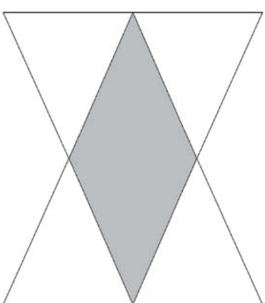

# 第七章

### 联结与分化的机制

既然联结的技巧围绕寻找共同点，联结的机制则是创造并凸显这些共同点的方式。你可能会以为，既然分化的技巧着眼于找出差异，其机制也应如此。这句话没错，只不过联结或分化的机制都属于同一类范畴。最终得到什么结果，取决于你如何使用这些与他人相处的门道。可以把其中每一种都当作一块磁铁：取决于你把磁铁的哪一头指向哪里，它要么吸引，要么排斥。

类别如下：
- 阐述
- 隔离
- 关联

在探讨这些之前，先看看三维钟形图的一些练习，然后深入了解一套削减选项的技巧，你将与阐述、隔离和关联配合使用。

通过设想完整的钟形图，你就能知道一个人的驱动力是什么，从而无论是消极还是积极地运用这些工具来获得最大优势。你可以只看表面，认为杰克因持有大麻被捕，从而加剧他在工作中日渐崩坏的声誉；也可以进一步了解他，指出他在高中的志愿工作能让孩子们参加有益的户外活动。反过来，你也可以因为你邻居会说七种语言而对他抱有敬意，或者公开一个事实：他在多个大洲被开除的原因，是他所谓的中文其实只是酒吧俚语。整体的钟形图能帮助你理解该在何处施力，才能把一个人从群体中分化出来，或者把他联结起来，并提升他作为群体一员的价值。

## 削减选项

不要像对待派对游戏那样看待削减选项。这是本书最阴暗的一节，也是审讯对从业人员和囚犯双方都如此严苛的核心原因。与它相关的唯一正面因素就是结果；技巧本身始终是负面的。

把这最严苛的操控形式看作一种迫使某人在两种选项中抉择的方法：一个“坏”选项——你希望他做、并且与他的需求紧密相关的事情；以及一个“更坏”选项——他自己想做的事。后者之所以更糟，是因为你设计好了结构，一旦他选择它，就会在需求层次上向下移动。这就是为什么我们坚持认为，削减选项本质上是一门黑暗艺术。它也是一个人能学到的、左右人类行为最强的单项技能。切勿随意使用。用错了，结果对你和你的目标都可能是灾难性的。

在2018年10月美国参议院针对布雷特·卡瓦诺法官的确认听证会上，参议员科里

Booker opened his questioning of Kavanaugh with a confrontational statement: “Judge Kavanaugh, you drank on weekdays in high school, not just weekends.” The assertion, delivered with the certainty of someone who was reading one of the Ten Commandments, was the first to hit Kavanaugh behind the knees in a relentless effort to bring him down. When Kavanaugh turned to what appeared to be a copy of his high school calendar and tried to evade the question, Booker returned with: “You drank on weekdays—yes or no, sir?” The senator then extracted a reluctant version of “Yes.”

The coup de grâce, however, was Booker's deft use of paring options. The premise of paring options is forcing a person to choose answer A or answer B—there is no C. They have to do one of the following:

- Choose the answer they want but be at odds with themselves.

or

- Choose to be themselves and be at odds with the situation.

The example from the Booker-Kavanaugh exchange concerns Booker's question about whether or not Kavanaugh ever drank enough in high school to black out.

1. *Choosing to say no puts him at odds with himself if he is an honest man and ever did black out.* Blacking out is not a crime; it's the possible aftermath of drinking heavily, which Kavanaugh admitted he did. He claimed that he had a “sensitive stomach” and that excessive drinking caused him to vomit on occasion; someone without a “sensitive
maintain his esteem while fighting for an apple. As you move up the pyramid, it gets harder and harder to ascend to the next tier, as opportunities to find a new group diminish, or it takes significant effort to gain or regain self-esteem.

Though the opportunities become rarer as you move up the pyramid, the number of actions that could fulfill each of these needs actually broadens. When you are thirsty, hungry, or need shelter or sleep, the options are narrow. When you are at the point of self-actualization, however, the options are endless. All the money in the world will not keep you from dying of thirst while stranded on a raft in the ocean, but maybe you can be self-actualized through having the world's most extensive collection of shoehorns used by Elvis.

If you overlaid a diagram of the hierarchy of fulfillment over the pyramid of Maslow's hierarchy of needs, the result would look like this:

## Situation

You come home and your spouse asks you what you would like to eat. You say you would like lemongrass chicken. Unfortunately, you live in a small town in Kansas where there is no lemongrass at the supermarket and no Thai restaurant within eighty-five miles. In this case, you failed to understand the situation and assess what the possibilities are, so the situation pares the options.

Would you ever drink water with rat feces in it? Of course not. How about cow feces? At this point, you think we lost our train of thought even asking that question. But what if your only source of water was either a well suffering from a rat infestation or a muddy pond where cows hung out? That is precisely the choice that Maryann faced in her first Eco-Challenge, a race encompassing more than 376 miles of spectacular Utah wilderness, much of which also happened to be very, very dry. Racers who made it as far as the well and the pond—many did not—all faced the same options: 1) use some fabric as a filter as you pour the contaminated water into a bottle and add iodine; or 2) go into a state of dehydration and get kicked out of the race. About 100 people chose to drink the water. Maryann would normally not have considered that an option, but the situation forced the issue. In this case, she was still functioning at a high enough level for the dynamics of both triangles to meet. She opted to forgo

esteem and drink dung water rather than walk away from the race and further shatter her esteem.

In a very real-life situation, in which there were no camera crews or other people around, the majority of people would opt for the same decision, not for esteem reasons, but for the most basic reason of thirst.

This diagram shows the real imperative—the real choice of options in the diagram below. No matter what the magical mystery self-help books say, for real human beings, the true options are limited. The shaded diamond delineates the area of actual options and it reflects these premises:

- 1. **Few people have the ability to move their reality to the point that their self-actualization tier (the peak of Maslow's pyramid) can touch all of the possible options.** Why? Your operating system and the output of what's running on it (experiences) limit your capability to maneuver through the tiers, so as you move up the tiers, the options become slimmer. The resulting possible options are based on situation and prior decisions.

## 2. *The broadest range of possibilities for most of us exists in the tier of belonging and love.* Does that really surprise you when you think about how many people never truly get to the point of real self-esteem?

How you perceive yourself in terms of possibilities also narrows your options. Look at your own core personality and the 3-D bell that represents your strengths and weaknesses, your ordinariness, and your differentiation. There are only so many things that will allow you to get to the point of self-actualization. The universe of possibilities is large, but not for an individual with a limited number of talents and interests, which is really any of us.

On a theoretical level, there are infinite ways for humans to become self-actualized, but on a practical level, they narrow. If we carried no baggage from the past, any given thing could satisfy that need; but every decision limits the next, and before you know it, the options are narrow. Once you acknowledge this, you negate the

presumption that people have unlimited ways to feel truly satisfied. As you go toward the base of Maslow's hierarchy, there are fewer ways to satisfy the needs on each level. As you keep dropping down, the more primate the need, the fewer the natural options. So the broadest range of options lies in the place where the monkey and the man meet: belonging and esteem.

Your knowledge of this reality combined with your situational awareness and analysis of an individual enable you to get people to do things they cannot imagine. That level of control starts with putting yourself in the right circumstance. Regardless of what it takes to satisfy someone's needs, if you have control of the circumstances, you can manage a person's perception of the possibilities.

## The Landrum Factor

In codifying the process of paring options, we chose to name the system after Don Landrum, the most efficient practitioner of paring options Greg ever met. Don was a Vietnam-era special forces soldier, a Green Beret who was one of the founding members of the SERE school.

Greg worked with Don when Greg was in his twenties, so he had a number of years to practice and integrate the operational principles he saw Don use. In a nutshell, his art was the ability to make people see life as mundane and limited, even when it's not.

The diagram illustrates that at the heart of the possibilities to fulfill your needs and inside the narrowed options based on situation is a very narrow band of real—not imagined—possibilities. This band of possibilities is much narrower than the original for one simple reason: self-image.

Through manipulation, skilled interrogators can easily convince sources that, in areas where they think they are typical, they fall woefully short of the mark. And in areas of pride, they are just typical. You can manage this in three ways:

- Isolation
- Illustration
- Association

## Isolation

You do not have to lock your target in a cage. Merely separating the person from the support group that props up his self-image will accomplish isolation. For example, you accompany the local office Goliath—she has the highest equipment sales in the county—to a national sales conference. Although others may know her name, it is by no means a household word. If she starts to raise her head in a way that undermines your agenda, you can quickly

击倒她，因为在这种情况下，她的力量基础和自我形象绝缘体并不围绕着她。一个自然的做法可能是强调这个县有多小。

你也可以让孤立成为一种人为的、蓄意的练习。你可能会选择在她最喜欢的餐厅安排一次会面。最后一刻，把餐厅换成一个每个人都认识你名字的地方，只是为了让她失去平衡并削弱她的自我形象。最强大的效果是消除任何自我形象强化的来源。

孤立是一种强大的策略，当它无意中发生时，甚至可以成为一种阴险的杀手。它有唤起一种个人灭绝感的力量。

我们每个人内心都隐藏着需求和欲望。让我们称之为“隐藏的马斯洛”。自我形象与你的隐藏马斯洛相连。因为这些需求和欲望可能被包裹在一个人的内心，其他人可能完全不知道它们是什么，从而无意中孤立了她，造成深层的精神创伤。

卡罗尔以举办奢华派对而闻名，而且这些派对总是为了别人。生日、订婚派对、周年纪念晚宴——她多年来举办了这么多，以至于人们开始期待并依赖她的慷慨。整个职业生涯中，她都攀升到专业领域的顶峰，所以她有钱举办盛大的活动；她的收入超过了她前夫的任何时候。她的女儿们期待着盛大的婚礼，并且如愿以偿。

她持续的需求是看到别人表达喜悦，但与之相连的是看到这种喜悦与她相关。随着岁月的流逝，她被宠坏的女儿们给了她爱，但从未似乎将卡罗尔的慷慨与爱联系起来。她的朋友们做到了，但她开始怀疑他们的感情。她做得够吗？他们爱的是她这个人吗？这些问题困扰着她，并在她写下的最后一封信中浮现。

卡罗尔在2013年一个星期五晚上入住了舒适的酒店。那不是一个豪华的地方；那是一栋紧邻高速公路的低层建筑。她开车去那里，提着一个小包，沿着水泥楼梯上到建筑尽头的房间。

卡罗尔用塑料布盖住床垫。她写了一封道歉信给女佣并留下500美元的小费。她的遗书和遗嘱仍留在行李箱里。躺在床上，她朝嘴里开枪。

她的行为是一种戏剧性的、体面的方式来传达关于孤立的关键信息，尽管可以肯定地说这并不是她的本意。当周围的人不支持你努力满足你的隐藏马斯洛时——即使他们不知道你深切需要和想要什么——痛苦可能对一些人来说太难以忍受。

卡罗尔的故事涉及一个界限分明的时刻，但有多少人经历孤立并试图通过以社会可接受的方式加速死亡来应对，例如酗酒？当谈到孤立的体验时，自我觉察比觉察那些滋养或 starve 他人自我形象的东西更重要。

在卡罗尔的案例中——就像许多自杀案例一样——虽然她的层级需求在外部似乎得到了满足，但在内部却没有。她没有尝到她渴望的满足感。

## Illustration

通过举例说明，你问他足够多的问题，以消除他对自己掌控话题和在特定情况下拥有无限选择的概念。一旦一个人开始看到自己的不足之处，他认为可用的选择就会受到限制。当你使用举例说明时，你的提问和倾听技巧可以 pinpoint 他不愿说出的事情以及与满足群体核心要求相关的不足感。一旦确定，你就通过有意提问来攻击它们。

唐·兰德鲁姆引用了老话：“一个白痴可以问足够多的问题，让一个智者看起来像个傻瓜。”他会问你来自哪里，并问关于你家乡的问题，直到他知道关于你城镇的一些你不知道的事情，或者只是知道一些你无法回答的事情。

我们每个人吸收和处理信息的方式略有不同。像唐·兰德鲁姆这样出色的提问者可以如此熟练地问谁、什么、何时、何地、为什么和哈？的问题，以至于你会发现自己被逼到墙角，无法回答关于自己家庭的问题。

## Association

结盟的艺术利用了这样一个想法：每一次选择都会消除另一种选择。通过显示与一个群体的关联，你就消除了与另一个群体建立联系的能力。结果是，你将一个人的选择缩小到比情况所规定的更少。

另一种阴险的结盟形式依赖于你在该群体 alpha 上的使用 3-D 铃。你确定他不足之处并突出它。因为那个 alpha 在你的目标的世界中享有超典型地位，这个群体能有多伟大？与这个被玷污的 alpha 领导的群体关联突然表现为负面。

当削减某人的选择时，你传达的信息是：他要么遵循你铺设的通往满足的道路，要么按自己的意愿行事，后果未知。你缩小选择范围，以至于他唯一能够归属或继续区分自己的方式就是做你想让他做的事，走你为他选择的那条路。那条路有吸引力，因为
你将其与满足他在层级中迫切需求的承诺联系起来。

在审讯世界中，这很简单。双方是敌人，一方依赖另一方。（审讯者通常由于时间限制而强硬；他拥有控制的奢侈，而你拥有时间的奢侈。）基于导致这种情况的事件链，囚犯的选择非常有限。审讯者可能会走欺骗的道路，要求囚犯给他一些价值可疑的东西，然后让囚犯觉得他交出了大量信息。审讯者随后利用这一点作为杠杆对囚犯说：“我会告诉整个监狱人口你刚刚帮助了敌人，除非……”。信息很明确：审讯者将以负面方式将这个囚犯与他所属的群体区分开，使他成为局外人。

害怕失去同志情谊，囚犯要求审讯者不要披露信息。审讯者总是愿意“帮忙”，告诉囚犯如果他只是帮助审讯者完善细节，他就无需向其他人透露任何事情。囚犯面临两难：交出更多细节以在狱友面前保住面子，还是坚持原则不再说任何话。选择神圣原则意味着他不仅会失去一开始就谈话的名声，更重要的是，他还会失去同胞的归属感。违反一次以挽救这种纽带的诱惑占了上风。

将其推向更极端的程度。一个走进情况时感到自信但自尊受挫、同伴被他孤立、身体健康受到威胁的人，已经跌到最底层——生理需求的水平。审讯者已经削减了他的选择，以至于他会为了一个饼干而做被要求做的事。记住，饼干不是奖品；饼干阴险地与心理联系在一起。

在历史频道的 *We Can Make You Talk* 中，格雷格和他的同事面对来自不同背景的志愿者，但他们都带着自信进入为期两天的模拟，认为自己会表现良好。其中一个年轻人特别以他的学术资格为傲；他进入这个角色扮演练习时断言，他会让这些来自美国陆军的蠢货看到他能让他们蒙羞。

他是一位28岁的自我实现型大学教授，发现他的头衔和学位在那种环境中一文不值。他所有的傲慢态度只会促使我们以旨在打破他的心理技术全力以赴。那些资格令人印象深刻，而且仍然如此，但我们永远不会通过说那样的话来强化他的自我形象，他的狱友也不会，他们有自己的自我形象需要担心。他被与崇拜者隔离开了。

这个家伙进入模拟时认为自己是与众不同的——聪明、受过良好教育、出身良好——但我们把他削减到只剩下足够的尊严来归属的地步，并让他知道如果他再做一件违背我们的事，我们就会剥夺他的尊严，他将只能为归属而挣扎。

当格雷格和他的审讯同事采访他时，他们抓住每一个机会指出给这位高瘦的家伙，他在身体上并不出众。对于一个年轻人来说，这是一个容易的起点。移动的严苛和真人秀绑架的身体性质给所有参与者带来了代价。团队中有女性比教授表现更好——审讯者没有浪费这一点。他们指出给教授，一位年轻女性

## 削减选择：怎么做

SERE学校以及为电视拍摄的审讯模拟捕捉的是极端情况，在此情况下，受试者很可能会一路跌至需求层次的最底层。如果你的工作场所发生类似情况，那你很可能是在最高戒备监狱工作。

第一步，为你想要影响的人绘制钟形曲线。这个人是否像我们描述的模拟中的年轻大学教授那样，是一个自我实现、超典型的人？还是他在为满足需求层次中较低层次的需求而挣扎？

你要把一个人从自我实现的状态拉下来，做法与审讯员对待那位大学教授的方式完全相同：你不承认他的差异化特质有任何价值。你不把奥普拉·温弗瑞当作媒体大亨，而是把她当作来自密西西比的穷孩子来交谈。你让这个人觉得她必须向你证明她不仅仅是如此。你管理这个人的状态。

依附者——那些不确定自己在群体中位置的人——是合理的攻击目标，因为他们勉强维持着自己在群体中的地位。玛丽安认识一位女士，她的口音最好被形容为“独特的欧洲口音”；她甚至从未离开过美国，也没有说话怪异的家人。她的口音让一些同事着迷，他们觉得这位漂亮聪明的女士竟然自创了一种奇怪的口音，非常有趣。然而，群体中的大多数人对这件事并不太在意。后来，群体中一个相对不受欢迎（也就是亚典型）的人当面指出了这一点，那感觉就像他把靴子踩到她头上，把她踢下了社交阶梯。所有人的目光都落在了她身上。

片刻之间，在场的人眼中，她的古怪压过了她有趣可爱的形象。那位同事把她打落到他自己的亚典型水平。通过攻击她在群体中的地位，并迫使她为了保住自己在社会结构中的位置而仓促做出正常化的举动，他实际上做到了两件事：他夺走了她的差异化特质，并迫使她为自己的归属感而担忧。那瞬间的个人疑虑，就是人际关系中的上风。在这种情况下，他几乎没有什么可失去，而她几乎没有什么可得到。

本书的大部分内容都依赖于一些技巧，让你可以在马斯洛需求层次中提升或降低某人。最好的解决方案是让人上升，因为你将被视为富有魅力和善良。如果你使用与削减选择相关的这套技巧，你的目标就是让人们沿着需求层次下行。很少有人——至少没有哪个有自尊的人——会善待你。想想你自己的声誉和你对归属感的需求。这不是儿戏。

## 让他跌落

当你让人沿着需求层次向下移动而不是向上时，削减他们的选择要容易得多。他们剩下的唯一选择，就是那些能满足当前层级需求的选择。如果他们不按你的要求去做，他们就会限制自己成长的选择；更糟糕的是，你把他们推得更低，他们的选择会变得更加狭窄。

依靠目标的3D模型，把完整的人放在他的世界中观察，你会看到他的骄傲之处在哪里。要明白，这些骄傲之处可能与你试图操纵他所对抗的群体归属毫无关系。即使你是在利用他相对于工作同事的杠杆，而他最大的优势并不在工作中，你可能看不到其中的关联，但关联就在那里，可以当作杠杆。

原理是这样的：他会为自己最伟大的成就感到非常自豪，所以你可以利用这种自豪感和说明工具，以一种使他脱离群体常态的方式将他差异化。我们说的“脱离”并不是让他感觉优越或交到朋友——恰恰相反。你想用一种让他看起来像精英或怪咖的方式来突出他的特殊才能：“厄尔，上个月去丹吉尔岛的那场破船赛怎么样？”他回答说那是一场帆船赛，于是他不禁给人留下傲慢的印象。

自我形象驱动着这一切，所以对他来说，在受保护的外部群体中完全正常的事情，一旦你开始具体说明它的含义，就可能显得怪异。例如，格雷格参与一项运动，人们穿着盔甲，用棍子互相猛击对方。他在商业世界中与高尔夫球手共事，要能经得起别人对这个爱好的审视，需要特定的性格类型。在该运动被视为正常的圈子里，他所做的事不会让人侧目。但站在一群完全不了解细节、反复追问这项爱好精妙之处的人中间，就足以让一个缺乏自信的人失去重心。要判断你是否对影响这样的人有了“门路”，最简单的办法是：找到一个人，他在你所应对的群体之外高度差异化，但该群体中几乎没有人知道这种差异化。

一旦你开始把目标从群体中分离出来，下一步就是给他一个出口，让他重新与群体连接，并与你的成功捆绑在一起。你可能会就一个此前一直反对你的决定寻求共识

正如我们在后续章节中讨论的，还有其他更微妙、更友好的合作方式。
