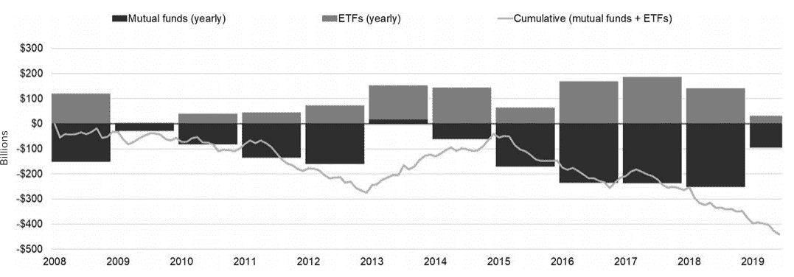

# 致谢

多年来我一直想写一本书，但由于公司限制和时间投入，从未能开始这段旅程。我撰写了数十份白皮书、博客和文章，涉及本书中涵盖的部分主题和话题，并在过去二十余年里在数百场会议上就不断变化的财富管理格局发表过演讲。我阅读了关于华尔街历史、投资策略、行为金融学和现代投资组合理论的数百本书，但我感觉存在一个空白：一本专门为财富顾问撰写的书，为其不断发展的执业模式、价值主张和投资才干提供指导。本书也面向那些长期自己做出投资决策的高净值投资者。

在撰写我的第一本书时，我很幸运有一支团队在整个过程中给予帮助。我的咨询委员会鼓励我写书，因为他们认为我有有价值的内容可以分享。他们审阅了章节，提供了建设性反馈，并撰写了评论。我谨向 John Nersesian、Margaret Towle、Alan Reid、Scott Welch、Jamie McLaughlin、Christine Gaze、Bob Powell 和 Halvard Kvaale 表示感谢，感谢他们的指导与友谊。

Hans Jepson 和 Charlie Schulman 对我早期关于投资和与富裕家庭打交道的看法产生了影响。他们敢于给一个没有投资经验的年轻农场男孩一个机会。Hans 和 Charlie 教给我许多宝贵的教训，这些教训促使我写了这本书，多年后，我很荣幸能将他们视为朋友和导师。

超过 25 年来，我有幸以各种身份参与投资与财富学会的工作，曾在董事会任职，担任多个委员会（全国大会、政府关系和提名委员会）的主席，并目前担任 *投资与财富监测* 编辑咨询委员会主席。该组织提供认证项目、高级教育和前沿的思想领导力。它将常春藤联盟教授提供的学术严谨性与策略师和行业专家提供的实践应用相结合。

会议和出版物帮助塑造了我的观点和视角。许多员工和志愿者已成为朋友。Sean Walters（首席执行官）为我的书撰写了前言；Devin Ekberg（首席学习官）和 Debbie Nochlin（编辑总监）协助编辑和推广我的书。我要感谢编辑咨询委员会识别行业面临的挑战与机遇。你们帮助塑造了本书所探讨的不断变化的格局。

我要感谢 Kevin Sanchez、April Rudin、Keith Black、Lule Demmissie、Joe Burns 和 Tatiana Esipovich 阅读我的手稿并提供反馈。我很幸运能与行业内众多顶尖财富管理人合作，包括 Alex Williams、Peter Rukeyser、Rob Sechan、Jim Schlueter、Mike Appleton、Ivar Bolander、Brian Ullsperger、Dorothy Bossung、Todd Wagenberg 和 Noel Paccaro-Brown。你们通过对自身及执业的投入和奉献，提升了这一职业。多年来，我的行业朋友一直支持我，包括 Liz Ann Sonders、Laura McDowell、Garry Bridgman、Betsy Piper-Bach、Libet Anderson、Jonathan Golub、Bob Worthington、Bruce Stewart、Donal Mastrangelo、Becky Bowler、Jeaneen Terrio、Pete Sloan、Brett Wright、Joel Schiffman、Luke Collins、David Archer 和 Peter Gorman。

当我讨论写书时，有人告诉我需要一位代理人，这或许是我收到的最好的建议。我的代理人 Leah Spiro 在此首次航行中一直是我的指路明灯。她从一开始就信任我，并在整个过程中提供了明智的建议。Leah 帮助我将手稿呈递给行业内顶尖出版社，并帮助我评估出版本书所收到的报价。

我选择麦格罗希尔（McGraw Hill）主要是因为 Stephen Isaacs。Stephen 喜欢我的早期手稿，并了解我瞄准的受众。他拥有令人印象深刻的资历，与投资行业众多顶尖作者合作过，但在整个过程中始终平易近人且易于接触。他的团队，包括 Judith Newlin、Scott Sewell、Steve Straus 以及其他许多人，在编辑、出版和推广《目标导向投资：财富管理的远见框架》的各个方面都提供了专业且有帮助的支持。

我要感谢 Natalia Cervantes，她在本书的营销和推广方面起到了关键作用。Natalia 帮助我建立了网站、社交媒体影响力以及关于本书的整体知名度。她对这个项目充满热情，她的专业知识帮助触达了不断扩大的受众。

最后，我要感谢我亲爱的妻子 Sovy 以及我们两位才华横溢的女儿 Stephanie 和 Megan。她们都是充满热情的教师，帮助教育下一代，并为这个不断变化的世界做好准备。我知道她们将在下一代中做出改变，并激发将使她们受益的好奇心。我们的家庭一直致力于做出改变和教育他人。

将文字写在纸上花了几个月时间，但我的经验和观点源自几十年，常常需要花数周时间出差会见客户并在会议上发言。错过了太多生日、纪念日和特殊活动。我的家人一直明白这是我工作的一部分，并且我正在努力帮助顾问和投资者实现更好的结果。我很幸运拥有一个充满爱心的家庭和强大的支持系统。

# 前言

我最初在纽约举办的投资咨询会议上认识 Tony。他热情地解释自己为摩根士丹利顾问制定的“阶梯式”职业发展方法。在当今的资质认证领域，他教育顾问的方法将被定义为“可堆叠式”。他的想法放在今天都属于前沿，更不用说 15 年前我遇到这位来自行业领先咨询公司的友好慷慨的高管时了。

应邀为我们志愿者社区中一位最多产、最深思熟虑的主题专家的新书撰写前言，我深感荣幸。自 2010 年以来，我一直担任非营利组织投资与财富学会的首席执行官。投资与财富学会是一个专业协会，代表世界上最优秀的顾问讨论当下最紧迫的问题，并有学术研究作为支撑。

然而，为像 *目标导向投资：财富管理的远见框架* 这样广泛而全面的著作做铺垫，这一想法略显令人生畏。本书探讨了我们组织曾投入整个课程、会议、出版物和研究的主题。我很幸运能够旁听十年来关于本书所呈现主题的对话：财富管理的演变与未来、主动与被动投资、另类投资、私募市场、可持续投资以及目标导向投资。Tony Davidow 一直是众多……的中心支柱

这些对话持续了25年以上。Tony 在我们的投资管理分析师认证（Certified Investment Management Analyst）项目中任教，主持了数十场教育讲座和网络研讨会，并多年担任我们屡获殊荣、经同行评审的出版物《投资与财富监测》（Investments & Wealth Monitor）的编辑。2020年，他获得了我们享有盛誉的J. Richard Joyner财富管理影响力奖，该奖项授予在私人财富管理领域做出卓越贡献的个人。

本书的出版恰逢其时。现代财务顾问职业的历史还不足半个世纪。财务规划运动正式始于1969年，当时成立了国际财务规划协会（International Association for Financial Planning，现为财务规划协会、金融规划学院和认证理财规划师委员会）。投资咨询运动正式始于1985年，当时成立了投资管理顾问协会（Investment Management Consultants Association，现为投资与财富学院）。这两场运动以巨大的方式惠及了公众，为财务顾问树立了日益提高的专业标准，并改变了雇佣或服务于财务顾问的行业。

多年来，我们的研究所一直在对与顾问合作的客户进行研究，以期了解优秀顾问与优良顾问之间的区别。这项研究告诉我们，客户的基本期望是：他们的顾问秉持职业道德，帮助他们实现目标，并将客户利益置于其他竞争性利益之上。除此之外，他们还期望专业知识、个性化的方法、先进的能力、卓越的服务和有意义的指导。

这些差异化特征确实是本书的实质与核心，也是Tony多年来潜心钻研的工作的核心内容。15年前我们相识时，Tony就已走在时代前列，如今他比大多数人更清晰地看到：由于许多因素，财富管理职业正在快速转型——监管、新商业模式的竞争以及技术进步正在推动顾问开展业务的方式，并改变建议交付模式以满足客户期望。

好消息是，只要具备正确的技能和能力，就能驾驭财富管理的未来。顾问将通过与投资和财富管理行业同步发展而继续取得成功。本书致力于为当今的从业者提供更成功所需的知识，并涉及成功顾问已经开始或已在其实践中取得成功的关键趋势。

我为Tony Davidow及时带来《基于目标的投资：财富管理的远见框架》（Goals-Based Investing: A Visionary Framework for Wealth Management）而喝彩，该书为我们提供了切实可行、创新的解决方案，用于提供财富管理服务和财务建议，其基础是全球适用的投资管理原则。读者必将大开眼界！

Sean R. Walters，投资与财富学院首席执行官

本页故意留空

# 引言

金融服务行业正处于关键转折点。由于内在的利益冲突，华尔街公司正受到审查，机器人威胁要取代财务顾问。财务顾问正努力在投资者眼中保持相关性和价值，他们的费用也面临压力。许多人正在转型成为财富顾问，这需要扩展一套能力。大量新产品涌入市场，顾问和投资者需要帮助以有效地使用它们。过去十年，该行业经历了快速转型。《基于目标的投资：财富管理的远见框架》（Goals-Based Investing: A Visionary Framework for Wealth Management）探讨了这种转型的影响。

在当前的市场环境下，财富顾问需要发展其投资方法，以更好地服务客户。《基于目标的投资》为满足客户需求提供了一个框架。财富顾问需要扩大资产类别的数量，以识别投资机会并充分分散其管理投资组合中的风险。现代投资组合理论已不再现代，后现代投资组合理论也已过时。金融市场的相互关联程度前所未有：中国发生的事情会影响全球市场，地缘政治风险、人口结构变化、技术进步以及全球各地的社会紧张局势也是如此。

幸运的是，过去几十年投资产品发生了显著演变，这使得顾问和投资者更容易进入各种市场细分领域和独特资产类别，例如对冲基金、私募股权、私人信贷和实物资产。交易所交易基金（ETF）、注册基金和联结基金有助于使投资普惠化。《基于目标的投资》考虑了涌入市场的新产品的一些结构性权衡，并探讨了财富顾问在构建和管理客户投资组合时如何有效地融入这些新工具。财富顾问需要发展其业务和价值主张，以跟上飞速发展的行业步伐。否则，他们将面临被商品化并被淘汰的风险。

## 应对这些挑战

多年来，我一直在研究、撰写、培训和演讲，面向数以万计的顾问，主题涉及为高净值（HNW）投资者提供服务、先进资产配置、因子投资以及另类投资的作用和应用等多样化领域。在我35年的职业生涯中，其中包括在施瓦布、古根海姆投资、摩根士丹利和基德皮博迪等机构任职期间，我始终将教育放在首位，使顾问和投资者都能获得更充分的信息。我直接与数百个高净值和超高净值（UHNW）家庭合作，开发和实施资产配置策略，并与大型机构和家族办公室密切合作，提供一系列咨询服务。事实上，我最初在一个大型家族办公室工作开启职业生涯，并获得了贯穿整个职业生涯都极其宝贵的经验。

在整个职业生涯中，我一直寻求比我更聪明的人，并且经常挑战传统观念，无论涉及投资理论还是如何与客户互动。许多导师塑造了我对世界的看法。反过来，我指导了许多年轻专业人士在其职业旅程中前进。多年来，我很荣幸结识了许多诺贝尔奖获得者，包括哈里·马科维茨、比尔·夏普、尤金·法玛、罗伯特·默顿、理查德·塞勒、丹尼尔·卡尼曼和迈伦·肖尔斯。我对他们的天才敬仰有加，并为他们的贡献感激不尽，因为该行业已从学术理论发展为实际应用。

我曾与数千名拥有各种专业认证的顾问合作，包括CIMA®（投资管理分析师）、CPWA®（私人财富顾问）、RMA®（退休管理顾问）、CFA®（特许金融分析师）和CAIA®（特许另类投资分析师）。这些经验丰富的顾问是《基于目标的投资》的主要读者，特别是侧重于为高净值（HNW）投资者（可投资资产100万至2000万美元）和超高净值（UHNW）投资者（可投资资产2000万美元或以上）提供服务的顾问。为HNW和UHNW投资者提供服务的财务顾问认识到，需要高级教育才能充分满足客户需求。我将这部分财务顾问视为“终身学习者”：不断寻求学习并投资于自身。他们认识到事物没有一成不变，那些不发展进步的人面临着被淘汰的风险。

本书还探讨了家族办公室、多家族办公室（MFO）和经验丰富的高净值投资者面临的挑战，这些投资者以拆分的方式利用多位专家。家族办公室和MFO通常雇佣投资和税务专业人士，专注于寻找独特的投资机会（例如私募股权、私募房地产、私人信贷和对冲基金等），这些机会可以整合并在多个账户（个人、信托、家族基金会等）中访问。家族办公室和MFO专业人士在各种公司之间拥有多重关系，从传统的投资管理到私募股权和税务规划。家族办公室通常设有一个或多个基金会来资助慈善活动，并可能配备专门人员来管理基金会。

本书还为经验丰富的高净值投资者提供可借鉴的见解，这些投资者中许多人曾在金融服务行业工作或出售了自己的公司，可能在特定市场细分领域拥有核心能力，但正寻求在其专业领域之外实现多元化。我的许多

朋友们曾经或目前在财富管理公司、资产管理人、对冲基金、私募股权和房地产公司工作。他们可能不需要在其专业领域获得帮助，但可以从非捆绑建议中受益，以补充其专业领域。基于他们的经验，他们可能不会以传统意义上使用财务顾问，并可能聘请多位专家来寻找想法和投资。

高净值（HNW）和超高净值（UHNW）投资者专注于实现家庭目标、向后代转移财富、资助慈善事业以及设立信托以保护财富等问题。他们可能投资于对冲基金、私募股权、私募信贷和实物资产等复杂投资。HNW 家庭可能偏好社会责任投资，使其投资组合与目标保持一致。*目标导向型投资*旨在为应对不断变化的环境中的家庭需求提供一个框架。为了使这些概念生动起来，我在整本书中融入了个人经历和案例研究。

## 金融服务业现状

> 坚持健全的政策，无论顺境逆境，既是极其困难也是极其重要的工作。这就是为什么投资者可以从制定并坚持健全的投资政策和实践中受益。对自己承诺的不忠成本可能非常高。
>
> Charles D. Ellis
> 《输家的游戏》：
> 成功投资的永恒策略

金融服务业正处于关键转折点。要在这种新环境中取得成功，财务顾问需要了解环境是如何变化的，以及他们必须如何演变自己的方法。本章通过介绍行业面临的广泛挑战以及财务顾问面临的具体挑战，为本书其余部分提供了背景。拥抱这些变化并主动适应的顾问，比抗拒变化并试图遵循越来越过时的策略手册来与客户合作的顾问更有可能取得成功。

对投资者来说，理解术语以及各方扮演的角色通常很令人困惑。在深入探讨行业现状之前，让我们先确定关键参与者及其各自的角色。

### 表 1.1 财富管理中的关键参与者

| 参与者 | 用于描述公司的其他名称 | 示例 | 角色 |
| :--- | :--- | :--- | :--- |
| 财富管理公司 | 全方位服务公司（wirehouses）、注册投资顾问（RIA）和独立经纪商 | Morgan Stanley, Merrill Lynch, Goldman Sachs, UBS, Raymond James, LPL, and Hightower | 为财务顾问提供研究、尽职调查和运营支持。为与客户合作的财务顾问提供规模和效率。 |
| 财务顾问 | 财务顾问、财富顾问和投资顾问 | 财务顾问为财富管理公司工作。 | 向客户提供各种问题的建议。可能聘请资产管理人提供投资建议。 |
| 托管人 | N/A | Schwab, Fidelity, Pershing | 向RIA提供托管服务、技术、研究和交易支持。 |
| 资产管理人 | 投资经理和资金经理 | Blackrock, PIMCO, Fidelity, Vanguard, JP Morgan, American Century, Nuveen 等 | 通过各种结构管理资金，包括共同基金、单独管理账户（SMAs）、交易所交易基金（ETFs）和对冲基金。 |

多家公司身兼多职，这可能会增加投资者的困惑。Morgan Stanley、UBS 和 Goldman Sachs 是同时拥有零售和私人财富部门（可投资资产超过 1000 万美元）以及资产管理子公司的财富管理公司。JP Morgan 是一家拥有零售、私人财富和资产管理业务的银行。Schwab 和 Fidelity 是拥有零售和资产管理业务的托管人。Blackrock 和 PIMCO 是向零售、高净值和机构投资者提供投资解决方案的资产管理人，包括单独管理账户（SMAs）、共同基金、交易所交易基金（ETFs）和另类投资策略。

### 费用压缩与利益一致

行业面临的一个挑战是，财务顾问向客户收取的费用面临越来越大的压力。公众对顾问提供的财务建议持更加怀疑的态度。越来越多的客户向他们的顾问问道：“你是在为我服务？还是在为你自己服务？”关于客户支付的内容以及是否物有所值，也存在困惑。

20 世纪 80 年代，财务顾问的报酬大部分以佣金形式获得。他们因推荐个股、债券、共同基金和年金而获得报酬。他们的激励是产生大量活动以增加佣金。事实上，财富管理公司通常会设定每种产品需要产生多少佣金的目标。产生大量佣金的财务顾问会获得激励旅行、更高的报酬和高管头衔（副总裁、高级副总裁、执行董事、董事总经理等）的奖励。

20 世纪 90 年代初，行业开始采用另一种更好地协调顾问活动与客户利益的薪酬结构。许多财务顾问不再仅依赖佣金，开始采用某种形式的顾问模式，其报酬基于客户的管理资产。这种结构更好地协调了顾问和客户，因为顾问现在被激励去增加管理资产。顾问与客户共享成功：资产越多，顾问的费用越高。

虽然这对行业来说是朝着正确方向迈出的一步，但客户认为能够跑赢市场是顾问的价值主张所在。顾问费结构仅考虑客户的投资组合。客户通常不直接为财务规划工作、退休规划、遗产规划、持有未受管理资产以及一般咨询服务支付费用，尽管这些服务提供了重要价值。

在客户心中，顾问的价值往往过于简单地等同于跑赢市场的能力。在 20 世纪 90 年代牛市期间，顾问可以大谈客户投资组合增长得有多好，他们的报酬也随之大幅上涨。顾问接受了一种观念，即他们的价值主张在于接触世界一流的投资经理并增长客户的管理资产。财务顾问可以在经理费用基础上收取溢价费用，因为随着市场创出新高，投资结果强劲。

2000 年代开启了一个新环境，随之而来的是互联网泡沫破裂（2000 年）和全球金融危机（GFC；2008 年）。许多客户倾向于追求回报最高的策略，因此当互联网泡沫破裂且技术股密集型策略价值大幅下跌时，他们付出了惨重代价。许多顾问通过指责投资经理来推卸责任，而这些经理很容易被替换。

互联网泡沫之后，许多顾问再次陷入向客户推荐明星经理的陷阱。这些并非主导 20 世纪 90 年代末期的技术密集型增长经理。相反，奉行沃伦·巴菲特价值观和美德的价值经理成为了新宠。他们声称，其纪律严明的方法能让投资者远离另一次像互联网泡沫那样的灾难。这些经理声称拥有识别低估公司和避免爆雷的洞察力和技能。

财务顾问还开始鼓励投资者将资产配置到国际和新兴市场。这些市场提供了多元化收益，并帮助投资者抵御影响美国市场的事件。国际和新兴市场经理夸耀自己能识别出下一个微软、苹果或谷歌。这是一个非常引人入胜的故事，数据显示 2000 年代初美国境外的投资回报强劲。

如图 1.1 所示，2003–2007 年和 2009 年，新兴市场是表现最好的资产类别。因此，许多顾问在 2008 年全球金融危机来临前向客户推荐新兴市场经理，也不足为奇。当然，GFC 影响了几乎所有市场板块，导致标普 500 指数下跌 37%，国际市场下跌 43%，新兴市场下跌惊人的 53%。

许多投资者在互联网泡沫和全球金融危机后感到震惊不已。他们开始质疑拥有顾问的价值。*我的顾问真的能跑赢市场吗？顾问能接触到最好的投资经理吗？我们的利益真正一致吗？*

过去几年中，我们目睹了大量费用压缩。这部分是由更低成本的解决方案、日益激烈的竞争格局以及对顾问价值缺乏认识所推动的。投资者常常觉得他们收到的建议千篇一律，因此是一种商品。

许多顾问已将 ETFs 作为基石加以采纳，但这并未降低财务顾问的价值。事实上，这表明顾问专注于提供低成本的市场敞口。顾问的价值在于组合适当的底层投资，以最大限度地提高实现客户目标的可能性。为了有效做到这一点，财务顾问必须以产品中立的方式考虑成本、税收效率和绩效。财务顾问可能需要重新描述向客户介绍其服务的方式，但他们不应仅仅因为使用了更便宜的解决方案就感到必须打折扣。

### 图 1.1 资产类别收益率（2000–2009）

| 2000 | 2001 | 2002 | 2003 | 2004 | 2005 | 2006 | 2007 | 2008 | 2009 |
| :--- | :--- | :--- | :--- | :--- | :--- | :--- | :--- | :--- | :--- |
| 核心债券 11.6% | 核心债券 8.4% | 核心债券 10.3% | 新兴市场 56.3% | 新兴市场 25.6% | 新兴市场 34.5% | 新兴市场 32.6% | 新兴市场 39.8% | 核心债券 5.2% | 新兴市场 78.5% |
| 国库券 6.0% | 国库券 4.1% | 国库券 1.7% | 美国小盘股 47.3% | 国际发达市场 20.1% | 国际发达市场 14.0% | 国际发达市场 26.9% | 国际发达市场 11.6% | 国库券 1.8% | 高收益债券 63.5% |
| 高收益债券 -2.0% | 美国小盘股 2.5% | 新兴市场 -6.0% | 国际发达市场 39.2% | 美国小盘股 18.3% | 美国大盘股 4.9% | 美国小盘股 18.4% | 核心债券 7.0% | 高收益债券 -28.4% | 国际发达市场 31.8% |
| 美国小盘股 -3.0% | 高收益债券 -1.1% | 高收益债券 -10.0% | 高收益债券 34.1% | 高收益债券 11.3% | 美国小盘股 4.5% | 美国大盘股 15.8% | 美国大盘股 5.5% | 美国小盘股 -33.8% | 美国小盘股 27.2% |
| 美国大盘股 -9.1% | 新兴市场 -2.4% | 国际发达市场 -15.7% | 美国大盘股 28.7% | 美国大盘股 10.9% | 高收益债券 3.1% | 高收益债券 12.0% | 国库券 4.7% | 美国大盘股 -37.0% | 美国大盘股 26.5% |
| 国际发达市场 -14.0% | 美国大盘股 -11.9% | 美国小盘股 -20.5% | 核心债券 4.1% | 核心债券 4.3% | 国库券 3.0% | 国库券 4.5% | 高收益债券 2.1% | 国际发达市场 -43.4% | 核心债券 5.9% |
| 新兴市场 -30.6% | 国际发达市场 -21.2% | 美国大盘股 -22.1% | 国库券 1.1% | 国库券 1.2% | 核心债券 2.4% | 核心债券 4.3% | 美国小盘股 -1.6% | 新兴市场 -53.3% | 国库券 0.2% |

不认为有顾问组建投资组合有任何价值的客户，可能会选择使用 ETF 自行构建投资组合。事实上，在上涨的牛市中，投资者常常认为自己不需要任何投资帮助。20 世纪 90 年代末和我们最近的一次牛市中也是如此。当市场波动显露其丑陋面目时，客户通常会想起顾问建议的价值。

随着对高净值投资者竞争的加剧，过去十年来行业一直在经历稳定的费用压缩。财富管理公司压榨共同基金和 SMA 经理以降低其费用，而财务顾问则通过降价来削弱竞争对手，以获取市场份额。较低的费用对投资者有利，但也可能意味着财富管理公司和资产管理人被迫削减客户服务支持、培训计划，以及负责寻找和审查新经理和新策略的尽职调查人员。资产管理人可能需要裁掉支持顾问并为客户制作材料的员工。经理们还可能选择不参与支付降低费用的顾问计划。

## 被动投资的兴起

杰克·博格（Jack Bogle）是先锋集团（The Vanguard Group）的创始人，他于 1975 年创建了第一支指数基金。博格认为，低成本的指数基金优于试图跑赢市场的高成本共同基金，更适合投资者。当时，他并未得到太多认可。如今，先锋集团是世界上第二大资产管理人，管理资产超过 6 万亿美元。博格还培养了一群狂热的追随者，被称为“博格派”（Bogleheads）。他的投资理念如下：

- 1. 选择低成本基金。
- 2. 仔细考虑顾问费用的额外成本。
- 3. 不要高估基金的过去业绩。
- 4. 利用过去业绩来确定一致性和风险。
- 5. 谨防明星共同基金经理。
- 6. 谨慎对待资产规模。
- 7. 不要持有过多基金。
- 8. 买入你的基金并持有。

博格对财务顾问的价值持怀疑态度。他认为投资者不需要承担顾问的额外费用，自己操作也能做得同样好。后来，先锋集团淡化了这种反顾问的言论，因为它希望顾问接受先锋的共同基金和 ETF，但博格种下了一颗种子：投资者可以选择自行投资。

虽然第一只 ETF 于 1993 年推出，但 ETF 的增长在全球金融危机（GFC）后才真正加速。投资者质疑，如果投资经理无法在市场崩盘时保护他们，甚至无法在市场下跌期间跑赢市场，为什么要支付如此高昂的费用。许多顾问开始使用 ETF 构建多元化投资组合。与共同基金或单独管理账户（SMA）相比，他们可以以大幅降低的费用高效地进入市场。他们迅速将其价值主张转向：利用一套更具成本效益和税收效率的策略来组建投资组合。

如今，ETF 管理资产超过 5 万亿美元。虽然前四家公司（贝莱德、先锋集团、街道标准和因威斯科）约占行业管理资产的 80%，但许多传统资产管理人也加入了这个行列，因为它们看到了来自其共同基金和 SMA 业务的资金流出。摩根大通、高盛、PIMCO、Nuveen、富达和富兰克林等公司已进入这个不断扩大的市场。

ETF 的增长也与华尔街 Rep-as-PM 和 Rep-as-Advisor 计划的迅速兴起相对应。这些顾问计划允许财务顾问通过以酌情或非酌情方式构建投资组合来收取费用。顾问可以使用股票、债券、共同基金和 ETF 来获得市场板块的敞口。ETF 是这些计划的理想工具，因其交易便捷且能够进入几乎所有市场。统一托管账户也使用了 ETF，被其低成本、税务效率和易接入性所吸引。

## 颠覆者

尽管杰克·博格被誉为掀起被动指数化热潮的发起人，但查尔斯·施瓦布（Charles Schwab）引入了多项创新，帮助改变了金融服务行业。他于 1975 年创立了查尔斯·施瓦布公司，作为一家折扣经纪商，挑战华尔街公司收取的高额佣金。施瓦布后来推出了首个共同基金市场，以及无交易费的共同基金和 ETF 平台。该公司还推出了机器人资产配置计划和机器人理财规划计划，开启了数字化顾问时代。2019 年秋季，该公司推出了股票、ETF 和期权零佣金交易。施瓦布通过打破壁垒、提高准入门槛，致力于帮助个人投资者。

施瓦布还已成为蓬勃发展的独立注册投资顾问（RIA）市场的最大托管人。2020 年，施瓦布完成了对 TD Ameritrade 的收购，增加了其在不断壮大的 RIA 业务中的市场份额。

查克·施瓦布（Chuck Schwab）和杰克·博格（Jack Bogle）被誉为颠覆金融服务行业的人物，但他们并非唯一。Betterment 和 Wealthfront 掀起了机器人顾问热潮，随后施瓦布、先锋集团、富达等众多公司迅速跟进。即使是大型成熟的全方位服务公司，也提供了某种形式的数字化顾问服务。SoFi 和 Robinhood 等公司也加入战局，向千禧一代和小型投资者提供所谓的免费交易。

所有这些颠覆进一步细分了市场：散户投资者通常获得数字化顾问建议和千篇一律的方案，而高净值投资者则要求高度定制化、整合性的建议。这令人困惑，因为许多公司都声称提供类似服务。如果投资者无法区分建议质量，他们很可能会选择低成本方案。

## 资产管理转型

资产管理人也不得不应对不断变化的市场格局。其共同基金和 SMA 的费用已降低，并且不得不应对低成本被动投资策略的兴起。许多资产管理人决定推出 ETF，以抵消主动策略的资金流出，或收购 ETF 提供商，以快速进入快速增长的 ETF 市场。

鉴于跑赢被动基准面临的挑战，主动股票经理自 2008 年以来一直面临净流出（参见图 1.2）。根据 2020 年 ICI 事实手册，截至 2019 年 12 月，股票管理资产降至 11.3 万亿美元。相比之下，ETF 在同期实现了剧烈增长，国内资产现已超过 5 万亿美元。我并非暗示共同基金将变得过时，但应认识到投资者拥抱 ETF 所带来的深刻转变。

许多资产管理人决定通过进入 ETF 市场来抵消共同基金资产的流出，因此不得不面对利润率大幅下降的现实。这一转变影响了他们在财务上以及通过销售和营销支持来帮助财富管理公司和财务顾问的能力。大多数资产管理人需要支付费用才能被平台（大型券商和托管人）纳入。资产管理人通常需要支付某种形式的收益分成，以将其共同基金、单独管理账户和 ETF 列入各个平台。较大的资产管理人可能被要求成为合作伙伴公司，这意味着要支付一笔可观的费用以获得优惠待遇：内部销售数据、产品摆放和顾问准入。

费用压缩带来了一些意想不到的后果。资产管理人可能选择将受容量限制的策略从平台上撤回，而较小的资产管理人可能选择不参与平台。最终，财务顾问和投资者以投资选择有限的形式为此付出代价。

许多资产管理人试图通过提供替代性（alternative）等高利润产品来改善其收入。

### 图 1.2 国内股票净流量

来源：Investment Company Institute, 2019

投资（对冲基金、私募股权、私募信贷和实物资产）或能够捕获更多资产的解决方案（模型投资组合）。为了拓宽产品供应，资产管理人要么自行开发这些能力，要么与专家合作，要么收购具有相关专业知识的公司。

## 另类投资：对冲基金

互联网泡沫之后，高净值投资者开始要求获得另类投资及其他独特策略的渠道。高净值投资者希望找到高效方式来保护自己免受市场修正的影响，并希望获得优质投资的敞口。他们希望获得对冲基金的投资渠道。

20 世纪 90 年代末，当高盛、摩根士丹利等公司的顶级交易员离职成立自己的公司时，对冲基金规模迅速增长。对冲基金让经理人在不受大公司合规与监督限制的情况下赚取大量收益。对冲基金经理可以收取高昂的管理费，通常为 2%，外加 20% 的业绩报酬（通常被称为“2 & 20”），有时甚至更多。对冲基金容量有限，只向机构和富裕家庭（合格购买者或合格投资者）开放。

美国证券交易委员会（SEC）使用“合格投资者”这一术语，指那些在财务上成熟且较少需要依赖监管披露文件所提供保护的投资者。合格投资者包括高净值投资者、银行、保险公司、经纪商和信托。要成为合格投资者，高净值投资者在过去两年的年薪必须达到 $200,000 或以上，或者净资产达到 $100 万美元（不含其住宅价值）。

随着需求增长，许多华尔街公司开始向其高净值投资者提供对冲基金渠道。由于容量有限以及分散投资的优势，基金中的基金（FoFs）成为许多此类公司的热门选择。FoFs 通过多只底层对冲基金实现分散投资，将风险分散到不同经理人和策略上。FoF 经理人会宣扬其尽职调查专长以及获取其他渠道无法获得的对冲基金的能力。不幸的是，FoFs 会在对冲基金本已高昂的价格之上，再叠加一层费用。这可是个不小的负担。

全球金融危机（GFC）之后，许多投资者对对冲基金亏损感到失望，尽管亏损幅度不如大多数传统投资那么大。许多此类对冲基金曾承诺，无论市场条件如何都能带来绝对收益，并在上涨和下跌的市场中逐季捕获一些增量回报。此外，几家大型 FoFs 此前曾向伯尼·麦多夫分配资本。（麦多夫从技术上讲并非运营对冲基金，而是一个精心策划的庞氏骗局。）

投资者再次质疑这些策略的价值。对冲基金费用是否合理对齐？费用是否过高？绝对收益仅仅是营销噱头吗？我的 FoF 怎么就没通过尽职调查识别出麦多夫的欺诈行为？

### 流动另类投资

流动另类投资——以共同基金结构运作的对冲基金策略——在全球金融危机（GFC）之后变得流行。无论资产管理人是否具有管理对冲基金策略的经验，都迅速加入竞争。流动另类投资解决了对冲基金的一些结构性挑战：费用过高、缺乏流动性和缺乏透明度。流动另类投资的门槛也更低。零售投资者可以从大量新产品中进行选择。全球金融危机（GFC）之后，流动另类投资的管理资产迅速增长，但近年来显著放缓。

虽然以更具流动性和透明度的结构提供另类投资有其优势，但在提供流动性方面也存在权衡。

### 表 1.2 流动另类投资的优缺点

| 优点 | 缺点 |
| :--- | :--- |
| 提供具备流动性、透明度且受监管的结构 | 某些策略不适合流动结构。 |
| 面向所有投资者开放——无合格投资者要求 | 流动另类投资可能需要保留现金以满足赎回需求。 |
| 杠杆和衍生品使用受限 | 杠杆使用受限可能会限制回报潜力。 |
| 频繁定价和估值 | 定价取决于底层投资。 |
| 税务申报：1099 表与 K-1 表 | 由于限制，业绩可能会滞后。 |

近年来，一些投资者批评流动另类策略的表现。这种批评有几个原因，有些合理，有些则不然：

- **预期不匹配。** 投资者期望另类投资在上涨的牛市中跑赢大盘。
- **现金拖累。** 为满足赎回需求而持有现金或流动性证券，对回报构成了拖累。
- **经理人经验。** 许多经理人缺乏管理多空策略的经验。
- **经济性。** 由于经济利益更为优厚，经理人可能倾向于将最佳创意纳入有限合伙（LP）结构，而不是共同基金替代产品。

流动另类投资表面上颇具吸引力，但我们需要探讨其中一些结构性权衡。流动性是有代价的。最优秀的经理人可能会将其最佳创意仅提供给大型投资者，因为这类投资者不太可能要求赎回且愿意支付更高费用。过去几年中，越来越多的流动另类产品发生了关停。我们将在未来几年继续评估这些结果。

我将在本书后面更详细地介绍另类投资，但我现在要指出的是，高净值投资者的需求以及许多顶级对冲基金和私募股权基金的认可，推动了产品的进一步演进。注册基金已成为一种有吸引力的混合解决方案，既解决了经典 LP 结构的一些结构性顾虑，也克服了流动另类投资的局限性。过去几年中，涌向市场的产品数量和质量都有了显著提升。

## 实践演进

服务于高净值投资者的财务顾问通常被称为财富顾问——这个术语更能反映他们为客户所做的工作——但也迫使这些顾问重塑自我，为客户提供全新且不同的服务。这种重塑需要新技能和教育。顾问需要更好地了解信托和遗产问题、集中仓位、贷款选择和慈善捐赠等其他问题。财务顾问通常会组建团队来应对这些领域。

为了满足高净值投资者的需求，顾问可能需要就更广泛的一系列投资选择接受高级教育，包括交易所交易基金（ETF）、因子投资、另类投资和私募市场。顾问需要了解这些策略及其结构（包括开放式基金、封闭式基金、对冲基金、供给基金、定期基金和拍卖基金等）的价值。

许多大型财富管理公司已开发内部培训计划，教育其顾问了解高净值投资者的需求，以及旨在提升财务顾问投资素养的计划。许多财务顾问已参加行业组织（如投资与财富学会、CFA 协会、CAIA 协会和财务规划师协会（FPA）等）提供的教育计划。投资与财富学会在 20 世纪 90 年代初推出了认证投资管理分析师（CIMA）计划，因为顾问们寻求超出公司所能提供的教育。投资与财富学会后来推出了认证私人财富顾问（CPWA）计划，以磨练服务于高净值投资者的顾问的技能，并推出了退休管理分析师（RMA）计划，以帮助服务于退休人员的顾问。CFA 协会为通过旨在帮助顾问进行组合管理的全面计划的成员提供 CFA 证书。CAIA 推出了 CAIA 特许证书，以提供关于另类投资的作用和用途的高级教育。FPA 管理认证理财规划师（CFP）资格。

### 表 1.3 行业认证

| CIMA | CPWA | CFA | CFP | CAIA |
| :--- | :--- | :--- | :--- | :--- |
| 投资咨询 | 私人财富管理 | 组合管理 | 财务规划 | 另类投资 |
| • 投资基础 • 投资理论 • 行为金融学 • 风险管理 • 组合构建 • 咨询流程 • 职业道德  ≈9,000 名持证人 | • 高级税务 • 遗产规划 • 慈善捐赠 • 复杂问题： &nbsp;&nbsp;企业主和高管 • 退休规划 • 家族财富动态 • 职业道德  ≈2,500 名持证人 | • 定量方法 • 公司财务 • 财务报告与分析 • 组合管理 • 投资 • 职业道德  170,000 名持证人 | • 财务规划简介 • 保险规划 • 投资 • 基础税务 • 退休规划 • 遗产规划 • 职业道德  >88,000 名持证人 | • 私募市场 • 对冲基金和管理期货 • 实物资产 • 结构性产品 • 资产配置 • 风险管理 • 尽职调查  >11,000 名持证人 |

数据截止 2021 年 1 月。

这些高级称号帮助财务顾问在竞争激烈的市场中脱颖而出。许多顾问还会获得多个高级称号，以满足其求知欲。

这些终身学习者有动力在自己的专业领域保持最佳水平。

## 实践多样性

顾问应仔细考虑团队的多样性。金融服务行业长期以来一直由年长白人男性主导。作为一个行业，我们需要在吸引女性、少数族裔和年轻专业人士方面做得更好。团队受益于多样化的视角，投资者希望与更像自己的人接触。

表 1.4 展示了女性、非裔美国人、亚裔和西班牙裔金融顾问的人口统计构成。女性占美国人口的一半多，但在顾问群体中仅占 32.1%。这一比例显著高于非裔美国人、亚裔和西班牙裔顾问的比例（分别为 6.9%、8.6% 和 6.3%）。

### 表 1.4 女性和少数族裔顾问占比

| 成员群体 | 顾问人口百分比 |
|---|---|
| 白人 | 82.2% |
| 女性 | 32.1% |
| 黑人 | 6.9% |
| 亚裔 | 8.6% |
| 西班牙裔 | 6.3% |

来源：劳工统计局，2019年

多家组织，例如 Investments & Wealth Institute，已制定正式举措以解决多样性和包容性问题。摩根士丹利和 RBC 等财富管理公司也制定了自己的多样性举措和导师计划，以改变金融服务行业的面貌。

女性代表着巨大的增长机遇。正如麦肯锡所预测：“在未来三到五年，前所未有的资产将转移到美国女性手中，到本世纪末将代表 30 万亿美元的机遇。”¹ 吸引和留住女性投资者至关重要。金融顾问需要在与高净值家庭建立关系时包括配偶和子女。他们需要考虑财富向下一代的转移。

虎伍兹对高尔夫运动产生了深远影响，这不仅源于他超凡的天赋，或许更重要的是，他打破了高尔夫球手都是一群富有白人男子的刻板印象。伍兹凭借其运动天赋以及与其他高尔夫球手截然不同的外表激励了孩子们：他的父亲是非裔美国人，母亲是亚裔。一代男女高尔夫球手成长过程中都崇拜虎伍兹。少数族裔儿童看到了像他们一样成功的人，并受到他非凡成就的激励。

作为一个行业，我们需要向少数族裔展示，他们在财富管理行业取得成功是有路可走的。我们需要表彰那些已取得成功的人，并营造包容的环境，让其他人追随他们的脚步。财富管理公司和资产管理人应为少数族裔提供更好的培训计划，并从高校招募他们。这对行业有益，也对致力于服务多元化客户群的个人执业机构有益。

如表 1.5 所示，千禧一代是最大的人口群体，也是劳动力中最大的部分。千禧大多在经济和技术扩张时期成长；9/11 事件和全球金融危机（GFC）帮助塑造了他们。父母、老师和教练告诉他们他们很特别且有权利，因此他们自信且自信满满。这一代人背负着大学债务，毕业后就业机会很少。这些经历塑造了他们的哲学和方法。

### 表 1.5 代际构成

| 代际 | 出生年份 | 人口百万（%） | 劳动力百万（%） |
|---|---|---|---|
| 千禧一代 | 1981–1996 | 72.5（22.0%） | 59.4（31.6%） |
| X 世代 | 1965–1980 | 62.5（19.8%） | 53.4（28.3%） |
| 婴儿潮一代 | 1946–1964 | 72.0（21.8%） | 36.1（19.2%） |

来源：皮尤研究中心，美国人口普查局

## 在后新冠时代蓬勃发展

当 2020 年 COVID-19 大流行袭击时，世界按下了暂停键。投资者担心自己的健康，以及是否有足够的钱度过难关。

除健康问题外，投资者还寻求关于市场和投资组合的指导。金融顾问需要从强劲经济迅速转向为挽救生命而故意“休眠”的经济。他们必须应对前所未有的市场波动以及市场何时稳定的不确定性。二月和三月的暴跌让投资者非常不安，无疑许多人考虑退出以避免进一步损失。投资者每天听到死亡人数，看到令人痛心的图像，并目睹财富暴跌。

表 1.6 显示，道琼斯工业平均指数（DJIA）10 大点数跌幅中有 8 个发生在 2020 年；10 大点数涨幅中也有 8 个发生在 2020 年。10 大百分比跌幅中只有 2 个发生在 2020 年。由于市场处于历史高位，点数跌幅和涨幅放大了从较低水平计算的整体百分比变化。相比之下，最大百分比跌幅发生在 1987 年 10 月 19 日的“黑色星期一”，当时道指下跌了当时创下纪录的 508 点（-22.61%）。

### 表 1.6 DJIA 最大点数跌幅

| 排名 | 日期 | 点数跌幅 | 百分比跌幅 |
|---|---|---|---|
| 1 | 2020 年 3 月 16 日 | -2,997.10 | -12.93 |
| 2 | 2020 年 3 月 12 日 | -2,352.60 | -9.99 |
| 3 | 2020 年 3 月 9 日 | -2,013.76 | -7.79 |
| 4 | 2020 年 6 月 11 日 | -1,861.82 | -6.90 |
| 5 | 2020 年 3 月 11 日 | -1,464.94 | -5.86 |
| 6 | 2020 年 3 月 18 日 | -1,338.46 | -6.30 |
| 7 | 2020 年 2 月 27 日 | -1,190.95 | -4.42 |
| 8 | 2020 年 2 月 5 日 | -1,172.29 | -4.60 |
| 9 | 2018 年 2 月 8 日 | -1,032.89 | -4.15 |
| 10 | 2020 年 2 月 24 日 | -1,031.61 | -3.56 |

大流行期间，金融顾问需要帮助客户处理财务和情感问题。在许多方面，COVID-19 加速了一些已经进行的趋势。金融顾问必须重新构思与客户互动的方式，例如利用技术联系客户并提高执业效率。他们需要磨练行为教练技能和投资洞察力，以在这段动荡时期提供可靠建议。顾问需要超越投资组合，探究客户的需求。他们是否需要额外收入？他们对市场波动有何感受？应该多久联系每位客户一次？应该审查什么？

在撰写本书时，我们仍在应对 COVID-19 的影响，并学习如何与客户互动。我们已经习惯了 Zoom 会议、社交距离和远程工作。金融顾问通过阅读研究、收听网络研讨会和参加虚拟会议来获取信息。

尚不清楚顾问在后疫情时代将如何与客户互动：是面对面、远程、通过技术，还是各种方式的结合。这可能会改变服务现有客户和获取新客户的商业模式。金融顾问需要重新审视其执业规模和职能职责——他们需要重新评估其价值主张——并可能需要重塑自己作为财富顾问。

许多金融顾问尚未完全完成向财富顾问的转型。如果他们不演变自己的方法，就有面临商品化或更糟的过时风险。金融顾问需要认识到本章中确定的变化和挑战，并继续演变服务客户的方式。如果不这样做，他们就有被机器人取代或其执业规模随时间萎缩的风险。

本页故意留空

