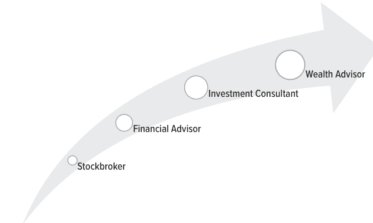
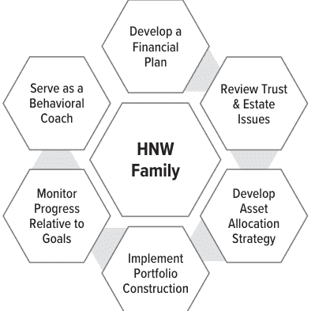
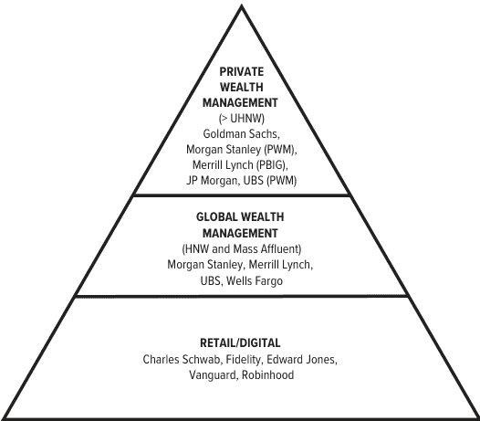
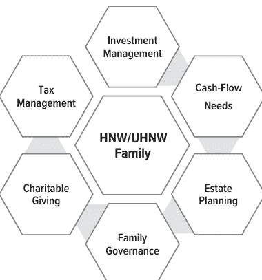

# 财富管理的演变

> 衡量投资成功的最佳方式，不在于你是否跑赢大市，而在于你是否已制定一项财务计划和行为纪律，这些很可能会带你到达你想要去的地方。
> 本杰明·格雷厄姆

财富管理行业正处于关键拐点，正在经历一场转型。财富管理公司和财务顾问正在演变其商业模式，以有效服务高净值（HNW）投资者。他们也正从以交易为导向的模式转向以关系为导向的模式。财务顾问不得不投资于自身并重塑其价值主张，以继续成为客户世界中相关且至关重要的一部分。他们不得不将投资知识扩展到传统投资之外，并拓宽其提供给更具挑剔客户群体的一系列服务。

财富管理远不止于管理资金。它是一种多学科方法，用于解决富裕家庭的需求和愿望。投资管理是实现目标的手段。它可以资助家族的活动，例如财富代际传承或进行慈善捐赠。投资管理可以通过退休产生收入，或为购买房屋提供资金。

顾问们经常将其投资管理专长宣传为其核心价值主张。他们强调通过挑选历史上跑赢大市的共同基金或单独管理账户（SMAs）来跑赢大市的成功。毫不奇怪，投资者往往仅根据业绩来衡量顾问的成功或失败。如果他们的顾问未能跑赢大市，他们就会寻找其他承诺能够做到的人。

顾问需要改变其被评估和衡量的方式。跑赢大市往往来自于采取激进的短视押注，而非制定长期战略计划并根据情况进行微妙调整。顾问对客户的价值远不止于跑赢大市。

投资者对利益冲突持怀疑态度，并担心他们支付的费用水平。他们常常被行业术语搞糊涂，无法区分不同财富管理公司提供的各种能力。投资者和客户难以正确评估他们的关系价值。

本章涵盖正在进行的转型，并讨论顾问如何应对不断变化的格局。它回顾了高净值投资者的需求和期望，以及顾问如何脱颖而出并蓬勃发展，而不是沦为商品化。这是一段需要大量时间和资金投入的旅程——但将在未来带来丰厚回报。

## 向财富顾问的演变

过去几十年来，顾问的角色发生了巨大变化，如图 2.1 所示。

### 图 2.1 向财富顾问的演变

### 从股票经纪人到财务顾问

演变的第一个阶段发生在几十年前，因此这份简短的描述大多数读者应该都很熟悉。顾问从股票经纪人演变而来，股票经纪人推销其公司推荐的股票，进而成为财务顾问，财务顾问推广一系列金融产品，包括共同基金、单独管理账户（SMAs）、保险产品和首次公开募股（IPOs）。财务顾问经常被激励去销售公司推荐的专有产品。根据销售量，顾问会从其受雇公司获得更高的回报和认可，包括旅行等奖励。

### 从财务顾问到投资顾问

随着行业的发展，许多公司创建了一种不同的商业模式，以更好地协调顾问和投资者。投资顾问采用了类似于机构顾问采用的流程，以了解每个客户的目标和宗旨，制定投资政策声明和资产配置策略，进行经理人搜寻，并监测底层经理人表现。顾问通常会调整该流程，以纳入对信托和遗产的审查，以及高净值投资者的其他独特问题。

### 图 2.2 咨询流程

投资顾问的演变与华尔街咨询业务的引入同时发生。这些业务进行尽职调查并识别出机构级投资经理。这些业务谈判了有利的定价，并通过包干费结构将其提供给顾问。这些第三方经理人管理 SMAs 和共同基金。

咨询业务开发了工具和培训，帮助顾问转向这种新模式。顾问迁移到这种模式，因为它通过将顾问报酬从佣金改为咨询费，使顾问和投资者的利益保持一致。顾问根据管理资产（AUM）收取费用，费用会随投资组合价值而上升或下降。

这些业务在整个行业迅速发展，因为顾问和投资者都倾向于这种新模式。顾问喜欢开放架构和经常性收入模式的理念。他们按季度获得报酬，并可以利用第三方经理人来发展他们的业务。

投资者获得了接触世界级经理人的机会，并喜欢这种利益一致的经济模式。他们赞赏顾问正在帮助他们实现目标，而不是出于产生佣金的动机。投资者可以看到他们的投资组合增长，并感到安心，因为他们有一支专家团队在管理他们的资金。

让我们仔细看看咨询流程中的每个步骤。

- **制定财务计划。** 顾问评估客户的需求和目标。顾问询问有关客户经验、风险偏好、回报预期、时间范围和现金流需求的信息。这些信息被纳入财务计划，作为客户的路线图。
- **审查信托和遗产问题。** 顾问应了解围绕客户信托和遗产问题、慈善捐赠目标及大额集中持仓的所有相关信息。顾问可能希望讨论低成本证券的赠与策略，并考虑设立多个信托。
- **制定资产配置策略。** 顾问应制定长期战略配置，以大概率实现客户的目标和宗旨。配置应考虑一系列历史上表现出有吸引力的回报、风险和相关性特征的资产类别。顾问可能需要在各种账户类型（个人、退休、信托、家族基金等）之间制定多种资产配置。
- **实施投资组合构建。** 资产配置为在一系列资产类别之间分配资本提供了理论框架，而投资组合构建是投资者获得底层资产类别风险敞口的方式。顾问可以使用个别证券、共同基金、SMAs、ETF 或另类投资来获得这些资产类别的风险敞口。顾问必须正确整合资产配置和投资组合构建，以实现客户的目标和宗旨。
- **监测相对于目标的进展。** 一旦顾问制定了资产配置和投资组合构建策略，他或她就会确定衡量相对于每个客户目标进展的频率和方式。基准比较存在一些固有局限性。例如，相对于标普 500 指数或其他某些基准（60% 标普 500 指数 / 40% 巴克莱汇聚债券指数）的业绩，对某些客户来说可能相关，也可能不相关。
- **成为行为教练。** 也许顾问最大的价值在于担任行为教练，帮助客户做出理性决策，避免情绪化反应。顾问应理解客户的含义——不仅仅是他们所说的话——并帮助客户克服我们都知道存在的行为偏差。当事情感觉最不舒服时，行为教练能让客户保持参与。

### 从投资顾问到财富顾问

随着顾问开始追求更大客户，他们意识到需要扩展技能，超越仅提供传统资金管理。许多较大的华尔街公司开发了内部培训计划，以提升顾问的技能组合。成功完成这些计划的顾问通常会获得“财富顾问”等称号。（不同公司可能使用略有不同的头衔。）

行业组织如投资与财富研究所开发了 CIMA 项目，以提升投资咨询技能，并开发了 CPWA 项目，以帮助专注于高净值和超高净值（UHNW）家庭的顾问。这些项目利用了学术资源并引入了

行业专家讨论资产配置、另类投资、税务规划、遗产规划、慈善捐赠、高管薪酬以及处理集中持仓等话题。这些认证帮助顾问在竞争对手中脱颖而出。他们向客户（包括现有客户和潜在客户）证明，顾问在管理高净值（HNW）和超高净值（UHNW）客户投资方面已达到高级水平的教育、知识和技能。

## 顾问演变对财富管理公司的影响

随着财富管理公司不断演变其业务模式，他们希望顾问将业务上移，以服务于需求更复杂的大型家庭。他们认识到，小额账户的竞争日益激烈，且小额账户提供增加显著价值的机会较少。高净值市场代表了目标丰富的机会，大量财富正在一代又一代地创造和转移。

根据《卡普杰明 2020 年世界财富报告》，1 美国约有 590 万名高净值投资者：可投资资产达 100 万美元或以上的投资者。约有 12 万名超高净值投资者：可投资资产达 3000 万美元* 或以上的投资者。随着越来越多公司瞄准大客户，一些公司已对业务进行细分，并投资培训顾问，以有效处理财富的复杂性。培训和分级旨在教育顾问了解富裕家庭面临的独特挑战和问题。顾问学习了先进的财富管理技巧，并且通常能够利用公司资源为富裕家庭服务。

* 卡普杰明将 3000 万美元作为该群体的最低标准；然而，大多数财富管理公司将 2000 万美元作为入门标准。

作为一个行业，我们看到了向团队模式的重大转变。团队成员通常拥有多样化的技能。团队合作为顾问业务提供规模、效率和专业知识。团队结构还能让客户放心，其财富顾问拥有梯队实力、多样化的技能组合和备份保障。

图 2.3 说明了金融服务行业是如何细分的。尽管行业可能已细分，且覆盖模式和相关经验之间存在显著差异，但这些差异对投资者来说并不总是清晰明了。顾问在瞄准富裕家庭时必须让自己脱颖而出。许多人可能会获得高级认证，例如 CIMA、CPWA、CAIA、RMA 和 CFP。顾问应突出团队成员的能力和经验，以及他们获得的任何认证。

## 图 2.3 金融服务行业细分

### 私人财富管理

摩根士丹利、高盛、美林银行、瑞银和 JP Morgan 拥有专门团队，专注于服务超高净值家庭的需求。这些业务通常被称为“私人财富管理”或“私人客户集团”。它们通常以团队形式组织，通常只处理 30 到 50 个家庭。其中一些团队专注于特定行业，并可能与投资银行覆盖相关联。

这些团队处理的家庭较少，部分原因是为了与客户建立深厚关系。私人财富团队通常与私营公司创始人和高级管理人员合作。他们常在 IPO 之前培养关系；一旦公司上市，这些关系通常会蓬勃发展。这些团队通常拥有信托和遗产专家，在公司上市前与创始人合作设立信托和资助活动。他们有专家可以协助公司内部人士建立预设多元化计划（PDP）。团队可以接触到独特的投资机会，包括 IPO、对冲基金、私募股权、私募债务和私募房地产。

### 全球财富管理

全球财富管理公司（又称“线下大行”）——摩根士丹利、美林银行、瑞银和富国银行——拥有专注于高净值和大众富裕投资者，以及机构、退休人员、企业主和其他客户细分市场的团队。它们通常利用公司资源来处理棘手问题。专注于高净值投资者的团队通常需要完成内部培训，有时还需要接受高级行业培训。这些团队通常处理数百名客户，其中一些客户享有优惠待遇。

行业正在变得越来越两极分化。高净值投资者要求高度定制的建议。较小的投资者选择非人工互动，可能不愿支付咨询费，因为他们往往认为价值很小。顾问必须关注那些重视建议并需要帮助实现目标的投资者。情况复杂的高净值投资者——包括税务、信托、集中持仓、慈善捐赠和多个实体——需要有经验的顾问帮助他们应对无数挑战和问题。

线下大行也处理大众富裕客户，并一直在将较小客户转向某种形式的数字咨询服务（又称“机器人投顾”）。处理大众富裕客户的顾问通常有数百名客户，并被鼓励交叉销售产品以提高客户保留率和增加收入。

一小部分顾问专注于处理机构客户。他们通常在机构类型（养老金计划、公共基金、捐赠基金和基金会等）及其需求方面拥有高级教育，并且经常拥有专门服务于机构客户的团队和资源。

### 零售/数字服务

查尔斯·施瓦布、富达和先锋一直积极向其零售客户推出机器人资产配置和机器人财务规划工具。机器人服务提供规模和效率。然而，在没有人工干预的情况下，投资者在艰难时期是否能保持纪律尚不清楚。毕竟，我们只是凡人，在极端情况下，我们很容易让恐惧和狂喜主导一切。Robinhood 提供面向千禧一代的交易平台，但在证券估值、理解金融市场或构建投资组合方面提供的建议很少。

### 注册投资顾问（RIA）

施瓦伯、富达和 Pershing 为服务于财富光谱（零售、高净值和超高净值）客户的注册投资顾问（RIA）提供托管服务。过去几年，RIA 细分市场发展迅速，原因是大型顾问团队离开线下大行。RIA 模式的增长是由顾问对独立性的渴望以及公众对华尔街的看法所推动的。行业资深人士 Charlotte Beyer 指出：

> 当今，整个金融服务业仍然遭受信任的削弱。2008–09 年金融危机紧张了关系；客户的理所当然感与顾问为盈利而扩张的需求之间的紧张关系，就像暴风雪中的脆弱电力线。我们行业的历史布满了伯尼·麦道夫等丑闻，以及华尔街对短期利润的自身关注，摧毁了整个行业的诚信。²

Beyer 批评大型公司专注于从客户那里获利，而非满足其需求。全球金融危机后，许多投资者开始质疑大公司固有的利益冲突：使用关联产品、与资产管理人分享收益以及投资银行利益冲突等。

全球金融危机后，RIA 细分市场实现了强劲增长，因为顾问希望与华尔街根源划清界限。他们希望避免显得是为了从客户那里赚钱，而是专注于为客户赚钱。

RIA 强调其独立性以及作为客户受托人的能力：将客户利益置于首位。通常，线下大行顾问受到较低标准的约束，并且通常无法承认自己是受托人。RIA 可以制定自己的投资理念，进行独立尽职调查，并使用其选择的工具和技术。未来几年，这个市场细分将继续增长。

尽管线下大行不愿普遍承认其顾问可能是受托人，但许多顾问确实是受托人，并据此行事。我职业生涯的大部分时间都在直接与顾问合作，大多数人都很正直，将客户利益放在首位。事实上，许多认证组织都有行为准则（道德标准），要求其成员以客户的最大利益行事。

## 将理论付诸实践

高净值（HNW）和超高净值（UHNW）家族面临多个需要应对的问题。财富顾问在制定资产配置策略之前，应考虑现金流需求和遗产规划问题。他们应评估税务后果和资产位置，并可能需要确定如何为慈善活动提供资金。这些问题相互关联。

### 图 2.4 高净值和超高净值家族的财富管理问题

在 1990 年代末至 2000 年代中期，我曾在摩根士丹利的私人财富管理部门工作，管理格雷斯通财富管理，并担任客户战略小组成员。摩根士丹利收购了格雷斯通（一家在另类投资方面具有特殊专长的多家族办公室），以加强其私人财富管理部门向超高净值家族提供的投资服务。

客户战略小组是一支由精英专业人士组成的团队，被派遣去与公司最大的客户和潜在客户合作，这些客户通常正在出售业务或通过首次公开募股（IPO）上市。客户战略小组的成员在信托和遗产问题、高管薪酬、对冲和变现策略以及税务管理方面拥有专长。我是资产配置和另类投资方面的驻场专家。我们在所有大型复杂情况下密切合作，这成为一项竞争优势。

客户战略小组经常被引入，在首次公开募股前后与公司的创始人或高级管理人员合作。IPO 之前，我们的信托和遗产团队讨论设立信托、资产产权登记以及潜在的赠与策略。由于许多公司高管在出售证券方面受到限制，我们的团队讨论了对冲和变现策略，包括建立 PDP（该计划规定内部人士在预定的间隔和金额出售证券）。这些计划帮助公司高管获得流动性并分散其持仓，而不会违反内幕交易规则。

税务是任何正在经历首次公开募股或出售业务的富裕家族需要考虑的主要问题。理想情况下，税务规划应在交易前进行，以最大限度地降低可能非常大的税务影响。顾问必须在前期处理几个关键问题，包括：

- 资产应如何登记产权？
- 家庭是否为子女或孙辈设立了信托？何种类型的信托？
- 税务应如何支付？由哪个实体支付？
- 在出售公司或首次公开募股之前，是否应赠送证券？
- 我们如何最大限度地减少税务？应如何分配出售所得款项？

制定资产配置策略也存在一些独特的复杂性。创始人和高级管理人员通常将其大部分财富集中在公司股票中。金融理论建议分散集中持仓。然而，限制可能意味着这不可行，或者外界形象和情感依恋可能使其难以接受。创始人通常犹豫是否出售股票，因为出售可能暗示他们对公司失去了信心。他们常常对股票产生情感依恋，因为股票创造了他们的财富。

针对创始人或高级管理人员的资产配置策略可能需要在较长一段时间内实施，随着证券的变现。通过避免某些行业或市场板块来分散敞口，以最大限度地降低风险集中，可能是审慎的。例如，一家科技公司的创始人可能会避免增加科技领域敞口。不同账户（个人投资、为子女或孙辈设立的信托、家族基金会）可能需要不同的资产配置。

由于许多创始人将财富锁定在限制性股票和期权中，他们可能资产丰富，但流动性受限。现金管理计划可以帮助他们处理税务和其他支出。

本节讨论了超高净值家族面临的挑战以及需要专业资源来帮助他们适当应对。尽管超高净值家族面临的问题有许多相似之处，但每个家庭在应对这些问题的方式上都是独特的。

## 一支专家团队

由于影响高净值和超高净值家族的问题各不相同，他们可能会聘请多位顾问来协助处理投资管理、高管薪酬、遗产规划和税务管理等专业领域。家族办公室可能会引入资源来处理这些问题，并帮助界定家族传承和治理问题。家族办公室通常为拥有 2.5 亿美元或以上可投资资产的家族处理投资、税务和慈善需求。多家族办公室处理多个家族的需求，提供规模、专业知识和效率。

无论他们如何处理这些领域，顾问都不应孤立地看待这些问题。团队需要协调与整合。顾问还可能需要利用内外部专业知识来处理各种问题。他们可能需要与家族聘请的其他值得信任的顾问合作，包括信托和遗产律师、税务顾问和公司法律顾问。

许多财富顾问已组建团队，借助内外部专家来帮助解决高净值家族面临的问题。团队可能包括曾任信托和遗产律师的人员；他们可能能够利用为最富有客户指定的公司资源。他们需要投资管理专业知识，通常对对冲基金、私人市场（私募股权、私募信贷和实物资产）及其他复杂产品有深入了解。一些团队会与当地专家建立关系，以拓宽其专业知识和覆盖范围。这些关系也可能成为介绍业务的来源。

例如，一个刚刚以 1 亿美元出售其业务的超高净值家族，希望拥有一个熟悉公司出售和建立 PDP 计划的专门团队。该家族希望有一位专家审查信托文件，并可能希望就设立额外信托寻求建议。该家族希望利用专业知识来考虑潜在的赠与策略并正确登记资产产权。高级管理人员将希望就高管薪酬（包括限制性股票和期权授予）获得指导。取决于出售的性质和基础流动性，该家族可能需要考虑贷款选项。

最后，当家族准备制定投资计划时，他们希望有人能够跨多种账户类型制定资产配置策略。该家族期望获得独特投资选项的渠道，包括对冲基金、私募股权、私募房地产和其他非传统投资，并对税务影响有清晰的认识。

总之，超高净值家族希望拥有一支具备相关经验和充足资源的专门团队来满足其需求。私人财富团队通常只服务超高净值客户，拥有深厚的团队和资源，并且只服务 40 到 50 个家族。其平均客户关系规模可能为 4000 万至 5000 万美元，并采取高接触方式来处理家族的需求。

反之，大型券商团队通常服务数百个高净值家族，并利用公司资源，其平均客户通常范围在 100 万至 500 万美元。这并不是说大型券商团队无法处理 1 亿美元规模的家族，但这并非常态，他们可能没有处理家族所面临问题的经验。

## 制定财富管理流程

正如前文所述，顾问们专注于将业务向上游拓展，服务于需求更复杂的更富裕家庭。他们正在开发专业团队，并尝试将业务规模调整到合适水平，以便能够妥善支持客户需求。如果团队拥有数百个客户，要了解特定家族的所有关键信息具有挑战性。一些顾问会系统地将较小的关系过渡到初级团队成员或其他顾问。对某些顾问来说，这是一种自然演变。其他人则努力重塑自己。

为了妥善扩展业务并充分满足客户期望，团队需要制定一套财富管理流程，以获取关于家族目标的所有相关信息。他们可能对不同账户有不同的目标。家族可能会关注个人资产的财富保值和子女信托账户的财富增值。家族可能会为家族基金会制定具体的资金目标，并可能希望维持一个机会性交易账户。

团队必须从家族那里获取信息，并引导他们完成决策过程，考虑：

- 家族的目标和宗旨是什么？家族可能有多个目标。
- 客户的总体投资理念是什么？

- 关键考虑因素有哪些：税务、跨代财富转移、遗产规划等等？
- 这个家族有什么现金流需求？
- 家族应如何衡量成功？
- 家族的使命宣言是什么？
- 他们的慈善需求是什么？
- 顾问应多久重新审视一次家族的目标？

目标是成为值得信赖的顾问：即让家族在讨论财富、税务、遗产规划、家族动态及其他敏感话题时感到自在的人。赢得家族信任通常需要时间。随着时间的推移，家族可能会更愿意分享更多信息；因此，顾问应继续与客户保持接触，并及时了解他们情况的任何变化。家族会发生变化：结婚、离婚、出生、出售企业、购买房产，以及更换律师、CPA和财务顾问，这些情况都会发生。不加注意的顾问可能会发现别人会关注，并且他们可能面临流失客户的风险。

卡普杰明指出，高净值投资者正在审视其顾问费用的规模和性质。“超过五分之一的高净值个人可能在明年更换机构，高昂费用是42%高净值个人更换机构的首要原因。高净值个人还表示偏好绩效和服务导向的费用，而非基于资产的费用，这表明他们对所收费用交付的价值有更高期望。”³

作为一个行业，顾问需要解决费用结构问题。正如本章开头所述，顾问已从赚取佣金转向收取管理资产的一定百分比。这种顾问模式更好地协调了顾问与客户的利益；通过将费用与绩效挂钩，它加强了顾问与投资组合的关系。这种模式忽略了在处理信托与遗产、慈善捐赠、家族遗产以及大额集中头寸等问题中所提供的价值。事实上，这种结构可能会激励顾问将更多的家族关系转变为顾问模式。鼓励家族出售不征收顾问费的集中头寸可能存在利益冲突。

## 资产配置与投资组合构建考量

一旦团队了解了关于家族的所有必要信息，并为每个账户确定了适当的目标集，团队就可以制定资产配置策略。他们可以为每个账户制定总体策略和子策略。

战略资产配置需要对投资者和底层资产类别进行深思熟虑的分析。它应基于对投资者回报预期、风险偏好、时间跨度和现金流需求的深入讨论。战略资产配置应建立长期（10至20年）的资本配置视角。计划定期重新审视这一点。除非发生重大变化，否则配置应作为长期路线图。

资产配置与投资组合构建应仔细协调。太多时候，我看到顾问花大量时间为特定客户确定适当的资产配置，然后组建一套经理人或基金阵容，以草率的方式实施策略。如果要让整体投资组合按设计运作，适当的协调至关重要。如果经理人出现风格漂移或随时间改变方法会怎样？经理人是否有偏见和押注会改变配置？如果市场条件发生剧烈变化会怎样？

本书全文都涵盖了资产配置与投资组合构建的考量。本章侧重于顾问作为整体财富管理流程一部分需要考虑的几个关键因素：

- 你如何构建资产配置模型？是基于总回报还是基于目标的投资？战略资产配置可以面向产生总回报，也可以设计为满足特定目标，例如产生收入或使投资组合与目标保持一致（环境、社会及公司治理或ESG）。

- 总回报配置旨在优化底层资产类别的回报和风险。根据投资者的风险概况和时间跨度，不同百分比可能分配给各种资产类别。风险偏好健康且时间跨度长的投资者可能对股票有更高配置。临近退休且更规避风险的人可能对固定收益有更高配置。

- 基于目标的投资方法旨在与特定目标保持一致，例如积累财富、产生收入或最小化下行风险。要使用这种方法，顾问需要持续强化并衡量向目标的进展。当投资组合跑赢时，不要将结果与标普500指数比较，当表现滞后时，再回到基于目标的投资。

- 你如何确定适当的资本市场假设？战略资产配置模型使用回报、风险和相关性数据来确定各类资产类别的最优配置。但如果未来与过去不同会怎样？如果未来股票回报和债券收益率较低会怎样？如果相关性更高会怎样？

- 你是否采用某种形式的战术性配置？如果采用，将如何实施？当今市场动态，顾问可能希望对其长期战略配置采用某种形式的战术性叠加。这并非试图择时，而是为了根据当前市场环境，对投资组合进行微调以更好地定位。战术可能包括超配看起来被低估的资产类别，或低配已经涨得太快太猛的资产类别。你可以尝试降低整体投资组合风险，或增加对可能从市场变化中获益的资产类别的配置。我绝不会建议试图择时，但这些微调可以增加可观价值，特别是在波动较大的时候。

- 你如何确定应税和免税账户类型之间的资产位置？跨账户配置是一个重要考量。许多高净值投资者可能有多个账户：投资账户、个人退休账户（IRA）、401(k)计划、为子女设立的多个信托以及私人基金会。每个账户都应有其自身的资产配置，审慎地思考哪些投资应放在哪些账户中是明智的。资产位置决策不当可能会通过触发不必要的税务后果而削弱健全策略的价值。投资账户可能面向长期，以最小化税务后果。IRA可能持有更高周转率的策略，因为其税收优惠地位，而信托可能旨在最大化长期回报。

- 你如何运用主动和被动投资？随着ETF的爆炸式增长，投资者现在可以以具有成本效益且税务高效的方式，有效地进入几乎每个市场细分领域。然而，大多数传统ETF是基于规则的，意味着它们不能偏离其既定的筛选和加权方法。我认为在构建投资组合中，主动和被动策略都有其作用。

- 另类投资的作用是什么？另类投资涵盖广泛的底层策略，例如对冲基金和私募市场。一些是增量回报的来源。另一些是另类收入来源，还有一些可以减缓投资组合波动。

- 在当今市场环境下，私募市场（例如私募股权、私募信贷和实物资产）是否合理？私募市场长期以来一直是家族办公室、超高净值家族和大型机构的专属领域。这些策略现在对高净值投资者变得更加可及，门槛更低且流动性更大。

## 案例研究：客户选择和接洽顾问的视角

我经常收到关于如何与超高净值家族打交道的顾问提问。它们与高净值家族有何不同？他们面临哪些独特问题？他们如何选择和接洽顾问？以下案例研究探讨了这些问题。

大卫·曼宁（非真实姓名）和他的兄弟将其消费品业务以20亿美元出售给一家大型集团。华尔街大型公司、国家银行和信托公司以及独立RIA的几位顾问积极追求大卫。大卫决定继续与摩根士丹利、高盛和摩根大通保持关系。他想获得最佳观点，并意识到与这些公司建立关系意味着他将获得私募股权、私募房地产及其他机会的优先准入。

大卫建立了成功的业务，现在拥有比他花得完的更多资金。他不急于投资。大卫在出售前进行过一些遗产规划，但他希望就设立慈善基金会获得指导。他需要为税务留出资金，并将大部分钱投入市政债券，同时思考投资选择。

大卫想了解每家公司的战略和推荐投资，并选择在他完全理解一切之前暂缓分配资本。这与大卫开始了一年的过程：审视其各实体的目标，解释投资理论，审查底层传统和另类投资，分析历史结果，并建立衡量成功的方法。

随着大卫变得更加自在，他请我审查高盛和摩根大通的投资。他并非在寻求

取代他们；相反，他希望确保这些公司不会背道而驰。David需要一个总体战略，并希望利用三家顶尖私人财富管理公司提供的最佳投资选项。

将近一年后，David开始有节制地在三家公司之间分配资金。他希望有一支专家团队，努力赢得他的信任和业务。在某些方面，David在考验我们：我们是否愿意投入时间和精力来建立关系？还是说我们是出于赚钱的动机？我猜想，许多公司本会催促David更快地分配资金，以创造收入。

David非常聪明，就投资、公司如何进行尽职调查、潜在利益冲突以及顾问如何获得报酬等问题提出了很多好的问题。David直接提出了这些问题，但我认为大多数富有的家庭都有类似的担忧，并试图自行弄清楚。我鼓励顾问主动与家庭解决这些问题。如果你的目标是成为受信任的顾问，你必须对客户保持透明。

David后来要求我与他的妹妹进行类似的教育流程，因为我已经赢得了他的尊重和信任。David最终设立了一个家族办公室，并要求我与他的首席投资官（CIO）合作，解释我们开发的方法。他定期征求我对投资、特定基金和经理的意见。尽管David建立家族办公室是为了专注于家庭的需求，但他继续以非绑定方式聘请一批受信任顾问的网络，以满足特定的投资、税务和慈善需求。

我非常享受与David合作的经历。他为人严厉，对团队要求很高，但他也欣赏我们提供的价值和专业知识。从这个案例研究中，有几个重要的教训：

- David希望基于信任和经验建立关系。
- David希望了解战略。他需要教育，而非推销话术。
- David认识到让顾问争夺其业务的价值，从更广泛的团队中获得最佳想法和见解。
- David认识到拥有一支愿意与其他受信任顾问合作的专家团队的价值。
- David明白他需要一个连贯的战略来利用多位专家，而非多个可能背道而驰的竞争性战略。

## 你如何增加价值？

本章描述了从股票经纪人到财富顾问的演变，以及顾问与客户互动的方式。财富顾问不得不大幅扩展其在财富管理问题和投资策略方面的知识，并发展其实践以满足高净值（HNW）投资者的需求。

你的客户是否欣赏你的转变？他们能描述你所做的工作以及你如何增加价值吗？

与你的最佳客户坐下来，请他们描述你的价值主张，这可能会很有启发性。他们如何描述你的能力？“Jim帮我挑选最好的股票或共同基金”，或者“Jim帮我思考我家庭的目标和宗旨。他定期与我以及我的其他受信任顾问会面，提供包括遗产规划、税务管理、慈善捐赠和投资管理在内的全面建议。”

你很可能花了大量时间来定义你的价值主张。你的客户是否以你希望被看待的方式看待你？他们认为你的价值在于跑赢市场吗？你认为这是衡量成功的适当方式吗？

你可以通过组建一个由少数客户组成的咨询委员会，更正式地制定你的价值主张。请他们帮助定义你的价值主张，甚至讨论如何发展你的业务。这样，你的客户就会更好地与你的成功保持一致，并有动力帮助你发展业务。通过组建咨询委员会并邀请一些客户加入该委员会，你改变了他们对你的看法，并给他们一个替你发声的方式。

在启动我的新公司之前，我组建了一个由志同道合的行业领袖组成的咨询委员会。他们通过提供宝贵的推荐，帮助我塑造信息传递、客户细分策略和影响力。同样，我通过介绍和适当分享我的专业知识来帮助我的咨询委员会成员。我的咨询委员会鼓励我写这本书。

作为一个行业，我们需要帮助投资者区分各种公司和顾问实践。我们需要重塑许多投资者看待金融机构的方式，并认识到优秀顾问所提供的价值。在他的《基于目标的财富管理》一书中，⁴ Jean Brunel建议顾问应成为翻译和教育者。Brunel认识到我们的行业术语对各个财富水平的客户来说有多么令人困惑。他建议花时间向客户教育基本概念，包括现代投资组合理论、有效市场理论、资本市场假设等。你甚至可能想为客户推荐一个阅读清单。更多的资金并不总是意味着更高的专业水平。金融市场很复杂，媒体往往通过过度炒作市场波动事件来制造更多困惑。

另一个需要考虑的是技术的角色和使用：它是朋友还是敌人？尽管技术可以提供规模和效率，但算法缺乏共情能力，无法读取非语言线索。高净值家庭需要量身定制的支持和服务，以满足其需求，而不是千篇一律的解决方案。你应该将技术视为有价值的工具，而不是你专业知识和经验的替代品。通过清晰地阐述你的价值主张来帮助客户。

我们都认识到追逐业绩并允许投资者相对于某些任意基准来定义你的成功或失败的弊端。你可能能够跑赢市场，但代价是什么？那正是你想要完成的目标吗？显然，将客户重点转移到其相对于目标的进展上，对每个人都更有好处。

一位优秀的顾问在业绩之外增加了大量价值。能够使一位顾问与其他顾问区分开来的服务和价值的部分列表包括：

- **获取独特投资：** 另类投资、私募股权、私募信贷和实物资产。
- **经验丰富的团队：** 了解高净值（HNW）和超高净值（UHNW）家庭面临的复杂情况，并能够与其他受信任顾问协调的能力。
- **获取主题专家（SMEs）：** 在高管薪酬、信托和遗产、税务管理、慈善捐赠以及投资管理等多样化领域。
- **教育者/教师：** 投资者可以从你在众多问题上的智慧中受益。
- **覆盖模式：** 一个提供专门支持的专家团队，以及允许适当参与的业务规模。
- **行为教练：** 帮助客户做出理性决策，避免因情绪冲动而行动。

你可能需要更好地阐述你如何增加价值，并随时间强化该价值。你需要将讨论超越投资组合，涵盖你为客户提供的所有服务。你可能希望与高净值投资者采用基于目标的方法。否则，你可能会被一个无法处理高净值家庭复杂性的机器人所取代。机器人无法看到你的客户如何描述照顾其特殊需求子女或年迈父母的愿望。机器人缺乏共情和情感，也无法捕捉到你瞬间就能察觉的非语言线索。

过去二十年里，行业发生了巨大变化。许多顾问已发展成为财富顾问，但有些人未能跟上行业步伐，继续推销产品。随着商品化加剧和费用压缩，你需要能够阐述并强化你的价值主张，以便在未来几年中蓬勃发展。

