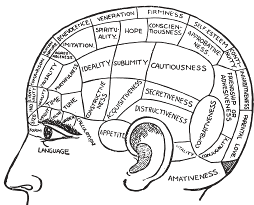
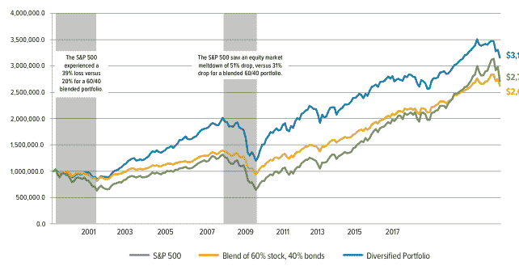
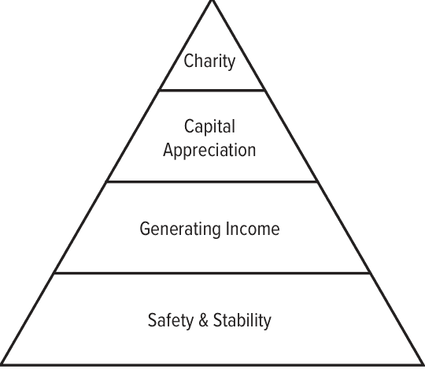

# 第 3 章

# 成为行为教练

> 我们让世界变得合乎逻辑的令人安心的信念，建立在安全的基础上：我们几乎无限的忽视自身无知的能力。

**丹尼尔·卡尼曼**
*思考，快与慢*

投资者并不总是理性行事。毕竟，我们只是凡人，常常对事件做出情绪化反应。大多数传统金融理论都假设人们 *会* 理性行事，在做出投资决策时考虑所有可用信息。行为金融学挑战这一假设，探讨个人实际如何对刺激做出反应。它表明顾问如何帮助投资者做出明智的决策。

哈里·马科维茨、比尔·夏普和尤金·法玛因其在定义投资理论方面的工作而获得诺贝尔奖。马科维茨普遍被认为是现代组合理论之父。夏普向我们介绍了资本资产定价模型（CAPM），法玛介绍了有效市场理论。他们的研究为当今我们的投资方式奠定了基础，并催生了众多其他研究和理论。现代金融的这些先驱使用历史数据来证明他们的理论。尽管这些理论非常有指导意义，但它们假设投资者会做出逻辑和理性的选择。

丹尼尔·卡尼曼、理查德·塞勒和米尔·斯特曼指出了传统金融理论的缺陷，最突出的是投资者会做出理性决策这一观点。卡尼曼因其在识别源于启发法和偏见的常见人类错误的认知基础方面的工作，以及其基于损失厌恶的前景理论的开发而于 2002 年获得诺贝尔奖。塞勒因其在决策中研究经济学与心理学分析相互作用的工作而于 2017 年获得诺贝尔奖。斯特曼的工作一直集中在投资者的认知和情感捷径以及避免认知和情感错误的方法上。

这些行为金融学先驱发表了大量关于投资者如何运作以及为何他们经常做出错误决策的研究。但针对这些偏见可以做些什么？我们能预见这些偏见并训练投资者做得更好吗？

### 了解行为偏差

大脑是一个控制所有身体功能、解释来自外部世界的信息并充当我们自身超级计算机的复杂器官。智力、创造力、情绪和记忆是大脑管辖的众多事物中的几个。大脑通过我们的五种感官接收信息，通常是同时接收。它充当超级计算机，汇编和存储消息（图 3.1）。

大脑还帮助我们做出决策，通常使用被称为 *启发法* 的思维捷径和经验法则。不幸的是，我们都受认知偏差的困扰，这会导致我们做出不合逻辑的决策。行为金融学研究当我们让情绪压倒对事件的理性反应时，我们都会陷入的偏见和陷阱。这些陷阱包括：

### 图 3.1 最初的个人计算机

- **损失厌恶。** 投资者会不惜一切代价避免损失。因此，他们可能因为过于保守而未能实现目标。
- **确认偏误。** 人们常常倾向于验证其信念和观点的信息或观点。这种偏误可能会损害投资者，投资者应客观评估策略或投资产品。
- **心理账户。** 当一个人将某些资金来源视为与其他资金不同（例如，你赚到的钱与你继承的钱）时就会发生这种情况。投资者也可能对个别股票或共同基金产生情感投入。
- **控制错觉偏差。** 当投资者相信他们可以挑选出能够跑赢大市的个股或经理人时就会发生这种情况。他们认为，因为自己掌控局面，结果就会更好。
- **近因偏差。** 许多投资者容易追逐热门股票、资产类别和资产经理。他们看到近期的强劲结果，并将这些结果外推到未来，但这在长期来看很少奏效。
- **事后偏差。** 当投资者事后说他们知道某只特定股票或投资会失败时就会发生这种情况。投资者和顾问都倾向于夸大自己预测未来的能力，这可能导致过度承担风险。
- **从众心理。** 许多以……为傲。财富顾问自己也常表现出这些偏见，这可能会影响客户对市场和其顾问的感受。如图 3.2 所示，根据 2019 年 BeFi 巴罗米特调查，¹ 顾问将损失厌恶、过度自信、可得性偏差和确认偏误列为他们最主要的偏见。

这些发现令人震惊，很可能会塑造客户对市场的看法。根据卡尼曼的研究，我们知道客户也表现出损失厌恶。顾问应帮助他们理解，这种行为是不理性的，并可能导致在最不合时宜的时候退出策略。但是，如果顾问本人也担心损失厌恶，他或她可能更倾向于建议卖出头寸或变得更加防守，在

### 图 3.2 顾问的行为偏见

| 顾问偏见 | 声明 | 同意 |
| :--- | :--- | :--- |
| 损失厌恶 | 我倾向于觉得损失带来的痛苦是等额收益带来的快乐的两倍 | 82% |
| 过度自信 | 我认为我的投资组合管理能力可以帮助客户跑赢大市 | 65% |
| 可得性偏差 | 我倾向于依赖易于获取或容易回忆的信息 | 58% |
| 确认偏误 | 我寻求能够确认我认知或当前观点的信息 | 54% |
| 近因偏差 | 我在做出投资决策时受近期新闻事件或经历的影响 | 51% |

波动时期，而实际上更审慎的做法可能是保持冷静，专注于客户的长期目标和宗旨。

顾问可能对自己的投资组合管理技能过度自信，并因此将其价值主张描述为跑赢大市，即便是最优秀、最大的经理人也很难持续做到这一点。根据 2020 年 SPIVA 评分卡，² 67% 的共同基金在 1 年期间未能跑赢广义市场。长期结果更令人震惊，3 年内 71% 的基金跑输大市，5 年内 80% 跑输，10 年内 84% 跑输。可得性偏差和确认偏误都用来支持顾问的过度自信——这可不是成功之道。

如果我们探讨在构建投资组合时应用行为偏见，应当认识到客户在牛市和熊市中对风险的感受往往不同。在牛市期间，客户可能会说他们愿意承担风险，拥有长期投资期限，并愿意忍受投资组合的损失。

然而，正如我们在全球大流行期间所经历的，当波动出现时，客户对风险的感觉会大不相同。BeFi 巴罗米特调查询问顾问如何应对客户风险偏好与风险承受能力不匹配的情况。大多数顾问（51%）根据客户的风险偏好和风险承受能力制定修改后的资产配置策略，而只有 27% 的顾问根据行为偏见调整其配置。如果客户夸大其承担风险的意愿呢？如果他们的投资期限比最初说明的要短得多呢？参见图 3.3。

### 图 3.3 构建投资组合时解决客户的行为差距

| 响应 | 百分比 |
| :--- | :--- |
| 根据客户的风险偏好和风险承受能力组合制定修改后的资产配置 | 51% |
| 调整资产配置以适应客户的行为偏见和风险偏好 | 27% |
| 提高客户承担风险的舒适度/对抗消极偏见 | 16% |
| 其他 | 6% |

顾问需要提醒客户他们的既定目标和宗旨，并了解他们对市场的感受，尤其是在波动和不确定性加剧的情况下。顾问需要保护客户免受非理性冲动的影响，并使他们建立在稳健、有纪律的流程之上。有时做正确的事感觉不舒服，因此顾问应提前为客户做好准备，以避免情感

反应。投资政策声明可以通过描述何时以及如何重新平衡配置来铭记这种纪律。

在如此强劲的牛市（2009–2019）之后，许多投资组合可能因市场增值而承担了更多风险，客户可能希望让赢家持续获利。然而，建立了在投资组合超过特定阈值时重新平衡的纪律化方法的顾问，会告诉客户削减股票敞口，以与其既定目标保持一致。投资政策声明可以建立流程，避免说服客户做正确事情的问题。酌情模式的兴起有助于让客户走在正确的轨道上，因为顾问无需许可即可采取适当措施。

财富顾问必须对自身的偏见保持敏感，这些偏见可能会影响客户对市场和顾问价值主张的看法。顾问应小心避免将偏见强加于客户，并专注于遵循健全的流程。

## 市场动荡的反应

我们都明白，投资者和顾问对负面冲击的反应与对上涨市场的反应不同。当市场上涨时，就像2009–2019年牛市期间那样，投资者感到自信，并且往往愿意承担更多风险。因为他们的投资组合在增长，他们可能容易追逐回报，认为自己能战胜市场，并混淆技能和动力。相反，在市场冲击期间，就像我们在2020年2月–3月经历的那样，投资者更关注损失厌恶，担心可能失去财富。他们常常想观望，直到市场稳定下来。当然，这两种反应都是情绪化的，并引入了不同类型的风险。

Absolute Engagement首席执行官Julie Littlechild在2020年3月10日至24日期间（全球大流行期间）研究了投资者行为。基于该研究的时间，³ 该研究表明，越来越多的客户质疑其顾问是否提供了所需的指导。Littlechild的研究显示，与前一年相比，表示将“肯定”继续与顾问合作的客户数量下降了11%。客户忠诚度的变化源于投资表现和风险、整体信任、相信顾问将客户需求置于首位以及信心方面的差距。客户没有：

- 感到财务安全
- 感到掌控实现其财务目标
- 对自己实现财务目标的能力充满信心
- 制定明确的计划来实现其财务目标

也许市场动荡影响了研究结果。尽管如此，结果确定了顾问应主动与客户解决的问题领域。与其只关注投资结果，不如顾问应强化相对于客户既定目标的进展，并定期回顾每位客户的财务计划，以确保其反映客户当前的财务状况。顾问不应等到市场波动事件才与客户进行这些讨论。

Littlechild的研究指出，需要更好地了解市场以及与市场无关的问题，包括保持足够的资产以满足终身收入需求（39%）、应对重大市场下跌（37%）、理解投资或市场（32%）、应对不断上升的医疗保健和长期护理成本（29%），以及如果配偶或丧偶伴侣成为鳏夫/寡妇，确保其财务安全（28%）。她还指出，需要与客户进行更相关的互动——不仅审查投资组合回报，还要围绕客户的需求和愿望与客户互动。

## 框架讨论

框架效应描述了我们如何回应信息呈现方式。当我们听到“这种新疫苗有效率为95%”时会感到积极，但如果听到“这种疫苗5%的时间无法提供任何益处”就会感到担忧。信息是相同的，但我们的反应不同，框架可能会改变我们接种疫苗的意愿。框架也会影响投资者的决策。

心理学家Daniel Kahneman和Amos Tversky的奠基性工作通过他们所谓的*前景理论*解释了框架。根据这一理论，人们认为损失比收益更重要，投资者会不遗余力地避免损失。Kahneman和Tversky的研究表明，人们避免损失所付出的努力是寻求收益的两倍。因为我们想要避免确定的损失，所以我们寻找提供确定收益的选项，并避免有损失风险的选项。

框架可能会影响我们将机会视为主要关于收益或主要关于损失。不要欺骗投资者，但要意识到客户可能会如何回应框架。让投资者为不可避免的下跌做好准备，而不是只关注正回报，让投资者对回调毫无准备。讨论投资的风险和回报。我喜欢告诉投资者，我们从事的是风险管理业务，而不是风险回避业务。市场冲击会发生。我们的工作是构建一个能缓冲这些不可避免冲击影响的投资组合，同时仍能提供实现客户目标的可能性。

财富顾问在描述投资的历史回报和风险时应保持一致和自信，倡导分散投资的优点以帮助缓冲投资组合波动性，并提供进入其他市场细分领域的机会。在讨论风险-回报权衡时应保持平衡，即使只关注正向时期更容易。投资者会感激这种诚实，并为未来的市场冲击做好更充分的准备。

在选择框架选项以及视觉呈现（即数据呈现方式）时要谨慎。

在图3.4中，三条线长度相同，但箭头产生一种视觉错觉，使中间线看起来更长。当我们呈现财务数据时，要考虑视觉框架，并认识到投资者可能会对上升和

图3.4 哪条水平线最长？

下降的线条或柱状图。有时，突出重点区域也很有效，这样客户就不会被那些偏离核心信息的信息所吸引。

一个经典例子是展示100万美元增长的图表。它展示了指数在较长时间内的增长：标普500指数、60/40组合和全球分散投资组合（图3.5）。投资者可能会看到许多波动时期以及2008年全球金融危机期间的大幅回撤。您希望关注全球分散投资组合随时间增长的优势。如何更好地定义讨论框架？

对回撤进行阴影标示，并指出标普500指数（下跌51%）与60/40组合（下跌31%）之间的差异，以及抵消50%跌幅需要100%收益的事实。将三条线的累积回报以美元金额表示。研究表明，投资者对百分比变化不太敏感，但对美元结果反应更好。带投资者浏览图表，强调分散投资在长期增长投资组合中的价值。指出累积回报，即在60/40组合中100万美元的投资增长到260万美元，其走势比仅标普500指数要平滑得多，而全球分散投资组合则因更广泛的分散投资增长到310万美元。主动承认市场容易出现回调，通过识别全球金融危机期间的回撤，并展示60/40和全球分散投资组合在回调期间如何保护投资者免遭重大损失。如果您使用宣传册或推介书，请记下笔记

突出相关信息，然后将它们留给投资者。如果您给客户留下标记过的图表，客户会更好地记住对话。

### 图 3.5 分散投资组合的历史表现

来源：Morningstar Direct。此图表代表假设性投资，仅用于说明目的。数据来自 2001 年 1 月 1 日至 2018 年 12 月 31 日。60/40 投资组合由 60% 的标准普尔 500 指数和 40% 的彭博-巴克莱美国综合指数组成。在分散投资组合中计入费用和开支会降低回报。投资组合每年再平衡。全球分散投资组合包括国内、国际和大宗商品指数。回报包括股息、利息和资本收益的再投资。指数不受管理，不产生费用或开支，也不能直接投资。过去表现并不代表未来结果。

另一种常见的图表是被单图，它显示资产类别的自然年际轮换，通常包括分散投资组合（图 3.6）。我们称其为被单图，是因为不规则的颜色模式展示了随时间推移从表现最好到表现最差的资产类别。我们喜欢这个图表，因为它展示了从一个时期到下一个时期挑选赢家的挑战，以及分散投资在平滑投资过程中的价值。然而，投资者经常看到大量令人困惑的颜色和数据。您如何重新框架这些信息？我喜欢强调某一资产类别，例如新兴市场：展示特定时期内的回报模式。新兴市场通常是表现最好或表现最差的资产类别，而诱惑在于在其大幅上涨后分配资金给新兴市场，结果却在分配后眼睁睁地看着其暴跌。我指出，从长远来看，新兴市场一直是表现最好的资产类别之一，但它提供的是一段颠簸的旅程。我也指出，分散投资组合按定义永远不会是表现最好或最差的资产类别。相反，它以最佳权重持有各种资产类别，旨在减少巨大波动，从而提供实现客户目标的最大可能性。同样，我喜欢在图表上做标记，以吸引投资者关注关键点。

### 图 3.6 历史资产类别回报（被单图）

| 2010 | 2011 | 2012 | 2013 | 2014 | 2015 | 2016 | 2017 | 2018 | 2019 |
| :--- | :--- | :--- | :--- | :--- | :--- | :--- | :--- | :--- | :--- |
| 小盘股股票 26.85% | 美国固定收益 7.84% | 房地产 27.73% | 小盘股股票 38.82% | 房地产 15.02% | 大盘股股票 1.38% | 小盘股股票 21.31% | 新兴市场股票 37.28% | 现金等价物 1.87% | 大盘股股票 31.49% |
| 房地产 19.63% | 高收益 4.98% | 新兴市场股票 18.23% | 大盘股股票 32.39% | 大盘股股票 13.69% | 美国固定收益 0.55% | 高收益 17.13% | 发达市场除美国股票 24.21% | 美国固定收益 0.01% | 小盘股股票 25.52% |
| 新兴市场股票 18.88% | 全球除美国固定收益 4.36% | 发达市场除美国股票 16.41% | 发达市场除美国股票 21.02% | 美国固定收益 5.97% | 现金等价物 0.05% | 大盘股股票 11.96% | 大盘股股票 21.83% | 高收益 -2.08% | 发达市场除美国股票 22.49% |
| 高收益 15.12% | 大盘股股票 2.11% | 小盘股股票 16.35% | 高收益 7.44% | 小盘股股票 4.89% | 房地产 -0.79% | 新兴市场股票 11.19% | 小盘股股票 14.65% | 全球除美国固定收益 -2.15% | 房地产 21.91% |
| 大盘股股票 15.06% | 现金等价物 0.10% | 大盘股股票 16.00% | 房地产 3.67% | 高收益 2.45% | 发达市场除美国股票 -3.04% | 房地产 4.06% | 全球除美国固定收益 10.51% | 大盘股股票 -4.38% | 新兴市场股票 18.44% |
| 发达市场除美国股票 8.95% | 小盘股股票 -4.18% | 高收益 15.81% | 现金等价物 0.07% | 现金等价物 0.03% | 小盘股股票 -4.4% | 发达市场除美国股票 2.75% | 房地产 10.36% | 房地产 -5.63% | 高收益 14.32% |
| 美国固定收益 6.54% | 房地产 -6.46% | 美国固定收益 4.21% | 美国固定收益 -2.02% | 新兴市场股票 -2.19% | 高收益 -4.47% | 美国固定收益 2.65% | 高收益 7.50% | 小盘股股票 -11.01% | 美国固定收益 8.72% |
| 全球除美国固定收益 4.95% | 发达市场除美国股票 -12.21 | 全球除美国固定收益 4.09% | 新兴市场股票 -2.60% | 全球除美国固定收益 -3.09% | 全球除美国固定收益 -6.02% | 全球除美国固定收益 1.49% | 美国固定收益 3.54% | 发达市场除美国股票 -14.09% | 全球除美国固定收益 5.09% |
| 现金等价物 0.13% | 新兴市场股票 -18.42% | 现金等价物 0.01% | 全球除美国固定收益 3.08% | 发达市场除美国股票 -4.32% | 新兴市场股票 -14.92% | 现金等价物 0.33% | 现金等价物 0.86% | 新兴市场股票 -14.57% | 现金等价物 2.28% |

我常用类比来描述资产配置，即做好两件事：选择合适的资产类别，并使用资产类别的最佳组合。我曾使用体育、烹饪和汽车类比来使这一概念生动化。我认为体育类比很有帮助，前提是听众理解这项运动。

由于我的烹饪技巧有限，我经常用制作煎蛋卷来说明资产配置。在制作煎蛋卷时，拥有合适的食材以及合适的比例非常重要。在我的煎蛋卷中，我喜欢鸡蛋、奶酪、洋葱、蘑菇、香肠和墨西哥辣椒。食材就像资产类别。并非每个人都喜欢墨西哥辣椒——就像并非每个人都喜欢新兴市场，因为其波动性。因此，使用合适的食材并保持合适的比例非常重要。一些投资者会排除某些资产类别，而每个资产类别的权重将取决于他们要解决的问题。

金融行业充斥着令人困惑的术语和数据。财富顾问可以通过用客户能理解的术语重新框架事物，帮助客户穿越噪音和困惑。

## 应对行为偏差

通过更好地理解行为偏差（包括自身的偏差），财富顾问可能能够改善客户结果。顾问必须提前识别这些行为偏差，并可能需要重新框架向客户展示信息的方式。如前所述，顾问应抵制强加自身偏见的冲动，而是专注于制定一份合理的投资计划。一旦识别出行为偏差，可能可以加以缓解或予以适应，从而使结果财务决策更接近传统金融所假设的理性财务决策。

顾问在艰难时期才真正证明自己的价值。投资者在市场高点时往往表现出最高程度的过度自信，在市场低点时则表现出最大程度的绝望。诱惑在于在应该降低风险时承担更多风险，以及在应该寻找机会时却逃之夭夭。顾问可以保护客户免于出于错误原因在错误时间做出错误决策。顾问应构建旨在抵御波动性的投资组合，并通过制定波动性检查表定期评估客户状况，该检查表应涵盖客户的风险承受能力、资产配置、底层投资和税务管理策略。请参考此市场波动性检查表：

- **审查投资者的风险承受能力。** 如果投资者对市场环境感到担忧，他们可能承担了过多风险。考虑为投资组合降低风险。
- **审查资产配置。** 在股票回报强劲的时期，配置可能与投资者的长期配置目标不一致。再平衡可能是合适的。
- **审查底层投资。** 确保每项投资都在投资组合中发挥其作用，并且总体风险概况适合客户的目标。
- **考虑税务管理策略。** 您不需要等到年末才考虑税务影响。
- **考虑战术性调整。** 为了更好地应对风暴，考虑增加对防御性资产（如现金或黄金）的配置，或引入新策略以缓冲波动性。

## 成为行为教练

财富顾问为面临诸多问题的高净值投资者提供有价值的建议。他们扮演的最有价值的角色之一就是充当行为教练，帮助投资者应对市场变化带来的非理性冲动。行为教练既是心理学家也是教师，诊断每位客户的行为偏差，并教育他们避免情绪化反应。

顾问需要了解每位客户对市场波动的反应。他们对波动加剧的反应如何？有些客户在市场波动的最初迹象就会感到不安，需要不断地得到保证，确信其投资组合能够经受住冲击。另一些客户则能更好地接受较高风险，几乎无需干预就能度过波动期。顾问需要为每类客户定制沟通的类型、语气和频率。对于紧张的客户，旨在平息情绪冲动的频繁沟通可能比较合适。对于自信的客户，频繁沟通可能会暗示他们应该对市场更加担忧。

成为行为教练需要在市场冲击发生之前很久就开始。顾问需要事先建立信誉并赢得客户的尊重，通过解释市场如何在风险与回报之间取得平衡来实现。赢得客户信任始于探索流程，即解释你为何提出这些问题，以及如何利用他们的答案为其构建合适的投资组合。你试图确定客户承担风险的能力（从数学角度）和承担风险的意愿（从情感角度）。这两者并不总是一致。一位高净值投资者可能拥有可观的财富、长期的投资期限以及相对较低的现金流需求，这表明该投资者可以承担较高风险。然而，深入探究后，你得知该投资者的父亲在20世纪80年代初投资有限合伙企业损失了全部积蓄，因此该投资者对重蹈覆辙深感戒心。

先锋集团试图量化顾问的阿尔法，⁴ 拆解出资产配置、成本效益高的执行、再平衡、资产配置位置和行为教练等价值增强要素。他们的研究估计，总体而言，顾问可增加大约300个基点，而有效的行为教练即可贡献其中150个基点。换言之，行为教练是顾问关系中最大的单一价值来源，约占所有增加价值的一半。直觉上，这很合理，因为我们理解非理性决策的代价，以及在事情最令人不安时保持客户参与的价值。

### 提出正确的问题

为了更好地了解投资者对市场及相关风险的真实感受，提出正确的问题非常重要。在初始探索流程中提出这些问题，并定期回顾对话，尤其是在高波动时期。

- 2020年3月市场波动期间，你的感受如何？你是否考虑过更改投资组合？
- 你对当前的资产配置有何感受？你是否觉得自己能够实现长期目标？
- 对你而言，更重要的是什么：在上涨市场中跑赢大市，还是在下跌市场中保全财富？
- 如果你的投资组合上涨了10%，你会怎么做（增加股票配置、减少股票配置，或保持原有配置不变）？
- 如果你的投资组合下跌了10%，你会怎么做（增加股票配置、减少股票配置，或保持原有配置不变）？
- 你如何定义风险（使用传统金融指标还是个人层面的定义）？
- 你更倾向于哪一种：低风险低回报的投资组合，还是高风险高回报的投资组合？

### 行为投资组合理论

在现代投资组合理论（MPT）的基础上，赫什·谢弗林和梅尔·斯塔特曼开发了一种融合了MPT和行为金融学方面的方法。行为投资组合理论⁵（BPT）超越了均值-方差优化（MVO），认识到投资者并不总是受最大化回报的驱动。BPT承认，投资者通常同时解决多个目标。BPT将投资者的需求展示为一个心理账户金字塔。类似于马斯洛需求层次理论，BPT的底层涉及满足最基本的需求：安全与保障。金字塔的顶层涉及满足理想目标，例如慈善捐赠。参见图 3.7。

MPT与BPT之间存在若干显著差异。MPT依赖MVO来寻找能够以单位风险最大化回报，或以给定回报单位最小化风险的投资组合组合。BPT则采用分层方法来解决特定需求。MPT将家庭视为单一投资组合，而BPT认识到家庭通常在解决多个目标。

斯塔特曼认为，投资者可能有一个行为欲望边界⁶，关注社会责任投资、爱国主义、自豪感以及避免后悔。一个投资组合可能不如MVO高效，但能满足投资者的需求并符合其价值观。我们将在本书后面介绍环境、社会和公司治理投资。

BPT为基于目标的投资奠定了基础。它解决了MPT的一些固有局限性，将讨论重点转移到解决投资者目标，而不仅仅是最大化回报。

### 图 3.7 行为投资组合层次

### 基于目标的投资

在本章前面，我们讨论了心理账户的行为偏差。投资者通常会根据投资属于个人、退休、继承还是慈善心理账户，通过不同视角来看待不同的投资。尽管心理账户可能对决策产生不利影响，但财富顾问可以利用基于目标的投资来解决这一偏差，方法是将家庭的目标划分为目标导向的账户。

一个家庭可能有多个短期和长期目标，包括退休规划、子女上大学、为子女设立信托、购买第二套住房以及设立家族基金会。每个目标都有不同的时间跨度、金额和资本配置。参见表 3.1。

### 表 3.1 高净值家庭基于目标的配置示例

| 目标 | 时间跨度 | 金额 | 配置示例 |
| :--- | :--- | :--- | :--- |
| 退休 | 20 年 | 500 万美元 | 60% 股票，20% 固定收益，20% 另类投资 |
| 子女教育（3份） | 3–5 年 | 200 万美元 | 40% 股票，60% 固定收益 |
| 信托（3份） | 10 年 | 300 万美元 | 70% 股票，10% 固定收益，20% 另类投资 |
| 住房 | 1 年 | 150 万美元 | 80% 固定收益和 20% 现金 |
| 基金会 | 12 年 | 100 万美元 | 75% 股票，20% 另类投资，5% 现金 |

通过将这些目标放入独立的账户中，我们能够让投资者专注于每笔资金旨在实现的用途，然后跟踪相对于每个目标的进展情况。这一策略迎合了投资者将投资分门别类的方式，如果财富顾问能够调整并管理以实现这些目标，则能提高实现目标的可能性。随着目标的临近，配置可能会发生变化，财富顾问可能需要更换底层投资以保持目标一致。

### 结论

管理客户情绪可能和管理投资组合一样具有挑战性，并且是顾问应与每位客户开展的重要工作。它必须从探索流程开始，顾问在其中建立信任和信誉，并随着关系随时间发展而继续。通过讨论市场风险和长期历史回报，让客户为不可避免的事情做好准备。要注意自身的行为偏差及其对客户的影响。

仔细考虑你用来阐明结果的文字和数据。考虑以更有效的方式框架讨论。避免使用行话和令人困惑的术语，尽可能使用简单语言。使用类比和讲故事来解释复杂概念。

财富顾问应当拥抱其作为行为教练、心理学家和教师的角色，为客户做好应对市场冲击的准备，并在事情让人感到最不舒服时保持客户的参与。顾问必须保护客户免受情绪驱动的行为影响，避免在错误的时间、出于错误的原因做出错误的决策。
