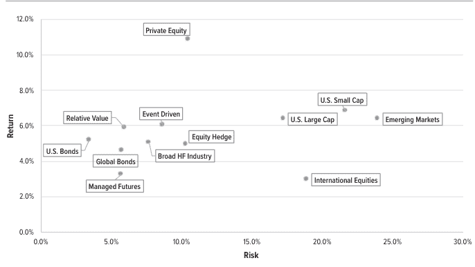

# 挑战现代投资组合理论

> 一个优秀的投资组合不仅仅是一份优质股票和债券的清单。它是一个均衡的整体，为投资者提供针对各种不确定情况的保护和机会。
>
> 哈里·马科威茨

哈里·马科威茨关于投资组合选择的论文主要关注将两个不协同波动的风险投资组合在一起的价值。马科威茨的前沿研究专注于这些投资的组合，并得出结论：正确的组合确实可以在较低风险下产生更高回报。他曾著名地表示：“分散投资是投资领域唯一的免费午餐。”我们通过正确分散彼此相关性较低的投资来提供这份免费午餐。

这是现代投资组合理论（MPT）的基础。马科威茨通常被称为现代投资组合理论之父，但其他先驱也在他最初工作的基础上进行了拓展，包括比尔·夏普和尤金·法玛。夏普开发了资本资产定价模型（CAPM）和夏普比率，用于衡量风险调整后的结果。法玛常被称为有效市场假说（EMH）之父。马科威茨和夏普于1990年获得经济学诺贝尔奖；法玛于2013年获奖。

过去30年左右，顾问们一直将马科威茨的研究纳入均值-方差优化（MVO）模型中，这些模型帮助顾问构建分散投资组合。马科威茨的研究帮助改变了顾问与客户互动的方式，将客户的注意力集中在投资组合结果上，而不是个股选择。1952年，马科威茨无法使用如今顾问们触手可及的强大计算机。现在，财富顾问可以在几秒钟内优化大量资产类别，并考虑各自的回报、风险和相关性统计数据。

多年来，我有幸多次与哈里·马科威茨共度时光，并询问了他关于其开创性研究的问题。他对自己的工作始终谦逊，并认识到需要进一步完善。我记得与哈里在前景分析咨询集团（Frontier Analytics Advisory Group）会议上，我向他提出了一个关于如何建模大型集中持仓的问题；当时，我正与许多出售公司的超高净值（UHNW）家庭合作。这些家庭中的许多都有大量财富集中在单一头寸中。哈里毫不犹豫地从座位上缓缓起身，走向董事会会议室中方便地设置好的画架。他随后潦草地写下了一个数学公式，用于建模集中持仓和股票的有效处置，并承认该建模存在一定局限性，包括成本、税收以及出售证券的限制。目睹哈里天才运作真是一件奇事——我办公室里至今仍保留着他的潦草笔记（一件珍宝）。

在大型机构之外，资产配置和MPT直到1986年才受到重视，当时加里·P·布林森、兰多夫·H·胡德和吉尔伯特·L·比鲍尔发表了其开创性论文《投资组合表现的决定因素》。该研究考察了1974年至1983年间91家大型美国养老基金，将其季度回报与假设基金（持有相同平均资产配置的指数化投资）的回报进行了比较。该研究得出结论：资产配置解释了投资组合季度回报变异的93.6%。

该研究强调做出合理的资产配置决策，而非专注于证券选择或市场时机。学者和从业者对该研究的稳健性及其结果的营销方式有所质疑，但很少有人不同意资产配置是实现长期目标的关键组成部分。无论采用何种方法来制定最佳资产类别组合，资产配置都已成为顾问价值主张的基石。

## 挑战现代投资组合理论

MPT假设投资者具有风险厌恶性，且理性投资者若发现第二个投资组合提供更低风险和相同或更好的回报，则不会投资于第一个投资组合。

MPT存在固有局限性：投资者并非总是理性，也并非总是选择风险较低的投资组合。投资者常常追逐回报，倾向于关注热门经理人或资产类别，尤其是在牛市期间。市场并非总是高效，且容易出现繁荣与萧条周期，情绪会从狂喜转为恐惧。MVO模型使用长期资本市场假设，但回报、风险和相关性在长期内并不稳定。

本章探讨了MPT的一些局限性，并评估了资本配置的替代技术。它深入探讨了以下问题：

- 财富顾问可以采用哪些资产配置方法？
- 每种方法有哪些局限性？
- 财富顾问应如何演进其方法？
- 目标导向方法的吸引力是什么？

## 现代投资组合理论的替代方案

**后MPT理论**于1991年应运而生，以回应MPT的一些局限性。这种投资组合优化方法使用回报的下行风险，而不是MPT使用的投资回报的均值方差。两种理论都描述了如何对风险资产进行估值，以及理性投资者应如何利用分散投资实现投资组合优化。区别在于各理论对风险的定义以及风险如何影响预期回报。

**Black-Litterman**模型于1992年出现，当时费舍尔·布莱克和罗伯特·利特曼试图解决MPT的一些局限性，最显著的是未来回报可能与历史结果不同。Black-Litterman模型从基于均衡假设（资产未来表现将如过去一样）的资产配置出发，然后通过考虑未来资产类别表现的预测来修改该配置。

**负债驱动投资**是处理确定收益养老金计划的常见方法，因为负债是确定且可预测的。它旨在将计划的收入需求与适当的资产配置相匹配。或者，它也可以用于匹配高净值（HNW）投资者的年度现金流需求。

**风险平价**是一种投资组合配置策略，利用风险来确定投资组合各组成部分之间的配置。风险平价在MPT基础上发展而来，基于预设的风险和回报目标进行配置。风险平价主要被对冲基金和机构使用。

**目标导向投资**结合了MPT和行为金融学的特点，旨在解决高净值（HNW）投资者的目标，而不是最大化回报或最小化风险。目标导向投资将讨论从战胜市场转向满足家庭需求。它专注于朝着商定的目标持续取得进展。

批评者指出了MPT的局限性，但许多替代资产配置方法也存在缺点。表4.1列出了这些替代方法的局限性。对于MPT和后MPT，最大的局限性是用于优化的数据的稳健性和准确性。如果未来结果与长期历史数据大相径庭，那么仅使用底层资产类别的长期历史平均值可能是一种有缺陷的方法。Black-Litterman试图通过使用未来结果的预测来解决这些局限性，但如果这些预测也是有缺陷的呢？

### 表4.1 资产配置方法

| 方法论 | 方法 | 局限性 |
|---|---|---|
| 现代投资组合理论（MPT） | MPT优化资产类别的组合，以在给定风险水平下最大化回报，或在给定回报水平下最小化风险。 | 取决于资本市场假设（回报、风险和相关性）的稳健性和准确性。该方法假设投资者选择最佳长期投资组合，而非当前最高回报的投资组合。 |
| 后MPT | 后MPT在MPT基础上发展而来，专注于优化投资组合的下行风险，而非回报的均值方差。 | 取决于资本市场假设（回报、风险和相关性）的稳健性和准确性。后MPT降低了整体投资组合风险，但在上涨市场中可能表现滞后。 |
| Black-Litterman | Black-Litterman在MPT基础上发展而来，专注于均衡假设，并纳入未来结果的预测。 | 模型投资组合可能存在估计误差，可能导致随时间推移出现截然不同的结果。 |
| 负债驱动投资 | 负债驱动投资旨在按规模和期限将未来现金流与未来负债相匹配。 | 这通常是一种机构方法，用于现金流需求可预测的确定收益计划。 |
| 风险平价（风险溢价平价） | 风险平价专注于在资产类别之间均等分配风险（由标准差定义）。 | 风险平价有助于限制风险，但这种方法在上涨市场中可能会表现滞后，因为在那种市场中承担风险的投资者会获得回报。 |
| 目标导向投资 | 目标导向投资旨在解决个人投资者的目标，例如积累财富、为购房储蓄、为子女支付大学学费或产生退休收入。 | 投资者容易追逐回报，且很难让他们专注于自己的目标。应定期回顾目标，因为目标可能会随时间而变化。 |

有缺陷的资本市场假设会损害表4.1中所有方法及其产生的结果。仅使用长期历史平均值可能会导致对回报和收入的预期高于当前可实现的水平。此外，随着相关性升高，投资者可能无法实现所需的分散投资效益。

尽管MPT、后MPT和Black-Litterman在方法上有些相似，但各自的细微差别会导致不同的投资组合。负债驱动投资和风险平价更多是机构方法，可能不适合高净值（HNW）家庭。基于目标的投资越来越流行，因为它与投资者的目标和宗旨保持一致，尽管鉴于投资者过分关注短期结果，持续加强相对于这些目标的进展可能具有挑战性。

正如我们稍后将介绍的，过去十年来，跨资产类别的相关性一直在上升，部分原因是市场之间的互联性增强。全球同步的中央银行干预造成了流动性泛滥。市场对正常时期和动荡时期的反应截然不同。在更长的市场周期内，相关性要稳定得多。然而，在市场冲击期间，例如2008年下半年、2018年第四季度或全球大流行期间，相关性会显著上升。在市场非理性行事的动荡时期，采用某种战术方法可能是明智的。

标准普尔500指数从1956年到2020年的历史年回报率为10.2%。然而，根据J.P. Morgan的长期资本市场假设，未来10至15年美国大盘股回报率将为4.1%，投资级债券回报率预计为2.5%，现金为1.1%——这些都远低于长期历史平均水平。表4.2显示了部分长期资本市场假设。较低的假设在很大程度上是由当前全球经济环境和对未来全球增长受限的预测所驱动的。

用于模型、资产配置和财务规划模型的资本市场假设（CMAs）会影响表4.1中列出的所有方法。如果历史平均值与CMAs之间的差异很小（几个基点），那么与大多数当前公司预测的差异相比就不那么重要了。

### 表4.2 精选长期资本市场假设（10–15年）

| 资产类别 | 2021年长期资本市场假设 | 2020年长期资本市场假设 |
|---|---|---|
| 美国小盘股 | 4.6% | 6.5% |
| 美国大盘股 | 4.1% | 5.6% |
| 高收益债券 | 4.8% | 5.2% |
| 美国国债（中期） | 1.5% | 2.7% |
| 美国投资级债券 | 2.5% | 3.4% |
| 现金 | 1.1% | 1.9% |

来源：J.P. Morgan Asset Management Multi-Asset Solutions，2020年，https://am.jpmorgan.com/content/dam/jpm-am-aem/global/en/insights/portfolio-insights/ltcma/ltcma-full-report.pdf

然而，长期平均值与前瞻性预测之间的差异相当大。各种模型中使用的输入决定了在特定时间范围内实现客户目标所需的回报预期、收入水平和风险。依赖有缺陷的CMAs可能导致高估回报、未能达到投资者预期，或被迫延长时间范围以实现结果。

财富顾问需要将他们的策略手册扩展到传统股票和债券配置之外，以帮助客户实现长期目标。私募股权可能提供更高回报，私人信贷提供替代收入来源，对冲基金历史上相对于传统投资提供了分散投资效益。（J.P. Morgan预计私募股权非流动性溢价为370个基点。）替代性投资的优点将在本书后面介绍。

## 资产配置考虑因素

自马科威茨论文发表以来，世界发生了巨大变化，无论是资产类别的数量还是这些资产类别的可获得性。额外的资产类别作为有价值的分散投资工具，因为全球化从定义上来说意味着当今市场更加相互关联。当然，挑战在于优化资产类别的数量和适当权重，并使用当前资本市场假设来提供围绕回报和风险的现实预期。

我们经常使用图4.1中的数据来说明最佳和最差资产类别随时间的自然轮换。该示意图的目的不是预测最佳资产类别，而是展示将风险分散到多个资产类别的价值。一个时期表现最好的资产类别可能在下一时期成为表现最差的；新兴市场是2017年表现最好的资产类别（上涨超过37%），2018年表现最差（下跌近15%）。

稳健、可靠的数据显示了美国股票的长期结果。然而，随着引入历史较短的资产类别，获取长期数据变得越来越具有挑战性：新兴市场（MSCI 1988）、小盘股（Russell 2000，1984年）、价值和成长（Russell 1987年）、房地产投资信托（FTSE Nareit 1972年）、对冲基金（HFRI 1992年）和私募股权（Cambridge 1986年）。许多较新的资产类别历史明显更短。相比之下，标准普尔500指数数据可追溯至1957年，道琼斯工业平均指数数据可追溯至1885年。

为了确定资产类别的最佳组合，许多顾问使用某种形式的MVO模型，其中关键输入是底层资产类别的回报、风险和相关性。许多模型使用长期历史数据。但如果未来结果不能反映过去结果怎么办？如果回报率较低，风险和相关性较高怎么办？投资者如何实现其长期目标？

如前所述，当前资本市场假设表明，仅使用传统投资将更难实现目标回报和充分分散投资。替代性投资可能是应对当前环境挑战的宝贵工具。私募股权提供

### 图4.1 精选资产类别回报（2010–2019年）

| 2010 | 2011 | 2012 | 2013 | 2014 | 2015 | 2016 | 2017 | 2018 | 2019 |
|:---|:---|:---|:---|:---|:---|:---|:---|:---|---|
| 小盘股股票 26.85% | 美国固定收益 7.84% | 房地产 27.73% | 小盘股股票 38.82% | 房地产 15.02% | 大盘股股票 1.38% | 小盘股股票 21.31% | 新兴市场股票 37.28% | 现金等价物 1.87% | 大盘股股票 31.49% |
| 房地产 19.63% | 高收益债 4.98% | 新兴市场股票 18.23% | 大盘股股票 32.39% | 大盘股股票 13.69% | 美国固定收益 0.55% | 高收益债 17.13% | 非美国发达市场股票 24.21% | 美国固定收益 0.01% | 小盘股股票 25.52% |
| 新兴市场股票 18.88% | 全球除美国外固定收益 4.36% | 非美国发达市场股票 16.41% | 非美国发达市场股票 21.02% | 美国固定收益 5.97% | 现金等价物 0.05% | 大盘股股票 11.96% | 大盘股股票 21.83% | 高收益债 -2.08% | 非美国发达市场股票 22.49% |
| 高收益债 15.12% | 大盘股股票 2.11% | 小盘股股票 16.35% | 高收益债 7.44% | 小盘股股票 4.89% | 房地产 -0.79% | 新兴市场股票 11.19% | 小盘股股票 14.65% | 全球除美国外固定收益 -2.15% | 房地产 21.91% |
| 大盘股股票 15.06% | 现金等价物 0.10% | 大盘股股票 16.00% | 房地产 3.67% | 高收益债 2.45% | 非美国发达市场股票 -3.04% | 房地产 4.06% | 全球除美国外固定收益 10.51% | 大盘股股票 -4.38% | 新兴市场股票 18.44% |
| 非美国发达市场股票 8.95% | 小盘股股票 -4.18% | 高收益债 15.81% | 现金等价物 0.07% | 现金等价物 0.03% | 小盘股股票 -4.41% | 非美国发达市场股票 2.75% | 房地产 10.36% | 房地产 -5.63% | 高收益债 14.32% |
| 美国固定收益 6.54% | 房地产 -6.46% | 美国固定收益 4.21% | 美国固定收益 -2.02% | 新兴市场股票 -2.19% | 高收益债 -4.47% | 美国固定收益 2.65% | 高收益债 7.50% | 小盘股股票 -11.01% | 美国固定收益 8.72% |
| 全球除美国外固定收益 4.95% | 非美国发达市场股票 -12.21% | 全球除美国外固定收益 4.09% | 新兴市场股票 -2.60% | 全球除美国外固定收益 -3.09% | 全球除美国外固定收益 -6.02% | 全球除美国外固定收益 1.49% | 美国固定收益 3.54% | 非美国发达市场股票 -14.09% | 全球除美国外固定收益 5.09% |
| 现金等价物 0.13% | 新兴市场股票 -18.42% | 现金等价物 0.11% | 全球除美国外固定收益 3.08% | 非美国发达市场股票 -4.32% | 新兴市场股票 -14.92% | 现金等价物 0.33% | 现金等价物 0.86% | 新兴市场股票 -14.57% | 现金等价物 2.28% |

获得更高回报的机会，私人信贷提供了替代收入来源，某些对冲基金策略相对于传统投资提供了分散投资。我们将在本书后面更详细地介绍另类投资。

我们将另类投资划分为对冲基金策略（股票对冲、事件驱动、相对价值、宏观和多策略）以及私人市场（私募股权、私人信贷和实物资产）。这些多功能策略可以成为财富顾问为高净值投资者构建更精细、更稳健的投资组合的宝贵工具。在这个充满挑战的环境中，高净值投资者正要求获取这些曾经触手难及的投资。

对冲基金和私募股权在表现最佳和表现最差的基金之间存在巨大的回报离散，相关基准通过对精选基金样本进行比较来计算结果，这可能存在幸存者偏差。对冲基金基准仅包含仍在运作的基金的数据，因而存在幸存者偏差。表现不佳的基金可能会关闭，其数据将从基准中移除。基于这种方法，基准可能高估回报并低估风险。如本书后文所述，表现最佳和表现最差的私募股权基金之间存在巨大差异，尤其与传统的只做多基金相比。

资产类别之间的相关性是现代投资组合理论（MPT）的“秘诀”。不幸的是，相关性并非静止不变，在过去几十年中一直在上升。图 4.2 显示，资产类别之间的相关性从 2000–2009 年上升到 2010–2020 年。在 2000–2009 期间，大宗商品与美国股票市场的相关性为 0.20，全球债券的相关性为 0.14。仅 10 年后，这些相关性分别上升至 0.57 和 0.25。这部分是由于各全球市场之间的互联互通。

在过去十年中，相关性在所有领域都大幅上升。事实上，在 2008 年下半年、2018 年第四季度以及全球大流行期间等冲击时期，大多数主要资产类别的相关性都有所上升。当我们最需要相关性带来好处时，它们未能保留分散投资的好处。这支持将风险分散到更多、不同的资产类别（包括另类投资）的观点。

### 图 4.2 精选相关性数据

| | 美国股票 | 全球股票 | 全球高收益 | 大宗商品 | 全球债券 |
|---|---|---|---|---|---|
| 美国股票 | 1.00 | | | | |
| 全球股票 | 0.97 | 1.00 | | | |
| 全球高收益 | 0.66 | 0.72 | 1.00 | | |
| 大宗商品 | 0.20 | 0.29 | 0.29 | 1.00 | |
| 全球债券 | 0.14 | 0.24 | 0.34 | 0.19 | 1.00 |

| | 美国股票 | 全球股票 | 全球高收益 | 大宗商品 | 全球债券 |
|---|---|---|---|---|---|
| 美国股票 | 1.00 | | | | |
| 全球股票 | 0.97 | 1.00 | | | |
| 全球高收益 | 0.75 | 0.83 | 1.00 | | |
| 大宗商品 | 0.57 | 0.61 | 0.69 | 1.00 | |
| 全球债券 | 0.25 | 0.34 | 0.52 | 0.23 | 1.00 |

## 资产配置的演变

哈里·马科维茨向我们展示了在构建投资组合时分散投资的价值，但自 20 世纪 50 年代马科维茨的开创性工作以来，世界已发生了巨大变化。我们需要汲取历史的教训，并使我们的方法适应当前的市场环境。我们需要扩大资产类别的数量，以识别机会并分散风险。

随着顾问开始向投资者介绍分散投资的好处，许多人将 60/40 配置作为一种流行的基准投资组合，投资者的大部分回报来自股票配置，收入主要来自债券配置。标普 500 指数的长期历史年均回报为 10.2%，固定收益的长期年收益率约为 4%。股票配置提供了强劲的回报，固定收益配置提供了收入，两者合计使投资者因其投资之间的低相关性而实现了一定程度的分散。简单的 60/40 投资组合提供了有吸引力的回报、收入和分散，投资者可以轻松调整配置，以随时间推移产生更高回报或满足其他需求。

但如果在未来 10 到 20 年内股票回报和债券收益率较低，顾问应该怎么办？如果资产类别之间的相关性保持高位怎么办？投资者如何实现其期望的回报要求？他们是否需要承担更多风险或延长投资期限？

顾问应考虑在股票和固定收益配置中进行更广泛的分散，包括国际发达市场、新兴市场、高收益债券、房地产、大宗商品和某些类型的另类投资。更广泛的分散可以帮助提高回报、降低风险并提供非相关回报。在牛市期间美国股市回报强劲的背景下，顾问在将对冲基金策略有意义地纳入投资组合方面行动缓慢。这部分是由于许多此类策略的结果普遍平平，部分是由于在描述这些策略旨在分散投资组合中发挥的作用时缺乏教育和一致性。

大多数对冲基金策略并非旨在在上涨市场中跑赢标普 500。股票对冲和事件驱动等策略对冲其市场风险敞口，相对价值是一种保守策略，旨在提供稳定的递增回报，而宏观和多策略是防御性策略，在艰难的市场条件下证明其价值。因此，将这些策略与标普 500 进行基准比较没有意义。私募股权、私人信贷和实物资产因其潜在回报、收入和分散效益而备受关注。这些曾经触手难及的资产类别现在以更低的门槛和更好的流动性向更多投资者开放。

随着传统回报和收入可能远低于其历史平均水平，顾问需要为客户识别替代性回报和收入来源。他们需要评估不同的策略和结构，以满足客户的需求和目标。

### 图 4.3 精选资产类别回报（2000–2020）

来源：iCapital Network、Hamilton Lane、HFR 和 Envestnet。风险和回报数据来自 2000 年 1 月至 2020 年 12 月。

与传统资产类别相比，私募股权在历史上一直提供强劲的绝对回报和相对回报。如今，私人公司的数量远多于上市公司——而且许多公司将保持私有更长时间。我们将在本书后面介绍私募股权。

## 资产配置注意事项

在构建更好的投资组合时，有几项资产配置和投资组合构建需要考虑。以下是几个关键问题：

- 战略配置与战术配置
- 资产配置与资产定位
- 主动投资与被动投资
- 另类投资的作用与运用
- 投资组合构建

## 战术配置

鉴于前面提到的一些局限性以及当今市场周期的动态性，顾问可能希望纳入战术覆盖以应对不断变化的市场条件。我不建议大幅进出市场，而是建议根据当前市场条件进行细微调整，以更好地定位投资组合。我建议顾问制定一个实施和跟踪战术配置的流程，包括以下内容：

- 如何做出决策？
- 是否有资产配置委员会？
- 战术配置的依据是什么？
- 什么会导致您解除战术配置？
- 对冲的超配和低配头寸是什么？
- 如何衡量成功？

大型公司可能拥有健全的流程和正式的管理机构（资产配置委员会或投资委员会）。无论公司规模如何，我都建议记录流程并跟踪结果。战术调整的频率和规模可能因当前市场条件而异。例如，在

创纪录的牛市行情（2009–2019年），采取更防御性的姿态可能是明智的。这本可以通过降低对风险资产（国内和国际股票）的敞口并增加对防御性资产（现金、黄金或宏观资产）的敞口来实现。战术性资产配置还可以超配有吸引力的资产类别（价值）并低配昂贵的资产类别（成长）。

## 资产配置位置

顾问们常花大量时间探讨现代组合理论（MPT）的局限性，融入行为金融学的各个方面以满足投资者需求。基于目标的投资直观且

向投资者解释起来很容易，并且能够很好地融入咨询流程，提供同时解决多个目标的灵活性。基于目标的投资将与客户的讨论从跑赢市场转移到相对于其既定目标的进展，并强化长期投资方法。

基于目标的投资是对现代投资组合理论（MPT）局限性的自然回应。与其追求最大化回报或最小化风险，基于目标的投资旨在最大限度地提高实现客户目标的可能性。虽然它平衡了回报与风险，但基于目标投资的效用函数是实现期望结果：资本增值、财富保值、退休收入、为第二套住房储蓄、大学基金或慈善捐赠。

由于高净值（HNW）家庭通常在多个账户中拥有多个目标，顾问应确定具体期望的结果，并为每个账户设定可实现的目标。顾问必须在牛市和熊市中始终如一地强化相对于客户目标的进展，以及实现这些目标的预定时间范围。顾问可能会在好时机专注于强劲表现，而在困难时期才回归目标，这会失去客户的信任，并使客户难以专注于其计划。
