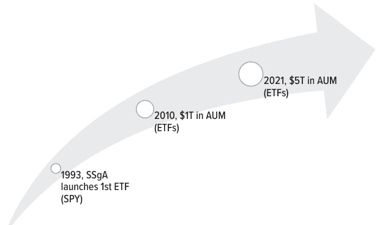

# 第 5 章

# 融入主动和被动策略

> 一只蒙住眼睛的猴子向报纸财经页面投飞镖，挑选出的投资组合表现可能与专家精心挑选的一样好。
>
> 伯顿·马尔基尔
> *《华尔街随机漫步》*

伯顿·马尔基尔的经典著作抛下了挑战书，主动管理者无法持续跑赢市场。他假设市场是有效的，证券价格反映了所有可获取的信息。该书出版于1973年并多次更新，《华尔街随机漫步》助推了被动投资革命，第一只指数基金由Vanguard于1975年推出，第一只ETF由State Street Global Advisors (SSgA)于1993年推出。

仅在美国，就有超过1,400只ETF，管理资产约5万亿美元。ETF通过以成本效益高、税收效率好的方式让投资者轻松接触市场几乎所有细分领域，帮助普及了投资。它们让投资者在一次交易中、无最低门槛地获取广泛市场细分领域的风险敞口。在ETF出现之前，想要持有标普500的投资者必须购买标的证券，并按指数使用的相同权重进行组装。这非常昂贵且难以实现，而且市场增值意味着投资者的风险敞口通常会随时间偏离指数回报。但现在，只需一次交易，就能以近乎零的价格轻松持有标的篮子，无交易成本，并内置自动再平衡。

### 图 5.1 被动投资的增长

数十年来，投资者一直在争论哪种更好：主动管理还是被动管理。主动管理者声称擅长识别优秀公司并避开弱势公司。被动管理的倡导者指出，主动管理者无法持续跑赢基准。近年来，主动ETF和被动共同基金模糊了两大阵营之间的界限。主动和被动管理都有其作用，我们将在本章中加以探讨。

### 被动投资的兴起

ETF的兴起在2008年全球金融危机后加速，因为许多主动管理者未能跑赢市场，投资者反对为表现不佳于市场的主动管理者支付高额费用。顾问开始采用ETF作为构建多元化投资组合的基石，投资者也开始自行尝试交易ETF，导致ETF在策略数量和管理资产方面迅速增长。ETF不断演变，现在有多种类型，从“cheap beta”到“smart beta”，从旨在模仿特定指数的策略到主动ETF。

历史上，ETF的持有者在散户投资者和机构投资者之间分配较为均衡。对冲基金接受了以可交易结构持有广泛市场细分领域的便捷方式。他们可以做多美国市场并做空国际市场，或做多小盘股并做空大盘股，并能轻松平仓。机构投资者以多种方式使用被动策略，包括表达战术观点、提供贝塔敞口或临时贝塔敞口（在寻求替代品时），以及超配或低配因子敞口。机构可能选择使用ETF或其他基于指数的策略，以反映对市场的长期和短期观点。顾问可以使用ETF来反映其观点和偏好，通过部署动量、质量、价值偏、收益导向和低波动率ETF。

家族办公室和超高净值（UHNW）家庭喜欢ETF的税收效率和灵活性。他们可以轻松调整投资组合敞口，并更敏捷地应对市场条件的变化。散户投资者喜欢能够高效进入市场，ETF迅速成为日常市场交易量的更大比例。与其争论持有Apple、Amazon或Google的优劣，现在只需轻点鼠标就能同时持有这三只股票。

随着ETF行业的成熟，我们看到了几个积极的发展。竞争环境导致费用大幅下降：一些ETF的定价接近于零。我们看到了产品创新，从旨在廉价镜像市场的产品到旨在跑赢市场的smart beta策略。为了使事情复杂化，现在出现了主动和“nontransparent”ETF（不提供透明度的主动策略）。ETF仅仅是持有标的证券篮子的外壳。

一些主动管理者在证券选择方面展现出技巧，但大多数人很难持续实现跑赢市场的结果。标普（S&P）每年发布一份记分卡，衡量跑赢市场的管理者数量。SPIVA Mid-Year 2020 Scorecard1 显示，令人不佳的67%的主动管理者未能跑赢整体市场。增长基金在一年期表现良好：74%的大盘增长基金、83%的中盘增长基金和89%的小盘增长基金跑赢了基准。然而，从长期来看，在过去15年中，92%的大盘增长基金、74%的中盘增长基金和75%的小盘增长基金跑输了基准。

这份数据意义重大，因为它涵盖了大流行病引发的剧烈下跌，以及财政和货币刺激措施注入后的急剧反弹。考虑到不确定性应该奖励主动管理，除了增长管理者之外，所有人的结果都相当糟糕。多年来，主动管理者声称，他们无法在由资金流入被动策略推动的上涨市场中跑赢，但在市场变得艰难且他们能够展示技巧时，他们可以跑赢。

ETF通常比可比策略更具税收效率，因为其成本结构和独特的“creation/redemption”流程。创建/赎回流程是提供ETF税收效率的“secret sauce”。当投资者投资共同基金时，经理使用资金购买证券，支付佣金并承担点差，最终影响投资者回报。当投资者从基金中提取资金时，经理出售证券并可能产生税务后果。

与共同基金中为其他投资者支付税款不同，ETF利用授权参与者的专业知识来创建和赎回份额。为了应对不断增长的需求，授权参与者创建一篮子标的股票，称为creation unit，或赎回股票以促进大额流出。授权参与者可以做到这一点而无需承担税款，因为他们正在创建新份额并将其交付给ETF发起人。

关于“race to zero”的简要说明：免费并不总是免费。尽管少数ETF发起人现在声称提供免费ETF，但深入研究可以帮助我们理解ETF的成本结构和收入来源。ETF持有总成本包括显性成本和隐性成本。显性成本包括运营费用比率、佣金、交易成本（bid-ask spreads）以及相对于资产净值（NAV）的折价和溢价。隐性成本包括跟踪误差和资本收益。ETF发起人还可以通过借贷证券产生收入。

扼杀推动增长的创新是“race to zero”的潜在非预期后果。资产管理者缺乏动力开发几乎没有或没有收入的产品。顾问和投资者应要求公平合理的定价，但我们仍在为成本和收入下降付出代价。

ETF的非凡增长在过去几年中帮助降低了共同基金费用。这是一个积极的发展，因为其高额费用使得共同基金难以持续跑赢市场，就像一名携带额外重量的短跑选手。

### 主动管理者的作用

尽管ETF在过去十年中无疑经历了非凡增长，有人预测主动管理将走向终结，但共同基金仍然是投资者的主要投资工具，拥有超过1亿个美国家庭和

截至2019年底，共同基金资产达21.3万亿美元。² 美国共同基金资产大部分投资于股票基金（53%），其次是债券基金（22%）、货币市场基金（17%）和混合基金（7%）。散户投资者持有大部分资产（89%）。ETF的市场份额有所增加，但仍远小于共同基金。

尽管引用了SPIVA数据，主动管理者更有能力应对市场不确定性，并在必要时采取防御策略。指数策略因其本质必须跟踪底层指数，无论市场是上涨还是下跌。主动管理者可以根据前瞻性观点调整策略，顺应当前市场环境，采取更积极或更防御的姿态。主动管理在效率较低的资产类别（新兴市场）、利基策略（期权叠加）、另类投资（对冲基金和私募市场）以及税收管理策略中也很有意义。

主动管理者在充满挑战的市场环境中能够展现其技巧，在这种环境下，赢家和输家公司之间的差异更大，证券选择显得尤为关键。在2009–2019年的牛市期间，动量股票主导了市场。资金涌入ETF推动了它们的增长，进一步抬高了这些股票的价格。未来10年很可能与过去10年不同，我们可能会看到一个奖励选股技巧娴熟投资者的市场环境。市场周期往往会起伏变化，下一个周期很可能在区分赢家和输家方面更具甄别力。

许多最成功的固定收益ETF都采取主动管理，且所有固定收益ETF都包含主动元素。固定收益市场与股票市场不同。如果你想持有标普500，可以轻松购买一篮子适当加权的有限数量证券。但固定收益ETF并不寻求以与巴克莱美国综合债券指数（最受欢迎的债券指数）相同的权重持有相同的债券。相反，它们寻求持有与基准具有相似特征的债券（行业、评级、久期等）。许多人质疑该基准是否具有代表性，并疑惑投资者为何要复制其结果，这导致许多投资者倾向于主动投资选择。

许多资产管理者将税务管理宣传为SMAs相对于共同基金的优势之一，且ETF通常是一种税务高效的结构。也就是说，有专注于全年税务管理的专职管理人员。税务管理策略对高净值（HNW）投资者非常有意义。事实上，一些税务管理策略声称能通过有效的税务亏损收割捕捉税后阿尔法。专注于为税务效率管理投资组合，并具备抵消收益和亏损的能力，对高净值和超高净值（UHNW）家庭无疑是有价值的。税务管理对富裕家庭至关重要，不容忽视。任何为高净值投资者服务的顾问都应考虑某种形式的主动税务管理。

问题不在于主动投资与被动投资的对抗，而在于如何有效地运用主动和被动策略。主动管理者面临的挑战是，他们能否在扣除费用和税务后提供超额回报。市场上有技巧娴熟的管理者；当然，挑战在于找到他们。许多顾问已决定将时间和精力投入到更具附加值的业务中。

如果克服较高的费用结构对主动管理者构成障碍，主动ETF是合理的答案。过去几年中，许多大型资产管理者面临大量资产流出。我们看到许多ETF提供商收购阻止了流出，几家管理者推出了自己的ETF。这些新进入者并未参与零费率竞赛，而是转向主动、非透明或智能贝塔ETF，以保留部分定价权。

## 智能贝塔策略

第一代指数产品旨在以成本效益高的包装跟踪底层指数。这些产品之所以受欢迎，很大程度上归功于接触各类市场细分的便捷性，以及主动管理者在持续跑赢被动基准方面的困难。正如我们所讨论的，ETF已成为顾问、投资者和机构构建投资组合或进入市场的通用工具。ETF的增长在很大程度上是以主动管理者为代价的，因为ETF提供了廉价的贝塔敞口。

第一代产品主要采用市值加权：市值最大的公司（按市值计算）在底层指数中的权重最大。最常见的指数就是按此构建的（标普500、罗素2000、MSCI EAFE等）。道琼斯工业平均指数采用价格加权：股价最高的公司权重最大。随着ETF越来越受欢迎，许多人开始质疑这种任意加权方式的合理性，因为大量学术研究表明，某些已知因素在历史上曾带来超额表现。

智能贝塔策略（又称策略性贝塔或另类贝塔）在过去十年左右的时间里越来越受欢迎，因为它们能够改善市场结果。其中许多策略跑赢了市场和/或相对于市场降低了风险。智能贝塔包含一系列策略：基本面、质量、动量、低波动和等权重等。其中许多策略通过利用价值、规模、质量、低波动和动量等已知因素来实现超额回报，而其他策略则仅依赖于显示出强劲假设结果的回测数据。

随着策略性贝塔策略的增多，投资研究公司晨星开始跟踪投资者可用的资金流动和策略数量，并引入了一种分类法，帮助顾问区分各种策略类型。截至2020年6月，共有632只交易所交易产品（ETF和交易所交易票据），管理资产达8697亿美元，占投资于交易所交易产品的4.38万亿美元的约20%。³ 增长主要来自新采用者，其中许多人正在退出主动管理选择。在过去二十年里，策略性贝塔交易所交易产品资产增长中，约72%来自净新流入，剩余28%反映资产增值。

策略性贝塔策略并非同质化，每种策略都采用自己的筛选和加权方法论。方法上的差异可能导致市值、行业配置、价值与成长的比例以及风险回报特征方面出现巨大差异。⁴ 表5.1介绍了几种更受欢迎的智能贝塔策略、其加权方法论以及相应的投资组合倾向。

### 表5.1 界定几种智能贝塔策略

| 智能贝塔类型 | 筛选和加权方法论 | 偏差 / 倾向 |
| :--- | :--- | :--- |
| 基本面 | 基于调整后的销售额、现金流、股息和回购对证券进行筛选和加权。 | 价值倾向 |
| 质量 | 侧重于资产负债表强劲、负债水平低、盈利强劲的公司，对证券进行筛选和加权。 | 价值/质量 |
| 动量 | 基于最近表现良好的公司（6–12个月）对证券进行筛选和加权。 | 成长导向 |
| 低波动 | 基于相对于整体市场历史上波动率较低的证券进行筛选和加权。 | 价值倾向 |
| 等权重 | 所有证券最初等权重，并每季度重新平衡回等权重。 | 小/中盘股偏向 |

由于筛选和加权方法论的差异，这些策略的受欢迎程度会随时间而变化。动量是一种成长导向策略，在2015至2020年期间表现良好，当时FAANG股票（Facebook、Apple、Amazon、Netflix和Google）占据主导地位。相反，基本面是一种价值倾向策略，在过去十年中，由于价值投资大幅落后于成长投资，因此表现滞后。顾问和投资者在投资智能贝塔策略之前应了解其内置偏差。

## 因子投资

行业经常将“战略 Beta”和“因子投资”混用，但并非所有战略 Beta 策略都基于因子研究。因子一词描述了一组证券的特征，可用于解释收益和风险。近年来，大量新策略涌现，都声称已识别出新因子。MSCI 对因子投资进行了广泛研究，并提出了以下观点：

虽然许多因子在解释风险和收益变化方面已被证明具有统计显著性，但并非所有这些因子都相对于 CAPM 定价提供风险溢价。风险溢价因子是指那些代表系统性风险敞口、历史上长期获得溢价的因子。迄今为止，我们已识别出六个风险溢价因子：价值、小盘、低波动、高股息收益率、质量和动量。多年的学术研究已对这些因子进行了实证检验，且有充分解释说明它们为何历史上提供了风险溢价。

因子投资始于 20 世纪 60 年代，当时资本资产定价模型（CAPM）被引入，该模型描述了系统性风险（即波动性）与预期收益之间的关系。尤金·法马和肯尼斯·弗伦奇在 CAPM 基础上构建模型，在 20 世纪 90 年代推出了三因子模型，将规模和价值因子添加到 CAPM 的市场风险因子中。对因子投资的研究范围广泛，可追溯数十年，大型机构投资者已使用因子投资数十年。如今，ETF 可以通过基于规则的结构捕捉这些因子，因此顾问和投资者可以轻松获得。

随着因子投资越来越被广泛接受，我们看到了多因子策略在市场上大量涌现。多因子策略在多个因子之间进行配置：价值、质量、动量和低波动。这些策略可以是静态的（保持目标配置）或动态的（根据当前市场条件调整配置）。这些策略通过捕捉因子进出青睐的自然轮动来吸引投资者。但它们是否超越持有市场本身增加了价值？它们是否抵消了在投资组合中孤立因子敞口的益处？我相信因子分散化的价值。顾问可以利用当今众多可用的因子 ETF 自行实施，或配置到基于自身方法论进行配置的多因子 ETF。

## 模型的兴起

一种新的主动管理类型开始获得关注：资产配置模型，使用 ETF、共同基金和 SMA 作为构建块以获取市场细分的敞口。资产管理人、财富顾问以及许多大型财富管理公司的总部运营团队正在开发这些模型。由于原材料丰富，模型的数量和多样性都大幅增长，解决了从总回报到特定目标的一切问题。

尽管资产配置模型投资组合自 20 世纪 90 年代初就已存在，但过去二十年里它们发生了很大演变，很大程度上归功于 ETF 的多样性。第一代模型主要使用共同基金或选择个别证券。ETF 大大扩展了工具箱，使获取市场和改变加权方法以提供不同结果变得容易。资产配置模型可以代表全投资组合解决方案或专业子组。

资产管理人抓住了机会，利用其专业知识并捕获整体投资组合配置的重要部分。这有助于遏制共同基金和 SMA 的资产流失，以及整个行业的费用压缩。利用第三方模型可以释放顾问，让他们专注于其他财富管理问题，加深与高净值家庭的关系，并帮助投资者获得专属投资组合管理以及他们需要的更广泛的一系列财富管理解决方案。

模型可以包括跨广泛资产类别的共同基金、ETF 或个别证券。总部员工已接受模型，因为它们让顾问能花更多时间在更广泛的财富管理问题上，并关注整体客户体验。财富顾问喜欢能够充当四分卫的能力，确定客户的需求和目标，并选择合适的模型以实现客户目标。如果投资者的目标发生变化或模型未达预期，顾问可以轻松替换模型。表 5.2 概述了模型在三个关键利益相关者：资产管理人、顾问和投资者中的价值和局限性。

类似于 20 世纪 90 年代初的 SMA 业务，资产配置模型投资组合代表了一种利用第三方资产管理人专业知识，并更好地使顾问利益与客户利益保持一致的方式。模型让资产管理人有办法利用其专业知识并拥有更大份额的蛋糕。它们让顾问能够使自身利益与客户利益保持一致，并利用世界一流资产管理人的专业知识。投资者能够获得更专业的专家团队。

许多顾问相信，通过创建投资组合可以增强其价值主张。但根据 Cerulli Research 报告，只有 28% 的投资者相信其顾问拥有最高水平的投资专业知识，35% 更喜欢专门的投资团队。投资者重视一个专业团队，每个人拥有自己的专业领域：投资管理、财务规划、信托与遗产、慈善事业。财富顾问的价值在于组建团队并根据需要调用这些资源。

对许多顾问来说，挑战在于有效转型，尤其是如果他们已将价值主张定位为构建投资组合。对于已将大量资产转移到“代表-组合经理”或“代表-顾问”项目的顾问来说，这可能是一个更具挑战性的讨论。将模型定位为互补解决方案可能更合适，因为其价值主张很可能一直是作为投资组合经理。

### TABLE 5.2 模型的价值和局限性

| | 模型的价值 | 模型的局限性 |
|---|---|---|
| 资产管理人 | 使资产管理人能够利用其专业知识并拥有更大份额的蛋糕。模型还帮助将讨论从单个子组件的表现转移开，并将注意力集中在模型表现上 | 模型仍需要交付结果：回报、收入、风险和期望结果。其他资产管理人和总部运营团队提供了大量竞争 |
| 顾问 | 模型让顾问能将更多时间和精力投入到其他财富管理问题上（财务规划、退休规划、信托与遗产、贷款、慈善事业等）。顾问价值主张转向统筹客户关系并利用资源 | 顾问需要能够区分各种模型提供商，并有效评估其构建方式。顾问可能需要使用多个模型来满足其客户需求 |
| 投资者 | 投资者能够获得更专业的专业知识以及为其效力的团队。模型让顾问能够扩大其向高净值客户提供的能力范围 | 模型仍需要交付结果，且顾问需要管理管理人以确保他们实现客户目标 |

对于主要拥有交易型、共同基金包装账户、单独管理账户（SMA）或统一管理账户（UMA）的顾问，我们在表 5.3 中讨论了迁移到模型投资组合的益处。

模型可能不适合每位顾问或每位客户，但它们代表了我们行业的演进前进步伐。资产管理人可以利用其资产配置和投资组合构建专业知识，顾问可以花更多时间和精力解决财富管理问题，投资者则获得了更广泛的专家团队为其效力。与过去二十年里的许多转变一样，有些顾问可能担心这些变化构成了对其业务模式的威胁，而其他人将拥抱这些变化并发展自己的业务。有些顾问将商品化，而其他人将随着转向关注更广泛的财富管理问题而繁荣发展。

随着资产配置模型投资组合预计将增长，顾问需要能够有效地评估和比较市场上各种提供商。资产配置的增长

### 表 5.3 转向模型的优势

| | 转向模型的优势 |
|---|---|
| 交易型 | 交易成本接近零。因此，投资者认为这种关系几乎没有或没有价值。顾问需要转变其价值主张，专注于如何帮助客户解决日益广泛的财富管理问题。 |
| 共同基金包装型 | 共同基金包装模式可能受基础共同基金数量和质量的限制。此外，由于共同基金成本通常较高，总费用可能显著高于主要使用ETF的模型。 |
| 传统SMA包装型 | SMA可能在最低门槛和充分分散多个管理人风险的能力方面受到限制。SMA成本通常高于ETF；因此，传统SMA模型可能比包含ETF的模型更昂贵。 |
| UMA模型 | UMA模型旨在解决共同基金包装模式和传统SMA包装账户的一些局限性。UMA模型通常由总部管理。利用第三方模型可提供额外的客观性，并使从一个模型转换到另一个模型变得更加容易。 |

模型的增长对我们的行业是一件好事，代表了顾问调整其业务模式和价值主张的自然演进。SMA并未否定顾问的价值。相反，它们将价值主张转移到选择合适的SMA组合以实现客户目标和宗旨上。模型的增长亦然。顾问的价值主张从构建模型转变为选择第三方模型以实现客户目标。

借助强大的基础资产，模型可以为几乎所有市场细分提供广泛分散，提供全球宏观风险敞口或为退休产生收入。模型可以旨在在上涨市场中最大化回报，或在波动市场中抑制波动。由于模型的多样性，顾问可以根据客户需求选择使用多个模型。为了说明模型多样性，表5.4提供了使用主动和被动策略的示例资产配置。

### 表 5.4 示例模型配置

| 资产类别 | 百分比 | 策略/结构 |
|---|---|---|
| 美国大盘股 | 25% | 多因子ETF/廉价Beta (60/40) |
| 美国小盘股 | 7% | 主动管理/廉价Beta (50/50) |
| 国际发达市场 | 13% | 主动管理/因子ETF (50/50) |
| 新兴市场 | 5% | 主动管理/因子ETF (60/40) |
| 固定收益 | 25% | 主动管理 |
| 高收益 | 5% | 主动管理 |
| 实物资产 | 5% | 主动管理 |
| 另类投资 | 10% | 主动管理 |
| 现金 | 5% | 货币市场 |

并保持低成本。多因子敞口可以通过单一ETF实现，或者模型提供商可以选择跨一个或多个因子ETF进行配置。

对于小盘股，我将敞口在主动管理（阿尔法）和廉价Beta ETF（降低成本）之间进行分配。对于国际发达市场和新兴市场，我使用主动管理和因子ETF，没有廉价Beta敞口。研究表明，因子策略长期以来一直以很大幅度跑赢其市值基准。5 对于广泛的固定收益、高收益、实物资产和另类投资，我建议根据管理人技能以及通过被动策略进入市场的一些固有挑战，使用主动管理选项。

顾问现在拥有一个多功能工具箱，可以利用一系列内部和第三方合作伙伴公司的资源和专业知识。因此，顾问的价值在于确定如何最好地使用这些模型来实现客户目标。

## 开发定制模型

虽然模型的增长对行业来说是积极的发展，但许多HNW和UHNW投资者需要包含另类投资配置的更多定制解决方案。因此，我们需要考虑基础投资在构建持久型投资组合中的作用。表5.4提供了我们如何拆分这些投资并有效地在投资组合中使用它们的高层次概述。

对于HNW和UHNW家庭，问题不在于主动与被动，或者传统与另类投资，而在于如何以最恰当的方式使用所有这些投资。作为一个行业，我们需要更好地识别如何更好地使用各种构建模块。传统ETF可以提供税收效率高的敞口，因子ETF可以提供超额回报。一些SMA已显示出跑赢市场的技能，而另一些则提供税后阿尔法。对冲基金可以在投资组合中发挥多种作用，从资本增值到财富保值以及提供更广泛的分散。私募股权提供更高回报的潜力，私募信贷可以是替代收入来源，实物资产可以提供远离传统投资的分散。

### 表 5.5 评估投资的结构和作用

| 被动投资（ETF和共同基金） | 廉价Beta为所有市场细分提供成本效益高、税收效率高的敞口。可根据其交易便利性进行战术性使用。 |
| --- | --- |
| | 智能Beta/因子投资提供利用已知因子跑赢市场、并在构建投资组合中融入倾斜和偏差的能力。 |
| 主动投资（SMA和共同基金） | 主动管理人需要通过跑赢市场和/或提供更好的税后回报来证明其价值。主动管理人可以在技能溢价高的挑战性市场环境中证明其价值。 |
| 对冲基金（有限合伙、有限另类投资和注册基金） | 对冲基金是多功能工具，在投资组合中发挥不同作用。它们可以细分为子策略：股票对冲、事件驱动、相对价值、宏观和多策略。 |
| 私募市场（有限合伙和注册基金） | 私募市场历史上一直是大型机构和家族办公室的专属领域。私募股权可以提供更高回报，私募信贷提供更高收入，实物资产提供分散。 |

## 案例研究：UHNW家庭

本案例研究基于我曾在摩根士丹利合作的一户UHNW家庭，以产品中立的方式说明了主动和被动策略的使用。出于保密考虑，我更改了姓名和一些细节。

Scott Perry将他的公司出售给一家大型食品服务集团，并成立了家族办公室。Scott和他的妻子Elaine拥有个人账户和联合账户。他们的三个孩子——Susan、Scott Jr.和Joanie——各自拥有个人账户，六个孙辈也是如此。Scott还成立了一个家族基金会。该家族总资产达数亿美元。Scott和Elaine拥有约2.5亿美元的可投资资产，基金会约有5000万美元，子女的投资组合在1000万至3000万美元之间，孙辈的投资组合在100万至500万美元之间。

### 表 5.6 Perry家族投资组合

| 账户 | 基础投资 |
|---|---|
| Scott & Elaine（所有实体） | Scott和Elaine可以无限制地接触对冲基金、私募股权和SMA。由于他们从特许权使用费中获得收入，他们对固定收益需求不大，投资期限较长，且对另类投资有健康敞口。我们偶尔使用ETF进行战术性配置。 |
| 家族基金会 | 家族基金会大量配置对冲基金和私募股权，以及一系列全球分散的独立管理账户策略和非受限固定收益共同基金（机构份额）。 |
| 子女 | Susan有兴趣了解自己的投资组合，对对冲基金和私募股权配置较高。Scott和Joanie更趋风险厌恶，对冲基金配置较小。他们各自通过多个SMA获得全球分散敞口，并通过机构共同基金获得分散固定收益敞口。我们偶尔在Susan的投资组合中战术性地使用ETF，以适应不断变化的市场状况。 |
| 孙辈 | 两个年龄最大的孙辈对基金中基金有小额敞口，而其他孙辈则分配给传统SMA、共同基金和ETF。我们使用ETF确保充分分散，并使用流动另类投资来模拟对冲基金。 |

佩里家族拥有可观的财富，能够接触到业界最优秀的思想。我们花了大量时间考虑各实体之间的资产配置，然后思考如何最好地获取各类资产类别的敞口。财富顾问不应仅仅因为 ETFs 价格低廉就认为它们是“零售”产品。机构和家族办公室几十年来一直在使用被动投资，而 ETFs 只是获取特定市场细分领域敞口的一种更高效方式。因子投资通过在优雅包装中捕捉已知因子，将被动投资提升到新水平。它提供 *Beta 外壳下的 Alpha*。

虽然单独管理账户（SMAs）通常是获取股票市场敞口的更好载体，但固定收益是一个机构市场，且往往存在规模刚性，使得机构共同基金成为更好的选择。以较小增量购买的 SMAs 可能支付的价格高于机构经理，后者可能因其规模和议价能力而能以更好的价格购买更多债券。

财富顾问在确定如何最好地获取特定市场细分领域敞口时，应仔细考虑载体选择。由于最低投资门槛较低，人们很容易认为 ETFs 和共同基金是零售投资，而对冲基金和私募股权是高净值和机构产品。但情况并非如此简单。将 ETFs 和共同基金用于高净值和超高净值家庭也有其优势。

## 关键要点

我们不应再争论主动投资与被动投资的孰优孰劣，而应确定如何在构建更好投资组合时最好地融合两者。主动与被动之间的界限正在模糊，主动 ETFs 和指数共同基金的出现就是例证。智能贝塔策略弥补了传统被动策略与主动管理人所追求成果之间的差距，有可能提供 alpha in a beta wrapper。
