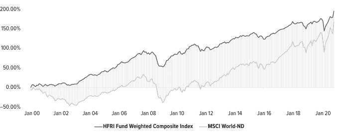
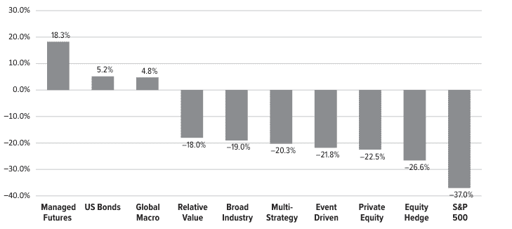

# 第 6 章

# 另类投资的作用与运用

> 强调定价低效且拥有有趣主动管理机会的资产类别，能提高投资成功的可能性。明智地接受非流动性并采取价值取向，是投资组合管理中一种审慎、保守的方法。

大卫·F·斯温森
《开创性组合管理：一种非传统的机构投资方法，全面修订更新版》

作为一个行业，我们并不总是让投资者轻松理解某类投资的作用。因此，我们有时会吓跑那些本应拥抱的投资者。另类投资这个术语是行业术语如何妨碍理解并限制这些策略整合到投资者投资组合中的一个很好的例子。仅凭这个名称就会引发恐惧和困惑。

另类投资仅仅是对冲基金的一个花哨名称吗？

它们是否仅适用于机构和非常富有的家庭？

它们是对什么的替代？本章在目标导向框架下评估另类投资：我们要解决什么问题？我们将考察各种另类投资类型，以及如何使用它们来构建目标导向型投资组合。

### 为何考虑另类投资？

我们将另类投资定义为对冲基金和私募市场：私募股权、私募信贷和实物资产。以下推动因素应将促使高净值投资者使用另类投资策略。

**市场环境。** 未来十年很可能与过去十年截然不同，传统股票回报和债券收益率较低，投资间相关性上升。市场将面临全球大流行病的影响、全球范围内负收益率资产以及日益升高的全球紧张局势。这种环境可能有利于另类投资帮助降低波动性、提供替代收入来源，并可能实现优于传统投资的回报。

**产品与结构开发。** 产品创新使管理人能够向过去因受资格认证、准入渠道和最低投资门槛限制而无法投资的投资者提供另类策略。新的产品结构及对现有结构的改进，为高净值投资者提供了更多更好的选择。

**监管变化。** 监管变化使私募基金更容易进行自我营销。联邦《跳起我们的商业初创企业（JOBS）法案》允许众筹，并放宽了向个人投资者营销对冲基金和私募股权的限制。伴随着新的产品创新，监管放宽增加了这些投资对普通投资者（Main Street investors）的可获得性。

另类投资长期以来一直是家族办公室和大型机构的宝贵投资工具，使两者都能有效地分配至各种底层策略。我们经常将 *另类投资* 和 *对冲基金* 这两个术语混用，但另类投资代表一系列广泛的底层策略，而对冲基金描述的是结构。对冲基金通常以有限合伙结构提供，因此仅限于合格购买者和合格投资者。当高净值投资者的净资产超过 100 万美元（不包括其主要住宅的价值），或年收入超过 20 万美元（夫妻为 30 万美元）时，即被归类为合格投资者；而合格购买者是指投资至少 500 万美元的个人。

大型机构历史上一直将其投资组合中的相当大比例分配给另类投资，原因在于其诱人的回报和分散投资的优势。事实上，如果我们查看表 6.1 中美国大学和学院商务官员协会（NACUBO）的配置情况，会发现基金规模越大，另类投资配置比例越高。管理资产超过 10 亿美元的基金，其超过一半的资产（58%）配置于另类投资，包括对对冲基金、私募股权、私募信贷和实物资产的专项配置。如果我们考察家族办公室和养老计划，也会看到类似情况。

我们并非建议高净值投资者将超过一半的投资分配给另类投资，而是要表明，最精明的投资者正在对这些独特投资进行大额配置。高净值投资者历史上对许多此类策略的获取有限，且在较低最低门槛下获取某些策略可能存在结构性权衡。与投资周期较长的机构相比，高净值投资者可能需要更大的流动性。

### 表 6.1 NACUBO：2018 财年资产配置

| 基金规模 | 国内股票 | 固定收益 | 非美国股票 | 另类策略 | 短期证券/现金 |
|---|---|---|---|---|---|
| 超过 10 亿美元 | 13% | 7% | 19% | **58%** | 3% |
| 5.01 亿至 10 亿美元 | 22% | 10% | 22% | **41%** | 5% |
| 1.01 亿至 5 亿美元 | 24% | 12% | 22% | **38%** | 4% |
| 5100 万至 1 亿美元 | 31% | 19% | 22% | **22%** | 3% |
| 2500 万至 5000 万美元 | 39% | 22% | 18% | **16%** | 5% |
| 2500 万美元以下 | 45% | 24% | 15% | **11%** | 5% |

数据截至 2018 年 6 月 30 日。除非另有说明，所有数据均为美元加权。由于四舍五入，明细项之和可能不等于 100%。NACUBO 中的另类策略分类如下：私募股权（杠杆收购、mezzanine、并购基金和国际私募股权）；可交易另类策略（对冲基金、绝对收益、市场中性、多空、130/30、以及事件驱动和衍生品）；风险投资；私募股权房地产（非校园）；能源和自然资源（石油、天然气、木材、商品和管理期货）；以及困境债务。校园房地产包含在短期证券/现金/其他类别中。
来源：NACUBO

### 对冲基金

科技泡沫破裂后，高净值投资者渴望在市场冲击期间保护其财富的策略。毫不奇怪，对对冲基金的兴趣在 2000 年代初期急剧增长。结果值得关注，因为广泛的对冲基金指数显著跑赢了全球股票指数（图 6.1）。总体而言，在全球金融危机期间，对冲基金的表现远好于大多数传统投资，全球宏观和管理期货等策略实现了正回报，而 MSCI World 指数则大幅下跌。

过去 20 年中，以对冲基金研究指数为代表的广泛对冲基金跑赢了全球股票指数，尤其是在 2000 年、2003 年、2008 年和 2020 年初（全球大流行病）等出现大幅回撤的期间。对冲基金往往在波动时期证明其价值，因为它们能够同时做多和做空，并且可支配的投资范围更广。它们在牛市中往往表现落后，例如 2009 年至 2019 年的牛市。

图 6.1 对比表现：对冲基金与全球股票

2008年全球金融危机之后，顾问和高净值投资者寻求能够帮助对冲市场风险并保护其免受重大回撤的投资。他们热衷于对冲基金策略，但常受限于投资者资格规则，这些规则基于财富状况限制投资者，并结构性地限制每只基金的投资者人数。我们将在本章后面讨论这些问题。对他们来说，往往唯一的选择就是对冲基金策略的稀释版共同基金版本（即，流动性替代品），而高净值投资者常常对结果感到失望。

顾问对对冲基金策略的兴趣在2009年开始的牛市期间逐渐减弱，当时传统股票回报强劲，被动投资兴起。全球金融危机后，美联储向市场注入大量流动性，导致了有史以来最长的牛市。在此期间，美国市场提供了高于长期历史平均水平的回报。投资者可以通过低成本的ETF轻松进入市场。被动资金的涌入推动市场不断攀升，几乎不考虑估值，也不区分基本面强劲的好公司和业务模式有缺陷的弱公司。由于ETF的性质，资金加速流入被动投资，将指数中的所有公司一路推向更高。

疯狂的牛市为许多对冲基金创造了艰难的环境。对冲基金回报往往落后于传统投资工具，而且向客户解释要复杂得多。财富顾问可以通过主动和被动策略的组合帮助客户实现目标，因此他们无需花费时间和精力去理解对冲基金策略的细微差别。在当前的市场环境下，财富顾问需要考虑扩展工具箱，将对冲基金纳入其中。

## 对冲基金策略

阿尔弗雷德·琼斯于1949年启动了第一只对冲基金，使用杠杆放大多头头寸，并通过卖空来降低市场风险。琼斯常被称为对冲基金行业之父，因为他以等比例持有多头和空头股票，其结果取决于挑选正确的股票买入和卖出。该基金通过不超过99名投资者并采用有限合伙结构，避开了1940年《投资公司法》的要求。琼斯抽取20%的利润作为报酬。

如今，对冲基金保留了琼斯模式的核心要素：一种合伙结构，其中利润的一定比例作为报酬支付给基金经理；有限数量的有限合伙人；以及用于产生回报的多头和空头头寸。对冲基金可以在投资组合中提供多种好处，包括潜在的更强回报，尤其是在高波动性和低相关性的环境中。它们可以通过主动风险管理和对冲保护资本，并可以通过进入不同市场来分散传统风险敞口。

投资者常常认为对冲基金是同质的，但实际上，从一种策略到另一种策略存在很大的多样性。对冲基金策略代表了一套广泛的解决方案，包括股票对冲、事件驱动、相对价值、宏观和多策略（见表6.2）。这些还可以进一步细分为市场中性、行动主义、固定收益套利、管理期货和防御性等子策略。并非所有对冲基金策略都一样，也不是所有策略都解决相同的问题。有些提供资本增值；另一些则提供财富保值和投资组合多元化。

表 6.2 策略细分

| 策略 | 子策略 | 在投资组合中的作用 |
| :--- | :--- | :--- |
| 股票对冲 | 多空、市场中性、行业、偏空等 | 资本增值 |
| 事件驱动 | 行动主义、并购套利、困境债券等 | 资本增值 |
| 相对价值 | 对子交易、固定收益套利、可转债套利等 | 财富保值 |
| 宏观 | 全球宏观、管理期货（CTA）、货币等 | 投资组合多元化 |
| 多策略 | 股票对冲、事件驱动、相对价值和宏观 | 投资组合多元化 |

**股票对冲。** 多空策略做多预期会上涨的公司，做空预期会下跌的公司。它们试图通过采用基本面或定量分析来赚钱。卖空股票需要借入股票，然后在以后买回并归还给出借人。这听起来很简单，但许多经验不足的对冲基金很难通过卖空股票来增加价值。市场中性策略使用对冲头寸来保持中性，或者在单个股票或行业上同时建立多头和空头头寸，同时保持市场贝塔。

**事件驱动。** 许多投资者对对冲基金的印象来自迈克尔·道格拉斯电影《华尔街》中的形象。角色戈登·葛柯克曾著名地说“贪婪是美德”，因为他试图收购一家目标公司。今天，行动主义投资者通常建立大额头寸并占据董事会席位，以释放公司价值。行动主义可能导致重组或出售无生产力的资产。并购套利寻求利用并购活动，通常在市场将交易计入价格之前，就在潜在目标上建立头寸。

**相对价值。** 相对价值策略利用市场定价错误，在看似被低估的市场板块建立多头头寸，在可能被高估的板块建立空头头寸。相对价值通常被称为“对子交易”或“均值回归”，因为经理交易两个高度相关的资产。

**宏观。** 宏观策略通常与整体市场表现出低相关性。全球宏观策略跨各个市场板块投资，以利用地缘政治风险和/或经济事件。管理期货是一种趋势跟踪策略，跨多种资产、商品和货币使用期货头寸。管理期货可以缓解市场冲击的波动性，因为它们与大多数传统资产的相关性为低至负相关。

**多策略。** 多策略跨多种对冲基金策略进行投资，通常结构为基金中的基金，经理在一系列策略和底层对冲基金之间分配资本。经理提供多元化的对冲基金敞口，并可以选择他们认为在特定市场环境下表现最好的策略。

## 对冲基金的优势

对冲基金常常被带有某种程度的怀疑态度来看待。投资者可能会想到吉姆·西蒙斯（文艺复兴科技）、雷·达里奥（桥水基金）、肯·格里芬（Citadel）、史蒂夫·科恩（Point72）和大卫·特珀（阿巴卢萨），这些都是亿万富翁投资者，个性与其投资组合一样庞大。有些人质疑他们是否在市场上具有优势，以及是技能、运气还是其他因素导致了他们非同寻常的结果。

如今，超过8000只对冲基金管理着约3万亿美元的资产。它们包括桥水联合（管理资产超过1300亿美元）等巨头，也包括小型初创公司、资深交易者以及刚刚成立公司的经理人。对冲基金代表着一群多样化的经理人和策略，成功程度和技能各不相同。表6.3描述了对冲基金的一些优缺点。

表 6.3 对冲基金的优缺点

| 优点 | 缺点 |
| :--- | :--- |
| 可以接触到世界上一些顶尖投资者。报酬结构吸引了最有才华的经理人。 | “2和20”费用结构会显著侵蚀投资者回报，并大幅降低他们的参与程度。 |
| 可以接触到独特的投资机会，包括非流动性投资。 | 某些基金设有“锁定期”条款，使投资者难以取回资金。 |
| 有限合伙结构为经理人提供了更大的投资灵活性。 | 在马多夫事件之后的世界里，缺乏透明度是投资者的主要担忧。 |
| 某些策略可能提供非相关回报和多元化优势。 | 并非所有基金都一样，进行尽职调查很困难。 |

对冲基金的吸引力长期以来在于能够挖掘最佳人才，并给予他们更多自由来识别投资机会。该结构意味着投资者必须拥有长期的投资期限，因为他们何时以及如何取回资金存在限制。这使经理人能够专注于长期投资，而不是被迫应对赎回。对冲基金经理人凭借典型的“2和20”费用结构，在产生业绩方面获得丰厚回报。

2008年后，投资者开始关注对冲基金的一些局限性：高额费用、流动性不足和透明度不足。费用旨在回报对冲基金。当它们能够交出成绩时，这无可厚非，但在2008年，许多对冲基金亏损，仍收取高额费用。全球金融危机之后，许多投资者想要取回资金，却发现许多对冲基金设立了“闸门”以阻止赎回。大多数募股说明书中鲜为人知的条款赋予对冲基金权力，如果它们认为赎回正在损害其他投资者，就可以停止赎回。2008年底，多达25%的对冲基金资产被“闸门”锁定。

对冲基金的另一个常见缺点是透明度不足。与共同基金、SMAs或ETF不同，对冲基金不需要披露其持仓。事实上，对冲基金通常希望隐藏其头寸。例如，当市场得知一家活动家对冲基金在一家上市公司中建立了大额头寸时，关于活动家将推动领导层变更、收购或剥离非生产性资产的投机往往会推高股价。

伯尼·麦多夫多年来运行了一个精心策划的庞氏骗局。他编造虚假报表，说服投资者他年年为他们赚钱。一个密集的帮凶网络数十年来实施了这场欺诈。检察官估计，这场欺诈在近5000个账户中给投资者造成了近650亿美元的损失。尽管麦多夫本身并非在运营对冲基金，但这场丑闻引发了投资者的广泛担忧。其他对冲基金是否也在运行庞氏骗局？如果有必要，投资者能否取回自己的资金？我们怎么知道对冲基金在做什么？

从许多方面来说，麦多夫丑闻开启了另类流动性策略的增长：采用共同基金结构的对冲基金。另类流动性策略解决了前面提到的一些结构性挑战，但代价是什么？另类流动性策略是否持有与其对冲基金“姐妹产品”相同的头寸？

## 评估结构

产品创新有助于使另类投资民主化，使这些曾经难以捉摸的策略以更具流动性和透明度的结构，向更多投资者开放。2008年后，许多资产管理者争相将另类流动性策略推向市场。不幸的是，其中许多人缺乏所需的经验和基础设施。管理多空投资组合比单纯挑选赢家和输家要复杂得多。交易与投资不同，高效地进出头寸可能是成功基金与失败基金之间的区别。由于这些工具提供每日流动性和有限杠杆，它们在长期增加阿尔法收益的能力上受到限制。

另类流动性策略存在局限性和结构性权衡，但如果它们能提供相似的多样化收益，则可以成为顾问的宝贵工具。登记投资公司（RICs）已成为连接对冲基金与传统共同基金的桥梁。表6.4比较了另类流动性策略、RICs和对冲基金的结构性权衡。

表6.4 结构性考量

| 特征 | 共同基金（另类流动性策略） | 登记投资公司（RIC） | 对冲基金和基金中的基金（LP） |
| :--- | :--- | :--- | :--- |
| 投资者类型 | 全体 | 不一 | 合格投资者/合格购买者 |
| 最低投资额 | 低 | 中等 | 高 |
| 定价 | 每日 | 每月 | 每月 |
| 流动性 | 每日 | 每月或每季 | 每季或更长 |
| 锁定期 | 无 | 不一 | 有 |
| 绩效费 | 无 | 不一 | 有 |
| 透明度 | 高 | 高 | 低 |
| 税务申报 | 1099 | 1099或K-1 | K-1 |
| 杠杆 | 有限 | 无限 | 无限 |

**共同基金**对所有投资者开放。它们提供低最低投资额、每日流动性、透明度和1099税务申报。然而，为满足流动性要求，它们可能需要持有更多流动性证券并限制杠杆。这些限制可能意味着它们相对于无约束的对冲基金表现不佳。

**注册基金**结合了另类流动性策略的许多优势，同时仍保留了对冲基金的一些好处。注册基金以较低的最低门槛向更多投资者开放。它们提供比对冲基金更好的透明度和更高的流动性。注册基金可以使用杠杆，投资于非流动性投资，并通常提供1099税务申报，这对投资者更为理想。RICs必须向美国证券交易委员会注册，并遵守适用法律。

**对冲基金**仅向合格投资者和合格购买者开放，具有高最低门槛和有限的流动性。它们收取绩效费，设有锁定期条款，并提供K-1税务申报。对冲基金可以投资于非流动性证券，慷慨使用杠杆，并提供有限的透明度，这最终使它们拥有投资优势，并提供产生阿尔法收益的机会。

## 风险因素

顾问和高净值投资者在投资前需要评估结构性权衡和其他风险因素，包括透明度、杠杆和复杂性。对冲基金可能不愿提供完全的透明度，但理想情况下，它们应提供尽职调查专业人员的访问权限，这些专业人士可以向投资者保证对冲基金正在遵守其既定纪律，并未使用过度杠杆。除非有人仔细审查过该基金，否则顾问和高净值投资者不应投资于对冲基金。

顾问需要将对冲基金的费用和流动性与注册基金及另类流动性策略进行比较。费用和有限流动性可能是多层的。了解以下几个关键术语可以帮助投资者在配置对冲基金前做出明智决策：

- **管理费。** 通常，管理费为每年1%至2%，按季度收取。
- **绩效费。** 20%是常态，在每个财政年度结束时收取。
- **高水位线。** 投资者仅对其入场点与最高水平之间赚取的利润支付绩效费。
- **锁定期。** 有些基金要求投资者将其资金锁定最长一段时间，通常为12个月。有些基金使用“软锁”，其目的相同，但允许投资者在锁定期内通过支付提前提取费来赎回。
- **赎回频率。** 大多数基金提供季度流动性。有些现提供每月流动性，而其他基金只允许年度赎回。
- **通知期。** 投资者必须通知基金经理其赎回意向，通常在赎回日期前30至90天。

## 对冲基金的作用

对冲基金通过进入市场的不同细分领域，并利用其做多做市的自由来降低投资组合波动。历史上，这一更广泛的投资范围已带来与传统投资更低的相关性和更好的下行保护。

正如其名称所示，对冲基金可以通过对冲市场风险来发挥重要作用，以限制大幅回撤的影响。图6.2显示了2008年部分资产类别的收益率。管理期货和全球宏观策略取得了正收益，而其他对冲基金策略的亏损小于标普500指数（-37%）。

图6.2 2008年精选资产类别收益率

来源：Morningstar Direct

对冲基金通常在波动性增加、赢家与输家公司差异明显的市场中蓬勃发展。这并非2009年至2019年牛市的环境，当时市场一路飙升至新高，ETF录得创纪录资金流入。未来十年很可能是一个截然不同的环境，因为全球经济正在应对全球大流行病的影响、国内外日益升高的紧张局势以及地缘政治风险。

在波动性加剧和全球市场遭受更多冲击的背景下，对冲基金在未来几年很可能能够通过利用市场错位来证明自身价值。未来十年将是一个技艺娴熟的对冲基

基金经理相较于传统投资能够创造可观的价值。传统回报可能会趋于疲软，远低于历史常态，而对冲基金则在利用各个市场细分领域的机会方面拥有更大的灵活性。

对冲基金也可以成为高净值投资者的替代收入来源。在传统固定收益处于世代低位，且全球有12万亿美元的负收益资产的背景下，对冲基金在可投资的证券类型方面拥有更大的灵活性，包括高收益债券、困境债务、杠杆贷款、抵押贷款债务凭证、信用卡应收账款、公共和私人房地产以及特许权使用费。随着高净值投资者认识到在当前市场环境下产生收益的挑战，替代信贷策略变得越来越流行。

对冲基金提供了比传统投资更好的回报和更高收入的机会，并可能提供更好的下行保护。选择哪种类型的策略在投资组合中发挥各种作用仍然很重要。股票对冲和事件驱动策略更侧重于资本增值，相对价值提供财富保值，而宏观和多策略提供投资组合分散化。

## 评估对冲基金

将对冲基金尽职调查分为投资尽职调查和运营尽职调查。投资尽职调查侧重于团队经验、历史业绩记录、基金规模、杠杆使用和风险管理控制。运营尽职调查侧重于交易控制、合规性、网络安全、定价以及审计师等服务提供商。顾问可以选择利用其公司或外部提供商进行的尽职调查，但在向客户推荐对冲基金之前，应确保对冲基金已经过仔细审查。

顾问应审查描述基金的文件，包括事实表、发行备忘录和研究/尽职调查报告。顾问应仔细关注以下风险因素：

- **透明度。** 视结构而定，对冲基金的透明度各不相同。在实际可行的范围内，顾问应尽力查明管理人是否遵循其声明的投资纪律。
- **流动性。** 提前仔细审查流动性条款。该结构的流动性如何？通知期是多久？
- **复杂性。** 了解所采用的策略。如果听起来太复杂或太好以至于令人难以置信，那么放弃该投资可能是明智之举。
- **时间范围。** 在投资前，了解特定策略可能需要多长时间才能显现成效，并确定哪种市场环境会奖励某种类型的策略。
- **杠杆。** 了解基金使用多少杠杆，以及与类似基金相比如何。杠杆往往会放大投资组合的结果，无论是上涨还是下跌。

联邦调查局副局长马克·费尔特在水门事件调查中担任秘密消息来源时，被称为“深喉咙”。他曾著名地告诉《华盛顿邮报》记者鲍勃·伍德沃德和卡尔·伯恩斯坦：“顺着钱走。”伍德沃德和伯恩斯坦顺着钱走，最终导致尼克松总统被弹劾。顾问应遵循费尔特的建议，在评估替代性投资策略时顺着钱走。仔细审查费用结构及任何相关付款。视结构而定，对冲基金可能会收取多层费用。对冲基金还可能支付费用以被列入公司平台。深入挖掘，以了解这些独特策略的经济学。

如前所述，我于1995年至2008年在摩根士丹利工作，并经常收到超高净值家庭关于投资伯尼·麦多夫的咨询。当时，麦多夫拥有类似邪教的追随者，这主要基于他声称长期以来产生了异常一致的结果——从不亏钱——以及他作为前纳斯达克主席和各种慈善努力的声誉。麦多夫很有魅力，活跃于纽约和佛罗里达州的犹太社区。麦多夫经常声称他对新投资者关闭，但会为富有的家庭和机构做例外。实际上，他需要新投资者来实施他的庞氏骗局。麦多夫声称采用“劈期行权”转换策略。

毫不奇怪，麦多夫对他的策略非常保密，不愿让许多公司到现场进行尽职调查。对那些被允许到现场的公司，他编造了显示产生结果的交易的对账单，并可以指出外部审计验证了结果。然而，如果你将交易与交易带进行比较，你会意识到它们是虚假的，如果你去拜访会计事务所，你会意识到它是一家只有一个客户的个人工作室——而不是你期望的麦多夫规模公司的大型会计事务所之一。

著名吹哨人哈里·马尔科波罗斯向美国证券交易委员会（SEC）提供了一份详细的路线图，记录了麦多夫的欺诈行为。在参议院证词中，马尔科波罗斯描述了他多次试图揭露麦多夫欺诈的尝试，始于2000年，随后在2001年、2005年、2007年和2008年向SEC提交了材料。马尔科波罗斯质疑任何管理人能否交付如此一致的结果：年收益率10%至20%，且没有亏损。他质疑麦多夫如何能够进行其所谓的交易，这些交易将超过声明的每日交易量，并质疑麦多夫与审计其结果的小型会计事务所之间关系过于密切。

## 我们能从麦多夫丑闻中学到什么？

- 1. 如果听起来太好以至于令人难以置信，那很可能就是如此。除非你了解策略的运作方式，否则不要投资。
- 2. 将结果与类似策略的结果进行比较。
- 3. 不要将营销与尽职调查混淆。
- 4. 谨防“独占性”推销话术。
- 5. 数字可能会产生误导。深入挖掘。
- 6. 评估合规控制和独立性。
- 7. 评估会计事务所。（对冲基金通常使用顶级事务所。）
- 8. 评估定价服务。
- 9. 审查独立托管人/经纪商对账单。
- 10. 确保公司已向适当的监管机构注册。

我绝不会在没有一家信誉良好的公司进行事前尽职调查的情况下，投资于任何替代性投资或任何复杂策略。投资者应始终知道*自己拥有什么*以及*为什么拥有它*。如果你不了解某个特定策略，也不知道它在你的投资组合中扮演什么角色，那么放弃这个机会可能是明智之举。你可能会错过一个令人兴奋的机会，或者你可能会避免一个巨大的错误，但至少你会了解已实施的整体策略。

## 基于目标的框架

基于目标的投资在过去几年中变得越来越流行，因为它跟踪相对于目标的进展，而不是相对于任意基准。投资者经常陷入使用三个基准来衡量成功的陷阱：标准普尔500指数、现金以及他们最好的朋友的投资组合——以表现最好的为准。如果在上涨市场中其多元化投资组合跑输标准普尔500指数，投资者就会抱怨；或者在市场修正期间抱怨持有现金会更好。他们过于关注自己相对于朋友或家人的表现如何。

这些比较很少合适。我们都将从摆脱对短期基准的执着、转而关注相对于个人目标的进展中受益。将与投资者的讨论转向各类资产单独的作用，然后关注这些类别如何整体融入投资组合，这很有价值。将底层投资视为拼图碎片，你可以将它们拼凑起来，看到一幅更完整的图画。

并非所有对冲基金策略都解决相同的问题，因此应将对冲基金视为离散的解决方案。就像你的股票配置一样，股票对冲和事件驱动策略旨在为投资组合提供资本保全。就像你的固定收益配置一样，相对价值策略旨在为投资组合提供财富保值（稳定性）。就像你对现金和黄金的配置一样，宏观和多策略旨在提供投资组合分散化和下行保护（防御）。

通过将讨论转向基于目标的框架，并关注底层策略旨在提供什么，我们可以更有效地衡量它们在投资组合中的价值。对冲基金是顾问和高净值投资者应该拥抱的宝贵工具。与锤子、钉子和锯子等传统工具相比，对冲基金是动力工具：电钻、台锯和钉枪。它们更加复杂和多功能，能够使用更广泛的证券集合，并且可以做多和做空市场。随着用于构建投资组合的更好的工具不断涌现，我们需要更好地了解如何恰当地使用它们。

对冲基金是构建更好投资组合的多功能工具，但它们经常被误解，因此投资者望而却步。对冲基金相对于传统投资提供了宝贵的分散化，在市场压力时期，它们可能有助于缓解重大回撤。未来十年可能会出现较低的传统回报、增加的市场冲击，以及赢家和输家之间更显著的差距。这是对冲基金应该蓬勃发展的环境。顾问应使用这些宝贵工具帮助客户实现其长期目标。

