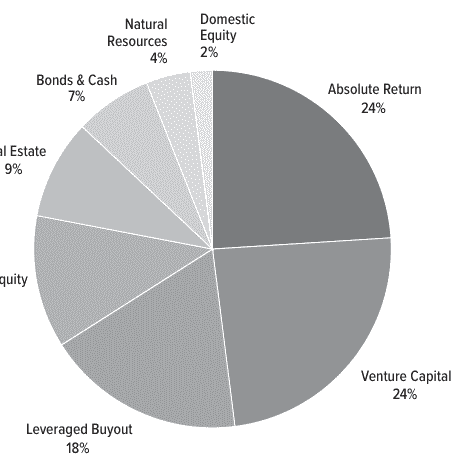
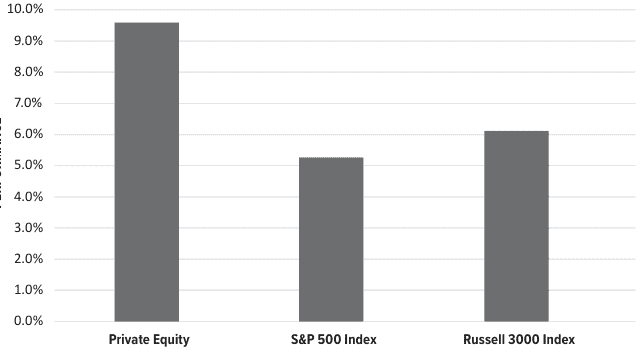
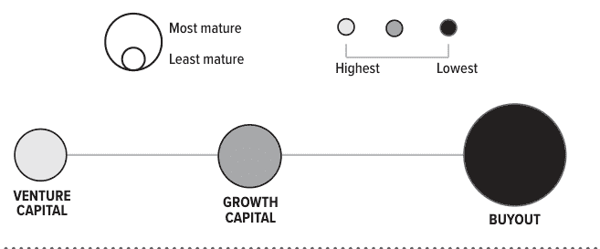
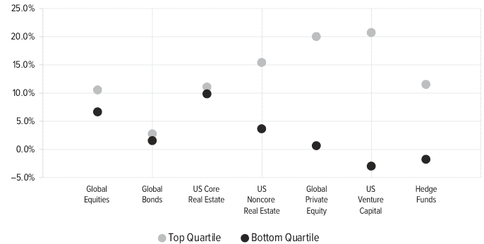
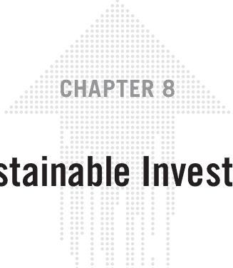

# 第 7 章
# 私募市场的创新

> 在我看来，当私募股权运作良好时，你正在使公司更加高效，帮助它们成长并变得更有盈利能力。这种成功意味着我们的投资者——例如公共养老金基金——将受益，从而有助于社会的经济财富。

**大卫·鲁宾斯坦**
卡莱尔集团联合创始人

私募股权长期以来一直是一种独特且难以捉摸的投资，仅向大型捐赠基金、基金会、养老金计划和家族办公室开放。近年来，由于产品创新、监管发展以及私人公司数量的增长等因素，私募股权已向更广泛的投资者群体开放，门槛往往更低。

投资者通常在公司通过首次公开募股（IPO）上市，或公司被私募股权公司收购、改进后再转售给企业买家时，才会想到私募股权。在很多方面，首次公开募股是美国梦的顶点：将一个想法转化为一家可行的公司，然后收获回报。头条新闻聚焦于创始人和早期投资者敲响开盘铃时获得的巨额财富。如果没有私募股权公司提供的资本、经验和指导，这一历程很可能无法实现。

在本章中，我们探讨私募市场（包括私募股权、私募信贷和实物资产）的增长与机遇。我们考察增长驱动因素并评估其可持续性，探讨顾问和投资者如何进入这一曾经难以捉摸的资产类别，并考虑一些结构性权衡。

在投资私募股权之前，顾问和投资者必须了解各个发展阶段及其相应的风险，从风险投资，经过成长阶段，直至收购机会。随着私募股权向更广泛的投资者群体开放，顾问需要了解产品创新以及可为客户提供的选项。我从顾问那里听到的最常见问题是：“我如何评估各种私募市场选择？”以及“我应该向私募市场分配多少比例？”我们将在本章中解答这些问题。

## 为什么是私募市场——为什么是现在？

如前所述，未来 10 到 15 年，传统投资的资本市场预期将显著低于历史平均水平。传统的 60/40 投资组合很可能远远低于长期历史平均水平。私募股权提供了获得更高回报的机会，私募信贷提供了替代性收入来源，实物资产则提供了更广泛的多元化。顾问应考虑更广泛的资产类别，以实现客户的目标。

预计未来 10 年，私募股权将带来约 9%–10% 的回报，相比传统股票回报，大约有 3 个百分点的非流动性溢价。这归因于多种因素，包括私人公司数量的增加和上市公司数量的下降。目前，约有 3,700 家上市公司，几乎是 20 年前数量的一半。许多公司选择更长时间保持私有，有些则根本不考虑上市。

相比之下，私募市场规模庞大且在增长，涵盖了大约 185,000 家最大公司中的 98%。超过 20,000 家私人公司的年收入超过 1 亿美元，而只有约 3,000 家上市公司拥有可比收入。上市公司也在老化，平均年龄超过 20 年。2017 年，这一平均值为 12 年。年龄很重要，因为公司成熟后，增长通常会放缓。

耶鲁捐赠基金首席投资官大卫·斯文森常被誉为这一代最精明的投资者。他倡导另类投资的优点，这使耶鲁在过去二十年里实现了卓越增长。尽管耶鲁捐赠基金与普通高净值投资者差异很大，但回顾其 2021 年目标资产配置（图 7.1）具有参考意义，尤其是其对绝对回报（对冲基金）、风险投资和杠杆收购（私募股权）、房地产和自然资源（实物资产）的大比例配置，以及对传统投资（境外和境内股票、债券及现金）的低比例配置。

该大学的长期业绩使其位于机构投资者的第一梯队。“该捐赠基金截至 2020 年 6 月 30 日的 10 年期年化回报率为 10.9%。耶鲁 20 年的资产类别业绩依然强劲。境内股票回报率为 9.7%，每年跑赢基准 3.5 个百分点。境外股票回报率为 14.8%，每年超过综合基准 9.3 个百分点。绝对回报年化回报率为 8.1%。杠杆收购回报率为 11.2%，而风险投资回报率为 11.6%。房地产和天然资源分别贡献了 8.3% 和 13.6% 的年回报率。”¹

请考虑个人投资者与机构投资者之间的差异，以及耶鲁的规模要求。耶鲁是一家捐赠基金，

图 7.1 耶鲁捐赠基金目标资产配置

来源：耶鲁新闻，2020 年 9 月 24 日

其时间范围是永久性的。个人投资者往往有现金流需求，可能不愿意或无法将资金锁定多年。耶鲁拥有学费和校友捐赠作为额外的资金来源。我们中的大多数人会因业绩不足而犹豫是否向朋友或家人寻求财务支持。

与个人投资者相比，耶鲁具有规模要求。耶鲁可以与对冲基金经理谈判获得有利条款，并进入典型的高净值投资者无法触及的独特私募市场机会。耶鲁可以为新经理人提供种子资金并要求“最惠国待遇”。耶鲁还雇佣了一支资深专职团队来分析策略。大多数财富管理公司和家族办公室都有专门的团队来寻找机会并进行尽职调查。大多数高净值投资者缺乏自行评估这些策略的专业知识和资源。

我绝不会建议盲目追随捐赠基金模式，但我相信我们可以通过研究最优秀、最聪明的投资者来学习宝贵的经验。私募市场可以提供增量回报来源、替代性收入来源，以及与传统投资的分散。

直到最近，高净值投资者对私募市场的准入一直有限。然而，产品创新、合格投资者标准的变化，以及私募股权公司更愿意将产品推向市场，已经改变了投资格局。这一曾经难以捉摸的资产类别现在可以被更广泛的投资者群体进入，门槛更低，流动性也比以往任何时候都更好。

## 私募股权的吸引力是什么？

从历史上看，与传统公开市场指数相比，私募股权交付了强劲的绝对回报和相对回报（图 7.2）。过去 20 年，私募股权回报率跑赢了标普 500 指数和罗素 2000 指数等广泛基础指数（分别为 9.6% 与 5.3%、6.1%）。我们将探讨私募股权如何交付这些强劲结果，并讨论这些回报是否将继续。

私募股权的吸引力在于，可以投资于早期公司，并随公司上市而获益。投资者可以在谷歌、脸书、特斯拉或爱彼迎的下一个公司创始阶段就进入。然而，私募股权涵盖了不同发展阶段的一系列机遇。在谱系的一端，是风险投资：仍在开发产品或服务的早期公司。在谱系的另一端，是收购：现金流为正、可能从重组或出售某些资产中受益的公司。

取决于公司的发展阶段，私募股权经理可以以不同方式提供帮助，从推出新产品

### 图 7.2 资产类别收益率

来源：Hamilton Lane 数据通过 Cobalt 和 eVestment。数据来自 2000 年第 2 季度至 2020 年第 2 季度

and services to spinning off noncore businesses or making strategic acquisitions. They can drive value creation by adding leadership, expanding a company’s geographic footprint, negotiating favorable terms, and/or spending on marketing. Private equity managers can add value through bolt-on transactions or by consolidating businesses. Let’s explore three of these stages in greater detail (Figure 7.3).

- **风险投资**公司处于独特产品、服务或技术创意的早期阶段。早期风险投资可能几乎没有收入，需要资金将其想法变为现实。创始人通常寻求资金来资助其商业计划。Google、Facebook 和 Uber 最初都是拥有将改变市场的想法的初创公司。他们早期需要资金来资助这些想法。当他们最终上市时，他们为创始人和早期投资者带来了可观的收益。

- **成长型**公司拥有经过验证的商业模式，正在快速增长，并且要么已经盈利，要么有清晰的盈利路径，年收入增长率在 20% 或更高。私募股权公司通常在公司中占少数股权，并与管理团队合作，通过运营改进和收入增长（无论是有机增长还是通过收购）来帮助创造价值。

- **收购型**公司拥有稳定的收入和现金流。私募股权基金在该阶段通过杠杆收购购买公司，并执行长期价值创造计划，该计划可能涉及有机增长、非有机增长和运营改进，然后出售公司。这些代表了私募资本的最大细分领域。

### 图 7.3 私募股权阶段

## 价值创造

私营公司享有长期规划的奢侈。相比之下，公开上市公司往往饱受短期视角之苦，努力满足季度市场预期。在《华尔街日报》的一篇评论文章中，沃伦·巴菲特和杰米·戴蒙指出，“公司经常削减在技术支出、招聘和研发方面的投入，以满足季度收益预测，而这些预测可能受到公司控制范围之外的因素影响，例如大宗商品价格波动、股市波动甚至天气。”²

相比之下，私营公司可以专注于执行长期战略，而无需安抚股东。结果表明，这种自由是一项重大优势。私募股权经理专注于在三到六年内创造价值。他们通常带来运营专业知识，并可以帮助创始人制定和实施多年计划，这通常会带来比公开上市公司更强劲的增长。

私营公司也受益于信息优势。公开上市公司必须向股东披露财务信息和关键业务驱动因素。大多数公开上市公司还受到华尔街研究的广泛审查，因此所有信息都已体现在股价中。反之，私募市场效率低下，有技巧的私募股权经理可以利用其信息优势来识别有吸引力的收购机会。一旦收购发生，私募股权经理就可以专注于执行其长期战略，而不受公众审查的干扰。

虽然我们通常关注向年轻或困难公司注入财务资本的价值，但增加人力资本也有巨大的价值：拥有运营经验、行业知识和广泛人脉的资深管理人员。根据 2020 年麦肯锡报告 _私募市场的新十年_，³ 25 家最大的私募股权公司都拥有重要的内部运营团队。这些公司专注于吸引和留住能够将其专业知识带到私营公司的运营人才。

## 私募股权基金的生命周期

私募股权基金是长期投资（7 到 10 年），因为其部署资本的方式和产生回报的时机。图 7.4 说明了私募股权的阶段及相应的现金流。在投资期，公司在寻找投资机会的同时下拨资本。在价值创造阶段，私募股权经理提高目标公司的运营效率。在退出期，私募股权经理通过出售或首次公开募股退出基础投资。

### 图 7.4 私募股权基金的生命周期

- **阶段 1：投资期**  
  发出资本缴款（下拨），所得款项用于投资于组合公司。

- **阶段 2：价值创造**  
  投资组合经理尝试通过运营、财务、管理和其他改进在组合公司中创造价值。

- **阶段 3：退出期**  
  投资组合经理退出基础组合公司，通常通过战略出售或 IPO，锁定已创造的价值，并将资本返还给投资者。

盈亏平衡点 净投资资本转为正数  
年份  
资本返还 资本缴款 累计现金流

此表中的线条说明了典型私募股权投资相关的现金流。这通常被称为 J 曲线，在私募股权投资的早期阶段出现下拨，随后随着公司在基础投资中释放价值而急剧反转。

私募股权公司为早期公司提供关键资本。他们通常筹集多轮资金。公司估值可能会不断变化。如前所述，私募股权经理为私营公司带来运营专业知识和战略领导力。创始人通常缺乏将公司带过增长阶段或将公司推向公开市场（如果这是期望的路径）的专业知识。我们都能想到多位伟大的创始人却是平庸的商业管理者。随着公司成熟，私募股权取代了其中一些经理人，并在公司上市前为其他人配备经验丰富的商业管理者。

## 私募信贷

在全球收益率处于历史低位的背景下，投资者越来越多地寻求替代性收益来源，私募信贷已成为一种有吸引力的回报来源。私募信贷在历史上一直提供有吸引力的风险调整后结果。直接贷款是该市场增长最快的细分领域。

投资于私营公司债务是投资者获得私营公司敞口的另一种方式，其涉及的风险可能比私募股权公司更小。与公开上市公司债务一样，私募信贷可能为投资者提供有吸引力的收入流。

通常，私募信贷与其他更传统的固定收益资产相关性较低，因为该债务不交易，也不受公开市场波动的影响。该债务通常采用浮动利率，因此投资者收入随总体利率上升而上升——这是在利率上升环境中的一项有吸引力的特征。

自全球金融危机（GFC）以来，专注于私募信贷的基金规模大幅增长，因为机构投资者和零售投资者都在寻求低利率环境下有吸引力的收益水平。这些基金的增长部分归因于全球金融危机之后银行放贷减少，以及 2010 年《多德-弗兰克华尔街改革与消费者保护法》。

根据 2020 年 Preqin 全球私募债务报告，⁴ 截至 2019 年 6 月，私募信贷飙升至 8120 亿美元。管理资产每年持续增长，私募信贷目前已超过基础设施和自然资源，成为第三大私募市场资产类别。

自全球金融危机（GFC）以来，该市场持续扩张，当时银行在去风险其资产负债表时撤出了中型市场服务。私募信贷公司乘虚而入，利用这一真空地带。需求催生了创纪录数量的基金经理（1,764 家）——是五年前数量的两倍多。

在投资私募信贷之前，投资者必须考虑基金投资的债务类型，以适当评估基金相对于基础证券的风险水平。考虑资本结构层次结构，以确定哪种类型的投资具有优先权和优先顺序。

注意投资组合中持有的基础债务类型。高级有担保债务优先于第二顺位债务、夹层债务和股权持有者。换句话说，如果公司陷入财务困境，高级有担保债务持有人对资产拥有优先索取权。

投资者可以通过多种基金结构投资私募信贷，所有这些结构都有投资者必须评估的固有权衡。

## 实物资产

实物资产包括房地产、基础设施和自然资源。房地产是实物资产中最大的细分领域，基金在此获取、融资或拥有多种物业类型，包括住宅、商业和工业。私募房地产与公开交易的REITs（房地产投资信托）之间存在巨大差异。

私募房地产基金通常根据其在风险收益谱中的位置进行细分。核心基金最为保守，而机会型基金风险最高。核心基金主要关注主要大都市地区的高质量房地产资产，具有稳定的入住率、稳定的收入以及很少或无需管理。它们通常使用最低的债务，且是最被动的。相比之下，机会型基金通常投资于需要进行大规模翻修甚至潜在开发工作的受压或困境物业。

自然资源是可用于经济生产或消费的原材料。对自然资源的投资包括土地、林地、农田、传统能源和可再生能源以及贵金属。自然资源投资通常与传统投资的相关性较低；它们还可能提供通胀保护。此外，可再生能源等领域正变得越来越受投资者欢迎，与日益高涨的可持续发展兴趣相一致。

基础设施是支持国家、州、城市或其他地区的一组设施或系统。基础设施投资包括道路、桥梁、水处理设施、港口、公用事业、医院和机场。由于这些投资与传统投资相比波动相对较低，并且具有通胀保护潜力，因此常受到追捧。过去几年，有大量言论都在谈论重建我们日益破旧的基础设施的必要性。也许这将在未来几年成为增长领域，推动经济扩张，为现代交通网络铺平道路。

## 产品演进

如前所述，另类投资的主要用户最初是机构和家族办公室，因此其结构旨在支持那些拥有大量可长期锁定资本的长期投资者的需求。但随着越来越多高净值投资者开始要求获得另类投资的渠道，结构需要不断演进以满足这一重要细分市场的需求。

产品创新旨在解决经典私募股权结构的一些局限性：最低投资额、税务报告和流动性。母基金、区间基金和要约基金有助于使私募市场投资民主化，并解决一些结构性限制（参见表7.1）。

| | 经典LP | 母基金 | 区间基金 | 要约基金 |
|---|---|---|---|---|
| 最低投资额 | 高（500万美元） | 较低（15万至25万美元） | 较低（2.5万美元） | 较低（2.5万美元） |
| 投资者资格 | 仅限合格购买者 | 仅限合格购买者 | 合格投资者或更低门槛 | 合格投资者 |
| 税务报告 | K-1 | K-1 | 1099 | 1099 |
| 流动性 | 有限 | 有限 | 有限 | 有限 |

**经典LP基金**仅提供给合格购买者，通常门槛较高且流动性有限。由于这些投资被构建为有限合伙，投资者接收K-1税务报告，这类报告通常延迟且可能需要修正。投资者承诺出资，资金随时间逐步划付（资本注资）。

**母基金**已受到高净值投资者的欢迎，因为它们允许投资者集合资金并以较低门槛进入顶级基金。母基金为普通合伙人提供规模和效率。母基金面向合格参与者开放，后者随后需接受资本注资。没有现金拖累，因为母基金不需要满足短期流动性需求。

**区间基金**面向合格投资者甚至门槛较低的投资者开放，具有较低门槛和季度流动性。区间基金通常是私募信贷基金。它们不受资本注资约束，并通过1099表格提供报告。为了满足流动性需求，区间基金可能会出现现金拖累：即保持足够流动性以满足赎回要求的成本。

**要约基金**面向合格投资者开放，门槛较低，并通过要约提供流动性。董事会决定提供多少流动性以及何时提供。要约基金通常持有私募股权。它们不受资本注资约束并提供1099税务报告。要约基金不需要持有流动性资产。

如前所述，结构性权衡可能使顾问在配置私募市场时拥有更大灵活性。母基金提供规模和效率，但仅面向合格参与者开放。区间基金提供更大流动性和更好的税务报告，但常会出现显著的现金拖累，且可能无法获得最佳机会。要约基金面向更广泛的投资者群体开放，门槛较低且流动性更好，但可能不持有最佳私营公司。

如果投资者具备相应实力，广泛分散投资于私募股权可能更能满足其需求。分散投资可以拓宽投资机会、降低风险并最大限度地减少现金拖累。顾问应考虑在管理人、阶段、行业和年份方面进行分散。私募市场提供吸引人的投资机会，尤其是因为产品创新已帮助使这些宝贵资产类别民主化。

像“拍卖基金”这样的产品结构听起来很有吸引力，但当投资者尝试赎回股份时，这种新结构运作得如何仍有待观察。拍卖基金被构建为持续发行的封闭式基金。它们旨在通过提供类似ETF的拍卖流程来解决其他结构相关的现金拖累问题。

随着新产品进入市场，成熟的管理人也在满足高净值投资者的需求，这种曾经难以触及的资产类别正成为越来越多投资者的一个更具可行性的投资选择。

## 风险考量

与传统投资相比，私募市场提供了强劲回报和分散投资的机会，但顾问和投资者在投资前也应评估这些市场相关的风险。风险包括与公开市场相比缺乏透明度，且投资通常按季度估值。私募市场投资也通常流动性差，投资者应做好准备，持有私募市场基金直到其7至10年的期限届满。

私募市场投资者也可能面临集中度风险。私募市场持仓可能集中于少数几个基金，因此相比更分散的投资组合，它们可能面临更高的资本损失可能性。顾问应向客户说明私募市场的长期性质，资本分配通常从基金生命周期的第三或第四年开始。其他考虑因素包括杠杆以及该资产类别结构固有的复杂性。许多私募股权基金，尤其是杠杆收购基金，将杠杆作为其交易结构的一部分，并且通常还会承担基金层面的杠杆，这伴随着额外的固有风险。

视结构而定，可能还有其他需要考虑的风险。例如，更具流动性的结构可能需要付出代价：显著的现金拖累。费用也可能因结构而显著不同，管理人可能会被激励将其最佳想法投入流动性较低、利润率更高的结构中，以避免被迫清算。

## 纳入私募市场

在配置私募市场之前，请考虑几项资产配置和投资组合构建问题。顾问和投资者应评估：

- **风险和回报。** 期望和假设是什么？
- **流动性。** 资金锁定期限是否有限制？
- **时间范围。** 整体投资组合的时间范围是什么？
- **分散投资。** 能否跨管理人、阶段、地区、行业和年份进行分散？
- **资产位置。** 适合持有该投资的实体/账户类型是什么？
- **目标配置。** 适当的目标配置是多少？

配置私募股权、私募信贷和实物资产需要知识、渠道和投资洞察力。顾问需要了解策略如何运作以及如何恰当地将其纳入。他们需要以最合适的结构获得最佳策略的渠道，并需要了解私募市场在构建分散投资组合中的作用。由于顾问价值主张的大部分已通过机器人理财规划和资产配置而商品化，这些独特的投资使顾问能够为投资者增加相当大的价值。

选择合适的私募股权基金可以提供巨大溢价。如图7.5所示，顶四分位私募股权基金的回报离散程度远大于底四分位基金，并且显著大于传统

投资和对冲基金。因此，由于顶部和底部四分位数基金之间存在较大的四分位距，选择合适的私募股权基金有巨大的溢价。

### 图 7.5 收益离散度

来源：Lipper, NCREIF, Cambridge Associates, HFRI, J.P. Morgan 资产管理。全球股票（大盘）和全球债券的离散度分别基于全球大盘股票和全球债券类别。经理离散度基于 2010 年第 2 季度至 2020 年第 2 季度的年度回报。

## 接下来是什么？

随着私募市场变得更加可及，且资本市场预测指向传统投资更具挑战性的回报，我们可能会看到对这一重要资产类别的持续兴趣。高净值投资者的需求正在促使更多关注识别和审核优质经理，并使其在各个平台上可用。认识到需求及相应机会，许多资产管理人正在为高净值投资者开发产品。一些缺乏必要专业知识的机构可能会选择与成熟的私募股权公司合作。

在考虑*接下来是什么*时，值得注意的几个趋势包括退休计划中的私募股权、影响力投资以及更好教育的需求。

### 退休计划中的私募股权

在令人惊讶的大胆举措中，美国劳工部（DOL）和证券交易委员会表示有意允许私募股权投资于退休计划。私募股权长期以来一直是大型确定受益计划的重要组成部分，但不适用于确定缴费计划或 401(k) 计划。这一最新发展的动机在于认识到私募股权提供了更高回报的潜力，因此将有助于退休人员增长其退休资产。

DOL 在允许私募基金进入退休计划方面提供了以下需考虑的额外指导：

- 私募股权配置对长期多元化、预期回报和费用的影响
- 计划受托人监督私募股权投资的能力，与聘请专家顾问相对比
- 投资于私募股权的百分比，需注意 SEC 将注册开放式投资公司的非流动资产限制为 15%
- 计划参与者是否被允许进行福利分配并转入其他投资选项
- 计划受托人同意按照会计准则评估私募股权投资，并将这些投资接受年度审计
- 任何私募股权投资的长期性质和流动性限制是否与计划参与者按其意愿进行分配或更改投资选项的能力相一致
- 关于包含私募股权组成部分的计划投资选项的性质和风险的参与者披露的充分性，以便参与者在投资前做出知情评估

这一发展是将私募市场带到主街的重要一步。这是一种认识，即这些投资可以帮助投资者增长他们的退休积蓄。在确定最佳结构方面还有工作要做，因为流动性是有代价的，投资者需要更多关于私募市场细微差别的教育。

### 影响力投资

金融服务行业最大的趋势之一是对可持续投资需求的增长。如前所述，可持续投资可以使投资者的目标与投资组合保持一致。数据表明，投资者可以同时行善并获得良好回报。

投资者可以在寻求稳健回报的同时改善社会的观点正在迅速获得接受。许多私募股权基金正在将环境、社会和治理筛选纳入其策略，投资者对 ESG 投资的兴趣当然也变得更加普遍接受。这对女性和千禧一代来说是一个特别重要的问题。

签署联合国支持的责任投资原则的基金经理数量从 2013 年的 1,200 名增长到 2018 年的 2,000 多名。这些签署方管理的 82 万亿美元资产在同一时期以 19% 的复合年增长率增长。据 Schroders 2017 年全球投资者研究显示，在全球 22,000 名投资者中，78% 表示他们现在比五年前更加注重可持续性。2018 年，世界上 250 家最大的公司中有超过 90% 发布了企业社会责任或可持续发展报告，而 2002 年这一比例为 45%。

向可持续投资的转变反映了公众对气候变化、塑料污染、森林砍伐、社会不平等和清洁水获取等全球挑战日益增长的关注。零售投资者，尤其是千禧一代和女性，越来越要求公司披露其做法。根据摩根士丹利可持续投资研究所的数据，千禧一代购买可持续公司产品的可能性是总体人群的两倍。在未来 30 年里，预计有约 30 万亿美元的财富将从婴儿潮一代转移到千禧一代手中，投资者面临的利益重大。

在光谱的另一端，家族办公室和高净值家庭往往是社会、慈善甚至政治的活跃成员。许多人寻求通过包括慈善在内的各种平台对社会产生积极影响。例如，考虑比尔及梅琳达·盖茨基金会（医疗保健和抗击贫困）、洛克菲勒基金会（健康和科学）、彭博基金会（环境和枪支管制）、施瓦布基金会（金融素养）和贝佐斯基金会（教育）。影响力投资是家族办公室和基金会扩展其使命导向工作的另一个渠道。

随着大小客户群体需求的增长，越来越多的影响力基金进入市场并不令人惊讶。私募股权公司独特地定位以投资这些机会，因为它们不受短期盈利产生的负担，并且保持重大控制权，这使它们能够推动影响力和强劲的财务结果。

### 顾问教育

尽管私募市场的吸引力显而易见，但我们需要关于这些独特投资适当使用的大量且更好的教育。顾问需要了解私募股权的各个阶段、增长驱动因素、非流动性溢价和结构性权衡。顾问还应了解私募信贷如何填补银行创造的空白，部署数千亿美元来为中型市场公司提供资金。他们必须熟悉实物资产的风险、回报和相关性优势，以及它们如何成为多元化投资组合的组成部分。

高级教育可以帮助顾问引导客户穿越这一具有独特术语和行话的新格局——VC、LBO、J 曲线、母基金、间隔基金和资本结构层级，仅举几例。

幸运的是，CAIA 协会、投资与财富研究所和 CFA 协会等组织已认识到这一挑战，并开始为财富顾问提供研究和教育。许多大型资产管理人也开发了自己的内容，以满足关于投资私募市场更多更好教育的需求。

## 关键要点

随着传统投资趋向较低回报，而私募市场提供强劲的绝对和相对回报，机构和家族办公室投资者一直在增加对私募股权、私募信贷和实物资产的配置。历史上，这些投资对许多高净值投资者不可用，但通过产品创新和大型私募资本公司满足行业需求的意愿，高净值投资者现在可以以较低门槛获取这些独特投资。

顾问应在教育投资者如何将这些策略纳入投资组合方面发挥带头作用。私募市场可以在多元化投资组合中发挥宝贵作用，潜在地增加回报、提供替代收入来源，并相对于传统投资提供多元化。投资者在投资前需要了解风险和结构性权衡，并应将私募市场视为长期投资。

