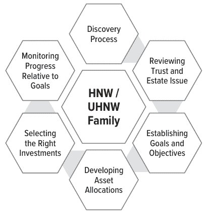
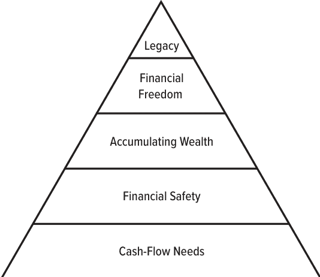
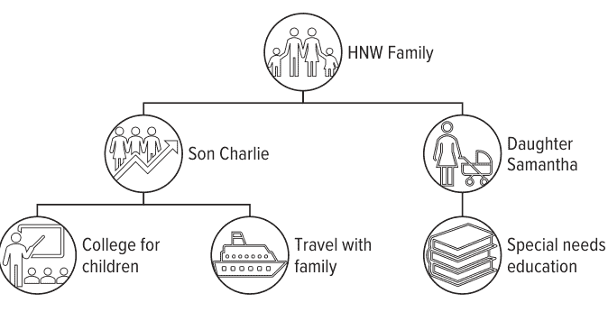

# 第 9 章
# 目标导向型投资

> 在某个基本层面上，直觉上并不难理解，一个家庭不仅仅是其银行和经纪账户。

让·布鲁内尔
《目标导向型财富管理：
改变财富顾问实践结构的综合实用方法》

贯穿本书，我一直在讨论目标导向型投资作为一种更先进的资产配置方法的优点。目标导向型投资解决了现代投资组合理论（MPT）的一些局限性，并融合了行为金融学的属性，以解决投资者的需求、愿望和渴望。在本章中，我重新阐述了目标导向型投资的优点，讨论财富顾问如何将其纳入流程，并提供一个案例研究来使概念生动化。

MPT 帮助顾问和投资者通过最小化风险来理解分散投资的优势，资产类别之间的相关性充当“秘诀”。然而，MPT 建立在几个有缺陷的假设之上，包括投资者是理性的并且会选择最优投资组合的观念。MPT 依赖历史回报、风险和相关性数据，来设计资产类别的最优组合，以在给定风险水平下最大化回报，或在期望回报水平下最小化风险。但如果未来股票回报和债券收益率较低怎么办？如果资产类别之间的相关性保持高位怎么办？不幸的是，使用有缺陷或过时的数据可能意味着投资者无法同时满足其回报和收入要求。这正是我们目前所处的环境，资本市场假设预测未来 10 到 20 年的回报和收入将大幅降低。由于全球市场的互联互通，相关性数据一直在稳步上升。

MPT 由数学驱动，输入决定输出。行为金融学是情感驱动的，关注投资者如何对刺激做出反应。目标导向型投资认识到投资者通常同时解决多个目标，而最大化回报可能不是其中之一。目标导向型投资将财富顾问的讨论从跑赢市场转移到实现客户目标。目标导向型投资将投资组合配置与特定目标保持一致。均值-方差优化旨在在给定风险水平下最大化回报，或在给定回报目标下最小化风险，并且具有某些内在局限性。

目标导向型投资旨在提高实现人生目标的可能性：积累财富、退休后产生收入、为大学储蓄、向慈善机构捐款或其他特定结果。高净值家庭通过信托代代相传财富，并且通常资助众多慈善活动。他们可能拥有多种账户类型，每种都有不同的目标和宗旨。目标导向型投资提供了跨多个投资组合解决多个目标的灵活性。

### 目标导向型财富管理

目标导向型财富管理将财务规划与投资规划相结合，为投资者实现目标提供路线图。目标导向型财富管理始于

发现流程，旨在了解高净值家庭的目标。与传统方法试图在一个投资组合中满足多个家庭需求不同，基于目标的投资提供了一个框架，用于解决多个目标，这些目标具有不同的现金流需求和时间跨度，并通过多个投资组合来实现。（参见图 9.1。）

### FIGURE 9.1 Global Wealth Management Process

- **发现流程。** 家庭的需求和愿望是什么？有哪些不同的账户类型？每种账户类型有什么独特之处？

- **审查信托和遗产问题。** 设立了哪些类型的信托（生前信托、可撤销信托、不可撤销信托、代际跳过信托等）？资产如何分配？谁接收这些资产（子女、孙辈、慈善机构等）？

- **制定目标和宗旨。** 针对什么（按账户类型）进行求解？现金流需求和各种时间跨度是什么？

- **制定资产配置。** 每种账户类型的回报目标、收入要求、实现各种目标的时间跨度以及流动性要求是什么？

- **选择合适的投资。** 哪只基金或经理能产生所需结果？共同基金、ETF、单独管理账户、注册基金或私募基金之间的结构性权衡是什么？如何纳入主动和被动策略？另类投资在这个多元化投资组合中扮演什么角色？

- **监测目标进展情况。** 经理和账户相对于其既定目标表现如何？家庭的情况是否发生了变化？是否需要进行投资组合调整？

采用基于目标的财富管理流程的顾问必须在衡量相对于目标的进展时保持一致性。他们不能陷入在上涨市场中强调业绩、在艰难环境中强调基于目标投资的陷阱。其业绩衡量工具需要演变，以恰当报告进展，而非强调相对于标普 500 或其他任意基准的业绩。

## The Means to the Ends

客户的投资组合是 *达到目的的手段*。这是其财富随时间增长的方式，也是实现其期望结果的方式。采用基于目标的方法并不意味着财富顾问应忽视业绩，而是应改变效用函数，以求解家庭的目标。高净值家庭显然希望并期望能够获得最佳投资策略。然而，如果表现最好的策略伴随着高波动率和高周转率，那么其价值在税后基础上可能被抵消。

如果组装得当，投资组合可以针对特定目标求解；如果你正确理解每项投资的角色，就可以衡量其在整体投资组合中的有效性。如本书所述，我倾向于将资产类别视为拼图碎片。如果它们拼合良好，就能清晰地展示投资组合旨在实现什么。如果它们被随意拼凑在一起，投资组合的目的将不明确。（参见图 9.2。）

### FIGURE 9.2 A Goals-Based Framework

| 类别 | 资产类别 | 资产类别 | 资产类别 | 资产类别 | 资产类别 |
|---|---|---|---|---|---|
| 增长 | 国内股权 | 国际股权 | 股票对冲 | 事件驱动 | 私募股权 |
| 收入 | 国债 | 公司债券 | 高收益债 | REITs | 私人信贷 |
| 防御性/非相关性 | 现金 | 黄金 | 宏观 | 多策略 | 管理期货 |

这一拼图碎片类比对客户很有效，因为它有助于消除对个别投资的神秘感，并确立其在多元化投资组合中的角色。如果我们用客户能理解的术语（如增长、收入和防御）来界定投资，客户会觉得更直观。这个框架建立了一种更有效的方式来衡量每项投资的成功与失败。例如，黄金进入投资组合并非为了跑赢标普 500。它是一种防御性资产，旨在在市场冲击面前提供安全性和稳定性。顾名思义，固定收益旨在为投资组合产生收入，而股票导向策略则提供资本增值。

- **增长。** 从传统意义上讲，投资组合的增长来自其股票配置：大盘、小盘、国际和新兴市场。该列表还可以包括私募股权、股票对冲和事件驱动策略。

- **收入。** 我们通常将多元化债券——国债、公司债、政府债和高收益债——视为投资组合的主要收入来源。具备必要流动性的投资者可能会考虑私人信贷、非交易所交易的 REITs 或困境策略。

- **防御。** 在波动率升高和市场修正期间，我们通常将现金、黄金和国债视为防御性资产。高净值投资者也可能考虑宏观、多策略和实物资产，以缓冲波动率并提供下行保护。

通过这样界定资产类别讨论，顾问可以引导投资者从在上涨市场中将一切都与标普 500 对标、在下跌市场中转向现金的做法。富裕家庭在不同账户类型中可能拥有许多相同的资产类别，但可能会以不同权重配置这些账户，以实现各种目标。为孙辈设立的信托可能更偏向增长，因为其时间跨度较长。家长的退休账户可能侧重于产生收入，而个人账户可能更防御，具体取决于他们对当前市场环境的看法。

如果我们按资产类别关注特定目标，那么应该使用正确的指标来评估各种资产类别的有效性。对于投资组合的增长导向部分，我们关注收益-风险权衡。对于收入导向部分，我们衡量每个资产类别的收益率。对于防御性资产，我们检查每个资产类别相对于标普 500 的相关性，因为我们试图降低整体投资组合的股票贝塔。

这些并非唯一需要考虑的指标。对于收入部分，我们必须认识到国债、高收益债和私人信贷与不同风险相关联，并承认公开股权和私募股权与不同风险相关联。从一种策略到另一种策略可能存在巨大差异，尤其是在考虑另类投资时。

## Defining Risk

在其 2005 年的论文中，Ash Chhabra 将风险的三个维度定义为“个人”、“市场”和“进取型”。个人风险是指我们可能无法实现既定生活水平的可能性；为了缓解这种风险，我们专注于降低下行风险，可能会接受低于市场回报率的回报以降低风险。我们通常关注市场风险，通过多元化投资组合平衡风险与回报，以维持生活方式。进取型风险意味着投资者愿意承担稍高的风险以提升其生活方式。

个人桶应专注于保护资产，并接受低于市场回报率的回报。市场桶的风险和回报应跟踪市场表现。进取型桶应追求高于市场的预期回报，并愿意承担稍高的风险以实现这些结果。

不幸的是，传统金融将波动率或标准差作为首选的风险度量指标。它不区分正向波动和负向波动。根据我们在行为金融学方面的讨论，我们知道投资者对损失和收益的感受截然不同，卡尼曼和特沃斯基认为投资者会不惜一切代价避免损失。如果投资者反对遭受损失，财富顾问应将这一点纳入投资者目标，并在选择投资选项时瞄准下行保护。

## FAMILY GOALS

高净值和超高净值家庭通常同时求解多个目标，而非仅专注于最大化回报。其目标可能包括保值、高效财富传承以及为对家庭重要的事业提供资金。家庭财富可能决定优先级，回顾财务需求层次（图 9.3）可能会有所启发。

### FIGURE 9.3 Hierarchy of Financial Needs

- **现金流需求。** 满足食物和住所等基本需求。

- **财务安全。** 为意外事件创建财务缓冲的能力。

**积累财富。** 建立财富、为退休储蓄和偿还债务。

**财务自由。** 为退休、子女教育和度假提供充足储蓄。

**遗产。** 专注于遗产规划、税务规划、慈善捐赠，并在子女和孙辈中灌输价值观。

考虑一个假设的高净值（HNW）家庭（见图 9.4）。Tom 和 Patricia 有两个孩子，Charlie 和 Samantha。Charlie 有三个孩子，专注于为他们的大学费用储蓄并与家人一起旅行。Samantha 有一个有特殊需求的年幼女儿。Tom 和 Patricia 为子女和孙辈设立了信托，以帮助他们实现各自的目标。

### 图 9.4 假设的高净值（HNW）家庭

顾问可能会将这个高净值（HNW）家庭视为单一关系，但根据各自的金额、现金流需求和时间跨度，他们的目标和目的很可能不同。每个账户都应有自己的目标，以及为实现这些目标而量身定制的投资组合。

## 可持续投资

越来越多的高净值（HNW）投资者寻求使其目标与投资组合保持一致，包括为其全部或部分投资组合采取某种形式的可持续投资。财富顾问需要认识到这一日益增长的趋势，并询问家庭在支持环境、社会问题、性别平等、医疗保健和董事会多样性等事业方面的兴趣。顾问应确定这些偏好是否应纳入家庭的投资组合。

如前所述，顾问应主导投资者可持续投资优势的教育工作，解释令人困惑的术语和不同的筛选方法。可持续投资不是一时的潮流，短期内不会消失。它是识别具有良好实践的优秀公司的一种方式。高净值（HNW）家庭关注其遗产，并希望在子女中灌输价值观。使其投资组合与目标保持一致是表达其价值观的一种方式。

财富顾问不仅需要向家庭介绍可持续投资，还需要做更多工作。他们需要确定一批能够帮助构建可持续投资组合的经理人。根据财富咨询业务的规模和专业化程度，指定某人作为可持续发展专家可能是合理的。可持续发展专家可以主导向家庭介绍可持续投资，并了解各种经理人的细微差别。由于形势变化迅速，可持续发展专家还可以关注行业趋势、即将推出的新产品以及家庭如何有效地使用这些策略。

即使家庭不采用可持续投资，通过询问家庭的兴趣，顾问也能获得对家庭的独特见解，并改变家庭对财富顾问服务和能力的看法。至少，每个财富咨询业务都应对可持续投资有基础了解，并拥有几个经过充分审查的经理人。

## 接触高净值（HNW）家庭

基于目标的财富管理旨在了解家庭的各种目标，这些目标通常跨越多代。为了了解家庭不断变化的需求，财富顾问必须与整个家庭及其其他可信赖的顾问建立关系。太多时候，顾问与家长和母亲建立了紧密联系，却未能充分吸引子女。最终，子女将继承父母的财产。如果没有与父母顾问建立牢固的关系，他们可能会寻找不同的顾问。财富顾问必须在整个家庭中建立关系。建立信任的一种方法是帮助他们了解投资。

Scott Perry 希望与其可信赖的顾问和子女进行面对面会面，以便我们能够教育他的子女并与他们建立关系。他想帮助女儿为领导家族做准备，因此希望她了解我们的投资理念和团队。Scott 正在考虑家族遗产以及代际延续性。

David Manning 在分配资本之前希望全面了解我们的投资理念和底层投资。他希望建立持久的关系。他很感激我耐心地帮助他理解对他相对新鲜的事物。后来，David 要求我与他的姐姐进行类似的流程。我赢得了他的信任，因此他将我推荐给一个他深深关心的人。

教育家庭通常是赢得信任的最佳方式。Jean Brunel 提出需要一位“财务翻译”来帮助家庭了解投资原则并翻译该领域的行话。我一直试图以教育为先导，并认识到家庭的资产负债表并非衡量成员投资水平的良好标准。有几种技巧可以吸引整个家庭：

- **吸引子女。** 分别与成年子女会面，以与他们建立个人关系。专注于了解他们的兴趣和投资组合目标。

- **教育家庭。** 向家庭成员发送关于财务或个人兴趣的阅读材料。添加个人备注：“Mary，考虑到我们最近的讨论，我认为你会对这本书感兴趣。”

- **建立个人关系。** 邀请家庭参加办公室外的活动：体育赛事、音乐会、晚餐、品酒会等等。考虑带上你自己的家人，让家庭以不同的眼光看待你。

- **举行家庭会议。** 提供举行家庭会议或静修的机会。这是一个既能成为可信赖顾问，又能观察家庭动态的绝佳机会。

- **制定家庭使命宣言。** 许多富裕家庭都有描述其宗旨的使命宣言。为尚未拥有使命宣言的高净值（HNW）家庭制定一份可能是值得的。

> 家庭使命宣言是所有家庭成员对家庭宗旨的综合、统一表达——即你们真正想要做什么、成为什么，以及选择用来治理家庭生活的原则。
>
> ——Stephen Covey, 《高效能家庭的7个习惯》

企业通常使用使命宣言来帮助集中注意力，并围绕共同目标统一所有员工。家庭使命宣言起到类似作用，阐明家庭原则。家庭使命宣言表达家庭价值观，并可用于评估影响更广泛家庭的决策。这对于多代家庭尤其重要，因为将这些价值观一代代传承下去可以延续家族的遗产。

家庭使命宣言不是关于最大化财富，而是关于财富能让家庭做什么来进一步推进他们的激情，并定义跨代的宗旨。

## 融入基于目标的财富管理

我在本书开头建议，顾问应发展其业务以更好地满足高净值（HNW）投资者不断增长的需求，从销售产品转向解决需求，并扩展我们的能力以涵盖信托和遗产问题、处理集中持仓、贷款和税务管理。基于目标的财富管理为解决这些需求提供了框架。

财富顾问应采用基于目标的财富管理方法来解决高净值（HNW）家庭的需求，改变其关系和价值主张，以更好地与家庭目标保持一致。高净值（HNW）家庭有复杂的需求，基于目标的财富管理旨在识别这些需求，然后逐一处理。基于目标的财富管理是财富顾问和高净值（HNW）家庭都偏好的模式。

基于目标的投资为各种规模的家庭提供了路线图。有些家庭可能更关注跨代财富转移，而其他家庭可能更关注退休规划。有些家庭可能关注慈善捐赠，而其他家庭则在解决大学资金问题。通常，高净值（HNW）家庭同时解决多种需求，他们的方法应根据每个目标进行定制。

财富管理是一门不断演进的学科体系。唯一不变的是服务于家庭的需求。较大的家庭往往更为复杂，可能需要专业团队的支持。财富管理是一项跨代际的事业；因此，顾问有责任与整个家庭建立关系，以有效应对未来不可避免的财富转移挑战。

## 家族办公室

家族办公室需要处理可观的财富和复杂性，包括投资管理、慈善捐赠、税务管理和家庭动态等。家族办公室通常利用可信赖顾问的网络来寻找机会，并帮助应对所面临的挑战。然而，他们需要小心确保决策在各个家庭单位之间经过仔细考虑。家庭成员通常有不同的偏好和优先事项，他们的行为也可能与父母和兄弟姐妹不同。如果使命宣言没有得到不断的重新审视和强化，家庭很容易偏离其使命。

家族办公室应定期审查各个家庭成员和账户类型之间的各项目标。当市场波动或情况变化时，它们很容易与既定目标失去同步。基础投资的差异意味着投资组合可能面临大幅波动，私募股权、集中持仓和其他独特机会可能带来超额回报。家庭可能因税务后果而犹豫是否调整投资组合，并可能随时间推移而偏离其原始目标配置。

家族办公室往往不惜一切代价隐藏其整体财富以及资产在多家机构中的分配方式。这可能导致策略冲突或重叠，并需要家族办公室投资人员进行仔细协调。我建议家族办公室采用基于目标的财富管理方法。他们可以聘请内外部专家相结合的方式来满足家庭需求，并且最好将流程正式化。

## HNW 投资者

我一直挑战财富顾问优化其执业模式，以满足 HNW 投资者的需求。我也认识到，一些 HNW 投资者自行做出投资决策，并不以传统方式聘请顾问。我认为有两类主要的 HNW 投资者不雇佣顾问：一类来自金融服务业，对市场了解甚多；另一类不重视或不信任金融顾问。

许多 HNW 投资者的财富来自金融服务业：退休的华尔街投资银行家、房地产开发商、高盛合伙人、前首席执行官、对冲基金经理、私募股权投资者——而这只是在我的乡村俱乐部。这些人知识渊博，人脉广泛，具备自行做出许多投资决策的能力。他们可能需要在核心能力之外的领域获得一些帮助，但可能不像其他投资者那样需要财富顾问。即便如此，他们从在家庭和账户类型（个人、退休、信托、基金会等）之间正式化目标中受益。

希望这些成熟的 HNW 投资者将随着投资理念和产品的演变，开启终身学习之旅。他们需要跟上不断变化的市场环境。我写这本书时心中想的就是这些投资者：朋友们，他们在职业生涯中一直很成功，在其领域内拥有丰富知识，但需要有效整合各种解决方案以实现目标。

希望这些 HNW 投资者阅读我的书并采用基于目标的投资方法，利用顾问寻找潜在投资机会。我鼓励各种规模和成熟程度的投资者制定一个流程，并在好时坏时都坚持下去。消除让情绪驱动决策过程的诱惑。

## 案例研究：家族办公室

我从在家族办公室工作开始我的职业生涯，在那里学到的教训贯穿了我整个职业生涯。我直接与家族合作的经历可以帮助说明富裕家庭如何考虑跨多个账户解决多个目标。显然，我已更改了家族名称和一些细节。

亚当斯家族设立了家族办公室，以满足其投资、税务、慈善和遗产规划需求。该家族在商品业务中积累了财富，并与许多华尔街最大的公司保持着紧密联系。该家族专注于将财富从一代传到下一代，并资助多项事业，包括医院和医疗保健、文化项目、社会服务和青年项目。

我们在曼哈顿中城的一座新高楼拥有一个楼层，这使我们能够频繁与家长及其两个儿子互动。（他的女儿会定期拜访办公室。）该办公室因其壮观的景色、现代设计和令人印象深刻的艺术收藏而被《建筑文摘》杂志报道。员工关系紧密，这对于一个不断处理机密信息的团队来说很重要。我们举办假日聚会，大家庭通常会参加。多年来，我与早期的几位同事一直保持着密切联系。

该家族最初在 19 世纪 90 年代积累了财富。通过明智的投资、独特的渠道和长期关注，该家族的财富随着时间的推移而大幅增长。他们会被视为“老钱”：跨代财富。相反的是“新钱”，通常由公司 IPO 创造。老钱家族天生富有，通常更保守。他们专注于自己的遗产，并保持低调。新钱家族往往更激进，通常愿意承担更多风险，并且经常炫耀财富。

亚当斯家族不惜一切代价保护家庭并避免聚光灯，即使他们慷慨地支持自己喜爱的事业。该家族通过使用旧仓库的名称作为公司名称来隐藏身份，与彭博、贝索斯或盖茨家族办公室不同，后者自由使用自己的姓名。亚当斯家族聘请了一小群可信赖的顾问来处理其投资、税务和慈善需求。

我作为一个来自小农村社区、没有正式投资培训的年轻人加入了家族办公室。这次独特的经历塑造了我对与富裕家庭合作的看法。我在为亚当斯家族工作期间学到了许多宝贵的教训。除了制定投资理念外，我还学到了关于税务规划、信托和遗产问题、慈善以及跨代合作的大量知识。

我从未被一个家族的财富、地位或成就所吓倒。我意识到他们有自己的一系列挑战，包括试图在孩子们心中灌输强烈的价值观。我总是很自在与亿万富翁、首席执行官、娱乐明星和职业运动员接触，因为我意识到他们的财富并不定义他们是谁。正是他们的经历和价值观让他们与众不同。

杰克·亚当斯是家族的家长。杰克的第一任妻子已去世，他后来娶了伊丽莎白为妻。杰克有两个儿子，帕特里克和比利，以及一个女儿凯莉，加上他们之间的八个孙子辈。该家族建立了有限合伙企业、多个信托和一个慈善基金会。我们拥有内部投资和税务专业知识，也利用外部专家，以应对家族广泛的活动。因为家族的财富可以追溯到一百多年前，我们持有大量低成本基础的股票，税务管理非常重要。由于家族的财富及其在华尔街的关系，我们不断获得独特的投资机会，包括对冲基金、私募股权和私人房地产。

我分享这些背景是为了展示该家族在各种账户类型间目标的多样性。家族有限合伙企业专注于寻找独特的投资机会。由于家族的老练与长期策略，他们有

耐心等待私募股权和私募房地产机会发挥其潜力。子女个人账户支付了多处房产、孙辈教育以及各种慈善礼物。因此，他们的投资组合侧重于资本增值。这些资产需要比有限合伙企业和孙辈信托账户更具流动性，因为后者拥有长期投资期限。慈善基金会资助了家族慷慨的赠款和各种事业。我们希望壮大基金会以延续这项善举，并可通过捐款弥补任何资金缺口。

我在家族办公室工作期间最生动的记忆之一是1987年10月16日——黑色星期一的前一个星期五。我记得看着市场首次下跌超过100点收盘，并担心周一开市时会发生什么。我问家族办公室的总裁是否考虑抛售任何资产。他以一贯平静的态度回应称，家族持有许多个股的成本基础仅为面值的几毛钱，恐慌从来不是制胜策略。家族从代际角度思考财富，是真正的长期投资者。每次市场回调时，我都会铭记这一教训。

亚当斯家族的故事有助于说明家族可能面临的目标多样性，以及根据这些目标定制解决方案的必要性。该家族拥有数十个账户，各有不同的目标和时间期限，以实现这些目标。税务和赠与策略至关重要，资产配置位置与资产配置同样重要。由于家族财富雄厚，我们经常接到关于独特投资机会的咨询，如果合理，可以承诺长期锁定资金。不出所料，该家族在私募股权、私募房地产和大宗商品方面拥有健康的配置，并能够利用华尔街最大、最优秀的机构来寻找机会。

财富顾问应按账户分解家族目标，而不是试图用单一方法解决每个目标。在制定家族目标时，财富顾问应考虑每个账户的目标、现金流需求、时间期限、税务状况、赠与策略和风险状况。在确定每个账户的目标后，顾问应评估实现这些目标的最合适方法，包括资产配置、资产配置位置、税务管理和投资组合构建。

## 关键要点

在本章中，我们探讨了现代投资组合理论的一些局限性，并了解目标导向型投资如何结合现代投资组合理论和行为金融学的要素。目标导向型投资旨在同时识别并解决多个目标。与仅仅为了最大化回报或最小化风险而优化投资组合不同，目标导向型投资认识到高净值家庭有多个目标，有不同的现金流需求，以及实现这些目标的不同时间期限。

目标导向型财富管理流程为在家族各账户中捕捉各种目标并为每个账户开发合适解决方案提供了框架。家族目标通常侧重于人生事件，如财富传承、大学资助和慈善捐赠，每个目标都需要专注以实现期望结果。正如本章所讨论的，高净值家庭越来越多地考虑可持续投资，财富顾问需要理解并回应这一日益增长的趋势。

财富顾问需要接触所有高净值家庭成员，并与子女、兄弟姐妹及其他受信赖的顾问建立关系。我建议了一些吸引富裕家庭的策略，包括接触子女、教育家族、举行家族会议、建立个人关系以及制定家族使命宣言。

我强调本章和全书所涵盖概念对选择自主决策的家族办公室和高净值投资者的重要性和相关性。家族办公室和高净值投资者应制定目标导向型财富管理流程，以识别并解决家族目标。超高净值和高净值家庭应根据情况利用专家，涉及财务规划、投资规划、税务管理和慈善捐赠等领域。他们可以聘请多位专家或一家综合服务提供商，以寻找对冲基金、私募股权、私募信贷和实物资产等独特的投资机会。

超高净值和高净值投资者希望并期望能够获取多家机构的最佳理念。挑战往往在于跟踪多个提供商相对于家族多个目标的进展情况。拥有巨额财富（通常可投资资产为2.5亿美元或以上）且情况复杂的超高净值家庭可以选择成立家族办公室来管理和监控其投资、税务和慈善需求，而其他家庭则可以选择多家族办公室（MFO）或其他财富顾问公司的规模。

最后，我使用了一个个人案例来说明跨多代和多种账户类型处理财富的复杂性，以及策略需要如何量身定制以满足各自的目标。我相信，无论您面对的是超高净值家庭还是需求较简单的小型家庭，这个案例都有值得借鉴的经验。

孤立地最大化回报可能不明智，并可能导致不当的税务后果等问题。财富顾问应花时间根据每个账户的具体目标制定策略，考虑其期望结果、现金流需求和时间期限。本书全文提供了真实的客户案例，以帮助将这些概念具体化，并强调与家庭建立个人关系的重要性，超越投资组合本身。
