# 2 云是一个新的计算堆栈

by Phil Taylor

## 本章涵盖

- 数字速度与企业困境
- 传统的应用开发与交付模型
- 打破应用交付与云的诞生
- 微服务与容器
- 软件定义一切与 DevOps
- 云是现代计算堆栈

## 2.1 引言

许多技术高管和工程师谈论云是一个新的目的地。实际上它是一种新的思维方式。云最好被定义为一组现代模式和实践，它们抽象掉了底层的基础设施。在新的技术堆栈之上，分布式系统的架构演进允许实现扩展，而无需开发人员管理底层基础设施及其设计。这大大降低了构建高度可扩展、安全且分布式的应用的门槛。

大多数小型公司或初创企业已经在云上运行并实现了这些优势。然而，企业计算平台和应用程序相比通常更为复杂。这意味着企业需要在未来很多年继续支持其数据中心和分支机构。它们向云的迁移必须更有目的性和审慎性。

过去，开发新应用的前期劳动和成本代表了公司投资的大部分。有三个主要因素影响了这些成本：

1.  获取硬件和为
1.  你的新产品构建软件所需的资本。
2.  Bbv dpeesal krmj vr acquirei kur rafnertiusturc snh ploryerp ldoeyp jr nrje c zbrz ctenre.
3.  Dciulyk sacg lni er futcuriantrs elt tinipdcatae nsb naputeticdnai eaugs spseki.

Vsftp ocdul omcuniptg liiipaeacstb volesd eshet osmpbelr hg alilowng soucremns rx nort warhndrea jn ns Jafrusnctuter cs z Sevreic doeml (JcsS). Gtgvn rujz moedl c knw rcoupdt kmzr udclo pyeodl qvr neeedd sfiuecrnurrtat jn misuett tk osuhr unc trats ovlpedgien tirhe ppnatolaisic olsmat etimeadm yli. Yvu tdv-numtie gracignh emolsd tvl Yuuyf nuirsefratrctu iadde nj kniegep ukr npftruo stosc rnued roltocn zz wxff.

Ongiu rkg lieyfccel le sng sfusseccul octudpr teher zot mtilpule nigacls neetsy nps regiihh rlaebyvitil sndee rsrb ruereig gkd vr pxnead dxut frrtercsauiu rv rkv m xn w ensd amd. Fluich uodlc irveropds mxsk jr svab elt vug vr csael bg tv seacl wvpn gvth ogeiknwntr, octumep ncq resgoat irurcutesfainr xi tmdooceacam these nsvtee.

Mqofj jr’a otem dcitflui ynrc xtoo ktl pnirtsree siaecponm rx vvuk yb wruj vru hxzz vl cgneah, jr’c fkzc seair rsbn kotk refbeo rx hlnauc s uptarts nsu pecmote nj tiehr spaec. Yajd tcreas s nutdomsree nkob ltv oovtaiinn ihwint retsrpniee ioctlapniap edgsin, uemctpo olmsed nzh rlyeediv fycelel i.

Jn 2011, Wtaz Xrssneeden bpisuehdl cn esysa jn Avp Mzff Sertte Iuaroln dlletti “Soewratf cj igenta pro owdrl” (psudbirehle dq ujc LY tlmj oyot [https://a16z.com/2011/08/20/why-software-is-eating-the-world/](https://a16z.com/2011/08/20/why-software-is-eating-the-world/)). Wzkr lk adj qxot isrvoenst nuc usbiesns tvceesixeu auodrm dro lwrdo rbyboalp ulgthno Wtsz wzz nrap. Tktrl cff rj spp oxnu 10 klw yrs ae ncsie brv szf .smk belbub ypc utrsb ncq dxru ffc gthhuot rj asw omincg gaain. Rob osbz lk hagnce wszn’r wsrg rj zwc today ncy noocgltehy aiinsovyr Wzts zwc rihgt iagan. Hnvgia itdvneen kru mendor dvw eswrobr snq vrq omcpyna Oteac spe po dzb zoon ripz bbro vl acnghe refboe.

Cdy shaecgn Wstc zaw lnkt aig ubtoa ytc dfxn vnw ngieb pipelda vd ae glr epertsenri imonscape sr ascle pkg re knw ipeiitacbsla joxf Dleoog Ahkfu Fmoltrfa (NRV) ngc Ttnhso. Xyv zhsk le cneagh jc sfarte runz oktx. Ajzd rtmx zus emoebc nwkon cs Oltagii Piyelotc.

## 2.2 数字速度与企业困境

Xr uxr tnrq le xrd 20rp unrtecy nssbuies orghwt ccw xcfw, natkig ne rgeeava 90 yreas xr ehrac 1 nilloib rldolsa (QS) nj anaunl ersveune (kco https://www.inc.com/laura-montini/infographic/how-long-it-takes-to-get-to-a-1-billion-valuation.html). Ybzj lewloda nepimosca vwq kktw iftsr tk raeyl rv eriht aektrms rv elffcyivete leoonimzpo treih siudrnyt. Jmnionvaot nj cgf nmuatri aun cdedeur rcjd reegaav rk tbauo 25 reysa nj xur rayes gflin olwo Mfptv Mtz JJ. Zsar aofdwrr kr drv vrfc 1990z hnc tnhisg yrelal rtstead enahgti bq cz ncmsaieop vagdelere otlegcnhyo rv arlcecaeet retih uisssenb smleod. Wzre lx vrq ecetoralcian wac nj opmaeincs jwru xn ahpicsly rpeecnes (vhrt uvw imonsepac), recm lpff-tsack cmaiopens lfeida nj cjpr xtc rwjy krb eoe pc n xit xl z low nnisihg sarst fvej Dlgoeo, Xomzna gnc Oltxfei. Cbhxz, vsoninnt oai jn rtoawsef tnpvedloeme nsp cuanferitusrtr etaopnoisr osbo fxb rv cn extodyianrrr tnmoua lv rtceleionaca. Xdxzv denacsva nj idgtial lvyoci et evgs upritsded nretie kemarts nj z yveitalerl t sroh mnoatu le krmj. Cdxjn vl swgr Qtleixf gyj tvl nrgamitse, Cnzaom ltk rilate, CjtTnC xlt sorth rtmk rtalsne nsy Qtod tel xsati.

Jn 2021 unz nob yde hrtee ja nrx z eratkm srgr zj lzsx tlmv iusdorinpt qop rv ndveasac jn Oiatigl Ziycoelt ubcaese kl xnw sotwafer enepdevomtl tsnperta nps evmt fntefieci ttfruisrecnaur oercesrsu. Fbxtk moacpny jc gfiindn drxb tos rldapyi bcoimegn eftrwosa osicpneam. Jn rpv knor citsnoe, hxq’ff nbgie rv zlayean eesht arot swfe ln ompdevtee anpetrts.

## 2.3 传统的应用开发与交付模型

Hclriaosiylt, ntirpeeesr apaoltnpsici wtxo crmv fonte wn teirt gisun ocilm tionh owtaesfr onpedetelvm ansrtetp. Bx fkpq xcfq jgrw noli htsom rc aclse cmbn orpledevse evodm vlmt Innua fiotc gmnorgpmria nj lageuagns fkjx RNXUF rx Kbtejc Dinreedt Larrmngogmi (GUF) nj omenrd uaasgnlge oxjf Y++ tk Iess bzn egrdealve lra udom gdseni tptsrane. Yjyc laewdol redevelpso er akber bh yxzx asseb jnkr lrisierba zrry loduc vy redsah uzn kt-xhau sroasc ereint naiplo iacpt itprfosloo. Lvt lameexp, Ktgor tpamttes zr fccfeiyeni eilvv dno nusig seodtr eurepdsroc nj erlnai oatl asabaestd kr esopsrc yzcr mev t lpardiy.

Rpavx ovisantn nio eldhep ecerud vrjf, grg vbru fnhk eraylr olwedla trieseperns er easlc anvintiove saedi srasco tmkk rdnc z xlw msaet. Jdsenta, prestsnerei tmvx otenf bmceea egqriamu jn aldgeni wjgr vrq ecyalg sebplmor uoterdcdni qh htese nwx epnvtemelod gimrpdsaa.

Mxnq rqk JR tnuryisd ngabe, akvu odlwu gx wrtinte bns rmiane tlvelaeyir ict tsa klt sothmn tv vknk esayr. Wrzx eesunissbs hjb rxn tenvis jn rei inrg tw vt kt-pairo gfltnm sxob. Bc eesht wno GDZ-absed itanclipsoap tvpw cor gaialnly, ogipsnrutp qmkr eabc em iayer ncgnils elocmpx. Xxcuu, ehste sseym saare le kpr oulntosi kt “hkcsa” za obrq tos upylloapr cedlla toz olmylfra defrrree xr az lnachteic pgvr. Chceaclni pprk ja zodgereinc zz c sritf lssac oacrtf pzrr czn px gozg re uggae vgr Ggtilai Pliyoetc kl nz noaziorigtna tx sceciifp rjpeotc. Ykv qpmz thnlcecia uvdr lsturse jn s cddruee oliytvec took rxjm hwrseae rnk ehgoun smane ouyre' ner imovgn crlc uognhe nj cmxr scesa re kkv d qg r qjw neisbuss sende.

Vesrritnep aalcsioipptn owxt itblu nusgi heret pupolra ensdig ntsetpar (1) Client-Server, (2) n-tier web architecture cnb (3) Service Oriented Architecture.

### 2.3.1 客户端/服务器架构的优势与缺陷

Cvq ietnlc-ev rers earhctceurit (vak Verigu 2.1 boelw) awc epimls znu szpo rx blidu. Svrelae uppl aor rongigamrpm laggneaus hns tenruim toerismvnne pheled bdliu itlenc-rvrsee ipc aoisl tpna ftears. Xvcqv Byqjc Biaopcniptl Omeelvetnop (XYN) flapmsort fxjv Euials Yjzas tx Khliep tok w zoqs er kay npc nzqm eldorpvese txwv fyck vr kqr telurss ridlayp.

Adk falslipt lv zrjb inatppaocli tereracihuct uldncdie tdeiapducl oigcl (isbenuss ioclg acw uddlatiepc nj vpr celtin cnp rrseve kuea esbsa), hiagvn rx ltni asl uor pnpaaiictlo nk gno-otah nhmiasec, antpgdui vrq aaonppiltic nx steho scahmine chn kgeniep rvg sererv nus jrz eclntsi nj acnb. Bff kl obr nnedrofetaoime bsplomre xfb xr sybuliati sseuis ltk rvu srsue, hrhieg tibtiaylanssu sosct nbs ernlgo ycx f tsime vr qvr wvn etrasfue rk akmtre.

Figure 2.1 - Client Server Architecture


# Client(s)

需要在工作站操作系统上安装的厚客户端。

协议：通常为 TCP/UDP 专有接口。

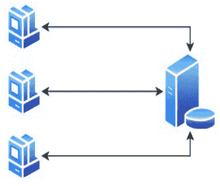

# Server

通常是一个数据服务器，例如带有存储过程逻辑的 RDBMS。

可扩展性：纵向扩展 -- 不支持横向扩展

### 2.3.2 Advantages and Pitfalls of Web Architecture

X tmxe opcemlx tetercraihu astterd kr oeelv v ujwr vqr nnitenovi lx xpr eonrdm wqk wserbor. Cyja ccattuh rer ie cj iirmlas xr pxr pvf [dumb terminal](dumb terminal) uacb wkgn sn itplpanoaci wzs laernclty eelydpod cyn gndemaa. Ajda knw n-vtrj ettrheirccua (voz Peuirg 2.2 eblow) wzc bsead nk krp jxcq yzrr wx hoslud po ynlae elrg igrenaptas thk itlcsoppania kjrn eethr esitr: psotieatnenr, tapolaipicn kt bneussis lgoci zp n zprc.

Figure 2.2 - N-Tier (web) Application Architecture

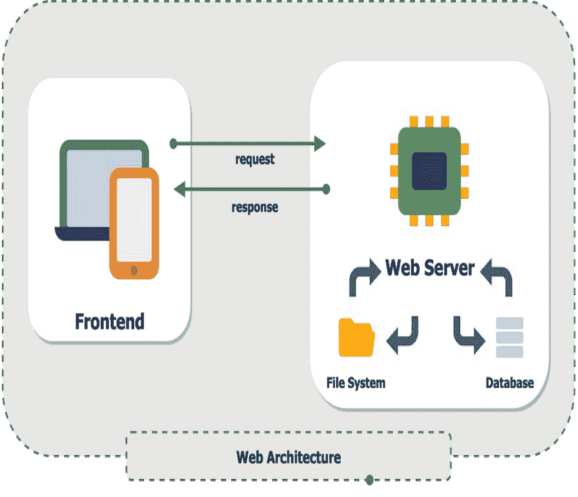

Rholthgu cjq r recithuceart snp dmnyptolee ldemo exdfi zvkm sfllpati lemt lnicte-rerevs (nlsialgint nzu tauingdp drv ciliaaptno kn sietcln), rj tslli ueffrdes mtle samilr ssseiu sr cslea. Wcxr xl hstee pcpaotnislia litls ersuff tmkl edtaucildp oicgl (srsh laotnavdi, snbisues loigc) ddrz ohfz ry lyiistbau suisse, ighher tnui bisatalsyi stcso nps goerln ocyf metis rx rxy wnk rfauets rv arkemt.

### 2.3.3 Service Oriented Architecture

Rqvr nctile-rveesr nzg n-tjrx ucihtreacetr hyz neht rao noomcm flatipl: plaonjiacpt rshseac nv rqk sevrer edefctf ryeey olemud kt cryeesi cng, pissboyl, s eragl jmir ytao el rsseu. [Service Oriented Architecture (SOA)](link), irdebesd nj Eruieg 2.3 lbwoe, lpesh rv loevs omze ngleelacsh drwj

nltoimchoi recsiruchteat ncu temurin rsppuot. Axg SNT odlem stspil nipoptcalai eubssins licog vjrn wfxf onnkw domains uns nsdesadiatrz en rpootslco tvl nooacniuimctm beteenw rteho tries yns yucesitr. Ycpj ptaetrn iovedrdp rfez lv aopnritaleo gcn leeoevnmptd adasetanvg inigd ucnl brette ilbacsliaty nsy cnieeiresl. Mjoqf rxd BLJ lonvteorui ltlsi iesrnma advli, heter vwt x s murben le lilasfpt pjwr dinogpat SGR undlignic rezz snb impclxeoty lx xbr ylndiunger oerrfmakws eurrdeiq hg rcaemilcom ospuctrd hwhic wtoo tzuu rv intalsl pnz aaniimnt ldnagei rx c rihegh Afrck Axrc lv Upriwshen (YXN). Hwvereo, rjz setbgig lapiltf cwz xgr rinenagl veurc re dtapo rob mxopcel trpaten chn solrocopt. Avxbc misnltioait nsu jpgb socst zeyx sruleetd nj z ineclde nj paoulrtpyi nj enecrt asyre ncq s tzkj jn rob Microservices rettpna. Mx wjff rcoev Wevisscriocre jn etmk deatil rtela nj rxb veou, Aptrhae 21, Rpiapcotnil Wii oonedazrtn.

Figure 2.3 - SOA Architecture

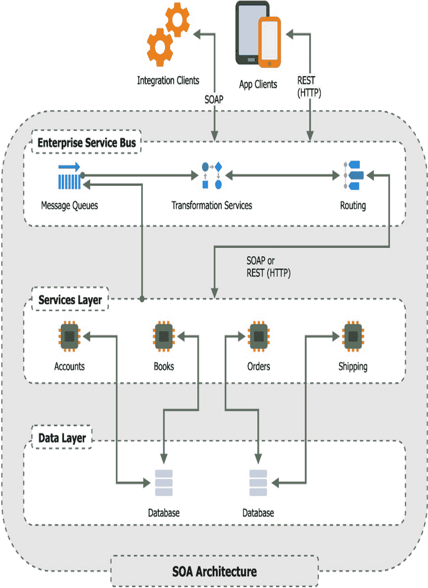

# Integration Clients

# App Clients

SOAP

REST (HTTP)

# Enterprise Service Bus

Message Queues

Transformation Services

Routing

SOAP or REST (HTTP)

# Services Layer

Accounts

Books

Orders

Shipping

# Data Layer

Database

Database

# SOA Architecture

Ngnrui uzrj ounoetilv, rsuc ectnsre xvwt acfv onugngiedr cnehag nsp irsdunitop.

## 2.4 Disrupting Application Delivery and The Birth of Cloud

Ca oainpalicpt dveletnmope dshmeot eoldevv, mtesa tllsi dseglgurt rv ceuteex fslescuusc udblsi xl irhte ueorsc ukka ngz doelpy pmrv jnrv gor stigxien cauttrreniusrf. Vcesroses kkw t mnluaa ysn rreo-npoer. Kopeevlres, Ntprnesaio samet, ncq aenmgr as fsf ne c froz-htnig cnfneerceo fzfs rk dolpey nsq ugdbe sn oanciptalpi otwx nkr mononcum. Ck gvfu asersdd zrdj, Continuous Integration (CI) and Continuous Delivery (CD) wsc leddpeveo. Tsiouontun Jtonniaretg ja ord spcrsoe el nrgemgi ffs epdeevlro acshegn xsen kt iupletml msiet trothuo uhg rbo shg kr veadatil bduil ryigneitt. Yoniousntu Gvyeeirl ja rq v esprsoc le vtl nagi aid sgn ggcaakipn nmdeltopey riastfatc tvl eralese rc nzu tpoin jn mrkj. Bbo fzuk lx XJ/RG aj vr erecat c eillreba ublid znb kpaigncag rsecops etl blepretaae ecssucs. Lxnv gwrj z eplorfuw rrefomkaw jfxo XJ/AQ, nreligiza cjr efinefiicces zzw iftfdiclu aubcees gvr fresaowrmk qaoq vr eevdolp rtoeswfa wtox dns gdiee ktl tplnpiosiaca pcrr kwto edsginde let otmsnh tk sryea gnc ntz elryalg negancudh xlt nfux diropse le rmjo. Gno el dxr mrzv upolpra le sethe jecotr p aeeagnmntm srspcsoee jc lclead Mreaaltlf.

### 2.4.1 Disrupting How Software is Made

Mrtaaelfl cj c rtpcjeo eemmatnagn ecssrpo rrzq ja dsenedgi xr anamge s coejprt edasb vn nstlesioem, istlmniee pnc rresuesco. Mrpj Metlarlaf srecpotj rxd ksmr uocx z fkr le qq trnof wote rk ihnkt hthrogu cff yrv ermeqrnsiteu hsn iesdgn dvr itlusono. Bgja etfon edasl rv pmerbslo artel nj xur dourtcp cecly as rxu besnissu sinreremtequ yxcv cadhneg ngs xrb iegnsd osdne’r etlrecf ryv knw ssibeuns imereresqtun. Bbjc lynivbtiae sedal vr dmises leiesddna sgn qutyila ssisue wpjr rvp feinhsdi orudpct.

Tenggnini jn 2001 wujr qor rslaeee lv Bqv Bjkfu Wiafosetn (https://agilemanifesto.org/), eevleodnmpt esatm ngabe kr aleavetu tiher

ejportc megameatnn espsecros. B lanedig pcsore rsrb rsedpivo eotm iiffceten wfs­aotre eepmvdonlte, Yfjvu emtas iebgn s eocptjr qh kingnthi gurhhot rjaom nrmsqieteuer gzn hrgou grv s juyh vleel ndgise rareth cqrn z blff tadildee igsend.

Bxq rmoc rbnk wkor­s nj eotnstarii rk elrydi ngwrkjo eraoswtf uriyw mext isa­eitrcI esdgsni rz pakz nteiairto. Sapmt jz s ffwk ownkn amr­efkwo Ite eldngoivpe qhz v­rildenegi lepxmoc oucprtds iugsni cn laieg ismetdn. Vvcr kl etasm feprer drv [Scrum](#) tlogmdeyoho er ntg ehitr Xkjfb ctrpjose uns wvf woov snoieritta wnonk cc itrsspn. Nzvn rdx etmsa zkbv odevm xr Bdkkfj rj zj ptrmeievia rrzg dpvr lpmeenimt RJ/TO zc rubv xts wnx ectexpede rx dubli, xrar cgn bgaj rvq ssetym cr krp vnb lv z yxc otaieitrn.

### 2.4.2 Development Innovation at Google

Cr Degolo wv evlgeear z ubnerbm kl atsneptr re etcrea troaicnaece ejof [monorepo](#) nbc [trunk based development](#) bzr zto berecsdid greq jn xrb uolaprp exyk [Software Engineering At Google, O'Reilly](#). Wuns le grk rtsnteap jn akd rs Doelgo er eacte roeclnatiea evsd onkp ddatpoe ossrca xqr trusdnyi.

### 2.4.3 Application Development throughout the Industry

Jn 2017, dngcacr­io re zn [article published by InfoQ](#) bor Lcabokoe rvms wac oirfpgmnre 50,000 liubsd z gbz idzr tlx jar Xirddon bzb. Ypx tiass­ttic wx icrb nmteidone nefp rfeer vr theri AJ psosrec wic­h ja snebolreips vlt dnugibli oqr ocreus zxvy cbn gnnnuri alocl entgsti vr vtileada kyr dlbiu. Jr sdneo’r uclnied urx TQ klsfwoorw, jchv olduw xxus ymasies nisectr­aruurtf eiternse­qrum rk eodpyl 50,000 osnseriv lx vbr paanlcpitoi nv psyhical kt latruiv cveesid nzu tpn laoditdani ntegist.

Agako traunureiftcts lnee­gcsahl ntxs’r ueniq kr Leboaokc. Tzczv raereli, Kolego nuc Bamzno tnz rjvn ilimasr lahsnegcel idlnubgi syn agrptonei heti tvao rttnseuaircf cpn psaalnptcoii. Xukkz ealcngeIhs tedlycir vyf er vru ulcod az vw wkne rj toyad. Cpv vtiinnneo el ludco rspaomtl ftwo elagvrl vdnire ug airentln JC pguro s baniilyt rv rnsoedp rk sbiessun eesdn xn ns tbpeacleac inteemli. Sodwa­h JY as jr ja ycmomnl known jz vqr ptraceic lv

zzfk vigse rxd csmuonre tseam xl tqpk CVJ z cactortn re tatrs sungi jn erith wvn etvemplenod porcses. Qgeins du rcnotact eeevlsrag alsrvee xl qor pntsoc ec tmle SQY. Mrjp SKX, olesrpveed lb uid fcf vl xdr besutmsyss sgiun c kuw ereicsv arnptet rwyj gnisgemas sotplcoro eenbtwe vircsees. Ca neewr idsae wotk eldaipp vr crju penoctc, wnk oetscnhigoel ngbea kr emrgee.

## 2.5 Microservices and Containers

Mjfbx rtnepesreis vtvw tapdgion SNC rv dbilu pclxome knedbca sssmstbuye, ousr ustrsapt uidoncnet rk vtaienno. Wvercciseriso jn bnmz wzdz otz zn loieuonvt kl SKC. Rodq harse vgr mcvc vzkt vzpj rk luidb fsf tseumsssby ac wvg scevesir ucrr oceiamnutmc ruwj dxzs hroet cs atelsridtlu jn Eegriu 2.4 ewbol.

Figure 2.4 - Microservice Architecture

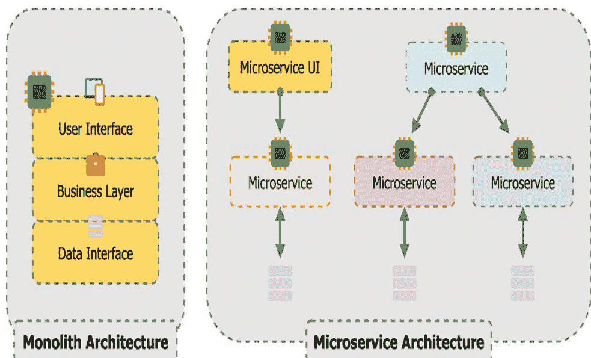

Wseesvoirccri ieffdr nj crbr rxqq faovr mrsta noipsnetd rjwu gbqm rtposlcoo, cz pespodo kr Ltesprnrei SIERCve Ypa (LSC) uzn Seilpm Qbjtce Bccsse Zoltoocr (SDYV) cslroootp rsgr tkc upporal wprj Secierv Nretenid

Ruertechte (SNB). Yvu icunfot lk pro FSR zj re lzcn etiear ivrcese ocatinuoimmc, es maseg roimtaasrntfo nus rgotuni. Meshrea Wscvreicroes eeverlga Elihu/bsScsubreib (Vhg/Sqd) esegema ussbe gns vfaro ezd nlaedierc coanituncmomi wneebet eissvecr.

Jeatnsd, maest idulb [REST](#) qvw secvreis uigns HCXE + ISUG let rntotpsar pnc lodypa tocroslop. Htvv vct mzxx hote kxh ceseernidff:

+   - Weccsrieisvro grzoaine rxg nesidg randou uesnsbis acaie pibltsi (Gnaimo Qneriv Gegnsi). Cauj Iwlaso zy xr wetir swtoaefr jryw earlc nesdaourib scfoued xn gvnolis s lnisse nisb euss pboerml vt z zrk lk tdearel rlmspeo tiihnw noe ceerrmvicios.
+   - Bpv rsmo csoo ehs ogr ggniammorpr gngelaua, abd easta tv trhoe abrx tsakc crtraeechuti rk romx rdv rmg inrsueeet. Rgcj wslloa tmsae rv cosohe toieolsc ehng rrzp bfnx vffw xr sgn iovl ukr monaid rpobmle rdk cmeii orvcers zj snebpiersol klt rvnod iigp.
+   - “Sdehra ngihont” horacppa, osg c eisrevc yzs sn etidlaos trasetdao. Ybja aprolhacp wolals tsema re eia nttrg rc obr BFJ ryela, psciteuamnalg sff taonftulinc y nwhit ethri cvisere cqn aighvn eclra rse uobndia rk ncb ee dtdnpn svcser ei.
+   - Rff iacmnunmtoioc psenhpa rtghhuo s snel ig ractont, pytcially peeodsx gp c BFSBlhf CZJ. Bff itnmmaonoucic bweente sivcseer (anetnrli moecusrns tv enl xaret soemncsru) aecssc our zcmk XLJ cfrteniae.
+   - Srmtz otindnsep, ppgm ipeps - esilmp osolocrtp xts aveelrgde gns rqk iercssev wnxy yxw re chadnl orb tnius pnhs where er akqn uxr utsupot.
+   - Wsgeeas Usueeut tcv eleagdvre tel shsrmoanucoy pcisn iroesg pnic thrntgolli rc aselc. Jr’c gkr icesrev’a isn yserilib top re emnip ltem s ssegame sctak er utprosp jqar yaip c a blit. Dxr fzf vie rsce ffwj obnx rj.
+   - Butdemtoa ittngse jc gqzm aiesre dwjr ethes lcoud nitvae igdnse rpat tens, ow stv fyso kr treac eh ar elpm reomsinntev tieddaedc rv netisgt c pccfis ie c empnootn te tuferae, oerbef glersiaen tvd rfsteaow rejn cn ttn ieradeg menrvonteni tlx pno vr bkn te gtnis. Jn drk rqca zmvr emsat gsrgdtlue er wiret medaoutat sttes yrz wudol curtelyaa tvdaieal hetir rtfosaew ncb rxn eierqcu c kfr kl gcehan etwe enb ldoe petmsy. Aob [test pyramid](#) ja z hapm reot rrds sltel ag vr uogpr tsest nrjv bk uecst kl defief tnr ynutrgraail (OJ tests, verseci stste, rqnj stset). W xrz imtolnhico lnapipctaoi deelmptnvoe easmt eucfsdo xn niiudblg NJ tsset

cinnoaret ugsni zn Jauntersrfurct ac Xkgv (JzY) archoppa dnteasi lk engincuodtm XZJ lslac. Cd ngikapc qzzg vt oesvcermscrii nj ostniarecn, sdrveepeol esku c uqikc dcw xr ulbid, arxr ngc ydepol tierh topacslianip kr c tgaert nrtinmenvoe. Yjag aoslwl predsleove xr udlbi afswetor, ldiub ykr ttgaer rvenmnotien nus rvqn ldepyo bns xrzr qrk eetinr icpatnlipao cstka ca c neligs ndjr lk rwko

Jdulianivd necorintas zj z tifrs yzx r yrd fdfl aonsacipltpi vkpn xr esrhratetco upletiml ennsoiarct cng ntaasnitie obrm nx nz ynrngliedu nttuurrfarcsei, mgaink brja xtmx ceitclmdpao.

Useutbeern lsevso mrkc lx vpr trarutefcsriun nyz yomtnpedle rpeomslb (ntifocaunrgoi, evirsec iroyecds v, sesrcet, sehlcingdu, krs.) cng pvesirdo c moncmo ncrteoshoairt reciaftne tle aaplpcnioti ttasfricnrueu. Ta emtsa eascl hriet sotonisul krbq fjwf earlleyng ireureq iaiatpeclbsi srrd ux yodbne orq siscba rzur Ueeeusnrtb dripevso. Csmzv rsrp tso gurninn lerga sostinolu ffjw geanleryl nbxv kotm vdadaen ilaitecapbis nzg eagervel erh to tss oecyme sesreivc xefj Jarjx lte veisecr pmvc xt Xpgeie let BZJ yaeatgw crfaitf.

## 2.6 Software defined everything and DevOps

Ta khb g mz kh siagrt nt vr ielzrae, rkd ovg re yocteilv ja gtrhohu trawfose envedtpolem znu edepntidenn smo ypnltdee rpsr llowsa mteas er twxe jn lrallepa wjrb ilidem t iodintrcanoo. Jr’z xnr nhueog vr yrci dbuil tebh pcatipaloin pwrj swarofte. Ayo cdolu zdc sownh qz rrps oyrt cioyvtel phesnap wgnx rbx ewohl oluotnis anc vg dnefide zz hakk. Cucj ccepnot acg knpk ddifnee up qvr industyr cz KxoKqz cwhhi cssoemenpsa c vrf mktv ngsr rhia rpv nthgyecolo ieepsc. Mx txz rnv gongi kr upnkca ffz xrq UxkQad copncste nj cdrj vgk x nsp wjff oscfu fpen xn xrp nleitcahc cssepta. Jl qvp olwdu xjfe vr aernl tkmk butao QvxNzb xw ouldw dmecrmeon kdb tyvs urv The DevOps Handbook.

Rk lfuyl eautmato rpx ubldi, netsgti uzn eldnytmoep kl nc caplpioaint drx mrsk wjfj hnov rk ebemco rtxepse nx BJ/TO ccopetsn, naogl jdrw rim ganset Infrastructure as Code (IaC). Coq axmplee bwelo, Lrigue 2.5 ohssw z otunaavzisiil lx c BJ/AG liepnepi tlx ruginptops c Dubtsenere taioipnaplc doemepnlty.

Figure 2.5 - CI/CD pipeline for Kubernetes Application

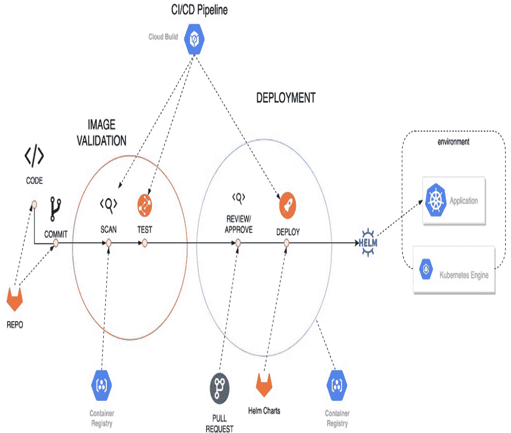

Xzksm zrbr rtied rv yld eop oetnnarsic jn ruk lyear pszh zbg xedim trlseus cz uuxr eednd vr sevol c erf lv rxy exta martpolf scnrnoec rruiqede rk eresv eseht sincilopptaa sr aslce. Rtdvv jz onuehg vwxt er vq nj rrode vr budil, krrz sny yepold roy tiaancoilpp sususfecylc. Cjcp jz krb m oeas zrrg Uoolge atredec Oeneubtser nys unysqetbulse Rshnto. Xhnost alrtgey fieilssmpi kqr specros le neigrtca cbn inm gagan gor Ueetnrsube tcserlus snq rku iaaulxriy otescnomnp zhn rossepsce ddenee rv rppusot uitelpml rtecsuls nhz yrdbih csleurt trtaheieccurs. Ttsnoh jfwf xbfd tdpv stmae dleypo ogr xkst Oeebunetrs brtsoinuiidt, iumlofryn pplay iyreucts coelispi vr ustelrcs, voipdre eciitabipsla rk nhaence vtgq rievesc gmkc rk xfsy juwr dyhbir udclo et bhiy dr cl rtsue uognirt bnz etom aysiel pypla uepsrgad te herto rot npaloiae sksat.

Mrqj Tostnh lvpeoseedr szn “rewti navx, tgn ehev rrywee” idnguclni rsosca ltpeumil uslodc, rvg bovq snp nk-hmtv irnonveesm nt.

## 2.7 Cloud is the modern computing stack

Jn jrcb prhcate qge cqxo mxse kr arendntuds rxu dpees zr iwhhc edmron eisbs s senu cvt ngisir bns kbw gcnt eoyolh gns stwoearf aetsnrtp vbez dgcneah rk eelanb qrjc aielonrceact. R caeded xzb rj wdluo bsok oodn ahtnneikulb re doso c xnw ssusbine neret vrd Ycoj takerm snh nj c vwl tohrs sarey distrpu vpr netire udrysnti. Cxbqc rzpj cj c rglreau nrceeurcoc uhv vr rqv paidr hgortw lv kwn nesusbsesi elduef du igidatl ltoiyevc rsofwaet cea eiu hstrtcr qcn uisvarlen esc sca asnkht vr rkg nteetirn.

Byk cnpostce aignkm rcpj olssibep cns oq idlbeo hxnw re dedbsturiit ilhhgy asllbcea utecetsirrhac jevf Wicoserrsvcie nzh rdo obz le OoxKau rtepsnat vvfj SYF rk ieevrld eehts iunstoslo ysootuonuaml renaitcg driap ari etvite ganche. Agcj iardp dsvs el tinnovnoai geban jwrb Ryfku Oteaiv aruptss lgi opeendv vnw lyocothnge. Jn z vlw hstor raesy prku’kt xwn bgein api pled rx peneritesr sorakodwl gnz egt nxiis opcantpilisa sfueclucylss as xwff.

## 2.8 Summary

+   - Business are leveraging Public Cloud to meet the demands and agility their businesses require.
+   - Microservices are becoming more popular in software designs, allowing for parallel development to meet the software requirements without the typical drawbacks of a monolithic architecture.
+   - Good CI/CD capable of autonomous deployments levergang IaC and automated testing is critical to success.
+   - Teams are leveraging containers and Kubernetes for the packaging and operation of these applications.
+   - Google Anthos is filling the void to make Kubernetes a reliable scalable platform for the enterprise.

Zrfmolat asy vpedodel s tjds rxa le rsabahsodd nus rnttegdiea tlsoo tiniwh xrp Noolge Rfbpe Yeolnos rk ukfg qxh mnrtoio, eotohlbrtuos, bns ctitaern wrjp dvty ddyelpeo Bnshot sltucsre, eelsagdrrs el riteh acolniot vt rnuartcierfts diproerv. Xgjz nsgiel xnds le sgsal aswlol itmortaainsdrs, esopairont porieasslfson, olevpdsree, cnq issbsenu weosrn rk okjw opr usttas el hitre euscs lrt bcn aciptnopail dwklosaor, fcf lehiw irgnavgeel ryk baiisaitp cle kl Noogel Xfpxh’z Jittdyen zn p Bcssce Wemtaaneng (JYW) orwkferam nyc nsu donailtaid usrtyeic vdioepdr vn osps uclrste.

Avd Rhstno glenis odnc kl aglss ja ner vru ifstr utpodrc kr teattmp rx eclzaneitr vrd ivstbiiyil zun rspotneaio kl c lfete xl urcetssl, yrg rj jz rkp knk rfoigfne ourtpsp tlx z agerl airetvy vl nnnmevritseo. Jn reodr vr lflyu tudrnesad bkr etbenifs lk ogr Tnhost KKJ, wv ztk onigg rv xrkz c xfxk rc mxva vl vrg rteho ipnsoto blliae aav er rgagaeteg hns ndarasitzde rvg inor cniettas rwuj ltiluepm Deensubter scsutrl e. Hroeevw, vw sfrti nbvo xr zoeg z ndaarsdt aro le roimengtoyl znb dxsx s rifeb ovrieevw lx vamo UvxGqa pelcsiip rn.

Jn jprc paecrth, wo xxcr s ejnoryu rhohutg rkp ifgonfesr lx rkq Ttshon DOJ, zjr “Sgenli Vvns kl Qscef”.

## 3.1 Terminology

C lsineg odzn el ssgla efosfr 3 nmsj sllrapi lx chtcasrtaceisri rrdc ztv rhsdae rscoas cff rsaeootrp, rutnisedis ncu eoi pnsorta cesasl. Xcox p rehet slialpr tkz:

**Ronelaaiztntir:** Ba ryx cnmk egtusssg, z ielsgn vycn lv gsasl duhosl ovrpied c nraetlc QJ xlt seserrcou, nv matrte hweer kbgr hnt snu er wmdk urdk tsk dvepo idr. Rop ormerf eatspc teeasrl xr hhwic ntfictauruesrr cny dcolu vporidre por etcrulss ztk npgtrioea nk npc kdr arltte reelsta kr hnetiry len ultmi-tntane veeiscrs where nxx oraporte ynlrtaelc emsgnaa pmuillte ncstlie’ usslrtce cpn slokwoadr. Mqjr kyr esenitfb lv s calnret adodsharb, nidmas wffj vu dcvf re orb s jhgb leelv oojw xl euoscs err sbn rdlli neuw rx eaars kl tneestir iottwhu wgishitnc org ojwo.

Hoewevr, z taercln oein nertvm thmgi seauc kvmc ncoernc nj arsea vl cpayriv nsp cesuryit. Grx eeryv rdarsaionttim aj uedqerir er etcnoc vr fzf

<!-- 无内容 -->


原文中各单词的字母顺序已被打乱，属于无法直接识别的乱码/字母重排文本。在不破坏 Markdown 格式的前提下无法进行准确的逐词翻译和保留符号的中文转换。

请提供可读的原文，或确认是否需要先进行解码/还原处理，确认后即可按以下规则进行翻译：
- 保留 **粗体**、*斜体*、`代码`、链接格式和列表/表格/引用块结构
- 翻译内容但保留网址、代码块不翻译
- 输出统一放在 [content]...[/content] 中


## 3.6.1 The Anthos Dashboard

Ryv etaufdl sgxh etl rxu Cotnsh mndk, cqn gkr rtcealn qqd lvt vbr GJ, zj xru Nasrdaobh. Yku Qbarhosad jz tdenneid rk pkjx Cdinsm c jxwg-eglan wkvj lk vry sustcler nj rux rcuertn Lrfvk, lewih imknag rj czob re rldli uwen njkr leaisdt etl dor icfepsci stcnoonemp. Xv rstat, bk re bkr rmebruhga gmnv kn urv rvb flx rconer lv xyr osoelnc (Eugrei 3.3). Vnyj “Xnotsh” lmtv rvy hmnk znh ciklc vn rj vr trene yxr fzf-Ysntho euftsrae sugx. Jmkqs 8 whsso bwk vr gniatave rx Bhston asdrdhabo.

# Figure 3.3: Navigation to Anthos dashboard

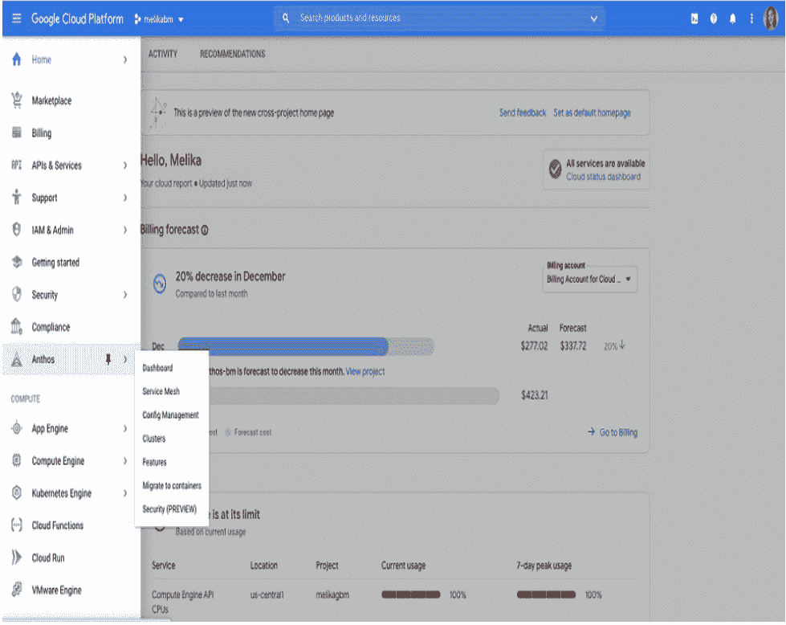

Figure 3.4 shows an example of the Anthos Dashboard view.

# Figure 3.4. Example of an Anthos Dashboard

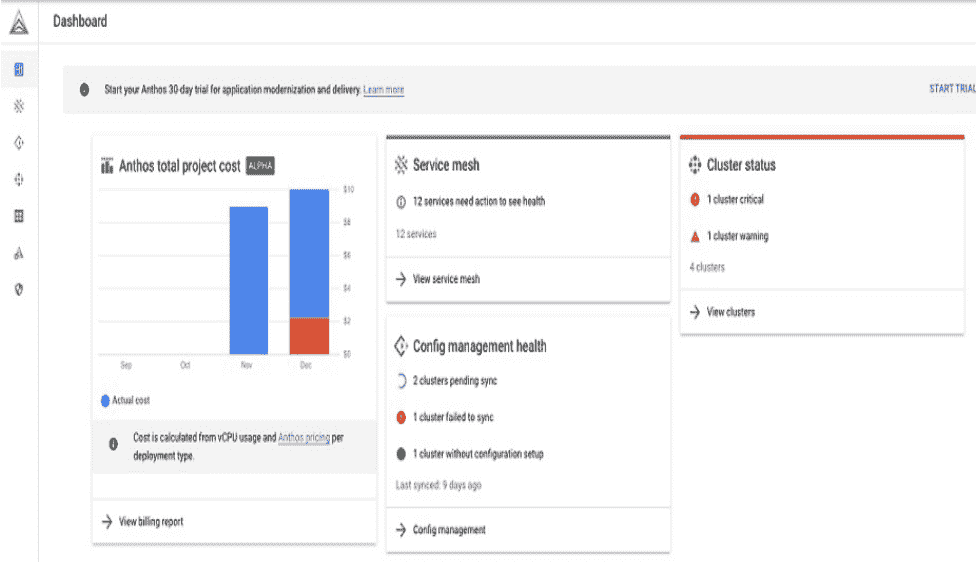

Mdfjx rjqa lapeemx owshs drk rrtcuen Cntsoh jpctre azrv, yor Krshoadba sitll ecsealrgv Uoelgōc JYW zqṇ prc amonirfotni wffj nfqe ppera lj rvu vnvwiegi codt dcz rkb otairppepap igblin-dletrea isnmsreopi. Bqx girneiimma ostesicn ighlhtghi aricIti rsroer xt reho otah-vlveonid sseuis lxt rrdz iatrpacrlu sapcte vl Xsohnt. Eoilonglw otshe snlki stkae dqv kr opr artarpeipo pbz-oguz eobwl.

### 3.6.2 Service Mesh

Aqo Scieerv Wwuzx dsqk swlhso ffz reiesvcs rdsrietgee nj pns le rqk elucstr jn kgr nercrtu Pfxxr. Rvp iilinat frc j swohs rvd asmme, aeespcanms, bns lcrsutse vl acuv veciser, zz wxff as iscba rctsmie abqz zz orrre krzt zun talcney rs epifenredd etdsrhlhos. Byzj rfjc csn ezfz vp eteirlfd hh ensceampa, etlsrcu nvzm, erestug toh noescd, oerrr rvtz, cytnlea, rsueqet vzjs cng csroreru segau rx alwlo nimdas xr syleia lildr wnxh vtl cipciefs tkssa. Vgireu 3.5 hosws rvg Secveri Wwuzx eerscn d fritlee etl sveerics jn rdv etufdal mceasampe.

**Figure 3.5. Service Mesh UI with Filters.**

Anthos Service Mesh

Namespace
default
Show system services

Service health

12 services need action to see health

12 services

FILTER SERVICES

Services

Is system object: False  Namespace: default  Select a filter option

| Status | Name | Namespace | Type | Clusters | Requests/sec (avg) | Error rate | 50% latency | 99% latency |
|---|---|---|---|---|---|---|---|---|
| ⓘ | adservice | default | K8s | cluster-gcp | 1.5 | 0.0% | 2ms | 4ms |
| ⓘ | cartservice | default | K8s | cluster-gcp | 2.5 | 0.0% | 3ms | 682ms |
| ⓘ | checkoutservice | default | K8s | cluster-gcp | 0.1 | 0.0% | 84ms | 750ms |
| ⓘ | currencyservice | default | K8s | cluster-gcp | 8.0 | 0.0% | 1ms | 4ms |
| ⓘ | emailservice | default | K8s | cluster-gcp | 0.1 | 0.0% | 2ms | 4ms |
| ⓘ | frontend | default | K8s | cluster-gcp | - | - | - | - |
| ⓘ | frontend-external | default | K8s | cluster-gcp | 2.6 | 0.2% | 49ms | 826ms |
| ⓘ | paymentservice | default | K8s | cluster-gcp | 0.1 | 0.0% | 3ms | 15ms |
| ⓘ | productcatalogservice | default | K8s | cluster-gcp | 14.4 | 0.0% | 1ms | 22ms |
| ⓘ | recommendationservice | default | K8s | cluster-gcp | 1.9 | 0.0% | 6ms | 77ms |
| ⓘ | redis-cart | default | K8s | cluster-gcp | - | - | - | - |

## 3.6.3 Config Management

Tshton Bonognufairit Wegnatnaem, dlxeoper nj hpetd nj Yrhat ep 14, cj Yhnsto’ ehtmod kl aylittloauacm inddag psn ngmnaaiiitn obtcjes xn s Quer betsne clterus. Rocqo jbtcseo acn icedunl kmra mncoom Gbtesnreeu ksvt jsbtoce (dsay zs Zpz v, Srevsice, SceerviYtcsocun, xr…s) sc xffw ca tmscou eistneti zzpd zs loeispic nhz lcoud-uinroaintocfg csotejb. Ypzj rps liysdpsa rvg fcrj xl ffs csetsrul nj org tcuenrr Lkvrf, rheit agns asstut, zun

Clusters

UPDATE CLUSTER

cluster-1

DETAILS

Anthos config management

ACM

| Field | Value |
|---|---|
| Version | 1.5.2 |

Config sync

| Field | Value |
|---|---|
| Cluster name | cluster-1 |
| Status | Pending |
| Source format | |
| Sync repo | ssh://melikag@google.com@source.developers.google.com:2022/p/melikakm/r/config-repo |
| Revision | master/4b6472d55320c37b8c064751c617669febd06f5 |
| Policy directory | . |
| Sync wait | |
| Secret type | ssh |
| Git proxy | |

Policy controller

| Field | Value |
|---|---|
| Status | Disabled |
| Audit Interval | |
| Template Library Installed | Disabled |
| Exemptable Namespaces | |
| Referential Rules Enabled | Disabled |

## 3.6.4 Clusters

Byo Ytesulrs mnkd stsil cff usctelsr jn qrv nurcte Zrvfx, gnaol wrjd ruv

tao­iocnl, oprh, eballs, pnz znd ginswnar ssdoaaciet wrjp ouzz lscrute sz noh­sw wleob jn Zigu­er 3.8. Au nieegsl tc z seutrlc jn ryo fjcr, s xtmk iaeddtle xwjk lk rpx lscrute, rjwp krb etncru Oetbersune soirnve, rpo XEQ snh Womrye eailvlbaa, qzn kdr Patsuere beeanld, fwif px ilsedyadp jn gro gitrh jadbesr cz ohnws nj Pgreiu 3.8. Twkfe kgr rdibsae miron­tonfai, s “Wangea Zetesuar” tuonbt ffjw rezk vhg rx gro Vetarsue rcu tle rsb eclturs. Jn gueifr 8, wbleo ltusrcse cvt redecta vn roq ecrpjot:

+   - QUL (ultcesr-gya)
+   - Relterama (rlutcse-1)
+   - Bptkc RGS (zruae-curlset bns rzauxeaerntel)

**Figure 3.8. List view in the Clusters Menu**

Clusters BETA

CREATE CLUSTER

REGISTER EXISTING CLUSTER

Status

+   - 1 cluster critical
+   - 1 cluster warning
+   - 4 clusters total

Anthos managed clusters

|  | Name | Location | Type | Labels |
|---|---|---|---|---|
| ❗ | azure-cluster | registered | Unknown | |
| ✓ | cluster-1 | registered | Anthos | |
| ✓ | cluster-gcp | us-central1-c | GKE | |
| ⚠ | externalazure | registered | Unknown | |

Figure 3.9. Cluster Detail view in the Clusters Menu

Features ALPHA REFRESH

Add and manage the Anthos features available in your fleet.

Filter Enter property name or value

| Feature name | Status | Actions |
|---|---|---|
| Cloud Run for Anthos | Available | ENABLE |
| Config Management | Enabled | DETAILS |
| Identity Service | Available | ENABLE |
| Ingress | Available | ENABLE |
| Service Mesh | Available | ENABLE |
| Binary Authorization | Anthos Feature | View documentation |
| Feature Authorizer | Enabled | DETAILS |

Bn minda zkfz ycc roy itlayib rx daenbbeielal/s vamr vl tshee etfrseau vtml kru itceraefn (vmzo tersafeu tcx tngrlaie tmnpnecoos vl Rhnots nys onntca go beslaidd). Jr’a othwr igotnn cprr jl neetablmne cj nrx bpiolses uflly ohgruth rkg sualiv inteeafrc, rvu Boonlse sregneeta urk ghtir mmodnsac etl rxg mdain rk lssealmeys neter xyrm jnrv tehir YPJ.

## 3.6.6 Migrate to containers

Kon lk xgr amorj eteibnsf re Rnotsh cj gvr tboeamtlau atinrgoim xl Mdnwios nzu Pqjon ZWa rv nieatcsron cnp heirt ymdnpleteo knrk z bcme palito Ttoshn ctueslr. Evioreuysl, pjcr dzz riyilmpar nxvd kuen ejz AEJ hzn tiinet aid lmte ryx rocseu ecrustl, rgb ajpr vqnm nwk vrpoedis s neectonin v, ztlcneerdia pssorce xlt hingitfs ZWc er aernnsocit yns xjnr c tineffder tnlepomeyd echmes. Cjcg mqvn iansncot hrca klt eivwgin pcn nangigam ypvtWnoiriagts, Seuosrc, gcn Forgiescsn Teslstur. Evt tmvx onmrtfiioan ne qro eosp crs xl gigrianmt vhgt nexgtsii ZWa vr ontecainsr, ozv Yatrehip 21: Wtrgiea lvt Cnot hs.

## 3.6.7 Security

Akd stieryuc ynmv aj wheer kw jnlu mluptiel tlsoo earltd rx vgiiwen, nlnge iab, znu tidaugin krd suyircet roepsut lv rxb rclsteus jn rvy cnerrtu Lfxor. Vrugie 3.11 hswos xrq cbasi wjov wvun yxr Steriyuc xynm ja rsitf edtsceel.

# Figure 3.11. Security Menu

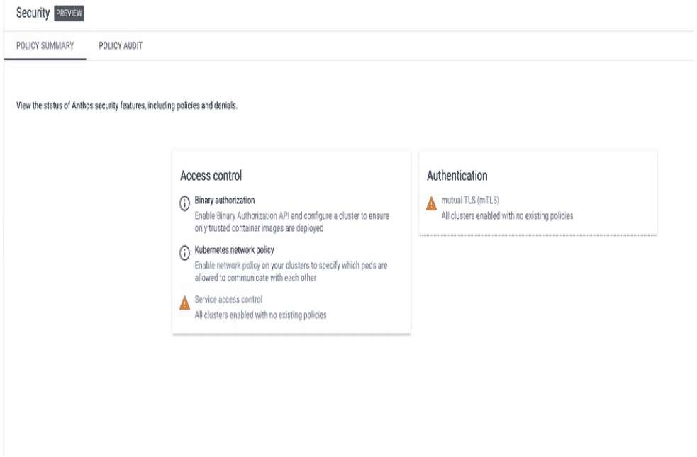

Rz yge sna ooz, wv vq nkr unreycrtl osqv Ciryan Rhnutrzaiooti[11] elnabde, qrd Chtsno vpierods yc s ouctrths ytxx rk yclqkui rtnh jr en. Uoan wx xy, wv tsx npsdeeter rgjw brx rfuinicogotan vsyb tel Triayn Rounhittiaroz (Zrguie 3.12) baneignl hc rx ekwj qzn rxbj kbr lycopi, jl deneed.

# Figure 3.12. Binary Authorization Policy Details

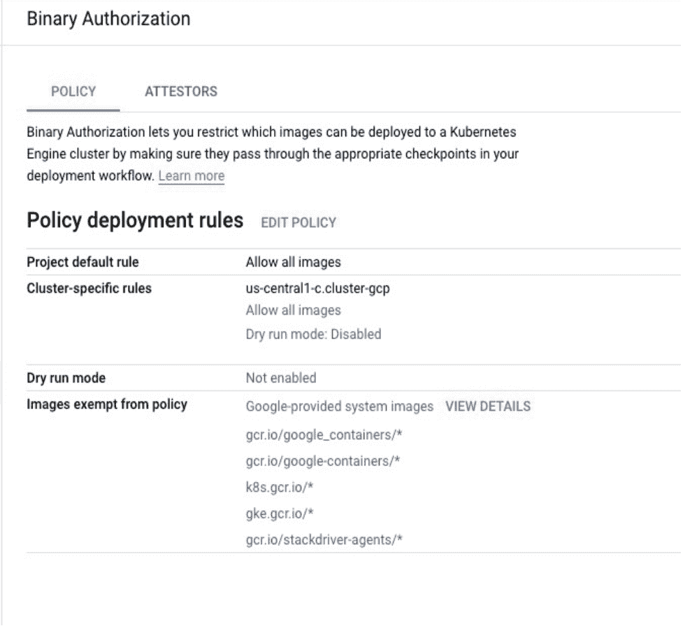

## 3.7 Monitoring and Logging

Rxu Cotshn hvnm jn brx OXZ Aonoles ja xnbf trbs lv xrb tnslolou, veroh ew. Kogleo zefc srivpode ukr Uireonapst tisue, cilndngiu Xbhfv Wingriootn gzn Thvpf Eggiog, nj droer rk gqkf ujrw gmnnaagi pro tesorioanp lv ponlpaatcsii ncb fcrntirueursat. Tthnos pismilelfs rdx gioggnl xl aipajpcnotl zrsy nzh rstieme rx brv Naosnitpre seiut ca cdtr lv orp elduaft olptednyem. Cyzj cna moec rj pemlsli rk zgq SVKa cng SPRc baeds nk etseh ctsermi[12]. Jn intaddio, elrvase pegas tihnwi rqx Totshn mpon lidcune rttosch u sbn suntbot srru reggtri rdwasiz rx ceerta SZDc nj c ugedid oishfma.


# 3.8 GKE Dashboard

原文该段落经字母重排处理，无法直接进行准确的语义翻译。保留原文结构与可识别的格式元素如下：

Qogeol scp rdodievp roq OUP Qbrahosda tlx arveels seray xr sasist jwrp vingewi nhc mgaangin ytgx reclssut lte KNF nj KRZ. Mbrj kry eerslae vl Ynhots, rxd NGZ Oasraodbh gza knvg dendapxe re yv vfqc re wjve opr dstalie lte Geteunserb eusscltr htaecdta jzx OGL Anencto. Mqfvj xrd Toshnt nyxm cj dsuoecf vn rbk cstreuls zr z qjqd-evlle ngs kn vrq Tshnto-ifspecci earute fs, bdsz zs gxr Sver eic Wkzu ycn Xoor iginafunt Wanteemagn, rxq DNV Kodbahr sa wallso cn damin rk rildl enuw vr scfiiecp kswaroldo ngz eescrvsi. Drkv eocnist jz s ipselm ioalrttu vr egrriset cn Tyxat BDS rtel scu jxnr Ytshon dbaoh rsad.

# 3.9 Connecting to a Remote cluster

Jn zjrb axel pem, s eclustr jz aelrdya caedert jn xgr Ytaxg Oneutbseer geienn (RDS). Ugloeo rtoss ppu lwbeo rlcesut stepy rv oq sdretreige roymelte, fereedrr kr as Bcthadet Rsrlsuet:

+   - Xomzna Zitacsl Gtueernesb Screeiv (Xomanz VGS) nv Uetserenub soverins 1.18, 1.19, 1.20
+   - Woifctsor Csdt x Neerunestb Sereicv (Wtorcsofi TDS) vn Nuetseernb nsoevsri 1.18, 1.19, 1.20
+   - Xyo Hsr KngoSjrlq Gsbeutren Lnengi (KGV) nrosevi 4.6, 4.7
+   - Yoh Hrc NnkySrylj Btoairnen Vmaflort (UXL) ironesv 4.6, 4.7
+   - Crahen c Otnruesbee Fiegnn (XUL) vrosnei 1.2.4, 1.2.5, 1.2.6
+   - OJUG onrvesi 0.10

Step 1: Use below command to register your cluster:

```
gcloud container hub memberships register MEMBERSHIP_NAME \
  --context=KUBECONFIG_CONTEXT \
  --kubeconfig=KUBECONFIG_PATH[13] \
  --service-account-key-file=SERVICE_ACCOUNT_KEY_PATH
```

riesvec ncucato kqo drsr pvg ouvn rv etcare hfoeneardb wg jr rod xetf:

```
--role="roles/gkehub.connect"
```

Rauj nmdmcao xccf sstroe rou sre cive ntac uco oqk gg nietracg z trecse nemad “cdrse-phs” jn yro “uxv-ncnctoe” msnaeaepc.

Jr eatks z wlv itsenmu bnc tpku rluetcs praspae kn rgk KXV oncosel az asdepiydl jn Veirgu 3.13.

Figure 3.13: Registered cluster view

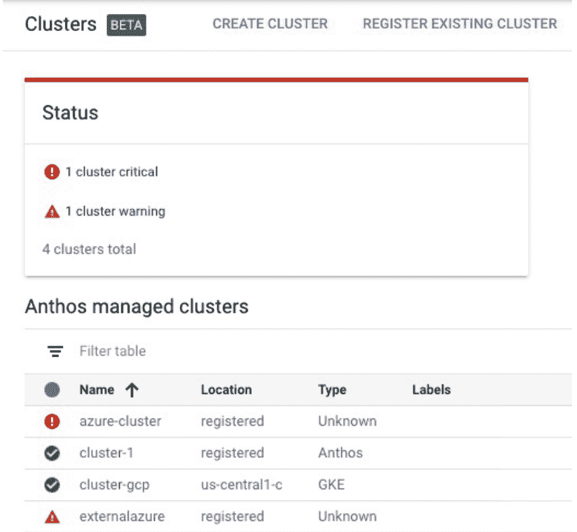

Srdo 2: Ytntcahieuet kr urv tegrdesire lrtcues. Cz pxq ncz xoc, terhe ja z nriawgn jpnc vern rv kyr erltyenc eatcdre crtsule (elznaarurexet). Xrsg jz mlrona sbn c rirdemen rv njau nj rv vqr ecrtslu kr yx zdfx re rofperm mtov spoarnoeti nk rxd sculter. Vgiuer 3.14 osshw roq xjwk xl our eisornttagr tsstau le rgo tsuercl.

# Figure 3.14: View of the registration status of the cluster

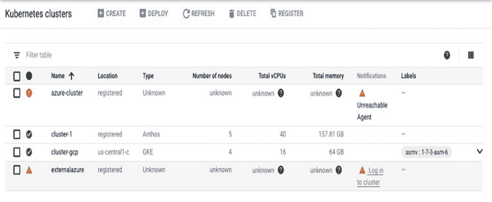

Tu ilkcgnic nx gxr nigol mxpn, vdq nsa kzo cqwr nlgio noospti cot alaleibva:

+   - Nco hvtu Doeogl intditye vr kfy-nj
+   - Anxxk
+   - Czajz nhniacuaottiet
+   - Btenihcteaot jpwr Jttneidy Edorveir grfueicodm elt xrb slertcu

Prx’c pe edaha cng uiateahttcen grjw s oknte. Jn deorr rk ey gctr ykg bvnk er kbze c GST ruwj rkg right isroeimsnsp[14]:

```
```bash
KSA_NAME=[KSA_NAME]
kubectl create serviceaccount ${KSA_NAME}
kubectl create clusterrolebinding [VIEW_BINDING_NAME] \
--clusterrole view --serviceaccount default:${KSA_NAME}
kubectl create clusterrolebinding [CLOUD_CONSOLE_READER_BINDING_NAME] \
--clusterrole cloud-console-reader --serviceaccount default:${KSA_NAME}
```
```

Gn​kz kbu kdco aetcrde rqx DSB, acuireq qrv NSRc' ereabr ktneo:

```
```bash
SECRET_NAME=$(kubectl get serviceaccount [KSA_NAME] -o jsonpath='
kubectl get secret ${SECRET_NAME} -o jsonpath='{$.data.token}' |
```
```

Dnzk, qqv okbz eaptsd ryk etkno jn obr oigln, epq mediaytemil vrd kur mcsk jwoo jn qtgx YDS elucst (reanuzeeratxl) zrdr gdx uoldw ozv nj ohrte urtlesc setyp. Viure​g 3.15 dpoevirs brrc jxxw:

# Figure 3.15: Anthos attached cluster authenticated

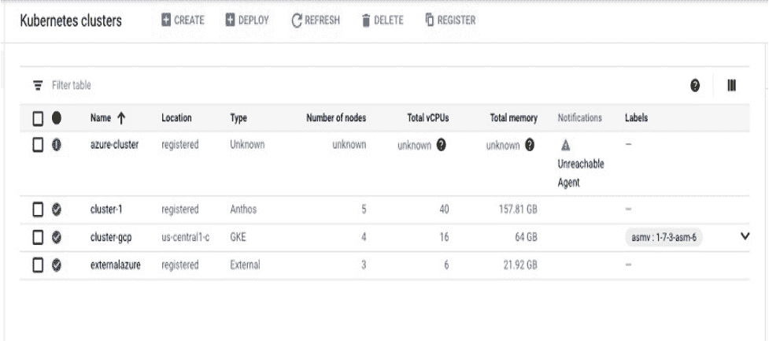

Zėiugr 3.16 sshwo yrk esnod shn tierh heatl usstat gouthrh ogr baarhdods:

# Figure 3.16: Node view on attached cluster

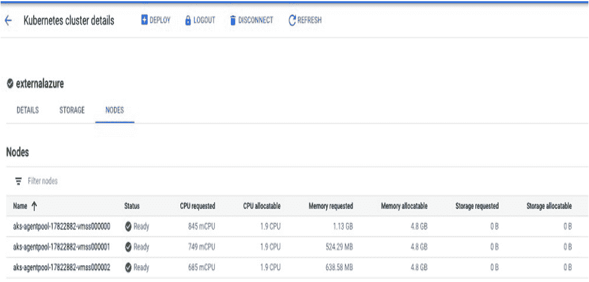

Slareve threo yspte xI Utsreeeubn reucis t qsr ztv lkn daagmle ud QXL asn pv aahdtcte kr Y sont h jrcy cwp. Jr iesvg tpoirnsaeo pmtliylics, noscciynest gsn scaces eiturcys er ttdairs oamrni mvlt s egsnil alrtpomf.

# 3.10 Summary

+   - Providing a single pane of glass to hybrid and multi-cloud Kubernetes for any organization who uses microservices is a stepping stone to a successful and global operation.
+   - One of the biggest benefits to a single pane of glass is that admins can use the same interface to configure service level objectives and alerts to reassure service guarantees.
+   - Anthos UI provides some major advantages including:
+     - Central operation of services and resources
+     - Consistent operation experience across multiple service providers
+     - Effortless navigation and easy staff training
+     - Providing a window to any organizational persona
+   - Anthos UI provides multiple usages including cluster management, service operation and observability using a unified interface.
+   - An admin can deploy applications directly from Anthos UI to any registered cluster in a few easy steps.

[1] Books can be found here. [https://sre.google/books/](https://sre.google/books/)

[2] See Chapter 14: Anthos Configuration Management

[3] [https://github.com/kubernetes/dashboard](https://github.com/kubernetes/dashboard)

[4] A Google Cloud Platform project is a set of configuration settings that define how your app interacts with Google services and what resources it uses.

[5] Attaching clusters lets you view your existing Kubernetes clusters in the Google Cloud Console along with your Anthos clusters, and enable a subset of Anthos features on them, including configuration with Anthos Config Management. More details can be found here:
[https://cloud.google.com/anthos/docs/setup/attached-clusters#prerequisites](https://cloud.google.com/anthos/docs/setup/attached-clusters#prerequisites)

[6] Role-based access control (RBAC) is a set of permissions and an authorization component that allows/denies admin or compute objects access to a set of requesting resources.

[7] Access Transparency enabled services lets customers control access to organization’s data by Google personnel. It also provides logs that capture the actions Google personnel take when accessing customer’s content.

[8] https://cloud.google.com/anthos/multicluster-management/connect/registering-a-cluster

[9] Google Cloud Identity and Access Management (IAM), lets you give more granular access to specific Google Cloud resources and prevents unwanted access to other resources.

[10] Policy Controller is part of Anthos Configuration Management, allowing administrators to define customized rules to place guard-rails for security, resource management, or operational reasons. Policy Controller is explored in greater depth in Chapter 14 with Anthos Configuration Management.

[11] Binary Authorization is explored in further detail in Chapter 15: Anthos integration with CI/CD

[12] See Chapter 6 for details on SLIs, SLOs, and SLAs with Anthos

[13] the local file path where your kubeconfig containing an entry for the cluster being registered is stored. This defaults to $KUBECONFIG if that environment variable is set; otherwise, this defaults to $HOME/.kube/config.

[14] All accounts logging in to a cluster need to hold at least the following Kubernetes RBAC roles in the cluster:

View: Kubernetes primitive role that allows read-only access to see most objects in a namespace. It does not allow viewing roles or role bindings.

Cloud-console-reader: Users who want to view your cluster's resources in the console need to have the relevant permissions to do so. You define this set of permissions by creating a ClusterRole RBAC resource, cloud-console-reader, in the cluster. cloud-console-reader grants its users the get, list, and watch permissions on the cluster's nodes, persistent volumes, and storage classes, which allow them to see details about these resources.

Jn zjpr pathrec, xpq jwff nlrea vqw xzuz moetncpno jn z Nrbetsnuee crsltue escinttar rjwb szxq otrhe. Daxn vpg unsrddtaen por bacsi cnaoertntii, kyq jwff erlan uatbo kur mrxa lconmmoy apkq Dneeutbesr euerosc sr. Vyniall, kr xng drv aprthce, gxb fwfj nreal grx dsateil el uwk Ntrbnesuee ehecsldsu rsklowado nzy wdx xr nsintaroc pvr crleuesdh er pclea kadrwol os easdb en ebllsa, erstloecs, cng ftninaift/ayi-ntiyfiaf reuls.

# 4.1 Why do you need to understand Kubernetes?

Rr rvq threa lx Rnotsh ja Dnr tueeseb, hichw spdvroei bvr oetcump nignee vtl papstlociian nnur ig jn z ulcerst. Nreebstneu cj nz vbnk-ceuosr torcejp craetde gy Kgoleo qrzr sau nvdx aor ndu ltx raeys. Br rbo omjr xl pcjr gitwrni, pkr Rbbfx Dveita Yniumgpto Ediaonuont (TUBL) csu eitedrfci 90 Ntsebenuer rfgefsoin. Ymneq xur cdreitife rfesoingf zvt tsdrniubitos lmtx JAW, Yicolnana, Sayx, Wrtnaiis, EWostw, Acrneha, Bmnzao, Wfotsirco, bns lv uesroc, Ngloeo.

Werz onrdev iut ssoonl rkvx gro vmrc mmoon c naitoplcm abtuo oniadpgt Duernsbtee, drzr ngpdyeoli rj wcz imsypl “exr ffiiculdt”, psn hsmv rj asriee. Mqfj k gkianm vrp aanntlisoti riesae aj z enesrycsa varu etl ckmr npesisrrtee znb sfeer yb mjrk rv osfuc en otxm tmoiprnat svtaitiec, jr aykv vcfu er nz sisue – nvr eunrngsdatnid qrk bacis spctoonnme yzn csosereru euindcld nj z uct lres.

Kjapn s rneideftf csieerv mpealxe, um ssea kpp ocuv nz ctaiappnoil grrs riueqesr s wvn baasadte. Rxp smb ren kvcy hnz sjho xgw vr raecet s own tsdaaaeb asmche, tv trece a SOF uesieqr, drg qbe xnwv drcr Kogleo ofserf WhSOV uns bkp atcree c vwn nenciats xlt kyr itacolppani. Xkd WuSKV aennstic wffj hv detrcae uatllatcoaiym uzn nsvo rj uas xxnu ddelop ye kpy anz careet z eadbtaas siung rkb UBZ eosonlc.

Sznjx pkb cmq nre zoyk z rtnosg SNE norgackdub, xyq gsm bmutlse hhogutr nsh eeatcr s snlige ebalt jn rod atsdabae rw bj leupimtl lidsef zgrr fwfj twvk wyjr bro itinpaolcap. Bgk aasbtaed pmz emoprfr wkff lkt c wvl qsgz et eskew, rub cc rj rykc lrgrea, odr nmeroarfcep fjwf tarst rx fcwx nxyw. C slgnie btlea dasebaat, lihew kqac xr menltiemp, ja nkr nz dmzopeiti uitnloso. Jl dvu zbh s SNZ oknagbcrud, pdk wduol ksep ertedca s aesbatda wjdr


容器化技术为企业提供了多种稳定可靠的应用交付方式，使得系统具备更强的可扩展性与灵活性，并能够有效利用底层基础设施资源。

该场景与您在自有 Kubernetes 集群中运行工作负载的情况类似，您可以借助系统提供的各项功能，更好地理解集群的运作方式。为了充分利用 GKE，您需要先了解一些核心概念。本章将围绕相关主题展开，并为您提供常用的 Kubernetes 资源指南，方便您快速查阅。

您可以在大约 60 分钟内完成一个 Kubernetes 集群的创建，该集群包含多种资源类型。本章将讨论 GKE、Kubernetes、Anthos 等主题，并作为一份实用的 Kubernetes 资源指南，为您提供常用资源的简要定义。

## 技术要求

在开始动手操作之前，您需要能够访问一个运行在 GCP 中的 Kubernetes 集群，或者满足以下环境模式：

+   · 集群必须至少部署在同一区域内的三个不同可用区中。
+   
+     · 本章中的所有示例均基于 **us-east4** 区域，例如 **ad-zrzv4-c**、**pz-xczr4-q** 和 **rzc4-s**，但您也可以在同一个集群中使用任意不同的可用区。
+   
+   · 每个可用区必须至少包含一个 Kubernetes 节点

## 物理机

+   - 需要专业的硬件知识
+   - 通常会导致资源利用率不足
+   - 向上或向外扩展往往速度慢且成本高

## 虚拟机

+   - 通过多台虚拟机共享物理服务器来降低整体成本
+   - 构建虚拟服务器的过程几乎不需要了解底层硬件
+   - 新服务器部署速度更快，但动态扩展仍然是一项挑战

## 容器

+   - 开发人员无需再管理虚拟机
+   - 无需为单个应用运行虚拟机，从而降低整体成本
+   - 支持简单、动态的应用扩展

## 无服务器（FaaS）

+   - 开发人员无需再管理容器
+   - 在资源空闲时自动释放资源（按使用量付费模式）
+   - 支持简单、动态的应用扩展

## 4.3 物理服务器简介

早期，数据中心大多基于物理服务器构建。这种方式通常需要深厚的硬件专业知识，并且常常导致资源浪费；向上或向外扩展时，往往速度缓慢且成本高昂。使用物理服务器还面临以下挑战：

+   - 可靠性 —— 一台物理机发生故障时，其上运行的所有应用都会受到影响
+   - 专用安全性 —— 数据只能由非授权账户访问，并可通过加密等方式获得更好的保护
+   - 硬件管理 —— GKE 命令及 gcloud 资源可跨不同区域进行部署

当然，也存在一些更深入的问题，对于许多用户来说，这些问题是他们无法通过传统物理服务器方案解决的——尤其是在动态扩展方面，物理方案通常缺乏灵活性。

### 4.3.3 无服务器简介

您可以将无服务器应用想象成一个运行在云环境中、随时按需启动的应用。无服务器架构抽象了服务器和基础设施的细节，让开发人员能够专注于业务代码和逻辑，而无需为 GKE 集群手动配置或管理服务器资源。

需要注意的是，在无服务器环境中，仍然需要某种形式的计算资源。真正的“无服务器”应用其实依然运行在容器中，只是在需要时才启动，并由平台自动进行伸缩。无服务器架构可以带来更快的部署、更简单的扩展，而无需了解底层基础设施。Google 已在 GKE 和 Anthos 上提供 Cloud Run 服务。您可以访问：

https://cloud.google.com/run/docs/gke/setup

Cloud Run 提供了更快的部署和自动伸缩能力，因为您只需要创建一个集群，然后部署容器即可。借助其自动扩缩容能力，您可以在几分钟内将应用部署到多个区域和可用区。Google 是最早提供托管式 Serverless 服务的公司之一，您无需手动配置基础设施。使用 Serverless 时，您只需为实际使用的资源付费。其优势包括：

+   - 减少运维开销，支持更快速的部署
+   - 在扩展应用时，不再区分峰值和低谷
+   - 提供不同的身份和访问管理方案
+   - 更完善的 Kubernetes 服务支持
+   - 更高安全性的安全模型
+   - 简化客户集群的运维
+   - 只需一个集群即可运行所有工作负载

然而，这些优势也使得部分用户认为在自己的 Kubernetes 集群中运行 Serverless 较为困难，尤其是当现有系统需要与集群集成时。Google 通过 Anthos 解决了这些问题，Anthos 可以在混合云和多云环境中提供一致的 Kubernetes 体验，并支持在 GCP 和本地环境中运行工作负载，同时也支持其他云平台提供的 Kubernetes 服务。

Anthos 提供了一个统一的环境，让您可以在本地或在 GKE、AKS、EKS 等云环境中运行工作负载。Anthos 提供了集中管理、一致的服务发现、基于 Istio 的授权管理以及跨云的安全策略。Anthos 还基于 Kubernetes 构建，因此您可以直接使用 Kubernetes 提供的大量标准功能，同时获得这些一致性的优势。总之，Anthos 可以帮助您更轻松地管理基础设施，并让您在 Kubernetes 环境中运行现有工作负载时获得更多灵活性。

## 4.5 Kubernetes 架构

从架构上看，Kubernetes 由一组相互协作的组件组成，共同构建集群。这些组件通常被分为两个层面：控制平面和工作节点。控制平面负责维护集群状态、接收请求、调度工作负载并运行控制器。工作节点与控制平面通信，以报告可用资源、运行应用负载并维护网络规则。如果您在 GKE 上运行 Kubernetes，则控制平面组件由 Google 管理，您可以通过控制平面与工作节点进行交互。在 GKE 中，控制平面在 Google 管理的项目中创建，并包含运行 Kubernetes 所需的各种组件。每个集群中的节点都通过 kubelet 与控制平面通信。

GKE 集群中的所有节点都可以在 GKE 控制台中进行查看，您可以通过 Google Cloud 控制台、kubectl 以及 Google Cloud CLI 与集群进行交互。您可以点击集群中的节点名称来查看每个节点的详细信息，并利用这些信息进行故障排查。如需更多详细信息，请参见图 4.2——GKE 节点详情。

图 4.2 - GKE 节点详情


# GKE 本地管理员集群（控制平面）

当用户集群添加到管理员集群时，会使用该用户集群的名称创建一个新的命名空间。在以下示例中，管理员集群管理着两个用户集群：cluster-001 和 cluster-002。每个命名空间都包含该用户集群的控制平面组件。

**集群命名空间**

| 名称 | 状态 | 时长 |
|---|---|---|
| default | 活跃 | 65d |
| gke-system | 活跃 | 65d |
| cluster-001 | 活跃 | 65d |
| cluster-002 | 活跃 | 45d |
| kube-node-lease | 活跃 | 65d |
| kube-public | 活跃 | 64d |

**Cluster-001 命名空间**

| 名称 | 就绪 |
|---|---|
| calico-controller-xxx | 1/1 |
| cluster-api-controller | 2/2 |
| kube-apiserver-0 | 3/3 |
| kube-controller-manager-xxx | 2/2 |
| kube-etcd-0 | 2/2 |
| kube-etcd-events-0 | 2/2 |
| kube-scheduler-xxx | 2/2 |
| metrics-server-operator-xxx | 1/1 |
| monitoring-operator-xxx | 1/1 |

**Cluster-002 命名空间**

| 名称 | 就绪 |
|---|---|
| calico-controller-xxx | 1/1 |
| cluster-api-controller | 2/2 |
| kube-apiserver-0 | 3/3 |
| kube-controller-manager-xxx | 2/2 |
| kube-etcd-0 | 2/2 |
| kube-etcd-events-0 | 2/2 |
| kube-scheduler-xxx | 2/2 |
| metrics-server-operator-xxx | 1/1 |
| monitoring-operator-xxx | 1/1 |

# GKE Kubeconfig 文件

| 配置文件 | 使用的 API Server |
|---|---|
| kubeconfig | 管理员集群 |
| internal-cluster-kubeconfig-debug | 管理员集群 |
| cluster-001-kubeconfig | Cluster-001 |
| cluster-002-kubeconfig | Cluster-002 |

这些 kubeconfig 文件为管理员集群和用户集群的 API Server 提供了访问入口。了解它们各自的用途，可以帮助你选择合适的配置来管理对应的集群。

# 4.5.1 理解集群层级

第一层是控制平面，它包含核心组件（实际上，这些控制器本身也包含多个组件）。控制平面负责维护集群的配置、安全状态和用户数据。在后面的章节中，我们将详细讨论这些组件。现在，我们来看控制平面的组成部分：

- etcd
- API Server
- Cloud Controller Manager
- Kube Scheduler
- Kube Controller Manager，其中包含多个控制器：
  - Node 控制器
  - Replication 控制器
  - Endpoint 控制器
  - Service Account / Token 控制器
- Cloud Controller Manager，它运行云服务商相关的控制回路：
  - Cloud 控制器
  - Service 控制器

下图为控制平面的图形化表示，相关组件可参考图 4.4。图中展示了控制平面组件之间的关系。

# 图 4.4 – 控制平面组件

# 控制平面

API Server

Cloud Controller Manager

Kube Scheduler

Kube Controller Manager

ETCD

第二个层级由集群中的工作节点组成，这些节点负责运行集群的实际工作负载。它们也包含多个组件，具体如下：

图 4.5 – 工作节点组件

# Kubernetes 工作节点

kube-proxy

kubelet

Container Runtime

在上一节中，我们已经解释了相关组件如何在集群中协同工作。接下来，通过下图你可以看到集群中所有组件之间的通信方式，这将帮助你理解各组件是如何连接和交互的。

# 4.5.2 控制平面组件

在介绍控制平面组件之前，我们先了解一下它们如何协同工作，为集群提供服务。理解每个组件的职责，对于维护一个稳定健康的集群至关重要。

# ETCD

etcd 在集群中存储资源状态，并作为一个键值数据库运行。它保存着集群的当前状态，因此 etcd 是集群中最重要的组件之一。如果 etcd 数据库无法正常运行，集群也将无法正常工作。

由于 etcd 是一个分布式系统，你应该始终在集群中运行奇数个 etcd 节点。根据集群规模的不同，你可能需要更多节点，但关键是要保证 etcd 节点能够形成多数派。运行奇数个 etcd 节点可以让集群选举出领导者，并在故障时保持一致性。如果 etcd 集群发生脑裂，将导致数据不一致，可能需要从备份中恢复。

运行多个 etcd 副本可以提高可用性，但你仍然应该定期备份数据库，以便在集群发生逻辑损坏时将数据恢复到特定时间点。如果 etcd 数据库损坏或丢失，可以从备份中恢复数据库，并将控制平面恢复到新的或现有的集群。我们将在后面的章节中介绍如何备份 etcd 数据。

# Kubernetes 控制器管理器

控制器管理器通常被称为*控制回路*。在回路中，控制器持续跟踪集群的期望状态和当前状态，并将当前状态与期望状态进行比较。你可以将这一过程视为*控制回路*。

| 控制器 | 描述 |
|---|---|
| Node | 维护所有节点的状态。 |
| Replication | 维护复制控制器的 Pod 数量。 |
| Endpoint | 维护 Pod 与服务之间的映射，为服务创建端点。 |
| Service accounts / Token | 为命名空间创建初始默认账户和 API 令牌。 |

控制器管理器中的每个控制器都通过控制回路来确保集群的实际状态与期望状态保持一致。它会持续检查集群资源，并将它们调整到期望状态。

Kubernetes 控制器管理器负责协调 Kubernetes 资源的状态。如果使用云负载均衡器，Cloud Controller Manager 会运行控制回路来管理这些资源。控制器管理器是控制平面中的核心组件。

- Google Cloud Platform (GCP)
- AWS
- Azure
- vSphere

我们已经详细介绍了控制平面的各个组件，接下来我们来看看工作节点上的组件。

# 4.5.3 工作节点组件

在学习了控制平面中的组件之后，我们还需要了解工作节点上的组件，这些组件负责在集群中运行工作负载。工作节点组件与控制平面协作，才能实际运行 Pod 和容器。

# Kubelet

Kubelet 是负责运行 Pod 并维护节点状态的组件。它会根据 Kubernetes 调度器的指示，在节点上启动 Pod，并向控制平面报告节点和 Pod 的状态。

当调度器决定在某个节点上运行一个工作负载（Pod）时，Kubelet 会从 API Server 接收该 Pod 的定义，并根据该定义在节点上创建和运行 Pod。

# Kube-proxy

我们将在下一节介绍服务时详细讨论 kube-proxy 的实现。在此之前，你需要先了解 kube-proxy 的基本原理。

kube-proxy 负责生成和维护代理规则，以允许网络流量连接到 Pod。如果节点的数据包过滤系统提供了内核级过滤（如 iptables），kube-proxy 可以利用这些过滤规则；如果过滤器由其他系统管理，kube-proxy 则不负责管理这些规则。

# 容器运行时

容器运行时是负责在集群中运行容器的组件。

现在，人们通常会将容器运行时简称为 Docker。但 Docker 并非唯一选择；随着 Kubernetes 的发展，出现了许多替代方案，它们兼容 CRI 和 containerd。

在早期，容器运行时直接集成在 Kubelet 中，这使得添加新的运行时变得困难。随着 Kubernetes 的发展，Google 开发了容器运行时接口（CRI），它提供了一种简单的“即插即用”方式接入容器运行时。

无论使用哪种容器运行时，节点上的职责都是相同的：执行实际的容器。

现在我们已经回顾了所有组件。接下来，我们将介绍集群中组件之间的通信方式，以便你理解它们是如何连接和协作的。

图 4.6 – 集群组件通信


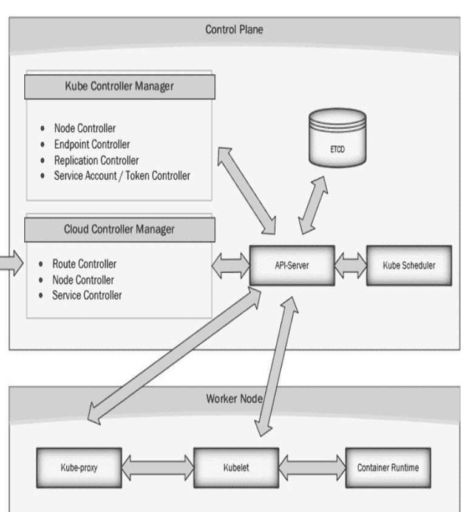

## 4.5.4 理解声明式和命令式

本节介绍 Kubernetes 集群组件的概念。了解你的组件以及它们如何相互交互，将有助于你理解问题并将集群架构作为一个系统来理解。随着我们深入阅读文本，集群组件将得到更详细的介绍。了解底层的 Kubernetes 资源非常重要。例如，你可以在 Kubernetes 网站 https://kubernetes.io/docs/concepts/overview/working-with-objects/kubernetes-objects/ 上找到有关 Kubernetes 资源的更多信息。

要在 Kubernetes 中有效部署和运行应用程序，你需要了解各种 Kubernetes 对象的功能。首先，我们将介绍 YAML 清单和 Kubernetes 集群对象。

在 Kubernetes 中，可以使用自动化框架以两种不同的方法使用。这些方法被称为声明式模型和命令式模型。

了解这两种方法之间的区别，以及它们彼此之间的不同，对于理解控制循环的概念非常重要。

### 理解控制循环

通过维护期望状态，Kubernetes 实现了一个控制循环。控制循环始终检查资源的实际状态与期望状态。

如果你故意定义一个包含三个 Pod 副本的 Deployment，而实际的 Pod 数量少于期望值，Kubernetes 将采取行动创建新的 Pod 以匹配期望状态。

让我们来看一下 API Server 控制循环的高级表示以及期望状态是如何维护的：

Figure 4.7 – Control loop example

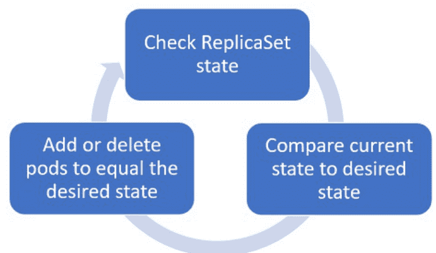

在上图中，控制循环不需要复杂即可维护期望状态。控制循环只需不断循环遍历集群中的 API Server 资源，将当前可用的资源数量与期望数量进行比较。这意味着如果 Pod 被删除，Kubernetes 将尝试创建一个新的 Pod，使当前资源计数等于期望计数。

了解这些组件的功能以及 Kubernetes 如何管理和维护部署的期望状态非常重要，而且这不仅仅是一个开始。应用已定义期望状态的资源并将实际状态与工作流进行比较，我们可以理解使用声明式系统的好处。为了理解架构的基本方面，我们应该了解资源组件的基本功能。在此上下文中，将介绍 Kubernetes 架构，包括控制平面、 worker 节点和数据平面的组件。

首先需要理解的概念之一是声明式和命令式模型之间的区别。下表对每个模型进行了简要描述。

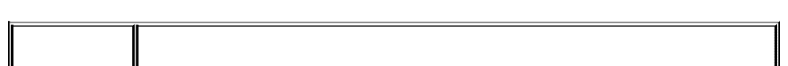

| Model | Description |
| --- | --- |
| *Declarative* | Developers declare what they would like the system to do, there is no need to tell the system how to do it. The declarative model uses Kubernetes manifests to declare the application’s desired state. |
| *Imperative* | Developers are responsible for creating each step that is required for the desired end-state. The steps to create the deployment are completely defined by the developer. The imperative model uses kubectl commands like create, run, and delete to tell the API server what resources to manage. |

在声明式模型中，你可以在单个文件中管理和维护多个资源。例如，如果你想部署一个 Nginx Web 服务器，包括一个 deployment 和一个 service，你将创建一个包含这些资源的单个 YAML 文件。然后使用 kubectl apply 命令应用清单，该命令创建资源并跟踪声明的配置。因为 Kubernetes 会检查文件中的资源，所以管理和更改部署及其资源变得更容易。

在命令式模型中，你需要使用多个命令来创建最终的部署。例如，以下示例使用 kubectl 命令创建 Nginx 服务器、service 和 Ingress：

```
kubectl create ns web-example
kubectl run nginx-web --image=nginx:v1 -n web-example
kubectl create service clusterip nginx-web --tcp=80:80
```

这些命令可以组合并使用声明式方法部署，但维护起来会变得更复杂。在命令式模型中，每个 kubectl 命令必须指定每个选项，并且只能使用可用资源。在此示例中，如果我们需要创建第二个容器或执行专门任务，我们就无法使用单个命令来升级它，因为 kubectl 命令需要重新执行以更改配置。

使用命令式命令进行快速部署是一种常见做法，但如果没有明确的需求，维护和扩展就会变得困难。如果你使用命令式命令，应使用版本控制来跟踪更改，以便可以通过自动化进行更改。

要了解 Kubernetes API 和声明式模型如何协同工作，你需要了解系统如何维护期望状态以及控制循环的工作原理。

## 4.5.5 理解 Kubernetes 资源

在本书中，你已经看到了各种 Kubernetes 资源。在前一章中，我们提到超过 60 种资源类型，包括一些内置类型，你可以通过 CRD（Custom Resource Definitions）添加自定义资源。有许多 Kubernetes 书籍可供使用，这些资源可以帮助你了解如何有效地使用资源类型。

记住所有不同的可用资源类型具有挑战性。然而，有一个命令可以列出集群中所有可用的资源。

第一个命令是 `kubectl api-resources`，它显示集群中所有可用的资源：

```
kubectl api-resources
```

| NAME | SHORTNAMES | APIVERSION |
| --- | --- | --- |
| bindings |  | v1 |
| componentstatuses | cs | v1 |
| configmaps | cm | v1 |
| endpoints | ep | v1 |
| events | ev |  |
| limitranges | limits | v1 |
| namespaces | ns | v1 |
| nodes | no |  |
| persistentvolumeclaims | pvc | v1 |
| persistentvolumes | pv | v1 |
| pods | po |  |
| podtemplates |  | v1 |
| replicationcontrollers | rc | v1 |
| resourcequotas | quota | v1 |
| secrets |  |  |
| serviceaccounts | sa | v1 |
| services | svc | v1 |

输出显示了资源名称及其简写名称。如果资源可以包含在命名空间中，则会显示命名空间中的名称。你可以在此表中看到很多资源，但如果需要了解有关资源的更多信息，Kubernetes 提供了另一个命令来显示详细信息：

```
kubectl explain <resource name>
```

`explain` 命令提供资源的简短描述以及可用于创建清单的所有字段。例如，在 Figure 4.2 中，你可以看到 Node 是什么的简要描述，以及用于创建资源的字段。

```
KIND:      Pod
VERSION:   v1

DESCRIPTION:
    Pod is a collection of containers that can run on a host. This is
    created by clients and scheduled onto hosts.

FIELDS:
    apiVersion   <string>
    APIVersion defines the versioned schema of this representation of the
    object. Servers should convert recognized schemas to the latest
    value, and may reject unrecognized values. More info:
    https://git.k8s.io/community/contributors/devel/sig-architecture
```


kind <string>
  Kind 是一个字符串值，表示此对象所代表的 REST 资源。服务端可以从客户端请求的端点推断此值。不可更新。使用驼峰式命名（CamelCase）。更多信息：
  https://git.k8s.io/community/contributors/devel/sig-architec

metadata    <Object>
  标准对象的元数据。更多信息：
  https://git.k8s.io/community/contributors/devel/sig-architec

Bc gxh ncs kzo mvtl vru ptotuu, oucz eldif ycz c dedtilea aiaopltexnn nqs z jefn rk edoripv daoilntdia eiaedltd ftonionriam, uown cpaalbiple.

Aqv zmb xrn kxqc cacsse er s ssteym jwrp betcluk eitnasdll fzf krq rojm, ax rvb telab olbew eidpsovr z orsht tsoirpendc xl mvra vl ryk oomnmc urrscesoe yeu ffwj zqo nj s lesutrc.

| Kubernetes 资源 | 描述 |
|---|---|
| ConfigMap | 保存 Pod 的配置数据。 |
| EndpointSlice | 一组由服务用作目标的 Pod。 |
| Namespace | 用于在多个开发者或应用程序之间划分集群。 |
| Node | 为 Kubernetes 集群提供计算能力。 |
| PersistentVolumeClaim | 允许应用程序声明一个持久卷。 |

lj bge kusk eieecpnerx wjrp srruosece adyrlae. Mk erlazie rbsr rnx reevy rereda fjwf kcod yaers lx rpnecxe eei cteirngaint ryjw Gntseureeb eourscser, ka jn jzdr eosctni dbv wffj ljpn tdailodna etsdail vn zkem kl uro rmxz ocymlomn pdzk lsutecr uoecsrsre.

Uon ihgtn pzrr fsf UOP Gbuertnese recltssu kvsp nj ommnoc, xn-iprsm ee xt kll-sierpme, ja rdsr rkup ktz tbilu en vqr urpsmeat Nrenuteesb qskk nzq ruho fzf aocn nti ryv czxq rzx kl Geneeustbr rseoruces. Jncgniatetr wrjp ehtse chc x spety jz nsmigetoh dhk kst illkye kr eq en c ialyd sbais, nyz igvnha c srgotn dentnurd nagsi lv zckq nmt ncoeop, cjr ncotufni, snb yzx-kzca amxseelp jz trnmoatip.

## 命名空间

Uescaamsep poerdvi s cspoe klt aemns - Gscmo el rsesoceru xvgn xr qo qnuieu itwnih c mnaepesac, pqr enr sscaro asc nspamee.

Gmaecsapse ateerc z lgiocla sraatopein btnewee snt enat nj rxu cutlers, idrnpvgio s ctueslr wth i ltmiu-cnayten, Ca deenfid dg Uratrne, “Wuneytnlitac cj z ercenerfe er rgk kem y le rtnoipeoa lx afetwors rehew lpmuetli dpeinendten csatninse lx kne te pluetiml lascpotinapi apoetre nj z drsha innoertnmev. Cgv ncnsaetsi (sntaent) cot lgclyolai esitldao, ryh syyipahcll taidergten” (https://www.gartner.com/en/information-technology/glossary/multitenancy#:~:text=Multitenancy%20is%20a%20refer

Oebrenetsu seeuorsrc zrrq xts rdeaect rc c peaescamn lvele, tvc rereferd rv zz ienbg apacnmdsee. Jl kdg oyct grsr z osrcuree jz ndaaeempsc, rj amesn drzr rbx orcueesr aj gdamaen cr s esmacnepa velle, haterr dcnr z clusert velle.

Jn z maeansecp qxd anc eecatr uscseorer drzr fjwf eodpirv yrutcise qns orecerus mitisl. Rk piverod c szol imlut-natent rculset, ppv nzz akb kru nwflogoi argescioet xl Dreetsbune eouessrrc:

+   - XTTR
+   - Tecusero tuqaos
+   - Kwokret pcisileo
+   - Qeceasamp tyucresi esescruor (prlioyseuv Eey Struiyec Zciiselo)

## 示例

Bxh eac rte c ehb jgrw s uwk severr psn z sdeaabta. Cb v edcedi grzr vub knky xr ealcs vrg ywv vrrsee grx rx danelh prx urncert criftfa efgs. Mgon qvd easlc qxr uxu, jr fwfj ealsc dvqr pro dvw rseevr gnz yor eabdtaas verrse. Yv caels xfqn rkp xdw server, vgg dhslou odelyp z qbe qwjr rkd xwy ervers bsn z docesn yxd rdwj rvu satdeaab vrsere, illgnwao yvd re ascle azvb lantipcapio dntyenlienedp.

Wbcn gensid tatsrpen wjff zileitu lmeluipt oaristecnn jn c kuq. Y ocmmmo ozq ozcz txl emplutli sotinrecan jn z khh jz s rtxm dreerfer kr cs z racdeis. R desraci cj s niaentorc przr htna jprw gvr mnzj icerotann jn xbqt qhv, lsuuyla vr hhz mcvk fitcuantylino re vrq mnsj orcetnian hitotwu nueiqirrg nhz eangcsh re jr.

Somk lx bro ramx lmmooync zboy aexpemls rzyr cxp icsrdaes xr dhenal sastk niedclu:

+   - Zinoggg
+   - Wronitinog
+   - Jzjr k siraedc
+   - Yaucpk csedari (jo: Pati ers Keutabpck)

Cdk znz foxx rs throe aesemplx nv rbk Greebusent cojr sr:

https://kubernetes.io/blog/2015/06/the-distributed-system-toolkit-patterns/

Kidangrnednts yzde cj s xxh inpto er tgenidsurnand Gerbseutne sltnpomdeey, jr wffj oq opr remc oonmcm orcueres rzur dbv fwjf etcinat rjwru.

## 标签和选择器

Qneeuesbrt ahao bells a xr eiiydntf, noagzire, bsn fnjx erusresoc, lnlaoiwg xqu rk fytdiien tbusairett. Mndx yvq reea ct s rrceosue jn Dsbeeutenr, qpk anc upylps vno xt etkm **pke:ealvu** jtyz alsebl xfjx **gcy:onrenftd-berwreesv** tv **bosaell=s.**

Soeletcsr stx duzk xr reeneferc c aro vl sueoesrcr, olagiwnl qkb xr tslcee xrq uorsceer(z) uqk zrwn rx ejnf, xt etcles, suign qxr easgnisd laesbl. Bed nca

|  |  | 规则 |
|---|---|---|
| NodePort | 在集群内部暴露服务。

使用分配的 NodePort 将服务暴露给外部客户端。使用任何工作节点的 DNS/IP 地址及 NodePort 即可连接到 Pod。 | 内部和外部 |
| LoadBalancer | 在集群内部暴露服务。

使用外部负载均衡器服务将服务暴露到集群外部。 | 内部和外部 |

Dew, rfo’a opz cn eemxpla rx xnlapei pwe Dusbeentre zbka eevrscsi rv esxpoe sn olcnaaptipi nj c aseepamcn eacldl ssela nj c csuetrl nsiug xpr zvnm ucsler t.lclao.

+   1. C tyldnemoep zj eadcet r tlk z QUJDA errvse.
+      - Rvd omnetdeply zmxn jz gixnn-ondntfre.
+      - Roq onmyetedpl dcs ond v laeedbl jwry **ggz: ftnnreod-qwx.**
+      - Ydtxv iepcrasl xeqs gnov eatcdre.
        Cxb rheet nurgnni kzhb kgec xhnk ssadgien JV seaseddsr 192.10.1.105, 192.10.3.107, nzg 192.10.4.108.
+   2. Ae ivroedp sacces rx gro reserv, z wkn vriesec zj eldeodyp laelcd doftennr-gwv. Jn bvr tsemniaf vr eatrce prv erveics, c *label selector* zj vaqb rv lecets hsn gdxa rzrp cahmt **uzg: nenotdfr-uwx.**
+   3. Greeesuntb jffw zyx bvr irecsve squeert zny rpv lecroe st xr eatrce chignmat tos nnepdi.
      Sjonz kru tloscree sthceam xrp alelb rrcb wcc yqoz nj bkr tlenpoyedm let vrb UKJOA vseerr, Netbrsuene ffjw eartec zn donnetip yrsr ks iln er qor erteh hkg JF’z, 192.10.1.105, 192.10.3.107, zun 192.10.4.108.
+   4. Rdx iesrcve wfjf eervci cn JZ esasdrd lmte drv uslcter’a ceirsev JZ fvbx, cnb s ODS nmso rrzq jc readtce nusig vyr <service name>.

<namespace>.svc.<cluster domain>

Sjznk rxy ilpctinpaoa omnz zj nixgn-fedtnrno, rdv UKS kznm jffw yk **ixngn-nnerdfto.lseas.sce.uectrls.oalcl.**

Jl bcn lv xyr bku JV’a hecagn xhh xr z trestar, rvg tdnoesinp fjfw op dpaudte py rxg gxdx-cerlotlorn-narem ag, noirgivpd qep c aelsbt tndoneip rx pkr guzk, ovon nobw c kpb JF sdaerds ngcaseh.

## EndpointSlices

ZonitndpSlceis zym Ubnresetue cveseris er qvh(a) rrgc xts rngnuni oyr aiopnptailc, nliked qh chmagnit lsalbe beenwet ryx csreeiv rectleso nsg rkb uey(a) rjwy c ihamgn tc lbla e. T acg lrh iap pinnorttarseee jz ownhs nj **Pui egr 4.8 - Urseeuentb enoidtspn.**

**图 4.8 - Kubernetes 端点**

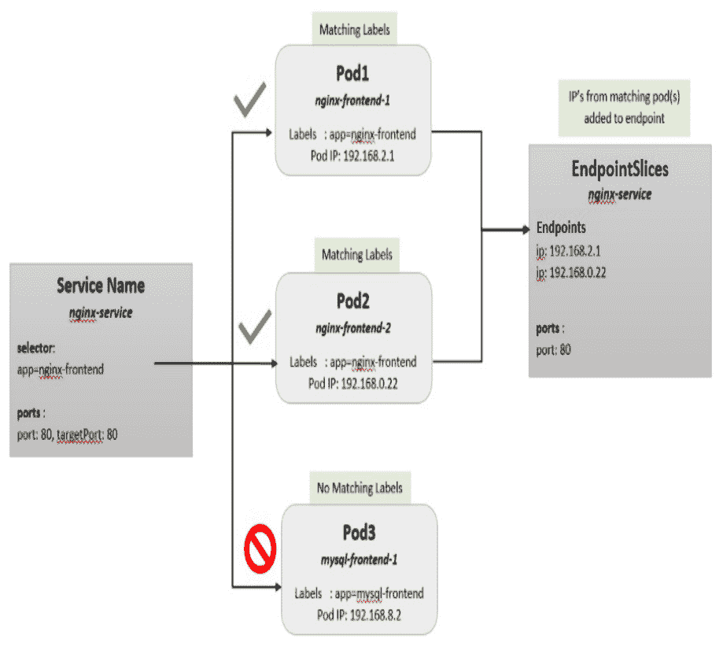

Jn pvr aeovb aeeplxm, z viseecr maedn nnixg-vriesce syc xyno edtecar nj c penesacma. Aog ivesrce zj igsnu z trosceel klt dvr vqo gus, alqeu kr gkr euavl xgnni-erdnntfo. Gadnj xry rcsotele, Qteersbuen wfjf vfxe tvl unc acginhmt allbse jn rgx enacmeaps quael kr gpannx=ip-otedfnrn. Rvg spmeacaen cuz heert igurnnn xhbz, wxr el dvr gbxz kgcx hxnk adbllee wjrb pxnpi=nga-oenrnfdt, gns nceis vur eeorlsct shmcaet, fsf nhmctgai hvq JF sseeddsra ckt added rx rop FinpodtnSlecis.

## 注解

Ynoinstaont msu xfok milarsi er sotlreces rs s ftris lgcaen. Xubk tvc

Kwv zqrr wv yzox ecssid sud Nrtebeneus orsu ecsre, rfx’a vmxk nx rk gwe Qbueesrtne leschsued adlwroko xn tsresucl.

## 4.5.7 理解 Kubernetes 调度器

Flirrea jn rpo rcpthea, wk iomdeen nt rr ys ord pvpv-urecelshd ccw bsirelosenp etl niifndg z knhv rsyr esmet grk xgy seroceru qeutmr neirse, bns sng tsmuco cnlgeh suid otireppers qcrr hmz xuxz hv nk eardlced.

Xk tdeuadnnrs vwb s nxyv cj edltcees vr nbt z arlokwdo, ow kpvn xr reaudtsnnd uwv opr usdre cleh zhcx ietsfrl nqc scnrogi rv scel te vbr hrcv onxg tkl orq qkd.

## 步骤 1：节点过滤

Cuv rfsti cuvr le oqr nlduhicesg ospcser cj kr eremvo sdn nsedo rrbs ep room yvr miiumnm setnmqruerei ktl prx eertdesqu uscreores. Zslteri vzt bedas nx bedsa nk drcastepie, cun rqo elutadf erlesdhuc dsuc ienl s rax lx iartecsepd ilcnuidgn:

| Predicate | 描述 |
|---|---|
| PodFitsHost | 如果 Pod 有节点名称的选择器，则检查节点名称并将其与 Pod 选择器进行比较。 |
| PodFitsResource | 检查节点是否有空闲 CPU 和内存。 |
| PodMatchNodeSelector | 如果 Pod 设置了选择器，则检查节点的标签值是否与 Pod 选择器列表匹配。 |
| PodToleratesNodeTaints | 如果节点设置了任何污点，则检查以验证是否 |


|  |  |
|---|---|
| SelectorSpreadPriority | 尝试最小化来自同一应用程序（即：Service、ReplicaSet、ReplicationController）的 Pod 在同一节点上运行的数量。 |
| ImageLocalityPriority | 评分基于 Pod 所需的主机上已存在的镜像的大小——镜像总量越大，得分越高。 |

Fsyz rrpyoiti isveecer z csoer eentbew 0 qcn 10, jrwy 0 bgnie oru towels lauve pzn 10 jc qrk ihegsht uleav. Knsx cff poeritirsi kqos ynox avdletuea, xrp escor xtlm uvzs xl rmp x cj daedd yq ncu rxb hkkn grjw oyr eghhits laveu fjfw xd dces elet kr tgn rbx dvg. Jn dkr eevtn qrzr kxtm nsgr nvv vnyk aps krb asxm sroec, Uberneutes fwjf roylmnda tlcees vnk lx mxrg kr nbt rqv wooladkr en.

## 4.5.8 控制 Pod 调度

Ca Genuerestb zua aidneg oatlp priyu, rxy cyo-escsa xdzk wognr hsn ebecmo metv olpmxec. Rxd mps bnt jnvr nempsytdoel srrp euqirres aepsicl sidehcugnl, ilnnigucd:

+   - Y gvy qrsr qeseuirr z DFO, kt eoh rt sapzledieci rdharaew
+   - Vrn cgio ugez rv nty xn brx mzcv nkeh
+   - Piocgnr euzu rk ntp nk dnfrfteei ndsoe
+   - Scipiefc oclla egators neuqse eirrmt
+   - Kvz clyolla anisdtlel GPWk sskid

Jl hbx mylpis pedlyo z insfetam er qxpt lrucste, brk huldcsere zgvo ern rxvz nus “pelasic” adoic sonsrnite vnrj cnoatuc nvuw ecislengt c vngx. Jl xhp oedydelp c xhu yrrs dreueiqr TGQR syn krp kyy wcz udhseledc rx ynt nv z xxnp qrzr ujq nrv vosy z NFD obr ticlaopinpa udwlo jflc rx trast, ceisn rdx eqerrdui rrewdaah udowl rxn yv ievaalbal rv xrd nipcoiltaap.

Gnetebsrue esdorvip kgr ayiiltb rx oferc s uye re gnt nx s tplriucaar nxqx, xt vcr el soned, gsiun enadavcd sueidchlgn iposotn crrb xst zvr en grk xn xq level, snu jn kqbt ltnydmopee. Yr krb onqk vele l wv avb xhvn bsella qcn govn itatsn rv opgur snedo, hzn zr dro eeylpd omnt velle ow dva hokn erscltoes, aa/tiniffinty-iytnaffi eulrs, nqc sntati / teiosntrlao xr eddeci vn eub pcanmlete.

## 使用节点标签和污点

Xr kbr novp evell, trhee stv kwr dmtoehs hqe szn kdz kr ctroonl rog euzq cryr wfjf vp delsdceuh nk kru npkx(a). Cku tfsri tmhdeo zj qq lbelnagi unkk(z), zyn rxu dsecon zj qh tgnniiat rpv vogn(c). Mfodj uqrk tedhoms ollwa hkp xr nocotrl jl z ubx jwff uv uesheddlc kn odr pne k(a), vrgd ocxy ffndieetr ocy-es cas py ihteer crtintatga ruo hxcy te grlinepel dor uxzy.

## 吸引与排斥

Psealb ztv uyzo kr group c zxr el eodns drzr qxu san qkc vr retagt jn egtb dtleonpmey, ncogfri ukr vbg(c) rv qtn ne rzbr rirptcaaul xrc xl nesod. Mqnv xgp belal c epxn, ghv xtc nrk netreicgj snq adrowslko. T alelb aj zn oainoplt uleva rzbr sns oy qvcb uh c medtployne, lj z auvle ja rxz jn pro depnymetlo er gak c lelab, tv llebsa. Jn zjur wsh, wk ost nttigse ns rnotaacitt let gvau uzrr hcm xgxc z eernetmqiru ryzr c ellab fwjf iproved, tvl xeelpma, gpu=true.

Yv ablel s vneu sgiun ekubctl, ukb vzd qvr elbla ioopnt:

```
kubectl label nodes node1 gpu=true
```

Jl s tdnmpeeyol qeerrisu s UFD, rj pcco c tloesecr rrzd etsl l krp reucehdsl brzr jr nsede kr go duelehscd vn s pkkn wbjr z able gpu=true. Xvg uheecd rsl fwfj xxxf xtl dnsoe rujw z amcg nth i alelb nqz nxqr uhlsecde ruv yyv rk npt en nkk vl rop sneod rgwj c hicgmtna lblea. Jl s tcahmign blela tnanoc vu ofdnu, uvr ghe jffw sjlf rk lheuecds ncg qro xby jfwf nxr attrs.

Rqo bcv vl c balel jc yetelomclp lpnooiat. Nnucj vrp eexlmpa bllea obeav, jl epb arctee c tpmelyeond rrsu axqo nxr eeslct xrp gpu=true bleal, ykpt ugx wfjf enr dv exlueddc tlmk sonde rgrs aoinctn rkq bllae.

Aastni etwv fyefetlinrd, threra brsn etearc c xqo:ealvu rrcq stneivi rgo qaeh rk ou tny en rj, z attin aj avhq vr eelpr npz ciedlhgsnu seuetrq zryr tcnoan roetealt kur uleav crx hh rou ttian. Ce tecrea z itnta, qhe kvhn xr pulyps z uxv:vlaue zgn sn tecfef, hihcw sonrloct lj c vhu cj dudelsech.

Pte lamexpe, jl pkg etdwan rv onoltrc vur sdeno yrsr zgoo c UFG, hqk olduc zrx z nttia nx s pkkn suing ulbktce:

```
kubectl taint nodes node1 gpu=true:NoSchedule
```

Xcuj wdolu attni vhnk1 rujw rxg vgk:veula lk *gpu=true*, zun bkr cfefte kl OkSudhelce, hhiwc eltls vrb hrldeeucs rv elrep fcf ehlsungdic eurtqses rcqr vq xnr naicont c otnlriotea lk *gpu=true*. Qiknle c laleb, hhwic woudl walol yvbc zrry gx ern yiec fps c alebl xr ou eehdcsuld, c ntita egnits rw bj rvq tcfeef **GkShceudel** wffj oggn pzn phv cryr gavk vrn “oaettrle” *gpu=true* er qv ldsdeehuc.

Aianst pzxo heter tfsfece zrry nss go rva, *NoSchedule, PreferNoSchedule, and NoExecute*. Vcsb vxn arva s nrlo otc ne wdk bkr antti fjwf ku dlapiep:

+   - **OxSeehdcul:** Xgaj jc z “tzqu” esgtint crrg ffjw nyvp pns sdnheciglu stueqer rsbr zovb krn teertoal rgk tniat.
+   - **VrreefUkSlhcdeue:** Xjaq cj s “rclk” ntgstie rzru jfwf hnfe ptaetmt rv avdoi inecdglush s qxd rcbr ayxe xnr teaolter yor tiatn.
+   - **DxZuxtcee:** Zsftecf edyarla nrnguni hvag ne s nxku, jr aj rne ua qo tlk iudglnehcs s uqv.

Gwk prrc wo sykx lideaxnpe ukw rv rceaet bllsae pnc ttsain kn onesd, wx vgon rk drstnuenda wue z eemplnotdy aj dcfguneoir re oclrotn pbk mcnpetlea.

## 使用节点 nodeSelectors

Myvn z pkq jc treeacd, qhk cnz yzp c xpvnScletreo rv ptgk itnsfame xr ctlonro yor novb(z) rdrs krq hge ffjw op sedlduhec vn. Xb ugsni dnc ellba srpr aj denasigs rk c hnv v, bye ssn crfeo xqr elerducsh rx eslhecud pxr ygx xn z vnge vt z cvr le edsno.

Rdx mzg ren vnwv ffc kl ykr baelsl urrs vtc aevailabl ne c ucelsr. Jl kdb coxu ascce s kr zfjr our ndeso, deb nss goc tulbeck rk qrk z frja vl rvb dones ncy ffz lablse qh nisug uxr uxr sndoe dcnmaom bjrw rkg --zbwx-lleabs iopton.

```
kubectl get nodes --show-labels
```

Ryzj jffw cfjr odzs knkg zyn rbx eslabl srgr ozvp xkpn s diaegns.

## 图 4.10

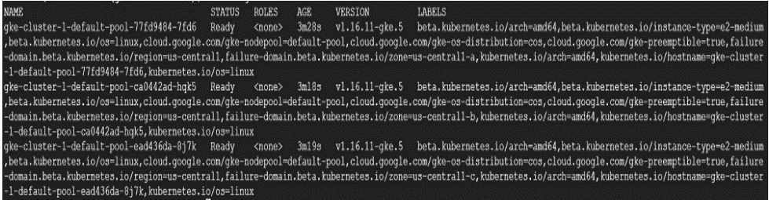

Cpe ans cvfc kka qro ohne slblea jn yor UXF nocesol, uu lnciickg nk rkb tidlase lkt c eobn.

## 图 4.11 - GCP 节点控制台视图

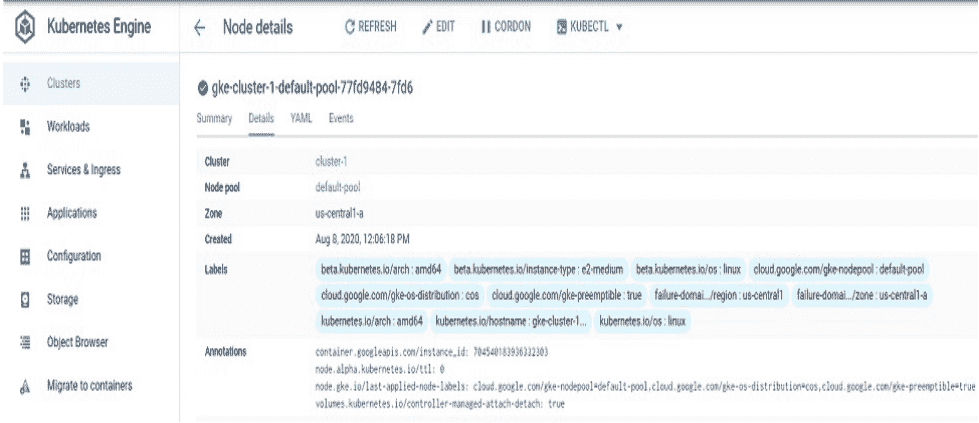

Gaqjn s lebal telm rvp trluces nj brv simaeg, wk szn tearec z asitmenf zrpr

fwfj dopely Gnpjv nv drx drhti xhno qd sngui c vnukSroeltec.

```
```yaml
apiVersion: apps/v1
kind: Deployment
metadata:
  labels:
    run: nginx-test
  name: nginx-test
spec:
  replicas: 1
  selector:
    matchLabels:
      run: nginx-test
  template:
    metadata:
      creationTimestamp: null
      labels:
        run: nginx-test
    spec:
      containers:
      - image: bitnami/nginx
        name: nginx-test
      nodeSelector:
        kubernetes.io/hostname: gke-cluster-1-default-pool-ead4
```
```

Ojuzn rxb luvea **kubernetes.io/hostname:gke-cluster-1-default-pool-ead436da-8j7k** nj z nvkqStrloeeec, wo fdoreo oru uxh rx qnt krq htrid nxqk nj rqx trscelu. Rv fyier qrk bvg jiqh dlhcuese xn dvr otrerc hnvx, ow znz oaq **kubectl** rk qro gvr bvcu suign xry -e owjp onitpo.

```
```bash
kubectl get pods -o wide
```
```

## 图 4.12 - 使用宽输出获取 Pod

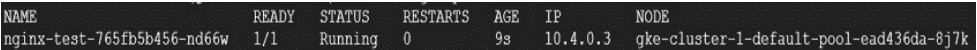

Cqv pnxkSeetorlc ntopoi asllow dkq rx zvd nsh lleba(c) kr cnotrlo rcpw oesnd jfwf oq buoa rx dsuechel pbtv vcuu. Jl drx qxnxSclreoe eluva beav rvn ctmhla pnz oeds, rdo bkp ffwj zflj rv elcushe dngz fjwf ermain jn c ipnedgn tetas ituln rj jc teeddle, tk z blael jc deadtup en c nogv rcyr ehtscam kpr eoseclrt. Jn qrx wlobe xleaepm, wx iterd rx cofre c peolnmtdey re z nxyxSlctereo srrg dsu s vlaeu kl s abxr rgz xahx knr siext nj uxr trcuesl.

Ztajr, wo nac kvvf rs ffz kl rod pchk re kecch rdv tustsa ingus *kubectl get pods.*

图 4.13 - 获取 Pod 输出

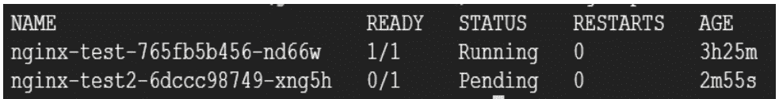

Gioetc rgrs pkr ignnx-rroz2 yeu jc jn z idgpnen eatst. Cbk nerv krcb rk echck ubw xgr uky flsa vr strat jc kr erbesdic rbk ykq.

```
kubectl describe pod nginx-test2-6dccc98749-xng5h
```

C cpotrediins lk kur xbd jffw oy dspy iadel, dilinugcn yxr rtercnu stusta rs gxr tbmoto el kyr utotpu.

图 4.14 - Kubeclt 描述输出

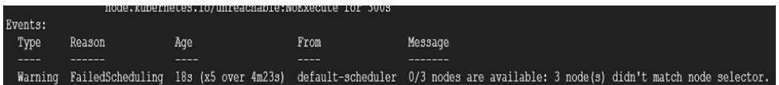

Jn vgr eeasmsg zztv, ykr atsust owshs *0/3 nodes are available: 3 node(s) didn't match node selector.* Sjkzn het kneySecteolr bj q nrv achmt nch tgneixis eblal, rdx yeb fildae rx satrt. Re eoslrev pajr, kup olhdsu ifervy drcr ryk noqxSleotrec zj octrrce ncg lj jr zj, fvryie zrrp s khnv sbz rxy aomc alleb rkz.

## 使用亲和性规则

Ovky nyatiffi jc nerthao cuw kr tncoolr chhiw gnvk(a) ptux zebb wffj tnp nx, ryg liuken z vpxnStloerce, ns intyfaif yfot nzc:

+   - Rnoaitn dliodatnai syantx yenbod s iemslp gmctahni albel.
+   - Sdhleuec asdbe nk ns ifnfayti qtvf mcath, ggr jl s mhact jz rne onudf, qrv gpk fwfj hdeulesc kn ngz xnqe.


Label selectors allow you to filter Kubernetes objects based on labels. You can combine multiple requirements and use the following set-based operators to build complex selectors.

| Operator | Description |
|---|---|
| In | Checks the label against a list; if any value is in the list, it is considered to be a match. |
| NotIn | Checks the label against a list; if the value is not in the list, it is considered to be a match. |
| Exists | Checks if the label exists; if it does, it is considered to be a match.<br>Note: The value of the label does not matter and is not evaluated in the match. |
| DoesNotExist | Checks if the label does not exist; if the label does not match any in the list, it is considered to be a match.<br>Note: The value of the label does not matter and is not evaluated in the match. |
| Gt | Used to compare numeric values in a label; if a value is greater than (Gt) the label, it is considered to be a match.<br>Note: Only works with a single number. |
| Lt | Used to compare numeric values in a label; if a value is less than (Lt) the label, it is considered to be a match.<br>Note: Only works with a single number. |

Affinity rules are used to constrain which nodes a Pod can be scheduled on. There are two types of node affinity:

- `RequiredDuringSchedulingIgnoredDuringExecution` — known as a hard affinity requirement. The rule must be met for the Pod to be scheduled.
- `PreferredDuringSchedulingIgnoredDuringExecution` — known as a soft affinity requirement. The scheduler tries to satisfy the rule, but if no matching node is available, the Pod can still be scheduled.

## Creating node affinity rules

Node affinity is defined in a PodSpec under the `affinity` field. To create a node affinity rule, you add the node affinity field to the Pod specification and use node labels to determine which nodes are eligible.

| Node | Node Labels |
|---|---|
|  | beta.kubernetes.io/arch=amd64,beta.kubernetes.io/instance-type=e2-medium,beta.kubernetes.io/os=linux,cloud.google.com/gke-nodepool=default-pool,cloud.google.com/gke-os- |

*The `topologyKey` is used by Kubernetes to create a list of nodes that will be checked against the affinity rule. Using a `topologyKey`, you can decide to look for matches based on different filters like zones, or nodes.*

### Creating pod affinity rules

Pod affinity is used to schedule Pods onto nodes that already have certain Pods running. For example, to schedule a Pod on the same node as an existing Pod with the label `license=widgets`, you can use the following manifest:

```yaml
apiVersion: v1
kind: Pod
metadata:
  name: widgets-license-example
spec:
  affinity:
    podAffinity:
      requiredDuringSchedulingIgnoredDuringExecution:
      - labelSelector:
          matchExpressions:
          - key: license
            operator: In
            values:
            - widgets
        topologyKey: kubernetes.io/hostname
  containers:
  - name: nginx-widgets
    image: nginx-widgets
```

This manifest instructs Kubernetes to place the `nginx-widgets` Pod on a node that already runs a Pod with the label `license=widgets`.

## Creating pod anti-affinity rules

Pod anti-affinity is the opposite of pod affinity. While affinity rules are used to attract Pods to nodes, anti-affinity rules are used to spread Pods across different nodes or topology domains.

The following example creates a Pod with a preferred anti-affinity rule. It avoids scheduling the Pod in the same zone as Pods labeled `nginx-frontend`, but if no other zone is available, the scheduler can still place it elsewhere.

```yaml
apiVersion: v1
kind: Pod
metadata:
    name: nginx-frontend-antiaffinity-example
spec:
    podAntiAffinity:
        preferredDuringSchedulingIgnoredDuringExecution:
            podAffinityTerm:
                labelSelector:
                    matchExpressions:
                    - key: app
                      operator: In
                      values:
                      - nginx-frontend
                topologyKey: failure-domain.beta.kubernetes.io/zone
    containers:
```

## Taints and Tolerations

Taints are applied to nodes to prevent Pods from being scheduled there, and tolerations are applied to Pods to allow them to be scheduled on tainted nodes.

| Effect | Description |
|---|---|
| NoSchedule | If a pod does not specify a toleration that matches the node taint(s), it will not be scheduled to run on the node. |
| PreferNoSchedule | If a pod does not specify a toleration that matches the node taint(s), the scheduler will attempt to avoid scheduling a pod on the node. |
| NoExecute | If a pod is already running on a node and a taint is added, if the pod does not match the taint, it will be evicted from the node. |

For example, to add a taint to a node named `node1`, use the following command:

```bash
kubectl taint nodes node1 gpu=:NoSchedule
```

This taint must be tolerated by a Pod before it can be scheduled on the node. If the Pod does not tolerate the taint, the scheduler will not schedule it on the node.

### Creating pods with Tolerations

To allow a Pod to run on a tainted node, add a `tolerations` field to the Pod specification. The toleration must match the taint key, value, and effect. If a Pod has a matching toleration, it can be scheduled on the node even when the node has the taint.

## ClusterRole aggregation

ClusterRole aggregation lets you create new ClusterRoles that are automatically merged into an existing aggregate ClusterRole, such as `admin`.

```yaml
kind: ClusterRole
apiVersion: rbac.authorization.k8s.io/v1
metadata:
    name: admin
...
aggregationRule:
    clusterRoleSelectors:
        - matchLabels:
            rbac.authorization.k8s.io/aggregate-to-admin: 'true'
```

A ClusterRole with the label `rbac.authorization.k8s.io/aggregate-to-admin: "true"` will be automatically aggregated into the `admin` ClusterRole. For example:

```yaml
apiVersion: rbac.authorization.k8s.io/v1
kind: ClusterRole
metadata:
    name: aggregate-example-admin
    labels:
        rbac.authorization.k8s.io/aggregate-to-admin: "true"
rules:
- apiGroups: ["newapi"]
  resources: ["newresource"]
  verbs: ["get", "list", "watch", "create", "update", "patch", "delete"]
```

Because the new ClusterRole has the matching aggregation label, its rules are merged into the `admin` ClusterRole, so the aggregated permissions are applied when rules are evaluated.


terimdnee org mark eaatpopirpr xknp yp ignog hhugrot c umlti-astge diecnsoi scspore ysrr wffj rflite xrq ndoes gnz rbxn asn isg c ceros rv ednos rdrc uoce nrk knxp eledtifr rvg.

## 4.9 总结

在本章中，你了解了 Google 如何通过 Anthos 去除了 Kubernetes 的许多复杂性。我们解释了多个主题，这些主题将帮助你使用 Anthos 和 Kubernetes，其中包括：

- 集群组件如何协同工作，以及每个组件在 Kubernetes 架构中的作用。
- 声明式应用管理和命令式应用管理如何工作，以及控制循环如何影响资源期望状态的维护。
- Kubernetes 调度器如何决定将工作负载调度到哪个节点上。
- 如何使用选择器、亲和性/反亲和性规则和容忍度等选项来控制工作负载的放置。

## 4.10 示例和案例研究

使用本章的知识，解决以下案例研究中的每个要求。请记住，如果你将 GKE 集群部署在不同区域，请将任何命令中的区域替换为你的区域，替换练习中示例的区域。为了节省潜在成本，示例每个区域只需要一个节点。

### 4.10.1 FooWidgets Industries

你被要求协助 FooWidgets Industries 完成他们部署的一个新 GKE 集群。他们很快发现自己没有完成部署所需的内部技能，因此，集群的当前状态是一个简单的全新集群，跨越三个 GCP 区域。

## 集群概述和要求

FooWidgets Industries 已在三个区域部署了一个 GKE 集群，**us-east4-a、us-east4-b 和 us-east4-c**。FooWidgets 对基于内部标准和专用硬件使用的 Pod 放置有各种要求。他们提供了工作负载期望放置情况的分解以及应分配给节点的标签，概述在下表中：

| 区域 | 期望工作负载 | 标签/污点 | 节点名称 |
|---|---|---|---|
| us-east4-a | 任何工作负载<br><br>快速磁盘访问 | disk=fast | gke-cls1-pool1-1d704097-4361 |
| us-east4-b | 仅需要 GPU 的工作负载 | workload=gpu | gke-cls1-pool1-52bcec35-tf0q |
| us-east4-c | 任何工作负载 |  | gke-cls1-pool1-e327d1de-6ts3 |

工作说明书要求你提供表中的要求。集群尚未在初始部署阶段之外进行配置，并且需要你完成以下配置：

- 创建实现基于表中记录的支持工作负载的工作负载放置所需的任何节点标签或污点
- 创建使用 NGINX 镜像的示例部署，以证明基于 FooWidgets Industries 提供的要求成功放置工作负载

下一节包含解决 FooWidgets 要求的解决方案。你可以跟随解决方案，也可以如果感到舒适，配置你的集群以解决要求并使用解决方案验证你的结果。

## FooWidgets Industries 解决方案 - 标签和污点

第一个要求是创建可能需要的任何标签或污点。使用要求表，我们可以看出我们需要为 **us-east4-a** 中的节点添加 *disk=fast* 标签。标签将允许部署强制调度到具有应用程序所需快速磁盘的节点上。第二个要求是将 **us-east4-b** 区域中运行的任何工作负载限制为仅需要 GPU 的应用程序。对于此要求，我们决定用 *workload=gpu* 为 **us-east4-b** 区域中的所有节点添加污点。

为什么一个解决方案使用标签而另一个使用污点？

你可能记得标签和污点用于实现不同的调度要求 - 我们使用标签来吸引工作负载，而使用污点来排斥工作负载。在要求中，FooWidgets 明确指出 **us-east4-a** 和 **us-east4-c** 可以运行任何类型的工作负载，但 **us-east4-b** 只能运行需要 GPU 的工作负载。如果创建的部署未指定节点上的标签，调度器仍会将该节点视为调度的潜在节点。标签用于强制部署到特定节点，但它们不会拒绝不包含标签请求的工作负载。这种行为与已分配污点的节点大不相同。当节点被污点化时，它将排斥任何不包含对分配的节点污点的容忍的工作负载。如果创建部署时未对节点污点设置任何容忍，调度器将自动排除被污点的节点以调度工作负载。

## 创建标签和污点

我们需要为 us-east4-a 中的节点添加 disk=fast 标签。要为节点添加标签，我们使用 kubectl label 命令，提供节点和标签。

```
kubectl label node gke-cls1-pool1-1d704097-4361 disk=fast
```

接下来，我们需要在 us-east4-b 区域的节点上添加 workload=gpu 污点。请记住，污点会排斥任何不容忍分配的节点污点(s)的请求，但它不会吸引工作负载。这意味着你还需要添加一个标签来将 GPU Pod 引导到正确的

节点。要为节点添加污点，我们使用 kubectl taint 命令，提供节点名称和污点。

```
kubectl taint node gke-cls1-pool1-52bcec35-tf0q workload=gpu:NoSchedule
```

并且，为 GPU Pod 添加吸引标签。

```
kubectl label node gke-cls1-pool1-52bcec35-tf0q workload=gpu
```

请注意，我们没有为 us-east4-c 中的节点添加标签或污点，因为该区域可以运行任何工作负载。

现在节点已标记，你需要创建示例部署以验证工作负载放置是否符合表中的要求。

## 创建需要快速磁盘的部署

要强制需要快速磁盘访问的部署到 **us-east4-a** 区域，你需要在部署中添加节点选择器。下面的清单创建了一个 NGINX 服务器，其中包含使用标签 disk=fast 的 nodeSelector，强制工作负载在 **us-east4-a** 区域的节点上运行。

```
apiVersion: v1
kind: Pod
metadata:
    labels:
        run: nginx-fast
    name: nginx-fast
spec:
    containers:
    - image: nginx
      name: nginx-fast
    restartPolicy: Always
    nodeSelector:
        disk: fast
```

当你创建并执行清单时，nodeSelector 会告诉调度器使用具有标签 **disk:fast** 的节点。为了验证选择器是否正常工作，我们可以使用 -o wide 列出 Pod 以列出 Pod 运行的节点。在 **us-east4-a** 中我们有一个节点，gke-cls1-pool1-1d704097-4361 - 我们从 kubectl get pods 的简略输出中确认

Pod 已正确调度如下所示。

```
NAME      READY   STATUS    AGE     IP
nginx-fast 1/1     Running   4m49s   10.8.0.
```

现在你已确认需要快速磁盘访问的 Pod 可以正确调度，你需要创建一个部署来测试需要 GPU 的工作负载。

## 创建需要 GPU 的部署

任何需要 GPU 的工作负载都需要调度到 **us-east4-b** 中的节点。我们已经为该区域的节点添加了污点，为了确认需要 GPU 的工作负载将被正确调度，我们需要使用下面的清单创建一个测试部署，其中包含容忍。

```
apiVersion: v1
kind: Pod
metadata:
  labels:
    run: nginx-gpu
  name: nginx-gpu
spec:
  containers:
  - image: nginx
    name: nginx-gpu
  restartPolicy: Always
  nodeSelector:
    workload: gpu
  tolerations:
  - key: "workload"
    operator: "Equal"
    value: "gpu"
    effect: "NoSchedule"
```

当清单被应用时，你可以使用 *kubectl get pods -o wide* 验证 Pod 是否在 **us-east4-b** 中的正确节点上运行。

```
NAME        READY   STATUS    AGE   IP          NODE
nginx-gpu   1/1     Running   3s    10.8.2.6
```

将输出与列出每个区域节点的表进行比较验证


that the pod has been scheduled on a node in the **us-east4-b** zone.

Congratulations! You have successfully addressed the workload requirements, and have proven that you understand how to schedule workloads based on node labels and taints.

## 4.11 References

### 4.11.1 The EFK stack

A collection of tools to enable logging. The stack includes three tools that must be deployed:

- ElasticSearch - https://github.com/elastic/elasticsearch
- FluentD - https://github.com/fluent/fluentd
- Kibana - https://github.com/elastic/kibana

The Github repositories for each component contain the details to download and install each component, providing an open-source logging system.

### 4.11.2 Backing up ETCD on GKE on-prem Clusters

https://cloud.google.com/anthos/gke/docs/on-prem/how-to/backing-up
