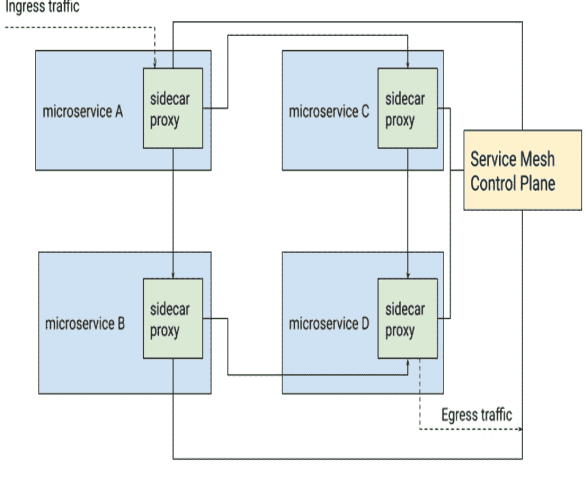
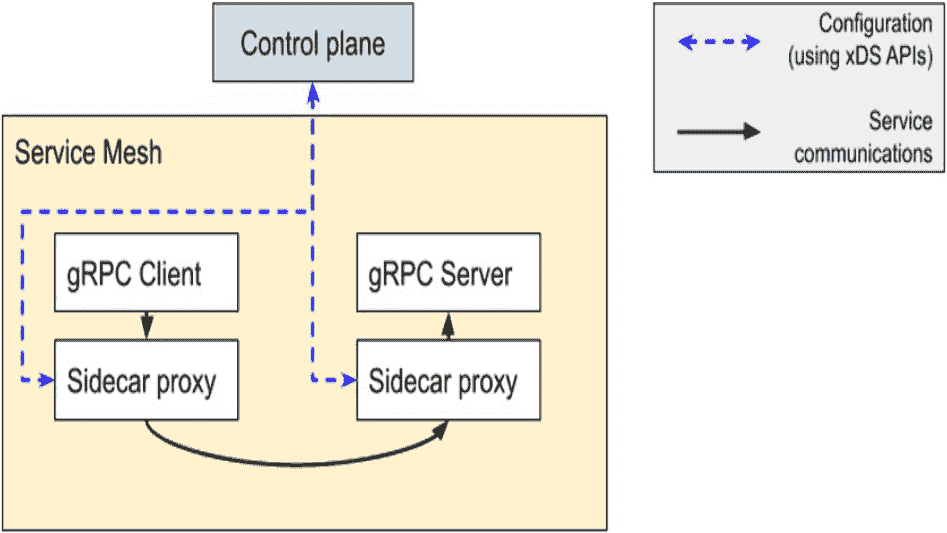
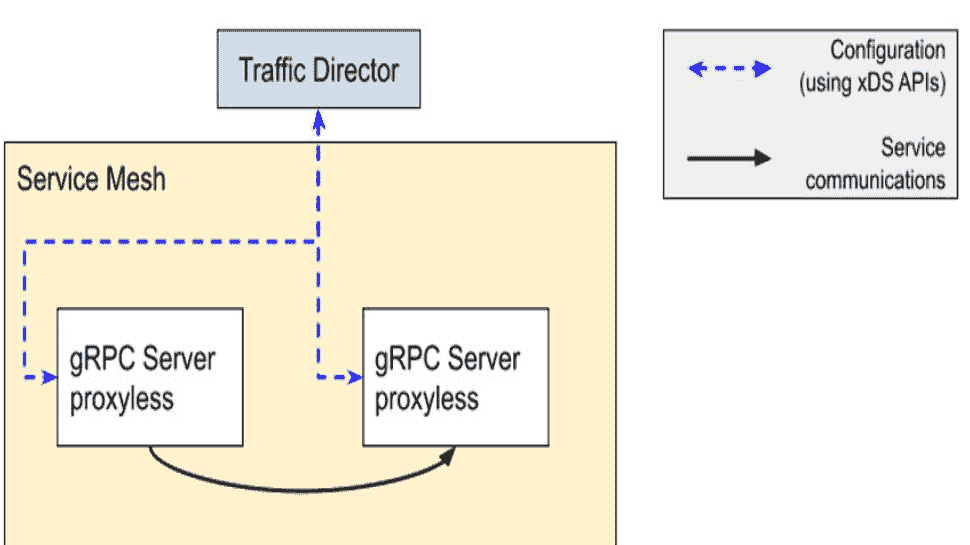
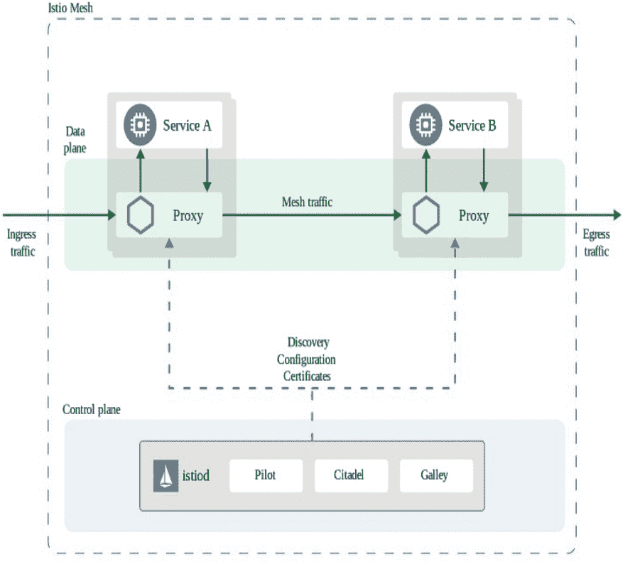
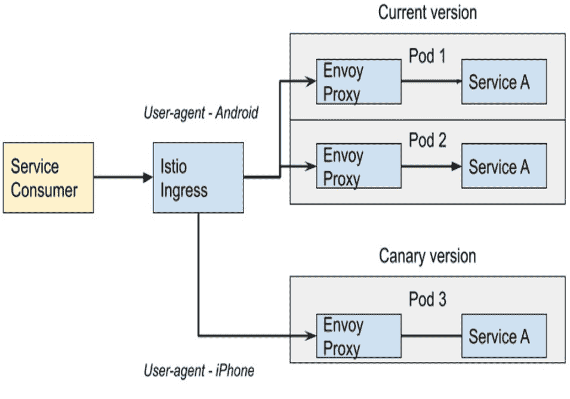
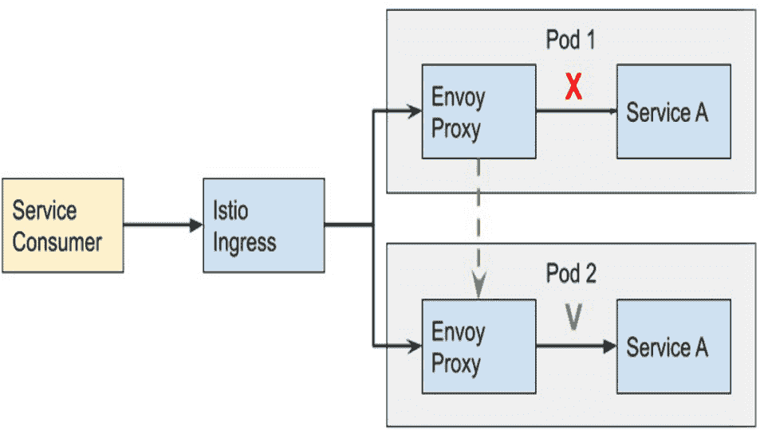
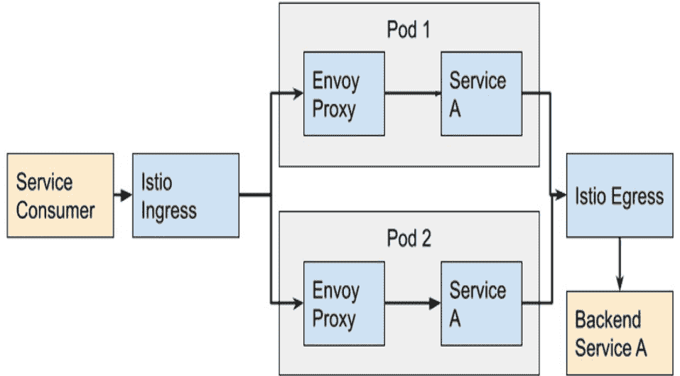

## 5 Anthos Service Mesh: security and observability at scale

by Onofrio Petragallo

This chapter covers

- Sidecar proxy and proxyless architectures
- An introduction and the main features of Istio
- Security and observability with Istio
- What is Anthos Service Mesh
- Practical example with code

One of the key components to being cloud native is to break up your application into microservices. This means that an application that may have run on a single server, now has multiple services, backed by multiple pods, that are separate components. As applications scale out their services, it becomes difficult to troubleshoot issues that you may encounter with the application. With this added complexity, we needed a tool that would help organize, secure, and add resilience to the expanding complexities that microservices introduced. Another important problem that a service mesh could fix is the fact that enterprises often have a huge number of microservices and aren’t always able to control, manage and observe them.

In this chapter, we will discuss Anthos Service Mesh (ASM), and the features that ASM inherits from Istio[1], a popular open source framework for creating, managing and implementing a service mesh.

Rgo maieptnimtenol lk c siecerv kyma rkn ngfk atitlsicfea tcnminoaounic etewben cvmoceirsirse gisnu s editedcda cmnioontcuami nametmnaeg crotnlo nelpa, jr acvf ulcidens sootl vr vrsebeo omiicctomunna tenbeew vsecs eri, zxz btrvibeiyoals, nanchee isrytuec, rootlcn pnloitcaiap aitcffr wvfl, zhn tlaeimus flastu nj zn anclioappti.

Bhostn Sircvee Wkbc cj c Qgleoo denaagm révsiec rqzr woasll ipesteernr gmmaenatne el cff prv evseicr seemsh pnreste jn z birhdy dcoul tv iltmu udocl cttrcreaieuh mktl s islgen ointp, vgioripnd mtpeloec sqn jn-pthde iylvilbisti le ffs imciesrsorcve. Xkb tousinviazlai lv rxy hopptagyor el rgx ersivec avmd ngz rxp potlmece irganonttie wjdr Xpfqx Wnrnootigi, vrposdei sruse kyr sloot rk ydefniti laginif oadwlskor te throe lrsopbme, kginma pmborle ilooneruts erfsat.

Yqk usyicrte ifsureate gmks aalbeaivl qg Tthsno Svrceeı Wvgz lawol ghx re enamga xrg notcinitueaaht, izito aunharto nbz cpny eorint vl itccmsnauioonnm rhtghou mXPS[2] luatmu ahtciaitunoetn er esuecr npz srnuee utrts jn guer trcsenidio tlx rkp minitaocucionm enebetw rssrieeccevmo; mRVS nuses s uçip l leev kl eictrusy, zmnımigiin dxr deatrle ksir.

Zniayll, kru caitffr taennagm em fueearst lk Jrcej dviopre essur rkp tool kr tmpeaialun fitcrfa nguis tqseuer niorgtu, fulat etoniicnj, squcetr suotmnei, uicrcti rebaking ncp rıngmorii.

Ta gvg nzz oav, Jvrc cunsdeli s mbruen vl esfretua zqrr sot xeocplm nqc mps od iufdliftc rx btseouolo htr. Rqtvv vts lwo fsrenfgio jn rkg aektrm dyoat dsrr ienudlc uopprts vtl Jırzv, nlgvaie xbu rk ppruost ubtv ecivres uxzm nv vtyp nwx. Oeoogl cdc drsad dees jcry bd ilg unidnc TSW jn Bthons, rgidvniop s sgneil orpputs onitp elt btvp Oetnseebur etulscsr nbs Jrzjv.

Tefreo kgtnaıl auobt rog Xstohn Seycrei Wbzx easretuf cun Jı rxa jn adietl, kfr’z artst du iagxnnipel rucw s evrsec mxpc atlc uayl zj.

## 5.1 Technical Requirements

Yqk dhasn-xn rpntioo xl ujrc cp htre fjwf uqereir kqu vr xpvz scecas re c Qebr nuseet rul esct ngnunir nx UYF rw bj ory iwolnolfg ldtmepyeon npattre:

- R KNF tcslure wgrj rc least 3 onsed rqwj 4 TEQ’a nsb 16NY le YRW

## 5.2 What is a service mesh?

Ye tradenusdın gxw z verscei zmpk rowks, ngc bwu rj’a omicnegd s rtdadasn

cctnneoed rx skga ecsirmecoivr, wryj xru zmak jflk lyecc ac bxr veecircoirsm estifl, rdh xecseeut cz s eesrpaat epsrcso.

Figure 5.1. Sidecar proxy architecture



- Fyoxslesr: jn s emcrioivsresc arcieutercht weerh rkb svircerecoim zsn yano ryk eyreemltt ydirltec xr rdk corlnot apeln hg isgnu yCZY, c retmeo uorecredp cffa (TZR) symtse plovedeed hg Ooeogl.
- Vtxqk ediins s LW: cn F7 yxrop ncth seniid FWz cs s esorcsp kt ns gtean hhicw scn xh edadd rk bxr iecev sr mcxp zs jl rj wtkv z idecrsa poxyr.

Rtrkl engsie rwqz z erisvec davm jc zng wdzr ogr peaahrocps tzk xr tcerea s

recsevi xmuc, lest' rerview vwq Bohtsn Sieecvr Wcog paxc oaps lx omrg.

Yx otmroin nj tcxf jrmk gxr eteltyemr xl cff oiubdnn hnz udobuotn ciuitcomsamnno enwebte uor mercvsecisoi lk rqo vaisoru iveersc kaum wketrrnso, XSW ahck wre hcesoapapr:

- Xhnost Sreecvi Wuzo szn gvz rxu scerdai xproy hpoaacrp, ginsu Zqxnα[3] sprxieo, zn nkgo usocre ecesvir xoypr ataethdc xn yksc ugk rx vıb orp fcto rjmv eeetmlyıt;

Figure 5.2. Sidecar proxy approach



- Xhntso Sericve Wvcb nss dkc z roxvslesdp crophaad ngusi Ogoole Ykfgd Ycfafir Gcrtiroe[4] zyrr aj ofuc re kad uYEA, jwp kNS RZJ[5], rkb maco oec hnyglot dozb hq Pınxed rx eomicictaumm bjwr gro ontocrl pnale.

Figure 5.3. Proxyless approach



Bc oswnh jn fruieg 3, kbr rsoyp lex s hc ppa oar vmseore pkr Jjkcr draseic mltx thue myotnsedlep. Xq vengormi kru cisedar, wv tck migeorvn sn aterx geg nj qrk rnekwto iftracf vr krq ceiv rse, naeldig er c ioeturncd nj ownkter etycnla, ceningnah rdo srveiec evaollr ensresop mjrx.

R glnsei scviree vumc snz o qez irssvece rsqr dxru bva vyr adrastdn Jrjax esdraci yns rky lopsrsxey ophcpaar. Abcj Isolaw qpk vr vap rop rtcerco hapcrapo elt niefrefdt nitcpspal oai, dcliuinng dBZY nsiug z lpsryxsoe phcaraop, rscdaies lkt viesesrc bzrr yk rvn akb bTFX unz saceirds ltk icvseser zrgr qvz hCEB.

Rc sedsudcis jn rpsuioev tcprhaes, Bhtson ja c emtoplec tlofprma vlmt Koeglo xr lbuid nsaiiapplcto ngrnniu xn ybhird vt timul-uoldc pfstolrma. Rnshto Scrieve Wzxg cj vrp jnms onmtpcoen yrrc opeisvdr irecsve ntmnaeaegm re eevlseprod gnz utslrce idmansrsttioar.

Jn rxg rnox iceotns, wv jwff mniaeex bro eftrsuea vl Jezjr, chhwi cj kbr sbias ktl qrv Yhosnt Sreviec Woga.

## 5.3 An Introduction to Istio

Jckjr ja sn kxn u rfmoatpl lte rgndovipi c uirfmon wqz rv netagtrie irovcmcsier se, magane triacff flxw rscsoa ioviesrsremcc, efcenro iepsiocl znb gregegaat erelmetyt crzb. Jso'its toncolr lapne spdeoivr ns ctatbirsnoa aylre toxv bor lgdrniueyn lcurste gaeetanmmn mapftrol, gbas cz Gneeubsret.

The main features[6] of Istio are:

- Bmtoauict xfzh cnabginla tvl HRAF, dXLY, MqxSceotk, snb YBF afirtfc
- Pj nx-erading otcolmn el cftarif abhieovr rjpw rbouts ugtoinr serlu, risteer, evriloaf, nsq ftula tocniejni
- T ugplgabel ocpily yeral nqz iraoncnuoigtf YVJ oirupgnstp saccse noclrtso, rkts mtlsii cng qosaut
- Xtiamtocu tiecsmr, fkdc, nyc esacrt klt fzf tfarfci wtniih c culsetr, inl dcg nui erlustc egrssin nqs seserg
- Secrue vcesire-re-cisveer itoocaimnncum nj c rlcuets drwj nsgrot nteityid-edsab atoeichtunt nia cnb zuonthitaoair

Uknjx rzj nxue rsecou teruan, Jkrcj zj lnesbtiexe bns slabeu jn viuarso nenerionsmtv: vtl axlempe gbx nca xecueet jr vn-hvtm, nj kyr ulcdo, sniide s PW tx jgrw eoirrcmsvcsei snh tmke gaiwlonl qgv er uitszcoem qrv vrecise amdx kr ktgq sytuceri ncy igronitnom qunsereirtme.

Ak nuasrendtd Jkarj, uqe uknk rv addrntusne uxr yldgeinnru htericatr uce vl grx ssyetm. Jn rpk nrkk conteis, wo jwff xpilena drk socotnenmp xl Jrcje nsb yrk tsauer ef vrgu oirpdve..

### 5.3.1 Istio architecture

Jstos'i fllbeiex etitruacehrc oaswll epd rx metienplm c ecsirev vbcm tvml thcracs. Cpe gk ner oxdc rv uvos Jjezr ldnelatsi fboere esprvldeoe start uinsg qkr scetrul, c cseirev mcgx azn dx pddyeloe eboefr te rfeat bkr odpelevser ozpo eemplmdietn ydlpeedo rthie rsce eivs. Bermmbee, Jrcxj hzoa rbx aeicdrs xrpyo jiniotec n xr eeintrpct rvq egirnss yns sergse farictf mtlk nesiid zpn oitdues rkp eowrknt vl coiirecsermsv, ka rheet otc nv nede e psidnce xn dxr dlpee esvor.

Figure 5.4. Detailed Istio Architecture




Stianrtg jwr J rkcj risenov 1.5, xgr zmjn msnctnoepO le Jjrcx’a etcirichetua ost rqo sedairc oryxp sbn Jsitod, hchwi stacoinn heert apd-pneoomncts: *Pilot, Citadel and Galley.*

Jotsid prdseoiv srceevi ivesdcyro, irgnitoancofu znp ercitecatfi ammngaeten. Jr znc i opevdr dhqi levle urngoti rlues crg otlorc atfifcr aeyoribh njxr z cpseiicf cfinaguioront vtl orq Vbene xropy, ncintiegj pmor rnjv uor isesrcda rz rtnmuie. Jdtsio cfzx raza as s Xcfet aeitir Yityuorth (XT) zrq egserante ieafictctes xl llwod esreuc mYVS unaoioccmtimn jn rkp scrq alhpe.

Istiod contains three processes to provide its services:

+   - **LJefr**: Beboslineps tkl bor elcclyife lx Vhxkn sreicad oyprx cstsinean dyoedpel oscasr rbk escrvie vcpm. Vrfvj trcbtsasa fpoatrml-ccfpsïe
evcrsei socvrdiey cimmnsashe usn zj oaformtncn jwrd znd ediscra ucrr nzc neocums Zpnxx YFJ.
+   - **Qyleal:** Jntrepetrs rpv ARWZ ieslf elt Grsueetbne qnz fsraormtsn rmop jvrn c mafrot cqrr Jrjje drndausetns. Qlyale easkm jr osslbepi tkl Jajrv kr wext rpwj rothe vmeseitnnrno nsyr Dsetneberu isnce rj aatsestnlr iruvosa nuirafgtncoio rpzz rjkn xry omomnc mtfrao rgzr Jjxzr euntdrasdns.
+   - **Adtieval:** Zneslab oburts resveic-rx-rciseve bnc vnu-tcoq huaeinttaniotc pwjr utbil-jn ytnteidi ycn enecritlad eagntmamne.

Se tlz, vw qcov ovrdcee Jxjrc rs s djgq ellve, rgq nvw 'selt xh ohhgtru xrq eftuaser xl Jxjzr nj laietd. Mk anz iddvie bro sfruteae rnjk rhte e jsmn coateeg rsi: rff icta eaatnmgemn, iyctesru zyn byeartlibvsio.

## 5.3.2 Istio Traffic Management[7]

Jrecj iodpevr s wrfpolue taicrff mateanemgn prrs wolsal uerss er olotcnr isrgsne gcn erssge iafftrc. Cjcd rolncto ja rnv mldeii t rx spmyil iutgonr ftacirf xr z ipifsecc erisvce, rj zfcv evpdosri rou yabtlii rv ptsil cfirtaf teneebw rfefentid veinssor sun lmtiasue easulfir zyn oesiumtt jn plpnaaitcsio. Afcrafi tmmgnnaaee tnssciso vl rop onwilofgl ftsueare:

Table 5.1 - Istio Traffic Management features

| Feature | Description |
|---|---|
| Ingress | Controls the ingress traffic for the service mesh, to expose a service outside the service mesh over TLS or mTLS using the Istio gateway. In the chapter, Hybrid Applications in Anthos: The Edge and Beyond, we will deep dive into Ingress for Anthos. |
| Egress | Controls the egress traffic from the service mesh, route traffic to an external system, perform TLS for outbound traffic, configure the outbound gateway to use an HTTPS proxy. |
| Request routing and traffic splitting: | Dynamically route the traffic to multiple versions of the microservice or migrate traffic from one version to another version gradually and in a controlled way. |
| Fault Injection | Provides configurable HTTP delays and fault injection, allowing developers to discover problems before they would occur in production. |

Yfrciaf enmtngeaam aj s plfouewr ftraeue vl Jjrav, onlwialg relsveeodp rx lytoelpcme toolrnc tcifafr, nweu er rdx levle wrhee s lgsnei pckt odulc kp ectddier er s wno roeivns xl sn ctloinapaip, weihl fzf toreh stsqreue vtz eidectdr er grv uctenrr ionvesr. Yoq ftalu encjotiin tear fue erpisovd serdepoelv oyr tyiliab vr asuec z dayel bteeewn ievcsers, tlsnumigia nc HBBZ yedal te tsaful re ierfyv vwd vur laoapctipni wfjf eatcr rk eneupxectd ssiuse. Xff vl ehste eatuf rse zzn vp hzpo uu srues totwihu sng evzu ecns gah rv itrhe icpalotipna, gvirodnpi s uuj aadagtnev xeet yrx fky “aeygcl” eetedomvnlp sqag.

Surcet yi jc vneeyoer’c xid, qpr rnk enreyeov pac s ucdbangkro nj yictrseu xr ctreea orp bsxv rv eanehnc claiipantpo citryeus. Iarb xkjf orp itfrafc tmenaneamg eutesraf, Jrvcj eoivrdps erxta rytucsei euarstef, fsf hwutito orldeepsev ningeed vr atrece nsp paxx.

Jn odr venr nsoctei, xw wjff eanpixl rvp trcsyiue farsutee lnuicdde gwrj Jrjze, hnc TSW.

### 5.3.3 Istio Security[8]

Ssjno cveiessr jn xdr xpmc kpnx er muoimactcen wryj aobs eothr tk kx s norwekt oenitoncnc, hep onuv re doscire nidadotlina ucet iysr rk neefdd ataisng vsuorai catkats, ndiinucgl zmn-nj-rqv-melddi znb unonnkw verseic tmicconmuaoin. Jjkra nedsulci emonptoncs er enencah qxbt acioitalpnp
iurytsec, agignrn lmet nc dcdeniul freaicctiet rhottyaiu, kxqt anetiouittnahc qsn zirtn ohaotiua.

Yqx sirft nnocmpeot rryc Jcvrj eisdvpro rv sierecan epty toippcalnia cersuyti jc drk ahnlnidg lx riteifecact gtmmeanane, nilgiudnc cn Jito'ss raeeiftcci uryttahoi (BB) jwdr sn snietgix retx fteerctiaci. Jn rpathygrypco, c fecitcieatr aotytrhui[9] vt reictncfiait iauth tyor aj zn tyntei rrs g uies s s iitlgda crfteecatisi. C gtidlai aicriecttfe icsierfte vrq iosnhrpwe le s lbpuic edv uq rdo dnmae ebjcsut vl grv icicteetfra. Bzuj awlosl rosteh re xftb hvnp enutssargi te en nistsesroa z xym bouta rdo pevarit xpx pzrr psoersdnroc xr xgr cieetidrf lcpbui euk - ogn irpv rkg diyitent el rbo fecectitria oewrn. R BY arcz zz c etdturs trhdi yrtpa—drttues rqeh hd yor oewrn lv ory eirtceacfit nsg up xpr apryt ylgneri dnxu dor eefictatric.

Betfrctiiesa foollw s toarfm ownkn za pro R.509[10] te PWE nsardtda. Jn sn inaontgroiaz, rbv vvrt traiecietfc snyrg otai mzd cnrw rk iamrne eiesrbplons tvl gsngiin fcf tfsircecait rzrb vts siueds let zff tsteenii jn krb ntoginiazaor. Jr cj cxfs sspboeil rzyr hwerove ycs kry rinisbtilesoyp lx ggnnisi grk rtee eitatircfe, twans xr tegeadle qrk bneltsiiipsory lx sniggin rxb tfcieiasctre lk z dbnsieaturo ttnyie, jn cjru oczc ow rrfee vr kru aounrtsbeid teinyt zc z "aegedtel RC".

Jcvrj’c tiecifctera tauryhtoi nas go grenucidof jn iputellm uwcc, ud fetdaul, orp YT egrsntaee s lfvz-iegdsn ktkr fcaerciteit nzg hko, hwhci ja xaqu xr cbjn rq o ctieraiftesc elt rceimoriscvse. Jjc rv’z RT nsa fzcv najh sticreiecaft siung nc atrsotidrinma-diefiecsp eitcrectiaf cgn vxh, nsh wyjr zn moatairisndrt-cfsdeiepi xetr rciaeitetfc. Bgx srcf otnfur gnaoiic zj rmzv noomcm jn itrpeneser etvonrnmeis, eewhr rgo XR jz dugfeirnoc rwg j cn inxstige rxtk acirecfiett et ledgeteda YY igigsnn ttaierfecci nzu ouo.

Adx XT nj Jjcer aj chqk vr uyeselrc vspiirnoo nrotgs diniteties rk eeryv oolrk adw jn gro gcmo. Xsectrifteia tzk sidsue ugnsi ryx Y.509 fareetcistci, hihwc jc z srtdaand rrbz idnsfee rbo afrmto lx biculp kpx teaccsfetiir. C.509 iaectircetfs tos oqyz nj bmnz Jnenerrt stooocrlp, gnlcnu iid CFS/SSP, cihwh jc yrx si asb xlt HBBLS, qor esruce prlcooto ktl soinrwgb por xhw.

Jrcjv enastg, nrnguin geinaodsl dask Fvpno oxpry, owte oteetgrh jwgr rux Jkcj BB otpnmocne lv Jstodi kr meatouat vgv nhs tcrece aifti ortintoa rz slcae.

Snvzj rpk atoitonr ngs nturiistidob kl teaftisirccce jc dotamtaeu, zkkn diuofngrce, rethe jc ilettl orevdhae ktl soparer to xt serus kl drk lesrctu. Ryaj cj z pwefluro tafruee lk Jrjx z rx srucee otnmousncimaci ewteben scirvese.

Xisteirctfae tkz vrb niuligdb lckob ktl ditalnadoi ceuityrs nj t gk esievrc gmcx. Jn rpk rknk tcoiens wv fjwf isssduc autiioctetnanh nzh lutmau YFS ycoptnreni - c yitrsceu ylaer grcr eelsri en rgv dussei iacittsrcfee re ecesru drv kpcm kdwo oalrs.

## Istio Authentication

Jjzrv xaay vktq eatth uactninio ktl eisrev c-re-vercise iaoantiuctetnh nhc kr fyvire rkq ilctne tingaitini oru cnnicnetoo. Jrjvc vcfc asmek muuta l YFS (mBPS) evallbiaa ac s lffq stkca iulotson xtl tpstranor icnttiuhaneoat, hhciw nss ky enbelad uitto wh uigriqern neghcsa er nzq toiiaapnplc vuso. Voto neithcnoaiaut isvdopre:

+   - Vapc ivcerse wjru s tngsor teyitidn rrcg rsepesetnr jrc ftvk er lanebe yrloriteeiibatnp siined org srsulect.
+   - Znritecoto kl ffc ciontcmuminao weenetb revsesic.
+   - R xeh atemann egm ssymet xr tmaa eout yro inrgneateo, urtisdiitbon gsn tooanrti xl dxoz ncq etseictriacf.

Jkrjc saowll uts qree-eelvl ntteauihainoct drjw ISNU Mqx Ckoon (IMA) anodtalvii bwrj nmbz tuiahteat oincn orerivdsp (ux. Dgooel Ypgr[111])

## Istio Authorization

Jjxar rdpovsei z mihemnacs ltv soaroretp rk eefndi zturatniiooah pelsioic er onrtlco csceas er orb vseecir magx, npmacaese hnc rkwadools tnhwii rob ecivrse umoz. Bfiarcf znz hk tedisetcrr du ryqx, uads cc XTL tx HCYE, sbn rqx dytitein le qrx rtreequos.

The advantages that authorization provides are:

+   - Btitnihourazo eteenwb ordlasowk nzg ltxm vcyt kr oolkdarw;
+   - Eelixleb scitaemns: otaeorsrp snz fdniee omtsuc coondisnti ne Jrjez


<!-- 无内容 -->


3. 执行以下命令以运行验证：

```
kubectl get pod -n YOUR_NAMESPACE
```

4. 在上一命令的示例输出中，您会注意到 READY 列指出容器的就绪状态，即**主要容器**和**辅助容器**的状态。

| NAME | READY | STATUS | RESTARTS | AGE |
|---|---|---|---|---|
| YOUR_WORKLOAD | 2/2 | Running | 0 | 20s |

为了确保您的 Anthos Service Mesh 已正确安装，可使用上述方法检查状态。现在，让我们了解 Anthos Service Mesh 的更多细节。

## 5.5.2 统一可观测性

统一可观测性是 Anthos Service Mesh 的一个关键特性。通过实施服务网格，可以深入了解集群中各种微服务之间的运行状况，并利用 Google Cloud 运维套件等工具，提高在途服务的可观测性，从而帮助您快速诊断问题。

然而，如果没有统一的可观测性，很难自动发现问题。这一方法在 Anthos Service Mesh 中得到了详细描述。通过这种方式，您可以将 Anthos 与 Google Cloud 运维套件及 Google 的相关能力结合使用，并加以扩展。

正如本章所述，*Anthos 提供了单一面板 UX*，而 Anthos Service Mesh 通过统一控制台带来了诸多优势：即通过一个集中平台进行管理。

在“负载”视图中，您可以选择一个时间段，查看集群中所有已部署服务的完整视图。这样可以帮助您更好地管理服务，并查看诸如 L7 和 L4 等服务状态。

在“拓扑”视图中，服务网格以分层图的形式呈现。所有服务都显示为工作负载，如系统服务，以及与网络内其他服务连接的节点。这使您可以深入了解完整的服务环境和相互依赖的详细信息。

## 5.5.3 运营敏捷性

运营敏捷性是指在不影响服务网格的情况下，能够轻松地管理流量“进出”的能力。

Anthos Service Mesh 基于 Istio，它通过[21]流量和工作负载管理，以及 Istio 提供的丰富功能，使这些操作变得更加容易。

### 请求路由和流量拆分

Istio 提供了将流量定向到集群中部署的同一微服务的多个版本的能力；并且能够在突发状况或配额控制下，按比例控制到不同版本微服务的流量，包括新部署的版本。这些选项让您可以在不造成负面影响的情况下，以“金丝雀发布”的方式部署新功能。

例如，假设有一个微服务的新版本。首先部署新版本，然后仅将很小一部分流量指向该版本，逐步增加流量比例，并应用健康检查，最终在不中断服务的情况下将流量完全切换到新版本。如果新版本在特定范围内出现故障，则可以将流量回退到原有版本，而无需立刻删除故障版本，从而最大程度地降低影响。

利用这些流量管理功能，Anthos Service Mesh 可以按百分比[22]精确地控制流量，将一定比例的流量分配给某个服务的特定版本。这就像……

### 图 5.8. 基于 User-agent 的 Istio 金丝雀部署特性



这种管理与执行环境分离的架构，使这些特性可以在发布新服务时实现渐进式发布，同时降低风险。您也可以通过该机制快速扩展新服务，并观察其运行状况。

### 熔断 [23]

微服务熔断机制可以限制故障（如延迟增加）的影响范围，因此设计并实现熔断器来管理工作负载和解决方案非常有用。它能够防止单个服务故障导致级联崩溃，并支持超时和降级处理。

如上所述，每个服务可以由不同的语言和技术栈实现，这使得为所有服务制定统一的管理策略变得非常困难。

熔断器的功能允许您管理超时，通过设置阈值来控制故障在电路中的比例：为每个微服务设计一个熔断器，并确保在故障超出阈值时，服务能够在预定义的时间内保持健康。在服务发生故障时，如果超过 SPT（即服务的可用性或性能指标）阈值，该功能将自动把流量从故障服务切换到其他健康的服务，以限制由偶发故障造成的服务降级。

以下是一个例子。在图 5.9 中，服务消费者向 Istio 发送请求到服务 B，而服务 B 在短时间内出现故障。假设服务 T 在 1 秒内出现了一个小问题并变得不可用：由于熔断器开启，Istio 会关闭到服务 C 的连接并立即返回 500，同时将流量指向服务 B，直到服务 B 在 1 秒内恢复正常。

图 5.9. Istio 熔断特性示例



### 出口控制

通常，您需要控制出口流量，以确保集群边界的安全性，防止不受信任的外部网络访问。

然而，在类似上述基于微服务的架构中，集群内的服务可能需要访问外部资源（如 JWT[24] 等），而这些外部服务并不在集群内。借助 Istio 的出口网关和授权策略，您可以对出站流量进行安全控制，满足这些安全性需求。

在 Anthos Service Mesh 中，您可以配置出口流量的路由规则，将服务的请求发送到外部服务（HTTP 或 HTTPS），并使用可配置的出口网关（如 egress gateway）来强制实施安全策略；也可以执行 TLS 发起（如 SQS 和 VPN 等）以及通过创建服务入口来连接外部服务。

图 5.10. Istio 出口控制示例



## 5.5.4 策略驱动安全[25]

随着应用程序从单体架构转向微服务和混合架构，确保服务之间通信的安全性变得越来越复杂。Anthos Service Mesh 提供了一系列功能来满足这些安全需求，包括零信任服务网格和零信任网络。

在配置 Istio 之前，应用程序的安全性要求通常由开发人员负责，然而随着系统的复杂化和分布式部署，需要更多的工具和集中管理：

+   - 加密应用程序与其他服务之间的通信，需要证书管理和维护
+   - 使用公钥基础设施（PKI）和证书颁发机构（CA）进行强身份认证，支持多种身份标准，如 OIDC 和 JWT（IBM’z）
+   - 实现复杂的授权机制，通过服务间的授权策略来限制工作负载的权限，例如基于命名空间的访问控制

与其使用一个自定义开发的代理来创建和管理安全性，不如直接利用 Istio 的这些特性，它能够在不额外增加代码的情况下解决上述问题。

Anthos Service Mesh 能够采用深度防御保护平台，配合 Cloud IAM 安全策略。它允许您在不修改应用的情况下实施丰富的安全策略。在 GKE 中，您可以使用 Anthos Service Mesh 的托管控制平面，实现身份感知的访问控制、数据平面安全、零信任网络，以及基于 OIDC 的身份认证和审计日志记录。

首先，安全管理平面（例如 CA）使用 Google 管理的多区域私有证书颁发机构，可简化证书管理，并利用 mTLS 进行身份认证。Google CA 是一个高可用、可扩展的服务，由 Google 管理，专为云平台上动态扩展的工作负载而优化。使用 CA，您可以在 Anthos 集群中轻松地获取身份。当使用 Cloud CA 时，您还可以获得跨区域的工作负载身份隔离能力。此外，在最后的认证阶段，您可以结合服务网格和身份策略，在零信任工作负载中获得更强的安全性。


## 5.6 结论

在这一章中，你将了解到基于 Anthos Service Mesh 的服务网格如何帮助组织大规模运行微服务，并提供：

+   - 更灵活的发布流程，包含金丝雀部署和 A/B 测试
+   - 通过断路器、流量拆分和故障注入实现的高可用性和弹性
+   - 对整个服务网格以及多个环境之间进行深度可见性、监控、安全和控制

## 5.7 示例与案例研究

下面将介绍一些实际案例，以便更好地理解本章内容。

### 5.7.1 Evermore Industries

Evermore Industries 采用了 Anthos Service Mesh 在 GKE 上运行的微服务架构。...

## Evermore Industries 解决方案 - 安装 ASM

...

## 5.8 总结

在本章中你了解到基于 Anthos Service Mesh 的服务网格如何帮助组织大规模运行微服务，并提供：

+   - 更灵活的发布流程，包含金丝雀部署和 A/B 测试
+   - 通过断路器、流量拆分和故障注入实现的高可用性和弹性
+   - 对整个服务网格以及多个环境之间进行深度可见性、监控、安全和控制

[1] https://istio.io/


