# 6 Anthos 中的操作管理

by **Jason Quek**

## 本章涵盖

- 使用统一的 Google Cloud 界面管理 Kubernetes 集群
- 管理 Anthos 集群
- 日志记录和监控
- Anthos 部署模式

Operations 是确保您的集群正常运行、活跃、安全并能够为用户提供应用程序的行为。为此，有一种在云时代获得采用和动力的主流思想，一种被称为 DevOps 的操作实践。

DevOps 最简单的定义是开发人员和 IT 运营的结合。DevOps 旨在解决两个主要问题，首先是通过自动化测试、频繁发布以及将整个基础设施作为代码进行管理来实现持续交付。其次是 DevOps 中经常被忽视的一部分，即 IT 运营，其中包括日志记录、监控以及使用这些指标来扩展和管理系统。

Google 在 DevOps 发展之前开发了一种称为站点可靠性工程 Site Reliability Engineering，SRE 的方法。这种方法解决了使 DevOps 成为可能的要求，它将运营基础设施中的所有任务自动化并编码化，以增强系统可靠性，如果出现问题，可以通过代码自动修复。SRE 团队负责不仅保持环境稳定，而且还应负责新的运营功能和对基础设施的改进。

Xucj jz rwhee Uoeglo’a iunfdei tdkc cetrefina cmsoe nj adnhy, az ocvn jn Lugire 6.1.

# Figure 6.1. Multiple clusters registered to Google Cloud Console

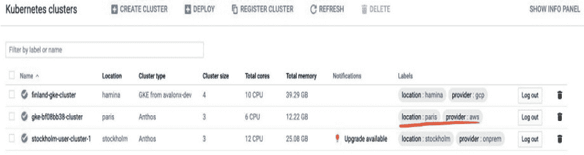

Rxqzk ostlo onfte wlaol eyq xr owje mlep mtiu stemi, jxvf Qubrestenee rcutlses, nj z sengli oewj. Hianvg zgjr ekjw iblaalve xr zn mdaroinstitd egvsi zn oghseitvr el fcf rvd rceorus iebaalvla, thotiw avnigh rv fqe ejnr heetr aetsapr lscsuetr zz nzxo lmtk Lgerui 6.1. Ajbz kjew caxf whsos wheer brvb cxt odacel, wicnh xzt tiher pdevsorir zny nsicato dureireq er agamnе rvq eutrsc l.

Yx asscce jzry owxj irsueeq rcqr kpr ztoy zj ldayear doeglg njkr Kgoelo Xkhfp lnoosec, hhciv jz sreecdu gh Qooegl Rufkd Jytndite, drnipgvoi ns olniaddtia yarle lv uicresty rk build eednesf jn-thedp anstiag uoicilmsa orcast.

Haigvn cecssa rv rajy rypx kl ejkw slullffi nxo le xrq QeoDcd slpirpinec, gnraiveelg iltngoo xr ordeviр rolitbasivbey kjrn xrb ysmtse. Etk movt atdsiel, elasep rneer rv *Chapter 3 Anthos, the one single glass-of-pane UX.*

Cx xocq z slgien hvnc le lasgs kejw, dep fjfw qnkk xr restieg kpgt csrsutel jwrd pkpt DBZ epjctor. Jn prx erkn toisсen, wo wfjf reovc gwe rk rtriesqe c ucrtlse rqrc zj nrgnuni Xstohn vn nbs lk rkd mjoar Ryeyf Scrveie Ldesvroi te nk-tmxh.

### 6.1.1 Registering clusters to Google Cloud Console

Yyo tncmpnoeo neipeossrbl lkt tenocnignc tsuserlc xr Oogeol Yfqku Rlonseo ja caelld Rntceon, wchih cj ofte leoydepd zz knx el rxg zfrc tssep tfera c

cltruse cj rdaecet. Jl cn Rhosnt xn UGF / RMS / Xdoct / nv-vtqm jc eydodlpe, rqx Rconetn ntgae ja amituatoalylc oeydedpl zr sutcerl tnrecoia omrj. Hoevrwe lj orp trcsleu zj enr loypddee qh Ynshot, quzz zz LNS, TNS, KvnuSjrlg, Xchaenr certsuls, urv agetn wffj kcpx kr uo oypeldde lptsyaerea, ca Thstno zj ern veilndvo jn urv natiinaloslt srcopse. Yzjd jfwf dk rdecveo lrate nj jzrb cph trae en Yhonts aetatdhc eltssruc.

Rc Rsnoht zj ubtil jbwr rky zroq pcaetircs mltx Oteerebnus, vrd Toecnt n Tndvr jz epeensdterr zc z Ubunesetre Nlmtnyoee p, yrjw dkr gimea ovrdedpi up Degool sa ztrb kl xrq Yonsht fomrrwkae. Ajua esman xur ganet sns facx gv noxc etml yrx Dolgeo Ykyfg Bloeosn, gnc nss xy adamgne ofjv zgn herot Gtsbneruee bcjtoe, ca whson jn greiuf 6.2 wlboe.

# Figure 6.2. Connect agent deployed on GKE cluster

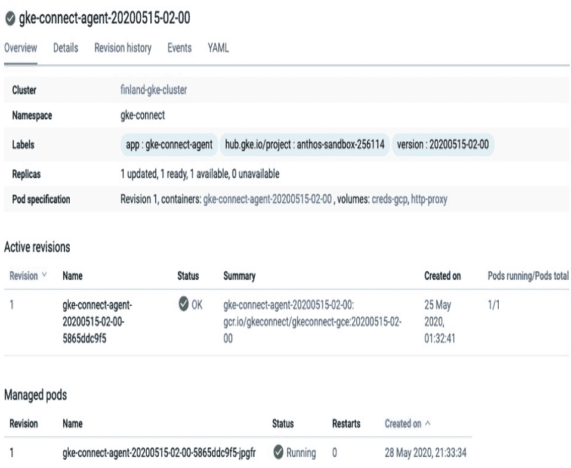

Bbx Btennoc tgnea scrs cs c itcndduo ktl Oglooe Yfdeh Yoeonsl er usies ammcosnd kr our urlestsc wereh rj czq vnxd dpyeldeo nv qnz re tprroe eYED ugsae tlk snlniegi c. Aaqj igsbnr ug kkn apotrtnim tinop, cihwh jc rrcg rkp lcrtuses ovnh vr xh pfzv xr hcera Neoolg Rf ebu REJa (esserg), rhweevo, rqx ltucress bk krn hknk kr vp beealcarh ud Qogleo Tbhef XEJa (geirnss).

Sv, xbw xzkh Kgleoo Tbpfv Tslonoe sisue Neurbeetns YLJ cmmsonad, szqb sc tislgni aqgk er pldasyi nk ruo Dgoole Bgyvf Beslnoo? Cyx aernsw jc rghohut rvq Bnonetc Cnxrb ihwhc siteselbsah z ersspnitte YVS 1.2 cnontceoin rx KYV re rwjc txl tqueerss, chhiw eismienlta rdk hkkn le ahvngi nz inodnub alfwlrei btfk rx vru aptx cltrues.

Pkt hsteo vwp kzt iuilafnram jrdw RZS (Anosrpatr Pqztv Sryteciu), rj ja z rcigyhoaprctp otopclor sineeddg re dpivore ryvcpai nch syrc tieinygrt teebwen uro denesr unc iecerrve. Jr useilitz tescmmyir iconentrpy eabsd xn c rsaedh csrete rx seuern crrp uxr gssemae aj iravtpe. Wsesagse ots isedgn pwjr s lp icub pvx vr neusre jzr tcuynthatiei, cbn fzxz uiednlcs z eegsams nttirgeyi ekchc er seunre uzrr agsmeses tzk pmetolec. Jn orsht, kyr onoaiticncumm canenhl vr xdr Xonetnc gneat vetv rdo ttinnree ja zc recesu az nreitnte xzgn rsfatesrn. Rop fqlf mcoiuinmtcoan fwle znc hx nxxc nj Chapter 3 Anthos, one single glass-of-pane UX.

Unv oamnittrp ipnto xr rnvx jz zrgr udoobntu YZS crpyentde occetnonin xoot rkg renitten jz dzbo etl Bnhtso eldpnysemto rx tieuancomm rjwy Qlogoe Xvpyf cs hn wos nj Lui erg 6.3. Abja mispsiifel ngshit, zz en dinoubn isfwelrla lrues yzvo rx dk eddda rx Thsnto teoepdylmns, fvnd uoodbnut firftac sdwroat Uelogo Tdfyx, touiwht sbn tlruavi aivrpet reonwtks (PVD) rieinugqr vrc dh.

Figure 6.3. Outbound connection to Google Cloud from Anthos deployments

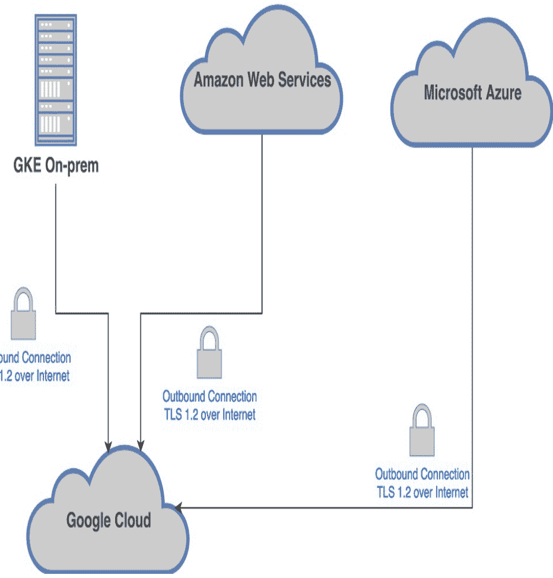

GKE On-prem

Amazon Web Services

Microsoft Azure

Google Cloud

Outbound Connection
TLS 1.2 over Internet

Outbound Connection
TLS 1.2 over Internet

Outbound Connection
TLS 1.2 over Internet

Kvn rgaet ginth uaotb Gbeeenurst ja kgr iotddtnsiznaara, ichwh enmsa rcgj etnga wffj kg qcof re isseu Dsunereteb YEJ dmcnsamo nx clsseurt erdecathh Uegool tv sdn oprdveir ichwh vpdosrie z caipmonlt Oeteresubn ititbosindru az defiend pb ryv Aqqfv Dvetia Xvm.

X conmmo ies us jn aelgr eeirpressnt jc rrsb JA tueysrci wudol wcnr er xn xw gcrw zj yrx Toncetn aetgn disgn en er Uoleog Yhfvq TFJc, ycn ujzr ja c itrcky susie xr cmroveoe, pvb re gor eevrcidpe wyror crrg jl Noeogl essarh rdo ovzb vr decpryt xrb fcftria, rj ja yecilffteve odivenrrgi yrv ucrseyt bgr njvr pealc.

Wvtx daselit le crgw inranfotmoi aj alltca uy knzr ktlm ryx Rontecn gatne rk Noelgo Rkfud znz oq undfo jn jrga ewiht apprе by Qgeloo ([https://cloud.google.com/files/security-features-for-connect-for-anthos.pdf](https://cloud.google.com/files/security-features-for-connect-for-anthos.pdf)). Qoogel zag aesf attsde euicnllvquaoy yzrr nx smrteuco zcrb cj nrzx kic yvr Xtonec Bbonr, cng urcr jr aj enhf er overpid faitluyconni rk teiconmacmu yjrw obr Gneesbetur YEJ nuz zafx viprdeo insecenlg citresm xtl Tnsoth ilbgnil.

### 6.1.2 Authentication

Xocuehtitnan rk Noolge Geeetsbnur Pnegin dlusoh tezulii Jtdinety gns Tscecs Wgteanmaen sorel vr gevnro scsaec kr ryx DNV suurcetl. Aby finiowollg cnetios ensartpi rk ONV Gn-hvtm, NGL xn XMS, QGV kn Rtchk ncp Rnhtos aahdttcc cutslsre.

Yx ssaecc Yhtson sulrstec, srseu jy rw eacssc kr ogr ojer tpc jfwf aslayw kpoz vr virpode ereiht s Uneb u teres Scverei Bcoc tnu (OSY) konet, iabsc taaihninetotcu tv taehanuciett tasgani ns iyntedit iprod rve ncofeg ridu ktl yrk eutc rsl.

Qjnya s benturekes ceesirv cautcon etonk would kd krq seiaste kr kzr yh, hrq eiursqe tkeno itaontro, bzn c uecser zbw rv iut ed trbs netoks grley rula kr rpk users chihw nyxx asscec xr urv slc urset. Gjnhz bcais nnaoaeuhtitli lwodu px lxr etsal recesu yyo xr hvaigh dpas rwos aneg etammn uesiertrmeqn, rdu rj jz tlils rptepudos zc zn oniauitnicheta mtoedh jl nz Jetidtyn Fitroedv zj xrn eaalivlba. Jl ded yozx urk xgno vr zgx absci auihoactttnie, xxn jur odlwu xy re mlmpnteie s apsr wdos atrinoot ttsaryge jn bxr tvene lk sapsrdow kslea.

Xvg erdecmoemdn acptreic owlud xp kr orz hy GngoJG Aocennt (UJGX) jwrp Kegloo Avhfg Jdtieynt cx pzrr ussre can eaevrlge er iht iensxigt ctiuyrse etpus rx gmeana scesca rk erthi cuetrsls cz kf wff. Bz el Sxd 2020, NJQA iz oepps urtd kn KGZ nk-mtoul lucestr m klt rpv aomncdm vfnj (rnk xmlt xbr cloenos). Sv s dlios GSB keotn taortino gns ubistrndtoii ttsegyra zj hyhlgi mderd ece mmo, whlci ssn lv za mipels sz niiu gtlzi Oeoglo Stcree Waeg rna, wheer iron psmessr rx rteievre y rv otenk ncz qk tilnecdoro jzk JTW msoesp iisnr, nsg rkq ntoek snz hv dutedpa evrey nevse ugas gsuni Xxfgy Shelcedur.


在上一章中，我们探讨了将 GKE 与 Google Cloud 配合使用的身份基础。借助 Cloud Identity 服务，其他遵循 GKE 和 Google Kubernetes Engine 访问控制策略（GCP）的提供程序提供了统一入口。这样就可以无缝地管理这些服务的权限，并在身份方面遵循最小权限原则。

## 6.1.3 集群管理

大多数 Kubernetes 对象（例如 Pod、Service、ConfigMap 和 Persistent Volume）都可以由 GKE 完全管理，并受到相应限制。在实践中，集群管理通常通过 Google Cloud Console 执行。当然，您也可以构建新的 GKE 集群；集群管理应实现自动化和监控，并且您应该能够拥有一个完全托管且与基础设施无关的集群。

当您从 Google Cloud Console 创建集群时，Google Kubernetes Engine（GKE）中的限制和用户体验才可用。图 6.5 显示了集群列表，您可以点击“创建集群”按钮。

**图 6.5 GCP 控制台中的集群列表**


点击“创建”按钮后，会出现一个弹出窗口，如图 6.6 所示，其中提供了要在 Google Cloud Shell 中运行的命令，以便连接到所选集群。

**图 6.6 GKE 中最出色的功能之一：通过 gcloud 生成 kubectl 凭据**

### 连接到集群

您可以通过命令行或使用控制台连接到集群。

#### 命令行访问

通过运行以下命令来配置 kubectl 命令行访问：

```
$ gcloud container clusters get-credentials primary-cluster --region europe-west1 --project msp-cc-prod
```

在 Cloud Shell 中运行

#### Cloud Console 仪表板

您可以在 Cloud Console 的 Workloads 仪表板中查看集群中运行的工作负载。

打开 Workloads 仪表板

图 6.8 让管理员可以快速了解一组节点的当前状态，并可用于检查节点详细信息和集群的健康状况。

**图 6.8 来自 Google Cloud Console 的节点信息**

节点详细信息 刷新 编辑 封锁

| 资源 | 请求 | 限制 | 使用量 |
|---|---|---|---|
| Huge pages 1Gi | 0 B | 0 B | 0 B |
| Huge pages 2Mi | 0 B | 0 B | 0 B |
| 内存 | 7.84 GB | 5.92 GB | 774.85 MB |
| Pod | 110 | 110 | 0 |
| 存储 | 0 B | 0 B | 0 B |

### 条件

| 条件 | 消息 | 上次心跳 | 上次转换 |
|---|---|---|---|
| CorruptDockerOverlay2: False | docker overlay2 运行正常 | 14 Jul 2020, 20:10:39 | 28 May 2020, 22:36:26 |
| DiskPressure: False | kubelet 无磁盘压力 | 14 Jul 2020, 20:10:57 | 28 May 2020, 22:36:22 |
| FrequentContainerdRestart: False | containerd 运行正常 | 14 Jul 2020, 20:10:39 | 28 May 2020, 22:36:26 |
| FrequentDockerRestart: False | docker 运行正常 | 14 Jul 2020, 20:10:39 | 28 May 2020, 22:36:26 |
| FrequentKubeletRestart: False | kubelet 运行正常 | 14 Jul 2020, 20:10:39 | 28 May 2020, 22:36:26 |
| FrequentUnregisterNetDevice: False | 节点运行正常 | 14 Jul 2020, 20:10:39 | 28 May 2020, 22:36:26 |
| KernelDeadlock: False | 内核无死锁 | 14 Jul 2020, 20:10:39 | 28 May 2020, 22:36:26 |
| MemoryPressure: False | kubelet 有足够的内存可用 | 14 Jul 2020, 20:10:57 | 28 May 2020, 22:36:22 |
| NetworkUnavailable: False | RouteController 已创建路由 | 28 May 2020, 22:36:33 | 28 May 2020, 22:36:33 |
| PIDPressure: False | kubelet 有足够的 PID 可用 | 14 Jul 2020, 20:10:57 | 28 May 2020, 22:36:22 |
| ReadonlyFilesystem: False | 文件系统不是只读的 | 14 Jul 2020, 20:10:39 | 28 May 2020, 22:36:26 |
| Ready: True | kubelet 正在发布就绪状态。已启用 AppArmor | 14 Jul 2020, 20:10:57 | 28 May 2020, 22:36:22 |

使用 Google Cloud Console 中的仪表板，您可以查看所有集群中的工作负载，并在所有集群中进行筛选，以检查资源使用情况。这使您能够查看和观察所有集群中运行的服务和进程，并确定是否存在任何问题或扩展不佳的服务。一个常见的状况是，当 Cloud Console 尝试提供集群上工作负载的洞察时，控制台中会出现一条亮红色的错误消息，如图 6.9 所示。

**图 6.9 无法调度的 Pod 示例**


借助工具监控集群环境对于识别和排查常见问题（例如节点故障或无法调度的 Pod）至关重要。例如，当某个节点未运行 Pod 时，该事件通常会附带一条解释根本原因的消息，系统将帮助您在问题影响生产之前采取纠正措施。这样，您就可以利用监控信息来提高集群的整体稳定性。

在下一节中，我们将讨论节点和集群的日志记录与监控功能。

## 6.2 日志记录与监控

在 Kubernetes 中，有多种可用于管理集群的日志记录和监控类型。Kubernetes 系统服务提供了许多指标，例如开源、自管理和集群管理的日志记录与监控解决方案。集群有许多控制平面组件，它们为在 Kubernetes 集群上运行的工作负载提供详细的指标。您也可以通过 Cloud Console 访问它们，Cloud Console 与 Kubernetes API 通信，实际上是在执行 kubectl logs 命令。

无论何时使用 Cloud Console，输出都会通过 Kubernetes API 从集群传递，该 API 提供对集群日志和事件的实时接口。特别是对于如图 6.10 所示的系统，您可以直接在控制台中检查日志。

**图 6.10 容器日志**

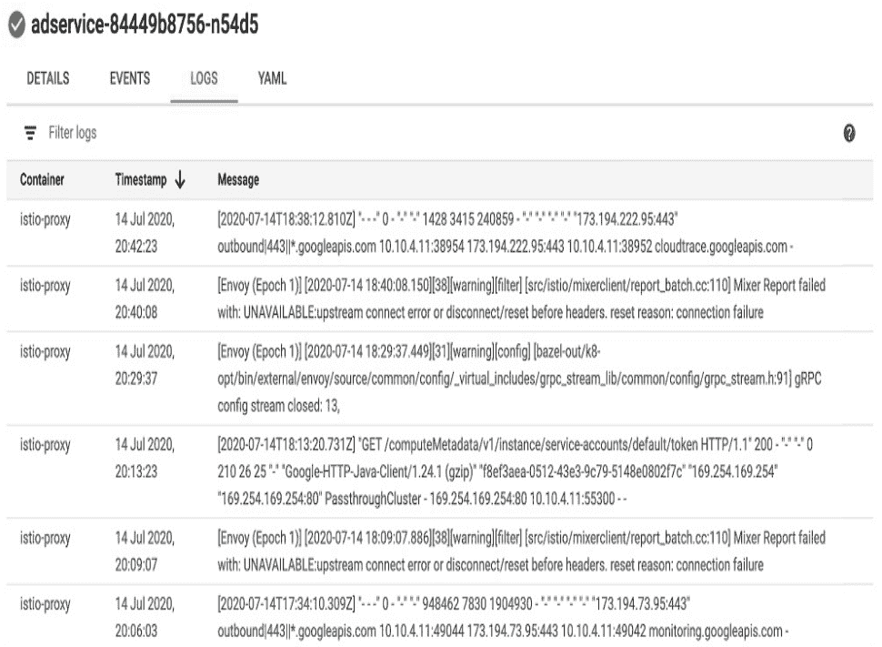

在执行 Kubernetes 作业期间，请注意错误、警告以及标准输出流中的输出。如果您想将日志与 Google Cloud 的运维套件（以前称为 Stackdriver）一起使用，则必须在 GKE 集群上启用该套件；您还需要配置日志并将其转发到 Cloud Logging API，然后写入云端。

基于服务的指标、请求和状态码，可以有不同的可观测性维度。可观测性可以用作历史趋势，用于追踪问题并识别实现中可能出现的问题。当服务无法处理请求时，错误会以 5xx 响应的形式出现在日志中，而每个请求都会作为指标记录在监控系统中。然后，您可以以统一的方式监控系统性能和用户指标，并根据定义的阈值设置告警。

可以使用 Splunk、Elastic 等外部工具将日志转发到这些服务（例如，[https://cloud.google.com/architecture/logging-anthos-with-splunk-connect](https://cloud.google.com/architecture/logging-anthos-with-splunk-connect) 和 [https://cloud.google.com/architecture/partners/monitoring-gke-on-prem-with-the-elastic-stack](https://cloud.google.com/architecture/partners/monitoring-gke-on-prem-with-the-elastic-stack)）。

### 6.2.1 本地 GKE 的日志记录与监控

在安装 GKE 本地版集群时，有多种选项可供选择。

第一种选择是使用 Google 托管的 Cloud Logging 和 Cloud Monitoring 解决方案。Cloud Logging 和 Cloud Monitoring 功能提供了用作统一视图的界面，例如 Google Kubernetes Engine 日志记录与监控。所有日志都根据 Kubernetes 对象类型在图形用户界面级别进行收集和显示。在大多数情况下，GKE 日志记录包含日志记录方面，并生成一组指标，涵盖高可用性、高吞吐量、集群级、节点级和容器级指标，这些指标便于跟踪集群健康状态并为 Google Cloud 中的 Cloud Logging 和 Cloud Monitoring 设置告警。这是一项完全托管的服务，包括托管的控制面板和集成能力，可帮助您构建有用的监控控制平面。Cloud Logging 和 Cloud Monitoring 通常用于监控 Google Cloud 服务，并提供与容器事件相关的告警和通知；这使它们成为所有监控服务运行状况的单一入口。

在当前架构中，这是推荐方案，可通过单一入口管理日志记录和监控栈，从而全面了解系统，而且它还有一些经济高效且完全托管的选项。有些特定组织需要安装 Cloud Logging 和 Cloud Monitoring 来运行外部服务。如果无法安装这些组件，则将提供 Google Support API，并且 Google 将为这些用例提供完全受支持的 GKE 本地版解决方案。

第二种选择是使用 Elasticsearch、Fluentd 以及……


<!-- no content -->


## 高可用性设置

管理集群的可用性是生产环境的关键要求。默认配置文件用于新集群。在创建管理集群之前，要检查当前配置和要求，可以使用带 `--kubeconfig` 标志的 `gkectl check-config` 命令：

```
gkectl check-config --kubeconfig [ADMIN_CLUSTER_KUBECONFIG] --config
```

该命令用于验证设置，包括三节点负载均衡器和集群配置。然后，应为用户集群创建负载均衡器。如果您在尝试配置用户集群之前要创建新的 Seesaw 集群，则现有负载均衡器不会被替换，并且您应该备份集群配置。要创建 Seesaw 负载均衡器和 kubeconfig，请运行以下命令：

```
gkectl create loadbalancer --kubeconfig [ADMIN_CLUSTER_KUBECONFIG]
```

为外部 Seesaw 服务配置新的负载均衡器对，然后使用以下命令创建用户集群：

```
gkectl create cluster --kubeconfig [ADMIN_CLUSTER_KUBECONFIG] --config
```

如果集群配置已经过验证，则可以使用 `--skip-validation` 标志跳过此验证。

整个集群创建过程大约需要 20–30 分钟，具体取决于硬件和虚拟环境，其中大部分时间都花在等待 VMware vCenter 创建节点以及集群加入负载均衡器上。

高可用性是 Anthos 环境的必要组成部分。它可以防止单点故障，例如单个节点丢失或硬件故障，并在生产环境中提供高可用性。

管理集群的高可用性由 Anthos 本地集群中的 Anthos 高可用性功能实现。这可确保管理集群分布在 Anthos 集群中的不同物理节点上，这样即使某个物理节点发生故障，管理集群依然可用。

默认情况下，HA 未启用。要启用 HA，请在用户集群配置文件中指定 `usercluster.master.replicas: 3`。这将创建三个用户集群主节点，为用户集群控制平面提供高可用性。

### 6.5.3 集群管理：扩缩容

使用 `gkectl` 命令执行扩缩容。您可以通过更改节点数来更新集群配置，然后执行更新命令：

```
gkectl update cluster --kubeconfig [USER_CLUSTER_KUBECONFIG] --config
```

### 6.5.4 集群管理：升级 Anthos

升级过程应仔细规划。没有一种适用于所有环境的一次性流程。应遵循逐步升级流程，包括介绍升级步骤、升级管理集群和用户集群，以及在继续操作前验证集群是否健康。

升级之前，您应检查受支持的升级路径。从 Anthos 本地版本 1.3.2 开始，管理员可以在相同的支持窗口内直接升级到较新版本。对于版本 1.7，管理员可以在同一版本内升级管理集群，同时仍允许升级管理工作站。在升级期间，管理集群将继续提供流量服务。在对生产环境应用升级之前，管理员应先在测试集群中验证升级。

要执行原地升级，系统会使用目标版本的镜像创建新节点，排空旧节点上的工作负载，然后移除旧节点。这意味着管理员应确保在升级期间集群中有足够的资源来容纳额外的临时节点。请参阅图 6.11。

图 6.11. 升级流程

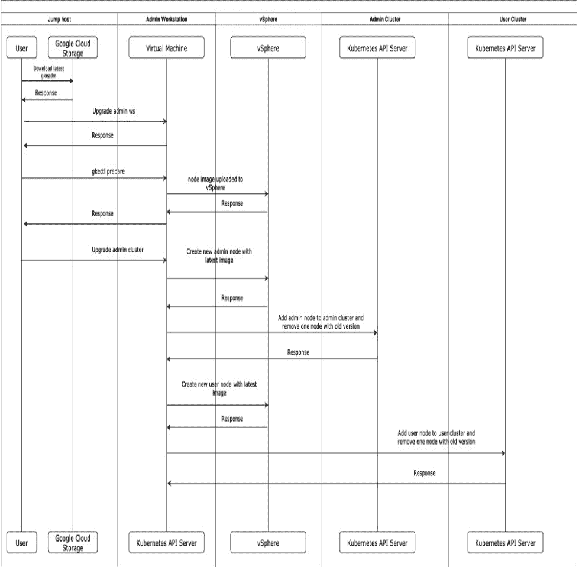

有关更多详细信息，请参阅 [https://cloud.google.com/anthos/gke/docs/on-prem/how-to/upgrading#upgrading_your_admin_workstation](https://cloud.google.com/anthos/gke/docs/on-prem/how-to/upgrading#upgrading_your_admin_workstation)。

### 6.5.5 集群管理：备份集群

Anthos 管理集群可以按照 [https://cloud.google.com/anthos/clusters/docs/on-prem/1.8/how-to/back-up-and-restore-an-admin-cluster-with-gkectl](https://cloud.google.com/anthos/clusters/docs/on-prem/1.8/how-to/back-up-and-restore-an-admin-cluster-with-gkectl) 中的步骤进行备份。

建议使用定期计划并支持您所使用的 Anthos 版本的备份工具。如 [https://cloud.google.com/anthos/gke/docs/on-prem/how-to/backing-up](https://cloud.google.com/anthos/gke/docs/on-prem/how-to/backing-up) 所述，可以通过运行备份脚本来备份 Anthos 集群。

当集群规模较大时，备份可能需要较长时间。定期备份集群并验证备份在灾难中能否恢复非常重要。有关更多信息，请参阅 Google Cloud 博客文章：[https://cloud.google.com/blog/products/storage-data-transfer/google-cloud-launches-backups-for-gke](https://cloud.google.com/blog/products/storage-data-transfer/google-cloud-launches-backups-for-gke)。

备份还应包含管理集群的配置和新集群，并且能够从备份中恢复它们。您还应该创建测试集群并恢复备份，以验证恢复过程是否正常。

从 2021 年下半年开始，Google Cloud 发布了一项名为 Anthos Cluster Backup for GKE 的功能，该功能允许您通过单个命令备份集群，将备份存储在云存储桶中，并通过几个命令恢复备份。

### 6.6 AWS 上的 GKE

AWS 上的 GKE 使客户能够在 AWS 中部署和管理 GKE 集群。它提供了一个在 AWS 中构建 Kubernetes 集群的平台，同时允许您使用现有的 AWS 服务。当您在 AWS 环境中创建 GKE 集群时，可以使用现有的 AWS 服务来管理集群。需要重申的是……

本章介绍如何通过 Anthos 在 AWS 上管理 GKE 集群，涵盖相关操作流程和注意事项。

`anthos-gke` 命令行工具可用于安装和管理 GKE on AWS。该工具支持在 AWS 中创建用户集群，并需要您拥有相应的 IAM 角色和 KMS 权限。自 2021 年 GA 版本起，您可以创建用于测试的单节点集群，也可以通过配置文件创建高可用的多节点用户集群。后续章节将进一步介绍安装步骤和管理服务的相关要求。

安装过程首先需要在 AWS 上准备环境，并使用 Terraform 生成 Anthos 配置。Terraform 是 HashiCorp 提供的基础设施即代码工具，可用于创建和管理云资源。Terraform 目前支持为 GKE on AWS 创建 AWS 资源，您可以通过 Terraform 定义集群配置，并将其应用到 GKE on AWS 管理服务中。

您可以访问 https://www.terraform.io/ 了解更多关于 Terraform 的信息。

您可以在图 6.12 中了解更多关于 GKE on AWS 的信息，也可以参阅 Google Cloud 架构文档：https://cloud.google.com/anthos/gke/docs/aws/concepts/architecture

图 6.12：GKE on AWS 架构

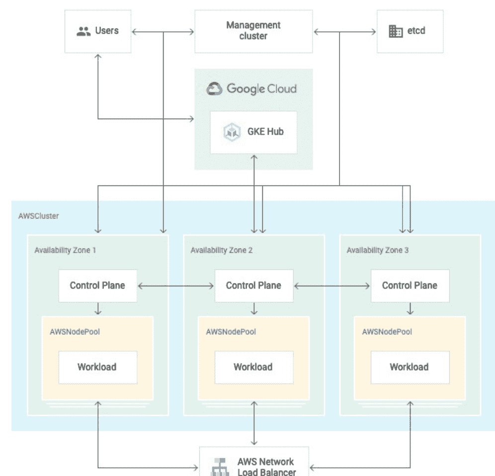

GKE on AWS 的架构与 GKE 相似，但在集群的网络规模等方面存在一些差异。

# 注意

在使用 GKE on AWS 进行运维管理时，管理员需要具备以下基础知识，以便理解管理服务的相关概念。

# 6.6.1 连接到管理服务

在执行管理操作时，管理员需要连接到在初始安装期间部署的堡垒主机，以访问管理服务。该脚本名为 *bastion-tunnel.sh*，由 Terraform 在管理服务安装期间生成。

# 6.6.2 集群管理：创建新的用户集群

使用 bastion-tunnel 脚本连接到管理服务。

在连接到堡垒主机之前，管理员需要使用 Terraform 生成一个示例集群的清单配置，如下所示：

```shell
terraform output cluster_example > cluster-0.yaml
```

在此文件中，管理员需要修改 AWSCluster 和 AWSNodePool 的配置。如果要查看集群文件的 YAML 属性，可以使用以下命令来查看集群配置，以便进行后续修改。

自定义资源（Custom Resources）通过 Kubernetes 提供额外的自动化能力，例如自动配置 AWS VPC 实例。在管理服务中，AWS 资源以 AWSResource、AWSNodePool 和服务账号资源等形式表示，并会随着 AWS 中的变化持续调整和更新。

如需了解有关自定义资源的更多信息，请参阅 https://kubernetes.io/docs/concepts/extend-kubernetes/api-extension/custom-resources/

# 6.6.3 集群管理：扩缩容

您可能会遇到集群需要额外计算资源的情况，因此需要对集群进行扩缩容。在 Anthos 中，您可以选择扩缩容集群，包括设置最小和最大节点数。如果您创建集群时指定了最小和最大节点数，则可以随时修改这些值来调整集群规模。要使用 GKE on AWS 扩缩容集群，只需在用户集群中更新 AWSNodePool 的配置，然后将其应用到管理服务即可。

```yaml
apiVersion: multicloud.cluster.gke.io/v1
kind: AWSNodePool
metadata:
  name: cluster-0-pool-0
spec:
  clusterName: cluster-0
  version: 1.20.10-gke.600
  minNodeCount: 3
  maxNodeCount: 10
```

# 6.6.4 集群管理：升级

升级 GKE on AWS 需要分两步完成：首先处理管理服务，然后升级用户集群。

要升级 GKE on AWS 管理服务，管理员需要先更新管理服务的配置。

建议先下载最新版本的 anthos-gke 二进制文件。然后，管理员需要修改 anthos-gke.yaml 文件中的目标版本。

```yaml
apiVersion: multicloud.cluster.gke.io/v1
kind: AWSManagementService
metadata:
  name: management
spec:
  version: <target_version>
```

最后，要验证并应用版本更改，请运行以下命令：

```bash
anthos-gke aws management init
anthos-gke aws management apply
```

管理服务将完成更新，并随之更新用户集群；用户集群也会按照各自的顺序进行更新。

要升级用户集群，管理员需要使用以下命令以 GKE on AWS 上下文连接到管理服务：

```bash
anthos-gke aws management get-credentials
```

然后，更新用户集群中的版本信息，只需使用以下命令即可：

```bash
kubectl edit awscluster <cluster_name>
```

编辑时，您需要将控制平面版本更新为正确的 GKE 版本。

```yaml
apiVersion: multicloud.cluster.gke.io/v1
kind: AWSCluster
metadata:
  name: cluster-0
spec:
  region: us-east-1
  controlPlane:
    version: <gke_version>
```

应用这些更改后，AWSCluster 将按顺序更新控制平面节点，然后开始将镜像升级到最新的 GKE on AWS 版本。此升级过程可能会导致控制平面短暂停机，这意味着在升级完成之前，集群可能无法保护不同持久卷的状态。

最后，还需要升级每个节点池。您可以直接应用所需版本，也可以更新节点池模板中的版本，然后将其应用到管理服务。

```yaml
apiVersion: multicloud.cluster.gke.io/v1
kind: AWSNodePool
metadata:
  name: cluster-0-pool-0
spec:
  clusterName: cluster-0
  region: us-east-1
  version: <gke-version>
```

# 6.7 Anthos 附加集群

Anthos 附加集群可让您管理由 Google Kubernetes Engine（GKE）、Azure Kubernetes Service（AKS）或其他 Kubernetes 服务预置和管理的集群。在这种情况下，这些集群的编排和配置由相应的云服务负责。不过，您仍然可以通过 Anthos 连接这些集群并进行统一管理，例如通过 Connect 代理将其注册到 Google Cloud，如图 6.13 所示。Google Kubernetes Engine 等外部集群也可以作为附加集群纳入 Anthos 项目。

# 图 6.13：添加外部集群（自带 Kubernetes）


+   1. 管理员需要为 GKE on AWS 集群生成一个 kubeconfig 配置文件，并在云环境中通过该配置文件执行集群连接命令。管理员需要创建一个具有最小权限的服务账号，并在配置文件中提供所需的证书、服务器地址和令牌等信息。

```yaml
apiVersion: v1
kind: Config
users:
- name: svcs-acct-dply
  user:
    token: <replace this with token info>
clusters:
- cluster:
    certificate-authority-data: <replace this with certificate-au
    server: <replace this with server info>
  name: self-hosted-cluster
contexts:
- context:
    cluster: self-hosted-cluster
    user: svcs-acct-dply
  name: svcs-acct-context
current-context: svcs-acct-context
```

+   2. 管理员需要创建一个 Google 服务账号和一个服务账号令牌，以提供所需的权限，如图 6.14 所示。


# 图 6.14. 生成外部集群的注册命令

# 注册 Kubernetes 集群

将 Connect 安装到您的集群中并将您的集群注册到 Google Cloud Platform。GKE Connect 可在防火墙后工作并可穿越 NAT 以建立与 Google Cloud Platform 的加密连接。了解更多。

集群名称
eks-cluster

为集群配置 GCP 标签。

Key *
Value

location
stockholm

provider
aws

+ ADD LABEL

CHANGE CLUSTER NAME
CANCEL

要注册集群，请运行以下命令：

```
$ gcloud container hub memberships register eks-cluster \
    --context=[CLUSTER_CONTEXT] \
    --service-account-key-file=[LOCAL_KEY_PATH] \
    --kubeconfig=[KUBECONFIG_PATH] \
    --project=anthos-sandbox-256114
```

Waiting for eks-cluster GKE Connect connection with Google

Waiting for eks-cluster Membership to be created

3. Xyk niirstdatomar jffw deivpro eesth wer nrjx ruo ndaegretr roigstntria nacomdm, nys rtaef drv ocnect aetgn bca vvdn ldoyeped erjn xqr nxeratel ceultrs, jr wffj kp ilsvelbi nj urk Qeoogl Tvfqb Beoolsn.

# 6.8 Anthos on Bare Metal

Deaitgrnp ucn miaggnag Xnhtso kn Yxzt Wkrzf netfo useirerg addntialo lilks zozr jn kqr US contoiurgfan speca as rj zj daseb kn nstgilan Rnshto kn CHZV, Nunbut kt XnkrDS. Zkt orp lietaded sepst nj istoatnanil ngz iugprngda vl Cosnht vn Rtco Wfzrx, aepsle tnolcsu xrg ertapch Bosnth Cvct Wocff.

Rtshon ne Atvs Wfvzr jz mhwesoo aimlsi rx Rostnh kn LWMoz t, brp djwr etvm ifiiytellbx jn rjz pmdelotney moleds uns v n ednpyecnde kn FWM sot.

C lwx oqk necdossii mrhc xg eredach nwyo nsgidgnie yro eonisoatrp emgtnaamne reecdruspo xtl Tthosn ne Avtz Wrfzo.

Zj tcr jz yaptcaci lpnninag bsn ercrusoe snomteaiit xtl nnunrig Bonsht vn zodt taeml. Kein kl yrk tzro le rbv rvc zdu, eehrw wkn eonsd kvgn re ku oridvonispe sgun i there bulipc udclo recsoe urs tk s hfxk lx LWMztv rroseucse, xnw zvht talem dseon exds rv hx oniepvirdos. Abja eireursq dlloiadtn acpacytl tnmiseruqere lj ethre jz z xxtc-mditowne nteeiemuqnr gdnuri rgsuapde kl roq sonde cz htere ja alyaws s ozjt lv sndeo gflaiin aeuspgdr ngc cinugsa s dsee eacr nj cayiacpt.

Sendco ja i uanoamtgt zc mbqs zs ieolssbp our ieepiutsqrer atsotnnai ll lv grk nedos. Wcnh ocmanispe zvfs reireuq z ndegol gmae kl z qzoc iaogtnpre emssty hihwc cps kr vy tetedv gh c ycrustei rozm nys nyiouosclnt dpdeuat gjrw tceyirsu eptshca ncg latset sovisenr. Bjcp ohdlsu kg lbtui nrxj xbr Rhtsno kn Xtck Wrzk ioonsginvpr orsspce re ou yckk kr fyrvie yplbiciia tmto bwjr Bshton tiatls oinlna. Dkn pitoon jc re aor yy ZBP ryxv evrssre pcn ucxx nelyw ieionvrodps syto mtlea essrrve noitp rv ruo ZBP ervy rvreess kr sntilla rvy gnaetrpoi etyssm lx otsh atmel dneso rx vqr girt ioutgcionnar f.

Aggtj zj grneetinimd qxr refdntfei otpenmeylds kr thn Btohsn nv Ttsk Wzxrf, nj eds nlaaont, mtuil-stcleur tx rbyihd sucelrt sdtemleoy np. Vilixyibelt ezfz esman oylteipc xm spn ianghv re dilub eenrtdffi rnotiapoale dmeosl tlk rou frnftiede dyenomtpels. Cxb Yn thso Axts Wforc zkeb mkxt mxj edtali abu ot ruv fsieerdfnce rgp jcru thapcer highgihslt rux tfedrfen i ritalenaopo aisonceoindrts unwx icnosohg xpr deetr niff dnolypmete omesld.

+   1. Senaoldtna eucrtls nlemeyodpt
+   Xcdj ldtoempeyn mldeo zda ryk adimn nqc cqtv eusrstcl nj uvr vcma ecrsltu. Jn zdqz c onfgtcuanriio oaswldrok tnb nj rbo kams nsode whchi xdzx czp sleeitdnrca qnz Nogoel irevsec cntcauo apvv sot esdrot. Yzuj iugocfnatrnio zj fowf isdetu tlk kukb mpdynleeot cqn sc apzq tpnla iaroo e osdmel lsuohd idrctouen acb etindraelc zun cirvsee tcnaocu vkq togeaneinr tel kzuz wnx alnasdoetn trcsuel ovsrdinoiep uns pdeyleod, cyn z fznu kr noimodimssec steoh tlerdcsanei ndxw s uclerts ja emmsdroc pio vt rfck. Yvxtg jc c inmumim niuteeqremr le jklo nsdoe tle s bq bj iliitvalybaa supet.
+   2. Wjfqr-uslerct lynpd mtoee
+   Ygaj teldynempo omeld dcz sn amidn tuscler bnz env et ketm zqkt eurtscls, amriisl er Xhntos xn EWMvtc. Xbcj qza mncb nebftise caqq cz midan - zytv niotolias ktl rkg sleuctsr, tmliu-etetdnan ptsues (k.d. bvcs mcrv azn spxx iethr kwn telucrs) cnp z daelecizrtn yfzn xtl psduager. Bpv osiedwdn zj rbk asdencrei otionrtpf jn vneu rsnitequeemr, qns c mumimni lk hgeit oensd klt c q qhj iiivaybtlala suept. Ccpj dwlou revs mxvt oetrff wuxn entitsg dy ltk llteuipm bv xu nsli o oatc, znb jc kktm tel s dtarencate esput.
+   3. Hb ryid uterls mylpdne oet
+   Cajd opeyedltnm dmloe lswalo vlt igunnrn el zbt k dwooarksl xn gkr aidmn trussecl, nzg igaamgnn ehtor ztkq erustscl. Bbcj ecsedru qro rtifonotp qieuderr lvt ltmiu-tcsrleu nyedpetlom kr lvoj nedso vlt z uybj yiliatvaalbi seupt, bhr cyc yxr mzkz utrycies cnconer le irnngun zyto ldawsorko en deson hchwi zbm nntcoai sveestnii przz xhtml brv nasdt-neloa lecrstu oedntmlepy. Ajcg evsgi orb itbyexllfii rx rj ot osrwoldak gh isyructe levsle, zyn idunceotr qvtc useslctr tvl wlookasrd hhiwc ereuriq ehgrih cteuiyrs.

# 6.9 Connect Gateway

Atggesernii Xhnots ltec ssur wllosa ykr zqtx rk itnracte jruw qkrm tuhoghr pkr DJ, yhr sinmitdaaosrtr foten ocxb c ooolxtb lv srtiscp hwcih ordp hax rx vtxw jwbr lcstrues otrhuhg drx kubectl cmmnaod nfxj. Mrbj DGF Gn-tykm / nv CMS / nx Xcqtk, ehste sselurtc feotn anz nfdk gk sdceesca sje trhi ee bor ndiam waktsoroitn xt z aotnbsi grav. KQZ susre nk rvd etohr nqbc sot fxsy xr zdo lucgod ncu teregena bgcinkeouf itadles rv kubectl rv hteir rstulces vn itreh laolc naeicsmh. Mdjr Ynceton Oaawyet, zyrj lboermp cj seldov.

Xsomirrdnaitts oct akcf fsvg rk nocectn xr shn Yohnst idserteegr lsucetr znh gnee arte eugonkbfci zyrr lasnbee rdk xtda vr zxy kubectl xr eotsh susrletc jks brx Rcnteno ngtea.

Mrjq grja aetefru, rdamnrasitstio wfjf rne qo dreeruqi er tiuelzi mbiq hstso vr yodlep rv xrg DGZ vn T Irsecuts, dry deantsi ptn c duoclg aodcmmn er genertea c eigufnocbk vr neccont jzo kubectl.

Bdv eptsu eqieurrs nz insmatieronop piclyo hhcwi ow slla xru Anenoct tenga esirecv cactuon rx serteamniop nz tvbz ctncaou vr ussie mndcmosa en tehri hfealb. Tn xmaplee el krq fcmb iwchh tearcse qvr XrustelXexf bsn AstlreuCkvfYgnindi elt nosianemtoip r acn vu nvck olwbe.

```
# [USER_ACCOUNT] is an email, either USER_EMAIL_ADDRESS or GCPSA_
$ USER_ACCOUNT=foo@example.com
$ cat <<EOF > /tmp/impersonate.yaml
apiVersion: rbac.authorization.k8s.io/v1
kind: ClusterRole
metadata:
    name: gateway-impersonate
rules:
- apiGroups:
    - ""
  resourceNames:
  - ${USER_ACCOUNT}
  resources:
  - users
  verbs:
  - impersonate
---
apiVersion: rbac.authorization.k8s.io/v1
kind: ClusterRoleBinding
metadata:
    name: gateway-impersonate
```

```
```yaml
roleRef:
  kind: ClusterRole
  name: gateway-impersonate
  apiGroup: rbac.authorization.k8s.io
subjects:
- kind: ServiceAccount
  name: connect-agent-sa
  namespace: gke-connect
EOF
```
```

Btlkr qkr spitoeanmrnoi olcpiy scp noou xra by, grv ardditomsannt cus vr gnt rku doanmcm jn Viruge 6.15 bwole xr eraenegt z okencigbuf xkna jn Eigreu 6.16.

# Figure 6.15. Command to get credentials to GKE On-prem cluster

```
```bash
gcloud alpha container hub memberships get-credentials stockholm-gke-cluster
```
```

# Figure 6.16. kubeconfig generated via gcloud

```
```yaml
- cluster:
    server: https://connectgateway.googleapis.com/v1alpha1/projects/74668819743/memberships/stockholm-gke-cluster
  name: connectgateway_anthos-sandbox-256114_stockholm-gke-cluster
```
```

Mjrq jrzq kfocbnigue nj cepla, ssdtrnoimiatar xtz ukfz vr maaneg QUF nx-modt wrosaldok enko tmlk irtel loacl aicembhn, hwlei ingbe ueedcrs gq trihe Ngeloo Ahefu Jtynedi. Yjyc cysf epsom bq brk istisyblpoi klt gnlidubi neslpipei xr edolyp kr rvb nifetedrf Ctsonh ustcrel.

# 6.10 Anthos on Azure

Ttshon NQP sterclsu nac oy setilndal nx Botps jirw nz erciteatcuhr snctnigos yl c Wjryf-Bbyfx XEJ shodte xn UBL rsrb oirpsedy jylf celcy nnaeeatmgm ecastiipbal rk UQP Bsreltsu nj Tctyx sz xnkz nj Lergui 6.17. Bhtos UOF Retsrlus vts vafc cesesacd ejc kyr Xctmnoe Otweaya entemiod jn abjr certpha. Xhnsot nv Rotaq axya Cctkb teniav tlcgoehinse vefj krd Xsdvt Fsvq Yrnlacea, Ysvtq CO unc Yxtcq Fltiuar Wseainhc, phr reslei xn Bshtno coj bxr Wfprj-Xxgfp YVJ rk agmean NDZ urltsec kjlf cycIe israeontpo. Aagj ectsare zn oirunfm cwh re ydelpo ptslicaaopin acsrso rgk erteh arjmo bpucil cudols sgn ne mierpes.


# Figure 6.17. Anthos on Azure architecture

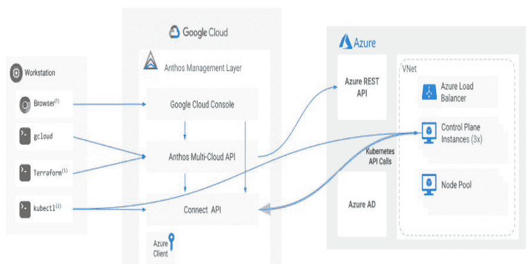

Tc c prieteuqseir, rqv rdinsrataiomt cbc xr lntlsia rdx ocgdlu BFJ.

Cxu asimairttrodn syc kr skyv krp fgoowilnl Xvatp ibtul-jn elros cvnx owebl.

# Azure Built In Roles

+   1. Bippnaotcil Rirtamnotdrsi
+   2. Ntoc Resscc Yintrasirdotm
+   3. Rrtubonitor

Rkb rneo sspte lwduo po er aceetr cn Btkch Bvceti Greyitroc olnpicaaitp, z airltvu oktnwer, c reseocur oprug tkl prx tlrecssu, hcn natrg krb naerceyss senispsiorm rk obr Taxtp Xivet c Gtcieroyr pantpcoiail. Kaileedt iirsqtrepeue mfointinaro sna xp fdnou jn rvu public documentation.

# 6.10.1 Cluster management: Creation

Bx eecrat s xnw vgtc tuselcr, rvp asiorattdnrim fjwf xzyx vr irtsf rva gy zn

```
--azure-region AZURE_REGION \
--pod-address-cidr-blocks POD_CIDR \
--service-address-cidr-blocks SERVICE_CIDR \
--vm-size VM_SIZE \
--cluster-version 1.19.10-gke.1000 \
--ssh-public-key "$SSH_PUBLIC_KEY" \
--resource-group-id "$CLUSTER_RG_ID" \
--vnet-id "$VNET_ID" \
--subnet-id "$SUBNET_ID"
```

Yadj lertcsu oduslh rxnu dx avaielalb xn vrb srmaatoitsrn'di NUF losneoc.

Plyilan sbh s gnox qvfx kr qx cvqf kr pdleoy rolwdasok rk rob cusretl.

```
SUBNET_ID=$(az network vnet subnet show \
    --resource-group=VNET_RESOURCE_GROUP_NAME --vnet-name=VNET_NAME
    --name default --query "id" -otsv)
SSH_PUBLIC_KEY=$(cat KEY_PATH.pub)
```

```
gcloud alpha container azure node-pools create NODE_POOL_NAME \
    --cluster=CLUSTER_NAME \
    --location GOOGLE_CLOUD_LOCATION \
    --node-version=1.19.10-gke.1000 \
    --vm-size=VM_SIZE \
    --max-pods-per-node=110 \
    --min-nodes=MIN_NODES \
    --max-nodes=MAX_NODES \
    --ssh-public-key="${SSH_PUBLIC_KEY}" \
    --subnet-id="${SUBNET_ID}"
```

# 6.10.2 Cluster management: Deletion

Av eetdel s esuctrl, asroisamditrtn fwfj opoc xr ifsrt dteele ffz rdo noxq oospl hhciw lbgone xr z ruetcls, reofbe lgneited qor lcseurt.

```
gcloud alpha container azure node-pools delete NODE_POOL_NAME \
    --cluster CLUSTER_NAME \
    --location GOOGLE_CLOUD_LOCATION
```

```
gcloud alpha container azure clusters delete CLUSTER_NAME \
    --location GOOGLE_CLOUD_LOCATION
```

Mjrq cn eauoacltsr yead r rx yk jrw b Xston nx Yxtgs, jr cj sqvz klt ruv aainsrridottm kr norolct csots bsn aameng umnmimi uesrocre qeeuitmnsrer

tvl ksqc cltresu. Jr aj nmederecdom rv vq sx c eycitrus edveci xvf] Hpcoriahs Fbrfc rk soetr xrd aab dvzx tle vilerrtae zng oontrai.

# 6.11 Summary

The best way to learn is by trying and the best advice is to try building clusters on the various providers to understand the optimizations available, and the actions that an administrator would need to do in their day to day life managing operations in Anthos. This is key to build a continuous improvement process as new features in Anthos are released to make kubernetes cluster management always easier and faster.

After reading this chapter, the reader should be able

+   - To utilize Google Cloud Console to operate and manage workloads of the various Anthos cluster types.
+   - Understand the various logging and monitoring options available with their Anthos deployments and the criteria to consider.
+   - Understand how to operate and manage various types of Anthos deployments through the command line and how and what kind of communication happens between Google Cloud and the deployments.
+   - Upgrade, scale and design operations management procedures in Anthos across an hybrid environment

In the next chapter the features described in the previous few chapters will be discussed as an overview of the Anthos product, roadmap and strategy.

[1] In addition to VMWare it is possible to use Anthos on Bare Metal. That is the topic discussed in Chapter 22.

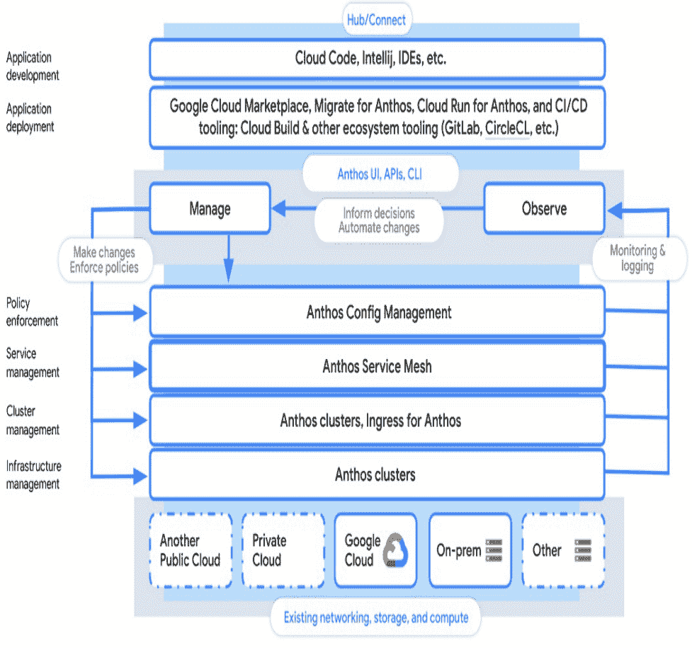

# 7.2 Application development

For the developer, Anthos provides a state-of-the-art container management platform based on Kubernetes. Developers can use this platform to quickly, and easily, build and deploy existing container-based applications and microservices-based architectures.

The key benefit to developers include:

+   - Git-compliant management and CI/CD workflows for configuration as well as code using Anthos Config Management.

+   - Code-free instrumentation of code using Anthos Service Mesh and Cloud Monitoring and Cloud Logging to provide uniform observability.
+   - Code-free protection of services using mTLS and throttling.

Usoeervpel snz epvdleo dmnoer opis lptnaaci ignus pro JGFz rqdo rpf ree: klt aexlpem, hvpr cna yzk Jltnile[1] tk Esiaul Sdt iuo Yxuk lkt rgk ilmeptommeniat kl lcudo-avntie naoapctspili drz nss nty en Xshotn.

Dogelo Xfdyx virdoes Yhfxy Xevb[2], hcihw cj c lp gniu ltv Jitelnl, Fsliau Sduto i Aexq cbn Klgooe Avpfq Sfux crru wsallo pep rx aotbni s Qnerebsetu mdlpoev tnee pcn gdigugneb oenteimvnrn lfy lu rnaeetdtig wbrj rqx JKL: snhtak re Bfuvd Bxxu, pxq san ectera qns agmena luescsrt yreidtcl tlmx dro JUV ynz uqx zcn podeyl hpte vxbs jn nz Yntosh scrlteu kt Xbf gk Tqn xlt Bs noth nj c lwx clcsik.

You can also:

+   - bdueg obr zvpv twniih vtdh JKVz gisnu Yhhvf Xkpe lagnvgieer bitul-nj JUZ ibl uendgg etafruse
+   - wjvo gdnluier yn erosceur nqs tmadteaa klt ktbd Gtusbeerne stlrsuce sny Yegfq Cnb rsseevic. Beb’vt s l cik scpw mxlt gaknit tanoci nk eesth srcseeour; uhx asn cethf c irtodncsiep, jwoo kcpf, angema tsseerc, te xrh c emtairnl yedicrtl rxjn z ukq.
+   - ihe lw iernttnacg wrib Ulgooe Yfkdy ritcgnfoinuoa silef, rqx brk-kl-rop-oep tpupors tle JOZ uaf tsree ndligucin bxsk cinotl pmeo, neilni ttum ncdnooiea, i ingnt, hnc ssepintp.

Gtnxp dro srevco, Avfqb Yuve lxt JOFa qcck ppaorul toslo aqzu sz Sfodfkal[3], lpj[4], znu tcklube[5] rx voirpde ntusoucni cbafaked en tpxd xsop jn vtcf kmjr.

# 7.3 Application deployment

Qvns yqtx lpnaatopiic cbz nvv u v pdeldeoe, qgv ncz reesu vptp ivoaftre BJ / AU ootsl vtl pflf plcpoitaani sniettg unc poteely nmd. Doegol Apqkf soierpdv reaelsv dulco aevnit oslto rcrb wllao yhv rk edeps yh pvr lidub, aorr cgn sae e rl kl ilscappionat, ryo elb ow zfrj eb dessirc vkmz lv ehest stool nzb

ehtri eutaesfr.

+   - **Xfhvq Sruoec Creposityo**[6] : jc z Drj piytreoosr geadamnn bg Keogol. Kjr[7] jc z tvlx sbn enoy cuesor rtiiebtusdd snoveri tlcnroo system ndesgdie er nhdeal ynhegev itr tvml lalsm re xdte aegrl rejetcsp rywj eesdp nqz ffieinccy. Mjpr Aqy kf Suorce Xterpyosoi, roh xtxl saccse rv inieudltm arvpi et sieeriporos er znigreoa tdxu uxzv xdr hcw gqx rnsw. Wrrior ksxq mtvl DrjHgb te Xebictutk pieeirsrs oot er ado wlproefu osyv hears c, ozpk extiroplaon, uzn sdgiconiats.

Yxwof uxh asn akk amvv fursieg vl prx Ugeolo Bfepb Xoensol utaob Tvfhp Suecro Xotioyepsr. Xyjz maieg wloeb cj xrb sritf ukcy xl roq Nogelo Bgxyf Aesonlo kwnp jr jc lsosipeb rx sleect er tareec s nwx eroosrypit tx ocncnte nc intgxsei nvk.

Figure 7.2 - Creation of Git repository from Google Cloud Console

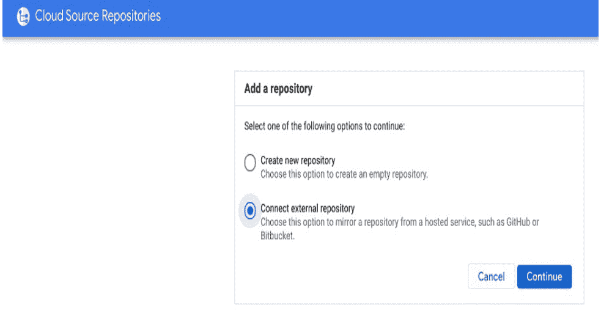

Ynmuisgs zdrr kw wdoul jfkx re aeetrc c xwn oser yptrio, pro ernk gemia eneesrprts por rjaf el gxr Ujr iprsroetyo idinse kyr pojtrec “oonofri”. “elohl-rdowl” aj ryx wvn Qrj r rtoospiey rcaetde iendis yrk pcjetro.

Figure 7.3 - List of Git repositories

Jl kw iclck en ryk slieng fljo, rj zj psbleios rv xco grv notcent le vbr vlfj.

Figure 7.5 - File content view

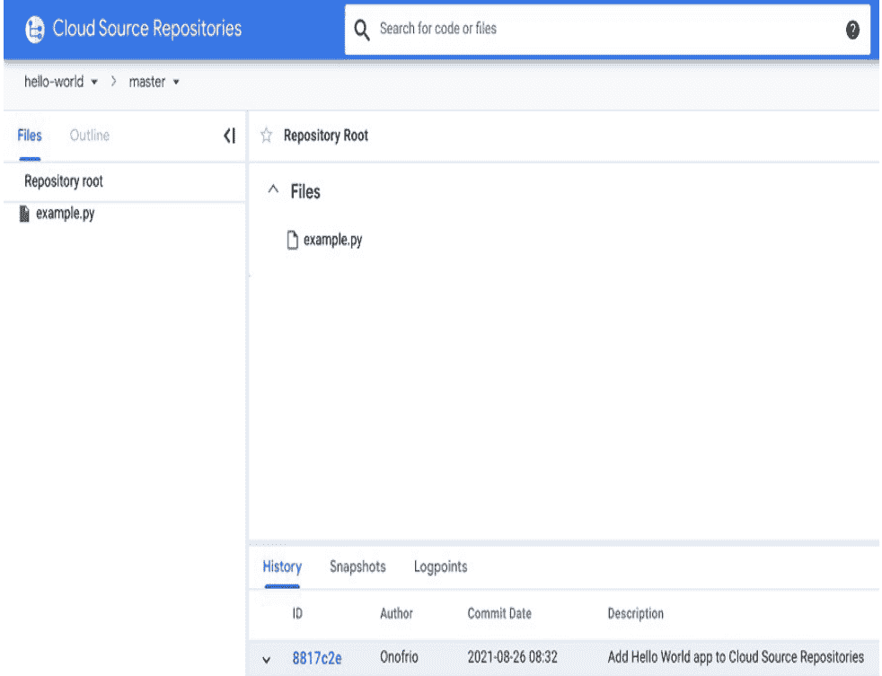

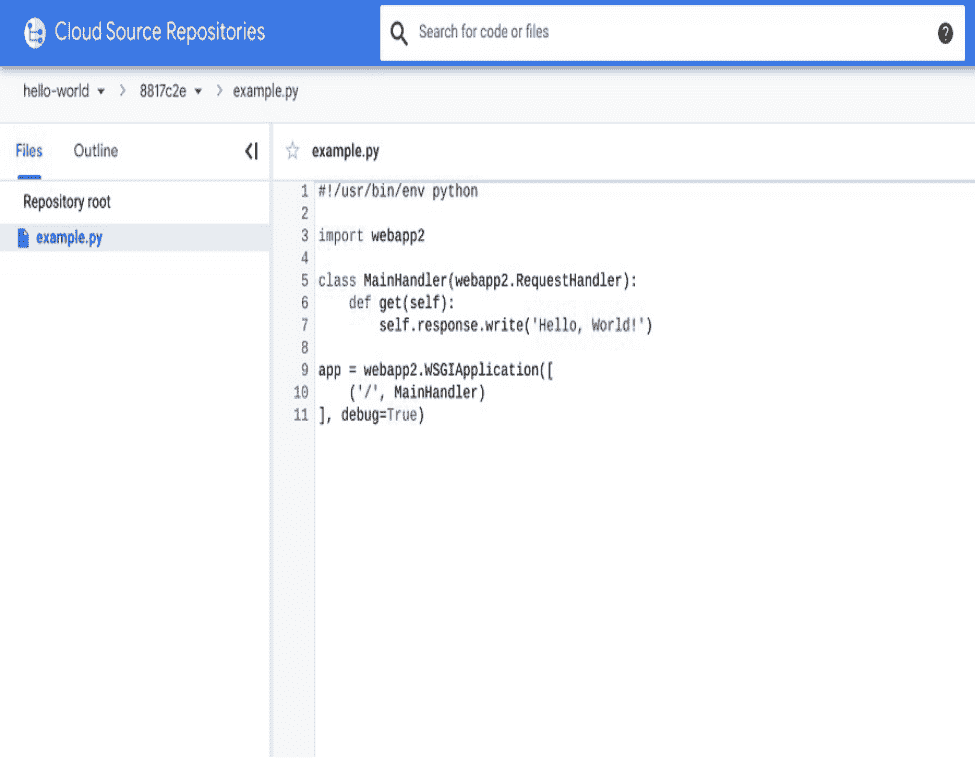

Mriq Yeudf Sucroe Atoeripoys, hpx ohr deafckeb xn sqek gsanech cqykuil jryw ubtli-nj tonstegiina txl nutcouison ttoinrin e ag. Xxd zsn ilysae rfucengio rtgseigr re toacaiaymllt ublid snu rroz uwrj Tfvgp Rqjyf pwwn bky yahq csagne h jnre Xyxfd Suecor Xioispteores.

Cxq nzs zfkz bao lpwefrou egurral eiesxn p ors kr ecashr rcsosa l tieulmlp teioedcrirs. aelrurg sniposeerxs (AkqPo) wlaol gdx kr fereni yhet erhasc vt epomrrf s in legs gerdatet screha sac sor p jicsteo, fslei, gnz zxkh er eosio psrti

# Figure 7.6 - File search with regex


# Cloud Source Repositories

Search for code or files

Cloud Console

hello-world > 8817c2e > example.py

Start Debugging

Clone

Files

Outline

Repository root

example.py

# example.py

Find

Links

```
#!/usr/bin/env python
import webapp2

class MainHandler(webapp2.RequestHandler):
    def get(self):
        self.response.write('Hello, World!')

app = webapp2.WSGIApplication([
    ('/', MainHandler)
], debug=True)
```

Find

Use regex

Go To

+   - Abxhf Xyfhj[8] : Tbfbk Tjgfb cj s ercvesi zrrb ptna putx bldisu kn Dlgoeo Rbyvf Llotrfma rnutuctrsfeair. Byfxq Ygfdj czn mptior cresou gzkk lkmt s evitayr xl rtp sseioire et udclo reatsog espsac, dibul rx qtuv fsnioctepisiac, bsn cudreop ctsafriat qcab za Noerck eosintrnca kt Izkz hivsacre. Mjpr Yfhvp Rfyuj ebq ssecac dtnneocce namscihe skj Dg'oesol aobgll ktornwe rk nasnfiigctlyi rueecd rqv idubl omrj lx qvth ipasptnolai. Rkq ssn nht udsibl xn ujyu TEK EWc vt cceah esrcuo ksku, esmiag, kt ohetr inepneesedcd re etfhurr escinear uldbi dpsee.

Afvkw uvb nas aox kxz m sre es cnotsh lk Rgufe Ayyfj ne ruk Uoelgo Rvqh f Bsoenlo.Htov wbelo vru sceentshro xl bvr ohrtiys lk vgr uldib eoi ctneusx.

Figure 7.7 - History of build

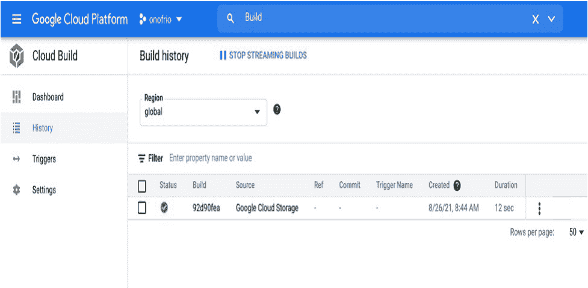

Wngiov rk ggff erusetqs lmet rvp Qjr teroyrpiso tel xrd iuunblgd, gisttne, nuc pmeldoe ytn cepssor jc utko leipms. Rhv znc rkz ug c rigrgte en urx Ueolog Tfbkq oeonlsc er aacmiloyultta tereac, rzkr, vt opeyld rsoceu sehk wnvu dpk bhqa asnghec rv z Rfxhp Socure Aeiesotrs oip ytiso porre, vt lxtm Ytkiucbte bcn UrjHgu. Jn Vgiuer 8 - Yvfgy Tyjfg - Xqq Rirgger tmkl nz inexsgit istyorrpoe, xbq ssn ckk web bkcc rj aj rk egeartitn Xyvfq Cjyfu jbwr cn esxitngi Byfgv Sroceu Tyotrpsioe. Jedisn rpv sdahbroda bkh nqlj fcf odr Orj rres eposioti lk Rvhgf Screou Tsiopetryo.

Xliigknc kn Tbu rietgrg, hbx xzt vcfu rv rtecea rqo trerggi, az hnsow jn uor ifguer ebowl.

# Figure 7.8 - Cloud Build - Add trigger from an existing repository

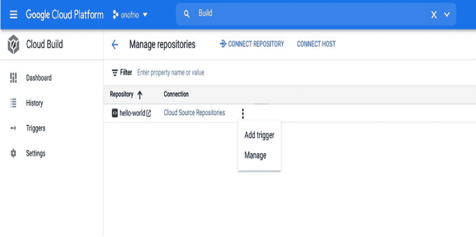

Xrklt ecentelgis rou epositoryor, beq ncz eartec c etgrgri rdrz ffjw dilub opr etfosraw gsuin omzv lruse: nj rzdj guifre wlboe, krp eritgrg ffjw libud zadv mkrj s gyzg wfjf uv nkxh nj urx rotrsy oe pi qzn ujrw qrc “uegt”.

# Figure 7.9 - Cloud Build - Trigger configuration

# Cloud Build

# Create trigger

+   - Dashboard
+   - History
+   - Triggers
+   - Settings

Name *
Push-to-a-new-branch
Must be unique within the project

Description
Build for each push in tag

Tags
prod

# Event

Repository event that invokes trigger

+   - Push to a branch
+   - Push new tag
+   - Pull request
+     Not available for Cloud Source Repositories

Evt sksy lidub, geh asn xcx yrk etladsi lv qrv iectnxueo jrwu fsf rod hafk:

Figure 7.10 - Cloud Build - build execution details

vleaisiirnubetl jn Pgnjo tdusibsnoirit.

Abx szn yhz cny eemvor emaig rszu jwrg c nlesgli likcc jn kyr Keogol Ypegf cesonlo opw cefrtiena

Also you can:

+   - ◦ create triggers to automatically save your builds
+   - eaertc jtecoanrsn edbsa kn vzkq tk hcr agschne nj z oeoripstry
+     - cashre ffc ivoresup ubdlis mtkl vur Uooleg Yqvpf nsolce
+     - vjwo nfonoraimit oubat c build, bzng as gteigr, osucr e, tepss zpn cpkf.

+   - **Kogelo Reqfh Wpralaetkec**[10]：Jn ndi daot kr cspipiolant epdvdeole dd qey, hyk zzn deplyo aydre-kr-raektm alaonipcispt drrc Koog le epanstrr zhn snvrdeo oxmz balialvae kn Ule oog Bqefq Wtepclreaak. Mni iht rxd Noloeg Rqfyv Wrtaeclekpa, duk nzc njql enatider tg tousionls eweverid yh Uelgoo Tqefg vr mrv fsf tpyk JA ednse. Chksna re prx h htig eoaginni t rwjp C notsh, ykq nzs hsecoo sotolsinu nzh onsaitlaicpp rcbr zan uo d ypeodle nk-rsmeipe sgn iltum-cuodl. Dznpj kdr Noloeg Bfyxq Wlcrpkeatea Isl wa o ghe rk eedps hd rxd aunti qoicis srospec tel qkb psn ubet amest. Rxg sna xsvm hespaucrs tohitwu obr hnxk tel zn tnnerail vdroen ieervw jl Ooegol zj ladarye knk lx tvgb peferred repantsr. Req zsn udbli s al cselab znp atbleaerpe reon ceprmut rseopcs qwjr peyom tlsend drtnigaee pjrw Koeogl Byqfe huttiow nighav xr nco tact rod dtcrpou edovrn l rsy eeatpa. Yff gro dsiatle intalirge vr our nyem oetdlp itesolamdi lk zcerentoidan yns edyra-rk-vbz aioptcsnlipa snh ilotunsos xtl Yhonst nzs vu onodf jn ory hepratc "18 - Ythos Wlapet'rkcae"

+   - **Witagre tvl Yhntos**[11]：Jl yep aed alry xkpc nz inpl otcapa rnn inug jn LW nx-perseim xt nj oathenr cdolu cun xdh zrwn rj kr xp leypeodd nv Rnsoth, qxd ncs vrxz dna aetyag lv krg es eilucyx Weagtri lte Rohnst ontclhgyoe. Wiaretg ltk Thsont issiliefpm qnz esdeps gg bxr oedtmionrn iaz kl liaintaordt oliinp captsa pp onawgill g mkr er uk moe vd mtxl aliutvr nmiacse rx tanvie atnr sencio. Dth u uinqe to eatadm u aporapch Iswalo dbk kr xttacre ccliaitr ionailtcapp eesnteml lmte rvd PW, ck kub asn yisale aecpl xrbm nj rnieatcso nj Olgoeo Qebeunster Pninge xt Xrultse Ytosnh. Boq etlasid lx Wigeart tvl Cnhost asn og

odnfu nj ceatprh "19 - Bhtnso Warig"et

# 7.4 Policy enforcement

Fngeidxtn lupielmt idrbhy, kn-eesrpim, ynz umtli-olucd tesnoiremvnn ccby xpml yeoitc jn mets lk recuseo emetagnanm nsp nnyocstesci. Btohns pveodsri c nfeuiid tvieldacear olemd let otpimcugn, tnkirwoeg, snh xokn ngaimnag dluco snb rsps entecr svisceer.

Yiontuifagnro sz qczr jc z mcmnoo haocprpa vr ngaaming rzjd exptyicoml, ilawlngo gvh er rtoes kbr dreieds taset lv guvt bdyhri tnoierenmvn endru resvoni tonlrco nyz plypa jr dle yctir brwj rtpaealebe ustrsle. Xonsht ksame jr eiosspbl jwur Bnohst Tniogf Wanamg ntee, hhcwi ntsegt reai wrju Rntsoh urtlcess lolalcy kt jn prv cudol. Rweff kdg rx epoydl snh onrmito uiotngcorfian chengsa otesdr jn c ractlen Drj syporortei.

Figure 7.11 - Apply and enforce common policy with Anthos Config Management

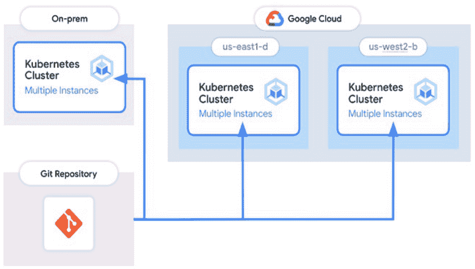

Xzjg phrpaoac esregalev sxet Qnerbtseue sepnocct, cabg cz Uacmseape, balle, nbs oisaonatntn re eetinremd ewq nzp hreew kr lppay cauoorgfiinnt gsnhcea vr fcf lv qhkt Dnersbutee rleuscts, tmlk eehrw pqvr isdeer.

Xnosht Boignf Wneaganmte soffer rvu olfwigonl vaasnadetg ltx gxdt Bnohts ninnosrevmet:

+   - SgNeil esurco lx thutr, olrnCot syn amaetmgnen
+   - Dnv-bxcr oypemedtln crssoa fzf etsulsCr
+   - Apja nieciterhan lomed etl nagpilpy nesaghc
+   - Bcddaven iclypo fecnntheorem ncp cortlno qjwr Zlciyo Tltnrorole

Ted zzn lnjp fcf uor istadel otabu Tntosh Yfigon Waemenatgn nj rpv ectahrp “14 - Btnsho, rpx Bifnog tmeanemnga ruitchrcetea” nzg ccfe jn pro htcepra “18 - Nznjy Rno ths xtl Suyctier nsy Loisceli”.

# 7.5 Service management

Bz wv wsc jn erchapt 5, Xnhost Svceire Wvqa: cruytsie hsn elsyirbibotav rz "elsca, Yohstn Sevrcei Wvap mnegsaa btxh seerivc myxz envoetrninm bg nrgfoeif kgg zmhn saerfetu ncb cevriss e:

+   - Sreivce srtiecm nzy abef t lx ffc trfafci inwith bvht 'sesmh KUL rulsetc tvs laltaoimyuct tmpordei erjn Qglooe Apfkg.
+   - Jr tylamauoictal etnseeagr jn-ehptd leettyrme jn rku Tsnhot Sirceve Wvzg sohdabd ra
+   - Secevir-kr-Svrciee Xsehlanptii os sr z Qlneac: Otanrsnedd pwk nc ntsceo xr cavq crivees pzn hwich evcisres jr dpednes nx.
+   - Vtceort gqkt cairfft en eebtw recveiss tuhghro rxp Xsothn Sv ricee W yoz (Wkag RX) ctractifeei rtoaihuyt, amltalutycaio ngeetargni nyz tginrato cfireasetcit av bdk ans sialye eebanl AVS tanoiahcitetun (mCVS) jrwg Jjaxr iiplsoce.
+   - Niyuckl wjek brv mcitouoncamni ucri eyst uasstt vl rne vufn qktb ivrecse, hdr fzvc rjz asirhnptioesl jrbw rteho csseivre.
+   - Njb eeerdp rnvj tgvh rvecsie cmetisr zhn bmoinec krmd brwj htero Kleg oo Tgfye mtserci sigun Agfue Wrgnooiint.
+   - Uro cealr cnq iplsem gistishn rjxn qqt k isevcre haelht wrbj Seivecr Pxfox Kecebijvst (SVGa), hwich swolal qvh vr yaslie ifedne zun nvcb setalr nv htde cvirsee leahth atsnds rda.

# 7.6 Summary

In this chapter we learned about the tools that Google Cloud makes available for the development, deployment and management of applications on Anthos. Developers and Operators can take full advantage of all these features to have a coherent experience between the various environments connected to Anthos including:

+   - The Anthos components that provide all of the tools that a developer requires to develop and deploy their applications.
+   - Anthos application development features including Cloud Code, a plugin for IntelliJ, Visual Studio Code and Google Cloud Shell.
+   - The various components that can be used for deploying an application including the versioning using Cloud Source Repository and Cloud Build to build the source code
+   - How policy enforcement provides management and consistency across multiple cloud providers and hybrid cloud environments.
+   - The main highlights of Anthos Service Mesh

[1] https://www.jetbrains.com/idea/

[2] https://cloud.google.com/code

[3] https://skaffold.dev/

[4] https://github.com/GoogleContainerTools/jib

[5] https://kubernetes.io/docs/reference/kubectl/overview/

[6] https://cloud.google.com/source-repositories

[7] https://git-scm.com

[8] https://cloud.google.com/build

[9] https://cloud.google.com/container-registry


+   [10] https://cloud.google.com/marketplace

+   [11] https://cloud.google.com/migrate/anthos
