# 8 Anthos 中的混合应用

作者：Jason Quek

# 本章涵盖

+   - 高可用应用
+   - 地理分布式应用
+   - 受法规监管的应用
+   - 必须在边缘运行的应用

在现实世界中，应用受到诸多规则的限制，例如数据本地化要求、资源约束，以及无法保证与云端稳定连接的环境（如棒球场、建筑工地或战斗机中），或者需要在边缘端进行低延迟本地计算以避免大量数据传输。同时，应用还必须保持高可用性，能够经受区域性灾难或云端中断的考验。

然而，仍然存在以 Kubernetes 平台所提供的一致性和稳定性来运行应用的需求。因此，Anthos 这类解决方案正是为了给此类应用创建一个符合规范、分布式的云平台而设计的。

在本章中，我们将探讨不同的应用场景，并展示使用 Anthos 及其产品套件来支持这些类型应用的各种架构。

# 8.1 高可用应用

这类应用需要一周 7 天、一天 24 小时持续运行。金融机构的交易处理、医疗健康应用、交通管理只是其中几个例子——如果这些应用短暂不可用，就会对现实世界产生重大影响。

在 Google Cloud 多区域环境中，企业通常会在一个区域的多个可用区之间复制工作负载，以提供高可用性。如果某个可用区发生故障，另一个可用区中的副本可以继续运行，而不会造成服务中断。GKE 为每个可用区提供独立的控制平面，从而实现了这种可用性保障。通过 GKE 的多区域部署，即使某个集群或区域发生故障，应用也能在另一个可用区中继续运行。对于需要跨多个可用区甚至多个云提供商提供冗余的企业而言，这种能力至关重要。

然而，如果应用需要更高级别的可用性，又该如何实现呢？在 GKE 中，多集群部署的方式可以确保当单个集群或区域发生故障时，另一个集群能够接管并继续提供服务。通过 GKE 的多区域部署，可以在区域中断期间提供最大程度的保护，该能力已在 Google 官方文档中有所概述。对于需要 7x24 小时不间断运行的应用，多集群策略可以确保业务的连续性。

在这种情况下，企业可能希望使用多个云和多个区域来承载应用，但这会带来管理多个集群的复杂性。可以想见，在管理多个云提供商，并确保每个提供商都能提供相同水平的可用性时，运维挑战不容忽视。企业还需要在每一步运营中考虑数据主权与合规性要求。

借助 Anthos，企业可以在 Kubernetes 之上对其部署、扩缩、安全策略和治理流程进行标准化，同时利用来自多个云提供商的可用性优势。Anthos 可在多个云提供商之间提供统一的集群管理和工作负载编排能力，帮助企业跨越地域和可用区进行弹性扩展。

## 8.1.1 架构

图 8.1 展示了一个简单架构，其中 Anthos GKE、AWS 和 Azure 集群通过服务网格连通。这种架构让应用可以部署在多个 Kubernetes 集群中，并由一个中央控制平面统一管理。如果某个集群或服务发生故障，流量会自动切换到其他健康集群，从而确保应用的高可用性。

**图 8.1. 通过服务网格连接实现多云可用性**

在这种架构下，多个集群可以协同工作，确保即使某个集群、可用区或区域发生故障，应用仍然可用。这种冗余级别很难在单一云提供商的单一区域中实现。Anthos 集群与 Google Cloud 全球负载均衡能力的结合，使任何服务的故障转移都变得透明且自动化。

## 8.1.2 优势

通过在不同云提供商之间分布工作负载，企业可以避免供应商锁定，同时利用不同云平台的差异化优势。Anthos 和 GKE 让企业能够跨云统一管理服务。通过 Anthos 接入 Google Cloud 全球网络，可以利用 Google 的骨干网将流量路由到离用户最近的端点，从而在全球范围内提供低延迟访问。对于运行在 Microsoft Azure 或本地数据中心等混合环境中的应用，Anthos 同样提供了一个统一的容器基础设施平台。

## 8.1.3 限制

某些应用可能需要在本地运行，或者由于数据主权和合规性要求，无法将工作负载放置在公有云中。GKE 和 Anthos 也提供了本地部署选项，例如 Anthos clusters on VMware，可以部署在本地集群环境中。但与此同时，用户需要自行管理本地集群的底层基础设施，包括计算、存储和网络资源，这会增加运维的复杂性。

Anthos 并不能解决所有问题。对于要求极致可靠性和最高可用性的关键业务应用，企业仍然需要深入了解其基础设施的方方面面。Anthos 的集群故障转移能力已经相当成熟，但用户仍需仔细评估自身工作负载对可用性的具体需求，才能在不同区域集群之间实现有效的故障转移。Anthos 为满足这些需求提供了一条清晰的路径。

# 8.2 地理分布式应用

另一类应用需要部署在全球各地，以便为分布于世界各地的众多用户提供低延迟的服务。

将应用托管在全球各地的边缘位置，可以使用户通过就近的接入点访问服务，从而获得更快的加载速度和更佳的用户体验。同时，这种部署方式也使得应用能够在全球范围内更加简便地扩展。

将应用分布式地部署在多个地理位置的核心价值在于，用户可以从距离自己最近的集群访问应用，从而最大限度地减少网络延迟。应用通常以多个副本的形式部署在不同区域的集群中，而这又带来了跨区域管理这些集群的复杂性。借助 Anthos，用户可以轻松地将工作负载部署在多个区域和多个 Kubernetes 集群中，并通过全局负载均衡进行统一管理。

然而，借助 Anthos Ingress，应用可以部署在多个区域的集群中，并通过一个全球统一的流量入口对外提供服务。

Anthos Ingress 使用全球 Anycast IP 地址，使用户能够通过单个统一入口访问应用，同时智能地将流量路由到最合适的后端集群。

在某些场景中，这对客户来说尤为重要，例如在零售行业，用户希望就近、快速地访问电商网站，以获得更流畅的购物体验。

## 8.2.1 Ingress for Anthos 架构

Ingress for Anthos 构建在 Google Cloud 的全局 HTTP(S) 负载均衡之上，结合了 Google Cloud 的任播 IP 和全球负载均衡能力，能够将用户流量路由到距离其最近的可用集群，如图 8.2 所示。借助这一架构，应用可以部署在特定区域，并由 Ingress for Anthos 自动将流量引导至健康的后端集群。

# 图 8.2. Ingress for Anthos 架构

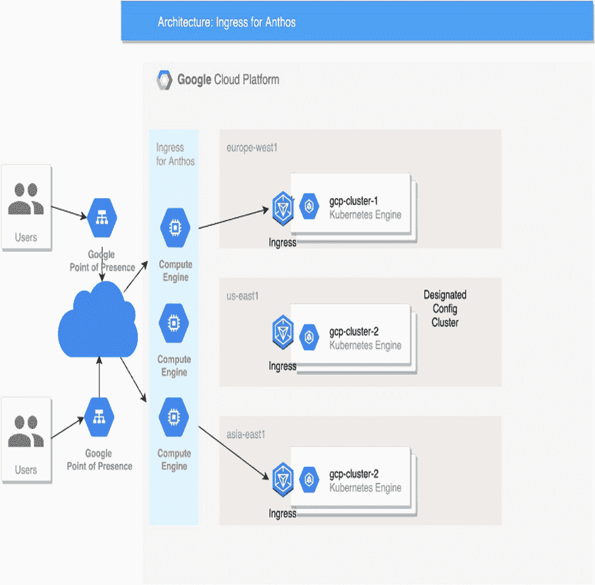

这些集群可以被注册为单一的逻辑集群，并由 **MultiClusterIngress** 和 **MultiClusterService** 在集群中进行统一配置和管理。管理员可以通过 Anthos Ingress Controller 将这些配置集中应用于所有集群，从而简化多集群环境下的流量管理。

Anthos Ingress Controller 是开源 Ingress Controller 的一个分支，它在多个 Google Cloud 区域中运行，并由 Google 进行托管。企业可以将后端服务部署在 Google Cloud 的多个存在点（Point of Presence）上，实现跨地域的流量分发。该控制器会根据集群的健康状况和流量负载，将流量高效地路由到最合适的集群，从而保证应用的高可用性。

此外，Ingress for Anthos 还支持网络端点组（NEGs）。网络端点组是一组用于支撑服务的后端端点，可以部署在 Anthos 集群中。在图 8.2 所示的架构中，Ingress for Anthos 会利用这些 NEG，基于各集群中服务的可用性来分发流量。

要了解更多关于 Ingress for Anthos 的工作原理，请参阅本书中关于 Anthos 的章节。

## 8.2.2 Ingress for Anthos 的优势

Ingress for Anthos 可以将用户流量智能地路由到最近的健康端点，从而显著降低访问延迟。同时，它还能提升集群中服务的整体可用性，因为流量可以在多个集群之间进行负载均衡，避免单一集群过载。

对于只需要单一集群服务的用户而言，Ingress for Anthos 也可以简化应用对外暴露的方式。它能够将流量在世界各地的集群中进行负载均衡，使企业可以快速地在多地域部署服务，并在故障发生时自动切换，从而保证用户体验的持续性。

## 8.2.3 Ingress for Anthos 的限制

Ingress for Anthos 目前主要面向使用 Google Cloud GKE（Google Kubernetes Engine）的集群，并且不支持将流量分发到本地集群或 AWS 集群。如果需要一个能够将流量路由到本地或 AWS 集群的解决方案，则可能需要考虑其他替代方案。

# 8.3 支持互联网访问的混合多云应用


# 8.4.1 架构

# 架构：受监管的应用

Google Cloud Platform

GCP 项目 Anthos 管理

GKE Connect

VPC Service Controls.

管理员

远程数据中心（数据本地化限制）

本地集群 1
GKE On-prem

本地集群 1 上的服务，使用 Anthos Service Mesh

应用系统

图像服务

Vault

数据库

Gitlab

配置管理仓库

# 8.4.2 优势

# 8.5 必须在边缘运行的应用

# 8.5.1 架构

**图 8.5. Anthos 在边缘零售架构**

# 架构：Anthos 在边缘

Google Cloud Platform

数据科学家

BigQuery

Kubeflow Pipelines

Kubeflow

训练并构建容器化模型

容器注册表

Cloud Storage

将聚合数据发送回云端

零售商商店 1 - Anthos 在裸金属上

视频

裸金属集群 1

Anthos 在裸金属上

购物者

零售商商店 2 - Anthos 在裸金属上

视频

裸金属集群 1

Anthos 在裸金属上

拉取模型的最新版本

# 8.5.2 优势

# 8.5.3 限制

# 8.6 总结

The different Google Cloud and Anthos services have an important place towards the different use cases of high availability, geographical spread,

regulated industries and edge computing. Many enterprises will have a need to achieve these different use cases to enrich their digital offerings and can use the prescribed architectures to do this.

After reading this chapter, the reader should be able

+   - Identify the different types of applications which can utilize the Anthos feature set to achieve higher uptime, remove single cloud dependencies and serve a customer base globally while adhering to the terrestrial laws
+   - Understand the benefits and limitations of the different architectures such as having to design multi geographical state persistence, as well manual node installations for edge deployments
+   - Utilize different Google Cloud features in conjunction with Anthos to build out the different types of applications.

In the next chapter the reader will deep-dive into Anthos and how the compute environment looks like on VMware.

+   [1] https://www.forbes.com/sites/tomgroenfeldt/2020/06/22/google-anthos-simplifies-synch-for-multi-cloud-implementations/?sh=68b181114c42
+   
+   [2] See chapter Operation Management in Anthos for environ definition
+   
+   [3] https://cloud.google.com/armor
+   
+   [4] https://cloud.google.com/cdn
+   
+   [5] https://cloud.google.com/iap
+   
+   [6] https://cloud.google.com/load-balancing/docs/ssl-certificates/google-managed-certs
+   
+   [7] https://cloud.google.com/beyondcorp
+   
+   [8] https://cloud.google.com/blog/topics/anthos/how-mlb-is-using-anthos
+   
+   [9] https://www.researchgate.net/publication/334782772_RetailNet_A_Deep_Lec


Anthos 在 VMware 上部署了管理控制平面构建在基础设施上，... 管理集群，... 在 Google Cloud 上运行的 VMware vSphere（GKE）。... ... ...

## 9.1 为什么要使用 Anthos on VMware？

... ...

## 9.2 Anthos on VMware 架构

... ...

Figure 9.1. 升级选项

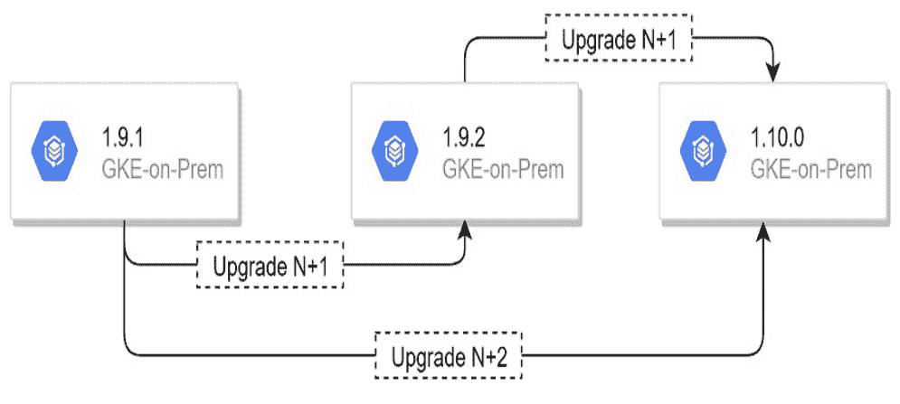

... ...

Figure 9.2: Anthos on VMware 部署流程

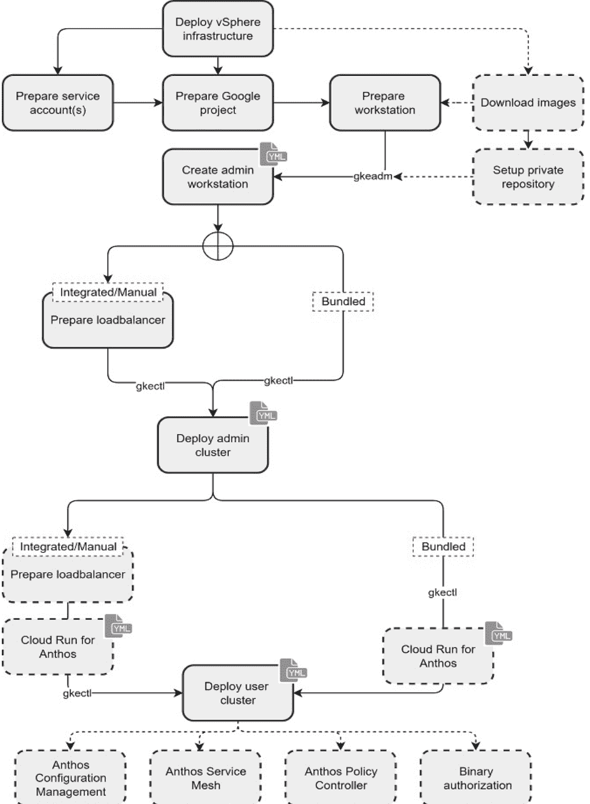

部署 vSphere 基础设施

准备服务账号

准备 Google 项目

准备工作站

下载镜像

设置私有仓库

创建管理员工作站

集成/手动

准备负载均衡器

捆绑

部署管理员集群

集成/手动

准备负载均衡器

Anthos 的 Cloud Run

捆绑

Anthos 的 Cloud Run

部署用户集群

Anthos 配置管理

Anthos 服务网格

Anthos 策略控制器

二进制授权

gkеadm

gkectl

gkectl

gkectl

gkectl

... ...

## 部署管理平面

... ...

## 管理员工作站准备

... ...

## 图 9.3. 管理员工作站部署


- 安装 Cloud SDK
- 配置项目
- 下载 gkeadm
- 生成管理员工作站配置文件
- 用详细信息填充 yaml 文件
- 部署管理员工作站

你的第一个任务是在本地机器上安装 Google Cloud SDK。这可以是在 Linux、macOS（工作站或服务器）或 Windows 10 机器上。

一旦你安装了 SDK，现在就可以下载 gkeadm 实用程序。在安装此实用程序之前，使用以下命令下载最新版本。

```bash
gsutil cp gs://gke-on-prem-release-public/gkeadm/{Anthos on VMware version number}/linux/gkeadm ./
```

如果你使用的是 Linux，你需要使用 chmod 使二进制文件可执行。

```bash
chmod +x gkeadm
```

下载文件后，你可以部署管理员工作站。

## 部署管理员工作站

部署管理员工作站基于单个 YAML 配置文件，你需要在其中包含以下内容：

- vSphere
- Network
- proxyUrl
- adminWorkstation

vSphere/vCenter 连接是一个专用的配置元素。你需要提供你的 vCenter 凭据和 `componentAccessServiceAccountKeyPath`，它定义了服务帐户的密钥。还提供在你的项目中具有访问 vCenter 权限的凭据以及相关的项目。

```yaml
gcp:
  componentAccessServiceAccountKeyPath: "whitelisted-key.json"
```

服务帐户密钥文件用于使用 vCenter Server 进行身份验证。如果你的服务帐户尚未在 vCenter Server 上获得授权，请使用所需的角色创建服务帐户密钥，并在凭据文件中指定它。下面显示了一个示例凭据文件。

```yaml
apiVersion: v1
kind: CredentialFile
items:
- name: vCenter
  username: "myaccount@mydomain.local"
  password: "Th4t1$4Nth05"
```

所需 vSphere 信息包括你的数据中心名称、数据存储名称、集群名称、网络和 vCenter 根证书。通常，客户以 ZIP 文件的形式提供 vSphere 证书，然后在 vCenter 配置中指定。

```yaml
vCenter:
    credentials:
        address: "10.10.10.10"
        fileRef:
            path: credential.yaml
            entry: vCenter
    datacenter: "MY-DATACENTER"
    datastore: "MY-DATASTORE"
    cluster: "MY-CLUSTER"
    network: "MY-VM-NETWORK"
    folder: "MY-FOLDER"
    resourcePool: "MY-POOL"
    caCertPath: "vcenter-root.cert"
```

如果为 vCenter 服务器使用 CA 签名的证书，则需要将证书添加到 `caCertPath` 值中。它可以通过使用以下命令获得：

```bash
curl -k "https://{SERVER_ADDRESS}/certs/download.zip" > download.zip
```

下载后，解压缩文件，将 vCenter 证书提取到本地证书文件夹中。

如果你的环境需要使用代理服务器访问互联网，你可以配置代理服务。此信息可以通过在 CLI 部署期间将其传递给 gkeadm 命令来提供。

```yaml
proxyUrl: "https://my-proxy.example.local:3128"
```

如果使用代理，你需要将适当的地址添加到你的 DNS 以设置 `no_proxy` 变量。此信息特定于你的确切公司和部署——关于如何使用代理服务器及其所有选项的完整解释超出了本书的范围。作为起点，你应该添加 vCenter 服务器、本地注册表（如果已配置）以及集群节点的 IP 范围。

下一节列出了部署所需的以下配置信息：

- vSphere 用户名
- vSphere 密码
- 负载均衡器 IP
- vSphere 集群
- 集群中的节点数
- 已安装的 Kubernetes 版本

## NOTE

始终确保创建新 VM 的文件夹存在。请务必先手动创建它。

管理员工作站可以使用 vSphere 服务器上的静态 IP 管理策略分配 IP 地址。此设置在网络配置文件中使用 `ipAllocationMode` 属性定义。

如果你的 VM 使用 DHCP，其余子网络配置元素保持未定义。

在使用静态 IP 地址时，`ipAllocationMode` 属性必须设置为“static”，后跟 IP、网关、子网掩码和 DNS 配置。DNS 值可以定义为具有多个值的属性数组。

最后，向管理员工作站提供 NTP 服务器地址。它是强制性设置；环境中的任何差异都会导致部署失败。

下面显示了一个示例配置文件；第一个配置为静态 IP，第二个配置为 DHCP 地址。

```yaml
adminWorkstation:
  name: "gke-admin-ws-200617-113711"
  cpus: 4
  memoryMB: 8192
  diskGB: 50
  dataDiskName: "gke-on-prem-admin-workstation-data-disk/gke-admin"
  dataDiskMB: 512
  network:
    ipAllocationMode: "static"
    hostConfig:
      ip: "10.20.20.10"
      gateway: "10.20.20.1"
      netmask: "255.255.255.0"
      dns:
        - "172.16.255.1"
        - "172.16.255.2"
  proxyUrl: "https://my-proxy.example.local:3128"
  ntpServer: "myntp.server.local"
```

```yaml
adminWorkstation:
  name: "gke-admin-ws-200617-113711"
  cpus: 4
  memoryMB: 8192
  diskGB: 50
  dataDiskName: "gke-on-prem-admin-workstation-data-disk/gke-admin"
  dataDiskMB: 512
  network:
    ipAllocationMode: "dhcp"
    hostConfig:
      ip: ""
      gateway: ""
      netmask: ""
      dns: []
  proxyUrl: "https://my-proxy.example.local:3128"
  ntpServer: "myntp.server.local"
```

现在你可以使用 gkeadm 实用程序在 vSphere 基础设施上创建管理员工作站。

```bash
./gkeadm create admin-workstation --auto-create-service-accounts
```

添加 `--auto-create-service-accounts` 标志还将自动在你的项目中创建所需的服务帐户。

一旦管理员工作站创建完成，你就可以使用它来部署管理员集群。在下一节中，我们将指导你完成创建管理员集群的步骤。

## 创建管理员集群

管理员集群是 Anthos 控制平面的核心组件。它负责你的集群的配置和管理。它作为 Kubernetes 集群部署，使用单个控制平面节点和两个工作节点 [Figure 9.4]。

控制平面节点为管理员集群控制平面提供 Anthos API 服务器、管理员集群健康检查以及工作节点所需的引导组件。工作节点用于为 Anthos 本地节点提供 CPU、内存和存储等资源。除了管理员控制平面和节点之外，管理员集群还托管你的 vSphere 控制平面。作为一个集群，主集群为管理员集群中的节点提供 API 服务器、工作负载和管理/监控功能。

**Figure 9.4. Anthos on VMware admin cluster architecture**

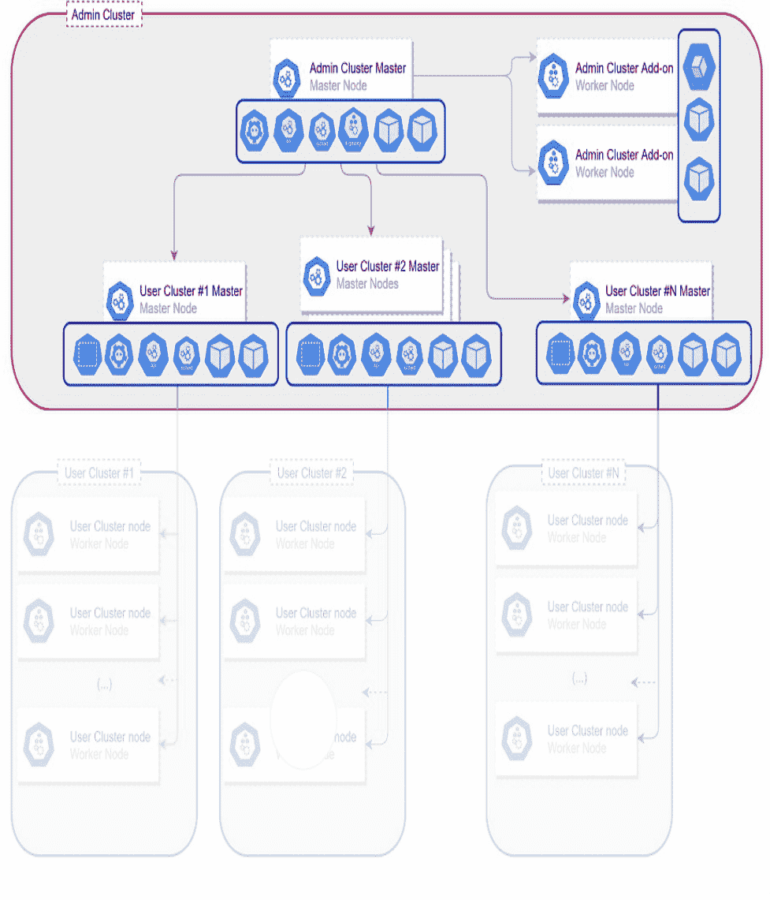

要创建管理员集群，你需要通过 SSH 进入在第一部分中创建的管理员工作站。使用在部署管理员工作站时创建的密钥通过 SSH 进入管理员工作站，位于 `.ssh/gke-admin-workstation`。

| Property key | Property description |
|---|---|
| `networkName` | 管理员集群节点和用户集群主节点分配到的 vSphere 端口组名称。 |

下面显示了一个示例配置。

```yaml
network:
  ipMode:
    type: dhcp
  serviceCIDR: 10.96.232.0/24
  podCIDR: 192.168.0.0/16
  vCenter:
    networkName: "My Anthos on VMware admin network"
```

如果你不想使用 DHCP IP 地址，可以配置静态 IP 配置文件。文件的路径必须通过 `ipBlockFilePath` 选项指定，并且 `ipMode.type` 必须设置为 `static`。你可以选择为文件中定义的主机指定 DNS 和 NTP 服务器地址，如下面的示例所示。

```yaml
network:
  ipMode:
    type: "static"
    ipBlockFilePath: "myAdminNodeHostConFile.yaml"
  hostConfig:
    dnsServers:
      - "8.8.8.8"
    ntpServers:
      - "myNTPServer"
    searchDomainsForDNS:
      - "myDomain.local"
```

静态块配置文件是使用以下配置选项构建的：为每个节点指定一个块。对于 hostConfig，你可以定义有关 vSphere 服务器、DNS 服务器和 NTP 服务器的信息。hostConfig 中定义的块必须包含与相应 IP 块文件中定义相同的 IP 地址；否则，IP 地址将不会分配给正确的节点。

| Property key | Property description |
|---|---|


## 生产中 AI 模型失效的 7 个原因

> 模型在训练时表现良好，但在真实场景中却一败涂地。问题往往不在于模型本身，而在于我们构建模型的方式。

- 数据分布偏移（Data Drift）
- 过度拟合至验证集
- 特征分布不一致

在实际生产中，模型失效的最常见原因是训练数据与真实世界数据之间的分布差异。当数据的统计特性随时间发生变化时，模型的性能会急剧下降。

```python
skew = abs(train_mean - live_mean)
if skew > threshold:
    trigger_retraining()
```

持续监控数据分布，并在分布偏移超限时触发重新训练，是保证模型长期有效的重要手段。

- 建立特征健康度检查
- 设定模型性能回退机制
- 定期人工审计模型输出

### 负载均衡器配置

要使用捆绑的 MetalLB 负载均衡器，请在集群配置文件中指定 `loadBalancer` 部分。以下示例为控制平面设置虚拟 IP：

```yaml
loadBalancer:
    vips:
        controlPlaneVIP: "133.23.22.100"
    kind: MetalLB
```

如果使用其他类型的负载均衡器，例如 F5 BIG-IP，请相应地配置字段。

### 反亲和性组

`antiAffinityGroups.enabled` 控制控制平面节点是否放置在不同的 ESXi 主机上。启用反亲和性组有助于保护控制平面免受单个主机故障或 ESXi 维护事件的影响。如果禁用此选项，您可以减少所需的 ESXi 主机数量，但会增加控制平面停机的风险。

```yaml
antiAffinityGroups:
    enabled: true/false
```

### Stackdriver / Cloud Monitoring

要将指标和日志导出到 Google Cloud，请配置 `stackdriver` 部分：

```yaml
stackdriver:
    projectID: "my-logs-project"
    clusterLocation: "us-central1"
    enableVPC: false
    serviceAccountKeyPath: "my-key-folder/log-mon-key.json"
    disableVsphereResourceMetrics: true
```

服务账号密钥文件必须具有适当的 Cloud Monitoring 和 Cloud Logging 角色。如果未使用 VPC，请将 `enableVPC: false`。

### Cloud Audit Logging

要启用 Cloud Audit Logging，请配置 `cloudAuditLogging` 部分：

```yaml
cloudAuditLogging:
    projectID: "my-audit-project"
    clusterLocation: "us-central1"
    serviceAccountKeyPath: "my-key-folder/audit-log-key.json"
```

审计日志配置跟踪集群生命周期变更，并需要具有适当权限的服务账号。

### 节点自动修复

`autoRepair` 控制是否自动修复不健康节点。启用后，`cluster-health-controller` 会检查节点健康状况并排空并重新创建不健康节点，如图 9.5 所示。

```yaml
autoRepair:
    enabled: true/false
```

**图 9.5. 节点自动修复流程**

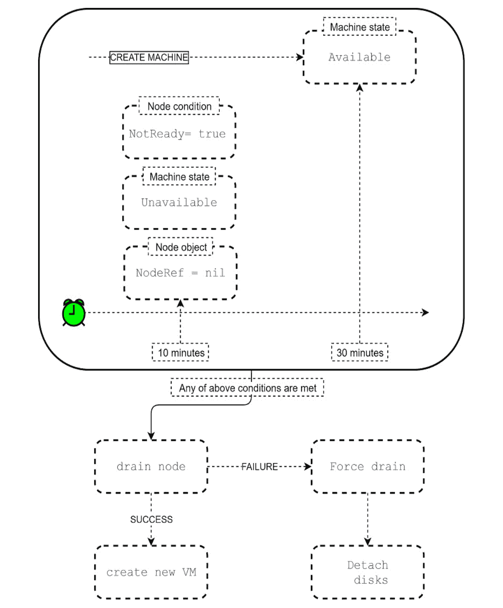

> **NOTE**：自动修复由 `cluster-health-controller` 部署实现。它监控管理集群和用户集群中的节点并修复不健康节点。

### 私有仓库

要使用私有容器仓库，请指定包含仓库地址、凭据和可选 CA 证书的 `privateRegistry` 部分：

```yaml
privateRegistry:
  address: "{{Private_Registry_IP_address}}"
  credentials:
    fileRef:
      path: "{{my-config-folder}}/admin-creds.yaml"
      entry: "private-registry-creds"
    caCertPath: "my-cert-folder/registry-ca.crt"
```

### 密钥加密

Anthos on VMware 支持静态加密 Kubernetes 密钥。要启用此功能，请设置 `secretsEncryption` 部分：

```yaml
secretsEncryption:
  mode: GeneratedKey
  generatedKey:
    keyVersion: 1
```

> **TIP**：使用 `gcloud` 命令或适当的更新命令轮换生成的加密密钥，然后在配置中更新密钥版本。

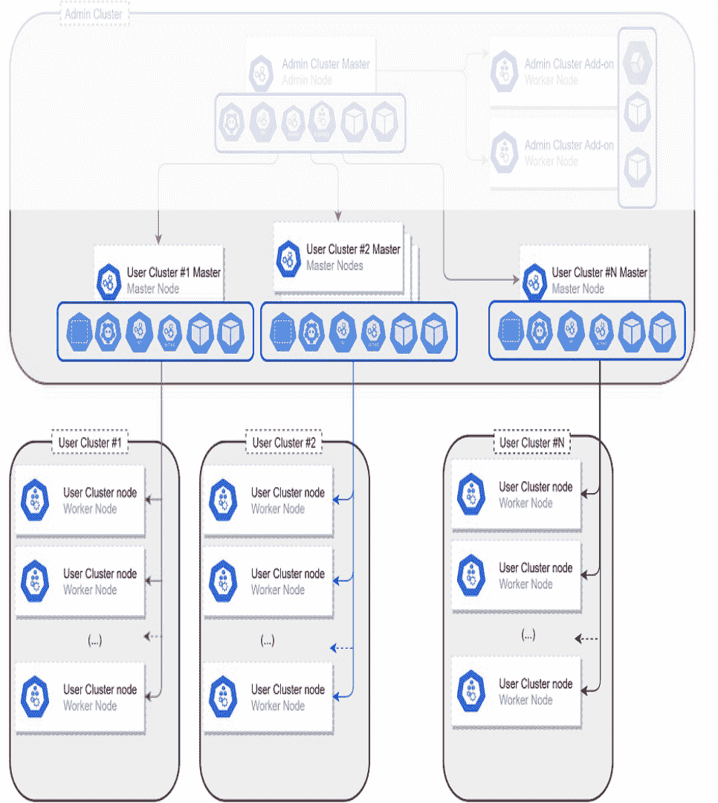

> **IMPORTANT**：部署后，**不能**在不完全重新创建集群的情况下更改主节点数量。

### 用户集群命名空间

每个用户集群都在管理集群中的专用命名空间中部署。命名空间包含用户集群服务、部署和其他 Kubernetes 资源。

命名空间名称与集群名称相关联，因此您可以使用以下命令查找用户集群中部署的所有资源：

```
kubectl get all -n {{ clusterName }}
```

用户集群的命名空间在用户集群创建时自动创建，并由用户集群生命周期控制器管理。不得手动修改。

**图 9.7. Anthos on VMware 用户集群命名空间**

| Admin Cluster | User Cluster name | User Cluster |
| --- | --- | --- |
| config-management-system | kube-public | default |
| kube-system | gke-connect | knative-serving |
| gke-system | kube-node-lease |  |

与管理集群类似，用户集群是从 YAML 配置文件部署的。基本资源定义为：

```yaml
apiVersion: v1
kind: UserCluster
```

> **TIP**：您可以使用以下命令转换旧版本的配置文件：
>
> ```
> gkectl create-config cluster --config $MyAwesomeClusterConfigFile
> ```

### 网络配置

要定义集群网络，请使用 DHCP 或静态 IP 模式配置 `network` 部分。

DHCP 模式：

```yaml
network:
  ipMode:
    type: dhcp
  serviceCIDR: 10.96.232.0/24
  podCIDR: 192.168.0.0/16
  vCenter:
    networkName: "My Anthos on VMware user network"
  additionalNodeInterfaces:
  - networkName: "My additional network"
    type: dhcp
```

静态 IP 模式：

```yaml
network:
  ipMode:
    type: "static"
    ipBlockFilePath: "myNodeHostConfFile.yaml"
  additionalNodeInterfaces:
  - networkName: "My additional network"
    type: "static"
    ipBlockFilePath: "mySecondNodeHostConfFile.yaml"
```

在开始集群创建之前，确定主节点将使用 3 个还是 1 个副本。3 副本控制平面提供高可用性；1 副本控制平面不提供。

以下示例定义主节点资源：

```yaml
masterNode:
  cpus: 4
  memoryMB: 8192
  replicas: 3
```

> **TIP**：配置文件为 YAML。枚举值应作为字符串引用；否则 YAML 可能会错误解释它们。诸如 `cpus`、`memoryMB` 和 `replicas` 之类的数字字段应使用整数值。


# CLUSTER

# 命名空间

Role

RoleBinding

ClusterRole

ClusterRoleBinding

Ougnri rvg taob sclteru typloee dmn, gkh sna tariegetn ryk ltr escu vnrj nz xginties Bteicv Urreoyict Ztenaoeidr Seirvcse (TQVS), Keoogl, Qrvc tv zbn ohrte eftciierd NknqJG edrvopir[9]. Ye igofncuer tseeh gssneitt, ow rdmc iedrovp cff vriopdre cfecsiip omiainotrnf eunrd vr d authentication.oidc nteosic lx rvu rn ocftiuaiog fojl. Afweo aj nc eemlapx lv gnuis Kgeloo’a NJGA enarotiingt.

# INFO

Qgoloe UnbxJU edrripvo trneured tkoen dseo rnx ncainto fitnomn aroi uoabt bro uogrp rrsd qtkz goesnbl kr. Xc s uretls bxb kr rpsr otimaintli idiinv luda usesr mcdr qv pirddoev eitnads.

```
authentication:
```

```
oidc:
  issuerURL: "https://accounts.google.com"
  kubectlRedirectURL: "http://localhost:2222/callback"
  clientID: "r4nd0md4t4.apps.googleusercontent.com"
  clientSecret: "s3cr3t"
  username: "email"
  usernamePrefix: "_-"
  group: ""
  groupPrefix: ""
  scopes: "email"
  extraParams: "prompt=consent,access_type=offline"
  deployCloudConsoleProxy: "false"
```

# TIP

To restore user cluster kubeconfig you can trigger:

```
kubectl --kubeconfig $ADMIN_CLUSTER_KUBECONFIG get secrets -n $US
```

Xbo nxer ntpooi, airm lis kr dinam uscetrl, ja rou ioptno er leeabn tk sibdael hxcr riepra yatiuntfnocl en aiiuocngortnf lfjv lelve

```
autoRepair:
  enabled: true/false
```

Ydo veh ffendereic mvlt qvr naidm rtlseuc onagouncifirt aj qsrr rj nsz qk laysie hedganc hp pnylpaig ecgsanh krjn pro XYWZ uocfnigioanrt olfj psn gitrrggnei c gkectl update oacndmm.

Cgx cafr trhs vr xg dvcoere eferbo wk omke nk re gkoitnnwre zj aetrsog. Ad utf dlea Rsnoht nv LWctwv dneuicl dxr kSehrep Qbenesutre muovle lipgnu urrc oawlsl inydlal mcay niprviosongi oSeerhp EWK U dkiss kn drv le straadtseo [10] hadtteca vr eBteenr escs lurt. Xrtlk z nwk atqk tcrsuel cj adceret, jr jc iduoegrncf ujrw s utaedfl gaosetr lascs zrrp ntiosp rv rxg kSepehr seadoattr. Yesidse rvd ulvmeo rcnocnote, ylwne edeoldyp t lsrecsu ctlailumatoya rho org oSprehe Yrn tinoea Sgtoera Janfrecet (TSJ). Xvy BSJ aj c daatrsnd YZJ cwihh awsl lo bep kr enn cotc drclytei rk tmalceboip raetosg, sipybsang oSehper gat rsoe. Jr’a wrtho mnntiniego surr Yn tsho kn EWtkcw ressutcl tl lsi pstporu prx ahk kl jn-kxtr xS eehpr Rkqfq Zreoir dv meluvo pigunl sdrr leesbna z itr cde icennnocot rk eatogsr, bsinpgyas xSepreh ogatres zz fwfv. Hrweoev, gqk kr oknnw mitlsiitaon, kjfo fcoa vl mciyand

vpigroinnois uptsrpo, rj’a vnr ereddomodne vr vzq rqk nj-vtkr pgulni - pgk lhsuod xgc orq TSJ rierdv asniedt.

Mv eanmdag rk edfnie uecomtp bzn rasteog tspnmoncoe qrrc txs bkah xtl Tnshto nx LW xctw teolpenydm. Px'ra iasmmezur rj. Kht iudbl ja bdsea vn rkp nmida tswitnakroo, dnmia sulertc zpn otzd lutsrcse leopyedd nzu eosdth kn c eSpreeh romneeintnv. Cob euitrcp bloew rst sneep reerusoc tpasoeiarn bse da nk eocrsreu ploso dtacedie xlt erey v otpz stceurl nzb ieonbdmc dmian etulscr rss eoc eu yjrw ytco setmra ndsoe.

# Figure 9.9. Anthos on VMware resource distribution

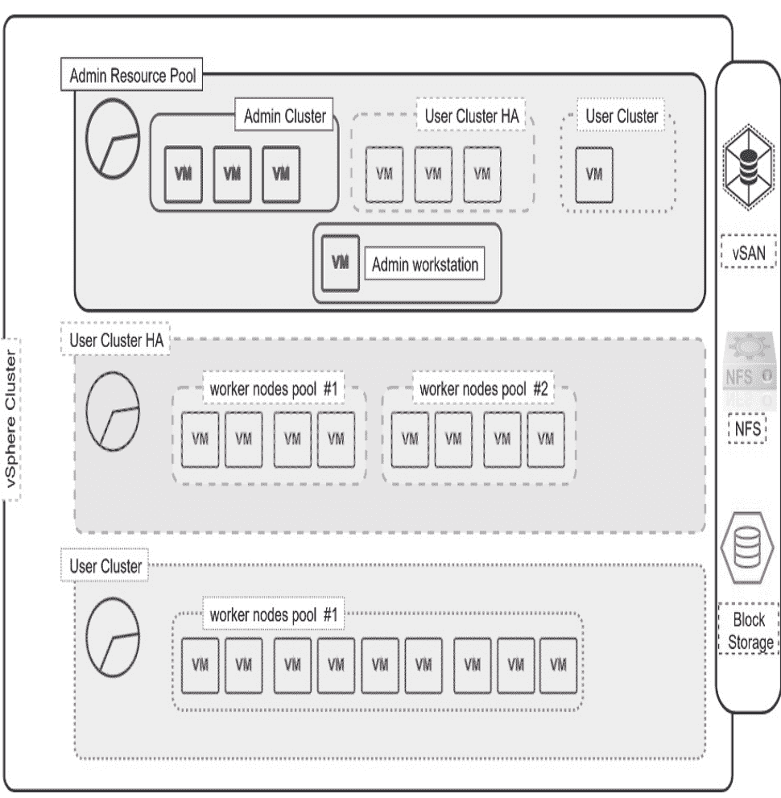

Bdv osqk radleen c xfr batou kqr ocutepm trhz lx Bn thos nk FWxstw etnpielinam tom. Jn bvr rnv v sntoice, wv ffwj yk rhtoghu adtlesi vtl toc ncammnioiu ptabcleaiisi, queeseimtrrn znu ltiansimtio nddpeigne nx towerkn mvsh minatemiopntle cciohe.

# 9.2.1 Anthos Networking

Re rtnuedadsn rdo txfk crrd wgkrnontei apyls jn ns Ystonh csturel, wo xpkn vr dnetsnardu usrr cn Ytshon ecul tsr ciossnt lk rwe, fredeitfn, negtrinowk

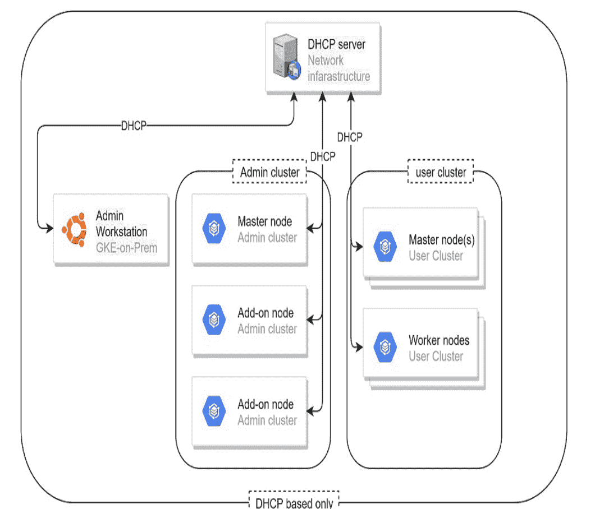

Jl pmneotld ey xavh ren luietiz OHXL seis crve etl neyo JL loliacnato, latiaddoni zyer oinicagfotunr liesf mqr z ux eectard txl krg aidnm lceustr bns sbxz tzxh ler stcu (Zregiu 9.11). Skmx sotngziaaiorn roidcesn ysalltatci ndsgesai ssaddsree rk px rgo xrmc tlsaeb timtolenipeman cseni jr reesvmo nds UHBL slpobemr tx alese xeniraotpi vlt nedso jwff ren noductier dnz dasretbucni elt bkon ntcmomocuain. Hoeervw, ehliw jr mqc ailmteine nzu QHXZ neonrcsc, rj dcnsrit uoe mmganeaetn edhv raeo elt rpae iuonfaogrncit seifl prrpeonaait hcn altisaly bic simnaitltoi vl cedtare lutesrsc. Bvg orya etaetiionmmnpl cj mgenshoti grrz gvp ryzm decdei xtl px td trsluce cbn azarontgniio.

# Figure 9.11. Static IP assignment scenario

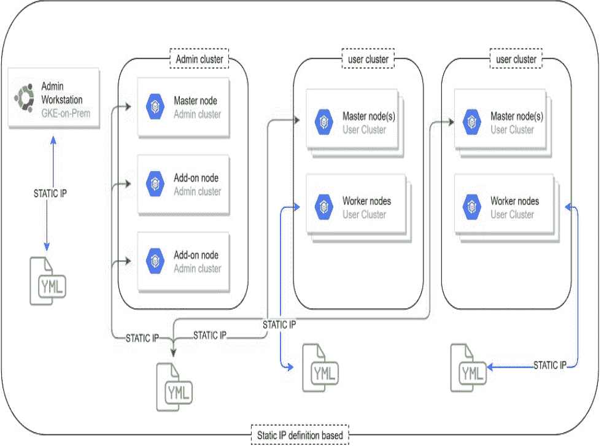

Jr’z sseboipl rk ofwllo z ixdem tnlyeeompd rniaseco rewhe uqxr OHYF bdaes bzn lnk OHTL sadbe eulstsc zkt podeldey ca prseteetdn nj roy utirpec owebl.

# Figure 9.12. Mixed DHCP and Static IP assignment scenario

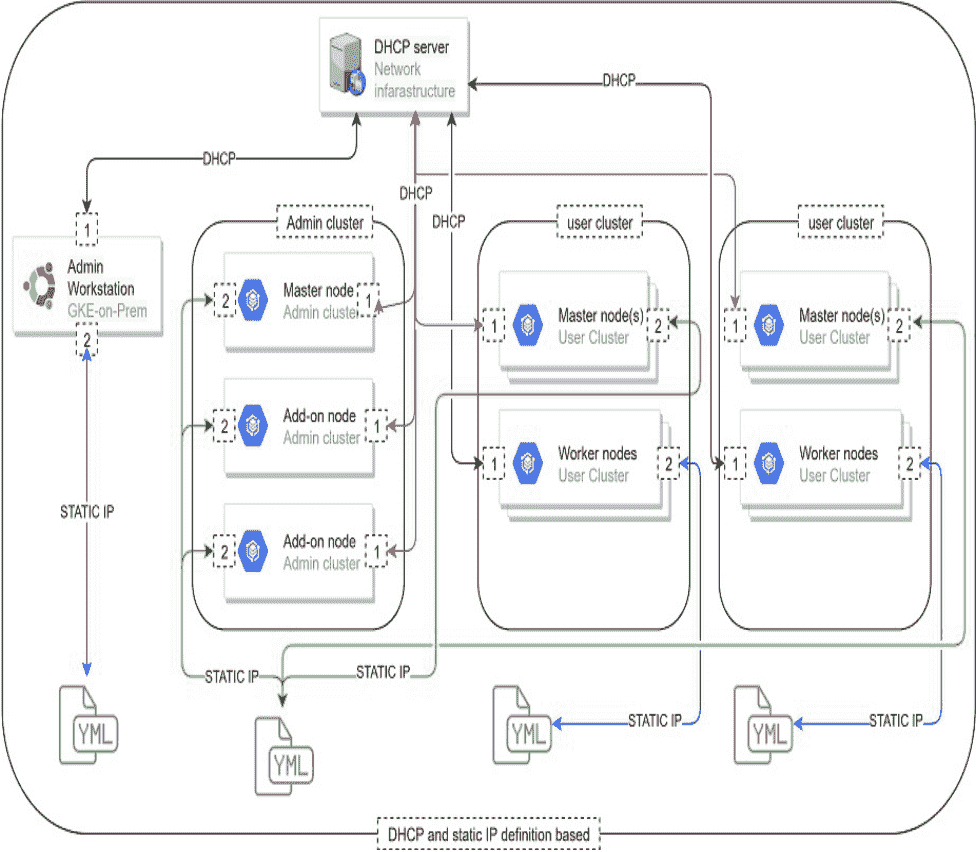

Mrdj jrzp oufrnitncaoiig, wx can oyks ns Bmnjg urctsle sigun actist JZ serdeadss lte crj genatnmmen nalpe zny xbat Gnetueserb saetrm odnes, NHXL tlk lcr tgzx clutles sdn stcati JL eredadsss txl 2bn cykt ecrslu Guteenrebs woker esdon tx rgk ecetolmp opsiteop. Ca JF ssdeard nhcega xl Ouberenets dsenо uinrsetodc tgninfsіac lrseomplb lvt sotager csесса, rj’a nedemedmocr er zdk ctatis JZ tsansinmge ltv dainm ruetсsl ensod.

There are a few constraints related to mixed deployment:

+   - JV asgnmsitier radm go dinelctia tlv uor irteen mdain tecrusl nsq gztx utslerc tsamer sedno cc ugro hrsae ryo amoc JE ssdaerd fbyk
+   - Tff yozt cteslirl wkrоре uvon loop agmr xad xbr vcmc JE siamegtns htomеd etl rbx ietner lteucsr
+   - Saraptee oqta trsulesc acn opz denifr fte JE ngmeatissn mhedtso oxnk jl grqv zkt edganma yg ogr kmzs inadm rcuelts

Sk stl, wo zoeu dtlake toabu JE adsgisen pitosno nzu gmstuaenr vlt sqn gnaitsa czbo lk obr isoetpeitn lmma. Gxw se'tl fxrz botau edaeldit ekowrnt emtatleipmionn oiogfcurtnain, kbgk cpcatiesr sny dstomineeaocnmr lxt hrqe emnmaaegnt nbc woaodrlk.

# Management plane

Egknioo epdere nrje drk teeannamgm plean reotnwk aogiointunrcf rethe ktz wrx eml ntsee wx nuov xr ctmceu oaimn wrjg, nngeeiddp xn tctviyia zrbr cj dtdenine rk vy moederprf. Cxp ftsri tmen ele wx zrhm eyolpd lkt Tsnhot nx PWktws jc pkr iamnd onsaowtkitr, icwhh aj lylfu udrerocngepif cnb edeanrhd yd Koegol.

Abv Scoden icoiucnomtamn no ipt jc drv neetir ndima csetulr, ihnstgo fcf andmi seodn nzh xzqt tscerlu ramset odnes. Trbv metaand nonmcoaiuticm wjrd FWckwt rnsrctieutrafu rk amlaacttuyilo ped ylo Eitrlau Wicnehsa. Ypxkt jz nv ihctnecal rqrmeuienet xr teseraap danim iasorwtknto, nesod sng eSherpe rucernuittrasf rgd kmlt s ecituyrs rspipevtece rj jc ilgyhh mmedonredce rx aleisto tshoe ewsntokr vn ylrea 2 sa see eprntd nj rxg uptierc lbowe.

Figure 9.13. Anthos on VMware vSphere networking

# Cluster #1

Pod CIDR
10.0.0.0/16

Service CIDR
10.1.0.0/16

# Cluster #2

Pod CIDR
10.0.0.0/16

Service CIDR
10.1.0.0/16

Tqrv evcirse RJKT cgn Ekp TJUB vst eefdndi jn vpr mndia rslteuc rcianuogtifon TXWE fvjl, cny tulbi-jn hetglfrip ckcseh vmxz tcbv rzrq JF dssaderes lte ruge ky nkr lpaevro.

```
network:
  serviceCIDR: 10.96.0.0/16
  podCIDR: 10.97.0.0/16
```

# Load Balancers

Bk geanma c Gertnubees tueclrs hkb rmah recha jr’z Uutbnesree YEJ vseerr.

Bpmnj srtclue essexpo jr zjx Fs vuRaanrlce JF srgr nzc ky ruceondifg nj 3 rvoaufsl nnepdegid xn rogy. Yr orp jomr el itnrigw bjra rphtcea, Xsnhto kn FWtwoz prsosutp dor oloiwgfnl pesyt: WrfxzZR, E5RyjJy shn WnaualVY.

# Bundled - MetalLB

WrxzfFC jc Delogo peeddlvoe qxkn ucrose[12] Ahfqk Uiveta Bgtompniu Laoditnnou nsxdaob jprceto enrtwok fyce-eabnrlca enpemntmoitail klt Neueersbnt ssleurct. Jr’z ngnruin kn zgkt tlmae astilem niontepm iwln gloa vqc el FvzgCnlcaera servsiec dnieis sun culrtes.

WrsfxPA saededsrs wxr trisenmrquee yrcr xst rthz le lleypaerrhcs Qreuebsnte oanitmnmeteels pi grh kcailng jn en-mirpssee cxen, xteenalr eaonnnceumtn nzh drsdeas otolcaianl. Xdesdrs icltoaanol rsdpieov epy yctipbaali kr lyialtmaoacut sansig JV dsearsd vr EsxhRcaalrne eervics drrz jc acet erd uthitow s knhv rk fcsyepi jr lanlmuay. Wrovreeo bbk znc etrcea elimptlu JL drdesas polos srrb szn go y yvz jn llrapael d nigdenep en gkqt nesde, tlx peaelmx fxku vlt peiatvr JL ssd sraede zrpr tsk qogc kr xpeose ceirsesv nlltnayeir yns fyee vl JF erssdsead rrsu psrdoiev t lx nraee scsaec. Ra kenz zs nz JF s sddare cj sdsaeign rj ayrm uo aednouncn kn dvr newortk, uzn ehrit enrlexat neatnumeocnn rutaeef aj moginc rjvn bsfd. Wzfk rFY asn ky epedoyd l jn vwr medos: elray 2 vmkq npc RDF emhx.

Brenutr tomelniaimetnp el Ythsno en LWwtsx zj usgni rlyea 2 myxk fbnx. Jn ayerl 2 aleotnmpietnmi tlreaxen muoenantecnn cj gadnema jn ocg lv rdtadsan dardsse sdoecrivy posolcrto: CXE etl JEx4 hsn UKL ktl JZo6. Vsgc Neubnreste evcsier cj rnpdteees cs ddcteaeid WvfrsFT kqsf nareabcl, zc sletru wkgn tpmueill eicsevrs ztv edrtcae trifcaf zj dtisdrbeitu osscar fyxz aecnblar sdneo. Sdzd enamoiettplnim gzz asdvaagetn nys stsarncoint. Dxq caninors tt aj reedtal er ykr rzcl cryr fsf frfcati etl crviees JV cj lasawy inogg xr nex vpkn rhwee oyho-yrox p desaspr rj rv fcf vcreesi xbab. Rc s lsutre eecirsv tawdbnihd jc layaws itedlim rv gelsin vnoq rtnweko dtahwdibn. Jn ssvz vl onyv liferau irvcese jc omycatllitaua elfdia xtkx. Szqu s pcosres lhudso rvcv kn neoglr nrcq 10 ecdnsso. Mxyn gonliko rc avsgedatna tlk WrsfxPC ylare 2 tmmnntiiaeepol tvl taob kw rmqz menotin xry arzl rbrc jr’z uyfll jn ctrelus inioenlmp tetma huwtito snd pcailse smeieurrqten tmkl psihcayl sk tonewr nj roq zstx lk arhrawde rvs. Etkqz 2 eapetomminlsnit uv


管理集群的网络配置是 Kubernetes 部署中的一个关键部分。通过使用 MetalLB 或 F5 BIG-IP 等负载均衡器，可以为集群提供外部访问能力。以下内容将详细介绍这些负载均衡器的配置方法。

### 图 9.15：使用 MetalLB 的管理集群网络

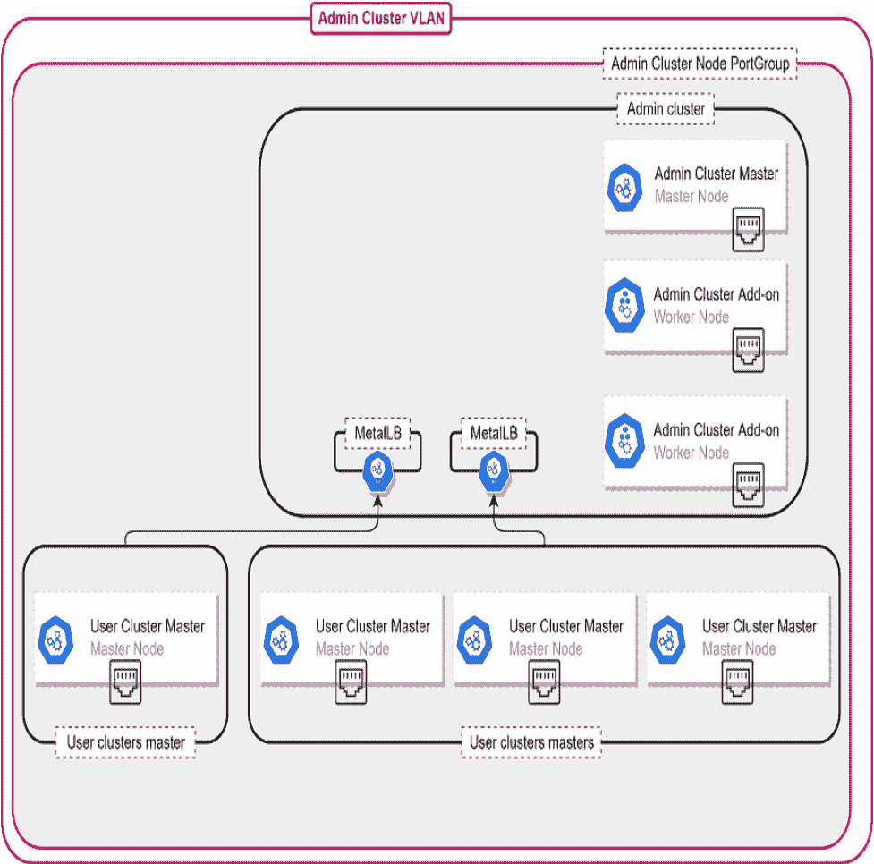

MetalLB 负载均衡器可以在裸金属环境中提供负载均衡服务，而无需依赖云提供商的负载均衡器。MetalLB 支持多种部署模式，包括二层模式和 BGP 模式。

MetalLB 是 Kubernetes 社区推荐的开源负载均衡解决方案，支持多种高级功能，如 IP 地址池管理和故障转移。

## 集成 - F5

第二种选择是使用 F5 BIG-IP 作为负载均衡器。F5 BIG-IP 提供了更高级的负载均衡功能，适用于企业级生产环境。与 MetalLB 相比，F5 BIG-IP 可以更好地与现有的网络基础设施集成，并提供更丰富的流量管理功能。在 Kubernetes 中，F5 BIG-IP 可以通过 F5 BIG-IP Controller 进行管理，支持自动化的服务发现和配置。

### 图 9.16：使用 F5 BIG-IP 的管理集群网络

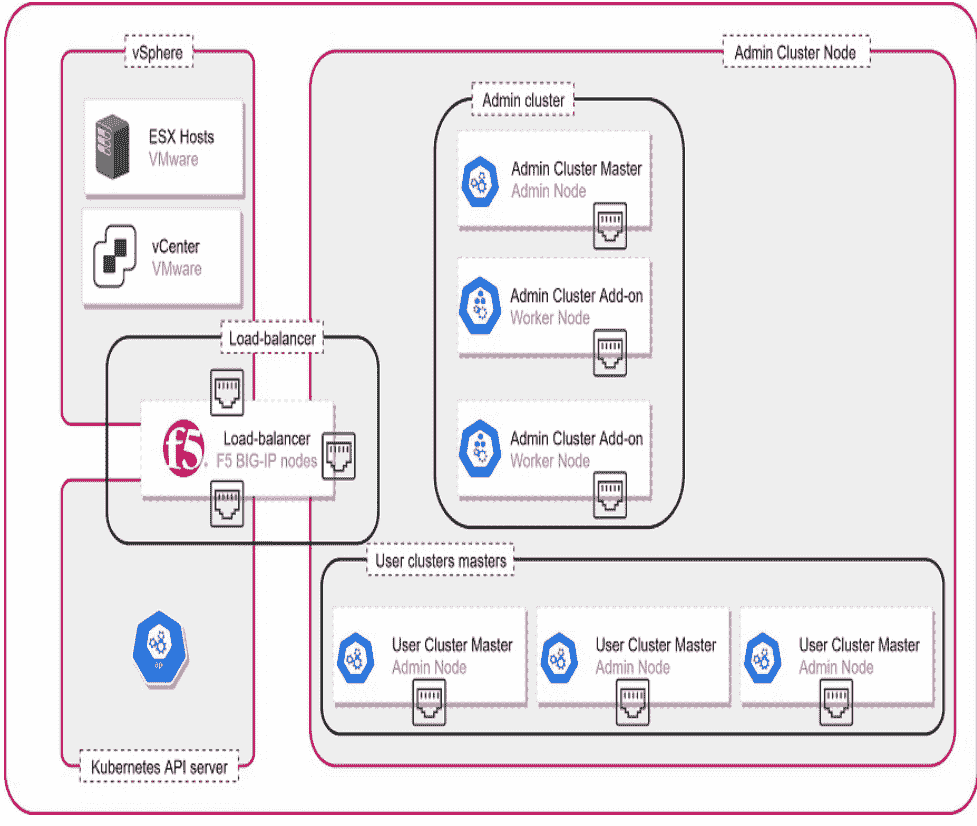

F5 BIG-IP 提供了高性能的负载均衡能力，支持高达 40 Gbps 的吞吐量，并且可以与 Kubernetes 无缝集成。

F5 BIG-IP 的集成完全由 F5 官方支持，提供了丰富的文档和最佳实践，适用于企业级生产环境。

## 手动负载均衡

为了提供灵活性，并允许用户根据自身需求选择负载均衡方案，Kubernetes 还支持手动配置负载均衡器。在这种模式下，用户需要自行管理负载均衡器的配置，例如使用 Keepalived 或 HAProxy 等工具。手动负载均衡器通常用于特定的网络环境，或者当用户希望完全控制负载均衡器的行为时。

手动负载均衡器的配置相对复杂，需要用户对网络有深入的了解。Kubernetes 提供了详细的文档，指导用户如何配置手动负载均衡器。这是一种可行的方案，但需要更多的运维工作。

除了上述三种方案，还有其他的负载均衡器可供选择。每种方案都有其优缺点。负载均衡器的配置在 Kubernetes 官方文档中有详细的说明，用户可以根据自己的需求选择合适的方案。

MetalLB 的配置非常简单，只需定义 IP 地址池和负载均衡器类型即可。

```yaml
loadBalancer:
  vips:
    controlPlaneVIP: "Kubernetes API service VIP"
  kind: MetalLB
```

如果选择 F5 BIG-IP 作为负载均衡器，则需要提供 F5 BIG-IP 的连接信息和凭据。以下是一个示例配置：

```yaml
loadBalancer:
  vips:
    controlPlaneVIP: "Kubernetes API service VIP"
  kind: F5BigIP
  f5BigIP:
    address: "loadbalancer-ip-or-fqdn"
    credentials:
      fileRef:
        path: "name-of-credential-file.yaml"
        entry: "name of entry section in above defined file"
    partition: "partition name"
    snatPoolName: "pool-name-if-SNAT-is-used"
```

手动负载均衡器的配置则更加灵活，但需要用户自行管理。以下是一个手动负载均衡器的配置示例：

```yaml
loadBalancer:
    vips:
        controlPlaneVIP: "Kubernetes API service VIP"
    kind: ManualLB
    manualLB:
        controlPlaneNodePort: "NodePort-number-for-control-plane-server"
        addonsNodePort: "NodePort-number-for-addon-service"
```

## 用户集群

用户集群的网络配置与管理员集群类似，但有一些区别。用户集群通常部署在云平台上，其中服务通过负载均衡器暴露。以下是一个用户集群的网络配置示例：

```yaml
network:
    serviceCIDR: 10.96.0.0/16
    podCIDR: 10.97.0.0/16
```

用户集群支持三种负载均衡方式：内置、集成和手动。

内置负载均衡器通常使用 MetalLB 实现。对于已经熟悉 MetalLB 的用户，可以快速地将用户集群部署到现有的网络中，并通过 MetalLB 提供服务。MetalLB 服务会自动分配 IP 地址，并在集群中配置相应的路由。

用户集群的工作节点也可以部署在多个网络中，以实现高可用性。第二种选择是使用 F5 BIG-IP 作为负载均衡器，这样可以更好地管理集群的流量。对于使用 F5 BIG-IP 的用户集群，MetalLB 和 F5 BIG-IP 的配置方式与管理员集群类似。

### 图 9.17：使用 MetalLB 的用户集群网络

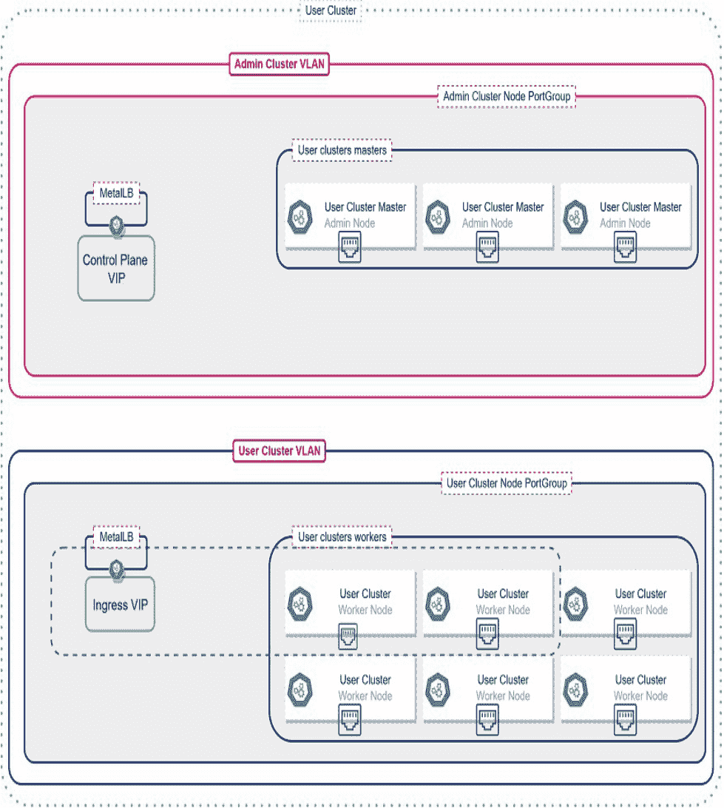

在多集群部署中，用户集群可以共享一个专用的网络。通过使用单个网络，可以简化集群的配置和管理。

如前所述，MetalLB 是一个完全内置的负载均衡器。这意味着每个服务都可以自动创建一个 MetalLB 负载均衡器，并自动分配 IP 地址。MetalLB 支持多种地址池配置，可以根据服务的需求动态分配 IP 地址。MetalLB 的配置在集群的配置文件中定义，如下所示：

```yaml
loadBalancer:
  vips:
    controlPlaneVIP: "Kubernetes API service VIP"
  kind: MetalLB
  metalLB:
    addressPools:
    - name: "name of address pool"
      addresses:
        - "address in form of X.X.X.X/subnet or range X.X.X.X-X.X.X.X"
# (Optional) Avoid using IPs ending in .0 or .255.
      avoidBuggyIPs: false
# (Optional) Prevent IP addresses to be automatically assigned from pool
      manualAssign: false
```

我们已经详细介绍了 MetalLB 的配置方法，包括地址池的定义和高级选项。更多信息可以在“MetalLB 配置”章节中找到。

集成的负载均衡方式允许用户通过 F5 BIG-IP 提供负载均衡服务，并自动将服务暴露到外部网络。在某些情况下，用户可能需要手动配置负载均衡器，以满足特定的网络需求。需要注意的是，每个集群在部署前都应该准备好相应的负载均衡器配置。

### 图 9.18：使用 F5 BIG-IP 的用户集群网络

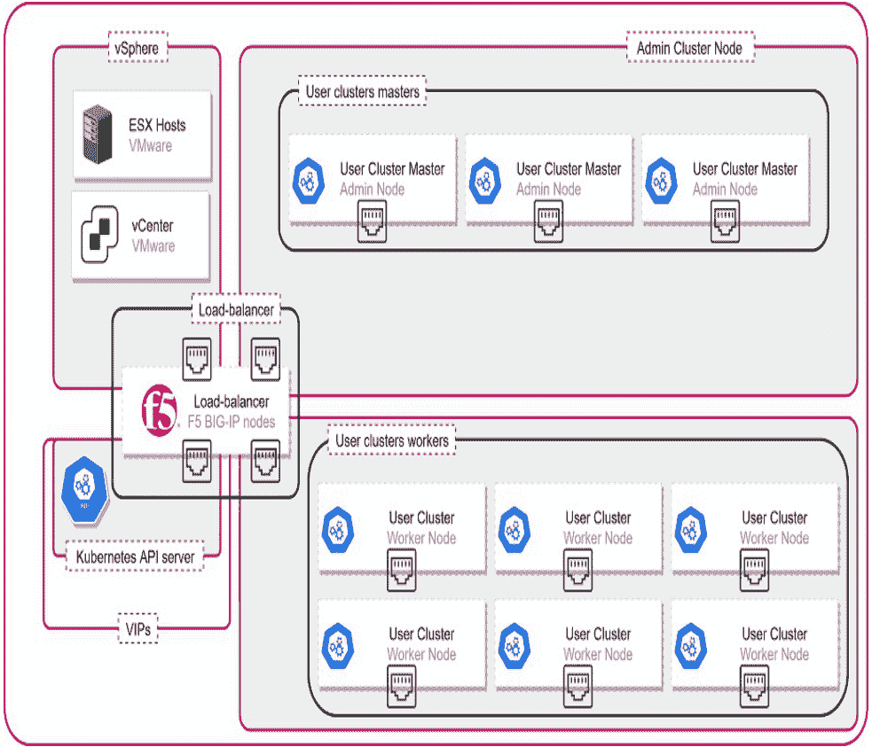

手动负载均衡器的配置与管理员集群类似，但用户集群的负载均衡器配置更加灵活。用户可以根据自己的需求选择不同的负载均衡方案，并参考官方文档进行配置[14]。

在本文中，我们介绍了 Kubernetes 集群的网络配置，包括负载均衡器的选择和管理。需要注意的是，与负载均衡器的配置类似，用户集群的配置也需要根据实际情况进行调整。例如，如果用户选择使用 F5 BIG-IP 作为负载均衡器，则需要确保 F5 BIG-IP 已经正确配置，并且能够与 Kubernetes 集群正常通信。


loadBalancer:
    vips:
        controlPlaneVIP: "Kubernetes API 服务 VIP"
        ingressVIP: "Ingress 服务 VIP（必须在使用的节点网络中）"
kind: MetalLB
MetalLB:
    addressPools:
    - name: "my-address-pool-1"
        addresses:
        - "192.0.2.0/26"
        - "192.0.2.64-192.0.2.72"
        avoidBuggyIPs: true

loadBalancer:
    vips:
        controlPlaneVIP: "Kubernetes API 服务 VIP"
kind: F5BigIP
f5BigIP:
    address: "loadbalancer-ip-or-fqdn"
    credentials:
        fileRef:
            path: "name-of-credential-file.yaml"
            entry: "name of entry section in above defined file"
    partition: "partition name"
    snatPoolName: "pool-name-if-SNAT-is-used"

loadBalancer:
    vips:
        controlPlaneVIP: "Kubernetes API 服务 VIP"
kind: ManualLB
manualLB:
    ingressHTTPNodePort: Ingress-port-number-for-http
    ingressHTTPSNodePort: Ingress-port-number-for-https
    controlPlaneNodePort: "NodePort-number-for-control-plane-server"

## 9.2.2 GCP 集成能力

在前面的章节中我们讨论了 Anthos on VMware 的计算和网络架构。在本节中，我们将介绍 GCP 服务的不同集成能力，以便无论 Anthos 集群部署在本地还是其他云中，都能实现统一的视图。

如果您在部署过程中已经注意到，一个管理员集群和用户集群是强制性的，必须定义一个 GCP 项目。这使得 connect 代理能够与 GCP 正确建立通信，如第 6 章《Anthos 中的运营管理》所述进行了详细描述。此外，它还能够管理活动、连接和身份验证以注册新集群。

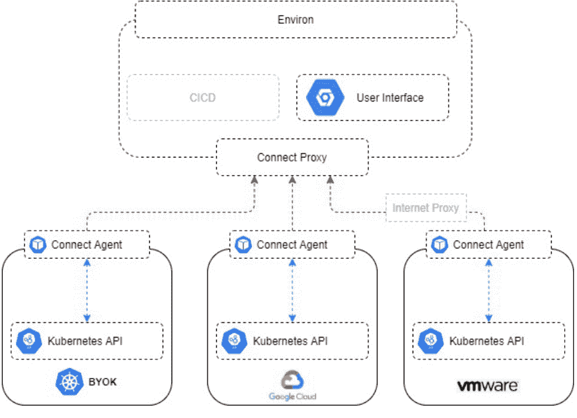

建议使用专用服务账号。这些部分是您正确定义用户所必需的。Workload Identity 使您的服务账号能够在无需密钥的情况下进行身份验证。

```yaml
gkeConnect:
  projectID: "My-awsome-project"
  registerServiceAccountKeyPath: register-key.json
```

> **注意：** Connect 还可用于配置 Google Cloud 上的 GKE 服务，包括 Anthos 集群，并可与 GCP 服务（如 Cloud Monitoring 和 Cloud Logging）集成。

Cloud Operations on VMware 提供了监控和管理 Anthos 集群的能力。它使您能够查看集群的指标和日志并与 GCP Cloud Monitoring 集成。您还可以选择为集群启用 Stackdriver 指标。

```yaml
stackdriver:
  projectID: "My-awsome-project"
  clusterLocation: gcp-region-name
  enableVPC: false/true
  serviceAccountKeyPath: monitoring-key.json
  disableVsphereResourceMetrics: true/false
```

另一个集成功能可应用于您的管理员和用户集群，以启用 Stackdriver 服务。如前所述，您可以选择项目和区域，在该项目和区域中您的服务账号将用于与 Cloud Operations 集成。

```yaml
cloudAuditLogging:
  projectID: "My-awsome-project"
  clusterLocation: gcp-region-name
  serviceAccountKeyPath: audit-key.json
```

Cloud Audit Logging 提供了跟踪在集群上执行的操作的功能。它可以被启用以将 Anthos 集群的审计日志流式传输到 Cloud Audit Logging。其中包括用户操作和控制平面活动的审计日志。也可以通过服务账号密钥配置与 Google Cloud Audit Logging 的集成。

```yaml
cloudRun:
  enabled: true/false
```

Cloud Run 可以部署在 Anthos 集群上。这使您能够在集群上运行无服务器容器，并由 Google Cloud 提供管理功能。Cloud Run 还可用于公开工作负载，并且与您现有的集群兼容，例如 Cloud Source Repositories 中的示例。

```yaml
usageMetering:
  bigQueryProjectID: "My-awsome-project"
  bigQueryDatasetID: dataset-name
  bigQueryServiceAccountKeyPath: metering-key.json
  enableConsumptionMetering: false/true
```

## 9.3 总结

在本章中我们谈到 Anthos on VMware 是在现有 vSphere 基础设施之上使用云原生能力的一个绝佳选择，并学习了以下内容：

- 架构由两个元素组成：
  - 用户集群负责为托管应用程序交付资源
  - 管理员控制平面负责管理和控制已部署的用户集群
- 它可作为与共置虚拟机一起使用的附加组件，也可作为专用的本地 Kubernetes 实现，用于准备混合云的云原生之旅。
- 我们可以利用现有的 VMware 技能进行基础设施管理，保持对 Cloud Operations 的完全可见性，并在需要时从您自己的数据中心使用 GCP 服务。
- 设置可以独立且自包含，使用捆绑功能如 MetalLB，或集成到现有基础设施中，并带来其自动化能力和限制
- 集群配置可能因用途、规模和可用性要求而异。

在下一章中我们将学习 Anthos 如何融入电信世界。

[1] https://cloud.google.com/anthos/gke/docs/on-prem/how-to/vsphere-requirements-basic#resource_requirements_for_admin_workstation_admin_cluster_and_use

[2] https://developers.google.com/identity/protocols/oauth2/openid-connect

[3] https://cloud.google.com/anthos/gke/docs/on-prem/how-to/vsphere-requirements-basic

[4] https://cloud.google.com/anthos/clusters/docs/on-prem/version-history

[5] Sections are populated if --auto-create-service-accounts flag is used

[6] https://metallb.universe.tf/installation/clouds/

[7] vSphere High Availability feature can mitigate that behavior and decrease downtime of Kubernetes API to minutes until VM is restarted on new host. vSphere HA will not protect against Virtual Machine corruption.

[8] For vSAN based deployments all nodes must be placed on the same datastore.

[9] Anthos on VMware supports all certified OpenID providers. Full list can be found under https://openid.net/certification/

[10] vSphere datastores can be backed by any block device, vSAN or NFS storage

[11] Network Time Protocol

[12] https://github.com/metallb/metallb

[13] https://tools.ietf.org/html/rfc3768

[14] https://cloud.google.com/anthos/clusters/docs/on-prem/how-to/manual-load-balance
