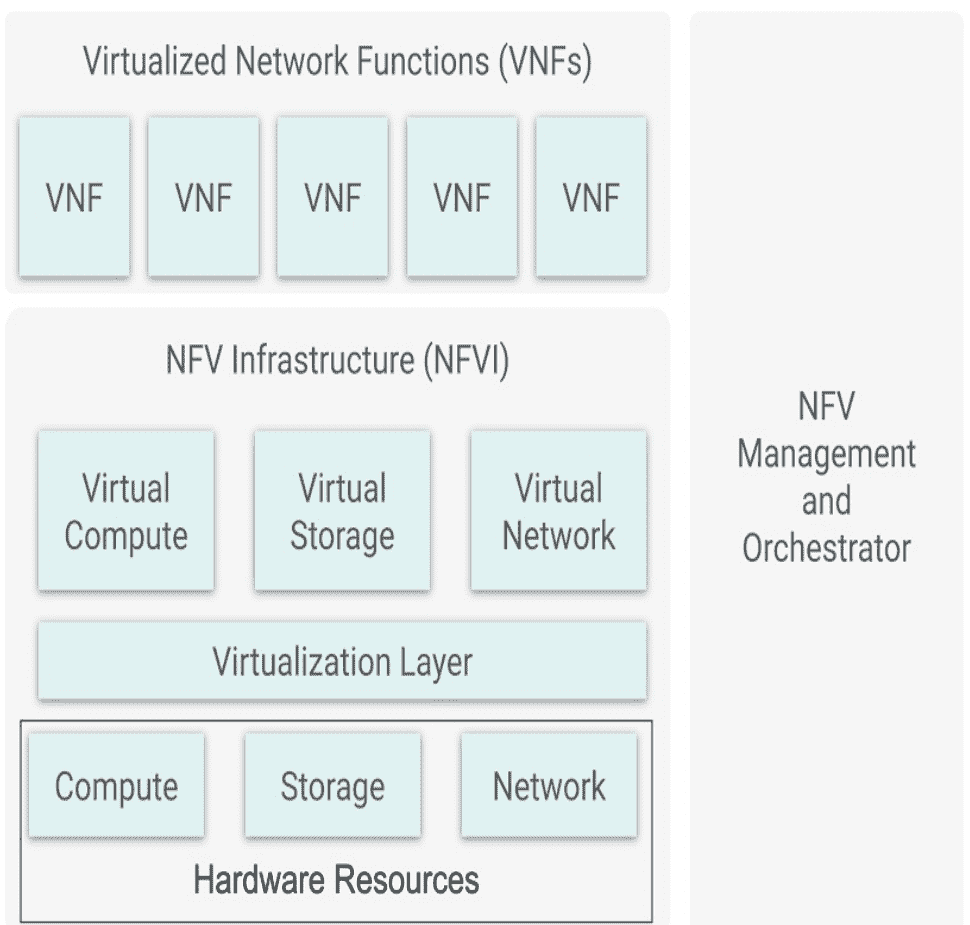
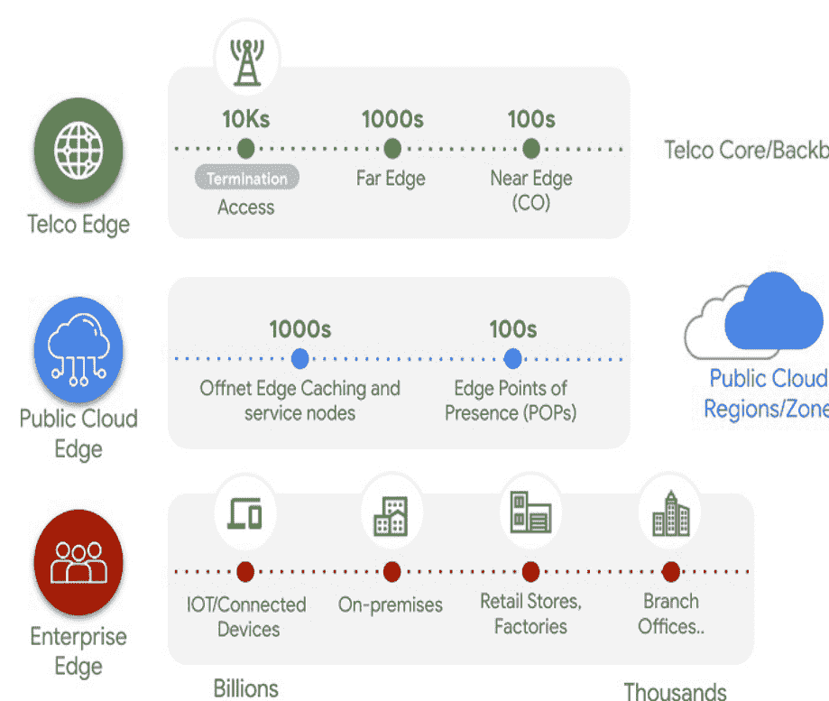
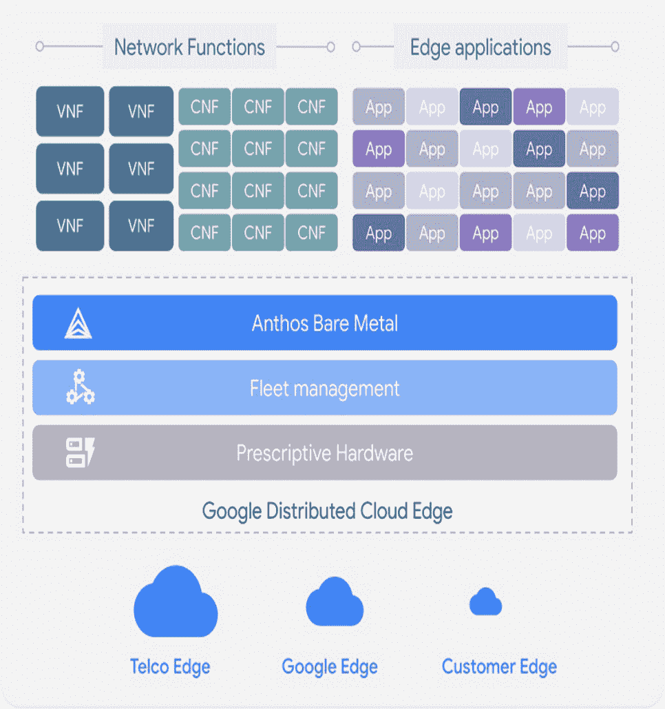
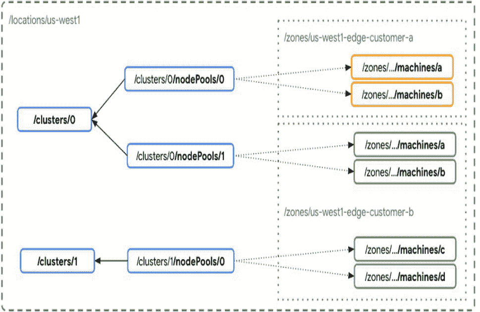
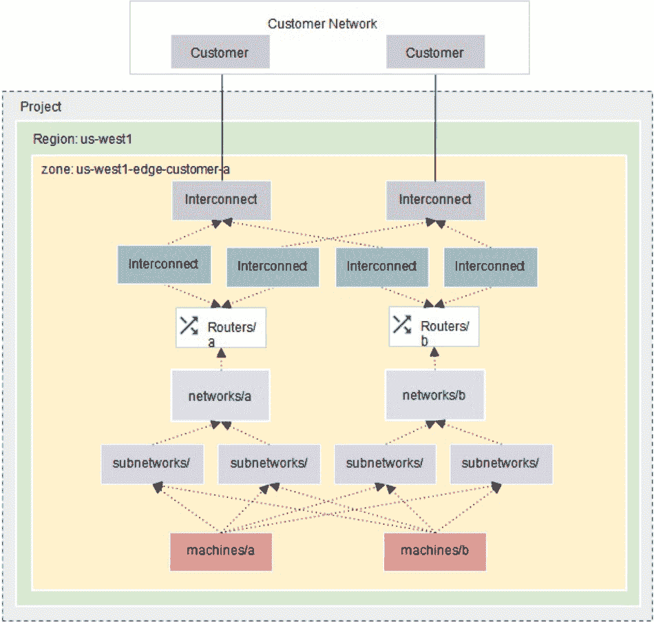
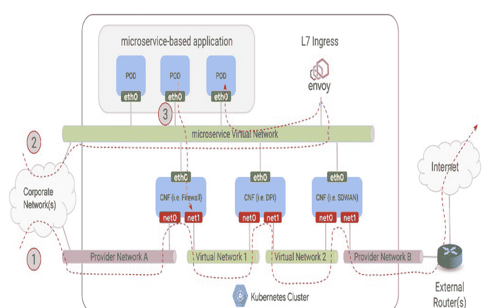
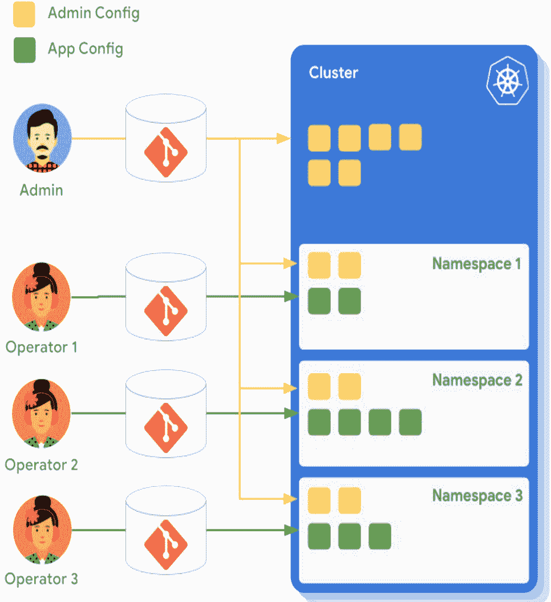
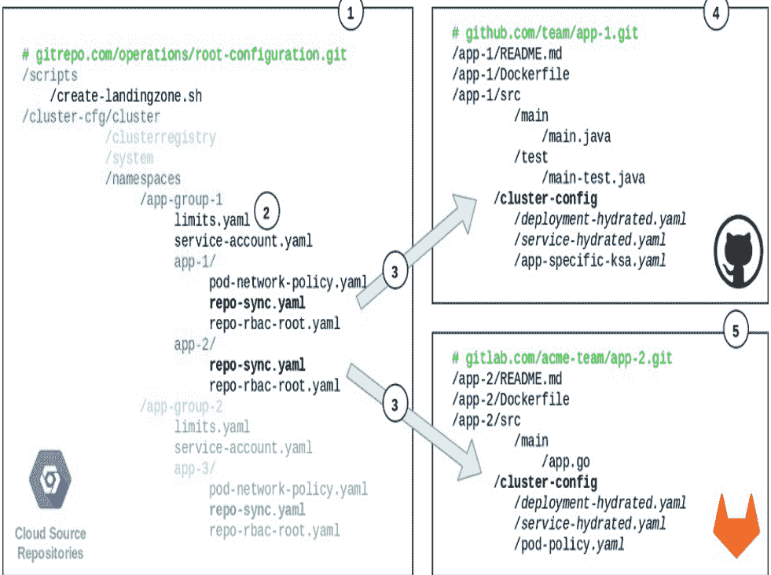
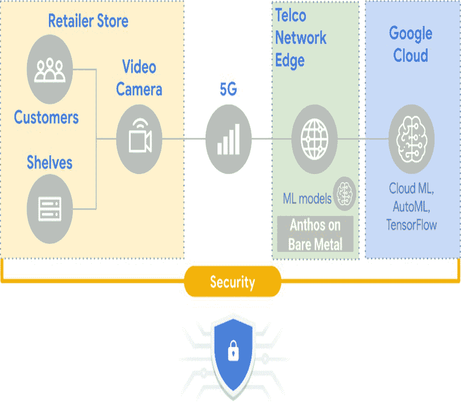

## 10 Anthos，边缘和电信世界

by Giovanni Galloro

### 本章涵盖：

- 电信网络功能向云原生网络功能演进
- 边缘应用用例
- Anthos 支持电信和边缘工作负载的特定能力
- Google Distributed Cloud Edge

本章是关于将 Anthos 用作边缘和电信工作负载的使能平台，其中这些工作负载主要分为 2 类：

1. **云原生网络功能：** 电信网络功能的演进，无论是已经虚拟化还是仍部署为物理设备，都朝向容器化工作负载发展，以实现更高的效率、性能和更易于管理。这种演进也将由新的 5G 相关网络功能驱动。
2. **新的边缘应用：** 部署在边缘位置、靠近终端客户的工作负载，以将延迟降至最低并实现新型应用，例如：自动驾驶、智慧城市、智能视频监控、增强现实、虚拟现实、远程医疗/手术。这类应用通常会受益于 5G 网络并由其驱动，并且很大程度上将以容器化工作负载部署。

## 10.1 电信应用的演进

在本节中，您将找到电信网络功能向网络功能虚拟化和云原生演进的回顾


# 网络功能

## 网络功能虚拟化（NFV）简介

传统上，网络运营商习惯于在专用、专有硬件设备上实现网络功能。从 2010 年代中期开始，随着电信运营商希望将网络功能虚拟化，网络功能虚拟化（NFV）的概念应运而生，其模式与导致 IT 服务器虚拟化的模式相同，旨在将多种网络设备类型整合到工业标准的高容量服务器、交换机和存储上，以降低成本并提高效率、敏捷性和弹性。

一种趋势开始将网络设备转变为虚拟网络功能（VNF），即通过超visor部署在工业标准 x86 服务器上的虚拟机。

NFV 架构的 3 个主要工作域是：

- 虚拟化网络功能（VNF）：网络设备的 x86 兼容虚拟机版本。
- 网络功能虚拟化基础设施（NFVI）：构建托管虚拟网络功能的环境的所有硬件（服务器、存储、网络设备）和软件组件（虚拟化软件）。
- 管理与编排（MANO）：物理或软件资源的生命周期管理与编排，以支持基础设施虚拟化以及虚拟网络功能的生命周期管理。

图 10.1：NFV 架构框架高层视图



## NFV 用例

作为该计划的一部分创建的一些虚拟化网络功能，在采用方面取得了不同的成功：

- vCPE：家庭和企业 CPE（客户 premises 设备）路由器虚拟化至运营商网络。通过这种方法，先进的路由和网络功能从接入路由器迁移，该路由器传统上由服务提供商部署在企业场所或消费者家庭中，迁移到在提供商自有 NFVI 中运行于工业标准硬件上的 VNF，而客户本地设备则被更简单的硬件取代。
- **vPE：** PE（Provider Edge）路由器虚拟化。在这种方法中，部署在服务提供商边缘的路由器，通常与部署在客户场所的路由器连接，也被虚拟化。
- **vEPC：** EPC（Evolved Packet Core）虚拟化：移动核心网络和 IP 多媒体子系统（IMS）中网络功能的虚拟化，如移动性管理实体（MME）、服务网关（SGW）、分组数据网络网关（PGW）。
- **vCDN：** CDN 虚拟化。该用例旨在虚拟化通常部署在运营商场所的第三方 CDN 设备。
- **vRAN：** 移动基站的虚拟化在无线接入网（RAN）中最初被视为 NFV 的用例，主要是因为移动基站是移动网络总拥有成本和能源消耗的主要组成部分之一。这种方法并未在 NFV 中有效实现，但为了获得上述容器化工作负载的好处以及与 5G 相关的新的无线网络功能的需求，正在推动这些功能向 CNF 的转变。

## 向云原生网络功能演进

电信运营商和网络功能供应商正在寻求基于容器的 **云原生网络功能**，作为 VNF 的演进，以充分实现上述 NFV 预期收益，并增加云原生应用带来的可移植性、敏捷性、可管理性和效率方面的改进。

在云原生计算基金会（CNCF）内部，有各种旨在支持电信运营商（和网络供应商）获得云原生技术所宣称的好处的举措，这些举措主要由电信用户组（ https://github.com/cncf/telecom-user-group ）推动，该组织制作了各种资产，包括存储库中的白皮书以及以下 **云原生网络功能的定义**：

A cloud native network function (CNF) is a cloud native application that implements network functionality. A CNF consists of one or more microservices and has been developed using Cloud Native Principles including immutable infrastructure, declarative APIs, and a “repeatable deployment process”

### 10.1.1 新边缘应用

在以下段落中，您将找到新边缘应用特征的描述，利用 5G 网络更高的带宽和更低的延迟。

## 5G 作为新边缘应用的推动者

一些 5G 网络特性，例如：更大的连续频谱、更先进的无线电天线技术（Massive MIMO）、更好的调制方案，以及核心与 RAN 之间信令流程的变更/优化，将提供网络能力，具有显著更高的带宽和更低的延迟。

电信服务提供商和应用/数字服务开发者希望利用上述特性，开发更多设备连接并以极高速度交换信息的应用程序，实现在以下领域的应用场景：自动驾驶、智慧城市、智能工厂、智能视频监控、增强现实、虚拟现实、远程医疗/手术。

为了与上述描述的拓扑和延迟要求保持一致，这些工作负载将在许多情况下部署在边缘位置，靠近终端设备或用户，以便进行近实时的数据处理和分析，使智能设备能够对输入做出反应，而无需将数据发送到云端再返回。

这类应用将很大程度上以容器化工作负载部署。5G 网络总体上将是软件定义的，延续了 NFV 开始的转型，由于其处理的速度和数据量，需要进一步的自动化，并将基于开源软件。

## 边缘计算

边缘计算将使应用能够快速响应，提供近实时洞察，减少对中央数据中心或云网络连接的依赖，并减少集中传输的数据量。

Gartner 预测，到 2025 年，75% 的企业生成的数据将在传统集中式数据中心或云之外创建和处理：https://www.gartner.com/smarterwithgartner/what-edge-computing-means-for-infrastructure-and-operations-leaders/。

边缘基础设施将部署在分布广泛的位置，在许多情况下，其规模小于中央数据中心，如：

- Telco Edge：电信运营商的小型数据中心、接入点、网络机柜
- 公有云边缘：云提供商/全球广播商的接入点和 CDN 边缘。
- 企业边缘：企业/终端用户位置，如分支机构、零售商店、仓库、工厂

图 10.2：边缘部署



计算节点数量通常会增长，并需要一个能够管理数量级达数万的更大计算集群的集中管理平面。

## 边缘应用示例

以下是一些应用和用例的示例，它们将受益于部署在边缘位置，并在图像、视频、音频和其他类型数据上执行分析和预测，也可通过本地执行 AI 模型进行：

- **预测性维护：** 在现场分析制造工厂和机器数据，以预测故障发生前并优化正常运行时间和维护团队工作
- **制造质量检查：** 分析产线外产品的图片和视频，以检查是否符合质量标准。
- **员工安全：** 通过图片和视频分析正确的安全措施实施情况和安全设备使用情况。
- **诊断服务和患者监测：** 使用部署到边缘的计算机视觉解决方案处理影像，可提高诊断准确性和检查效率。
- **零售商店排队和货架管理：** 分析视频 feed 以检查排队人数或货架商品可用性，并据此开放收银台或补货。
- **自动驾驶汽车和工业车辆：** 对自主车辆摄取和收集的数据进行低延迟处理。
- **通过 AR/VR 对制造工人的指导和培训：** 部署在边缘的 AI 模型识别工人取景的设备并提供最新信息和指示。
- **物流跟踪：** 识别图像和视频中运输中的包裹、物品、托盘、车辆的 AI 模型并更新跟踪系统。
- **库存管理和生产计划：** 通过图像对资产状态进行近实时分析，为生产和供应链履约提供输入。

## 10.2 Anthos 作为边缘和电信工作负载的平台

在本节中，我们将讨论 Anthos 如何提供支持边缘 Anthos 部署和电信工作负载执行的基础。我们还将深入探讨 Google 为此目的设计的特定解决方案。

### 10.2.1 Google 分布式云边缘

Google 分布式云边缘（GDCE）是 Google 提供的一个完全托管的解决方案，旨在支持电信虚拟化和云原生网络功能以及边缘应用，并包括软件、操作系统和硬件（服务器和 TOR 网络交换机）在 Google 管理的机架中；它基于 Anthos on Bare Metal（在专门章节中详细介绍）并且可以


部署在前几节描述的站点类型中：

- Public Cloud Edge：Google 边缘位置
- Telco Edge：由电信运营商拥有
- Enterprise Edge：由最终客户拥有（如零售商店、工厂车间、分支机构、体育场等）

### Figure 10.3: Google Distributed Cloud Edge High Level Architecture



GDCE 提供舰队管理能力来管理所有硬件和软件资产，并通过 Anthos on Bare Metal 能力支持容器化工作负载和虚拟机。

GDCE 还为用户提供到 GCP 的 VPN 连接，使用户能够与客户 VPC 中运行的其他应用程序以及其他 GCP 服务进行交互。为了服务高性能和低延迟工作负载，GDCE 还提供了一系列高网络性能功能，例如 SR-IOV 和 DPDK。Google Cloud 运营并管理底层基础设施，将云体验扩展到客户现场。

Google 提供计算、网络和存储硬件，这些硬件将被运送到目标位置并由 Google 管理。Google 运营团队将远程进行 Google 设备的管理和监控。

客户需要在目标位置指定一名联系人（客户人员的一部分，而非 Google 人员），该联系人可以访问设备并拥有执行基本管理任务的权限。这些任务包括，例如，冷重启、更换部件、能够在设备上运行本地诊断以及常见的系统管理任务。

硬件连接并投入运行后，用户可以使用标准 Google API 工具来使用该服务。

一个 GDCE Kubernetes 集群由控制平面和工作节点组成。工作节点组织成节点池。控制平面托管在 GCP 的单个计算区域中。工作节点是 GDCE 机架上的服务器，每个工作节点使用一台完整的物理服务器。一个机架或一组具有共享空间、电力、制冷和连续网络结构[content]

部署在前几节描述的站点类型中：

- Public Cloud Edge：Google 边缘位置
- Telco Edge：由电信运营商拥有
- Enterprise Edge：由最终客户拥有（如零售商店、工厂车间、分支机构、体育场等）

### Figure 10.3: Google Distributed Cloud Edge High Level Architecture


GDCE 提供舰队管理能力来管理所有硬件和软件资产，并通过 Anthos on Bare Metal 能力支持容器化工作负载和虚拟机。

GDCE 还为用户提供到 GCP 的 VPN 连接，使用户能够与客户 VPC 中运行的其他应用程序以及其他 GCP 服务进行交互。为了服务高性能和低延迟工作负载，GDCE 还提供了一系列高网络性能功能，例如 SR-IOV 和 DPDK。Google Cloud 运营并管理底层基础设施，将云体验扩展到客户现场。

Google 提供计算、网络和存储硬件，这些硬件将被运送到目标位置并由 Google 管理。Google 运营团队将远程进行 Google 设备的管理和监控。

客户需要在目标位置指定一名联系人（客户人员的一部分，而非 Google 人员），该联系人可以访问设备并拥有执行基本管理任务的权限。这些任务包括，例如，冷重启、更换部件、能够在设备上运行本地诊断以及常见的系统管理任务。

硬件连接并投入运行后，用户可以使用标准 Google API 工具来使用该服务。

一个 GDCE Kubernetes 集群由控制平面和工作节点组成。工作节点组织成节点池。控制平面托管在 GCP 的单个计算区域中。工作节点是 GDCE 机架上的服务器，每个工作节点使用一台完整的物理服务器。一个机架或一组具有共享空间、电力、制冷和连续网络结构织的机架被定义为 GDCE Zone。

## Google Distributed Cloud Edge Container Resource Model

GDCE 与 Anthos 以及其他 Anthos 部署选项相比具有不同的资源模型。在这里你会找到一个容器资源列表，用于描述、实现和管理 GDCE 实施的计算架构，如图 10.4 所示。

### Figure 10.4: Google Distributed Cloud Edge Container Resource Model



### Zone

Zone 代表共享网络结构或单个故障域的一组机器。zone 可以代表一个机架或放置在同一位置的多个机架。GDCE Zone 资源与 GCE Compute Zones 不同。列出 GCE Compute Zones 不会返回 GDCE Zones。Zone 代表单个故障域，为了部署具有高可用性的容错应用程序并帮助抵御故障，用户需要在链接到同一区域的多个 Zone 中部署应用程序。

### Machine

机器代表一台物理服务器，机器资源元数据包括其所在的机架和其他属性和标签。机器对用户而言是只读资源。在部署时，机器会根据 GDCE 系统的物理位置分配到特定区域。机器只能成为在其指定区域部署的 Kubernetes 集群的一部分。

### Cluster

集群由控制平面和零个或多个 NodePools 组成。集群驻留在特定区域中，并且只能连接来自该区域的 NodePools，如果用户尝试连接来自与集群不同区域的机器的 NodePool，操作将失败。

### Node Pool

NodePool 是 GDCE Zone 中机器的逻辑分组。NodePool 用于向集群添加工作节点。

### VPN Connection

GDCE 支持设置到 GCP 项目的 VPN 连接，允许在 GDCE Kubernetes 集群上运行的工作负载直接连接到 GCP 资源。在建立 VPN 连接之前，集群中应至少创建一个 NodePool。

## Google Distributed Cloud Edge Network Resource Model

除了 Kubernetes 集群资源、API 和默认的 Kubernetes Pod 网络之外，GDCE 还允许客户在 GDCE Zone 中配置额外的网络并将其与客户网络连接以用于不同目的。例如，在 Network Functions 用例中，客户可能会创建一个 OA&M 网络和一个 Signal 网络，每个网络都有不同的多个子网，连接到 Network Function pod 的辅助接口。

图 10.5 描述了 GDCE 网络模型中的资源及其关系。从高层次来看，与边缘网络配置相关的有 5 种类型的资源。

- **Network**：GDCE zone 中具有私有地址空间的虚拟网络，可能包含一个或多个子网。网络与同一 GDCE Zone 的其他网络隔离。
- **Subnetwork**：GDCE 网络中的第 2 层（VLAN）子网。子网具有自己的广播域和客户分配的 CIDR。网络内的子网可以相互访问。GDCE Zone 中不同网络的子网不能相互访问。
- **Interconnect**：代表 GDCE 与客户网络之间一个或多个物理链路的捆绑逻辑链路。Interconnect 只能在 GDCE 站点启用时创建。通常会配置多个 Interconnect 以提供高可用性。
- **InterconnectAttachment**：根据客户请求在 Interconnect 上配置的虚拟链路，用于在 GDCE 网络和客户网络之间提供隔离连接（例如 VRF）。通过 InterconnectAttachment 传输的数据包将不带标签，或带客户指定的 VLAN id 标签。
- **Router**：虚拟路由实例，用于配置 GDCE zone 中网络的路由功能，例如，客户可以使用它通过 InterconnectAttachment 在 GDCE 网络和客户网络之间配置 BGP 对等会话，或通过 pod 子网，以便某些 pod 可以向 GDCE 广告前缀。默认情况下，从子网接收的路由将被重新通告。

### Figure 10.5: Google Distributed Cloud Edge Network Resource Model



它们与 Google Cloud 网络抽象类似，但有几点不同：

- 为 GDCE 创建的所有网络资源都本地于 GDCE Zone。GDCE 网络没有直接连接到 GCP VPC 的连接。不同 GDCE zone 中的网络之间也没有直接连接，除非由客户有意连接。
- GDCE 子网支持 VLAN，因此在第 2 层彼此隔离。

系统管理员应创建和维护所有网络资源。应用开发人员/所有者仅对网络资源具有查看权限。

## 10.2.2 Anthos capabilities for Telco and Edge workloads

除了 GDCE 的特定特性外，还有 Anthos 能力，可在标准产品中使用，有助于边缘和电信工作负载的部署、执行和管理。其中一些能力是专门为此目的设计的，主要通过 Anthos on Bare Metal 提供，这是最适合这些工作负载的版本，也是 GDCE 的核心，而其他能力，如 Anthos Config Management，则是为通用目的提供的，但可以适应边缘和电信应用。

### Multiple Network Interfaces for pods

容器化网络功能（CNFs）的常见要求是在默认 k8s 接口之上为 Pod 配置额外的网络接口，这通常是为了在数据平面和管理/控制平面之间保持分离，出于性能或安全原因，或出于其他原因隔离网络流。

Anthos 在 Anthos on Bare Metal 上提供此功能，使用 Multus CNI 插件的特定实现。

### Architecture

此功能允许单个 pod 连接到多个网络。默认的 kubernetes 接口在 pod 中显示为 eth0，而通过 multus CNI 创建的额外接口默认显示为 net1、net2 ...（可配置）。

用于额外接口的 CNI 可以是：

- Ipvlan
- Macvlan
- Bridge
- SR-IOV


## 设置

要启用此功能，用户必须执行以下 3 个操作：

### 1 - 启用多网络接口（multi-NIC）

通过向集群自定义资源的 `clusterNetwork` 部分添加 `multipleNetworkInterfaces` 字段并将其设置为 `true`，为 Pod 启用多网络接口。

```
...
  clusterNetwork:
    multipleNetworkInterfaces: true
    pods:
      cidrBlocks:
      - 192.168.0.0/16
    services:
      cidrBlocks:
      - 10.96.0.0/12
...
```

### 2 - 指定网络接口

使用 `NetworkAttachmentDefinition` 自定义资源来指定额外的网络接口。这些自定义资源对应于可供 Pod 使用的网络。

可以在创建集群时在集群配置清单中指定这些自定义资源，也可以直接将其添加到现有的目标集群中。

```
apiVersion: "k8s.cni.cncf.io/v1"
kind: NetworkAttachmentDefinition
metadata:
  name: gke-network-1
spec:
  config: '{
"type": "ipvlan",
"master": "ens224",
"mode": "l2",
"ipam": {
"type": "whereabouts",
"range": "172.120.0.0/24"
}
}'
```

### 3 - 将网络接口分配给 Pod

可以通过 `k8s.v1.cni.cncf.io/networks` 注解在 Pod 或 Deployment 清单中启用多个网卡，使用与特定 `NetworkAttachmentDefinition` 自定义资源及其命名空间对应的值。如下例所示，网络接口由目标集群默认命名空间中的两个 `NetworkAttachmentDefinition` 自定义资源 `gke-network-1` 和 `gke-network-2` 的名称指定。

```
---
apiVersion: apps/v1
kind: Deployment
metadata:
  name: sample-deployment
spec:
...
  template:
    metadata:
      annotations:
        k8s.v1.cni.cncf.io/networks: default/gke-network-1, default/gke-network-2
      labels:
        app: sample-deployment
...
```

## 将网络接口限制到节点池（NodePool）

使用 `k8s.v1.cni.cncf.io/nodeSelector` 注解来指定 `NetworkAttachmentDefinition` 自定义资源有效的节点池。Anthos clusters on bare metal（裸金属上的 Anthos 集群）会强制所有引用此自定义资源的 Pod 部署到这些特定节点上。在以下示例中，Anthos clusters on bare metal 强制将分配了 `gke-network-1` 网络接口的所有 Pod 部署到 `multinicNP` 节点池。Anthos clusters on bare metal 会相应地为节点池打上 `baremetal.cluster.gke.io/node-pool` 标签。

```
apiVersion: "k8s.cni.cncf.io/v1"
kind: NetworkAttachmentDefinition
metadata:
    annotations:
        k8s.v1.cni.cncf.io/nodeSelector: baremetal.cluster.gke.io/node-pool
    name: gke-network-1
spec:
...
```

## 关于 SR-IOV 插件的说明

SR-IOV 是一种规范，本质上实现了物理 PCIe 设备的虚拟化。它允许将符合规范的网络设备（在主机节点上识别为物理功能 PF，通常代表单个 NIC 端口）划分为多个虚拟功能 VF，虚拟化工作负载可直接访问这些 VF。SR-IOV 对网络硬件的直接访问提供了增强的性能，因此被广泛用于基于 VM 的 VNF 中。

SR-IOV CNI 插件（https://github.com/intel/sriov-cni）使 Kubernetes Pod 能够直接连接到 SR-IOV VF，并将 VF 绑定到 DPDK 驱动程序。这为云原生网络功能（CNF）提供了增强的网络性能，就像以前为 VNF 所做的那样。

下面您可以看到一个示例图，展示了多个 CNF 通过多网卡 Pod 连接多个网段，串联在一起提供不同的服务（防火墙、深度包检测、SD-WAN）。

图 10.6：使用多个网卡连接不同网段的 CNF



## 在裸金属上的 Anthos 上运行基于 VM 的工作负载

很可能并非所有网络功能都会部署为 CNF，有些仍将作为 VNF 保留，因此在一段时间内需要两种部署模型共存。

为了满足这种情况以及将部分工作负载作为 VM 而非容器运行的其他需求，Anthos on Bare Metal 提供了通过基于 KubeVirt 的 Anthos VM Runtime 运行基于 VM 的工作负载的可能性。

下面是对在 Anthos on Bare Metal 上运行 VM 所需执行任务的简要描述：

### 启用 Anthos VM Runtime

要启用 Anthos VM Runtime，您需要：

1. 更新 `VMRuntime` 自定义资源，将 `enabled` 设置为 `true`，如下例所示：

```yaml
apiVersion: vm.cluster.gke.io/v1
kind: VMRuntime
metadata:
  name: vmruntime
spec:
  enabled: true
  # useEmulation default to false if not set.
  useEmulation: true
  # vmImageFormat default to "qcow2" if not set.
  vmImageFormat: qcow2
```

2. 如果您的节点不支持硬件虚拟化，或者您不确定，请将 `useEmulation` 设置为 `true`。如果可用，硬件虚拟化比软件模拟提供更好的性能。如果未指定，`useEmulation` 字段默认为 `false`。

3. 您可以通过设置 `vmImageFormat` 字段来更改所创建 VM 使用的镜像格式，该字段支持两种磁盘镜像格式值：`raw` 和 `qcow2`。如果未设置 `vmImageFormat`，Anthos VM Runtime 将使用 `raw` 磁盘镜像格式创建 VM。`raw` 格式可能比 `qcow2`（一种写时复制格式）提供更好的性能，但可能占用更多磁盘空间。

4. 保存配置并验证 `VMRuntime` 自定义资源已启用：您可以执行 `kubectl describe vmruntime vmruntime` 并检查描述显示 `VMRuntime.Status.Ready` 设置为 `true`。

### 创建 VM

在创建 VM 之前，建议配置一个 cloud-init 文件，以确保在创建 VM 后您可以获得其控制台访问权限。有两种方法可以创建自定义 cloud-init 文件。最简单的方法是在创建 VM 时指定 `--os=<OPERATING_SYSTEM>` 标志。此方法会自动配置一个简单的 cloud-init 文件，并适用于以下操作系统：

- Ubuntu
- CentOS
- Debian
- Fedora

VM 创建完成后，您可以使用以下凭据首次访问它，然后更改密码：

```
user: root
password: changeme
```

如果您的镜像包含不同的基于 Linux 的操作系统，或者您需要更高级的配置，您可以手动创建自定义 cloud-init 文件，并通过指定 `--cloud-init-file=<path/to/file>` 标志来指定该文件的路径。在最基本的形式中，cloud-init 文件是一个 YAML 文件，包含以下内容：

```
#cloud-config
user: root
password: changeme
lock_passwd: false
chpasswd: {expire: false}
disable_root: false
ssh_authorized_keys:
- <ssh-key>
```

要使用 kubectl 创建 VM，您需要：

1. 使用以下命令安装 virtctl 插件：`sudo -E ./bmctl install virtctl`
2. 执行命令 `kubectl virt create vm`，下面是一个带参数的示例：

```
kubectl virt create vm VM_NAME \
  --boot-disk-access-mode=MODE \
  --boot-disk-size=DISK_SIZE \
  --boot-disk-storage-class="DISK_CLASS" \
  --cloud-init-file=FILE_PATH \
  --cpu=CPU_NUMBER \
  --image=IMAGE_NAME \
  --memory=MEMORY_SIZE
```

参数说明如下：

- **VM_NAME**：您要创建的 VM 的名称。
- **MODE**：启动磁盘的访问模式。可能的值是 `ReadWriteOnce`（默认）或 `ReadWriteMany`。
- **DISK_SIZE**：您想要的启动磁盘大小。默认值为 `20Gi`。
- **DISK_CLASS**：启动磁盘的存储类。默认值为 `local-shared`。
- **FILE_PATH**：自定义 cloud-init 文件的完整路径。根据镜像的不同，创建后可能需要此路径才能获得 VM 的控制台访问权限。
- **CPU_NUMBER**：您要为 VM 配置的 CPU 数量。默认值为 1。
- **IMAGE_NAME**：VM 镜像，可以是 `ubuntu20.04`（默认）、`centos8` 或镜像的 URL。
- **MEMORY_SIZE**：VM 的内存大小。默认值为 `4Gi`。

如果未指定参数，则使用默认值。

或者，可以应用定义 `VirtualMachine` 自定义资源的清单，这也支持流行的 GitOps 部署方法（声明式与异步管理）。

## 大型计算集群的编排与自动化

边缘和无线接入网络（RAN）CNF 部署的影响之一是，需要一个中心控制平面来管理更广泛、更细粒度分布的计算集群，并且要部署的应用程序实例数量可能比传统数据中心或公有云中通常部署的数量高出几个数量级。

在某些情况下，需要在分布在边缘位置的数十、数百甚至数千个计算集群上部署同一应用程序的实例。通常，需要根据特定标准有选择地定义实例的部署位置，并且还要在非常短的时间内动态调整，以适应网络、被监控对象或应用程序用户不断变化的需求。

由以下部分提供的集中配置和策略管理能力：


Anthos Config Management 将是满足此要求的关键：

## Anthos Config Management

Anthos Config Management 的功能在 Anthos Config Management 章节中有详细描述。这里我们回顾其中两点，它们对于在大量集群上管理应用和网络功能部署特别有用：

- 多仓库模式
- 集群选择器

### 多仓库模式

在 Anthos Config Management 上启用多仓库模式后，可以将配置从多个仓库同步到同一组集群。单个**根仓库**（通常由中央平台团队管理）托管集群级和集中定义的命名空间级配置，而可选的**命名空间仓库**则用于配置特定命名空间中的对象。此功能将 ACM 的用途从平台配置和策略管理扩展到应用部署：可以将命名空间仓库的建立和控制委托给应用发布团队。命名空间的集中定义资源会被继承，而应用团队可以自由配置与应用相关的资源（部署、ConfigMap 等）。如果根仓库与命名空间仓库之间存在冲突，则只有根仓库中的声明会被应用到集群。

图 10.7：使用多仓库的 Anthos Config Management



命名空间仓库由 RepoSync 资源定义，该资源由中央平台团队部署在特定命名空间中；如果中央团队授权，也可以由应用团队直接部署。

图 10.8 中的图表展示了根仓库和两个命名空间仓库的结构，其中数字标识的含义如下：

1. 中央管理员/平台团队定义的根配置
2. 中央团队定义的配置，由于放置在多个命名空间的父文件夹中，因此对这些命名空间通用，并被这些命名空间继承。
3. 中央团队在每个特定命名空间文件夹中定义的资源，包括 RepoSync 资源（这也可以委托给应用团队）。
4. （和 5）由应用团队管理的应用配置清单

图 10.8：使用多仓库的 ACM 配置示例



### 集群选择器

```
kind: ClusterRole
apiVersion: rbac.authorization.k8s.io/v1
metadata:
  name: node-reader
  annotations:
    configmanagement.gke.io/cluster-selector: production-edge
rules:
- apiGroups: [""]
  resources: ["nodes"]
  verbs: ["get", "list", "watch"]
```

ClusterSelector 对象也可以被应用特定资源引用，以有选择地定义将承载应用实例的集群；如果使用了多仓库模式，还可以在 RepoSync 资源中引用，以仅将特定命名空间仓库同步到特定集群。

在下图中，您可以看到一个分布式单元 CNF 的示例，它由运营商管理的自定义资源（kind: DU）定义，部署在数百个带有 `cnfs: du-slice-1` 标签的 Anthos 集群上，但不会部署在专用于中央单元的集群（`cnfs: cu-cp-slice-1, cu-up-slice-1`）上。

图 10.9：使用集群选择器将不同 CNF 部署到不同集群的 ACM 配置示例

```
Google Cloud Platform

Cloud Logging
Cloud Monitoring

Policy Repository
kind: DU
metadata:
  name: du-slice-1-cr
  annotations:
    cluster-selector: du-slice-1
spec:
  cu-up: xxx.xxx.xxx.xxx
  cu-cp: xxx.xxx.xxx.xxx

kind: Deployment
metadata:
  name: du-operator
```

```
800 Anthos clusters
kind: Cluster
apiVersion: clusterregistry.k8s.io/v1alpha1
metadata:
  name: cluster-1
  labels:
    location: ldc-1
    cnfs: du-slice-1
```

```
40 Anthos clusters
kind: Cluster
apiVersion: clusterregistry.k8s.io/v1alpha1
metadata:
  name: cluster-2
  labels:
    location: breakout-eldc-1
    cnfs: cu-cp-slice-1, cu-up-slice-1
```

所有这些配置都通过与作为真相来源的 git 仓库（根仓库以及（如果存在）命名空间仓库）持续同步来实现；所有集群将定期收敛到期望状态，例如：

- 任何被分配了 `cnfs: du-slice-1` 标签的集群都会立即部署该 CNF
- 任何因更改标签而改变用途或目的的集群，其 CNF 将被删除，并立即应用新的期望配置。
- 对 CNF 配置的任何更新都会立即部署到所有目标集群。

## 10.2.3 解决方案架构示例：智慧零售

除了“架构基础”部分中分散介绍的部署示例之外，这里我们将为零售商描述一个构建在 Anthos 之上的边缘应用架构。

零售商的目标之一是在门店中部署尽可能小的基础设施，仅保留视频摄像头作为端点。所部署的应用是实时排队管理。该应用首先通过视频摄像头监控收银台的结账队伍，视频流通过门店内的 5G 调制解调器，经 5G 连接实时传输到电信运营商的边缘位置。电信运营商的网络边缘接收所有 5G 流量，其上的软件智能地将零售门店流量发送到部署在此边缘的 Anthos Bare Metal 集群。该集群中运行着一个基于容器的 ML 应用，对传入的视频流执行机器学习推理，检测零售门店中有多少人在排队。如果人数超过某个阈值，就会通过视频流进入的同一条低延迟 5G 路径向门店发送打开另一个收银台的通知。

除此之外，AI/ML 应用还会将此事件及其他事件的元数据发送到 Google Cloud。之后，Google Cloud 会安全地处理这些信息，为零售商提供洞察，并用于训练模型的后续迭代。借助 Google Cloud 成熟的 AI/ML 产品套件，我们可以轻松地为任何位置的任何应用训练和部署高精度的模型。

图 10.10：边缘智慧零售解决方案的高层架构



该架构可以扩展到其他“智慧零售”应用，例如单个客户个性化和数字标牌、实时推荐、无接触结账、货架自动补货。

所有对延迟敏感的处理（如视频或图像 ML 推理）都发生在电信边缘，而所有非实时组件（如模型训练和数据分析）则在云端运行。

## 10.3 总结

- 市场趋势和不断演进的平台能力正在推动电信网络功能和边缘应用将 Kubernetes 和 Anthos 视为理想部署平台。
- NFV 的目标是将电信网络功能从专有、专用的硬件设备过渡到部署在行业标准 x86 服务器上的虚拟机；这一转型可能已经开始，但尚未完全按预期实现。
- 向以容器形式部署在 Kubernetes 上的云原生网络功能（CNF）的演进，有望在可移植性、敏捷性、可管理性和效率方面带来巨大改进，并最终实现 NFV 的承诺。
- 5G 正在推动新应用的兴起，这些应用以容器化工作负载的形式部署在边缘位置，利用 5G 网络更高的带宽和更低的延迟，提供近乎实时的数据处理，并使智能设备无需将数据发送到云端再返回即可对输入做出行动和响应。
- Anthos 提供了对边缘和电信工作负载的部署、执行和管理至关重要的特定能力：虚拟机运行时、硬件加速器、每个 Pod 的多个网络接口、大规模集群管理。
- Google Distributed Cloud Edge (GDCE) 是 Google 提供的一款完全托管解决方案，基于 Anthos on Bare Metal，旨在支持电信虚拟化网络功能、云原生网络功能和边缘应用，并在 Google 管理的机架中集成了软件、操作系统和硬件。它可以部署在 Google 边缘、电信边缘或企业边缘。


