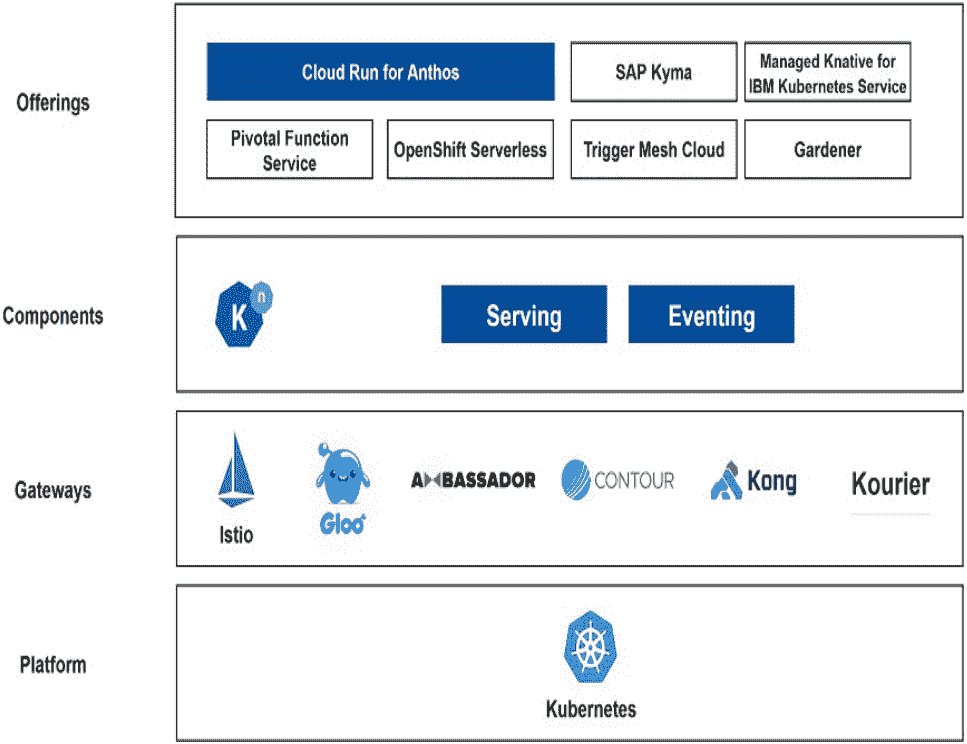
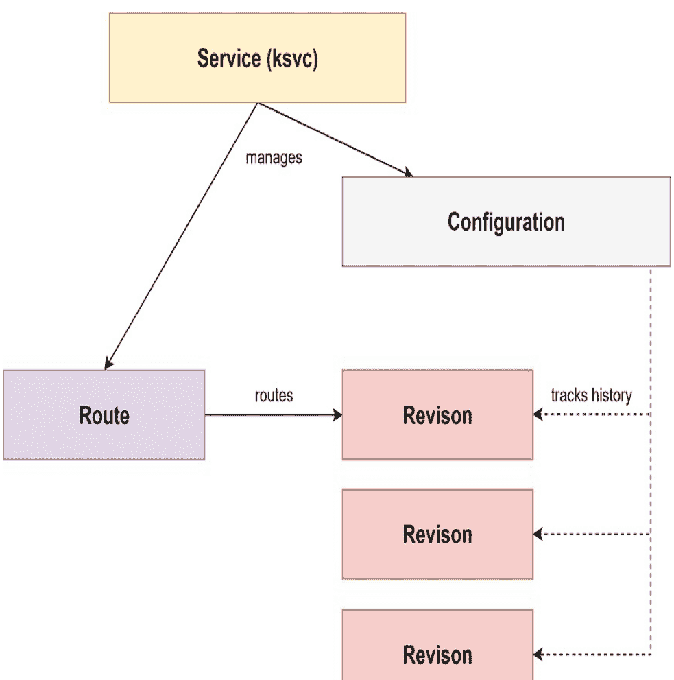
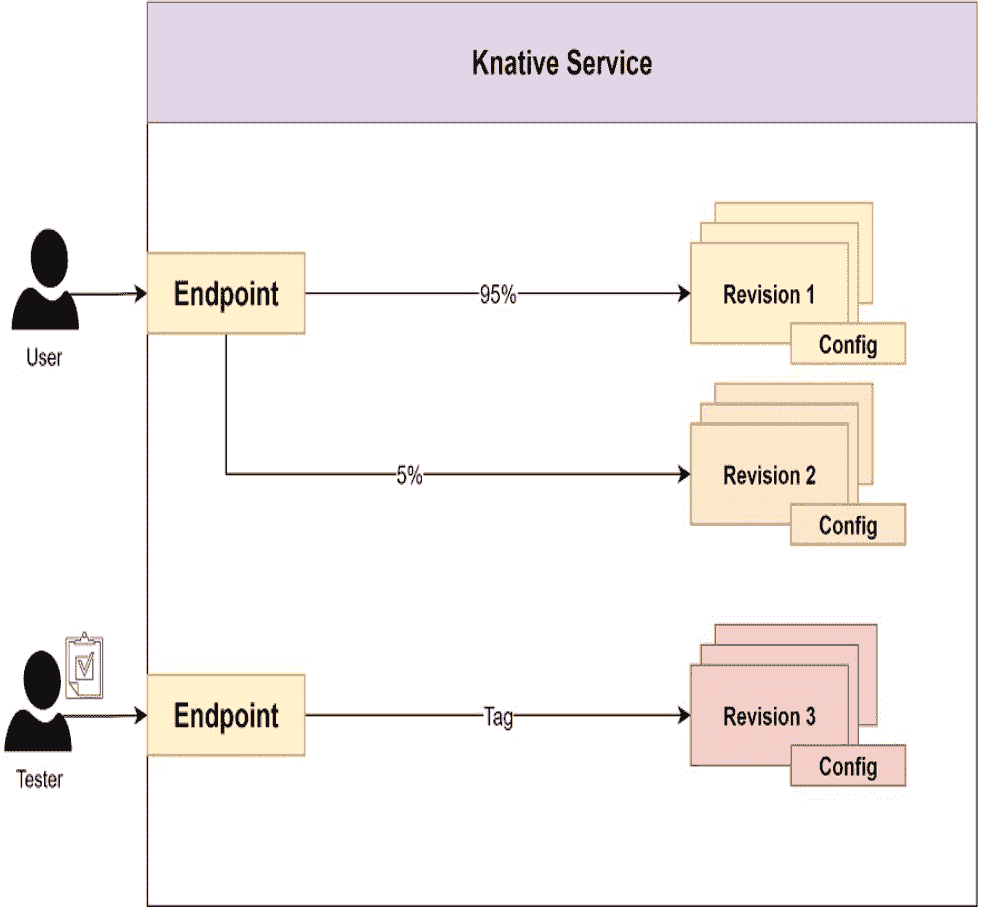
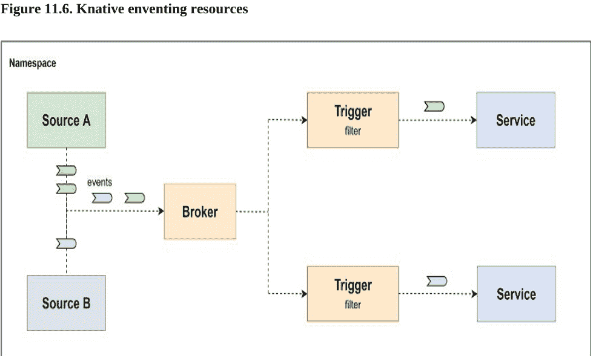
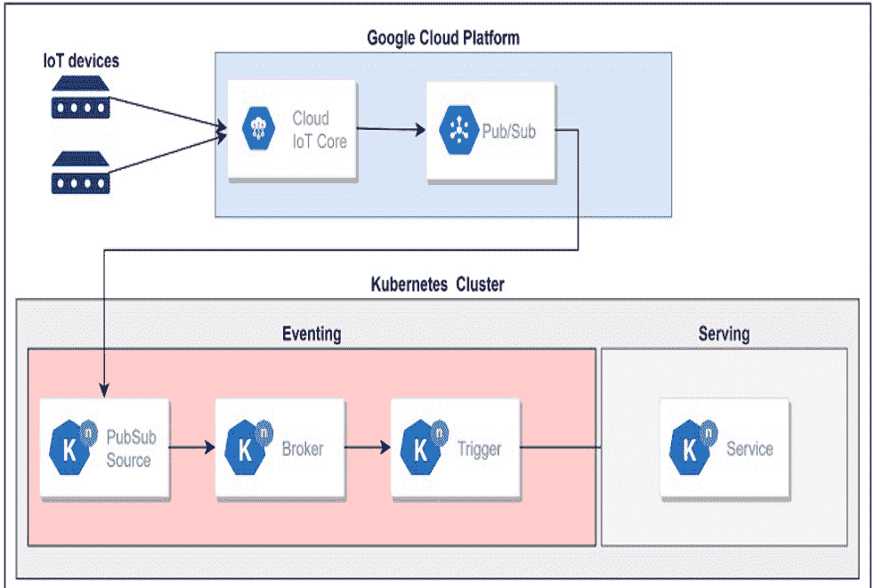
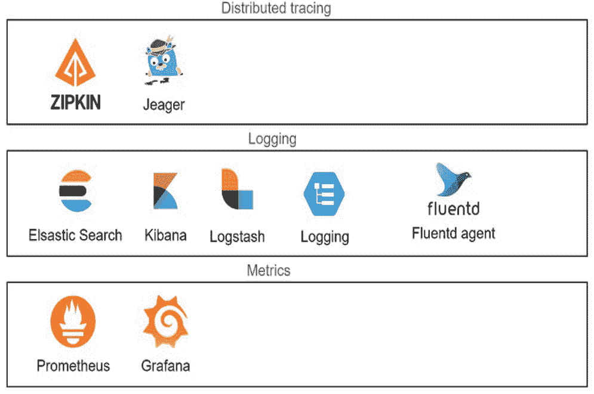
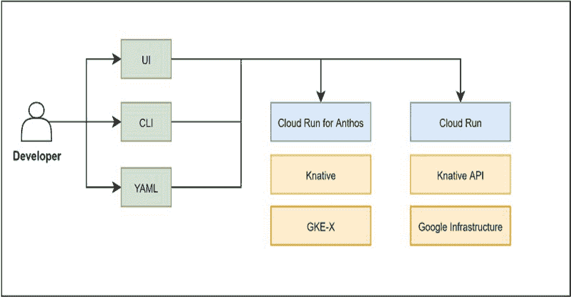

## 11 Knative 无服务器扩展

by Konrad Clapa

### 本章涵盖：
- Introduction to serverless
- Knative Serving and Eventing Components
- Knative on Anthos

在深入细节之前，让我们先设定场景。本章要讨论的是 Google Cloud Platform 的托管服务，该服务基于一个名为 Knative 的开源项目。该项目启动的目的是允许在无需理解其使用的复杂 Kubernetes 概念的情况下实现 Kubernetes 应用的更高开发速度。通过此服务，Google 会在你的 Anthos GKE 集群内部署并管理 Knative serving。使用 Knative 与 Anthos 而非开源 Knative 的好处之一是，Google 的自动化和站点可靠性工程师会处理安装和维护。Anthos 与众多 GCP 服务集成，如 Cloud Load Balancing[1]、Cloud Armor[2]、Cloud CDN[3] 等，使企业级 Knative 成为现实。

### 11.1 我们试图解决的问题是什么

我们在第 4 章已经讨论过 Kubernetes，Anthos 是一个基于 Kubernetes 的计算环境，因此我们了解其安装和维护可能有多复杂。Google Kubernetes Engine 为我们解决了这个问题。在 Kubernetes 之上，我们仍然需要知道如何运行和操作云原生应用。Knative 所做的是抽象这些实现细节，并允许你在任何 Kubernetes 集群上提供基于容器的无服务器工作负载。

在本章中，我们将了解无服务器是什么，介绍 Knative，最后讨论 Anthos 如何提供企业级容器化无服务器平台。

### 11.2 无服务器简介

关于无服务器是什么有很多讨论。最常见的是将无服务器与 Function as a Service (FaaS) 进行比较。这几乎是一种意识形态争论。为了简化，让我们看看 Cloud Native Computing Foundation 的定义：

> *Serverless computing refers to a new model of cloud native computing, enabled by architectures that do not require server management to build and run applications.*

Google 完全托管的 Cloud Run 服务完美契合此定义，因为它将计算层从开发者和运维人员中抽象出来。它允许你部署将提供 http(s) 请求的容器。应用的扩展由平台本身处理。

虽然 Google Cloud Functions 提供类似功能，但它对可使用的运行时语言有更强的限制。使用 Cloud Run，你可以使用任何能够运行可响应 HTTPS 调用的服务的语言。Cloud Run 不需要使用 Anthos。

当我们思考 Cloud Run 时，可以想到以下无服务器特性集合：

- No server - developers don’t need to worry about underlying compute infrastructure
- Multi-Language - the application can be written in any language
- Event-driven - the container/function is triggered by an external event
- Autoscaling - the container can automatically scale based on requests.
- Portability - your container/application should be able to run on any Kubernetes platform.

### 11.3 Knative

正如你所知，Kubernetes 是一个用于构建平台的平台。那么为什么不将其用于基于容器的无服务器平台构建呢？Knative 在 Kubernetes 之上运行，就像任何其他 Kubernetes 应用一样。你甚至可以看到 Knative 贡献者的一些说法，即它不应该被称为 serve less，所以，让我们将 Knative 看作是在你运行 Kubernetes 的任何地方提供无服务器的平台。听起来合理吗？

#### 11.3.1 简介

假设你想构建自己的基于 Kubernetes 的无服务器平台，你可能会画出如下所示的图表，展示所有必需的组件。显然，与构建自动伸缩、可观测性、滚动发布等原语相关的努力存在重复。Knative 所做的是为你提供所有这些原语，以便在 Kubernetes 上运行无服务器工作负载时具有一致的体验。

Figure 11.1. Kubernetes Serverless stack architecture

### Kubernetes Serverless stack architecture

Products

Developer Experience

Event Sources

Runtimes

...

Primitives

Build

Observe

Invoke

Rollout

Route

Bind Events

Autoscale

...

Common effort

Platform

Kubernetes

现在从开发者的角度思考。他们所要做的就是定义依赖项，编写代码并将其放入容器中。然后他们将应用部署到 Knative。如何提供服务不是他们的关注点。然而，这并不意味着他们失去了微调服务的能力。可以设置多个参数，如并发数（每个容器可处理的请求数）、最小/最大实例数（可为 Knative 服务配置的最小/最大容器实例数）等。Knative 隐藏了 Kubernetes 中与扩展和流量管理相关的所有复杂性，并提供了观察工作负载的手段。这就是你所说的轻松开始 Kubernetes 应用开发，对吧？

### Knative vs CaaS, FaaS and PaaS

在本章第二部分我们了解到 Knative 试图解决的问题：使无服务器工作负载能够在任何地方运行，同时具有 Kubernetes 的灵活性但隐藏复杂性。下表比较了 Knative 与平台即服务（PaaS）[4]、容器即服务（CaaS）[5] 和函数即服务（FaaS）[6]。各种功能是否受支持。Do it yourself (DIY) 表示你需要进行一些开发才能使用该功能。

### Table 11.1. Knative vs PaaS, CaaS and FaaS

| Feature | Knative | PaaS | CaaS | FaaS |
|---|---|---|---|---|
| Simple UX/DX | Yes | Yes |  | Yes |
| Event-driven | Yes | Yes |  | Yes |
| Container based | Yes | Yes | Yes | Yes |
| Autoscaling | Yes | Yes | DIY | Yes |
| Scale resources to 0 | Yes | Yes |  | Yes |
| Load Balancing | Yes | Yes | DIY | Yes |
| Unrestricted execution time | Yes* | Yes | Yes |  |
| Unrestricted compute/memory limits | Yes** | Yes** | Yes** |  |
| Variety of programming languages support | Yes | Yes | Yes | Limited |

*might be restricted for Managed services like Cloud Run.

** depends on the platform

正如我们所见，Knative 赋予了你函数即服务的全部优势，同时还赋予你以几乎任何语言运行应用的能力。与 FaaS 相比，执行时间的限制要高得多。在许多需要更长请求处理时间的情况下，Knative 是一个解决方案。你最终可以访问高级功能，如卷和网络，因此如果需要可以调整工作负载。与所有具有更高灵活性的计算服务一样，责任分界线会更多地转移到你身上。你需要构建自己的容器并确保能够利用所有高级功能，但说实话，谁不喜欢在获得 FaaS 所有好处的同时对应用有更多控制权呢？

#### 11.3.2 Knative 历史

Google 启动了 Knative，但现在已有 IBM、RedHat、Pivotal、SAP 等多家公司为其贡献。完整的文档和源代码可以在这里找到：https://github.com/knative。Knative 最初是一组组件，允许构建和运行无状态工作负载以及订阅事件。目前在 Github 上有两个活跃的项目正在进行中，它们是：

- **Knative Serving** - allows to serve serverless containerised workloads

#### 11.3.3 Knative 架构

让我们看看下面图表中展示的 Knative 架构。正如你已经注意到的那样，有多个层，其中一些组件可以即插即用或为可选。

### Figure 11.3. Knative Architecture



Knative 可以在任何能够运行 Kubernetes 的计算平台上运行。它可以基于虚拟机或裸机服务器。对于流量路由，使用 Service Mesh Gateway。显然最流行的是 Istio，但也支持替代解决方案，如：Gloo、Ambassador、Contour 和 Kourier，还有更多即将推出。要了解更多关于 Istio 的信息，请参阅第 5 章 Anthos Service Mesh: security and observability at scale。在此之上，我们将 Knative 组件作为 Kubernetes 应用安装。请注意，其中每个组件都可以安装和操作


separately. 如果你不想自行管理 Knative 安装，目前已有多个托管服务可供选择：Google Cloud Run 和 Google Cloud Run for Anthos、Openshift Serverless、Managed Knative for IBM Cloud Kubernetes Service 等，其中 Knative 和底层的 Kubernetes 均由提供商管理。相关服务的列表可在 https://knative.dev/docs/install/knative-offerings/ 找到。

## 11.3.4 Knative Kubernetes 资源类型

Knative 包含一组控制器和自定义资源定义（CRDs），用于扩展原生的 Kubernetes API。因此，与 Knative 的集成与与 Kubernetes API 本身的交互非常相似。我们将在下一节中查看 Knative 资源。

如果考虑一个简单的 Kubernetes 应用，你应该有诸如 Pods、Deployments 和 Services 之类的对象。如果加入 Service Mesh，你将有额外的资源来处理流量管理，如 VirtualServices、DestinationRules 等。而使用 Knative，你只需用一个资源即可控制部署，即 Knative Service，它允许你同时部署工作负载并处理流量。所有必需的 Kubernetes 和 Service Mesh 资源都将为你创建。

## 11.3.5 Knative Serving

Knative Serving 允许你轻松部署基于容器的无服务器工作负载，并通过 HTTP(s) 请求（近期已宣布支持 gRPC）将其提供给用户。例如，你可以使用 Knative Serving 提供整个电子商务网站的前端。它会根据需求自动扩展你的工作负载（从 0 到 N），并将流量路由或拆分到你选择的版本（revision）。要使用原生 Kubernetes 实现此功能，你需要使用额外的 Kubernetes 资源，如水平 Pod 自动扩缩器 HPA[10]。Knative Serving 通过新的自定义资源定义（CRDs）扩展了 Kubernetes API，如 Knative Serving Service、Configuration、Route 和 Revision。下图展示了 Knative 资源之间的依赖关系。

Figure 11.4. Knative Serving resources



让我们逐一查看这些 CRDs：

- **Service**（API 路径 service.serving.knative.dev）：这是 Knative Serving 中最重要的资源。它会自动创建整个工作负载生命周期所需的其他 Knative 资源。随着服务的更新，会创建新的 Revision。在 Knative Service 中，你可以同时定义容器版本以及

流量规则。

**Note:**

这与原生的 Kubernetes Service 对象不同，初次使用时可能会让新用户感到困惑。

下面我们可以看到一个 Service 定义的示例，它将一个简单的 hello world 工作负载部署到 Knative Serving。这将自动创建其他资源：Revision、Configurations 和 Route。

# Listing 11.1

```
apiVersion: serving.knative.dev/v1
kind: Service
metadata:
    name: helloworld
    namespace: default
spec:
    template:
        spec:
            containers:
                - image: docker.io/{username}/helloworld
                  env:
                    - name: TARGET
                      value: "Python Sample v1"
```

- **Revision**（API 路径 *revision.serving.knative.dev*）：这本质上是容器版本及其配置的不可变快照。它定义了实际提供给用户的内容。。
- **Configuration**（API 路径 *configuration.serving.knative.dev*）：这是应用程序的配置部分，用于强制执行工作负载的期望状态。它允许你将代码（容器）与配置部分分离。修改配置会导致创建新的 revision。
- **Route**（API 路径 *route.serving.knative.dev*）：它将端点映射到一个或多个 revisions。

当你使用 Knative 时，就不再需要担心原生的 Kubernetes 和 Service Mesh 资源，如：*Deployments*、*Services*、

*VirtualServices* 等。你只需将应用程序定义为 Knative Service，所有“后端”资源都会为你创建。

## Traffic Management

当你想用新镜像更新 Knative Service 时，会创建新的 revision，并且默认情况下流量会被导向新的 revision。你可以执行 A/B[^11] 测试和 Canary[^12] 发布，并通过定义 *metadata.spec.traffic* 属性来控制应将多少流量导向特定 revision。你也可以为特定 revision 设置标签，使其可通过专用 URL 访问。

Figure 11.5. Knative Service traffic flows



要实现上图所示的路由，你需要在 Knative Service 中按如下方式设置 metadata.spec.traffic 属性：

```
```yaml
traffic:
  - tag: current
    revisionName: helloworld-v1
    percent: 95%
  - tag: candidate
    revisionName: helloworld-v2
    percent: 5%
  - tag: latest
    latestRevision: true
    percent: 0
```
```

正如你所见，开发者只需使用一个 Kubernetes 对象即可控制整个工作负载的提供方式。无需深入 Kubernetes 后端。

## 11.3.6 Knative Serving Control Plane

现在让我们看看使这一切成为可能的 Knative Serving 控制平面。正如我们之前所说，Kubernetes 利用 Istio 或其他受支持的服务网格进行流量管理。它还包含一系列服务来负责运行和扩展工作负载。

要获取你安装 Knative 时的 knative-serving 命名空间中的服务列表，请使用：

```
kubectl get services -n knative-serving
```

它将显示以下服务：

| NAME | TYPE | CLUSTER-IP | EXTERNAL-IP | PO |
|---|---|---|---|---|
| activator-service | ClusterIP | 10.96.61.11 | <none> | 80 |
| autoscaler | ClusterIP | 10.104.217.223 | <none> | 80 |
| controller | ClusterIP | 10.101.39.220 | <none> | 90 |
| webhook | ClusterIP | 10.107.144.50 | <none> | 44 |

正如你所见，对于这样一个复杂的服务，支持服务并不多，让我们逐一查看。

- **Activator** - 接收并缓冲针对非活动 revision 的请求，并向 autoscaler 报告指标。它还在 autoscaler 根据报告的指标扩展 revision 后重试对 revision 的请求。
- **Autoscaler** - 根据定义的参数设置处理负载所需的 Pod 数量。
- **Controller** - 监控并协调 CRDs 中定义的 Knative 对象。当创建新的 Knative Service 时，它会创建 Configuration 和 Route。它会创建 revision 以及对应的 Deployment 和 Knative Pod Autoscalers（KPAs）。
- **Webhook** - 拦截、验证和修改 Kubernetes API 调用，包括 CRD 插入和更新。设置默认值并拒绝

不一致和无效的对象。

如果你获取 Knative 安装命名空间中的部署列表

```
kubectl get deployments -n knative-serving
```

你会看到以下部署：

| NAME | DESIRED | CURRENT | UP-TO-DATE | AVAILAB |
|---|---|---|---|---|
| activator | 1 | 1 | 1 | 1 |
| autoscaler | 1 | 1 | 1 | 1 |
| controller | 1 | 1 | 1 | 1 |
| networking-certmanager | 1 | 1 | 1 | 1 |
| networking-istio | 1 | 1 | 1 | 1 |
| webhook | 1 | 1 | 1 | 1 |

我们已经讨论了其中四个服务，但还有两个尚未见过的部署。它们的作用如下：

- **Networking-certmanager:** 将集群 ingress 协调为 cert manager 对象。
- **Networking-istio:** 将集群的 ingress 协调为 Istio virtual service。

## 11.3.7 Knative Eventing

Eventing 是 Knative 的组件，用于编排来自 Kubernetes 集群内部或外部各种源的事件。这是事件驱动架构中非常重要的元素，它允许你使用现有事件源中的选择来触发你的服务，并为尚未可用的自定义源场景构建新的事件源。这与 Function as a service 非常不同，后者在函数触发方面仅使用 HTTP 请求或其他预定义触发器，如 Google Cloud Storage 事件。

所有 Knative Eventing 对象均定义为 CRDs。它确保事件按照 Knatvie 对象中定义的规则使用控制器进行处理。可扩展性会自动处理，因为事件会触发对容器的调用。它为你提供了与 Knative Serving 相似的可扩展性，因此你开始


它可以处理少量事件的小负载，并能够扩展以处理事件流。

目前已有大约 20 个预定义的源可供使用，而且这个列表还在不断增长。你也可以开发自己的源。Knative Eventing 也具有很强的可插拔性，因此你可以选择在处理事件时如何存储事件。你可以选择使用内存存储或持久化存储。Knative 使用开放的 CNCF 标准 CloudEvents 来解析原始事件。事件的目标既可以是 Knative 服务，也可以是 Kubernetes 服务。Eventing 管道可以非常简单，比如将简单事件发送到单个服务，但也可以变得非常复杂。为了理解 Cloud Run，我们先从基础知识入手。

## 11.3.8 Knative Eventing 资源

Knative 事件最基本的组件是 Broker 和 Trigger。如果我们看下面的示意图，可以看到事件由外部源生成，并由 Broker 捕获。在那里，一个或多个 Trigger 接收事件，对事件进行过滤，然后将事件传递给 Service。



Knative 的架构带来了清晰的关注点分离。Knative Eventing Broker 是一个事件网格（Event Mesh），它拉取或接收事件，而 Knative Trigger 负责过滤事件并将事件路由到目标。事件源是 Knative Eventing 的控制平面，确保事件被发送到 Broker。

现在让我们更仔细地了解一下这些资源。

- **Broker API 路径 `broker.eventing.knative.dev`** 本质上是一个可寻址的事件交付系统，你可以将其安装在命名空间中。这可以通过在命名空间上设置标签来完成。类似你使用 Istio 时希望对 Pod 进行 sidecar 注入的做法。Broker 接收事件，然后将事件发送给订阅者。消息存储在由 Broker 管理的通道中。

  该通道可以是一个简单的内存通道，也可以为了可靠性而使用持久化存储。这方面的例子有 Pub/Sub 和 Kafka。通道的配置存储在 ConfigMap 中。你可以将 Broker 安装到多个命名空间中。这样做的使用场景是，如果你想要不同类型的消息。你还可以过滤 Broker 接收哪些事件。

  下面我们来看一个 Knative Broker 的示例定义：

  ```yaml
  apiVersion: eventing.knative.dev/v1
  kind: Broker
  metadata:
    annotations:
      eventing.knative.dev/broker.class: MTChannelBasedBroker
    name: default
    namespace: default
  spec:
    config:
      apiVersion: v1
      kind: ConfigMap
      name: config-br-default-channel
      namespace: knative-eventing
  ```

- **Triggers API 路径 `trigger.eventing.knative.dev`** 将事件与 Service 匹配。因此，它被定义为针对特定类型的事件（例如 Cloud Storage 对象创建时将事件发送到该服务）。Trigger 可以基于一个或多个属性过滤事件。如果有多个属性，则所有属性值都必须匹配。它还可以从接收的事件中生成新的事件类型。这对于过滤包含敏感数据的事件来说是一个很好的用例。

  下面我们来看一个 Knative Trigger 的示例定义：

  ```yaml
  apiVersion: eventing.knative.dev/v1alpha1
  kind: Trigger
  metadata:
      name: helloworld-python
      namespace: knative-samples
  spec:
      broker: default
      filter:
          attributes:
              type: dev.knative.samples.helloworld
              source: dev.knative.samples/helloworldsource
      subscriber:
          ref:
              apiVersion: v1
              kind: Service
              name: helloworld-python
  ```

- **Source API 路径（`<source_name>.eventing.knative.dev`）** 被定义为 CRD。这个列表还在不断增长，包括：AWS SQS、Google Cloud Pub/Sub、Google Cloud Scheduler、Google Cloud Storage、GitHub、GitLab 等。要查看完整的事件列表，请参阅：https://knative.dev/docs/eventing/sources/。你可以使用现有的 Source，也可以创建自己的 Source。下面的示例展示了如何配置 *CloudPubSubSource* 事件源。每当有消息发布到名为“testing”的 Pub/Sub 主题时，就会生成该事件。

  下面我们来看一个 Knative CloudPubSubSource 的示例定义：

  ```yaml
  apiVersion: events.cloud.google.com/v1
  kind: CloudPubSubSource
  metadata:
      name: cloudpubsubsource-test
  spec:
      topic: testing
      sink:
          ref:
              apiVersion: v1
              kind: Service
              name: event-display
  ```

这可以使用 Kubernetes Operators、Container sources 或现有的 Services 来完成。要了解如何开发自己的 Source，请参阅 Knative Eventing 文档（https://knative.dev/docs/eventing/custom-event-source/custom-event-source/）

## 11.3.9 Knative 用例

借助 Knative，你可以覆盖从简单的单一服务到非常复杂的多微服务应用的众多用例。使用 Knative Serving，你可以创建 HTTP 和 gRPC [13] 服务、webhook 和 API。你可以管理发布（rollout）和回滚（rollback）。你可以轻松控制应用程序的流量。借助 Cloud Eventing，你可以创建简单或非常复杂的事件管道。将这两种服务结合起来，你就可以交付完全云原生的、事件驱动的应用程序。

让我们看一个将运行中的服务绑定到 Cloud IoT Core [14] 的简单示例。来自 IoT 设备的消息被发送到 Google Cloud IoT Core，然后发送到 Pub/Sub。Cloud Eventing 服务使用 Pub/Sub Source 从主题获取消息。消息被发送到 Broker，并转换为 CloudEvents。Trigger 确保事件被发送到适当的服务，由该服务进一步处理、记录或向用户显示。

**图 11.8.**



如果你想亲自尝试 Pub/Sub 示例，我们建议你按照以下分步教程进行操作：https://github.com/google/knative-gcp/tree/main/docs/examples/cloudpubsubsource

## 11.3.10 可观测性

Knative 自带日志记录和追踪功能。支持以下开源软件：

- **Prometheus** 和 **Grafana** 用于指标
- **ELK** 技术栈（**Elasticsearch**、**Logstash** 和 **Kibana**）用于日志
- **Jaeger** 或 **Zipkin** 用于分布式追踪

要了解更多关于指标和追踪的信息，请参阅第 5 章“Anthos Service Mesh：大规模安全性和可观测性”。

你还可以使用 *Fluent Bit* 代理集成 **Google Cloud Logging**（原 Stackdriver Logging）来收集日志。每个组件的安装过程在以下文章中都有详细说明：
https://knative.dev/docs/serving/observability/logging/collecting-logs/

**图 11.9. Knative 可观测性生态系统**



由于这些组件像任何其他 Kubernetes 应用程序一样部署，你可以通过暴露 Kubernetes Service 来访问它们。下面是部署后集群中运行的 Pod 示例：

| 名称 | 就绪 | 状态 | 重启次数 |
|------|------|------|----------|
| grafana-798cf569ff-v4q74 | 1/1 | 运行中 | 0 |
| kibana-logging-7d474fbb45-6qb8x | 1/1 | 运行中 | 0 |
| kube-state-metrics-75bd4f5b8b-8t2h2 | 4/4 | 运行中 | 0 |
| node-exporter-cr6bh | 2/2 | 运行中 | 0 |
| node-exporter-mf6k7 | 2/2 | 运行中 | 0 |
| node-exporter-rhzr7 | 2/2 | 运行中 | 0 |
| prometheus-system-0 | 1/1 | 运行中 | 0 |
| prometheus-system-1 | 1/1 | 运行中 | 0 |

## 11.3.11 安装 Knative

你可以在多个云平台或本地环境中安装 Knative，只要运行的是 Kubernetes 集群。这包括但不限于：

- Amazon EKS
- Google GKE
- IBM IKS
- Red Hat OpenShift Cloud Platform
- Minikube

归根结底，Knative 只不过是一个 Kubernetes 应用程序。安装可以通过 YAML 文件或 Operator 来完成。要了解更多关于 Operator 的信息，请参阅：https://kubernetes.io/docs/concepts/extend-kubernetes/operator/。**Knative Serving** 组件的安装过程包括：

- 安装自定义资源定义（即 CRD）：
- 安装 Serving 的核心组件
- 安装网络层
- 配置 DNS
- 安装可选的 Serving 扩展

**Knative Eventing** 组件的安装过程包括：

- 安装自定义资源定义（即 CRD）：
- 安装 Eventing 的核心组件
- 安装默认的 Channel（消息）层
- 安装 Broker（事件）层
- 可选的 Eventing 扩展（源）

完成 Serving 和 Eventing 的安装后，你可以安装上一章描述的可观测性组件。有关端到端安装的详细分步说明，请参阅：https://knative.dev/docs/getting-started/quickstart-install/

## 11.3.12 部署到 Knative

你可以按照一个简单指南将你的第一个应用程序部署到 Knative。实际上，只需应用一个 Knative Service 对象即可。这就是


假设你已经有一个容器化的 Python 应用，该应用响应 *Hello Python Sample v1!* 并存储在 Docker Hub 中。 （请参阅 [https://github.com/knative/docs/tree/main/code-samples/eventing/helloworld/helloworld-python](https://github.com/knative/docs/tree/main/code-samples/eventing/helloworld/helloworld-python) 查看该应用的源代码。

+   1. 运行以下命令创建 Knative Service：

```
kubectl apply -f service.yaml
```

其中 Service 在 service.yaml 文件中定义：

```
apiVersion: serving.knative.dev/v1
kind: Service
metadata:
  name: test
  namespace: default
spec:
  template:
    spec:
      containers:
        - image: docker.io/<user>/<image_name>
          env:
            - name: TARGET
              value: "v1"
```

+   2. 部署后会为你创建多个对象。这包括 Pods、Knative Service、Configuration、Revision 和 Route。 你可以通过运行以下命令验证它们：

```
kubectl get pod,ksvc,configuration,revision,route
```

+   3. 要获取 IP 地址，你可以访问服务并获取 Istio ingress 网关的 IP 地址：

```
kubectl get ksvc helloworld-python --output=custom-columns=NAME:
```

这将返回 URL ：

```
NAME                 URL
helloworld-python     http://helloworld-python.default.1.2.3.4.xip.
```

4. 现在通过运行 curl 查询来测试应用程序：

```
curl http://helloworld-python.default.1.2.3.4.xip.io
```

请注意 xip.io 域是所谓的 Magic DNS，你可以在安装 Knative 时进行配置（参见： [https://knative.dev/docs/serving/using-a-custom-domain/](https://knative.dev/docs/serving/using-a-custom-domain/)）。

5. 你应该会看到以下输出

```
Hello Python Sample v1!
```

你已成功部署了第一个 Knative 应用程序！

为了获得 Knative 的实践经验，我们建议你按照下面的示例进行操作。它们涵盖了端到端的 Knative 应用开发和部署场景，并支持多种语言。我们特别推荐 Mete Atamel 关于 Knative 的教程，它会手把手地带你从非常简单的部署到非常复杂的部署，包括使用 Google Cloud 服务如 Pub/Sub、AI API、BigQuery 等。我们相信你会玩得很开心！

## 表 11.2. 部署到 Knative 的参考资料

| 标题 | URL |
|---|---|
| Knative Serving 代码示例 | [https://knative.dev/docs/serving/samples/](https://knative.dev/docs/serving/samples/) |
| Knative Eventing 代码示例 | [https://knative.dev/docs/eventing/samples/](https://knative.dev/docs/eventing/samples/) |
| Mete Atamel Knative 教程，包含多个示例 | [https://github.com/meteatamel/knative-tutorial](https://github.com/meteatamel/knative-tutorial) |

## Knative 总结

使用 Knative Service，你不再需要在 Kubernetes 的灵活性和 Function as a Service 的简易性之间做出选择。你可以获得两者的优点。你可以在任何地方运行你的无服务器工作负载。使用 Knative Eventing，你能够订阅并接收来自多个预定义源的事件，以及使用云原生架构定义自己的源。

## Cloud Run 与 Anthos 上的 Knative

Cloud Run 是一个完全托管的无服务器服务，Knative on Anthos 运行在你的 Anthos 集群之上。你可以以相同的方式与 Cloud Run 交互，无论你选择哪个版本。然而 Cloud Run 运行在 Google 基础设施上，你无需担心底层平台。

注意：为本书的目的，我们将把 Cloud Run（完全托管）称为 Cloud Run。

## 图 11.10. Cloud Run 和 Knative on Anthos 架构



好吧，我们已经知道主要区别是什么，但你仍然可能会

| 执行环境 | Google Infra | GKE 集群 |
|---|---|---|

那么何时选择每个服务？这在很大程度上取决于你希望对应用程序执行拥有多少控制权，以及是否需要 GKE 节点可能提供的定制硬件。例如，你可能希望利用 GPU 来提升 ML 流水线的性能。在这种情况下，Knative on Anthos 将是最佳选择。

## 11.4 总结

在本章中，我们讨论了 Knative 如何融入 Anthos 套件，并且我们学习了以下内容：

+   - Knative 抽象掉了 Kubernetes 的复杂性。
+   - 工作负载可以移植到任何 Kubernetes 集群。
+   - Knative 有多个组件，可以解决多种用例。
+   - Eventing 是编排来自各种源的事件的组件。
+   - Service 是允许你部署基于容器的无服务器工作负载并将其提供给用户的组件。
+   - 无服务器 Kubernetes 工作负载可以使用 Knative on Anthos 进行部署和提供服务。
+   - 可以使用修订版本控制应用程序的版本。
+   - 可以使用修订参数管理应用程序的流量。
+   - 你可以使用丰富的开源工具生态系统来获取应用程序的洞察，用于监控、日志记录和追踪。

下一章将讨论 Anthos 网络的网络概念。

[1] Cloud Load Balancing: https://cloud.google.com/load-balancing

[2] Cloud Armor: https://cloud.google.com/armor

[3] Cloud CDN（内容分发网络）: https://cloud.google.com/cdn/docs/overview

[4] PaaS https://en.wikipedia.org/wiki/Platform_as_a_service

[5] CaaS: https://www.ibm.com/services/cloud/containers-as-a-service

[6] FaaS: https://en.wikipedia.org/wiki/Function_as_a_service

[7] Tekton Pipelines: https://github.com/tektoncd/pipeline

[8] App Engine: https://cloud.google.com/appengine

[9] Knative Service 在本章的下一节中进行了解释。

[10] Horizontal Pod Autoscaler（HPA）: https://kubernetes.io/docs/tasks/run-application/horizontal-pod-autoscale/

[11] A/B 测试: https://martinfowler.com/articles/feature-toggles.html

[12] Canary 发布: https://martinfowler.com/bliki/CanaryRelease.html

[13] gRPC: https://grpc.io/docs/what-is-grpc/introduction/

[14] Cloud IoT Core: https://cloud.google.com/iot-core
