## 12 Anthos - 网络环境

作者 Ameer Abbas

## 本章涵盖

+   - Anthos 云网络和多个云环境之间的混合连接。
+   - Anthos Kubernetes 和 GKE 网络，包括数据平面 v2。
+   - Anthos 多集群网络，包括服务发现和路由。
+   - 服务到服务和客户端到服务的连接。

Anthos 网络可以分为四个部分。每个部分在实体之间提供一层连接，例如环境（例如公有云和本地）、Anthos GKE 集群，以及服务到服务的通信。四个层如下：

+   1. **云网络和混合连接** - 本节涉及网络的最低层，涵盖不同基础设施环境如何互连。
+   2. **Anthos GKE 网络** - Anthos GKE 集群根据其部署的基础设施有多种实现。本节涵盖 Anthos GKE 集群网络，包括 Ingress 在各种环境中的工作方式。
+   3. **多集群网络** - 本节涉及各种 Anthos GKE 集群如何相互连接。Anthos GKE 集群可能部署在单个基础设施环境中（例如 GCP），也可能部署在多个基础设施环境中（GCP 和本地数据中心）。
+   4. **服务和客户端连接** - 本节涉及在 Anthos 上运行的应用程序如何相互连接。本节还涉及在 Anthos 外部运行的客户端和服务如何

连接到 Anthos 平台内部运行的服务。

## 图 12.1 Anthos 网络的四个层

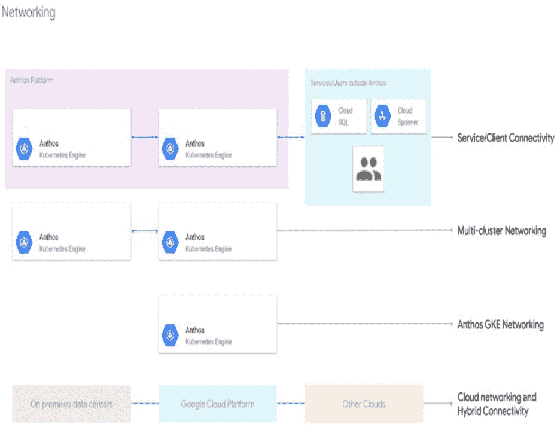

## 12.1 云网络和混合连接

本节涉及基础设施环境级别的网络连接各个方面。Anthos 是一个多云平台，可以运行在一个或多个公有和私有云环境中。

在基础设施层，有两种主要方式部署 Anthos。

+   1. 单一云环境中的 Anthos - 例如 GCP 或本地数据中心，甚至在另一个公有云中。


从法规角度来看。

## 共享 VPC

使用共享 VPC [6] 是为 Anthos 平台在 GCP 上配置网络的首选方式。共享 VPC 设计既可用于简单环境，也可用于复杂（大规模和多租户）的 Anthos 环境。共享 VPC 允许单个 VPC 在多个项目之间共享。这会形成一个由多个租户共享的单一扁平网络空间，每个租户都位于自己的项目中。按产品/租户划分 GCP 项目，可以在项目级别实现细粒度的 IAM 权限控制。同时，多个项目中的资源仍然可以（如果允许）相互连接，就像它们在同一个网络上一样。

网络宿主项目包含一个集中式的“共享”VPC。所有网络资源都位于此网络宿主项目中，包括子网、防火墙规则、网络权限等。一个集中的网络团队拥有并控制该网络宿主项目。这可确保组织的网络最佳实践由一支合格的网络专家团队统一执行。然后，多个服务项目可以使用宿主项目的网络资源。子网从网络宿主项目共享给多个服务项目，并由每个服务项目中的资源使用。

对于 GCP 上的 Anthos，建议创建一个名为“platform_admins”等服务项目。Anthos 平台（所有 GKE 集群）位于 platform_admins 项目内。顾名思义，platform_admins 项目由平台管理员团队拥有，他们负责管理和维护 Anthos 平台的生命周期。平台管理员是网络宿主项目的众多租户之一。同样，产品和环境也有各自的服务项目。Anthos 是一个共享的多租户平台，每个租户都有一个“着陆区”，用于在 Anthos 上运行其服务。着陆区是在 Anthos 平台上运行服务所需的一组资源。着陆区通常是一个（或多个）Anthos GKE 集群中的一个（或多个）命名空间，以及运行该服务所需的一组策略。所有非 Anthos 资源（属于某个服务）都在各个服务的 GCP 项目中预配和管理。这样，多个租户可以拥有自己的非 Anthos 资源项目，并且他们都可以共享 GCP 集群上的单个 Anthos GKE。使用共享 VPC 可以让 Anthos 和非 Anthos 资源相互连接。

图 12.3 GCP 中的共享 VPC 架构

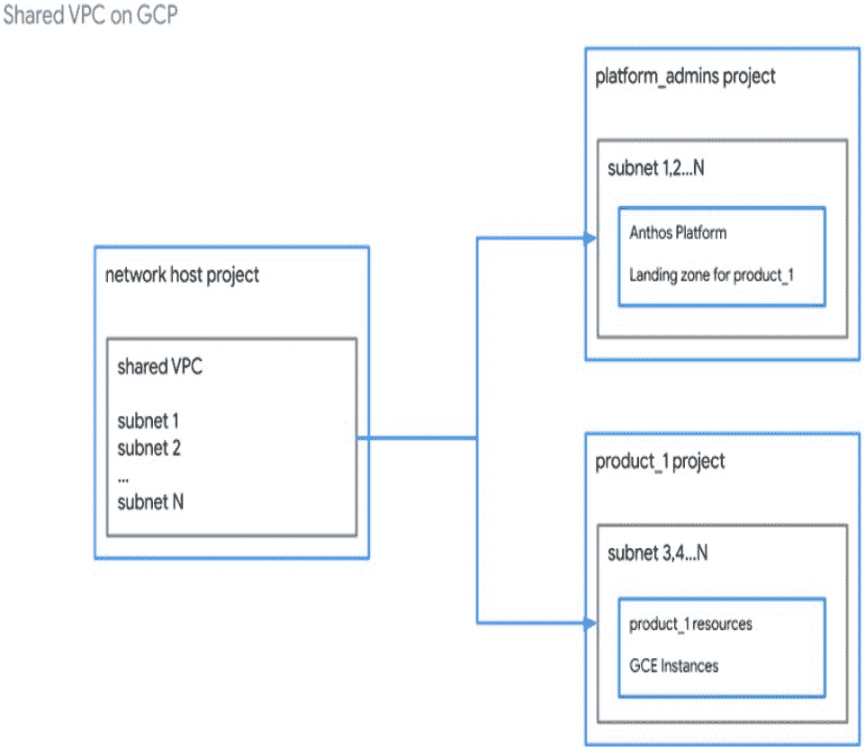

## 多 VPC

前两种 VPC 实现会产生一个扁平网络，所有资源都在单个逻辑 VPC 中预配。在某些情况下，安全或法规限制可能要求将资源分离到多个 VPC 中。公司或组织也可能希望每个团队或产品管理自己的网络。

GCP 平台上的 Anthos GKE 可以安装在一个 VPC 中。多租户功能允许您与多个租户共享 GCP 上的 Anthos GKE。可能要求将 Anthos 平台上运行的服务连接到平台外部的服务。在此设计中，这些服务在不同的 VPC 中运行。例如，在 GCP 的 Anthos GKE 上运行的服务可能在名为 anthos_vpc 的 VPC 上运行，而非 Anthos 资源可能在名为 product_1_vpc 的 VPC 上运行。有几种方法可以连接这些服务：

- 1. **IPSec VPN [7]** - 可以在两个 VPC 之间创建 IPSEC VPN 隧道。IPSec VPN 流量以安全的方式通过公共互联网传输。在两个网络之间传输的流量由一个 VPN 网关加密，然后由另一个 VPN 网关解密。此操作可保护您的数据在互联网上传输时的安全。通过公共互联网传输可能会导致性能下降。IPSec VPN 对于大规模环境很有帮助。
- 2. **VPC 对等互连 [8]** - 可以将多个 VPC 进行对等互连，使 VPC 之间可以互联，而无需通过 IPSEC VPN 连接 VPC。VPC 对等互连提供与单个 VPC 相同的数据平面和性能特性，但具有管理边界（安全性和配置）。这为 VPC 到 VPC 的流量提供了更好的安全性和性能。VPC 对等互连需要两个 VPC 的网络管理员之间的协调。VPC 对等互连不允许 IP 地址重叠。此外，两个 VPC 所有者都维护独立的防火墙，并设置允许属于两个 VPC 的子网之间流量的所需规则。
- 3. **公共互联网和安全入站** - 如果无法选择 VPC 对等互连或 VPN，服务可以通过公共互联网进行通信。在这种情况下，可以使用诸如 Anthos Service Mesh 之类的高级功能，通过 TLS [9] 或 mTLS（双向 TLS）对网络之间的流量进行加密。如果只有少量服务需要跨 VPC 连接，此方法效果很好，因为此方法需要按服务（目标服务）进行配置，而前两种方法是在 TCP/IP 层连接两个网络。

图 12.4 GCP 中的多 VPC 架构

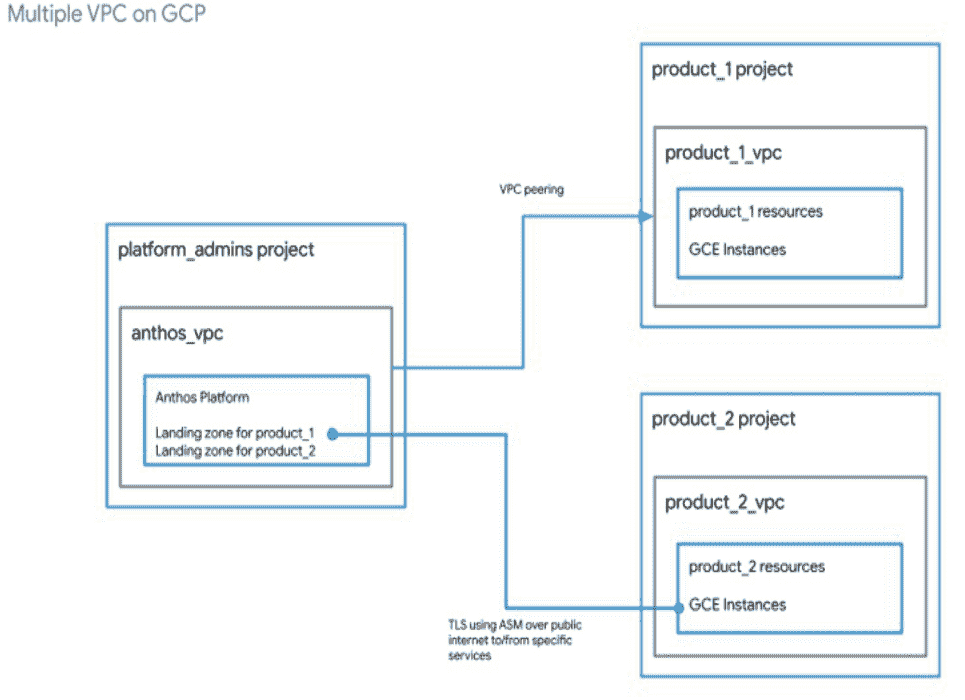

## 单个非 GCP 环境上的 Anthos

Anthos 可以部署在各种非 GCP 环境中。这些环境包括本地数据中心、公共云和私有云。在基础设施层，有两种主要的网络设计需要考虑。

### 单一扁平网络

顾名思义，扁平网络由单一逻辑网络空间组成，其中 Anthos 和非 Anthos 资源（例如在 Anthos 平台之外运行的虚拟机）都位于同一网络上。扁平网络是一组由路由器和交换机连接的子网，在给定正确路由（和防火墙）规则的情况下，每个 IP 端点都可以交换或路由到另一个端点。单个 GCP VPC 就是扁平网络的一个示例，您可能有多个子网以及路由/防火墙规则，以允许任意两个端点之间的路由。与多个不同的网络相比，扁平网络更易于管理，但在安全性方面需要更加严格，因为所有实体都位于同一逻辑网络空间中。防火墙规则、NetworkPolicies 和其他功能可以确保只有被允许的实体才能进行网络访问。扁平网络也可能会遇到可扩展性问题。通常，这些网络使用 RFC1918 地址空间，该空间提供有限数量的 IP 地址（略低于 1800 万个地址）。通常，扁平逻辑网络要求所有资源使用相同的 RFC1918 空间。此一般规则也有例外，大型组织可能会使用自己的公共 IP 地址空间进行内部寻址。无论使用何种 IP 地址，重要的是要注意，在扁平网络中，任何两个端点都不能拥有相同的 IP 地址。

### 多网络

Anthos 也可以部署在多网络环境中。Anthos GKE 集群可以根据需要部署在单个或多个网络上。通常，如果 Anthos 部署在同一网络中，则更容易管理 Anthos 平台上运行的应用程序的网络连接。可以将 Anthos 平台部署在多个不连通的网络上。在某些情况下，可能需要连接多个网络。有三种主要方法可以跨多个网络连接 Anthos 平台上运行的应用程序。

- 1. **VPN/ISP** - 通过 VPN 将多个网络连接在一起，或者所选的 ISP 可能提供这种连接。这些是连接多个本地数据中心的典型选择。
- 2. **VPC 对等互连** - 如果 Anthos 部署在提供 VPC 对等互连功能的公共云上，则可以使用 VPC 对等互连。
- 3. **网关或 mTLS** - 可以使用 TLS、mTLS 或安全的 API 网关，通过公共互联网安全地连接服务。此功能通过 Anthos Service Mesh [10]（ASM）等服务网格或 Apigee [11] 等 API 网关实现。这是在每个服务级别上完成的，而前两个选项是在网络层配置的。

## 12.1.2 多云/混合云部署


Anthos 是一个多云平台，可以部署到多个环境，例如公共/私有云和本地数据中心。在多个环境中管理网络具有挑战性，因为每个环境都是唯一的，并且资源管理取决于提供商而有所不同。例如，GCP VPC 的配置方式与 AWS VPC 或数据中心网络不同。Anthos 在多个环境中提供统一的接口。

Anthos 平台可以通过三种主要方式部署到多个环境中。

- 1. **多云部署** - Anthos 平台可以部署到多个公共云环境，例如 GCP 以及一个或多个公共云如 AWS 和 Azure。
- 2. **混合云部署** - Anthos 平台可以部署到 GCP 以及一个或多个本地数据中心。
- 3. **多云和混合云部署** - 此部署是上述两种部署的组合。例如，Anthos 平台可以部署到 GCP、一个或多个本地数据中心以及一个或多个非 GCP 公共云。

## 多/混合网络

当 Anthos 跨多个基础设施环境部署时，这些环境需要与 GCP 具有网络连接。

有三种网络连接选项可用于连接多个基础设施环境。

## Cloud Interconnect

[Cloud Interconnect](12) 通过高可用、低延迟的连接将本地网络扩展到 Google 网络。您可以使用 Dedicated Interconnect 直接连接到 Google，或使用 Partner Interconnect 通过受支持的服务提供商连接到 Google。Dedicated Interconnect 在您的本地网络和 Google 网络之间提供直接物理连接。Dedicated Interconnect 使您能够

它由 API 服务器用于将大型子网切片为每个节点的小型子网。例如，如果您希望每个节点有 30 个 Pod，每个节点至少需要一个 /27。您的 Pod IP 范围必须足够大，以容纳 N 个每个包含 32 个地址的子网，其中 N 为集群中的最大节点数。

Pod IP 地址在集群内可路由。它们是否可以从集群外部路由，取决于集群的类型和实现方式。这将在下一节中详细讨论。

**服务或 ClusterIP 地址** 分配给每个 Kubernetes [Service](Service)。与 Pod IP 地址不同，Pod IP 地址在 Pod 在节点之间移动时可能会发生变化，[ClusterIP](ClusterIP) 地址保持静态，并充当多个 Pod 的负载均衡虚拟 IP 地址（VIP），这些 Pod 代表单个 Kubernetes 服务。顾名思义，服务 IP 或 ClusterIP 对集群本地有效，无法从集群外部访问。集群内的服务可以使用 ClusterIP 访问服务。

## 集群网络数据平面

Anthos GKE 集群提供两种网络数据平面选项。

## GKE 数据平面 v1：Kube-proxy 和 Calico

Kubernetes 使用 [kube-proxy](kube-proxy) 组件管理 Pod 和服务之间的连接性。这默认作为每个节点上的静态 Pod 部署。运行 1.16 或更高版本的任何 GKE 集群都已部署 kube-proxy 作为 [DaemonSet](DaemonSet)。

kube-proxy 不是内联代理，而是基于出站的负载均衡控制器。它监视 Kubernetes API 服务器，并通过向节点的 [iptables](iptables) 子系统添加和删除目标 NAT（DNAT）规则，不断将 ClusterIP 映射到健康的 Pod。当在 Pod 中运行的容器向服务的 ClusterIP 发送流量时，节点会随机选择一个 Pod 并将流量路由到该 Pod。

当您配置服务时，您可以可选地通过

定义 port 和 targetPort 的值来重新映射其监听端口。port 是客户端访问应用程序的位置。targetPort 是应用程序在 Pod 内实际监听流量的端口。kube-proxy 通过在节点上添加和删除 iptables 规则来管理此端口重新映射。

在 GKE 数据平面 v1 中，Kubernetes NetworkPolicies 今天使用 Calico 组件实现。Calico 是一个开源的网络和网络安全解决方案，用于容器、虚拟机和原生主机工作负载。

此实现使用严重依赖 Linux 内核中 IPtables 功能的组件。IPtables 提供灵活但不可编程的数据路径，使 K8s 网络功能成为可能。

数据平面 v2 解决了并解决了其中一些问题。

## GKE 数据平面 v2：eBPF 和 Cilium

GKE 数据平面 V2 是一个有主见的数据平面，利用 eBPF 和 Cilium 的强大功能，Cilium 是一个开源项目，使用 eBPF 使 Linux 内核对 Kubernetes 感知。

数据平面 V2 通过提供可编程数据路径来解决可观察性、可扩展性和功能需求。扩展伯克利包过滤器（eBPF）是一种新的 Linux 网络范式，它向 Linux 内核内部的网络栈公开可编程钩子。无需在用户空间和内核空间之间来回跳转即可丰富内核的用户空间信息的能力，使得能够以高速对网络数据包进行上下文感知操作。

新的数据平面添加了两个新的集群组件 - 编程 eBPF 数据路径的 cilium-agent DaemonSet，以及管理 Cilium 内部 CRD 并帮助 cilium-agent 避免监视每个 pod 的 cilium-operator Deployment。

数据平面还消除了两个 calico 集群组件 - calico-node DaemonSet 和 calico-typha Deployment。这些组件提供 NetworkPolicy 强制执行功能，由 cilium-agent

daemonset 提供。

数据平面还从节点中移除了 kube-proxy 静态 pod。Kube-proxy 为集群提供服务解析功能，该功能也由 cilium-agent 提供。

此外，cilium-cni 由 Netd 编写的 CNI 配置链接到现有的 GKE CNI。Netd 通过从 netd-config configmap 读取添加链接到 cilium-cni 的选项。

## 图 12.6 GKE 数据平面 v2 架构

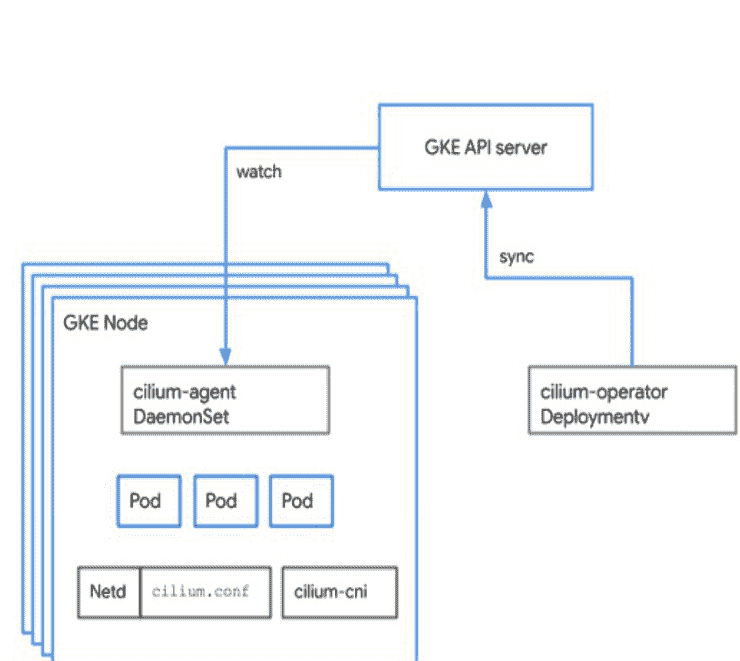

数据平面 V2 为 Anthos 集群提供网络可编程性和可扩展性。一个用例是 Network Policy 流日志记录。企业使用 Kubernetes 网络策略来声明 pod 如何相互通信。然而，没有可扩展的方式来排查和审计这些策略的行为。有了 GKE 中的 eBPF，您现在可以实时强制执行策略，并在几乎不影响节点 CPU 和内存资源的情况下，以线速将策略操作（允许/拒绝）与 pod、命名空间和策略名称相关联。当数据包进入 VM 时，专门的 eBPF 程序可以安装在内核中以决定如何路由数据包。与 IPTables 不同，eBPF 程序可以访问 Kubernetes 特定元数据，包括网络策略信息。这样，它们不仅可以允许或拒绝数据包，还可以将带注释的操作报告回用户空间。这些事件使您能够生成网络策略日志。

图 12.7 数据平面 v2：网络策略流日志记录

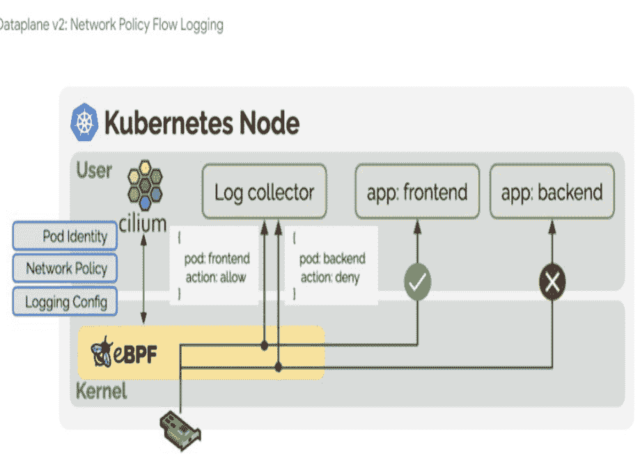

下表显示了数据平面 V1 和 V2 之间网络功能比较。

| 网络功能 | 现有 | 新数据平面 |
|---|---|---|
| ClusterIP 服务解析 | Kube-proxy 使用 IPTables | Cilium-agent 使用 eBPF 在套接字上 |
| NodePort 服务解析 | Kube-proxy 使用 IPTables | Cilium-agent 使用 eBPF 在 eth0 tc 钩子上 |
| LoadBalancer 服务解析 | Kube-proxy 使用 IPTables 重定向到服务链 | Cilium-agent 使用 eBPF 在 eth0 tc 钩子上（与上面相同的钩子） |
| 网络策略强制执行 | Calico 使用 IPTables | Cilium-agent 使用 eBPF 在套接字以及 eth0 tc 钩子上。 |

根据 Anthos 集群的类型和实现方式，网络设计和要求各不相同。在下一节中，我们将根据网络要求和最佳实践查看每种类型的 Anthos 集群。

## Anthos GKE on GCP

Anthos GKE 集群在 GCP 上运行并利用 GCP VPC 功能进行 Kubernetes 网络。有两种类型的 Anthos GKE on GCP 实现。

## VPC 原生集群

这是 Anthos GKE on GCP 集群的默认且推荐的实现。使用别名 IP 地址范围的集群称为 VPC-


native cluster。VPC 原生集群使用真实的 VPC IP 地址作为 Pod IP 范围。这允许在单个集群内的 Pod 与 Pod 通信，以及在同一 VPC 中的多个（VPC 原生）集群之间进行通信。这还允许 Pod 直接连接到任何可路由的 VPC 实体，例如 GCE 实例。VPC 原生集群使用 [secondary IP address ranges](secondary IP address ranges) 用于 Pod IP 范围和 Service IP 范围。

VPC 原生集群具有以下几个优势：

- [Pod](Pod) IP 地址可在集群的 VPC 网络以及通过 [VPC Network Peering](VPC Network Peering) 连接到的其他 VPC 网络中原生路由。
- Pod IP 地址在 Pod 在集群中创建之前就已在 VPC 网络中预留。这可防止与 VPC 网络中的其他资源冲突，并允许您更好地规划 IP 地址分配。
- Pod IP 地址范围不依赖于自定义静态路由。它们不消耗 [system-generated and custom static routes quota](system-generated and custom static routes quota)。相反，自动生成的 [subnet routes](subnet routes) 处理 VPC 原生集群的路由。
- 您可以创建 [firewall rules](firewall rules)，使其仅适用于 Pod IP 地址范围，而不是集群节点的任何 IP 地址。
- Pod IP 地址范围，以及子网二级 IP 地址范围总体上，可通过 Cloud VPN 或 Cloud Interconnect 连接的本地网络访问，使用 [Cloud Routers](Cloud Routers)。

## Routes-based clusters

使用 [Google Cloud Routes](Google Cloud Routes) 的集群称为基于路由的集群。Google Cloud 路由定义了网络流量从虚拟机（VM）实例到其他目的地的路径。基于路由集群中的 Pod IP 地址范围不是 VPC IP 地址，因此在 VPC 内不是原生可路由的。会为每个 Pod IP 地址范围创建 Cloud Routes，以便集群内的 Pod 可以与运行在不同节点上的其他 Pod 通信。基于路由的集群不提供多个 Anthos GKE 集群的 Pod 到 Pod 跨集群连接。要创建基于路由的集群，您必须显式关闭 VPC 原生选项。

在基于路由的集群中，每个节点分配一个 /24 范围的 IP 地址用于 Pod。/24 范围有 256 个地址，但每个节点的 Pod 最大数量为 110。通过拥有大约是可能 Pod 数量两倍的可用 IP 地址，Kubernetes 能够在 Pod 在节点上添加和删除时缓解 IP 地址重用。

基于路由的集群有一个用于 Pod 和 Services 的 IP 地址范围。即使该范围用于 Pod 和 Services，它仍称为 Pod 地址范围。Pod 地址范围的最后 /20 用于 Services。/20 范围有 2^12 = 4096 个地址。因此 4096 个地址用于 Services，其余范围用于 Pod。

在命令输出中，Pod 地址范围称为 `clusterIpv4Cidr`，而用于 Services 的地址范围称为 `servicesIpv4Cidr`。例如，`gcloud container clusters describe` 的输出包含类似如下内容：

```
clusterIpv4Cidr: 10.96.0.0/16
...
servicesIpv4Cidr: 10.96.240.0/20
```

对于 GKE 版本 1.7 及更高版本，Pod 地址范围可以来自任何 RFC 1918 块：10.0.0.0/8、172.16.0.0/12 或 192.168.0.0/16。对于更早版本，Pod 地址范围必须来自 10.0.0.0/8。

给定 GKE 集群的节点、Pod 和 Services 的最大数量由集群子网的大小和 Pod 地址范围的大小决定。创建集群后，您无法更改 Pod 地址范围大小。创建集群时，请确保选择足够大的 Pod 地址范围以适应集群的预期增长。

## Anthos GKE cluster IP allocation

Kubernetes 使用各种 IP 范围为节点、Pod 和 Services 分配 IP 地址。

1. **Node IP** - 在 Anthos GKE 集群中，节点是 GCE 实例。每个节点从集群的 Virtual Private Cloud（VPC）网络分配一个 IP 地址。此节点 IP 提供控制组件如 kube-proxy 和 kubelet 到 Kubernetes API 服务器的连接。此 IP 是节点连接到集群其余部分的连接。

2. **Pod IP CIDR** - 每个节点都有一个 IP 地址池，GKE 将其分配给在该节点上运行的 Pod（默认情况下为 /24 CIDR 块）。您可以选择在创建集群时指定 IP 范围。Flexible Pod CIDR 范围功能允许您减小给定节点池中节点 Pod IP 的范围大小。每个 Pod 从其节点的 Pod CIDR 范围分配一个唯一的 IP 地址。此 IP 地址由 Pod 内运行的所有容器共享，并将它们连接到集群中运行的其他 Pod。您可以在节点上运行的最大 Pod 数量等于 Pod IP CIDR 范围的一半。例如，您可以在 /24 范围的节点上最多运行 110 个 Pod，而不是您可能期望的 256 个。这提供了一个缓冲，以防止由于给定节点的 Pod IP 范围中暂时缺乏 IP 地址而导致 Pod 无法调度。对于小于 /24 的范围，可以调度的 Pod 数量为范围中 IP 地址数量的一半。

3. **Service IP** - 每个 Service 都有一个 IP 地址，称为 ClusterIP，从集群的 VPC 网络分配。您可以选择在创建集群时自定义 VPC 网络。在 Kubernetes 中，您可以将称为标签的任意键值对分配给任何 Kubernetes 资源。Kubernetes 使用标签将多个相关 Pod 分组为称为 Service 的逻辑单元。Service 具有稳定的 IP 地址和端口，并在标签选择器中定义的标签与您在创建 Service 时定义的所有标签匹配的 Pod 集合之间提供负载均衡。

## Egress traffic and controls

对于 VPC 原生集群，流出 Pod 的流量使用正常的 VPC 路由功能进行路由。Pod IP 地址作为源 IP 地址保留在 TCP 头中。您必须创建适当的防火墙规则以允许 Pod 与其他 VPC 资源之间的流量。您还可以使用 NetworkPolicy 来进一步控制集群内 Pod 之间流量的流动以及流出 Pod 的流量。这些策略由上一节中解释的 GKE 数据平面实现强制执行。在 Service 层，您可以通过 Anthos Service Mesh（ASM）使用 EgressPolicy 来控制流出集群的流量。在这种情况下，名为 `istio-egressgateway` 的 Envoy 代理存在于服务网格的边缘，所有流出流量都流经该代理。

对于基于路由的集群，所有 Pod 流出流量均通过节点 IP 地址进行 NAT。

## Load Balancers and Ingress

GKE 提供三种不同类型的负载均衡器来控制访问并尽可能均匀地将传入流量分配到您的集群。您可以配置一个 Service 同时使用多种类型的负载均衡器。

1. [External load balancers](#) 管理来自集群外部和 Google Cloud Virtual Private Cloud（VPC）网络外部的流量。它们使用与 Google Cloud 网络关联的转发规则将流量路由到 Kubernetes 节点。

2. [Internal load balancers](#) 管理来自同一 VPC 网络内部的流量。与外部负载均衡器一样，它们使用与 Google Cloud 网络关联的转发规则将流量路由到 Kubernetes 节点。

3. [HTTP(S) load balancers](#) 是用于 HTTP(S) 流量的专用外部负载均衡器。它们使用 Ingress 资源而不是转发规则将流量路由到 Kubernetes 节点。

上面描述的外部和内部负载均衡器是 TCP/L4 负载均衡器。如果您的 Service 需要从集群外部和 VPC 网络外部可达，您可以将 Service 配置为 [LoadBalancer](#)，通过在定义 Service 时将 Service 的 `type` 字段设置为 `LoadBalancer`。然后 GKE 会在 Service 前面配置一个 [Network load balancer](#)。Network load balancer 知道集群中的所有节点，并配置您的 VPC 网络的防火墙规则以允许从 VPC 网络外部使用 Service 的外部 IP 地址连接到 Service。您可以为 Service 分配静态外部 IP 地址。

对于需要从同一 VPC 网络内到达集群的流量，您可以配置 Service 以配置 [Internal load balancer](#)。Internal load balancer 从您的集群中选择一个 IP 地址


VPC 子网而不是外部 IP 地址。VPC 网络内的应用程序或服务可以使用此 IP 地址与集群内的服务进行通信。下面是一个创建内部负载均衡器的 Service 清单示例。您可以通过移除注释（该注释会创建内部负载均衡器）以相同的方式配置外部负载均衡器。

```
apiVersion: v1
kind: Service
metadata:
  name: ilb-service
  annotations:
    cloud.google.com/load-balancer-type: "Internal"    #A
  labels:
    app: hello
spec:
  type: LoadBalancer                #B
  selector:
    app: hello
  ports:
  - port: 80
    targetPort: 8080
    protocol: TCP
```

许多应用程序，例如 RESTful Web 服务 API，使用 HTTP(S) 进行通信。您可以使用 Kubernetes [Ingress 资源](Ingress resource) 允许 VPC 网络外部的客户端访问此类应用程序。Ingress 资源允许您将主机名和 URL 路径映射到集群内的服务。Ingress 资源与一个或多个 [Service](Service) 对象相关联，每个对象都与一组 Pod 相关联。当您创建 Ingress 资源时，[GKE Ingress 控制器](GKE Ingress controller) 会创建 [Google Cloud HTTP(S) 负载均衡器](Google Cloud HTTP(S) Load Balancer) 并根据 Ingress 及其关联服务的中的信息进行配置。要使用 Ingress，您必须启用 HTTP 负载均衡附加组件。GKE 集群默认启用 HTTP 负载均衡。

GKE Ingress 资源分为两种类型：

- 1. [Ingress for external HTTP(S) load balancer](Ingress for external HTTP(S) load balancer) 部署 [Google Cloud external HTTP(S) load balancer](Google Cloud external HTTP(S) load balancer)。此面向互联网的负载均衡器作为托管且可扩展的负载均衡资源池部署在 Google 的边缘网络中，覆盖全球。
- 2. [Ingress for Internal HTTP(S) Load Balancing](https://cloud.google.com/kubernetes-engine/docs/concepts/ingress) 部署 [Google Cloud internal HTTP(S) load balancer](https://cloud.google.com/load-balancing/docs/l7-internal)。这些内部 HTTP(S) 负载均衡器由位于 GKE 集群外部但在 VPC 网络内的 Envoy 代理系统提供支持。

由 Ingress 配置的 HTTP(S) 负载均衡包括以下功能：

- 1. 灵活的服务配置。Ingress 定义了流量如何到达您的服务以及如何将流量路由到您的应用程序。此外，Ingress 可以为集群中的多个服务提供单个 IP 地址。
- 2. 与 Google Cloud 网络服务集成
- 3. 支持多个 TLS 证书。Ingress 可以指定对请求终止使用多个 TLS 证书。

当您创建 Ingress 资源时，GKE 会根据 Ingress 清单和关联的 Service 清单中的规则在 Google Cloud 项目中配置 [HTTP(S) 负载均衡器](https://cloud.google.com/load-balancing/docs/https)。负载均衡器将请求发送到节点 IP 地址上的 NodePort。请求到达节点后，所选的 GKE 数据平面会将流量路由到适当的 Pod（用于所需服务）。对于数据平面 v1，节点使用其 iptables NAT 表来选择 Pod。kube-proxy 管理节点上的 iptables 规则。对于数据平面 v2，GKE 使用 eBPF 和 Cilium 代理提供此功能。

以下示例 Ingress 定义将 `demo.example.com` 的流量路由到名为 `frontend` 的服务端口 80，并将 `demo-backend.example.com` 的流量路由到名为 `users` 的服务端口 8080。

```
apiVersion: networking.k8s.io/v1beta1
kind: Ingress
metadata:
  name: demo
spec:
  rules:
  - host: demo.example.com          #A
    http:
      paths:
      - backend:
          serviceName: frontend      #A
          servicePort: 80              #A
  - host: demo-backend.example.com      #B
    http:
      paths:
      - backend:
          serviceName: users          #B
          servicePort: 8080           #B
```

## Container native load balancing

容器原生负载均衡是在 GKE 中使用网络端点组（NEGs）直接对 Pod 端点进行负载均衡的做法。使用 Ingress 时，服务绑定流量会从 HTTP 负载均衡器发送到 NodePort 上的任意节点 IP。请求到达节点后，GKE 数据平面会将流量路由到所需的 Pod。这会导致额外的跳数。在某些情况下，Pod 可能甚至不在该节点上运行，因此节点会将请求发送到所需 Pod 所在的节点。额外的跳数会增加延迟并使流量路径更加复杂。

使用 NEG 时，流量会直接从负载均衡器负载均衡到 Pod IP，而不是经过节点。此外，还实现了 Pod 就绪网关，以从负载均衡器的角度确定 Pod 的健康状况，而不仅仅是 Kubernetes 集群内健康检查。这通过使负载均衡器基础设施能够感知 Pod 启动、Pod 丢失或 VM 丢失等生命周期事件，从而提高了整体流量稳定性。这些功能解决了上述限制，并带来了更高效、更稳定的网络。

当满足以下所有条件时，容器原生负载均衡默认对服务启用：

- 1. 在 GKE 集群 1.17.6-gke.7 及更高版本中创建的服务
- 2. 使用 VPC 原生集群
- 3. 未使用共享 VPC
- 4. 未使用 GKE 网络策略

对于 NEG 不是默认的集群，仍然强烈建议使用容器原生负载均衡，但必须按每个服务显式启用。应以以下方式将注释应用于服务：

```
```yaml
kind: Service
...
  annotations:
    cloud.google.com/neg: '{"ingress": true}'  #A
...
```
```

在 Service 清单中，除非使用 [container native load balancing](#)，否则必须使用 `type: NodePort`。如果使用容器原生负载均衡，请使用 `type: ClusterIP`。

## Shared VPC considerations and best practices

GKE Ingress 控制器使用 Google Cloud 服务账号来部署和管理 Google Cloud 资源。当 GKE 集群位于共享 VPC 的服务项目中时，此服务账号可能没有管理主机项目拥有的网络资源的权限。Ingress 控制器会主动管理防火墙规则，以在负载均衡器与 Pod 之间以及集中式健康检查器与 Pod 之间提供访问。

有两种方法可以管理此问题。

- 1. **Manual firewall rule provisioning** - 如果您的安全策略仅允许从主机项目管理防火墙，则可以手动配置这些防火墙规则。在共享 VPC 中部署 Ingress 时，Ingress 资源事件会提供您需要添加的特定防火墙规则以提供访问。
  要手动配置防火墙规则，请使用以下 `describe` 命令查看 Ingress 资源，如下所示。

```
```bash
kubectl describe ingress INGRESS_NAME
```
```

此命令的输出应包含可在主机网络项目中实现所需的防火墙规则。

```
```text
Events:
Type      Reason   Age                 From                         M
```
```

---- ----- ----- ---- -
Normal Sync 9m34s (x237 over 38h) loadbalancer-controller F

- 2. **Automatic firewall rule provisioning** - 一种自动化方法是为 GKE Ingress 控制器服务账号提供更新防火墙规则的权限。
您可以通过创建自定义 IAM 角色来提供在主机网络项目中管理防火墙规则的能力，然后将此角色授予 GKE Ingress 服务账号来实现。

创建具有所需权限的自定义 IAM 角色。

```
gcloud iam roles create ROLE_NAME \
  --project PROJECT_ID \
  --title ROLE_TITLE \
  --description ROLE_DESCRIPTION \
  --permissions=compute.networks.updatePolicy, compute.firewalls
  --stage GA
```

将自定义角色授予 GKE Ingress Controller 服务账号。

```
gcloud projects add-iam-policy-binding my-project \
  --member=user:SERVICE_ACCOUNT \
  --role=roles/gke-ingress-fw-management
```

## Multi-cluster Ingress

在某些情况下，可能需要在多个 GKE 集群上运行相同的服务。许多因素驱动多集群拓扑，包括应用程序的接近用户位置、集群和区域高可用性、安全性和组织分离、集群迁移以及数据本地性。多集群 Ingress（MCI）是 Anthos GKE 集群的云托管多集群 Ingress 控制器。它是一个 Google 托管服务，支持跨集群和跨区域部署共享负载均衡资源。多集群 Ingress 旨在满足多集群、多区域环境的负载均衡需求。它是外部 HTTP(S) 负载均衡器的控制器，用于为来自互联网并跨一个或多个集群的流量提供入口。

多集群 Ingress 的多集群支持满足了许多用例，包括：


- 1. 为应用程序提供单一、一致的虚拟 IP（VIP），与应用程序在全球的部署位置无关。
- 2. 通过健康检查和流量故障转移实现多区域、多集群可用性。
- 3. 通过公共 Anycast VIP 实现基于就近的路由，以降低客户端延迟。
- 4. 透明的集群迁移，用于升级或集群重建。

Multi-cluster Ingress 是一种 Ingress 控制器，使用 [network endpoint groups](network endpoint groups)（NEGs）对外部 HTTP(S) 负载均衡器进行编程。当你创建 MultiClusterIngress 资源时，GKE 会部署 Compute Engine 负载均衡器资源并将各集群中的适当 Pod 配置为后端。NEG 用于动态跟踪 Pod 端点，以便 Google 负载均衡器拥有正确的健康后端集合。

Figure 12.8 Multi-cluster ingress to multiple GKE clusters in GCP

resources. 这些多集群资源存在于单一逻辑 API 中并且可从该 API 访问，以在所有集群间保持一致性。Ingress 控制器监视配置集群并协调负载均衡基础设施。

- 3. **Environ** - [environ](environ) 是一个域，用于对集群和基础设施进行分组、管理资源并在它们之间保持一致的策略（有关 Environs 的更多详细信息，请参阅第 N 章：Anthos，单一玻璃窗 UX）
- 4. MCI 使用 environ 的概念来说明 Ingress 如何在不同集群间应用。注册到 environ 的集群对 MCI 可见，因此可作为 Ingress 的后端使用。Environs 具有一种称为 *namespace sameness* 的特性，它假设在不同集群中具有相同名称和相同命名空间的资源被视为同一资源的实例。实际上，这意味着来自不同集群的 ns1 命名空间中带有标签 app: foo 的 Pod 从 Multi-cluster Ingress 的角度来看都被视为同一应用后端池的一部分。下图显示了两个服务 foo 和 bar 在两个集群上运行并由 MCI 进行负载均衡的示例。

**Figure 12.9 Multi-cluster ingress: Environ and namespace sameness**

Multi-cluster Ingress (MCI): Environ and namespace sameness

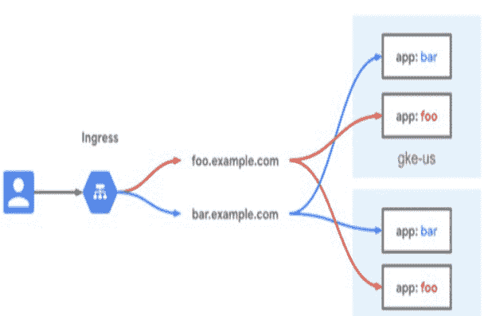

- 5. **Member cluster** - 注册到 environ 的集群称为成员集群。environ 中的成员集群构成了 MCI 感知的全部后端范围。

配置完 config cluster 后，你为你的多集群 Service 创建两个自定义资源，MultiClusterIngress 和 MultiClusterService。注意资源名称与单集群中所需的 Service 和 Ingress 相当相似。

下面是部署到 config cluster 的这些资源的示例。

```
# MulticlusterService with cluster selector
apiVersion: networking.gke.io/v1beta1
kind: MultiClusterService
metadata:
  name: foo
  namespace: blue
spec:
  template:
    spec:
selector:
  app: foo
ports:
- name: web
  protocol: TCP
  port: 80
  targetPort: 80
clusters:                      #A
- link: "europe-west1-c/gke-eu"      #B
- link: "asia-northeast1-a/gke-asia-1"      #B
```

## MultiClusterIngress

```
apiVersion: networking.gke.io/v1alpha1
kind: MultiClusterIngress
metadata:
  name: foobar-ingress
  namespace: blue
spec:
  template:
    spec:
      backend:
        serviceName: default-backend
        servicePort: 80
      rules:
      - host: foo.example.com
        backend:
          serviceName: foo      #A
          servicePort: 80
      - host: bar.example.com
        backend:
          serviceName: bar      #A
          servicePort: 80
```

请注意 MulticlusterService 底部包含一个 cluster selector 部分。移除它会将 Ingress 流量发送到所有成员集群。添加 cluster selector 可能在你希望从特定集群（或集群）移除 MCI 流量时很有用，例如在对集群进行升级或维护时。如果 MulticlusterService 资源中存在 clusters 部分，则 Ingress 流量仅发送到列表中可用的集群。集群通过 <region | zone>/<name> 显式引用。同一 environ 和区域内的成员集群应 cluster nodes can fetch GKE on-prem components and call certain Google services. 如果你希望外部客户端调用你的 GKE on-prem 集群中的服务，你的网络必须支持来自互联网的入站流量。

IP 地址架构和分配将在下一节中讨论。

## Anthos on Prem cluster IP allocation

以下 IP 地址对于 Anthos on Prem on VMWare 集群是必需的。

- 1. **Node IP** - 节点（虚拟机或 VM）的 DHCP 或静态分配 IP 地址。必须在数据中心内可路由。你可以手动分配静态 IP。Node IP 地址取决于 Anthos on Prem 集群中 Load Balancer 的实现。如果集群配置为集成模式负载均衡或捆绑模式负载均衡，你可以使用 DHCP 或静态分配的 IP 地址用于节点。如果集群配置为手动模式负载均衡，你必须为节点使用静态 IP 地址。在这种情况下，确保预留足够的 IP 地址以应对集群增长。负载均衡模式将在下一节中详细讨论。
- 2. **Pod IP CIDR** - 集群中所有 Pod 的不可路由 CIDR 块。从该范围内，按节点分配较小的 /24 范围。如果你需要一个 N 节点的集群，请确保该块足够大以支持 N x /24 块。
- 3. **Services IP** - 在 Island Mode 中，与 Pod CIDR 块类似，因此仅在集群内部使用。任何不与节点、VIP 或 Pod CIDR 块重叠的私有 CIDR 块。你可以在多个集群之间共享同一块。块的大小决定了服务数量。除了你的 Services 外，一块 Service IP 地址用于集群控制平面 Services。入口服务需要一个 Service IP，Kubernetes 服务如集群 DNS 等需要十个或更多 IP。

## Egress traffic and controls

Pod 到集群外部目标的所有出站流量都由节点 IP 进行 NAT。你可以使用 NetworkPolicy 来进一步控制集群内 Pod 之间流量的流动以及 Pod 的出站流量。这些策略由在每个集群内运行的 Calico 强制执行。在 Service 层，你可以通过 Anthos Service Mesh（ASM）使用 EgressPolicy 来控制流出集群的流量。在这种情况下，一个名为 istio-egressgateway 的 Envoy 代理存在于服务网格的边缘，所有出站流量都流经该代理。

## Load Balancers

Anthos on Prem 集群提供两种从集群外部访问 Service 的方式：负载均衡器和 Ingress。本节介绍负载均衡器及其不同的实现模式。

Anthos on Prem 集群可在三种负载均衡模式之一下运行：集成、手动或捆绑。

- 1. **Integrated mode** - 在集成模式下，Anthos on Prem 使用 F5 BIG-IP 负载均衡器。客户提供具有适当许可的 F5 BIG-IP 负载均衡器。你需要拥有足够的权限来设置和管理 F5 负载均衡器的用户角色。管理员角色或资源管理员角色就足够了。有关更多信息，请参阅 F5 BIG-IP 账户权限。你为配置为类型 LoadBalancer 的 Service 预留多个虚拟 IP 地址（VIP）。每个 Service 需要一个 VIP。所需的 VIP 数量取决于类型为 LoadBalancer 的 Service 数量。你在集群配置文件中指定这些 VIP，Anthos on Prem 会自动配置 F5 BIG-IP 负载均衡器以使用这些 VIP。集成模式的优点是你可以使用企业级负载均衡器并且配置大部分自动化。此模式也有其固有性，因为它需要 F5 负载均衡器，这可能带来额外的许可和支持成本。
- 2. **Manual mode** - 在手动模式下，Anthos on Prem 使用你选择的负载均衡器。手动负载均衡模式比集成模式需要额外的配置。你需要


```yaml
labels:
  app: guestbook
name: frontend
spec:
  ports:
  - port: 80
    protocol: TCP
    targetPort: 80
  selector:
    app: guestbook
type: LoadBalancer
loadBalancerIP: [SERVICE VIP]    #A
```

除了 Service VIP 之外，负载均衡器还需要一个用于 Kubernetes API 服务器的控制平面 VIP。最后，每个 Anthos on Prem 集群中都运行着一个 ingress 控制器。ingress 控制器服务也具有一个名为 Ingress VIP 的 VIP。通过 ingress 暴露的服务使用 Ingress VIP 来访问 Kubernetes 服务。

Anthos on Prem 高级负载均衡架构如下所示。

## Figure 12.10 Anthos on prem: Load balancer network architecture

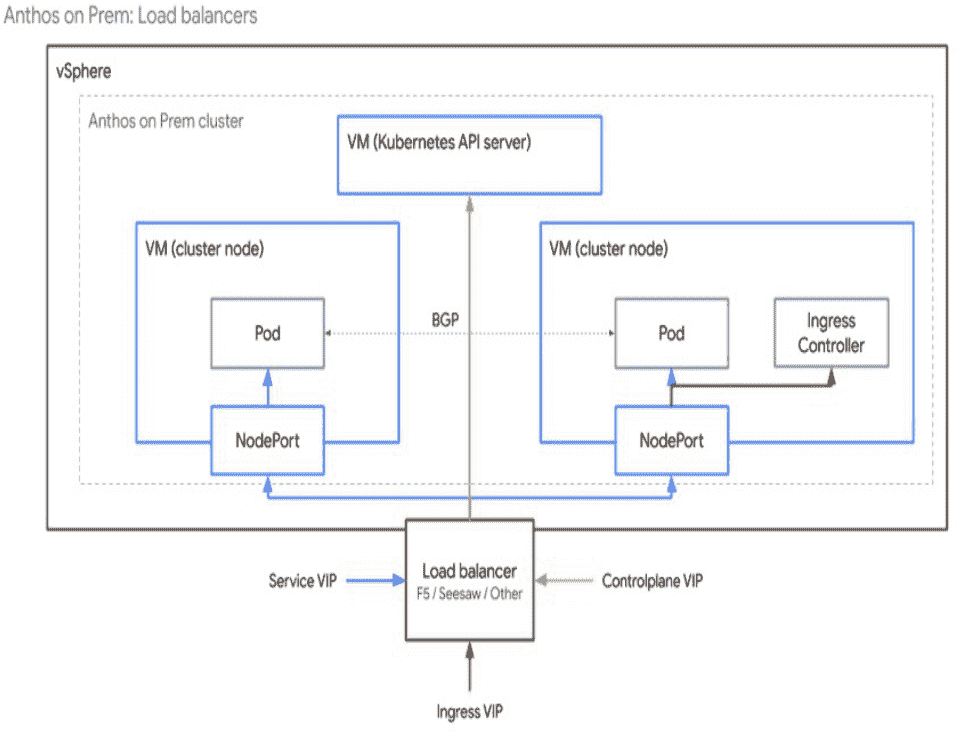

下表总结了在各种模式下为负载均衡做准备时必须执行的操作。

|  | Integrated / Bundled mode | Manual mode |
|---|---|---|
| Choose VIPs before you create your clusters. | Yes | Yes |
| Choose node IP addresses before you create your clusters. | No, if using DHCP. Yes, if using static IP | Yes |
| Choose nodePort values before you create your clusters. | No | Yes |
| Manually configure your load balancer | No | Yes |

## Ingress

Anthos on Prem 包含一个 L7 负载均衡器，具有基于 Envoy 的 ingress 控制器，用于处理集群内部署的 ClusterIP 服务的 Ingress 对象规则。ingress 控制器本身在集群中作为 NodePort 服务公开。ingress NodePort 服务可以通过 L3/L4 F5 负载均衡器访问。安装会在负载均衡器上配置一个虚拟 IP 地址（Ingress VIP）（端口 80 和 443）。VIP 指向 Ingress 控制器 NodePort 服务中的端口。这就是外部客户端如何访问集群中服务的方式。

为了通过 Ingress 暴露服务，您必须创建一条 DNS A 记录，将 DNS 名称指向 Ingress VIP。然后您可以为该服务创建 Service 和 Ingress 资源。例如，假设您想暴露一个示例 guestbook 应用的前端服务。

首先，为 guestbook 应用创建指向 Ingress VIP 的 DNS A 记录。

```
*.guestbook.com    A    [INGRESS_VIP]
```

接下来，为 frontend Deployment 创建一个 Service。请注意，Service 的类型为 ClusterIP。

```yaml
apiVersion: v1
kind: Service
metadata:
  labels:
    app: guestbook
name: frontend
spec:
  ports:
  - port: 80
    protocol: TCP
    targetPort: 80
  selector:
    app: guestbook
type: ClusterIP        #A
```

最后，创建 Ingress 规则。

```yaml
apiVersion: extensions/v1beta1
kind: Ingress
metadata:
  name: frontend
  labels:
    app: guestbook
spec:
  rules:
    - host: www.guestbook.com
      http:
        paths:
          - backend:
              serviceName: frontend    #A
              servicePort: 80      #A
```

## Anthos on Bare Metal

Anthos on bare metal 是 GCP 支持的 Anthos GKE 实现，部署在裸金属服务器上。Anthos on bare metal 消除了对虚拟化层或 hypervisor 的需求。所有集群节点和 API 服务器都直接在裸金属服务器上运行

Anthos on Bare Metal 部署模型和网络架构在专门介绍它的章节中有详细描述。

## Anthos on AWS

Anthos 集群在 AWS 上（GKE on AWS）是一种混合云软件，将 Google Kubernetes Engine（GKE）扩展到 Amazon Web Services（AWS）。Anthos on AWS 使用 AWS 资源，例如 [Elastic Compute Cloud (EC2)](https://aws.amazon.com/ec2/)、

[Elastic Block Storage (EBS)](#)，和 [Elastic Load Balancer (ELB)](#)。

Anthos 集群在 AWS 上有两个组件。

- 1. **Management service** - 可以安装和更新您的用户集群的环境，使用 AWS API 来配置资源。
- 2. **User clusters** - 您运行容器化应用程序的 Anthos on AWS 集群。

## Networking requirements

管理服务和用户集群都部署在 AWS VPC 内的 EC2 实例中。您可以在 [dedicated AWS VPC](#) 或 [existing AWS VPC](#) 中创建管理服务。您需要在运行 Anthos on AWS 用户集群的每个 AWS 虚拟私有云（VPC）中拥有一个管理服务。管理服务安装在一个 AWS 可用区中。每个 VPC 只需要一个管理服务；一个管理服务可以管理多个用户集群。

用户集群由两个组件组成：控制平面或 Kubernetes API 服务器，以及运行应用程序的节点池。管理服务的主要组件是 Cluster Operator。Cluster Operator 是一个 [Kubernetes Operator](#)，它创建和管理您的 AWSClusters 和 AWSNodePools。Cluster Operator 将配置存储在 etcd 数据库中，存储持久化在 AWS EBS 卷上。

AWSClusters 资源创建和管理用户集群的控制平面，AWSNodePools 资源创建和管理用户集群的节点池。

当您将管理集群安装到 [Dedicated VPC](#) 时，Anthos on AWS 会在 dedicatedVPC.availabilityZones 中指定的每个区域创建控制平面副本。当您将管理集群安装到 [existing infrastructure](#) 时，Anthos on AWS 会创建具有三个控制平面副本的 AWSCluster，每个副本都在相同的可用区中。每个副本都属于自己的 [AWS Auto Scaling group](#)，在实例终止时重启实例。管理服务将控制平面放置在 AWS Network Load Balancer（NLB）后面的私有子网中。管理服务使用 NLB 与控制平面交互。

每个控制平面都存储在本地 etcd 数据库中的配置。这些数据库被复制并设置在 [stacked high availability topology](stacked high availability topology) 中。

一个控制平面管理一个或多个 AWSNodePools。

## Figure 12.11 Anthos on AWS architecture

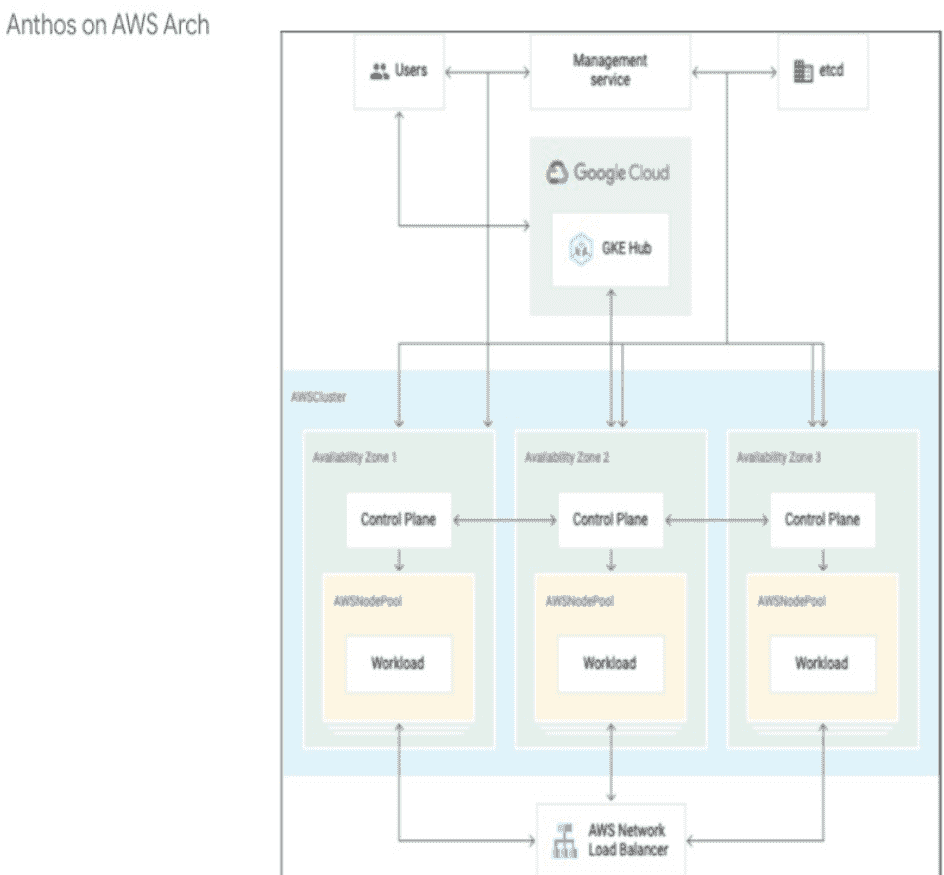

在专用 VPC 中创建 Anthos on AWS 集群时，需要以下 VPC 资源。

- 1. **VPC CIDR Range** - anthos-gke 创建的 AWS VPC 的 IP 地址总 [CIDR](https://aws.amazon.com/what-is/cidr/) 范围。例如，10.0.0.0/16。
- 2. **Availability Zones** - 您想要创建节点和控制平面的 AWS EC2 [availability zones](https://aws.amazon.com/about-aws/global-infrastructure/regions_az/)。
- 3. **Private CIDR Blocks** - 私有子网的 CIDR 块。Anthos on AWS 组件例如管理服务在私有子网中运行。该子网必须在 `vpcCIDRBlock` 中指定的 VPC CIDR 范围内。您需要为每个可用区一个子网。
- 4. **Public CIDR Block** - 公共子网的 CIDR 块。您需要为每个可用区一个子网。公共子网通过 AWS [network ACLs](https://docs.aws.amazon.com/vpc/latest/userguide/vpc-network-acls.html) 和 [security groups](https://docs.aws.amazon.com/vpc/latest/userguide/vpc-security-groups.html) 中指定的安全组和地址范围，将集群服务例如负载均衡器暴露给外部。
- 5. **SSH CIDR Block** - 允许对您的 [bastion host](https://cloud.google.com/anthos/clusters/docs/aws/how-to/bastion-host) 进行入站 SSH 的 CIDR 块。您可以使用 IP 范围，例如 203.0.113.0/24。如果您想允许从任何 IP 地址进行 SSH，请使用 0.0.0.0/0。当您使用默认设置创建管理服务时，控制平面具有私有 IP 地址。该 IP 地址无法从 AWS VPC 外部访问。您可以使用 [bastion](https://cloud.google.com/anthos/clusters/docs/aws/how-to/bastion-host) 主机或通过 VPN 或 [AWS Direct Connect](https://aws.amazon.com/directconnect/) 等其他连接访问 AWS VPC 来访问管理服务。

在现有 VPC 中创建 Anthos on AWS 集群时，需要以下 VPC 资源。

- 1. 至少一个公共子网。
- 2. 至少一个私有子网。
- 3. 一个具有通往公共子网路由的互联网网关。
- 4. 一个具有通往私有子网路由的 NAT 网关。
- 5. [DNS hostnames](https://docs.aws.amazon.com/vpc/latest/userguide/vpc-dns.html) 已启用。
- 6. DHCP 选项集中 `domain-name` 的自定义值。Anthos on AWS 不支持除 [default EC2 domain names](https://docs.aws.amazon.com/vpc/latest/userguide/vpc-dns.html#vpc-dns-hostnames) 之外的其他值。
- 7. 选择或创建一个 AWS [security group](https://docs.aws.amazon.com/vpc/latest/userguide/vpc-security-groups.html)，允许从您将管理 Anthos 集群 on AWS 安装的安全组或 IP 范围入站 SSH（端口 22）。

## Anthos on AWS cluster IP allocation


管理服务创建用户集群。管理服务使用带有 AWSClusters 和 AWSNodePools 资源的 Cluster Operator 分别创建用户集群的控制平面和节点池。每个用户集群的 IP 地址在 AWSCluster 资源中定义。

下面是一个 AWSCluster 资源示例。

```yaml
apiVersion: multicloud.cluster.gke.io/v1
kind: AWSCluster
metadata:
  name: CLUSTER_NAME
spec:
  region: AWS_REGION
  networking:                     #A
    vpcID: VPC_ID
    podAddressCIDRBlocks: POD_ADDRESS_CIDR_BLOCKS
    serviceAddressCIDRBlocks: SERVICE_ADDRESS_CIDR_BLOCKS
    ServiceLoadBalancerSubnetIDs: SERVICE_LOAD_BALANCER_SUBNETS
  controlPlane:                   #B
    version: CLUSTER_VERSION
    instanceType: AWS_INSTANCE_TYPE
    keyName: SSH_KEY_NAME
    subnetIDs:
    - CONTROL_PLANE_SUBNET_IDS
    securityGroupIDs:
    - CONTROL_PLANE_SECURITY_GROUPS
    iamInstanceProfile: CONTROL_PLANE_IAM_ROLE
    rootVolume:
      sizeGiB: ROOT_VOLUME_SIZE
    etcd:
      mainVolume.sizeGiB: ETCD_VOLUME_SIZE
  databaseEncryption:
    kmsKeyARN: ARN_OF_KMS_KEY
  hub: # Optional
    membershipName: ANTHOS_CONNECT_NAME
  workloadIdentity: # Optional
    oidcDiscoveryGCSBucket: WORKLOAD_IDENTITY_BUCKET
```

您在 networking 部分定义所需的 IP 地址。

Anthos on AWS 集群需要以下 IP 地址。

- 1. **节点 IP** - 节点 IP 在 EC2 实例创建时分配。每个 EC2 实例从其可用区的私有子网中分配一个 IP。这些地址在管理服务 spec 中定义。
- 2. **Pod IP CIDR** - 集群 Pod 使用的 IPv4 地址 CIDR 范围。该范围必须在您的 VPC CIDR 地址范围内，但不属于某个子网。
- 3. **Services IP** - 集群 Services 使用的 IPv4 地址范围。该范围必须在您的 VPC CIDR 地址范围内，但不属于某个子网。

## 出口流量和控制

从 Pod 到集群外部目标的所有出口流量都由节点 IP 进行 NAT。您可以使用 NetworkPolicy 进一步控制集群内 Pod 之间的流量流动以及从 Pod 流出的流量。这些策略由每个集群内运行的 Calico 强制执行。在 Service 层，您可以通过 Anthos Service Mesh (ASM) 使用 EgressPolicy 来控制哪些流量离开集群。在这种情况下，一个名为 `istio-egressgateway` 的 Envoy 代理位于服务网格的边界，所有出口流量都通过它流动。

此外，您可以在 AWSNodePools 安全组层控制流量。使用安全组，您可以进一步允许或拒绝入站和出站流量。

## 负载均衡器

当您创建类型为 LoadBalancer 的 Service 时，Anthos on AWS 控制器会在 AWS 上配置一个 Classic 或 Network ELB。Anthos on AWS 需要在包含负载均衡器端点的子网上打标签。Anthos on AWS 会自动为 AWSCluster 资源的 `spec.Networking.ServiceLoadBalancerSubnetIDs` 字段中指定的所有子网打上标签。

要创建标签，请获取负载均衡器子网的子网 ID。使用 `aws` 命令行工具在子网上创建标签，如下所示。对于多个子网，请确保子网 ID 之间用空格分隔。

```bash
aws ec2 create-tags \
--resources [SUBNET_IDs] \
--tags Key=kubernetes.io/cluster/$CLUSTER_ID,Value=shared
```

您需要为子网上的每个用户集群打一个标签。

您可以创建内部和外部负载均衡器。内部负载均衡器在私有子网上创建，而外部负载均衡器在公共子网上创建。您可以使用 Classic 或 Network 负载均衡器创建任一类型的负载均衡器。有关负载均衡器类型之间差异的更多信息，请参阅 AWS 文档中的负载均衡器类型。

不同类型的负载均衡器通过注解创建。

考虑以下 Service spec。

```yaml
apiVersion: v1
kind: Service
metadata:
    name: my-lb-service
spec:
    type: LoadBalancer
    selector:
      app: products
      department: sales
    ports:
    - protocol: TCP
      port: 60000
      targetPort: 50001
```

此资源为 Service 创建一个公共 Classic 负载均衡器。

要创建公共 Network 负载均衡器，请在上面的 spec 中添加以下注解。

```yaml
...
metadata:
    name: my-lb-service
    annotations:
        service.beta.kubernetes.io/aws-load-balancer-type: nlb  #A
...
```

要创建私有 Classic 负载均衡器，请在 Service spec 中添加以下注解。

```yaml
...
metadata:
    name: my-lb-service
    annotations:
        service.beta.kubernetes.io/aws-load-balancer-internal: "true"
...
```

最后，要创建私有 Network 负载均衡器，请在 Service spec 中添加两个注解。

```yaml
...
metadata:
    name: my-lb-service
    annotations:
        service.beta.kubernetes.io/aws-load-balancer-type: nlb
        service.beta.kubernetes.io/aws-load-balancer-internal: "true"
...
```

## Ingress

在 Anthos on AWS 集群上有两种使用 Ingress 的方式。

- 1. **应用程序负载均衡器** - [应用程序负载均衡器](https://aws.amazon.com/elasticloadbalancing/application-load-balancers/) (ALB) 是一个 AWS 托管的 L7 HTTP 负载均衡器。负载均衡器收到请求后，会按优先级顺序评估侦听器规则以确定应用哪条规则，然后从目标组中选择一个目标用于规则操作。此方法使用安装在 Anthos on AWS 集群中并具有适当权限的 [`alb-ingress-controller`](https://kubernetes-sigs.github.io/aws-load-balancer-controller/) 来为 Ingress 创建 ALB。

- 2. **ASM Ingress** - 您可以在 Anthos on AWS 集群上安装 Anthos Service Mesh (ASM) 并使用 ASM Ingress。ASM Ingress 是一个名为 `istio-ingressgateway` 的 Service，它是一个位于服务网格边界的 L7 Envoy 代理。`istio-ingressgateway` Service 本身使用前面章节所述的 ELB 暴露。所有 L7 负载均衡和路由都由 `istio-ingressgateway` 处理。

## 使用 Ingress 暴露 Services

为了使用 ALB 方法，请按照此处的说明[23]将 alb-ingress-controller 部署到 Anthos on AWS 集群。alb-ingress-controller 是一个在 Anthos on AWS 集群上运行的 Deployment，具有适当的 AWS 凭据和 Kubernetes RBAC 权限，以创建为 Ingress 创建 ALB 所需的规则和资源。

您现在可以创建带有适当注解的 Ingress 资源，以便为您的 Service 创建 ALB 和所需资源。

以下是一个 Service spec 示例。请注意，Service 的类型是 NodePort。Service 必须为 NodePort 类型。

```yaml
apiVersion: v1
kind: Service
metadata:
  name: "service-2048"
  namespace: "2048-game"
spec:
  ports:
    - port: 80
      targetPort: 80
      protocol: TCP
  type: NodePort
  selector:
    app: "2048"
```

以及使用 ALB 暴露此 Service 的 Ingress 资源。请注意两个配置面向互联网 ALB 的注解。

```yaml
apiVersion: extensions/v1beta1
kind: Ingress
metadata:
  name: "2048-ingress"
  namespace: "2048-game"
  annotations:
    kubernetes.io/ingress.class: alb            #A
    alb.ingress.kubernetes.io/scheme: internet-facing    #A
  labels:
    app: 2048-ingress
spec:
  rules:
```

### 7-1 第7章

本章介绍增益的概念及其在控制系统中的重要性。增益是决定系统输入与输出关系的基本参数。

- 定义系统增益
- 解释增益对稳定性的影响
- 讨论增益裕度和相位裕度

| 参数 | 值 | 单位 |
|-----------|-------|------|
| 增益 | 2.5 | dB |
| 相位 | -45 | 度 |

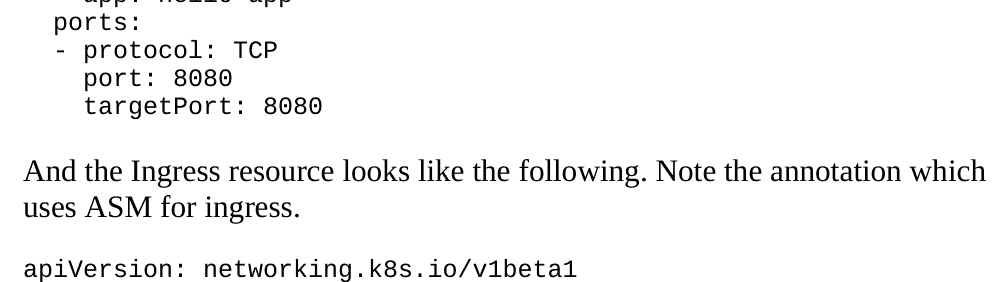

> “增益是物理系统与其数学模型之间的桥梁。”

```yaml
name: hello-app
spec:
  rules:
  - host:
    http:
      paths:
      - backend:
          serviceName: hello-app
          servicePort: 8080
```

## Anthos 附加集群

最后一种 Anthos 集群类型是 Anthos 附加集群。附加集群让您可以在 Google Cloud Console 中查看现有的 Kubernetes 集群以及您的 Anthos 集群，并在其上启用部分 Anthos 功能，包括使用 Anthos Config Management 进行配置。

您可以将任何符合标准的 Kubernetes 集群附加到 Anthos，并在 Cloud Console 中与您的 Anthos 集群一起查看。

无论您的集群位于何处，您都需要使用 Connect 将希望与 Anthos 一起使用的任何集群注册到项目环境中。环境提供了一种统一的方式来查看和管理多个集群及其工作负载，作为 Anthos 的一部分。您可以在我们的环境指南中了解有关环境及其所启用功能的更多信息。

## 网络要求

要成功注册集群，您需要确保您的 Kubernetes 集群可以访问以下域名：

- 1. cloudresourcemanager.googleapis.com 解析有关集群所连接的 Google Cloud 项目的元数据。
- 2. oauth2.googleapis.com 用于获取短期 OAuth 令牌，以便代理针对 gkeconnect.googleapis.com 进行操作。
- 3. gkeconnect.googleapis.com 用于建立用于接收来自 Google Cloud 的请求并发出响应的通道。
- 4. gkehub.googleapis.com 用于创建与您连接到 Google 的集群相对应的 Google Cloud 端 Hub 成员资源。


- 5. `www.googleapis.com` 用于对传入的 Google Cloud 服务请求进行服务令牌身份验证。
- 6. `gcr.io` 用于拉取 GKE Connect Agent 镜像。

如果您为 Connect 使用了 [proxy](#)，您还必须使用这些域名更新代理的允许列表。

如果您使用 [gcloud](#) 来注册 Kubernetes 集群，这些域名也需要在您运行 gcloud 命令的环境中可达。

您只需要对这些域名在端口 443 上进行出站连接。注册 Anthos 附加集群不需要入站连接。您也可以使用 VPC Service Controls 来获得额外的安全性。

## 使用 VPC Service Controls

如果您使用 [VPC Service Controls](#) 为应用程序提供额外的<|message|>数据安全性，请确保以下服务位于您的服务边界内：

- 1. Resource Manager API (cloudresourcemanager.googleapis.com)
- 2. GKE Connect API (gkeconnect.googleapis.com)
- 3. GKE Hub API (gkehub.googleapis.com)

您还需要为访问相关 API 设置 [private connectivity](#)。您可以在 [Setting up private connectivity](#) 中了解如何执行此操作。

您可以在 [here](#) 了解有关 GKE Connect 连接和安全功能的更多信息。

## 12.2.2 Anthos GKE IP 地址管理

除 Anthos GKE on GCP 外，所有其他 Anthos 集群都以 *Island Mode* 配置运行，在此配置中 Pod 可以在集群内直接相互通信，但无法从集群外部访问。此配置在网络中形成一个“孤岛”，与外部网络不相连。这使您可以使用相同的 IP 地址为多个 Anthos 集群创建。

对于 Island Mode 中的 Anthos 集群，IP 地址管理和 IP 耗尽不是问题。您可以标准化 IP 架构并为所有集群使用相同的架构。

GCP 建议以 VPC-native 模式运行 Anthos GKE on GCP 集群。在 VPC-native 模式下，集群使用的所有 IP 地址都是真实的 VPC IP 地址。这意味着使用 VPC-native 集群时，您不能使用重叠的 IP 地址，并且必须为每个集群使用唯一的子网。

请记住，每个 Anthos GKE on GCP 集群需要三个 IP 范围。

- 1. **Node IP -** 这些 IP 分配给属于集群的 GCE 实例或节点。每个节点需要一个 IP。这些 IP 地址使用主子网自动分配。
- 2. **Pod IP CIDR -** 这些 IP 分配给在集群内运行的每个 Pod。一个较大的子网分配给集群。集群控制平面将此大子网划分为较小的子网，并且每个子网（大小相等）分配给每个节点。例如，您可以拥有一个 Pod IP CIDR 为 10.0.0.0/16，集群控制平面为每个节点分配来自 Pod IP CIDR 块的 /24 大小的子网，从第一个节点的 10.0.0.0/24 开始，第二个节点的 10.0.1.0/24，依此类推。
- 3. **Service IP CIDR -** 这些 IP 分配给在集群内运行的服务。每个类型为 ClusterIP 的服务需要一个 IP 地址。

让我们一次详细地解决这些问题。

### Node IP

为了确定 Node IP 池的大小，您必须知道以下内容：

- 1. GCP 区域中的集群数量
- 2. 每个集群的最大节点数

如果您拥有相同大小的集群，您只需将这两个数字相乘即可得到该区域中运行所需的总最大节点数。

```
total number of nodes = number of clusters x max number of nodes
```

然后您可以使用下表确定 Node IP 子网所需的 host 位。

| Nodes required | Host bits for Nodes |
|---|---|
| 1-4 | 3 (or /29) |
| 5-12 | 4 (or /28) |
| 13–28 | 5 (or /27) |
| 29–60 | 6 (or /26) |
| 61–124 | 7 (or /25) |
| 125–252 | 8 (or /24) |
| 253–508 | 9 (or /23) |
| 509–1020 | 10 (or /22) |
| 1021–2044 | 11 (or /21) |
| 2045–4092 | 12 (or /20) |
| 4093–8188 | 13 (or /19) |

您可以使用单个子网用于多个 GKE 集群。

### Pod IP CIDR

为了确定 Pod IP CIDR，请确定集群在其生命周期内每个节点所需的 Pod 最大数量。如果您无法确定所需的最高数量，请使用每个节点 110 个 Pod 的配额限制作为最大值。使用以下表格确定所需 Pod 数量所需的 host 位。

| Pods-per-Node count | Host bits for Pods |
|---|---|
| 1–8 | 4 |
| 9–16 | 5 |
| 17–32 | 6 |
| 33–64 | 7 |
| 65–110 | 8 |

要计算 Pod IP CIDR 块，您需要节点和 Pod 的 host 位，并使用以下公式。

```
Pod IP CIDR block netmask = 32 - (host bits for Nodes + host bits for Pods)
```

例如，假设您需要每个节点 110 个 Pod，并且该区域中所有 GKE 集群的总节点数为 5000。首先使用上一节中的表格确定节点所需的 host 位。这将是 13。然后使用上面的表格确定 Pod 所需的 host 位。这将是 8。然后使用公式，您的 Pod IP CIDR 块网络掩码需要为。

```
Pod IP CIDR block netmask = 32 - (13 + 8) = 11
```

您需要一个掩码为 /11 的子网。

### Services IP

为了计算 Service IP CIDR，请确定集群在其生命周期内所需的集群 IP 地址的最大数量。每个服务都需要一个集群 IP。您不能在集群之间共享 Service IP 子网。这意味着您需要每个集群一个不同的 Service IP 子网。

一旦您知道集群中的最大服务数量，您可以使用下面的表格来获取所需的子网掩码。

| Number of cluster IP addresses | Netmask |
|---|---|
| 1–32 | /27 |
| 33–64 | /26 |
| 65–128 | /25 |
| 129–256 | /24 |
| 257–512 | /23 |
| 513–1,024 | /22 |
| 1,025–2,048 | /21 |
| 2,049–4,096 | /20 |
| 4,097–8,192 | /19 |
| 8,193–16,384 | /18 |
| 16,385–32,768 | /17 |
| 32,769–65,536 | /16 |

### 为 Anthos GKE 配置私有使用的公共 IP

从上一节中可以看出，在非常大的 GKE 环境中，您可能会遇到 IP 耗尽。大型 GKE 环境中 IP 耗尽的最大来源是 Pod IP CIDR 块。GCP VPC 使用 RFC1918 地址空间用于网络资源。在大型环境中，RFC1918 空间可能不足以配置 Anthos。这对于向许多租户交付其托管服务的托管服务提供商尤其令人担忧。

缓解地址耗尽的一种方法是为 GKE Pod CIDR 块使用私有使用的公共 IP (PUPI) 地址。PUPIs 是任何 Google 不拥有的公共 IP 地址，客户可以在 Google Cloud 上私有使用。客户不一定拥有这些地址。

下面的图表显示了一个公司（生产者）向客户（消费者）提供托管服务。

**Figure 12.12** Anthos GKE using privately used public IP (PUPI) addressing

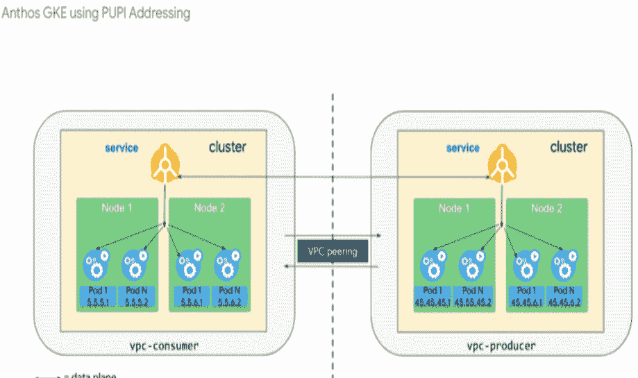

此设置涉及以下考虑因素：

- 1. **Primary CIDR block**: 用于节点和 ILB 的非 PUPI CIDR 块，必须在 VPC 之间不重叠。
- 2. **Producer secondary CIDR block**: 用于 Pod 的 PUPI CIDR 块（例如，45.45.0.0/16）。
- 3. **Consumer secondary CIDR block**: 客户侧的任何其他 PUPI CIDR 块（例如，5.5.0.0/16）。

公司的托管服务位于生产者 VPC (vpc-producer) 中，并基于 Anthos GKE 部署构建。公司的 GKE 集群使用 PUPI 45.0.0.0/8 CIDR 块用于 Pod 地址。客户的应用程序位于消费者 VPC (vpc-consumer) 中。客户还拥有 Anthos GKE 安装。消费者 VPC 中的 GKE 集群使用 PUPI 5.0.0.0/8 CIDR 块用于 Pod 地址。两个 VPC 彼此对等。两个 VPC 都使用 RFC 1918 地址空间用于节点、服务和负载平衡地址。

默认情况下，消费者 VPC (vpc-consumer) 将所有 RFC 1918 导出到生产者 VPC (vpc-producer)。与 RFC 1918 私有地址和扩展私有地址（CGN、Class E）不同，PUPIs 默认不会自动通告给 VPC 对等方。如果 vpc-consumer Pod 必须与 vpc-producer 通信，消费者必须启用 VPC 对等连接以导出 PUPI 地址。同样，生产者必须配置生产者 VPC 以通过 VPC 对等连接导入 PUPI 路由。

导出到 vpc-producer 的 vpc-consumer 地址空间不得与 vpc-producer 中使用的任何 RFC 1918 或 PUPI 地址重叠。生产者必须告知消费者托管服务使用的 PUPI CIDR 块，并确保消费者未使用这些块。生产者和消费者还必须同意并分配 vpc-producer 中内部负载平衡（ILB）和节点地址的不重叠地址空间。

PUPIs 不支持服务网络。

在大多数情况下，vpc-consumer 中的资源通过生产者集群中的 ILB 地址与 vpc-producer 中的服务通信。如果生产者 Pod 需要直接与 vpc-consumer 中的资源发起通信，并且 PUPI 地址不重叠，则生产者必须配置生产者 VPC 以通过 VPC 对等连接导出 PUPI 路由。同样，消费者必须配置 VPC 对等连接以将路由导入 vpc-consumer。如果消费者 VPC 已使用 PUPI 地址，则生产者应改为配置 IP 伪装功能，并在生产者节点 IP 地址后面隐藏 Pod IP 地址。

上面的示例显示了一个更复杂的生产者/消费者模型。您


可以在单一项目模型中直接使用。这样可以释放原本可能用于 Pod IP CIDR 的 RFC1918 空间。

在此了解有关为 GKE 配置私有使用的公共 IP 的更多信息。

## 12.3 Anthos 多集群网络

本节介绍用于连接跨多个集群运行的 Service 的机制。

根据定义，每个混合云和多云 Anthos 架构都拥有不止一个集群。例如，您在 GCP 中运行 Anthos GKE 集群，在本地数据中心运行 Anthos GKE 本地集群。在 Anthos 集群上运行的 Service 通常需要与在其他 Anthos 集群中运行的 Service 进行网络连接。

对于多集群 Service 网络，我们来看以下场景：

- 1. **GCP 上的多集群网络**——在此架构中，所有 Service 都运行在 GCP 中的多个 Anthos GKE 集群上。
- 2. **混合云和多云环境中的多集群网络**——在此架构中，Service 运行在混合云和多云环境中的多个 Anthos GKE 集群上。

### 12.3.1 GCP 上的多集群网络

云原生企业可以在 GCP 上运行 Anthos 平台。这可以是在单个区域的单个集群中。通常，Anthos 平台由多个区域的多个集群组成，以实现弹性。

在 GCP 中，我们建议使用具有多个服务项目的共享 VPC 模型。其中一个服务项目属于 platform_admins 组，包含构成 Anthos 平台的所有 Anthos GKE 集群。这些集群上的资源由多个租户共享。我们还建议使用 VPC 原生集群。VPC 原生集群为 Pod IP 使用 VPC IP 地址，这允许跨多个集群直接进行 Pod 到 Pod 的连接。

GCP 上典型的 Anthos 平台架构如下所示。

**图 12.13 Anthos 架构：单一环境**

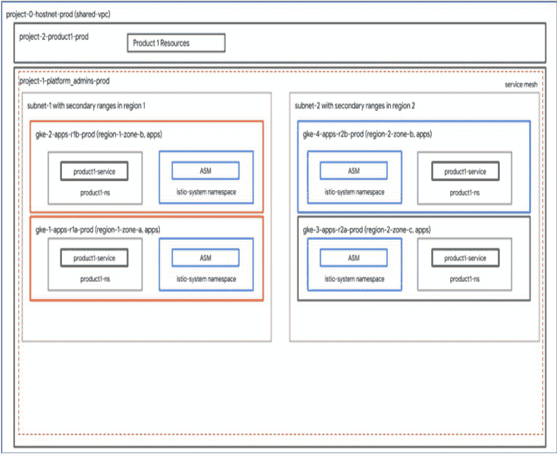

此架构表示单一环境，例如本例中的生产环境。

有一个名为 `project-0-nethost-prod` 的网络宿主项目来管理共享 VPC。有两个服务项目，一个用于平台管理员，名为 `project-1-platform_admins-prod`，Anthos 平台在此部署并由平台管理员管理；另一个用于产品，名为 `project-2-product1-prod`，与 product1 相关的资源位于此处。在此示例中，Anthos 平台部署在两个 GCP 区域以提供区域冗余。您可以创建具有两个以上区域甚至单个区域的相同架构。每个区域内部有一个带有辅助网段的子网。每个区域有两个可用区级 Anthos GKE 集群。每个区域多个集群可提供集群和可用区级弹性。您可以将相同的设计用于每个区域超过两个集群。所有集群都是 VPC 原生集群，允许集群之间进行 Pod 到 Pod 的连接。ASM 安装在所有集群上，形成多集群服务网格。ASM 控制平面发现网格内所有集群中运行的 Service 和 Endpoint，并配置每个 Pod 内运行的 Envoy 边车代理，使其包含与网格内所有 Service 相关的路由信息。

每个租户或产品都会以 Kubernetes 命名空间（位于网格内的所有集群中）和一组策略的形式获得一个*着陆区*。租户只能在自己的命名空间内部署其 Service。您可以在多个 Anthos GKE 集群中运行相同的 Service 以实现弹性。这些 Service 称为[分布式 Service](#)。从所有其他实体的角度来看，分布式 Service 充当单个逻辑 Service。在上图中，product1-service 是一个分布式 Service，有四个 Endpoint，每个 Endpoint 运行在不同的集群中。ASM 负责服务发现，VPC 原生集群允许 L3/L4 Pod 到 Pod 连接。

**图 12.14 Anthos GKE 多集群网络**

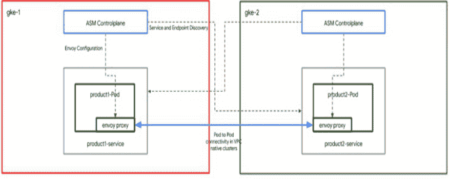

### 12.3.2 混合云和多云环境中的多集群网络

除了 GCP 上的 Anthos GKE 之外，所有其他 Anthos GKE 集群都以孤岛模式运行。这意味着集群内 Pod 和 Service 使用的 IP 地址在集群外部不可路由。在此场景中，您仍然可以连接在多个集群上运行的 Service，这些集群可以位于同一环境中，例如多个在本地数据中心运行的 Anthos GKE 集群，也可以位于多个基础设施环境中，例如在 GCP 的 Anthos GKE 和本地数据中心环境中运行的 Service。

在混合云或多云环境中连接多个 Anthos GKE 集群时，需要考虑三个方面。

- 1. 在多个集群上运行的 Pod 之间的网络连接。
- 2. 跨多个集群的服务发现。
- 3. 在混合云和多云架构中，基础设施环境之间的连接。

#### 网络连接

每个 Anthos GKE 集群都有一个负载均衡器。该负载均衡器可以在安装时捆绑提供，也可以手动配置。这些负载均衡器允许通过 NodePort 将 Service 暴露给集群外部运行的资源。每个 Service 都会获得一个虚拟 IP 地址（Service VIP），该地址在网络内部可路由且可访问。负载均衡器将流量路由到 Service NodePort 上的节点 IP，然后转发到所需端口上的 Pod IP。

一个集群中运行的 Service（和 Pod）可以访问另一个集群中运行的 Service 的 Service VIP，该 VIP 通过负载均衡器路由到所需的 Pod。

**图 12.15 Anthos GKE 混合多集群网络**

Anthos GKE 混合多集群网络

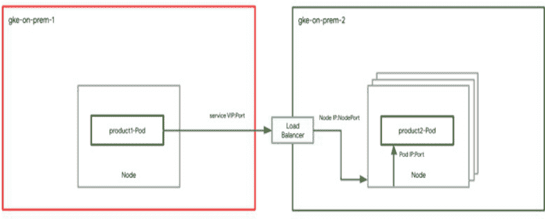

Anthos 集群也可以配置 Ingress 控制器。Ingress 控制器是 L7/HTTP 负载均衡器，通常位于集群内部。Ingress 控制器本身通过 L3/L4 负载均衡器暴露。这样，您就可以为同一集群上运行的多个 Service 使用一个 VIP（Ingress VIP）。Ingress 控制器根据 Ingress 规则进行操作，这些规则决定了流量如何在集群内部路由。

**图 12.16 Anthos GKE 混合多集群网络：Ingress**

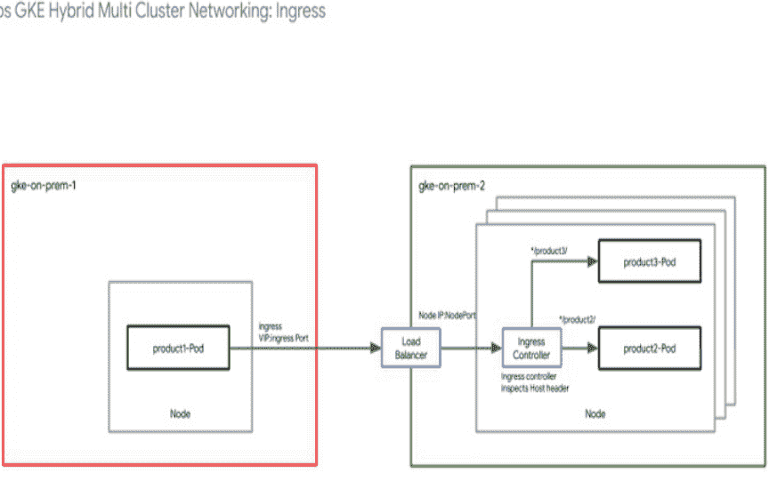

#### 多集群服务发现

Anthos Service Mesh（ASM）用于多集群服务发现。ASM 控制平面安装在每个集群中。ASM 控制平面发现来自所有集群的 Service 和 Endpoint。这也称为服务网格。ASM 控制平面必须具有对服务网格内所有 Anthos 集群的 Kubernetes API 服务器的网络访问权限。ASM 创建自己的服务注册表，该注册表是 Service 及其关联 Endpoint（或 Pod）的列表。

在 GCP 上的 Anthos GKE 中，如果使用 VPC 原生集群，Endpoint 就是实际的 Pod IP 地址。流量使用 VPC 路由在 Pod 之间流动。在非 GCP Anthos 集群中，集群之间的流量通过 L7 Envoy 代理流动。此代理在每个 Anthos 集群中作为名为 `istio-ingressgateway` 的 Service 运行。发往集群内所有 Service 的流量都流经 `istio-ingressgateway`。`istio-ingressgateway` 被配置为检查 Host 标头并将流量路由到集群内相应的 Service。

**图 12.17 Anthos GKE 混合多集群网络：Anthos Service Mesh（ASM）**

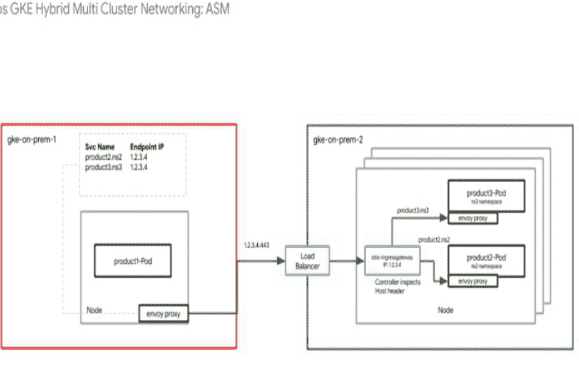

对于分布式 Service，我们建议使用 ASM，它提供跨多个集群的服务发现和流量路由功能。

#### 混合云和多云连接

只要您能够访问目标 Anthos 集群的 Kubernetes API 服务器和外部公共负载均衡器，您就可以跨多个基础设施环境连接在多个 Anthos 集群中运行的 Service。

连接基础设施环境主要有三种方式。

- 1. [Cloud Interconnect](https://cloud.google.com/network-connectivity/docs/interconnect)——Cloud Interconnect 通过高可用、低延迟的连接将您的本地网络扩展到 Google 的网络。您可以使用 Dedicated Interconnect 直接连接到 Google，或使用 Partner Interconnect 通过受支持的服务提供商连接到 Google。


1. **使用 Anthos Service Mesh (ASM)** - 使用 ASM 时，您可以使用 ASM ingress 处理 HTTP(S) 和 TCP 流量。ASM 提供了额外的 L7 功能，例如在 ingress 处执行身份验证和授权的能力。ASM 是在 Anthos 平台中访问基于 Web 的服务的推荐方式。ASM 也可用于基于 TCP 的服务。
2. **不使用 Anthos Service Mesh** - 所有 Anthos 集群都有配置负载均衡器的选项。负载均衡器在部署 Anthos 集群时集成/捆绑提供，或可手动配置。任何基于 TCP 的服务都可以使用类型为 `LoadBalancer` 的服务公开，该服务会创建可由客户端访问的服务 VIP。此外，所有 Anthos 集群都可以配置 ingress。Ingress 控制器通常作为 L7 代理在集群内部运行（Anthos GKE on GCP 和使用 ALB 的 Anthos on AWS 除外）。Ingress 控制器本身通过 L3/L4 负载均衡器公开。Ingress 是公开基于 Web 的服务的推荐方式。Ingress 规则作为服务部署管道的一部分实现，Ingress 控制器强制执行这些规则，其中包括监听和将流量路由到适当的服务。

## 12.4.2 服务到服务连接性

在集群内运行的服务需要网络连接性。这通过两种方式实现。

1. **使用 Anthos Service Mesh (ASM)** - 我们特别在多集群 Anthos 平台中推荐使用 ASM。ASM 提供服务发现以及服务之间的路由逻辑。ASM 还配置服务之间的身份验证和授权。例如，您可以在服务网格级别启用 mTLS，对所有服务到服务流量进行加密。您还可以为单个服务层配置安全策略。除了服务发现和网络之外，ASM 还提供诸如遥测、配额、速率限制和断路器等附加功能。有关 ASM 的功能和优势的更多信息，请参阅第 xyz 章。
2. **不使用 Anthos Service Mesh** - 如果您选择不使用 ASM，仍然可以配置服务到服务连接性。从网络角度来看，您可以使用负载均衡器或 ingress 模式来访问在集群内运行的服务。您必须自行配置服务发现。您可以使用 DNS 来提供此功能。

在任何一种情况下，您还可以在集群内部使用 `NetworkPolicy` 来控制/限制 Pod 和服务之间的流量。

## 12.4.3 服务到外部服务连接性

您可以以两种方式之一控制任何 Anthos 集群的出站流量。

1. **使用 Anthos Service Mesh (ASM)** - ASM 同时提供 ingress 和 egress 网关。我们之前讨论过 ASM 的 ingress 工作方式。同样，可以在服务网格的边缘配置一个名为 `istio-egressgateway` 的第二个代理。然后，您可以仅为允许从集群内部访问的服务配置 `ServiceEntries`。您可以将 `outboundTrafficPolicy` 模式设置为 `REGISTRY_ONLY`。这会阻止所有未发往网格内服务的出站流量。然后，您可以为访问平台外部运行的服务创建单独的 `ServiceEntries`。ServiceEntry 的示例可能如下所示。

```
apiVersion: networking.istio.io/v1alpha3
kind: ServiceEntry
metadata:
  name: httpbin-ext
spec:
  hosts:
  - httpbin.org
  ports:
  - number: 80
    name: http
    protocol: HTTP
  resolution: DNS
  location: MESH_EXTERNAL        #A
```

此规则允许发往端口 80 上的 `httpbin.org` 的流量。请注意服务的 location 为 `MESH_EXTERNAL`，表示该服务位于服务网格和 Anthos 平台之外。

2. **不使用 Anthos Service Mesh** - 您可以在集群内部使用 `NetworkPolicies` 根据标签选择器控制 Pod 的入站和出站流量。由于所有 Pod 出站流量都通过节点 IP 退出，因此您可以通过防火墙规则进一步控制出站流量，通过限制节点 IP 子网可以访问的目的地。

## 12.5 摘要

Anthos 网络可以分为四个层：

- **云网络和混合连接** - 这是 Anthos 网络的最低层。该层描述了如何在每个云环境中设置网络，以及将多个云环境安全连接在一起的选项。在 GCP 内部，您可以根据组织和功能要求设置单个网络（或 VPC）、共享 VPC 或多个 VPC。在非 GCP 环境中，所有 Anthos 集群都被视为隔离网络（或“岛模式”）。有多种混合连接选项：
  - **专用互连** - 此选项在您的本地网络和 Google 网络之间提供直接物理连接。专用互连使您能够在网络之间传输大量数据，这比通过公共互联网购买额外带宽更具成本效益。
  - **Cloud VPN** - 此选项通过 IPsec VPN 隧道安全地将您的对等网络扩展到 Google 网络。流量经过加密并通过公共互联网在两个网络之间传输。Cloud VPN 适用于低数据量连接。
  - **公共互联网** - 此选项不需要任何特殊软件或硬件来连接不同的网络。相反，使用 TLS/mTLS 连接来保护服务到服务连接。

- **Anthos GKE 网络** - 这是 Kubernetes 网络层。Anthos GKE 集群可以部署到各种环境，例如 GCP、在本地数据中心的 VMware 上、在裸机服务器上以及在 AWS 上。除了受支持的 Anthos 集群之外，您还可以将任何 [conformant](conformant) Kubernetes 集群注册到 Anthos 平台。例如，您可以将运行在 AWS 上的 [EKS](EKS) 集群和运行在 Azure 上的 [AKS](AKS) 集群注册到 Anthos 平台。目前有六种类型的 Anthos 集群。

  - Anthos 集群在 GCP 上（GKE）
  - Anthos 集群在 VMware 上（GKE on-prem）
  - Anthos 集群在裸机上
  - Anthos 集群在 AWS 上（GKE on AWS）
  - Anthos 集群在 Azure 上（GKE on Azure）
  - Anthos 附加集群（符合标准的 Kubernetes 集群）

- **Anthos 多集群网络** - Anthos 多集群网络处理服务需要在集群边界之间通信的多集群环境。该部分可分为两个子部分：

  - **GKE on GCP 的 Anthos 多集群网络** - 在 GKE on GCP 中，您可以使用扁平网络架构（使用单个或共享 VPC）或多网络（多 VPC）模型。在使用 VPC 原生 GKE 集群的扁平网络架构中，VPC 网络会自动允许多个集群之间的 Pod 到 Pod 连接。集群可以位于任何区域。集群之间 Pod 到 Pod 连接不需要额外配置。在多 VPC 架构中，您需要额外配置来连接多个集群之间的 Pod 和服务。例如，您可以使用特殊网关或 ingress 模型在集群之间通信。
  - **非 GCP 环境中的 Anthos 多集群网络** - 在所有非 GCP 集群中，每个集群特别是 Pod IP 地址范围都与其他集群隔离。这意味着多个集群中的 Pod 之间没有直接连接。为了连接多个集群，必须使用特殊网关或 ingress。Anthos Service Mesh 可用于部署此类网关。这些通常称为“东西向网关”，部署在参与多集群网格的所有集群中。此外，Anthos Service Mesh 还提供多集群服务发现。

- **服务层网络** - Anthos 网络的顶层是服务层网络。该层解决服务发现


并且相互通信。在上一节中，我们提到了 Anthos Service Mesh。Anthos Service Mesh 允许您在运行于多个云环境中的多个 Anthos 集群之上创建服务网格。该层抽象了底层网络的复杂性，使操作员能够专注于服务层。Anthos Service Mesh 使用每个工作负载的 sidecar 和专用网关，将多个集群跨多个环境和网络连接在一起。通过使用 Anthos Service Mesh，操作员可以专注于服务层功能，例如身份验证、加密和授权，而无需在集群级别管理单个工作负载。这使得操作员和管理员能够大规模运行，其中可能存在多个集群，在多个环境中，在多个网络中运行众多服务。

- 1. https://cloud.google.com/vpc
- 2. https://cloud.google.com/vpc/docs/firewalls
- 3. https://kubernetes.io/docs/concepts/services-networking/network-policies/
- 4. https://cloud.google.com/service-mesh/docs/security-overview
- 5. https://cloud.google.com/vpc/docs/quota
- 6. https://cloud.google.com/vpc/docs/shared-vpc
- 7. https://cloud.google.com/network-connectivity/docs/vpn/concepts/overview
- 8. https://cloud.google.com/vpc/docs/vpc-peering
- 9. https://en.wikipedia.org/wiki/Transport_Layer_Security
- 10. https://cloud.google.com/service-mesh/docs/overview
- 11. https://cloud.google.com/apigee
- 12. https://cloud.google.com/network-connectivity/docs/interconnect

在一个工具中进行更改，在另一个工具中授予 VM 访问权限，并通过第三个工具设置路由。这些挑战很大程度上落在 IT 运营团队的肩上，他们负责实施和维护所有这些基础设施。

随着越来越多的公司将 Kubernetes 用于日常运营，安全专业人员和管理人员对其配置、管理和审计 Kubernetes 集群的能力充满信心的需求已成为业务成功的关键。IT 安全团队负责在 IT 基础设施周围和内部开发和实施安全控制。这包括软件、硬件和物理限制、政策、程序和指导。许多公司采用分层权限模型，允许超级用户拥有更大的能力子集，而无需成为完整管理员。由于 Kubernetes 中的大部分工作都由通用定义语言驱动，以 JSON 或 YAML 表达，因此安全框架也应让经常在 Kubernetes 中工作的 IT 安全团队熟悉。

为帮助组织解决这一需求，Google 创建了 Anthos Config Management (ACM)，以简化 Kubernetes 策略的开发、部署和维护。在下一节中，您将研究 ACM 有助于解决的挑战的全部范围以及 ACM 为组织提供效率驱动的机会。

## 13.1 我们试图解决什么问题？

随着时间的推移，企业已将流程转移到数字格式。即使没有互联网作为参与平台，公司也已将其内部运营转移到依赖数字应用程序和通信。当这与大规模推动与数字客户互动的需求相结合时，公司对计算能力的需求比以往任何时候都大。而且它没有放缓的迹象。根据 Grandview Research 的预测，计算的最新方面之一边缘计算，到 2027 年预计将成为一个超过 400 亿美元的市场（https://www.grandviewresearch.com/press-release/global-edge-computing-market）。

此外，许多企业通过让这些系统相互通信以自动化其流程，从而看到更高的效率。例如，票证式自助服务软件（如 ServiceNow）、人员管理解决方案（如 Workday）以及 Okta 等组合身份验证和授权服务的普及，鼓励公司在本地和云端扩展其能力。随着公司转向更依赖其员工的开发能力来提供关键任务解决方案，随着他们将每个新供应商引入其生态系统，部署这些应用程序所涉及的复杂性也在增加。

任何公司的需求都与其最接近的竞争对手不同，因为它们为客户设计独特的价值，但大多数企业在本地和云端都有数字存在。虽然一些公司利用多个数据中心或托管设施来提供其冗余可靠的基础设施，但许多公司已转向云提供商。但云提供商的最佳实践和用户体验可能差异很大。运营团队上线每个云都会大大增加其技术负担和运营开销。即使在设计为完全相同的数据中心的情况下，安全控制和物理隔离仍然对其操作和可维护性构成障碍。

**图 13.1. 上线多个基础设施平台会增加相当大的运营开销。**

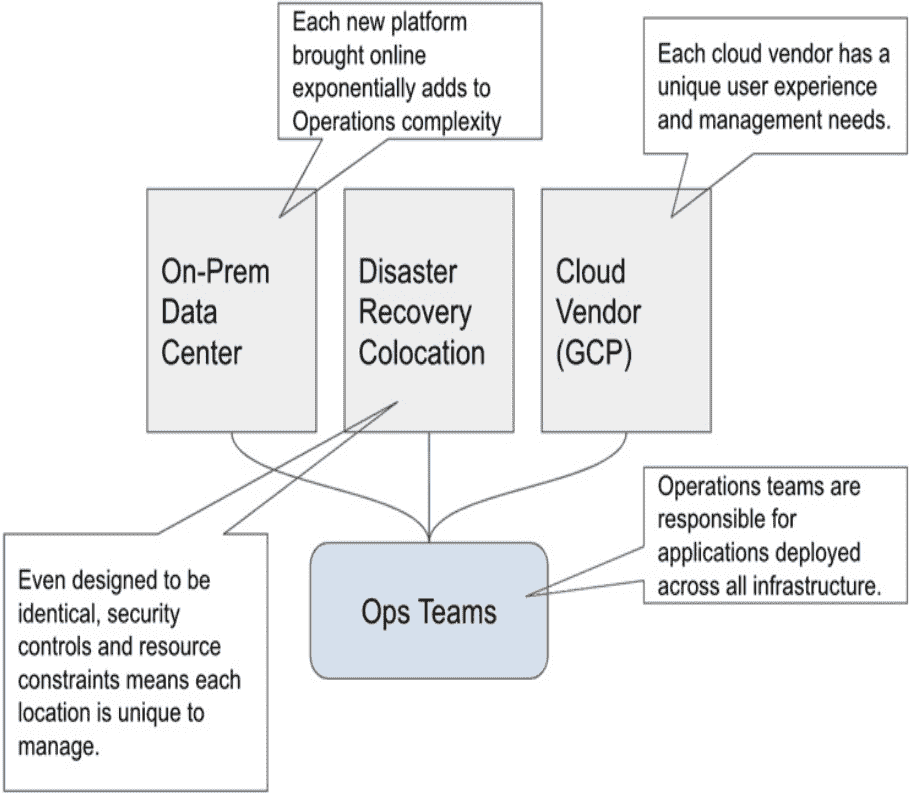

公司数字足迹的大小也增加了其系统配置和操作的复杂性。多个工作地点、更多数据中心以及参与这些系统管理的人员数量相应增加都会带来各自的问题。随着组织的增长，引入和利用系统性的安全和配置控制变得至关重要。

ACM 通过三种核心功能解决这些挑战：

- 1. 管理复杂性
- 2. 工作负载可观察性和检查
- 3. 在问题发生时进行补救和预防

Anthos Config Management 提供的所有集群的策略和配置的表示可以在前端做很多工作，以确保遵守适当的策略。

Anthos Config Management 的目标是使集群保持由存储在 git 仓库中的策略目录指定的状态。该策略目录与被管理的集群分开存在，并以基于文本的格式存储。因此，策略目录本身可以用作有关集群配置的信息来源。通过使用 git 仓库本身的功能，IT 运营团队可以确定集群何时不符合规范，并且可以轻松跟踪对集群配置的更改。

ACM 提供了一个命令行实用程序，通过 `nomos` 命令直接查询集群并确定其当前状态。运营团队可以使用 `nomos` 来诊断更改的推出情况，并确定是否存在会导致问题的错误或延迟。nomos 提供的大部分信息在 Google Cloud Console 中的 Anthos UI[1] 中可见，显示每个集群当前运行的配置版本，以及 ACM 安装的整体状态。此外，系统的 Kubernetes 操作员以与其它容器相同的方式记录事件和信息，因此可以在 Cloud Logging 中查看，并用于 Cloud Monitoring 警报和指标。

## 补救和预防问题

IT 运营团队的主要职责之一是维护系统可靠性和正常运行时间。知道更改导致了中断，能够快速隔离问题并迅速应用补救措施，是团队工具箱中的关键工具。在这三点上，ACM 提供了独特的特性，使团队能够在情况发生时做出响应。

由于 ACM 由 git 仓库驱动，您可以轻松地将一个或多个分支上的活动与 Cloud Monitoring 或其他监控套件关联，并在策略更改后提供额外的警报。使用仓库作为事实来源，团队可以调查在何时应用了哪些更改，以缩小任何有问题的配置范围。现有的 git


工具随后可用于回滚或修复配置。由于 ACM 的设计，这些更改通常在推送到策略仓库后一到两分钟内生效。

除了修复已部署的问题外，还可以利用现有的 CI/CD 工具和流程，在配置生效前对其进行验证。围绕 git 的其他工具，例如拉取和合并请求、分支等，也可用于让多名用户共同开发新策略，同时让组织在部署前批准这些更改。

ACM 包含将配置应用于集群子集的功能。虽然我们在示例中用它来按区域向集群部署不同版本的应用程序，但同样的功能也可用于受控地部署更改，或为每个集群应用不同的角色。例如，零售连锁店在每家门店运行一个集群，可以先向特定的一组测试门店部署新版本的应用程序，然后再向整个连锁店推广。使用不同集群用于开发、测试和生产环境的公司，可以根据集群授予用户不同的权限，同时仍使用单一策略仓库。

## 综合起来

这三个问题都可以通过 Anthos Config Management 得到很好的处理。利用 IT 专业人员熟悉的工具，并采用在高度分布式生态系统中蓬勃发展的设计，ACM 可帮助团队轻松管理大型系统。在下一节中，我们将简要概述 ACM 的工作原理以及安装时可包含的组件。

## 13.2 ACM 概述

现在我们对使用 Anthos Config Management 试图解决的问题有了很好的了解，让我们更深入地了解 ACM 的技术实现。

ACM 通过部署到每个受管集群的 Kubernetes operator 工作。包含集群的规范名称、git 配置和一组功能标志的配置文件也会应用于集群。operator 使用 git 配置连接到包含集群完整配置信息的 git 仓库。功能标志是用于激活 Config Connector、Policy Controller 或 Hierarchy Controller 的开关，这些将在本章后面介绍。operator 配置还将扩展以自动配置额外的服务和组件，例如 Binary Authorization。ACM 使用集群名称以及 git 仓库中的策略配置，为集群添加临时标签。这些标签随后可在策略仓库中使用，以修改部署到特定集群的资源。

ACM 采用最小占用原则：它不会试图接管整个 Kubernetes 集群。相反，operator 知道策略配置中定义了哪些对象，并且只管理那些特定对象。这允许多个部署机制在单个 Kubernetes 集群上并行工作而互不干扰。然而，使用多个工具会增加需要知道哪些工具部署了每个对象的额外负担。ACM 在对象上包含特定的注解，但这可能对所有工具来说并不相同。正如我们稍后会看到的，ACM 仓库可以配置为非结构化模式，这允许组织继续使用支持输出 YAML 或 JSON 的现有工具，同时仍利用 ACM 执行实际的部署和管理流程。

operator 每隔几分钟同步一次，此频率可在配置中根据组织需求进行调整。ACM 能够使用公共和私有仓库作为策略仓库，并使用适当的凭据。此外，git 配置可以指向仓库顶层以下的一个目录。如果 git 仓库使用模板引擎，甚至应用程序代码，这会很有用：可以使用子目录存储策略，而无需在多个仓库之间同步。

根据所使用的 Kubernetes 集群类型，部署 Anthos Configuration Management 主要有三种方式：部署在 GCP 上的 Google Kubernetes Engine（GKE）集群、GKE on VMware 集群，或其他类型的 Kubernetes。对于 GKE on GCP，启用 ACM 只需在集群配置页面上勾选一个复选框即可。对于 GKE on VMware，ACM 默认启用且无法禁用。只有不属于上述任一类别的集群才需要手动配置以安装 operator：获取 Google 提供的 operator Custom Resource Definition 文件的最新版本，并将其应用到集群。

此时，所有类型的 Kubernetes 都已安装并运行 operator，但 ACM 仍需启用并告知从何处提取策略。这是通过创建 operator 配置对象并将其应用到集群，同时附带所需的 git 凭据来完成的。支持多种 git 身份验证方法，包括无需身份验证的公共仓库、ssh 密钥对、个人访问令牌和 Google 服务账号。其中一些方法需要在 Kubernetes secret 中加载特定信息，以便 operator 正确加载。配置对象允许在需要时指定 git 仓库的代理。除了 git 连接信息外，配置对象还可以包含用于启用或禁用上述各个组件的设置，以及为 ACM 策略规则命名集群。随着 ACM 功能的扩展，将向此配置对象添加更多选项，但当前结构为：

```
apiVersion: configmanagement.gke.io/v1
kind: ConfigManagement
metadata:
  name: config-management
spec:
  clusterName: <name of cluster>
  configConnector:
    enabled: <true/false>
  enableMultiRepo: <true/false, enables multiple repository mode>
  enableLegacyFields: <true/false, used with multi repo, see below>
  policyController:
    enabled: <true/false>
    templateLibraryInstalled: <true/false, installs the Google-provided templates>
  hierarchyController:
    enabled: <true/false>
  sourceFormat: <hierarchy or unstructured. Sets the type of policy>
  enableMultiRepo: <if set to true, turns on multiple repositories>
git:
    syncRepo: <url of the git repository>
    syncBranch: <branch of the git repository to sync from>
    policyDir: <relative path in the git repository to the policy>
    syncWait: <number of seconds between sync attempts>
    syncRev: <git revision to sync from. Used if a specific commit>
    secretType: <ssh, cookiefile, token, gcenode, or none. Specifies>
proxy:
    httpProxy: <proxy information for http connection, styled as>
    httpsProxy: <proxy information for https connection, styled similarly>
```

单个集群上的 operator 是 ACM 用于更新各集群上对象的机制。虽然 ACM 使用中央 git 仓库，但由于各个集群主动获取配置，这极大地简化了集群与仓库之间的连接。由于仓库不会推送配置，我们无需引入额外的复杂性或安全入站漏洞，也无需中央仓库事先知道每个单独的集群。

## 13.2.1 ACM 策略结构

ACM 策略目录必须采用两种受支持格式之一，即 hierarchy 或 unstructured，默认采用 hierarchy。此设置也反映在上述 operator 配置对象中，spec.sourceFormat 键。在这两种情况下，策略目录都定义了 Kubernetes 对象，然后由连接到 git 仓库的每个集群上的 ACM operator 检查并应用。其中一些对象由 ACM 本身用于确定要应用于当前集群的配置，并且不会在集群本身上创建。

除了仓库的整体格式外，还可以使用多个仓库来配置集群。使用 enableMultiRepo 功能时，一个仓库用作根仓库（可以是 hierarchy 或 unstructured），而所有其他仓库用于配置单个命名空间中的对象。

### Hierarchy

在 hierarchy 仓库中，策略目录中有顶级目录根据用途和范围分隔配置文件：“system”、“clusterregistry”、“cluster”和“namespaces”：


| 目录 | 用途 |
|---|---|
| system | 与策略仓库本身相关的配置，例如所部署配置的版本。 |
| clusterregistry | 存储 Cluster 和 ClusterSelector 对象，这些对象可配合使用以选择集群子集，从而限制特定对象的应用范围。集群定义通过名称将特定标签附加到集群；ClusterSelector 随后可利用这些标签选择满足特定需求的一组集群。 |
| cluster | 包含为整个集群（命名空间除外）定义的对象。 |
| namespaces | 包含分配给一个或多个特定命名空间的对象，以及 Namespace 和 NamespaceSelector 定义。 |

采用层级模式的 ACM 利用了“抽象”命名空间的概念，即将一个或多个实际命名空间分组为一个共享一组 Kubernetes 对象的整体。例如，你可以在团队使用的每个命名空间中定义 Role 或 ConfigMap。当 ACM 分析仓库时，抽象命名空间中定义的任何对象都会自动复制到其下的每一个命名空间中。这些抽象命名空间还可以相互嵌套，以实现多层抽象。例如，你可以在一个名为“app-dev”的抽象命名空间下放置所有应用程序开发团队，然后在“app-dev”内为每个团队创建单独的抽象命名空间。

虽然 ACM 会将抽象命名空间中的对象复制到所有子命名空间，但你可以使用 NamespaceSelector 来限制对象所应用的命名空间范围。以“app-dev”的上述示例为例，我们希望将 ConfigMap 部署到多个团队中的多个命名空间，但仅限包含金融相关应用程序的命名空间。通过对这些命名空间应用标签，我们可以定义 NamespaceSelector 仅选择这些命名空间，然后将 ConfigMap 配置对象与 NamespaceSelector 关联。虽然这些选择器在层级仓库中确实有其用途，但它们的主要用途还是在非结构化仓库中。此外，在层级仓库中，具体命名空间必须是包含该对象的文件夹的子目录，并且必须与选择器匹配。关于非结构化仓库中定义了配置对象的完整示例，请参阅本章末尾的 Evermore Industries 示例。

在确定了要创建的具体命名空间名称后，还应决定继承哪个抽象命名空间。这可能意味着某些对象必须在比通常更高的层级上定义，仅仅是为了让各个命名空间能继承它们。确定名称和抽象命名空间后，在该组命名空间目录的底部创建一个以该名称命名的文件夹。在新建目录内部，还必须创建同名的 Kubernetes Namespace 对象。抽象命名空间中定义的所有对象也会在叶子命名空间内创建。让我们看一个示例：

给定以下文件夹结构：

```
namespaces
├─ staging
│  ├─ qa-rbac.yaml
│  └─ weather-app-staging
│     └─ namespace.yaml
├─ production
│  ├─ developer-rbac.yaml
│  ├─ app-service-account.yaml
│  ├─ weather-app-prod
│  │  ├─ namespace.yaml
│  │  └─ application.yaml
│  ├─ front-office-prod
│  │  ├─ namespace.yaml
│  │  └─ application.yaml
│  └─ marketing
│     └─ namespace.yaml
```

对于 production 抽象命名空间，我们通过 developer-rbac.yaml 定义开发人员的角色和角色绑定，并通过 app-service-account.yaml 定义应用程序的 Kubernetes 服务账户。由于 weather-app-prod、front-office-prod 和 marketing 命名空间位于 production 抽象命名空间之下，因此角色、角色绑定和 Kubernetes 服务账户将在这三个命名空间中创建。由于 ACM 分析策略仓库的方式，实际命名空间的文件夹中不能包含子目录，并且每个叶子目录都必须是一个实际命名空间，且目录中包含对应的命名空间声明。如果不遵守此限制，在部署 ACM 时将会导致配置错误。

除了抽象命名空间之外，对象还可以利用 NamespaceSelector（其声明方式与 ClusterSelectors 类似，将在本章稍后介绍）来仅影响对象作用域内的命名空间子集。在上述示例中，app-service-account 可以使用选择器仅部署到 weather-app-prod 和 front-office-prod 命名空间，而不部署到 marketing 命名空间。但是，层级仓库中的 NamespaceSelector 仅作用于当前文件夹树中的命名空间。例如，即使命名空间选择器的条件中包含 weather-app-staging，由于 weather-app-staging 目录不是包含 app-service-account 的目录的子目录，因此在 production 抽象命名空间下定义的 app-service-account 永远不会被应用到 staging 命名空间。

## 优点与缺点

层级仓库简化了对象向命名空间子集的部署，因为对象只能部署到仓库中配置文件所在层级或其下方的命名空间。通过使用 NamespaceSelector，组织可以进一步限制对象可部署到的命名空间范围。当存在多种命名空间分组方式时，这尤其有用。例如，命名空间可能按开发团队分组，但也可能需要按功能（前端、中间件等）或业务部门分组。使用层级仓库时，必须选择一种“主要”分组策略；如果对象需要部署到多个不在一组内的命名空间，则应将对象放在仓库中更高的层级，并使用 NamespaceSelector 加以限制。

采用层级模式的 ACM 可以利用“抽象”命名空间的概念，即一个或多个实际命名空间的分组，这些命名空间应共享一组 Kubernetes 对象。例如，你可能希望在团队使用的每个命名空间中定义 Role 或 ConfigMap。当 ACM 分析仓库时，抽象命名空间中定义的任何对象都会自动复制到其下的每个命名空间中。这些抽象命名空间也可以相互嵌套，以实现多层抽象。例如，你可以将所有应用程序开发团队放在“app-dev”抽象命名空间下，然后将每个团队放在“app-dev”下的单独抽象命名空间中。

虽然 ACM 会将抽象命名空间中的对象复制到所有子命名空间，但你可以使用 NamespaceSelector 来限制对象应用的命名空间。使用上面的“app-dev”示例，我们希望将 ConfigMap 部署到多个团队的多个命名空间，但只部署到包含金融相关应用程序的命名空间。通过对这些命名空间应用标签，我们可以定义 NamespaceSelector 仅选择那些命名空间，然后将 ConfigMap 配置对象链接到 NamespaceSelector。虽然这些选择器在层级仓库中有其用途，但它们的主要用途是在非结构化仓库中。此外，在层级仓库中，特定命名空间必须是包含该对象的文件夹的子目录，并且必须与选择器匹配。有关在非结构化仓库中定义配置对象的完整示例，请参阅本章末尾的 Evermore Industries 示例。

一旦确定了要创建的特定命名空间名称，还应决定要继承哪个抽象命名空间。这可能意味着某些对象必须在比通常更高的级别定义，只是为了由各个命名空间继承。确定名称和抽象命名空间后，你可以在该组命名空间目录的底部创建一个具有该名称的文件夹。在新创建的目录中，还必须创建同名的 Kubernetes Namespace 对象。抽象命名空间中定义的所有对象也会在叶子命名空间内创建。让我们看一个示例：

给定以下文件夹结构：

```
namespaces
├─ staging
│  ├─ qa-rbac.yaml
│  └─ weather-app-staging
│     └─ namespace.yaml
├─ production
│  ├─ developer-rbac.yaml
│  ├─ app-service-account.yaml
│  ├─ weather-app-prod
│  │  ├─ namespace.yaml
│  │  └─ application.yaml
│  ├─ front-office-prod
│  │  ├─ namespace.yaml
│  │  └─ application.yaml
│  └─ marketing
│     └─ namespace.yaml
```

对于 production 抽象命名空间，我们在 developer-rbac.yaml 中为开发人员定义了角色和绑定，并在 app-service-account.yaml 中为应用程序定义了 Kubernetes 服务账户。由于 weather-app-prod、front-office-prod 和 marketing 命名空间位于 production 抽象命名空间下，因此角色、角色绑定和 Kubernetes 服务账户将在这三个命名空间中创建。由于 ACM 分析策略仓库的方式，实际命名空间在其文件夹中不能有子目录，并且每个叶子目录必须是一个实际命名空间，并在目录中包含相应的命名空间声明。如果不符合此限制，则在部署 ACM 时会导致配置错误。

除了抽象命名空间外，对象还可以利用 NamespaceSelector（其声明方式与 ClusterSelectors 类似，本章稍后介绍），以便仅影响对象范围内的命名空间子集。在上面的示例中，app-service-account 可以使用选择器仅部署到 weather-app-prod 和 front-office-prod 命名空间，而不部署到 marketing 命名空间。但是，层级仓库中的 NamespaceSelector 仅对当前文件夹树中的命名空间生效。例如，即使命名空间选择器在其条件中包含了 weather-app-staging，由于 weather-app-staging 目录不是包含 app-service-account 的目录的子目录，因此在 production 抽象命名空间下定义的 app-service-account 永远不会被应用到 staging 命名空间。

## 优点与缺点

层级仓库简化了对象向命名空间子集的部署，因为对象只能部署到仓库中配置文件所在层级或其下方的命名空间。通过使用 NamespaceSelector，组织可以进一步限制对象可部署到的命名空间。如果存在多种命名空间分组方式，这尤其有用。例如，命名空间可能按开发团队分组，但也可能按功能（前端、中间件等）或业务部门分组。使用层级仓库，必须选择一种“主要”分组策略；如果对象需要部署到多个未分组在一起的命名空间，则该对象应放在仓库中较高的层级，并使用 NamespaceSelector 进行限制。对于策略目录下的配置文件，在实施 ACM 时，这可以提供一种压力较小的升级路径。

然而，非结构化仓库在命名空间分配方面存在一些棘手问题。由于非结构化仓库中的配置无法推断应分配的命名空间，用户必须显式分配所有对象。如果选择器的定义或使用不当，这可能导致对象部署到非预期的命名空间。此外，由于配置文件位置与部署命名空间之间不存在隐式关系，查找资源变得更加复杂。

## 多仓库模式[4]

将 ACM 配置为从多个仓库拉取，允许组织让各个团队管理自己的命名空间，同时仍能利用 ACM 的许多优势。当集群配置对象设置为启用多仓库模式时，使用 `enableMultiRepo` 标志，则不支持 spec.git 字段集。相反，你需要创建一个单独的 RootSync 对象来保存根仓库的配置详情。

设置 enableMultiRepo 后，组织可以为每个单独命名空间定义要使用的仓库。与 RootSync 对象一样，这些单独的 RepoSync 对象包含从 git 仓库拉取的配置以及该仓库中策略树顶部的目录。即使使用多仓库模式，根仓库仍然可以定义要在任何命名空间中管理的对象。如果根仓库和单独命名空间仓库之间存在冲突，则使用根仓库的版本。

多仓库设置的根仓库的功能与未处于多仓库模式时的配置完全相同；仅更改仓库的拉取配置方式。因此，多仓库模式是一个理想的解决方案，允许运维和安全团队实施策略、RBAC 规则、配置命名空间、Istio 规则等，同时允许应用团队将各自的应用程序管理并部署到


individual namespaces. The team managing the root repository also needs to add the appropriate policies to define what objects the individual repositories can modify. This is done by defining a custom Role or ClusterRole, or using one of the built-in roles, and then using a RoleBinding to attach the namespace’s worker service account to that role. This allows the operations team to offload much of the work of configuring a given application to the teams, and defining custom permissions per team if needed, rather than requiring the central team to validate or perform the work themselves.

## 13.2.2 ACM-specific Objects

While ACM can manage any valid Kubernetes object, there are custom objects used to adjust how the system operates and applies new configurations.

### ConfigManagement

Used by ACM to determine how, and where, to fetch the policy configurations to be used for the cluster. Deploying a ConfigManagement object to the cluster activates ACM for that cluster. This object also defines the name of the cluster, as used inside ACM, and determines which plugins (Config Connector, Policy Controller, and Hierarchy Controller) are active for the cluster.

### RootSync/RepoSync

When the cluster is running in Multiple Repository Mode, the configuration for fetching policies, including git URLs and secrets, are not stored in the ConfigManagement object, but rather in either the RootSync object (for the core repository), or in RepoSync objects in each namespace.

### Cluster

A cluster config is created in the ACM policy repo and allows users to attach labels to a specific cluster by cluster name. These labels are then used in ClusterSelectors to select specific types of clusters. In a hierarchy repo, the Cluster definitions must be in the "clusterregistry" directory.

### ClusterSelector

This object leverages the common Kubernetes labelSelectors pattern[^5] to select a subset of clusters. The ClusterSelector can then be used by an object, such as a Deployment, ConfigMap, or Secret, to only deploy that object in clusters matching the selector. In a hierarchy repo, these must be in the "clusterregistry" directory.

### NamespaceSelector

Similar to the ClusterSelector, this selector also uses labelSelectors, but is used to select namespaces instead. Primarily used in unstructured repos, or in a hierarchy repo as an additional method to limit which namespaces an object is deployed to.

### HierarchyConfiguration

These objects are declared in individual namespaces and point to their parent. This sets up the hierarchical namespace relationship that the Hierarchy Controller uses. Note that using the Hierarchy Controller is not the same as a hierarchy repository, the Hierarchy Controller will be explored further later in the chapter.

## 13.2.3 Additional Components

Although not strictly part of ACM itself, Config Connector, Policy Controller, and Hierarchy Controller greatly enhance the functionality of ACM and your Kubernetes environments. This section only gives a short introduction to each component, but all three are demonstrated in the examples at the end of the chapter. Google is also integrating additional components as development on Anthos continues. Please refer to the online documentation at [https://cloud.google.com/anthos-config-management/docs](https://cloud.google.com/anthos-config-management/docs) for the most up-to-date information on available add-ons.

### Config Connector[^6]

Config Connector is an add-on to Kubernetes that allows you to configure GCP resources, such as SQL Instances, Storage Buckets, and Compute Engine VMs, using Kubernetes objects. A full example of the structure of one of these objects is provided in the Evermore Industries case study in this chapter. Config Connector is only usable in GKE on GCP clusters. With proper permissioning, this allows a developer proficient with Kubernetes to create several different types of GCP resources, including SQL Databases, Networks, BigQuery Datasets and Tables, Compute Instances, PubSub Topics and Subscriptions, and Storage Buckets. In addition, these configurations can reference each other, simplifying configuration and allowing for a single source of truth.

Users can also leverage Kubernetes secrets to store sensitive information, such as passwords, and then use that information in Config Connector resources. Each of the Config Connector objects also includes a status section, describing the current state of the resource as it is created or updated in GCP.

### Policy Controller[^7]

While the Kubernetes role-based access control system (RBAC)[^8] has the ability to finely control what a specific user is permitted to do at the namespace and object-type level, it does not enforce arbitrary policies, or policies on specific objects. For example, we may want all pods deployed in a specific namespace to declare CPU limits for the containers, or require all namespaces include a custom label that indicates the cost center that should be billed for the resource usage. We may also want to protect a specific deployment and prevent modifications to that specific resource, while still allowing other resources in the same namespace to be modified. This is where Policy Controller comes into play.

Built from the open-source OPA Gatekeeper project[^9], Policy Controller is an admission controller that checks and verifies any create of, or update to, an object against the policies that have been declared and loaded to the cluster. Each policy consists of a constraint template, which is written using Rego to actually perform the test needed, and a constraint, which provides the arguments to the template for the specific policy. A set of existing templates, known as a template library, is provided by default when Policy Controller is enabled, though users can create customized constraint templates as well. Users can then create constraints that utilize these policy templates to enforce specific restrictions on the cluster.

Since we are utilizing ACM, we can pair the policy constraints with ClusterSelectors to restrict which clusters a particular policy applies to, locking some down while allowing a more relaxed set of rules on others.

### Hierarchy Controller[^10]

Hierarchy Controller is the newest add-on to fall under the ACM umbrella, and is still in Open Beta at the time of writing. This controller substantially changes how namespaces work within Kubernetes by allowing for inheritance between namespaces and is driven from the Multitenancy Kubernetes Special Interest Group[^11]. While similar to how abstract namespaces work in a hierarchy ACM repo, this component takes it a step further by allowing objects to be actively replicated from a parent namespace to a child. This is especially useful when using an ACM repo that does not include secrets as part of the repo (due to the security considerations involved). By configuring the Hierarchy Controller to replicate a secret from a parent to a child or children, a single secret can be replicated to multiple namespaces, simplifying the amount of rework or manual intervention required.

One other useful feature of Hierarchy Controller is the synergy between the controller and Cloud Logging. When the `enablePodTreeLabels` flag is set on the ACM config file, Hierarchy Controller sets flags on all pods, including those in child namespaces. This also indicates how far down the hierarchy tree the pod is located. Let’s look at a quick example:

**Figure 13.2 Namespaces and pods with hierarchy-related labels when `enablePodTreeLabels` is enabled.**

studies in greater detail. Each of these fictional companies is either using Kubernetes currently and wants to optimize their deployment or is moving to Kubernetes for the first time; each will use ACM to perform slightly different functions.

Our first company, Evermore Industries, has decided to use a single, large cluster with many nodes. All of their application teams will run their dev, qa, and production environments in parallel namespaces. Evermore wants to leverage GCP resources whenever possible, but their application developers do not have a lot of experience with Infrastructure as Code (IaC) tools. The core infrastructure team does have experience in IaC, but lacks sufficient members to provision everything the application teams desire. Management has decided to allow the application teams to manage portions of their own cloud infrastructure, but still wants to impose certain guidelines and policy rails to prevent out-of-control expenditures. Finally, due to the multitude of applications in the company, and the variable permission levels involved, a service mesh is needed to isolate and control traffic.

Village Linen, LLC was founded approximately two decades ago, and previously ran all of their infrastructure locally in two data centers near their headquarters. Partially due to a change in ownership at one of their data centers, but also due to bad results on past high-traffic shopping days, the company has decided to leverage the cloud to enable rapid scalability, while still keeping several core functions in their one remaining data center. However, corporate leadership wishes to retain the ability to run their entire application stack solely from the local data center, and has mandated that the two environments be as close to identical as possible, and that failover should be as simple and quick as possible. Village Linen also wants to allow developers the freedom to manage their own namespaces, without accidentally affecting other applications and without creating a lot of overhead to approve each change.

Our final company, Ambiguous Rock Feasting, runs several hundred restaurants across the United States and Canada, and has started expanding into Europe and Asia. Currently, their onsite applications (including inventory control, payroll, FOH systems, scheduling, and accounting) are updated via a monthly patch process that pushes the changes to the individual


门店。这需要专门的网络连接，而且有时会不稳定。公司希望转向一种不需要其中心IT网络与各门店保持持久连接的解决方案。过去，他们在向套件中添加新应用程序时，以及在尝试向不同地区部署有针对性的软件版本时，在修改部署流程和技术方面也遇到了问题。

## 13.3.1 Evermore Industries

对于Evermore Industries来说，只需管理一个大型集群的简洁性是关键。然而，管理大量的命名空间、用户、权限和GCP资源对于他们的IT运维来说实在过于繁重。因此，他们求助于ACM、Policy Controller和Config Connector来分担部分重担。

在迁移初期的一次简短概念验证中，IT运维团队意识到，非结构化仓库可以让他们更容易地将特定策略附加到各个命名空间（例如将一致的规则应用于生产命名空间），同时还允许使用基于团队的规则，而无需大量重复。非结构化仓库还允许IT安全团队轻松限制哪些用户拥有修改仓库中特定文件夹的权限。因此，Griffins团队的开发人员不会意外删除Unicorns团队的内容，并且任何应用团队成员都不允许修改全局策略。这减少了每次变更所需的配置审查量，但并未完全消除。

虽然Evermore使用Kubernetes已有几年，但他们的CI/CD流程[^12]利用模板引擎（Helm）直接部署到集群中。这在过去造成了一些问题，管理层决定不再让用户直接访问生产命名空间进行更改，包括CI/CD服务账号。由于非结构化仓库并不强制目录中的配置元素采用任何特定组织方式，Evermore决定继续利用他们的模板引擎，但将配置直接写入ACM仓库，并在部署新版本时创建拉取请求。由于这些请求可以由运维团队管理员快速验证，因此可以快速部署到活动仓库。

此外，几个应用团队表示有兴趣使用GCP资源来减轻其应用程序的部分工作负载。这些团队主要对Cloud SQL、Pub/Sub和Storage buckets感兴趣。由于应用团队中几乎没有人有使用IaC工具或GCP的经验，Evermore将利用Config Connector，使团队能够留在Kubernetes空间内满足所有部署需求，同时也无需配置和训练用户分别访问Kubernetes和GCP本身。

让我们看一下仓库的结构：

```
<Git Repo Parent>
├─ bin
└─ policies
   ├─ namespace_selectors
   ├─ global
   │  ├─ rbac
   │  ├─ namespaces
   │  └─ policy_controller
   └─ teams
      ├─ griffins (accounting)
      │  ├─ rbac
      │  ├─ namespaces
      │  └─ applications
      │     ├─ reconciler
      │     ├─ expense_reports
      │     └─ accounts_pay_recv
      ├─ unicorns (public-facing stores and APIs)
      │  ├─ rbac
      │  ├─ namespaces
      │  └─ applications
      │     ├─ storefront
      │     ├─ order_cap_and_ful
      │     ├─ payment_auth
      │     └─ inventory
      └─ dragons (internal apps)
         ├─ rbac
         ├─ namespaces
         └─ applications
            ├─ timesheets
            └─ shipping_manager
```

```
└─ sylphs (reporting and analysis)
   ├─ rbac
   ├─ namespaces
   └─ applications
      ├─ etl
      └─ reporting
```

我们不会详细讨论此仓库中创建的每个对象和文件，但这为我们了解Evermore选择的结构提供了一个起点。

在非结构化仓库中，策略目录不允许位于git仓库的顶层，因此公司选择将其放在下一层的“policies”目录中。在该目录中，对象可以放在任何层级，因此IT运维团队在“namespace_selectors”目录中放置了一组常见的命名空间选择器。其中之一是生产选择器：

```
kind: NamespaceSelector
apiVersion: configmanagement.gke.io/v1
metadata:
  name: production
spec:
  selector:
    matchLabels:
      env: production
```

为了简化应用团队的工作，IT运维还定义了一个通常只引用一个命名空间的选择器：

```
kind: NamespaceSelector
apiVersion: configmanagement.gke.io/v1
metadata:
  name: cc-project-ns
spec:
  selector:
    matchLabels:
      evermore.com/is-active-project: true
```

由于Config Connector对象的创建受到限制，CC对象必须在与项目ID同名的命名空间中指定。为了防止新项目创建时发生大规模变更，团队定义的所有Config Connector对象都使用命名空间选择器方法来选择合适的命名空间来部署其对象。例如：

```
apiVersion: storagebuckets.storage.cnrm.cloud.google.com/v1beta1
kind: StorageBucket
metadata:
  name: evermore-shipping-pk-list-archive
  annotations:
    configmanagement.gke.io/namespace-selector: cc-project-ns
spec:
  versioning:
    enabled: true
  storageClass: ARCHIVE
```

在“global”目录中，我们有IT运维团队定义的策略，这些策略适用于集群中的RBAC和Policy Controller。在RBAC目录中，分别定义了适用于dev/qa和生产环境的命名空间级角色。这些角色利用NamespaceSelectors，通过一个配置应用到多个命名空间。NamespaceSelectors通过注解使用，非结构化仓库中的所有命名空间级对象必须直接声明一个命名空间（通过metadata.namespace）或使用NamespaceSelector。以下是大多数开发人员将获得的基本生产角色：

```
apiVersion: rbac.authorization.k8s.io/v1
kind: Role
metadata:
  name: prod-developer
  annotations:
    configmanagement.gke.io/namespace-selector: production
rules:
- apiGroups: [""]
  resources: ["pods", "configmaps"]
  verbs: ["get", "watch", "list"]
- apiGroups: ["apps", "extensions"]
  resources: ["deployments", "replicasets"]
  verbs: ["get", "watch", "list"]
- apiGroups: [""]
  resources: ["secrets"]
  verbs: ["list"]
```

在“policy_controller”目录中，Evermore决定放置其所有的Policy Controller约束。除了要求定义容器限制和限制Istio[13]服务网格的约束外，IT运维团队还添加了以下约束，以强制团队为给定命名空间定义环境和团队：

```yaml
apiVersion: constraints.gatekeeper.sh/v1beta1
kind: K8sRequiredLabels
metadata:
  name: ns-must-have-env-and-team
spec:
  match:
    kinds:
      - apiGroups: [""]
        kinds: ["Namespace"]
  parameters:
    labels:
      - key: "env"
        expectedRegex: "^(production|development|qa)$"
      - key: "team"
        expectedRegex: "^(griffins|unicorns|dragons|sylphs)$"
```

除了要求设置命名空间上的标签外，此约束还限制了有效值的范围。Policy Controller基础设施支持创建自定义约束模板，但Evermore已经能够使用提供的库中的模板来实现其所有期望的策略。

在global文件夹中的“namespaces”目录存放着由IT运维管理的配置，这些配置要么不被任何应用团队使用，要么被大多数或所有团队使用。例如，这包括istio命名空间、config connector项目命名空间等。此外，该文件夹下的子文件夹包含整个系统使用的secrets、config maps和deployments。IT运维人员将一些通用的Istio配置（如IngressGateway）以及应复制到多个命名空间的配置（包括可通过每个应用程序中的环境变量挂载的联系人信息ConfigMap）放在此结构中。

对于每个团队的文件夹，“rbac”和“namespaces”目录由各个应用团队自行管理，但变更仍必须通过拉取请求由IT运维成员批准。namespaces目录保存每个应用程序和环境的命名空间声明，而rbac目录保存RoleBindings和

每个用户的 ClusterRoleBindings。

在每个应用程序文件夹（reconciler、storefront、etl 等）中，每个环境都存在三个文件夹。这些文件夹与每个应用程序已有的 CI/CD 流程相关联。CI/CD 管道已经配置为生成要加载到集群上的 Kubernetes 对象，因此团队更改了目标，以便将输出发送到相应环境目录中的一组文件。此 CI/CD 流程还会触发包含更改的自动拉取请求，然后 IT 运营团队成员可以快速批准和处理该请求。

Evermore 为其仓库选择了这种配置，因为这是当前最符合其需求的配置。然而，由于他们使用的是非结构化仓库，如果需要，更改目录结构是一种低成本的选择。其他公司可能会选择将所有与 RBAC 相关的对象集中到一个目录中，或者完全消除“团队”的概念，并根据各个应用程序来组织一切。非结构化仓库允许你以最适合你的组织的方式来组织你的策略，而不必局限于以命名空间为中心的结构。

## 13.3.2 Village Linen 有限责任公司

Village Linen 决定采用层级仓库，但他们将利用 Hierarchy Controller 来自动复制某些 Secret 和 ConfigMap。他们在 GCP 上运行 GKE，并在现有数据中心运行 GKE on VMware，并且希望两者在集群内的操作几乎完全相同。

灾难恢复是公司管理层关注的一个重要问题，但管理层也理解在处理故障转移时，数据复制有时会是一个问题。因此，架构师开发了一个系统，允许用户同时使用云和本地应用层，但在云中使用单个数据库集群。数据库在本地进行复制（复制的配置不在此处讨论），并且通过配置更改将应用程序指向位于数据中心的备用数据库。

仓库的总体结构如下：

```
<Git Repo Parent>
├─ bin
├─ policy_directory
│  ├─ namespaces
│  │  ├─ rbac.yaml
│  │  ├─ central
│  │  │  ├─ namespace.yaml
│  │  │  ├─ database_location_config.yaml
│  │  ├─ applications
│  │  │  ├─ service_account.yaml
│  │  │  ├─ website
│  │  │  │  ├─ namespace.yaml
│  │  │  │  ├─ hierarchy.yaml
│  │  │  │  ├─ repo-sync.yaml
│  │  │  ├─ inventory
│  │  │  │  ├─ namespace.yaml
│  │  │  │  ├─ hierarchy.yaml
│  │  │  │  ├─ repo-sync.yaml
│  │  ├─ village-linen-ac15e6
│  │  │  ├─ namespace.yaml
│  │  │  ├─ hierarchy.yaml
│  │  │  ├─ repo-sync.yaml
│  ├─ cluster
│  │  ├─ rbac.yaml
│  │  ├─ hierarchy.yaml
│  │  ├─ constraints.yaml
│  ├─ clusterregistry
│  │  ├─ data center.yaml
│  │  ├─ cloud.yaml
│  │  ├─ selectors.yaml
│  ├─ system
│     └─ repo.yaml
```

从底部开始，我们有一个包含当前策略版本的仓库定义。在 clusterregistry 目录中，我们有本地数据中心集群和 GCP 集群的集群定义。我们还为这些集群定义了选择器，以便我们可以限制 namespaces 目录中的资源。例如，云集群声明和选择器如下：

```
kind: Cluster
apiVersion: clusterregistry.k8s.io/v1alpha1
metadata:
  name: vili-cloud
  labels:
    locality: cloud
---
kind: ClusterSelector
apiVersion: configmanagement.gke.io/v1
metadata:
  name: sel-clu-cloud
spec:
  selector:
    matchLabels:
      locality: cloud
```

在 cluster 目录中，我们有适用于整个集群的配置。这些配置包括 ClusterRoles 和 ClusterRoleBindings，以及 Policy Controller 约束。默认情况下，Hierarchy Controller 仅将 RBAC Roles 和 RoleBindings 从父命名空间传播到子命名空间。但是，Village Linen 希望使用 Hierarchy Controller 将 Secret 和 ConfigMap 从‘central’命名空间同步到‘application’和‘project’命名空间。这样，Secret 可以直接应用于 central 命名空间并自动复制，而无需检入 git 仓库。修改后的 HierarchyConfig 如下：

```
apiVersion: hnc.x-k8s.io/v1alpha1
kind: HNCConfiguration
metadata:
  name: config
spec:
  types:
    - apiVersion: v1
      kind: ConfigMap
      mode: propagate
    - apiVersion: v1
      kind: Secret
      mode: propagate
```

转到 namespaces 目录，我们有一个顶级文件来定义要在每个命名空间中创建的一组 RBAC 角色。Village Linen 然后可以在‘applications’抽象命名空间（这会将绑定应用于‘website’和‘inventory’命名空间）或显式定义的命名空间中绑定这些角色，以控制谁可以访问这些角色。

此目录总共定义了四个命名空间：“central”、“website”、“inventory”和“village-linen-ac15e6”。最后一个命名空间与用于为这些集群部署资源的项目 ID 匹配（也是云 GKE 集群部署的位置）。两个应用程序命名空间共享一个服务账号定义，但这将创建两个独立的服务账号，每个命名空间一个。在 central 命名空间中，我们声明了一个 ConfigMap，它告诉应用程序使用哪个数据库，是 Cloud SQL 还是本地集群。

在每个“child”命名空间（“website”、“inventory”和“village-linen-ac15e6”）中，仓库都有一个 HierarchyConfiguration 对象，使 Hierarchy Controller 能够将对象从父级传播到子级：

```
apiVersion: hnc.x-k8s.io/v1alpha1
kind: HierarchyConfiguration
metadata:
  name: hierarchy
spec:
  parent: central
```

在这种情况下，所有“child”命名空间都继承自一个公共父级，但也可以将这些命名空间“堆叠”成链。例如，我们可以引入另一个命名空间‘applications’，它继承自‘central’，并将‘inventory’和‘website’修改为继承自‘applications’。执行这种堆叠式层次结构可以更精细地控制复制内容，并在启用时为日志添加额外的标记。

为给定集群启用 Hierarchy Controller 时，可以选择一个附加选项，该选项包括 pod 上的树标签。这些标签指示 pod 的层次结构关系，并且可以同时与命令行工具以及 Cloud Logging 结合使用，以过滤从给定命名空间派生的日志。

由于 Village Linen 使用的是层级仓库，因此对于 namespaces 目录中的对象，无需显式定义 metadata.namespace 字段。但是，命名空间本身需要显式定义；Village Linen 选择将这些定义放在 namespace.yaml 文件中，尽管这不是必需的。在 website 和 inventory 命名空间中定义的对象用于启用下面介绍的 Multiple Repository 功能。但是，Cloud SQL 集群定义在 namespaces 目录的最后一个文件夹中。cloud_sql.yaml 定义了 SQL 数据库、实例和用户：

```
---
apiVersion: sql.cnrm.cloud.google.com/v1beta1
kind: SQLInstance
metadata:
  name: village-linen
  annotations:
    configmanagement.gke.io/cluster-selector: sel-clu-cloud
spec:
  region: us-central1
  databaseVersion: POSTGRES_9_6
  settings:
    tier: db-custom-16-61440
---
apiVersion: sql.cnrm.cloud.google.com/v1beta1
kind: SQLDatabase
metadata:
  name: village-linen-primary
  annotations:
    configmanagement.gke.io/cluster-selector: sel-clu-cloud
spec:
  charset: UTF8
  collation: en_US.UTF8
  instanceRef:
    name: village-linen
---
apiVersion: sql.cnrm.cloud.google.com/v1beta1
kind: SQLUser
metadata:
  name: village-linen-dbuser
  annotations:
    configmanagement.gke.io/cluster-selector: sel-clu-cloud
spec:
  instanceRef:
    name: village-linen
  password:
    valueFrom:
      secretKeyRef:
        name: db-creds
        key: password
```

如你所见，Config Connector 既允许引用其他 Config Connector 对象（上面的 instanceRef 声明），也允许引用 Secret。Config Connector 还可以从 ConfigMap 中提取信息。出于安全原因，

为每个命名空间分别设置存储库，使应用团队在修改其应用的 Kubernetes 对象（包括部署、服务、持久卷等…）时体验更简单。这种安排还能限制团队意外地在命名空间之外部署内容。运维团队仍可通过核心存储库向每个命名空间添加项目，这些项目与命名空间特定的对象并存。在发生冲突时，采用核心存储库的版本，防止应用团队覆盖运维团队已定义的策略、服务账号、密钥等…此外，由于运维团队已使用 RBAC 限制命名空间的工作节点可修改的对象，各个存储库被沙箱化为只能控制有限的对象集，且不能自行授予权限，除非运维团队允许。

对于 Village Linen，ACM 为所有核心配置提供了一个集中存放和更新的便捷位置，同时让应用团队能够控制自己的命名空间。它还提供了配置更改时的便捷审计轨迹。如果本地数据中心集群或云集群因任何原因出现故障，可以快速启动新集群并连接到 ACM 仓库，迅速且自动地部署完整的运营栈。

## 13.3.3 模糊岩石盛宴

对于 Ambiguous Rock Feasting（A.R. Feasting），随着餐厅数量的不断扩展以及其中部署的技术，过去几年里的管理变得越来越困难。该公司现在认为，技术组件的实现时间，加上每个新地点给其 IT 运维团队带来的额外运营开销，已变得不可持续。因此，他们正转向一种更灵活、扩展性更好的模式。

餐厅已在本地服务器上运行 Kubernetes 集群，但更新已部署的应用或排查问题会给每个地点造成显著的时间损失。因此，A.R. Feasting 已转向使用 ACM 来管理各个集群。一般而言，其仓库布局与 Village Linen 相同，只是 A.R. Feasting 未使用 Hierarchy Controller。

在部署 ACM 操作器时，每个地点的集群都被赋予了专有名称，例如 "arf-043-01a"。IT 运维团队随后使用策略仓库中的 Cluster 定义为这些集群添加标签：

```
kind: Cluster
apiVersion: clusterregistry.k8s.io/v1alpha1
metadata:
  name: arf-043-01a
  labels:
    sales-area: us-midwest
    country: us
    region: texas
    city: austin
    location-code: alpha
```

或 "arf-101-01a" 的这个：

```
kind: Cluster
apiVersion: clusterregistry.k8s.io/v1alpha1
metadata:
  name: arf-101-01a
  labels:
    sales-area: emea
    country: uk
    region: england
    city: london
    location-code: alpha
    is-rollout-tester: true
```

IT 运维团队随后基于这些标签定义选择器，其中一些列于下方：

```
---
kind: ClusterSelector
apiVersion: configmanagement.gke.io/v1
metadata:
  name: rollout-testers
spec:
  selector:
    matchLabels:
      is-rollout-tester: true
---
kind: ClusterSelector
```

```
apiVersion: configmanagement.gke.io/v1
metadata:
  name: non-testers
spec:
  selector:
    matchExpressions:
      - key: is-rollout-tester
        operator: DoesNotExist
---
kind: ClusterSelector
apiVersion: configmanagement.gke.io/v1
metadata:
  name: country-us
spec:
  selector:
    matchLabels:
      country: us
```

这些选择器随后用于控制新版本应用的部署，或仅在特定区域部署某些应用。例如，只有美国的餐厅才有得来速。因此，得来速管理应用只需部署到 "country-us" 集群即可。公司还决定让某些选定的门店作为新软件的测试床，其集群上标记了 "is-rollout-tester" 标志。下面包含了一个应用的示例部署。然而，模板的部分内容已被移除，因为它们在两个示例中是相同的：

```
---
apiVersion: apps/v1
kind: Deployment
metadata:
  name: foh-engine
  annotations:
    configmanagement.gke.io/cluster-selector: rollout-testers
spec:
  template:
    spec:
      containers:
        - name: engine
          image: gcr.io/ambiguous-rock/foh/engine:v2.1.0
          imagePullPolicy: IfNotPresent
---
apiVersion: apps/v1
kind: Deployment
```

```
```yaml
metadata:
  name: foh-engine
  annotations:
    configmanagement.gke.io/cluster-selector: non-testers
spec:
  template:
    spec:
      containers:
      - name: engine
        image: gcr.io/ambiguous-rock/foh/engine:v2.0.3
        imagePullPolicy: IfNotPresent
```
```

这两个部署之间的差异在于使用的 cluster-selector 以及 engine 镜像的版本。回顾已定义的选择器，"rollout-testers" 和 "non-testers" 不会重叠。如果我们没有定义 non-testers 组并在上面的第二个部署中省略该注解，则 rollout-testers 将发生冲突，因为两个部署都将有效。

由于 ACM 使用与 Kubernetes 相同的日志标准记录其所做的更改，并且 A.R. Feasting 餐厅将日志转发到 Cloud Logging，IT 运维团队能够使用 Cloud Monitoring 设置监控，以确定各种集群上特定应用和版本的状况。使用此仪表板，他们可以快速诊断潜在问题可能出现的位置（例如商店停电）并更高效地工作。

## 13.4 结论

组织面临着管理其 IT 环境日益增长的复杂性。利用 Anthos Config Management 与 Kubernetes 集群配合使用，无论是在本地、Google Cloud 还是其他云提供商，都能为管理员提供一种熟悉的、声明式的方法来控制其集群的基础。本章提供了该服务的广泛概述，采用包含 ACM 的策略的一些原因，以及几个示例来说明 Anthos Config Management 的强大功能。

然而，我们尚未充分探索 Anthos Config Management 的功能和可能性：做到这一点需要一本专著。

最终，ACM 的目的是使您的业务更高效，并降低管理集群的复杂性。本章应为您提供了在自己的组织中利用 ACM 的思路，以及推动采用的一些示例。

有关本章涉及的各个主题的更多信息和示例，请参阅本书的相应章节：

- Policy Controller -- Anthos for Security/Policy
- Cloud Logging -- Operation Management with Anthos

## 13.5 摘要

- 随着组织管理的集群数量增加，强制执行最佳实践或提供核心功能变得呈指数级困难。
- 现代开发实践以及安全态势鼓励组织采用能够快速适应和部署更改的技术。
- Anthos Configuration Management（ACM）是 Anthos 平台的核心组件，旨在为基础设施、安全和运维团队提供所需的安全性和可观测性，同时也让开发团队能够以最少的额外障碍部署其应用。
- ACM 可以部署在两种不同的模式下，两者都提供独特的优势：
  - 层级模式允许轻松地在多个命名空间中部署单个资源，并且需要命名空间的逻辑集合才能有效。
  - 非结构化模式允许开发人员和管理员更轻松地选择要部署组件的命名空间，其缺点是需要明确指定要使用的命名空间（们）。此模式还与许多模板框架兼容，这些框架在层级模式下可能无法正常运行。
- ACM 包含自定义资源，允许对要应用配置元素的命名空间和集群进行更大程度的控制。


- ACM还基于开源工具引入了其他组件：
  - Config Connector为Kubernetes集群提供基础设施即数据能力，通过声明Kubernetes资源来配置Google Cloud资源。
  - Policy Controller基于开源Open Policy Agent，为管理员提供了一种便捷工具，可在其集群中创建和执行策略。
  - Hierarchy Controller是一项计划的结果，该计划旨在提供一种在集群命名空间之间复制资源的替代方法。由于将密钥存储在git仓库中是一种反模式，Hierarchy Controller定义允许组织定义一次密钥或配置，然后自动将其复制到后代命名空间。
- 三个案例研究探讨了使用和实现ACM的不同原因：
  - Evermore Industries希望减少直接在其生产环境中工作的用户数量，并允许开发团队直接配置某些Google Cloud资源。他们目前正在使用，并将继续使用模板引擎来生成其Kubernetes配置。
  - Village Linen, LLC在本地和异地都使用ACM，并使用Hierarchy Controller管理两组集群中ConfigMap和Secret的复制。
  - Ambiguous Rock Feasting精通Kubernetes，但特别使用ACM的ClusterSelectors功能，以便更精确地控制其应用程序的部署位置。

[1] Anthos UI主要在第三章“Anthos，单玻璃面板UX”中介绍。

[2] 有关Kubernetes操作符模式的更多信息，请参见 https://kubernetes.io/docs/concepts/extend-kubernetes/operator/

[3] 注解为`configmanagement.gke.io/managed: enabled`。

[4] https://cloud.google.com/anthos-config-management/docs/how-to/multi-repo

[5] 这与Deployments和Jobs使用的模式相同，详见 https://kubernetes.io/docs/concepts/overview/working-with-objects/labels/

[6] https://cloud.google.com/config-connector/docs

[7] https://cloud.google.com/anthos-config-management/docs/concepts/policy-controller

[8] 有关RBAC的更多信息，请参见“Anthos，基于Kubernetes的计算环境”一章。

[9] https://www.openpolicyagent.org/docs/latest/kubernetes-introduction/

[10] https://cloud.google.com/anthos-config-management/docs/concepts/hierarchy-controller

[11] https://github.com/kubernetes-sigs/multi-tenancy

[12] 有关CI/CD和Anthos的更多信息，请参见“Anthos，与CI/CD的集成”一章。

[13] Istio在“Anthos Service Mesh：规模化安全与可观测性”一章中进行了详细探讨。
