## 14 Anthos，与CI/CD的集成

**作者：Konrad Clapa和Jaroslaw Gajewski**

### 本章涵盖

- 理解CI/CD概念
- 自动化持续开发工作流
- 为你的Anthos应用引入持续集成
- 使用Cloud Deploy管理持续部署
- 理解现代CI/CD平台

在本章中，我们将指导你如何开发和部署Anthos应用程序。为简化操作，我们将使用一个简单的“Hello world”应用程序。我们将同时使用**Python**和**Go**语言的示例。我们将走完整个软件工作流。这将从持续开发开始，我们将学习如何开始开发Anthos应用程序，甚至在将代码提交到Git仓库之前预览它们。然后我们研究持续集成，最后讨论持续开发/交付。

我们需要认识到，可能有三种不同角色与CI/CD流水线交互。这些角色是：

- **开发人员：** 开发应用程序代码
- **运维人员：** 使用Kubernetes清单配置应用程序部署
- **安全人员：** 配置策略以确保Kubernetes部署的安全

在本章中，我们将重点放在前两个角色上。如果你想了解更多涉及策略的安全角色，请参阅*配置管理章节*。

**图14.1 CI/CD工作流**

现代软件开发过程很复杂。以可持续的方式、以一致的速度生产高质量软件，涉及许多流程和工具。实施CI/CD流水线是实现这一目标的最佳实践之一。**持续集成（CI）**是一种软件开发实践，开发人员频繁地检入代码，定期集成——至少每天一次，每次集成后都进行验证；也就是说，通过自动化过程来构建和测试集成变更[^1]。它使我们能够以恒定的速度和适当的水平实现可靠、可重复和可复用的构建，同时防止混乱并提高效率。

持续集成只是软件交付过程的一个方面，对于成功的流水线驱动开发，CI之后必须进行持续交付（CD）。**持续交付（CD）**[^2]是指以可持续的方式，安全且快速地将所有类型的变更（包括新功能、配置更改、错误修复和实验）投入生产的能力。它适用于基础设施配置、应用程序部署、移动应用发布、数据库和静态资源修改。持续交付可以用于任何环境，无论特定组织的监管要求如何。持续交付流水线通过使流程更加自动化，改善了从源代码到生产的软件交付，从而提高了流水线的可靠性、可预测性和可见性，降低了风险[^3]。

让我们看看现代CI/CD平台的一些特征：

### 可重复性

允许自动化围绕所创建的代码和制品的要求和流程。构建过程应该是确定性的，以便开发人员对生产的制品有信心。可重复的构建和测试还允许开发人员在其本地环境中运行相同的过程。部署和配置管理的自动化有助于在环境中提供一致性。

### 可靠性

提高开发和运维团队对流程和系统的信心，这些流程和系统保证工具的可用性和适用性，以及集成、测试和运维要求的完整性和充分性。通过定义的工作流进行自动化测试是捕获和跟踪组件最终成功和失败状态的关键，在开发和发布周期中提高团队信心和知识。

### 可复用性

使团队能够扩展、简化和加速开发工作流。CI/CD流水线的实现方式应允许将流水线组件复用于类似应用程序。这不仅降低了设置新流水线的成本，还提高了开发人员在整个企业中处理多个应用程序时的效率。

### 自动化测试

在高质量交付流程中，验证所开发的系统架构和功能至关重要。这可以通过将健壮的自动化测试流作为持续交付流水线的一个组成部分来实现。现代交付流水线应尽可能多地包含自动化测试。这些不仅包括单元测试、组件测试、系统功能测试，还包括检查能力、可用性和安全合规性的非功能测试。自动化测试几乎可以立即向开发人员提供反馈，从而减少生产部署中的缺陷数量和错误率。

### 基于主干的开发

当开发人员在“脑裂”环境中工作时，持续交付可能会显著减慢，在这种环境中，功能或错误修复代码分支的寿命非常长。因此，在大型团队中，代码变更在集成长期存在的分支时可能会引起冲突。这可能需要手动操作，使CI流程停滞。

### 环境一致性

环境一致性是降低风险的关键方面之一


生产部署。到开发和生产环境的部署必须依赖相同的流程、架构原则和配置策略。完全自动化的部署对于在持续交付管道中实现自动化测试和反馈至关重要。它允许基于版本控制系统中存储的代码和数据轻松重现环境的完整状态。

## 部署自动化

必须承认，部署自动化是一个应该循序渐进实现的过程。从易于自动化且能减少手动步骤的组件开始，逐步推进到自动化更复杂的组件。在部署自动化和测试中，有一个因素扮演重要角色——架构。如果我们的架构引入了显著限制并且是紧密耦合的设计，那么用于持续部署的最佳流程和工具也无济于事。

## 团队文化

要实现构建、测试、部署和基础设施的自动化，运维团队与开发团队之间需要充分合作。这能确保整个过程被所有相关方充分理解，并且不会引入不必要的复杂性。这并非易事。通常需要花大量时间一起为现有流程重新设计架构。

## 内置安全 DevSecOps

众所周知，预防胜于治疗。软件交付以及与安全相关的挑战也是如此。在软件交付过程中缩短团队的反馈回路被称为“左移”方法。同样的方法也被用于在开发过程早期以及整个持续交付流程中引入安全流程。这种方法使团队能够构建一个基于经安全预批准的标准化工具和策略[4]的开发栈。这些工具有助于团队将安全要求作为常规开发和交付活动的一部分来应对。标准化还支持额外的测试能力，使自动化测试能够扩展以满足安全性和监管要求。

最后需要强调的能力是**监控**。了解系统健康状况并进行监控，对于在问题发生前加以缓解至关重要。基于阈值或变化率告警的主动故障通知，能够构建关于系统状态的运维知识。通过日志和监控的扩展，发送给团队或系统的故障告警为及时响应这些事件、防止中断和停机提供了机会。

**全栈监控**使支持团队能够调试系统，并根据定义的模式或变更来度量系统行为。**历史监控数据**使我们能够快速引入持续改进，从而提高持续集成和持续交付管道的效率。

## 14.1.1 持续交付与持续部署

我们讨论了很多关于持续交付的内容，它常常与持续部署混为一谈。尽管它们隐藏在同一个 CD 缩写背后，但这两个概念之间存在着细微差别。持续部署扩展了持续交付，增加了将交付产物自动部署到用户环境而无需人工干预的能力。虽然持续交付适用于各类软件、业务应用、移动应用和固件，但持续部署主要适用于代码变更可以立即应用到生产环境的情况。

在熟悉了 CI/CD 概念和能力之后，我们现在可以深入了解实现选项、实践和工具的详细描述。

## 14.2 持续开发

开发云原生应用非常令人兴奋，但也伴随着一些挑战。下图展示了开发者为了获得 Kubernetes 应用预览而需要遵循的流程。

**图 14.2 持续开发工作流**

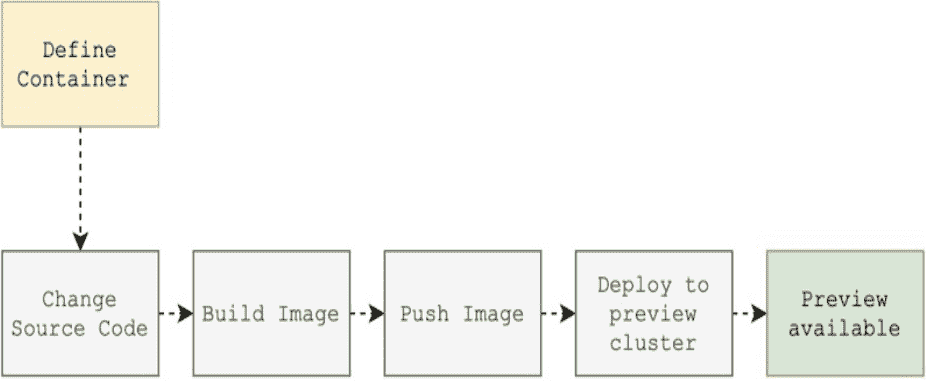

正如我们所见，一旦代码开发完成，就需要按照预定义步骤构建镜像并将其推送到容器镜像仓库。接下来，应用需要部署到目标集群。这意味着开发者每次提交变更，都会触发相同的工作流。想象一下，一整天都在运行多条命令，只是为了预览你的应用！这正成为开发者的噩梦。

在本节中，我们将了解一些工具，这些工具既允许我们在本地部署 Anthos 应用而无需运行中的 Anthos 集群，又能够自动化我们所确定的整个流程。

让我们从基于 Minikube 设置本地执行环境开始。接下来，我们将了解如何自动化代码变更后预览应用所需的重复且繁重的任务。最后，我们将讨论如何使用集成开发环境（IDE）来提供完整的 Anthos 应用开发体验（DX）。

## 14.2.1 设置本地预览 Minikube 集群

Minikube[^5] 是一款流行的软件，允许你在笔记本电脑上本地运行 Kubernetes 应用。它支持 Windows、Linux 和 macOS。你可以将应用部署到本地，而不是部署到 Anthos 集群，甚至在将代码推送到 Git 仓库之前就能预览应用。这将节省你的时间并降低开发环境成本。尽管 Minikube 并非为承载生产工作负载而设计，但它支持 Kubernetes 所支持的大部分功能。

你可以像使用常规集群一样，通过 `kubectl` 命令行界面与之交互。

Minikube 可以在满足以下最低要求的任何笔记本电脑上运行：

- 2 个 CPU
- 2GB 可用内存
- 20GB 可用磁盘空间
- 互联网连接
- 像 Virtual Box 这样的虚拟化软件。

在图 14.3 中，我们看到了可用于与 Minikube 交互的工具。我们将在本章后续章节中介绍 Skaffold 和 Cloud Code。它为开发用 Anthos 集群提供了一个很好的替代方案。

# 图 14.3 Minikube 集成

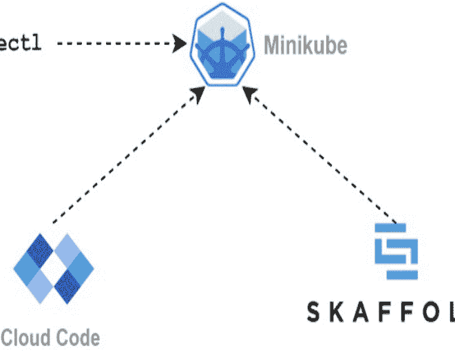

安装过程相当简单，但取决于你使用的操作系统。安装步骤可能会随新版本发布而变化，因此建议参考官方页面获取安装过程[^6]。来看看我们如何使用 Minikube 部署示例应用。

Minikube 成功安装后，你可以通过运行以下命令启动它：

```
minikube start
```

现在你可以创建一个简单的 hello-minikube 部署，并使用 NodePort 服务将其暴露。我们将使用一个已有的容器镜像：echoserver:1.4，但你也可以构建自己的镜像。

1. 通过运行以下命令创建部署：

```
kubectl create deployment hello-minikube --image=k8s.gcr.io/echoserver:1.4
```

2. 通过创建服务来暴露部署：

```
kubectl expose deployment hello-minikube --type=NodePort --port=8080
```

3. 检查服务是否存在：

```
kubectl get services hello-minikube
```

4. 你应该会看到以下提示：

```
NAME            TYPE       CLUSTER-IP       EXTERNAL-IP   PORT(S)
hello-minikube  NodePort   10.102.94.116    <none>        8080:31
```

5. 为服务配置到本地机器端口的端口转发：

```
kubectl port-forward service/hello-minikube 8080:8080
```

将出现以下提示，表明端口已转发：

```
Forwarding from 127.0.0.1:8080 -> 8080
Forwarding from [::1]:8080 -> 8080
```

6. 现在我们可以打开浏览器，看到服务正在 http://localhost:8080 地址上响应。

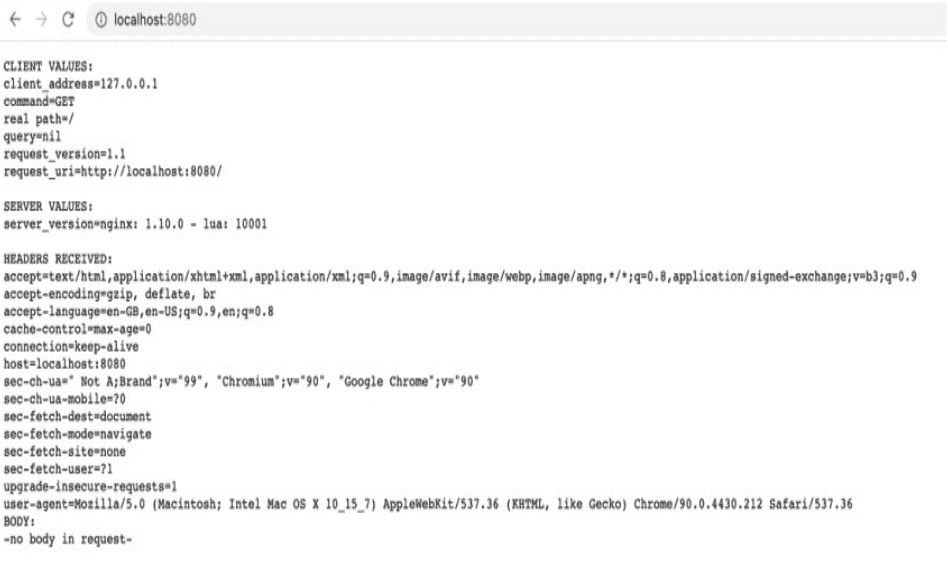

因此，我们已经看到了如何预览应用。你可能已经注意到，它仍然需要我们构建镜像，并在代码变更后使用 kubectl 更新应用预览。效率不高，理想情况下需要一种工具来自动化这些步骤。实现这一目标的常用工具是 Skaffold。

## 14.2.2 使用 Skaffold 进行持续开发

Skaffold[⁷] 是由 Google 赞助的开源项目。它最初是为了满足 Kubernetes 应用**持续开发**的需求而创建的。正如我们在上一节所了解的，开发者为了能够部署应用，必须编写必要的步骤来创建容器镜像、将创建的镜像推送到仓库，并最终将其部署到集群。

Skaffold 通过自动处理所有这些步骤来实现这一点。它持续监视源文件，并触发上述步骤，在本地 Minikube 或远程 Anthos 集群上创建 Kubernetes 应用的预览。当开发者通过按下 *Ctrl + C* 键停止 Skaffold 时，应用资源将自动清理。


在持续开发能力之上，Skaffold 提供了 CI/CD 管道的构建模块。它支持使用 kubectl、Helm[8] 和 Kustomize[9] 进行部署。让我们来看一下下方的图表，该图表可视化了使用 Skaffold 进行开发的流程。

**图 14.4 Skaffold 功能**

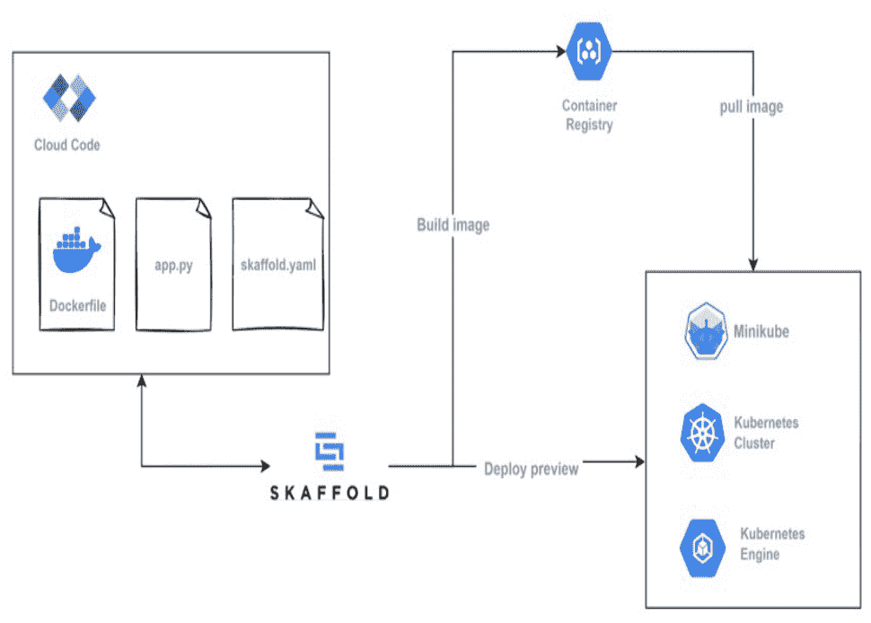

在图 14.4 中，你可以看到一个简单的管道可视化。Skaffold 会监视指定文件夹中的源文件更改。当检测到更改时，Skaffold 会自动构建镜像并将其推送到注册表。容器构建完成后，Skaffold 会将容器镜像部署到预定义的 Kubernetes 端点。在接下来的部分中，我们将解释 Skaffold 如何与 Cloud Code[10] 集成以获得更好的开发者体验（DX）。

## 使用 Skaffold

用户通过 `Command Line Interface`（CLI）与 Skaffold 交互。Skaffold 的完整指南可以在这里找到：[https://skaffold.dev/docs/references/cli/](https://skaffold.dev/docs/references/cli/)。为了快速了解如何使用 Skaffold，让我们来看一下基本步骤。我们将看到如何部署用 Go 编写的“Hello world”应用程序。

### 安装 Skaffold

安装 Skaffold 取决于底层操作系统。Skaffold 可以作为 gcloud 的组件安装。它也可以作为容器镜像 `gcr.io/k8s-skaffold/skaffold:latest` 提供，可直接在云原生 CI/CD 工具中使用。所有安装选项都在官方网站 [11] 中有说明。对于本地预览，你可以使用 Minikube，它允许你在笔记本电脑上部署应用程序。

### Skaffold 配置文件

Skaffold 使用单个配置 YAML 文件 `skaffold.yaml` 来定义 CD 管道中的步骤。它类似于 Kubernetes 资源清单。让我们来看一个非常基础的示例配置文件：

```yaml
apiVersion: skaffold/v2beta8
kind: Config
build:
  artifacts:
    - image: skaffold-example
deploy:
  kubectl:
    manifests:
      - k8s-*
```

在上述管道中定义了两个阶段：**build** 和 **deploy**。在构建阶段，Skaffold 会查找 Dockerfile 定义并使用它构建名为 `skaffold-example` 的容器镜像。在部署阶段，Skaffold 使用 kubectl 部署以“k8s-”前缀开头的所有 YAML 文件中定义的对象。

关于配置文件结构的非常全面的解释可以在 Skaffold 网站 [12] 上找到。

### 启动 Skaffold

你可以通过运行以下命令自动生成 `skaffold.yaml` 配置：

```bash
skaffold init
```

这将检测当前文件夹中的源文件并创建一个包含构建和部署部分的非常简单的配置文件。让我们创建三个文件：

- `Dockerfile` - 容器镜像定义
- `main.go` - 简单的“Hello world”Go 应用程序
- `k8s-pod.yaml` - Kubernetes Pod 定义

https://skaffold.dev/docs/references/yaml/

**Dockerfile 内容：**

```dockerfile
FROM golang:1.12.9-alpine3.10 as builder
COPY main.go .
ARG SKAFFOLD_GO_GCFLAGS
RUN go build -x -gcflags="${SKAFFOLD_GO_GCFLAGS}" -o /app main.go
FROM alpine:3.10
ENV GOTRACEBACK=single
CMD ["./app"]
COPY --from=builder /app .
```

**`main.go` 内容：**

```go
package main
import (
    "fmt"
    "time"
)

func main() {
    for {
        fmt.Println("Hello world!")
        time.Sleep(time.Second * 1)
    }
}
```

**`k8s-pod.yaml` 内容：**

```yaml
apiVersion: v1
kind: Pod
metadata:
    name: getting-started
spec:
    containers:
    - name: getting-started
      image: skaffold-example
```

这将生成一个我们在上一节中已经看到的 `skaffold.yaml` 文件，其中包含两个阶段：

```yaml
apiVersion: skaffold/v2beta3
kind: Config
metadata:
    name: getting-started
build:
    artifacts:
    - image: skaffold-example
deploy:
    kubectl:
        manifests:
        - k8s-pod.yaml
```

你可以从这里开始，根据需要使用 Skaffold 文档扩展该文件。

### 使用 Skaffold 开发

现在我们文件夹中已经有四个文件，包括 Skaffold 配置文件。现在我们可以开始持续开发，Skaffold 将监视源文件夹中的更改并执行 `skaffold.yaml` 文件中定义的所有步骤。

要开始开发，运行命令：

```bash
skaffold dev
```

Skaffold 会自动将已部署容器的日志尾部输出到控制台。

现在，如果你将源文件 `main.go` 中的打印内容从“hello world”改为“hello from Skaffold”，Skaffold 将自动检测更改，重建镜像，将其推送到注册表并部署。由于日志会尾部输出到控制台，你应该会看到消息“hello from Skaffold”。

### 使用 Skaffold 单次运行

虽然 `skaffold dev` 会持续监视源文件，你也可以通过运行 `skaffold run` 命令执行一次工作流。这在你只想运行一次执行而不希望每次代码修改时都触发流程时很有用。

### 支持的功能

到目前为止，我们应该对如何使用 Skaffold 开始开发有了基本了解，让我们来看一下其他有用的功能。

### 管道阶段

到目前为止，我们只查看了 Skaffold 的基本功能，然而该工具还有更多能力可以应对高级管道阶段。例如，开发人员可能不希望在每次代码更改后都重建镜像。在这种情况下，Skaffold 可以将文件，例如 `main.go` 源文件，同步到容器中。要实现这一点，你需要使用文件同步功能。下面可以找到当前所有可用阶段的列表：

**图 14.5 Skaffold 工作流**

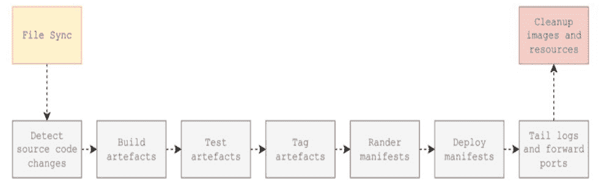

虽然图 14.5 显示了工作流中的所有步骤，但下面的列表显示了可用于执行这些步骤的所有 Skaffold 管道阶段：

- **Init** 生成基本的 Skaffold 配置
- **Build** 使用选择的构建器构建镜像
- **Test** 使用 structure-tests[13] 测试镜像
- **Tag** 基于不同策略标记镜像
- **Deploy** 使用 kubectl、kustomize 或 helm 部署应用程序
- **File Sync** 将更改的文件直接同步到正在运行的容器
- **Log Tailing** 从容器尾部输出日志
- **Port Forwarding** 将服务端口转发到 localhost
- **Cleanup** 清理清单和镜像

正如我们所见，我们有一个完整的管道，可以让我们部署和预览 Anthos 应用程序。

### 支持的环境

Skaffold 支持本地和远程 Kubernetes 集群。你可以使用本地开发集群如 Minikube，或部署在远程位置的 Anthos/Kubernetes 集群。

要连接到远程 Kubernetes 集群，你需要在 `kubeconfig` 文件中设置上下文，就像连接到任何 Kubernetes 集群一样。默认上下文可以通过运行命令 `skaffold dev --kube-context <myrepo>` 或通过更新 `skaffold.yaml` 文件中的 `deploy.kubeContext` 属性来覆盖，例如：

```yaml
deploy:
  kubeContext: minikube
```

### 支持的构建工具

如果你需要使用其他工具构建容器镜像，`skaffold.yaml` 配置文件中的 `build` 部分可以为自定义构建器配置。要使用自定义构建器，在 `build` 部分定义使用该构建器的适当选项。有关自定义构建器的详细信息请参阅 [https://skaffold.dev/docs/pipeline-stages/builders/](https://skaffold.dev/docs/pipeline-stages/builders/)

目前支持以下工具：

- Docker
- Jib[^14]
- Bazel[^15]
- Buildpacks[^16]

你也可以使用符合 Skaffold 定义标准的自定义脚本。

### 在 CI/CD 管道中使用 Skaffold

Skaffold 可以用作 CI/CD 管道中的工具。已经存在一个社区维护的构建器 [^17]，可以直接与 Cloud Build 一起使用，Cloud Build 是原生的 Google CI 工具（我们将在下一节详细了解它）。在 CI/CD 工作流中，最有用的 Skaffold 命令包括：

- `skaffold build` - 构建并标记你的镜像
- `skaffold deploy` - 部署给定的镜像
- `skaffold delete` - 清理已部署的制品
- `skaffold render` - 构建并标记镜像，并输出模板化的 Kubernetes 清单

### Skaffold 总结

在本节中，我们学习了如何安装 Skaffold 并在持续开发工作流中使用它。有关使用 Skaffold 进行开发工作流的更多信息，请遵循 Skaffold 快速入门指南[^18]。

## 14.2.3 Cloud Code：使用本地 IDE 开发

到目前为止，我们已经学习了如何预览 Anthos 应用程序，但


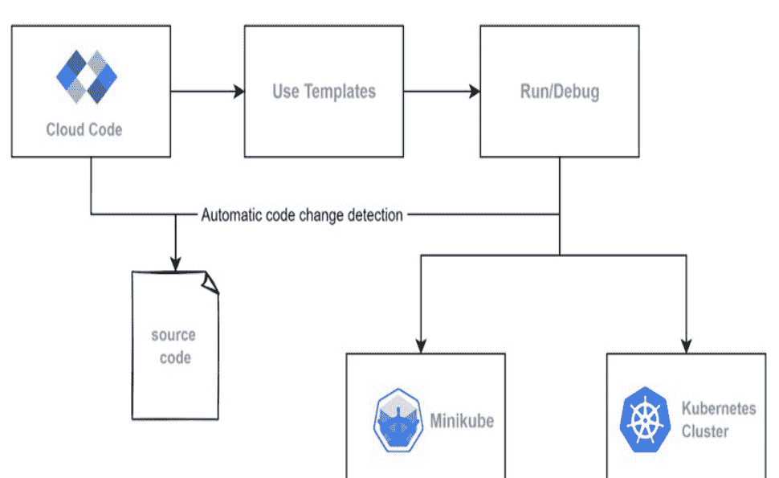

在 Cloud Run 应用的情况下，如图所示... Cloud Code 通过基于 Minikube 设置模拟器来帮助我们。它在本地运行，使开发人员能够运行和测试 Cloud Run 应用。也可以部署到 GCP 管理的服务，如 Cloud Run 或 Anthos 的 Cloud Run。

Figure 14.7 Running and debugging Cloud Run application with Cloud Code

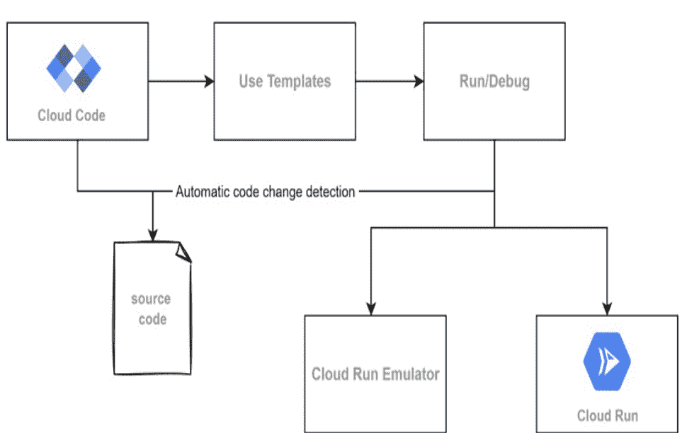

对于这两种选项，您都可以通过在代码中创建断点来调试在本地和远程端点上运行的代码。

在下一节中，您将开始使用 Cloud Code 处理我们的“Hello World” Anthos 应用。

## Start developing with Cloud Code

您可以通过使用 Kubernetes 和 Knative（Cloud Run）应用的预构建模板来启动应用的开发。这包括各种语言的简单单服务应用和多服务应用。

让我们看看如何开始使用 Cloud Code 进行开发。这次我们将使用 VSCode 来处理一个示例 Python “Hello world” 应用。

- 1. 首先从 VSCode Marketplace 安装 Cloud Code
- 2. 打开 VSCode

3. 在主窗口底部的蓝色条上查找并单击 </>Cloud Code 链接

Figure 14.8. VSCode Starting new application

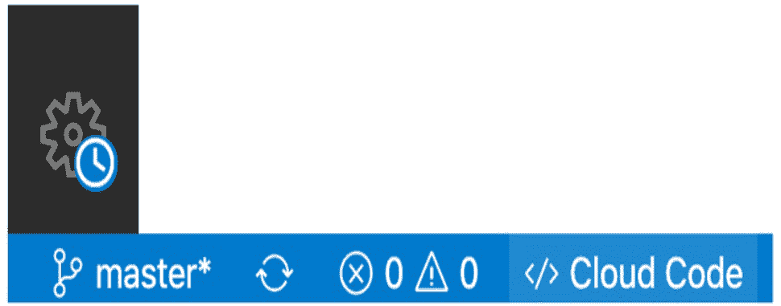

4. 屏幕顶部会出现一个下拉列表。我们将选择创建 New Application 的选项

注意：这是执行其他操作（如）的起点：

- 在 Kubernetes 上运行应用
- 在 Kubernetes 上调试应用
- 在 Cloud Run Emulator 上运行应用
- 在 Cloud Run 模拟器上调试应用
- 将应用部署到 Cloud Run

Figure 14.9 Cloud Code New Application

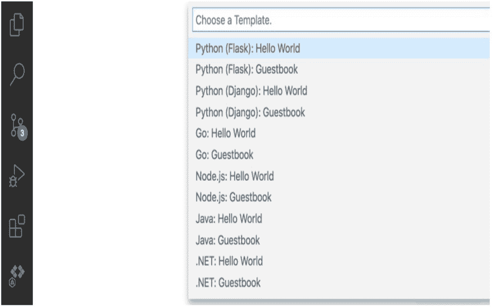

7. 我们等待几秒钟，Cloud Code 会拉取模板，其中包含所有文件，包括 vscode 配置文件、Kubernetes 清单、源代码和 Skaffold 配置文件。

**Figure 14.12 Cloud Code skaffold.yaml**

```
apiVersion: skaffold/v2beta4
kind: Config
build:
  tagPolicy:
    sha256: {}
# defines where to find the code at build time and where to push the artifacts:
- context: src
  image: python-hello-world
# defines the Kubernetes manifests to deploy on each run
deploy:
  kubectl:
    manifests:
    - kubernetes-manifests/**
# use the cloudbuild profile to build images using Google Cloud Build
profiles:
- name: cloudbuild
  build:
    googleCloudBuild: {}
```

8. 由于我们已准备好所有文件，我们可以通过再次单击 </>Cloud Code 链接并从下拉菜单中选择 Run on Kubernetes 来运行应用。

## Figure 14.13 Cloud Code run Kubernetes

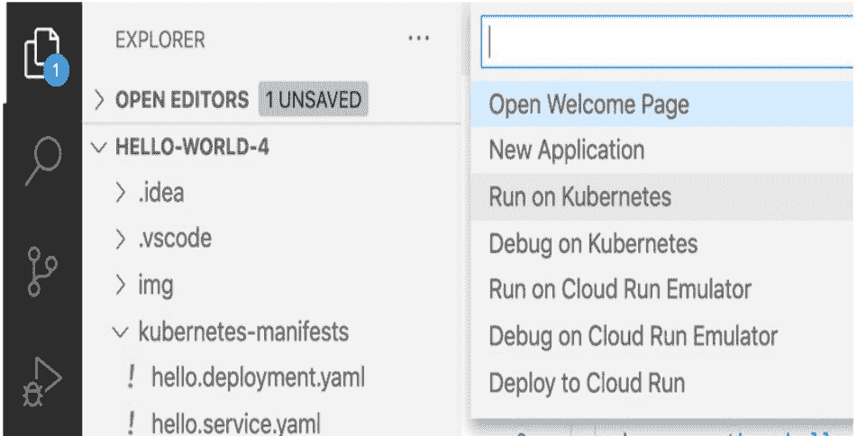

9. Cloud Code 会询问您是否要使用默认上下文。在我们的例子中，我们指向 minikube。用 Yes 确认或选择不同的上下文以部署到不同的集群。

Figure 14.14 Cloud Code setting context to minikube

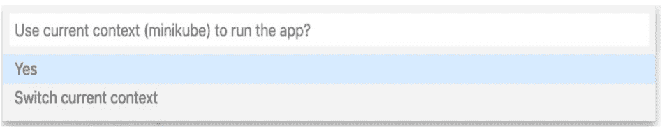

10. 在控制台中，您应该会看到以下输出，其中包含访问应用的 URL。

Figure 14.15 Cloud Code console output

```
PROBLEMS OUTPUT TERMINAL ... + Run on Kubernetes
Running "Run on Kubernetes" configuration (.vscode/launch.json) in Run mode

To view more detailed logs, go to Output channel : "Run on Kubernetes - Detailed"

Update initiated due to file change
Deploy started
Deploy complete

Status check started
Resource pod/python-hello-world-57dd476bf7-x44b9 status updated to In Progress
Resource pod/python-hello-world-57dd476bf7-x44b9 status completed successfully
Resource deployment/python-hello-world status updated to In Progress
Resource deployment/python-hello-world status completed successfully
Status check succeeded

**************URLS**************

Forwarded URL from service python-hello-world-external: http://localhost:4503

Update successful
*******************************
Watching for changes...
To disable watch mode, set watch to false in your launch configuration '/Users/Konrad/hello-world-5/.vscode/launch.json'
```

11. 如果您访问该 URL，您将看到应用正在运行：

Figure 14.16 Cloud Code application output

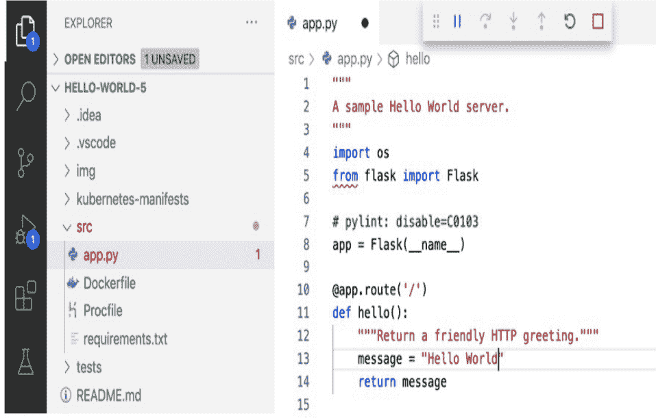

13. 将其更改为“Hello Anthos”并保存文件。

Figure 14.18 Cloud Code: change message to Hello Anthos

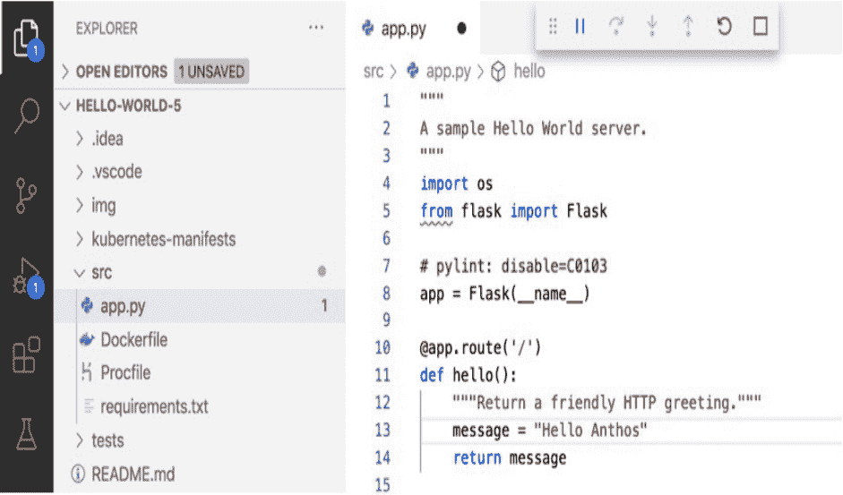

14. 您会注意到 Cloud Code 已检测到更改并将应用部署到 Minikube。

**Figure 14.19 Cloud Code: code change detection**

```
********************************
Watching for changes...
To disable watch mode, set watch to false in your launch configuration '/Users/Konrad/hello-world-5/.vscode/launch.json'
Update initiated due to file change
Deploy started
Deploy complete
```

15. 现在当我们访问应用时，我们会看到新的消息。

**Figure 14.20 Cloud Code: application output**

## Summary of Cloud Code

Cloud Code 是一个不仅能无缝集成 GCP，还能使 Anthos 应用的开发、容器化和预览变得非常容易的工具。它将前面讨论的 Skaffold 功能捆绑到您的 IDE 中，以实现自动化的持续开发工作流。

预览 Kubernetes 应用需要执行多个步骤；例如，每次对代码进行更改时，都需要构建容器镜像并将其部署到预览环境。

使用 Cloud Code，您可以专注于源代码，让 Cloud Code 集成处理所有这些步骤。在本节中，我们使用了现有的模板来向您展示设置的外观。您可以从这里开始，并开始开发您的 Anthos 应用，Cloud Code 将确保为您更新预览。

## 14.2.4 Anthos Sandbox: Development with Cloud Native IDE

Anthos Sandbox 是面向开发人员的免费工具，让您感受到在 Anthos 上开发的实际体验。它允许执行上一节中描述的相同任务，但使用 Google Cloud Shell 而不是本地。它由以下组件构建：

- **Cloud Shell** - 具有预装最佳 Google Cloud Platform 工具的计算环境。
- **Cloud Code** - 我们已经看过的 IDE 插件
- **Minikube** - 我们已经讨论过的单节点 Kubernetes 集群
- **Cloud Build Local Builder** - 在 Cloud Shell 中本地运行持续集成

您无需进行任何前期配置即可使用它。只需从链接访问即可：https://anthos-sandbox.dev，您就可以开始开发您的第一个 Anthos 应用。最重要的是，它对拥有 Google 账户的任何人都免费提供。借助 Anthos Sandbox，您可以执行以下日常开发任务：

- 在模拟的 Anthos 集群或 Cloud Run 模拟器上本地运行应用
- 使用 Cloud Build 在本地进行测试
- 在开发过程中使用自动实时更新迭代您的应用
- 使用 Buildpacks 创建您的镜像

如果您刚刚开始开发 Anthos 应用，它确实可以让您快速启动开发之旅，因为它附带可直接从界面访问的教程。

## Starting with Anthos Sandbox

让我们快速了解一下该工具：

- 1. 通过在浏览器中打开我们提到的链接来访问该工具。您将被告知 Anthos Sandbox 将被克隆。

## Figure 14.22 Anthos Sandbox: welcome screen

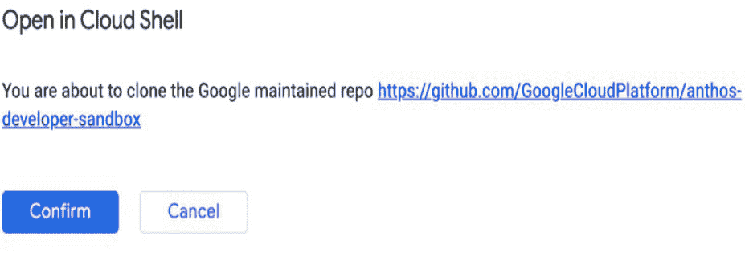

- 2. 单击 **Confirm** 按钮并等待环境设置完成。您可以看到所有组件正在为您配置。

## Figure 14.23 Anthos Sandbox: preparation of the environment


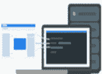

## 开发云原生应用

Cloud Shell 将 Cloud Code 的所有优势带到您的浏览器中。您可以在浏览器中创建 Kubernetes 和 Cloud Run 应用，进行开发、调试和部署，并监控和管理您的云资源。

## 配置您的 Cloud Shell 机器

连接到您的 Cloud Shell 实例

连接到您的 Cloud Shell 编辑器

3. 完成后，您应该会看到 IDE 已加载，工作区已准备好并包含克隆的仓库。在右侧窗格中，您可以看到教程。

图 14.24 Anthos Sandbox：主屏幕

应用代码。

## 14.3.1 Cloud Source Repositories

Cloud Source Repositories[^21] 是托管在 Google Cloud 上的功能完备的私有 Git 仓库。该服务帮助开发者在 Google Cloud Platform 上私有托管、跟踪和管理大型代码库的变更。它旨在轻松与 GCP 服务集成，例如 Anthos、GKE、Cloud Run、AppEngine 和 Cloud Functions。您可以配置无限数量的仓库，还可以镜像 Bitbucket 和 GitHub 仓库。Cloud Source Repositories 中的变更会受到监控，并可触发事件通知发送到 Cloud Pub/Sub 或 Cloud Function。Cloud Source Repositories 的差异化特性之一是，您可以使用正则表达式在仓库中搜索[^22]短语。Cloud Source Repository 的审计日志可在 Cloud Operations 中获取，因此您始终可以知道谁在何时访问了您的仓库。

**图 14.25 Cloud Source Repositories 集成**

要创建代码仓库，请运行以下命令：

```
```bash
gcloud init
```
```

这将初始化您的 gcloud 命令行工具。

```
```bash
gcloud source repos create [REPO_NAME]
```
```

这将创建一个名为 REPO_NAME 的仓库。

现在仓库已准备好使用，您需要选择以下三种身份验证方法之一：

- SSH
- Cloud SDK
- 手动生成的凭据

请参阅以下链接查看如何操作的分步指南：
[https://cloud.google.com/source-repositories/docs/authentication](https://cloud.google.com/source-repositories/docs/authentication)

仓库设置完成并且您成功通过身份验证后，您可以使用 Git 命令（如 `git clone`、`git pull` 和 `git push`）与之交互。

## 14.3.2 Artifact Registry

Artifact Registry 是 Google Container Registry 服务的下一代产品。除了能够存储容器镜像之外，Artifact Registry 还可以存储其他包，例如 Maven[23]、npm[24] 和 Python[25]，并且很快将推出更多功能。这些服务与 Google Cloud Platform 生态系统完全集成。这意味着您可以使用 IAM 策略控制对工件的访问，访问 Cloud Source Repositories，使用 Cloud Build 触发自动构建，并部署到 Google Kubernetes Engine、App Engine 和 Cloud Functions。

您可以在离工作负载最近的区域创建 Artifact Repositories，以便利用高速 Google 网络拉取工件。从安全角度来看，可以扫描您的容器以查找漏洞，并使用 Binary Authorization 来批准可以推送到生产环境的镜像。

您可以使用原生工具与 Artifact Repositories 交互，因此很容易将其集成到 CI/CD 管道中。

## 将 Artifact Registry 与 Docker 结合使用

让我们看看如何与 Artifact Registry 交互来存储容器镜像。

- 1. 首先，运行以下命令创建一个 Artifact 仓库：
- 2. 您可以运行以下命令列出您的仓库：
- 3. 在推送镜像之前，您应运行以下命令向仓库进行身份验证：
- 4. 现在，出于演示目的，我们将直接从 Docker Hub 拉取官方 alpine 镜像，而不是构建新镜像：
- 5. 我们将通过运行以下命令为镜像打上仓库名称标签：
- 6. 最后，我们可以通过运行以下命令将镜像推送到 Artifact Registry：

```
gcloud artifacts repositories create quickstart-docker-repo --rep --location=us-central1 [--description="Docker repository"]
```

```
gcloud artifacts repositories list
```

```
gcloud auth configure-docker us-central1-docker.pkg.dev
```

```
docker pull alpine
```

```
docker tag alpine us-central1-docker.pkg.dev/PROJECT/quickstart-d
```

```
docker push us-central1-docker.pkg.dev/PROJECT/quickstart-docker-
```

现在您就可以从镜像仓库中拉取容器镜像了。

## Artifact Registry 总结

在撰写本书时，Artifact Registry 已正式发布（Generally Available），但某些功能可能仍处于预览阶段。作为 Container Registry 的继任者，它最终将成为 GCP 中唯一可用的容器镜像仓库。这意味着您所有的新项目都应该已经开始使用 Artifact Registry。关于现有项目如何迁移到 Artifact Registry 的分步教程可以在这里找到：

[https://cloud.google.com/artifact-registry/docs/transition/transition-from-gcr](https://cloud.google.com/artifact-registry/docs/transition/transition-from-gcr)

## 14.3.3 Cloud Build

我们已经了解了如何对 Anthos 应用代码进行版本控制以及如何构建容器镜像。现在让我们看看如何创建持续集成管道。

Cloud Build 是 GCP 原生的 CI/CD 平台，是 Gitlab CI/CD、Jenkins 或 CircleCI 等工具的替代方案。它允许您在所有 Google 计算服务（包括 Anthos GKE 和 Cloud Run for Anthos）上部署、测试和构建应用。Cloud Build 管道的步骤以容器形式运行：


通过直接访问仓库、镜像仓库和工作负载来缩短部署时间。您还可以将 Cloud Build 与 **Spinnaker**[26] 等工具结合使用，以执行包含各种部署场景的更复杂管道。

Cloud Build 管道可以通过手动触发，也可以通过代码仓库的拉取请求触发。

既然我们已经了解了 Cloud Build 的基本工作原理，接下来让我们看看 Cloud Builders。

## Cloud Builders

正如我们已经了解的，Cloud Build 会运行 `cloudbuild.yaml` 文件中定义的一系列步骤。这些步骤在容器内执行。这些容器使用每个步骤的 name 属性中定义的容器镜像进行部署。这些容器镜像被称为 Cloud Builders。它们是经过特殊打包的镜像，可使用一组用户定义的属性来运行特定工具（如 docker、git 或 kubectl 等）。有三种类型的构建器。

- Google 支持的构建器
- 社区支持的构建器
- 自定义开发的构建器

让我们逐一了解每种类型：

## Google 支持的构建器

您可以在 Github 上找到 Google 支持的构建器完整列表：[https://github.com/GoogleCloudPlatform/cloud-builders](https://github.com/GoogleCloudPlatform/cloud-builders)。所有镜像都可以在容器镜像仓库中获取，路径为：gcr.io/cloud-builders/<builder name>。在 Anthos 环境下，一些最重要的构建器包括：

- docker
- git
- gcloud
- gke-deploy
- kubectl

## 社区支持的构建器

如果没有符合您需求的官方构建器，您可以使用社区构建器。有一些构建器可配合 *Helm*、*Packer*、*Skaffold*、*Terraform*、*Vault* 等工具使用。完整的社区 Cloud 构建器列表可以在这里找到：
https://github.com/GoogleCloudPlatform/cloud-builders-community

## 自定义开发的构建器

您可以创建自己的自定义构建器，用于您的构建中。自定义构建器是一个容器镜像，Cloud Build 会拉取该镜像并与您的源代码一起运行。您的自定义构建器可以执行容器内的任何脚本或二进制文件，因此它可以做容器能做的任何事情。有关创建自定义构建器的说明，请参阅：
https://cloud.google.com/cloud-build/docs/create-custom-build-steps

## 构建容器镜像

您可以使用配置文件或仅使用 Dockerfile 通过 Cloud Build 构建容器。让我们看看每种选项：

## 使用配置文件构建容器镜像

构建容器的第一种方法要求您提供 `cloudbuild.yaml` 配置文件作为输入：

图 14.27 使用 Cloud Build 配置文件构建容器镜像


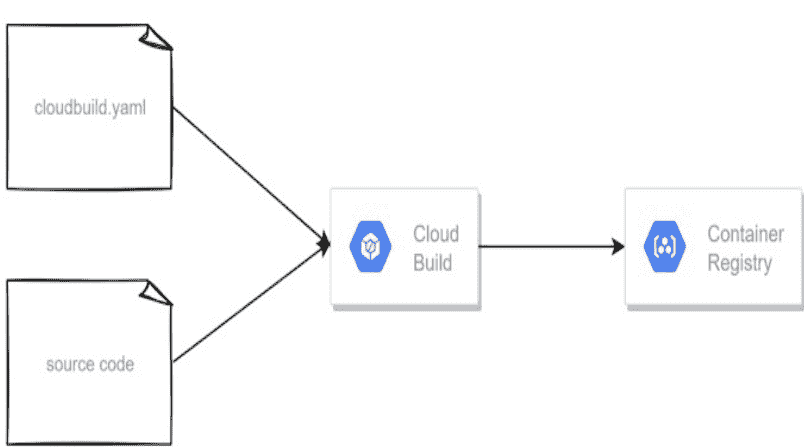

要通过配置文件构建镜像，你需要在 `cloudbuild.yaml` 文件中使用 Docker Cloud Builder 指定构建步骤：

```
steps:
- name: 'gcr.io/cloud-builders/docker'
  args: [ 'build', '-t', 'us-central1-docker.pkg.dev/$PROJECT_ID/${_REPOSITORY}/${_IMAGE}', '.' ]
images:
- 'us-central1-docker.pkg.dev/$PROJECT_ID/${_REPOSITORY}/${_IMAGE}'
```

接下来，运行以下命令来提交构建：

```
gcloud builds submit --config [CONFIG_FILE_PATH] [SOURCE_DIRECTORY]
```

这会构建镜像并将其存储到配置文件指定的 Google Artifact Registry 中。如果不指定 [CONFIG_FILE_PATH] 和 [SOURCE_DIRECTORY] 参数，将使用当前目录。

## 使用 Dockerfile 构建容器镜像

你可以不使用配置文件来创建容器镜像，因为你的 Dockerfile 包含了使用 Cloud Build 构建 Docker 镜像所需的全部信息。

图 14.28 从 Dockerfile 构建镜像

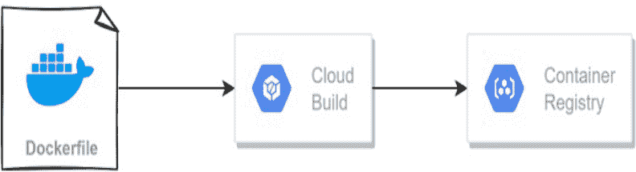

要使用 Dockerfile 运行构建请求，请从包含应用代码、Dockerfile 和其他任何资源的目录中运行以下命令：

```
gcloud builds submit --tag us-central1-docker.pkg.dev/$PROJECT_ID/${_REPOSITORY}/${_IMAGE}
```

这会构建镜像并将其存储在 Google Artifact Registry 中。

至此，我们已经了解了如何存储 Anthos 应用代码、构建并托管容器镜像。现在，让我们看看如何自动触发构建。

## Cloud Build 通知

有多种方式可以从 Cloud Build 获取通知。你可以收到构建状态任何变化的通知，包括构建的开始、转换和完成。

Cloud Build 与 Pub/Sub 集成良好，并向 cloud-builds Pub/Sub 主题发布消息。支持推送和拉取两种订阅模式。消息进入 Pub/Sub 队列后，你就有无数种选择可以将通知发送到下一步。

除了 Pub/Sub，你还可以通过以下通知渠道之一从 Cloud Build 获取通知。

- Slack - 向 Slack 频道发布通知
- SMTP - 通过 SMTP 协议发送电子邮件通知
- HTTP - 以 JSON 格式向 HTTP 端点发送通知

所有三种类型的通知都使用以 Cloud Run 服务运行的容器。有关如何创建此类通知的示例，请参见此处：
[https://cloud.google.com/cloud-build/docs/configuring-notifications/configure-smtp](https://cloud.google.com/cloud-build/docs/configuring-notifications/configure-smtp)

## 部署到 Anthos Google Kubernetes Engine

可以使用 `kubectl` 或 `gke-deploy` 构建器部署到 Google Kubernetes Engine。请注意，`gke-deploy`[^27] 本质上是 kubectl 的包装器，融入了 Google 部署 Kubernetes 资源的最佳实践。例如，它会向部署的 Kubernetes 资源添加标签 `app.kubernetes.io/name`。

下面你可以看到使用 gke-deploy 构建器部署到 GKE 集群的示例：

```
steps:
...
# deploy container image to GKE
- name: "gcr.io/cloud-builders/gke-deploy"
  args:
  - run
  - --filename=[kubernetes-config-file]
  - --location=[location]
  - --cluster=[cluster]
```

未来，我们还可以期待其他 Cloud Builder（如 Anthos CLI）的出现，它们将使体验更加统一。

## 部署到 Cloud Run 和 Anthos 的 Cloud Run

Cloud Build 允许你构建 Cloud Run 容器镜像，然后将其部署到 Cloud Run 或 Anthos 的 Cloud Run。在这两种情况下，你都需要先使用标准 Docker 构建器构建并推送镜像：

```
steps:
# Build the container image
- name: 'gcr.io/cloud-builders/docker'
  args: ['build', '-t', 'us-central1-docker.pkg.dev/$PROJECT_ID/${_REPOSITORY}/${_IMAGE}', '.']
# Push the container image to a registry
- name: 'gcr.io/cloud-builders/docker'
  args: ['push', 'us-central1-docker.pkg.dev/$PROJECT_ID/${_REPOSITORY}/${_IMAGE}']
```

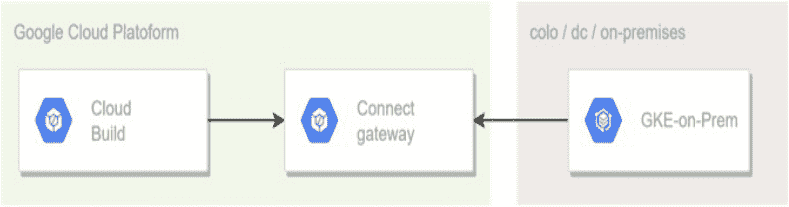

要配置 Connect Gateway 并连接你的 Anthos 集群，请按照 Google 文档中描述的步骤操作：
https://cloud.google.com/anthos/multicluster-management/gateway/setup

配置好 Connect Gateway 并注册 Anthos 集群后，运行以下命令检查它们在 Hub 中是否可见：

```
gcloud container hub memberships list
```

在这种情况下，我们看到注册了两个集群。一个是 VMware 上的 GKE，另一个是 GCP GKE 集群。

| NAME | EXTERNAL_ID |
| --- | --- |
| my-vmware-cluster | 0192893d-ee0d-11e9-9c03-42010a8001c1 |
| my-gke-cluster | f0e2ea35-ee0c-11e9-be79-42010a8400c2 |

让我们定义以下步骤来部署 myapp.yaml 清单中定义的应用。

```
steps:
- name: 'gcr.io/cloud-builders/gcloud'
  entrypoint: /bin/sh
  id: Deploy to Anthos cluster on VMware
  args:
  - '-c'
  - |
    set -x && \
    export KUBECONFIG="$(pwd)/gateway-kubeconfig" && \
    gcloud beta container hub memberships get-credentials my-vmware-cluster
    kubectl --kubeconfig gateway-kubeconfig apply -f myapp.yaml
```

正如我们在这个案例中看到的，这里使用的是网关 kubeconfig，而不是集群 kubeconfig 本身。请求将发送到网关，然后网关将其转发到 my-vmware-cluster。这意味着，在 GCP 之外部署你的 Anthos 集群不需要 Cloud VPN 或 Interconnect 等混合连接。

## 触发 Cloud Build

在上一节中，我们学习了如何将应用部署到任何 Anthos 集群。现在，让我们看看如何通过使用 gcloud 命令（我们在上一节中已经看过）或自动触发器来触发 Cloud Build 流水线。使用 Cloud Build，你可以使用三种类型的代码仓库。它们分别是：

- Cloud Source Repositories
- GitHub
- Bitbucket

要创建触发器，你既可以使用 Google Cloud Console，也可以使用命令行。首先将代码仓库添加到 Cloud Build：

```
gcloud beta builds triggers create cloud-source-repositories \
    --repo=[REPO_NAME] \
    --branch-pattern=".*" \
    --build-config=[BUILD_CONFIG_FILE]
```

然后添加触发器：

```
gcloud beta builds triggers create github \
    --repo-name=[REPO_NAME] \
    --repo-owner=[REPO_OWNER] \
    --branch-pattern=".*" \
    --build-config=[BUILD_CONFIG_FILE]
```

使用 --branch-pattern，你可以指定哪个分支将触发构建。在这种情况下，它将是所有分支。

如果你想了解如何从其他代码仓库创建触发器，请查阅文档：[https://cloud.google.com/cloud-build/docs/automating-builds/create-manage-triggers](https://cloud.google.com/cloud-build/docs/automating-builds/create-manage-triggers)

## Cloud Build 总结

Cloud Build 虽然使用起来非常简单，但实际上可以为交付你的 Anthos 应用提供端到端的 CI/CD 体验。

如果你想获得更多关于端到端流水线的实践经验，我们鼓励你按照自己的节奏学习教程：

[https://github.com/GoogleCloudPlatform/gke-gitops-tutorial-cloudbuild](https://github.com/GoogleCloudPlatform/gke-gitops-tutorial-cloudbuild)。在本教程中，你将开发一个支持以下功能的流水线：

- 测试已提交的代码
- 构建容器镜像
- 推送镜像到仓库
- 更新 K8s 清单并将其推送到环境仓库
- 检测分支上的更改
- 将清单应用到 Anthos GKE 集群
- 使用已应用的 K8s 清单更新生产分支

图 14.30 基于 Cloud Build 的 CI/CD 流水线中的步骤

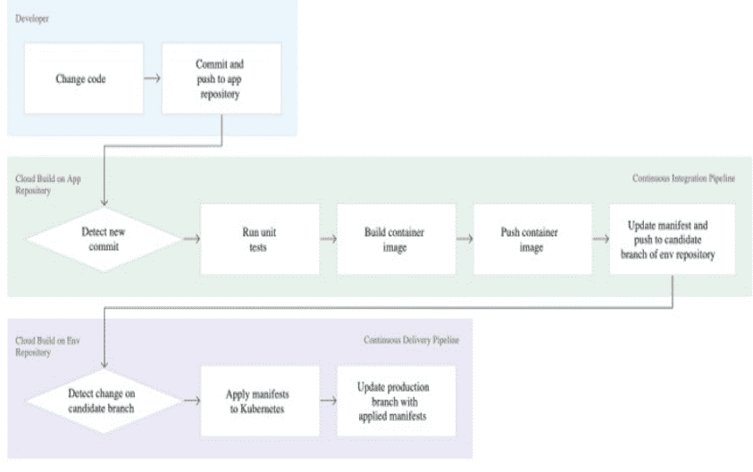

这将让你很好地了解如何使用 Cloud Build 执行高级任务。请注意，你可以使用 GitHub、GitLab 或 Bitbucket 等第三方工具实现相同的结果，但 Cloud Build 是 GCP 的原生工具，可以与 Anthos 很好地集成。

## 14.3.4 使用 Kustomize 生成特定于环境的配置。

在现实场景中，你会将应用部署到多个环境。在 CI/CD 流水线中，你需要有一个工具，能够在不更改实际代码库的情况下，为每个环境调整应用的配置。

Kustomize 是一个独立工具，通过使用 kustomization.yaml 文件来自定义 Kubernetes 资源。好消息是，从 Kubernetes 1.14 版本开始，Kustomize 已合并到 kubectl 工具中。

图 14.31 自定义 Kubernetes 清单

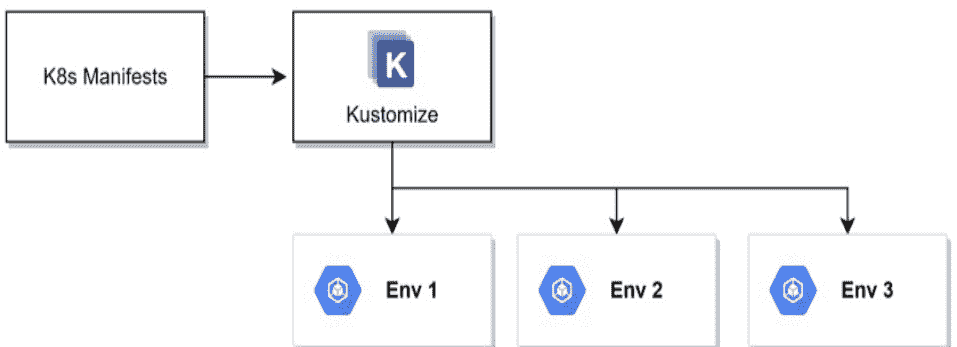

如上图所示，基本清单会被修补并应用到每个环境。

在下面的示例中，我们看到一个文件夹中包含 3 个文件。它们是：

- deployment.yaml 中 Deployment 的定义


- Kustomize 文件 `kustomization.yaml` 和
- 定义应更改 Deployment 中哪些属性的补丁文件 `patch.yaml`。

**图 14.32** 使用 Kustomize 修补部署镜像

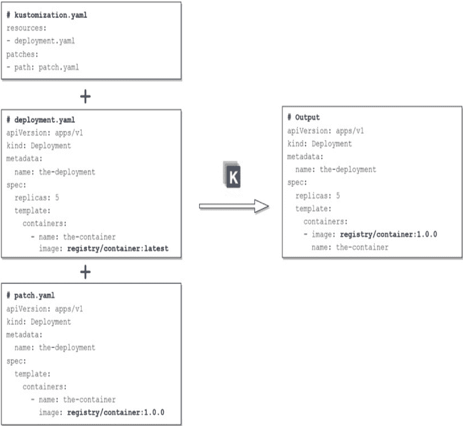

要执行自定义，我们应运行以下命令：

```bash
kubectl apply -k <kustomization_directory>
```

结果是，我们得到一个输出，其中 `spec.template.containers.image` 属性已更新。

## Kustomize 功能列表

Kustomize 提供了自定义 Kubernetes 部署所需的所有功能。这些包括：

- 生成资源（ConfigMaps 和 Secrets）
- 设置横切字段
- 组合和自定义资源

**图 14.33** Kustomize 功能

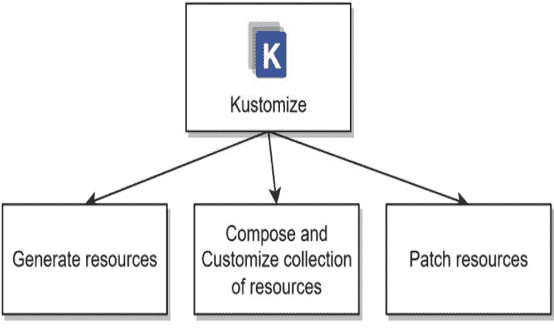

让我们详细查看一下它们：

### Composing

你可以使用 `resources` 属性来定义想要自定义的资源定义。

如果文件中不包含其他自定义功能，资源将被简单地组合成一个定义。下面示例中我们组合了 `deployment.yaml` 和 `service.yaml` 定义。

```yaml
# kustomization.yaml
resources:
- deployment.yaml
- service.yaml
```

要运行自定义，请执行以下命令。

```bash
kubectl kustomize ./
```

### Customizing

自定义允许你使用特定值修补资源。这使用两种方法：

- `patchesStrategicMerge` [28]
- `patchesJson6902` [29]

例如，你可以通过创建以下文件来修补 `deployment.yaml` 文件中定义的 `my-deployment` Deployment 的副本数。

```yaml
# increase_replicas.yaml

apiVersion: apps/v1
kind: Deployment
metadata:
  name: my-deployment
spec:
  replicas: 3
```

```yaml
# kustomization.yaml

resources:
- deployment.yaml
patchesStrategicMerge:
- increase_replicas.yaml
```

然后运行

```bash
kubectl kustomize ./
```

除了此自定义功能之外，你还可以通过定义 `image` 属性来更改 Deployment 中的容器镜像。

### Setting cross-cutting fields

使用 **Setting cross-cutting fields**，你可以为 Kubernetes 资源设置以下属性：

- `namespace`
- `namePrefix`
- `nameSuffix`
- `commonLabels`
- `commonAnnotation`

在下面的示例中，我们将 `deployment.yaml` 定义的命名空间设置为 `my-namespace`。注意：你可以使用 `resources` 属性来定义要受影响的资源。

```yaml
# kustomization.yaml
apiVersion: kustomize.config.k8s.io/v1beta1
kind: Kustomization
namespace: my-namespace
resources:
- deployment.yaml
```

### Generating Resources

使用 Kustomize 你可以生成 ConfigMaps 和 Secrets 资源。正如我们已经学到的，它们用于向应用程序提供配置和凭据。对象可以从字面量或文件生成。支持以下生成器：

- `configmapGenerator`
- `secretGenerator`

例如，要生成一个带有键值对的 ConfigMap，你可以使用以下文件

```yaml
# kustomization.yaml

configMapGenerator:
- name: example-configmap
  literals:
  - Foo=Bar
```

然后运行：

```bash
kubectl kustomize ./
```

### Using variables

变量功能在你想要捕获一个资源的属性并将其传递给其他资源时非常有用。例如，你可能想要使用服务名称将其传递给要执行的容器命令。请注意，这目前仅支持字符串类型。请查看以下链接以了解示例用法：

https://kubectl.docs.kubernetes.io/references/kustomize/kustomization/vars/

### Bases and Overlays

现在我们对 Kustomize 提供的功能有了很好的了解，我们可以看看如何使用它来为 CI/CD 流水线中的不同环境准备 Kubernetes。

Kustomize 提供了 **Bases** 和 **Overlays** 的概念。基础是一个包含 Kubernetes 资源定义和主 `kustomization.yaml` 文件的根目录。这执行第一层自定义。请注意，你也可以将基础设置在 git 仓库中。覆盖层是一个存储 `kustomization.yaml` 的目录，该文件自定义基础层中已自定义的资源。你可以创建多个覆盖层来表示每个环境。

**图 14.34** Kustomize 基础和覆盖层

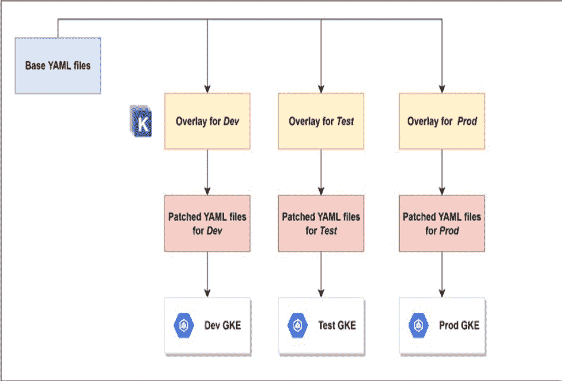

下面我们可以看到一个文件结构的示例，其中包含一个基础和三个用于 dev、test 和 prod 环境的覆盖层：

```
├── base
│   ├── deployment.yaml
│   ├── kustomization.yaml
│   └── service.yaml
└── overlays
    ├── dev
    │   ├── kustomization.yaml
    │   └── patch.yaml
    ├── test
    │   ├── kustomization.yaml
    │   └── patch.yaml
    └── prod
        ├── kustomization.yaml
        └── patch.yaml
```

现在你可以使用此文件结构将每个环境的副本数设置为不同。也许对于开发，你不需要消耗与测试一样多的资源，在测试中你可能想要运行性能测试。

### Summary of Kustomize

正如我们所见，Kustomize 可以成为你在 CI/CD 流水线中为每个环境生成和修补 Kubernetes 资源的有力工具。如果你想了解更多关于如何使用 Kustomize 的信息，请查看 Kustomize 示例：https://kubectl.docs.kubernetes.io/guides/example/，API 参考：https://kubernetes-sigs.github.io/kustomize/api-reference/，以及参考：https://kubectl.docs.kubernetes.io/references/

## 14.4 使用 Cloud Deploy 进行持续部署

Cloud Deploy 是一项完全托管的持续部署服务，允许你根据推广序列将应用程序交付到定义的 *target* 环境系列。

应用程序的 *lifecycle* 使用 *releases* 管理，并由 *delivery pipelines* 控制。

### 14.4.1 Anthos CI/CD 中的 Cloud Deploy

Google Cloud Deploy 与我们已经了解的 Google Cloud Platform 生态系统服务集成，以完成 GKE 和 Anthos 集群的端到端 CI/CD 解决方案。

**图 14.35** Cloud Deploy CI/CD 生态系统

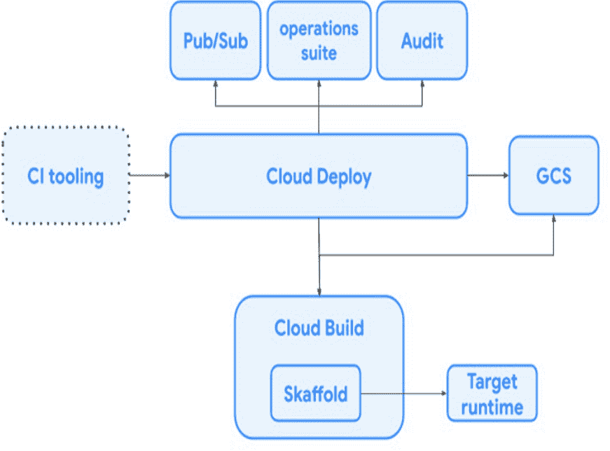

该图显示了 Google Cloud Deploy 如何与以下服务交互：

- **CI tooling** 可以调用 Google Cloud Deploy API 或 CLI 来创建发布。因此，大多数 CI 工具都受支持，包括 Cloud Build。
- **Cloud Build** 用于渲染清单并部署到目标运行时。
- **Skaffold** 由 Cloud Build 用于渲染和部署清单。因此，应用程序被部署。
- **Cloud Storage** 存储渲染源和已渲染的清单。
- **Google Cloud 的 operations suite** 收集并存储 Cloud Deploy 服务的审计日志。
- **Pub/Sub** 允许将 Cloud Deploy 的消息发布到 Pub/Sub 主题。这可用于与外部系统集成。
- **GKE 和 Anthos Clusters** 是 Google Cloud Deploy 部署应用程序的目标运行时。这是通过 Cloud Build 使用 `skaffold apply` 到你的目标运行时完成的。

现在我们知道了 Cloud Deploy 如何与其他 Anthos CI/CD 工具交互，让我们看看如何为 Anthos 应用程序的持续交付进行配置。

### 14.4.2 Anthos 的 Google Cloud Deploy 交付流水线

Cloud Deploy 使用定义推广序列的交付流水线清单来描述部署到目标的顺序。目标在流水线定义中或单独的文件中描述。Skaffold 配置文件用于渲染和部署 Kubernetes 资源清单。图 14.36 定义了 Cloud Deploy 使用的组件和流程。

**图 14.36** Cloud Deploy 工作流

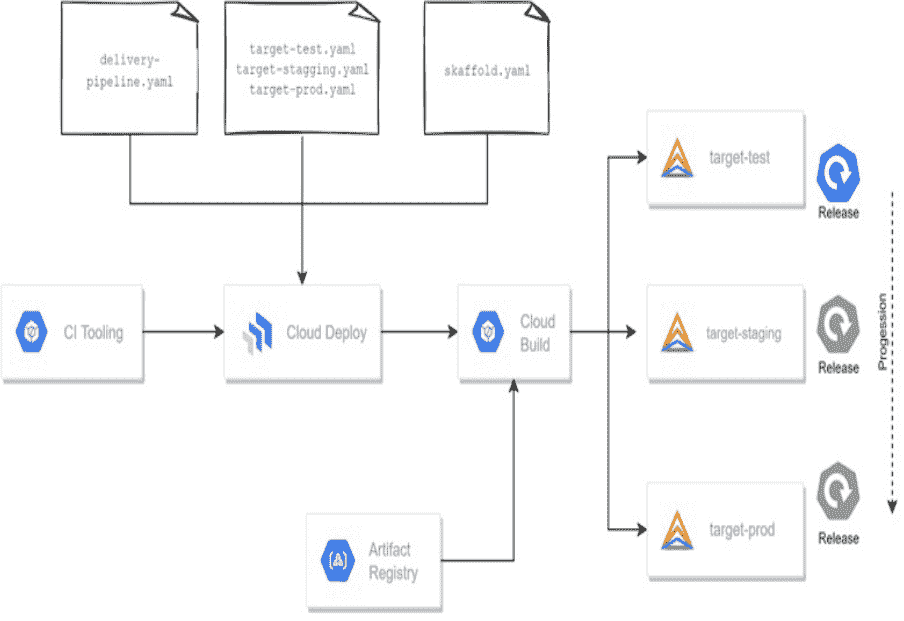

让我们看看配置与 Cloud Build 的持续交付所需的动作序列。


作为先决条件，我们应该已经为每个环境部署了 3 个 GKE/Anthos 集群。

Figure 14.37 Target GKE/Anthos Clusters

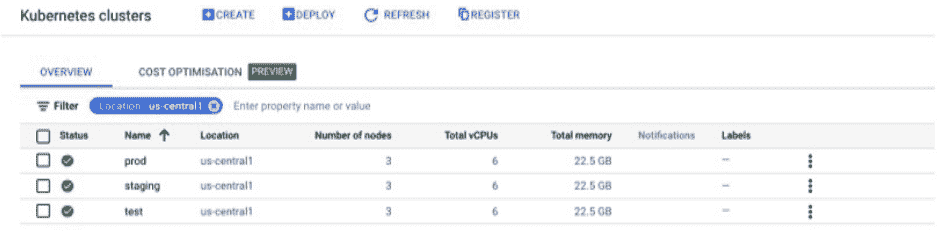

1. 第一步是定义交付流水线，包括其推进顺序（提升序列），以及可选的运行时目标。在本示例中，我们将创建单独的目标文件。对于本示例，我们可以定义以下流水线：

### 14.4.3 delivery-pipeline.yaml

```
apiVersion: deploy.cloud.google.com/v1beta1
kind: DeliveryPipeline
metadata:
    name: web-app
description: web-app delivery pipeline
serialPipeline:
  stages:
  - targetId: test
  - targetId: staging
  - targetId: prod
```

2. 目标可以定义为单独的文件。您可以为每个目标定义一个单独的文件。最终您将拥有 3 个文件：
   - target_test.yaml
   - target_staging.yaml
   - target_prod.yaml

   在每个文件中，您定义目标的名称和目标集群。下面可以看到测试目标的示例。

现在 Cloud Deploy 已了解您的应用程序，并且它将根据您定义的提升序列管理部署到目标。

5. 现在您可以通过命令行或 CI 工具创建 **release** 来启动交付流水线。Google Cloud Deploy 会创建 **rollout** 资源，该资源将发布与第一个目标环境关联。基于该 rollout，您的应用程序将被部署到第一个目标。

从包含 Skaffold 配置的目录运行以下命令：

```
gcloud deploy releases create RELEASE_NAME --delivery-pipeline=PIPELINE_NAME
```

6. 如果您想使用 Cloud Build 作为 CI 工具，以下 YAML 文件显示了示例 Cloud Build 构建配置。这包括对 Google Cloud Deploy 的调用以创建发布，发布名称基于日期，并使用 Skaffold 进行构建。

```
- name: gcr.io/k8s-skaffold/skaffold
  args:
    - skaffold
    - build
    - '--interactive=false'
    - '--file-output=/workspace/artifacts.json'
- name: gcr.io/google.com/cloudsdktool/cloud-sdk
  entrypoint: gcloud
  args:
    [
      "deploy", "releases", "create", "rel-${SHORT_SHA}",
      "--delivery-pipeline", "PIPELINE_NAME",
      "--region", "us-central1",
      "--annotations", "commitId=${REVISION_ID}",
      "--build-artifacts", "/workspace/artifacts.json"
    ]
```

7. 一旦您准备好将应用程序部署到序列中的下一个目标，您就可以提升它。对 Google Cloud Deploy 发出调用并创建新的 rollout。

```
gcloud deploy releases promote --release=RELEASE_NAME --delivery-pipeline=PIPELINE_NAME
```

8. 您可以继续提升到最后一个环境。在示例序列中，它是生产环境。

Figure 14.38 promotion sequence

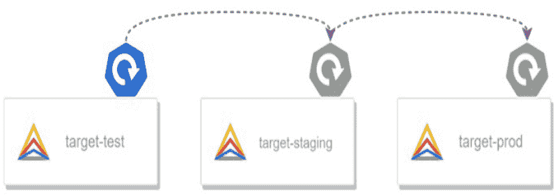

9. 如果您想在提升过程中引入审批，您可以在目标定义中进行操作。作为示例，我们可能希望根据图 14.39 批准所有提升到 staging 和 production。

Figure 14.39 manual approvals

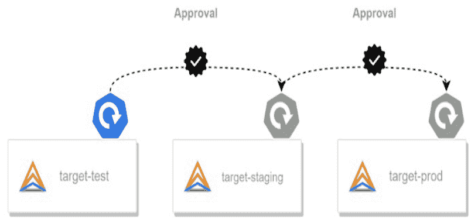

您可以在每个目标定义中定义审批。

```
apiVersion: deploy.cloud.google.com/v1
kind: Target
metadata:
  name:
  annotations:
  labels:
description:
requireApproval: true
gke:
  cluster: projects/[project_name]/locations/[location]/clusters/[cluster_name]
```

参数 **requireApproval: true** 表示提升到此目标是否需要手动审批。可以为 true 或 false。此属性是可选的。默认值为 false。

10. 现在您可以批准或拒绝 rollout。要批准 rollout，请运行命令：

```
gcloud deploy rollouts approve rollout-name --delivery-pipeline=PIPELINE_NAME
```

或通过运行以下命令拒绝审批：

```
gcloud deploy rollouts reject rollout-name --delivery-pipeline=PIPELINE_NAME
```

正如您所见，这使您能够完全控制应用程序的 rollout。

### Summary of Cloud Deploy

在本节中，我们学习了如何使用 Cloud Deploy 实现应用程序的持续交付。它具有许多重要功能，如审批、日志记录和与第三方工具的集成，使其成为企业级解决方案。它与 Anthos 的端到端 CI/CD 流水线无缝集成。要了解有关 Cloud Deploy 的更多信息，请查看：https://cloud.google.com/deploy

如果您想获得 Cloud Build 的实践经验，我们鼓励您查看涵盖更多功能和集成的示例教程：https://github.com/GoogleCloudPlatform/cloud-deploy-tutorials/blob/main/tutorials/base/clouddeploy-config/skaffold.yaml.template。

## 14.5 Modern CI/CD Platform

现代 CI/CD 平台必须允许可持续的软件开发和整个应用程序交付流水线的运营。实现这一目标没有唯一的方法，并且始终取决于应用程序和组织的具体情况。

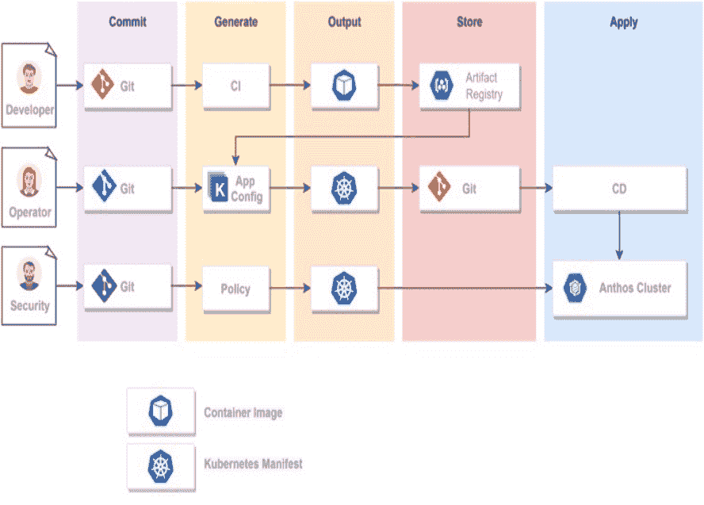

Anthos 引入了集中化管理的能力，并统一了可同时使用的工具集，同时保持将外部工具集成到流水线中的灵活性。现代 CI/CD 平台的目标是支持企业级和安全的 GitOps 实现。这意味着每个组件都必须作为存储在版本控制系统中的一组配置文件和定义来描述。每组由单独的团队管理和维护。已经提到，现代 CI/CD 平台依赖于共享责任。在这种模型中，所有各方始终通过代码仓库、镜像构建和 Kubernetes 清单定义阶段等通用接口进行交互。

现代应用程序交付依赖于 Kubernetes 编排和基于微服务的架构。在这种情况下，必须在开发人员和运维人员的工作环境之间进行分离。实现取决于定义的<|message|>要求。我们可以使用单个集群中的多个命名空间用于单个站点或非生产环境。如果我们交付的服务必须具有高可用性、在全球范围内提供低延迟，或我们必须限制基础设施生命周期活动的影响，请考虑多个 Anthos 集群。多集群设置还允许我们在应用程序完全发布之前，分步骤向单个集群推出应用程序。

让我们定义一个示例应用程序作为一个简单的基于微服务的投票系统，具有可视化投票结果的能力，如下所示。

Figure 14.42 Application schema

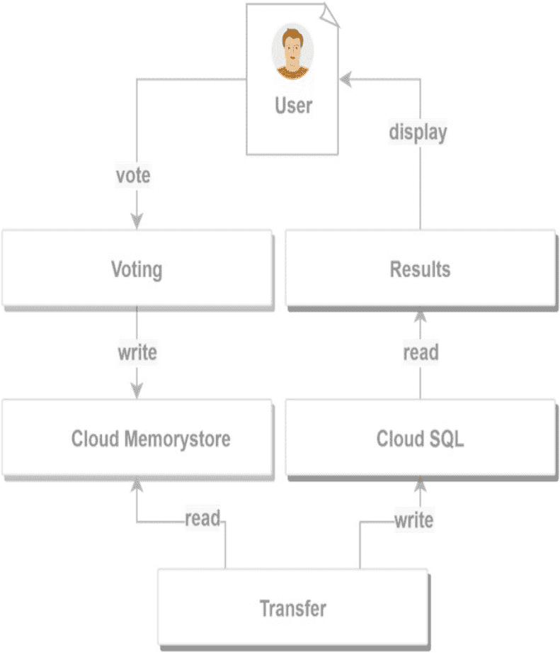

对于底层基础设施，它使用 GCP 上的 Anthos GKE 集群。在那里创建了三个命名空间，每个服务一个：

- voting
- transfer
- results

它还使用三个 Google 管理的服务：

- Cloud Memorystore 作为托管 Redis
- Cloud SQL 作为所有投票的中央数据库，以托管 PostgreSQL 的形式提供
- Secret Manager 作为安全密钥管理系统，用于存储 Memorystore 和 Cloud SQL 的凭据

开发人员使用基础设施，而不关心其交付方式。它必须满足他们与命名空间和托管服务相关的要求。负责的团队必须创建一个可用于应用程序托管目的的 CI/CD 流水线，并具有完全的灵活性来测试任何更改。

为了实现目标，我们可以使用多种不同的工具。如果我们的团队熟悉 Terraform，我们可以利用已有的知识并将其集成到我们的 CI/CD 流水线中。这种方法完全符合 DORA 的 DevOps 研究计划 [30]。它定义了在组织中实施 DevOps 的关键成功因素之一是开发人员和运维人员使用的工具选择的自由。

还有一个问题：我能否更简单地交付此类基础设施？由于我们使用的是 GCP 托管资源而不是外部工具，我们可以利用在“Anthos 配置管理”一章中详细介绍的 Anthos Config Connector 功能，将 Secret Manager、Cloud Memorystore 和 Cloud SQL 作为代码仓库中声明的对象来交付。

在需要为其他来源如 Anthos on-prem 交付服务的情况下，重要的是从第一天开始以自动化方式引入基础设施变更。每个 Anthos on VMware 或 Anthos on bare metal 都必须依赖可不断重复使用的预定义实践和安全策略。

深入到我们的现代平台基础设施，它必须交付以下元素以实现成功的应用程序交付。


- 高性能、高可用且稳定的共享工具基础设施。它用作 CI/CD、容器镜像、应用程序和基础设施代码及配置的中央存储库。可根据公司要求扩展以支持额外的业务支持工具
- 具有一致配置的独立预生产环境和多个生产环境。统一的安全策略、基于角色的访问控制或网络配置可提高测试质量和效率，降低错误率并提高生产软件交付速度。
- 开发基础设施。用于广泛的单元测试，并为我们的开发人员提供在各自命名空间中工作的自由

Figure 14.43 Infrastructure resources

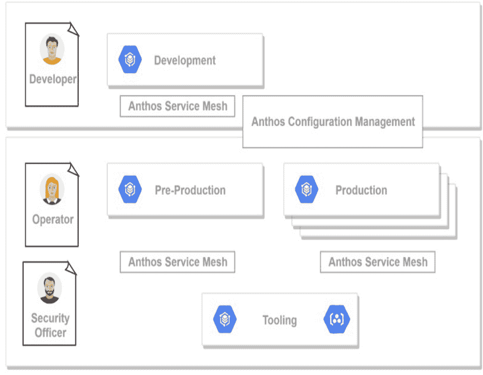

这就把我们带到了目标 CI/CD 平台。它是平台的重要组成部分

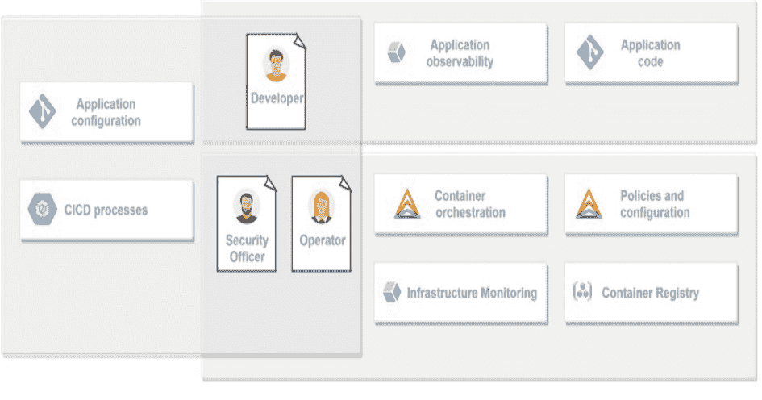

一旦我们的基础设施和 CI/CD 平台准备就绪，我们就可以将其用于开发活动。我们定义了角色以及他们用来相互协作的接口。让我们看看下面图中展示的该协作的端到端工作流程。

# Figure 14.45 Application delivery workflow

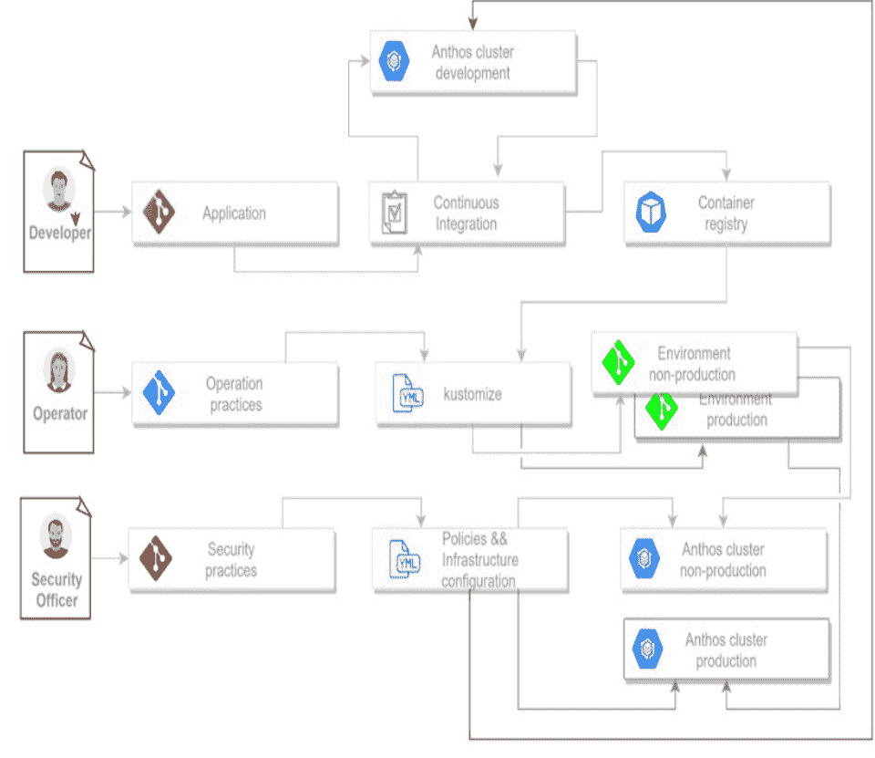

一旦代码准备就绪，就必须将其部署到类似生产的环境中。这保证了新代码更新验证过程中的质量。如前所述，代码可以推送到 Cloud Code 或任何其他 git 仓库，在那里执行质量和健全性检查。通过后，生成容器镜像并将其推送到容器注册表。镜像在被 Operators 确认后，他们会从运营实践 git 仓库中应用最佳实践、应用程序和公司标准。Operators 使用 kustomize 等工具定义流水线，创建环境特定的仓库，这些仓库成为环境特定清单的事实来源。此外，由于所有环境都依赖于相同的应用程序和运营实践代码仓库，因此它们被保证是一致的。结果是非生产环境尽可能接近生产环境。

我们已经提到了在开发生命周期中尽可能将安全适配左移的重要性。开发环境和生产环境之间 Kubernetes 集群的一致性在应用程序交付速度中发挥着重要作用。在第 16 章 *Anthos for Security/Policy* 中我们将学习 Anthos Policy Controller 的工作原理，而在第 13 章 *Anthos, the Config management architecture* 中我们已经学习了 Anthos Configuration Management 如何帮助保持配置一致。我们可以将策略和基础设施控制器都应用于我们 CI/CD 流水线的最终版本。与应用程序一致性类似，所有环境的单一事实来源保证了安全措施的一致性。这使我们能够以现代声明式的方式纳入基础设施和安全变更。

让我们回到我们的参考应用程序，看看上述工作流程如何应用于其中。在我们的案例中，我们可以有三个独立的开发团队。他们各自生成一个镜像，然后移交给负责端到端应用程序的 Operators。

Figure 14.46 Application landing zones

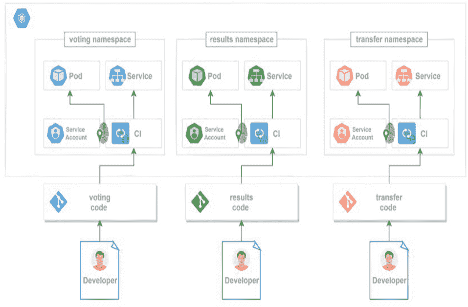

Kubernetes 集群作为专用的命名空间提供应用程序着陆区。这为我们在资源、安全和连接层面之间提供工作负载隔离的能力。

## 14.6 Summary

正如我们在本章中所学到的，现代应用程序交付 CI/CD 平台在现代企业应用程序交付流程中发挥着重要作用。它们具有以下优势：

- 开发人员可以专注于应用程序，从而提高开发团队的性能和效率。
- 同样适用于运营人员，他们能够在早期阶段控制应用程序交付，减轻日常例行工作和配置开销。
- 自动化流水线统一了处理应用程序和基础设施的方式。
- 安全团队成为集成和交付流程中不可或缺的一部分。
- 现代 CI/CD 平台引入了统一的工具。它们建立了对期望和工作方式的知识和意识，覆盖所有相关方。
- 统一的工具集改善了平台引入组织中的共享责任模型下的协作。
- 流程、运营模式、学习和沟通路径必须进行调整以适应这种新模式。它有助于减少变更的前置时间、提高部署频率并显著缩短服务恢复时间。

下一章将讨论 Anthos 上数据和分析的网络概念。

[1] Continuous Integration: https://www.martinfowler.com/articles/continuousIntegration.html

[2] Continuous Delivery: https://continuousdelivery.com/

[3] Continuous Delivery: Reliable Software Releases Through Build, Test and Deployment Automation by Jez Humble and David Farley.

[4] https://cloud.google.com/solutions/devops/devops-tech-shifting-left-on-security

[5] Minikube: https://minikube.sigs.k8s.io/docs/start/

[6] Minikube installation procedure: https://minikube.sigs.k8s.io/docs/start/

[7] Skaffold: https://skaffold.dev/

[8] Helm: https://helm.sh/

[9] Kustomize: https://kustomize.io/

[10] https://cloud.google.com/code

[11] https://skaffold.dev/docs/install/

[12] https://skaffold.dev/docs/references/yaml/

[13] Structure tests are Google developed mechanism of testing container for details consult: https://github.com/GoogleContainerTools/container-structure-test

[14] https://skaffold.dev/docs/pipeline-stages/builders/jib/

[15] https://skaffold.dev/docs/pipeline-stages/builders/bazel/

[16] https://skaffold.dev/docs/pipeline-stages/builders/buildpacks/

[17] https://github.com/GoogleCloudPlatform/cloud-builders-community/tree/master/skaffold

[18] https://skaffold.dev/docs/quickstart/

[19] VSCode: https://code.visualstudio.com/

[20] IntelliJ: https://www.jetbrains.com/idea/

[21] Cloud Source Repositories: https://cloud.google.com/source-repositories

[22] How to use code search https://cloud.google.com/source-repositories/docs/searching-code

[23] Maven: https://maven.apache.org/

[24] npm: https://www.npmjs.com/

[25] PyPI: https://pypi.org/

[26] https://spinnaker.io/

[27] gke-deploy builder: https://github.com/GoogleCloudPlatform/cloud-builders/tree/master/gke-deploy

[28]

https://github.com/kubernetes/community/blob/master/contributors/devel/sig-api-machinery/strategic-merge-patch.md

[29] https://kubectl.docs.kubernetes.io/references/kustomize/kustomization/patches

[30] https://www.devops-research.com/research.html
