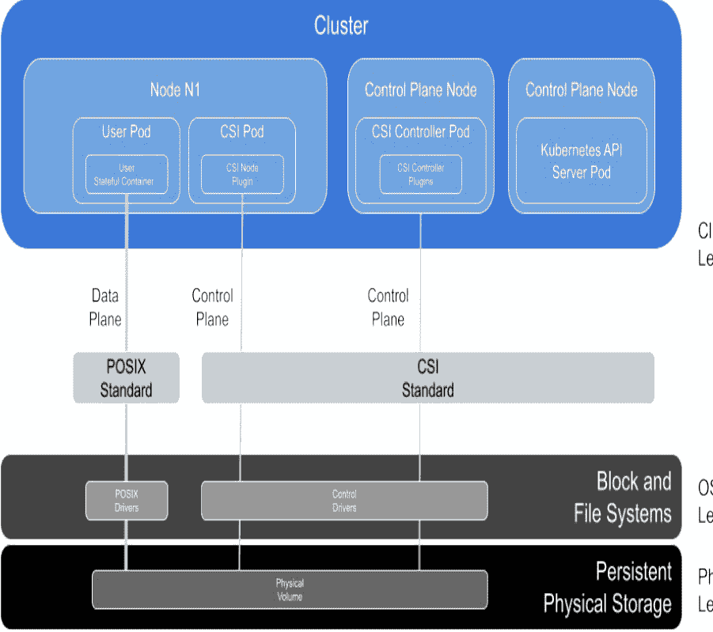
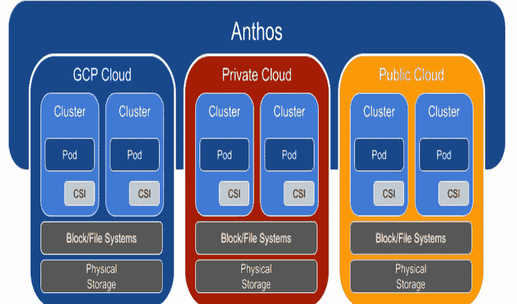
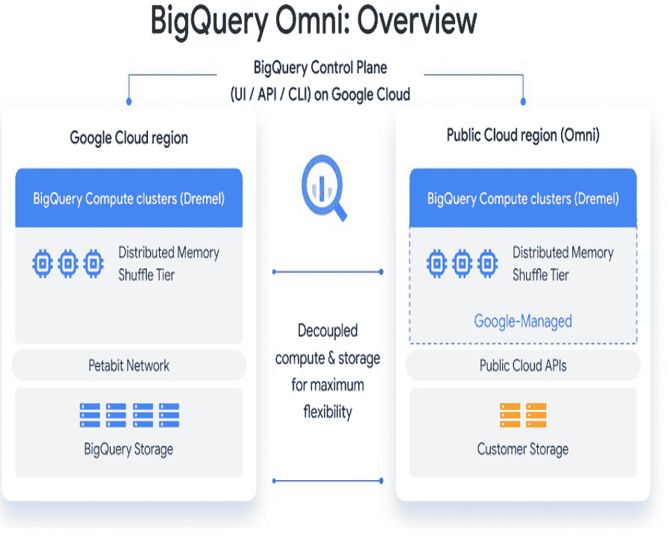
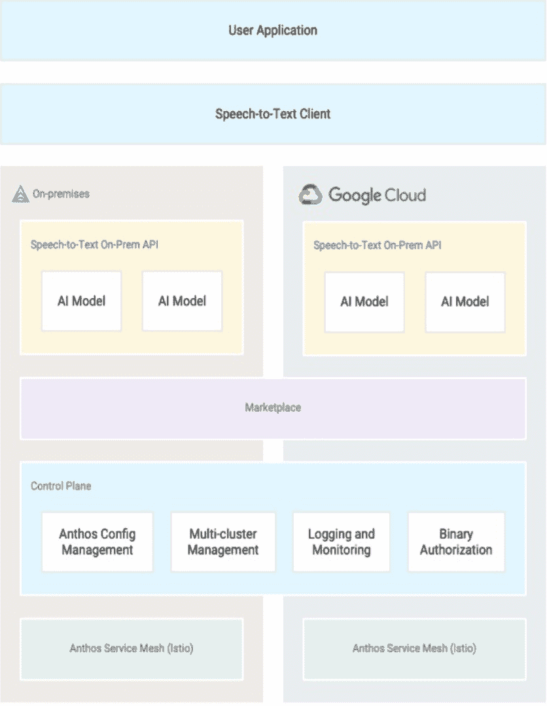

# 15 Anthos, data and analytics

**by Patricia Florrisi**

## This chapter covers:

- Understanding portability versus mobility
- Kubernetes and storage
- Anthos and storage
- BigQuery Omni
- Anthos Hybrid AI

直到最近，Anthos 通常在计算和网络的上下文中被提及，而很少，如果有的话，在存储或数据的上下文中。然而，Anthos 有潜力将可观测性、安全、配置和控制等基本要素带给有状态工作负载。此外，Anthos 有潜力像它扰乱计算的可移植性和移动性一样扰乱数据的可达性和可访问性。通过 Anthos，容器可以无缝地跨混合云和多云环境访问存储设备，并在配置、配置、分配和访问这些资源方面保持一致。

一旦 Anthos 集群使有状态容器能够跨混合云和多云环境部署，它就为这些容器提供安全且一致的数据可达性和访问能力，分析的执行方式就变得 ripe for a redesign。在传统设置中，从众多数据源收集的数据被存储在中央位置，以数据仓库或数据湖的形式存在，分析在此执行。因此，使用 *Artificial Intelligence (AI)* 和 *Machine Learning (ML)* 的分析解决方案长期以来都是在假设所需的所有数据都可以集中访问的前提下设计和优化的。

然而，最近的事件挑战了在执行分析之前将所有数据集中的能力。组织通常拥有数据

散布在组织边界或地理位置之间，无论是托管在本地还是在公共云中。 通常，监管合规、安全性或数据隐私会施加某种形式的数据驻留要求，即数据必须存储在物理或逻辑围栏内，不能移出该围栏。 此外，即使数据可以跨越这些边界，带宽限制，例如容量、速度和成本，也可能限制可以传输到中央目的地的 数据量。 Anthos 使将数据分析带到您的数据变得更容易，让数据分析在数据所在或需要所在的位置进行，无论是在本地还是在公共云中。

Anthos、数据和分析的交集只是一个新兴的话题，迄今为止，它是 Anthos 走向实现现代应用程序的轨迹中最为初生的。 当您阅读本章时，围绕 Anthos 如何实现下一代众多数据服务以及分析如何在混合云和多云中无缝运行的许多领域的工作仍在继续，包括：

- 从本地到云以及云之间的数据备份和灾难恢复；
- 数据库，其中计算引擎可以是容器原生，而存储可以是软件定义的；
- 联邦学习，其中 AI 模型的训练在多个位置进行编排，在数据所在位置处理数据，并仅集中聚合此类计算的中间结果；以及
- AI 和 ML 管道，允许在生产环境中对模型进行工业化，离开实验阶段。

正如引言所示，Anthos 上的数据开启了需要跨各种多云和混合云解决方案使用数据的许多额外工作负载——容器不再仅限于无状态工作负载。 但是，在深入研究在 Kubernetes 和 Anthos 上使用数据之前，我们需要了解可移植性和移动性之间的差异，我们将在下一节中讨论这个问题。

## 15.1 可移植性与移动性

就 Anthos 和数据而言，区分可移植性和移动性的细微差别对于理解在混合云和多云环境中处理散布的数据所带来的挑战至关重要。 应用的可移植性使 Anthos 能够实现“一次编写，到处运行”的前提，而应用的移动性则使这一前提得以扩展为“一次编写，到处运行，随处可移动”。 可移植性对软件开发人员在设计时以及管理员在运营时都很重要，因为它减少了可能需要配置的环境类型。 移动性在运行时对运营商最重要，因为它使他们能够动态地重新分配工作负载，并实时根据需求进行调整。 移动性在许多方面旨在避免将工作负载锁定到其运行配置的特定细节中，并且植根于对开放标准的采用。 可移植性和移动性共同使工业规模的运营更具可行性和可扩展性。 然而，与数据相关的可移植性和移动性方面的挑战可能比与计算相关的可移植性和移动性方面的挑战更为复杂。

虽然增加的可移植性扩大了有状态容器可以部署的硬件表面，但这可能并不直接等同于有状态工作负载从一个位置移动到另一个位置的移动性。 在某些情况下，一个在位置 L1 上运行并访问持久存储 PS 的有状态工作负载，我们称之为 SW，可能无法移动到位置 L2。 例如，SW 在 L2 上运行时可能无法访问 PS，并且数据本身可能没有移动到从位置 L2 可访问的物理存储的移动性。 数据通常表现出一种引力，由于许多因素而带来移动挑战，包括：数据的庞大规模、移动数据的财务和运营成本、带宽限制、安全要求、监管合规性和隐私限制。 此外，在许多情况下，数据是持续创建的，其中应用程序需要在时间敏感的窗口内摄取和处理不断增长的数据集。 在这些场景中，一次性复制或一组离散的数据复制可能无法满足应用程序的要求。

### 15.1.1 关于可移植性

*可移植性*是指能够在多个位置执行的能力。 在许多方面，与在飞行中更改数据本身的地址相关。 应用程序通常在执行开始时将地址绑定到物理位置，并且这些绑定不能轻易更改。 此外，根据需要移动的数据大小，带宽和读写吞吐量限制不容忽视。 随着规模的增加，数据获得更多的引力并失去移动性。

因此，需要访问驻留在持久存储中的数据的虚拟机变得绑定到只能移动到虚拟机仍可访问数据最初存储的存储的其他物理计算资源。 从本质上讲，计算工作负载移动了，但数据没有。

容器在使移动工作负载变得可行且更容易时增加了移动性的灵活性，通过简单地在新期望的目的地启动新容器然后终止旧容器，而不是实际移动正在运行的工作负载。 然而，类似的约束适用于访问持久存储的容器，称为有状态容器。 只要有状态容器新位置可以访问旧容器在其先前位置使用的同一持久存储，移动性就更容易。 然而，容器中出现了一个有趣的方面。 因为容器是从头开始重新启动的，所以可以在容器和物理存储之间建立新的绑定。 因此，只要副本彼此完全镜像，容器也可以移动到数据副本存在的位置。

### 15.1.3 章节组织

本章提供了 Anthos、数据和分析主题的一瞥，其组织如下：

- Kubernetes 和存储部分回顾了一些关于 Kubernetes 如何与存储层交互的重要概念，为下一节奠定了基础；
- Anthos 和存储部分讨论了 Anthos 如何在 Kubernetes 之上增加价值，以增强访问永久存储的工作负载的可移植性；
- BigQuery Omni 由 Anthos 提供支持部分解释了 Anthos 如何使 BigQuery 成为可能，BigQuery 是 Google Cloud 数据仓库分析引擎，能够查询驻留在其他公共云平台上的数据；
- Anthos Hybrid AI 部分解释了 Anthos 如何使 Google Cloud 分析解决方案能够在本地运行，允许云原生分析在无需将数据移动到云的情况下部署和执行；以及
- 摘要部分重点介绍了本章涵盖的主要主题。

## 15.2 Kubernetes 和存储

关于基于容器的和云原生应用程序（CNAs）的一个基本问题是它们如何支持持久数据。 这些问题范围从它们如何在集群内支持简单如块或文件操作，到它们如何与 PB 级别的事务数据库和对象存储交互。 由于 Anthos 是 Kubernetes 之上的管理平面，因此首先了解 Kubernetes 如何公开块和文件存储的配置和管理，然后了解 Anthos 今天在 Kubernetes 存储之上添加了什么，以及 Anthos 未来可以添加什么，这一点至关重要。

在 Kubernetes 中，卷代表存储分配单元，与存储系统直接交互的容器称为有状态容器。 图 1. 数据和控制平面显示了使有状态容器能够与存储系统交互的技术堆栈。 数据位于堆栈中最低的持久物理存储层，其中包括，例如，Internet 小型计算机系统接口（iSCSI）逻辑单元号（LUN）、网络文件系统（NFS）共享以及对象、块和文件的云产品。 在物理层之上，在操作系统（OS）级别，有块和文件系统，可以是本地的或网络的。 这些系统实现驱动程序，通常在操作系统内核级别运行，允许上层使用块级或文件级抽象与物理存储交互。 在最基本的形式中，容器通过两个平面与存储系统交互：

- *数据平面：* 有状态容器用于执行读写操作。 在很大程度上，数据平面已经标准化。 例如，可移植操作系统接口（POSIX）是 de-

事实上的标准协议接口，用于向文件和块存储读写数据。

- *控制平面（Control Plane）：* Kubernetes 卷插件使用它来在物理存储中分配、释放和管理空间。

与数据平面不同，控制平面接口直到最近才实现标准化。2017年，一场涉及Kubernetes、Mesos、Docker、Cloud Foundry等容器编排器的跨项目协作，催生了[容器存储接口（CSI）]( )规范。存储厂商使用其特定的API和存储协议，将CSI规范实现为驱动程序。然后，厂商的CSI驱动程序被打包并作为Pod部署到Kubernetes集群中，通常分为控制器部署和每节点部署。Kubernetes在编排容器工作负载的卷时，会调用这些驱动程序实现的相应CSI API。后续章节将进一步解释CSI。

图15.1. 数据平面与控制平面

在本章的上下文中，数据特指应用程序执行过程中持续存在的数据。因此，这些数据不仅需要持久化存储，而且在创建或修改它的应用程序正常或异常终止后，还需要能够被寻址和访问。这些应用可以是极其短暂的，例如手机中录制视频流后即终止的相机应用，也可以是更具弹性的数据库应用，例如可以作为数字银行服务后端的数据库。

### 15.2.1 论标准的出现

Kubernetes 卷插件引入了一种抽象机制，使厂商能够在 Kubernetes 中添加对其块存储和文件存储系统的支持，从而自动化容器的存储供应、挂载和装载。此外，Kubernetes 对持久卷（PV）、持久卷声明（PVC）和 StorageClass 对象的抽象实现了存储和有状态容器的可移植性。但其他挑战依然存在。

2017 年初，Kubernetes 还不是最广泛采用的容器编排平台。Mesos、Docker Swarm 等拥有可观的市场份额。这些编排系统各自都有不同的方式将卷暴露到自己的容器中。为了进入容器市场，存储厂商需要开发多个存储插件，每个容器编排系统一个，许多厂商决定推迟开发，直到标准建立或市场领导者出现。

与此同时，Kubernetes 卷插件机制也面临若干挑战。卷插件必须在 Kubernetes 核心中以树内卷插件（in-tree volume plugin）的形式实现。存储厂商必须使用 Go 编程语言实现插件，向 Kubernetes 代码仓库贡献源代码，并作为 Kubernetes 主版本的一部分发布和维护这些代码。

树内卷插件给不同的社区带来了不同的挑战，如下所述：

- *对于 Kubernetes 开发社区：* 将卷插件直接嵌入仓库，作为 Kubernetes 代码库的一部分，在 Kubernetes 二进制代码中编译和实现，变得令人生畏。紧密耦合带来了一些挑战，包括：
  - *安全性：* 卷插件拥有完全权限，可以访问所有 Kubernetes

在谷歌强有力的领导下，Kubernetes 社区决定摆脱树内插件模型，为厂商提供一种独立开发卷插件的方式。Kubernetes 并不孤单。所有容器编排系统都面临类似的挑战——它们需要以尽可能少的工作量、以最安全的方式，将容器暴露给尽可能多的不同存储厂商产品。与此同时，存储厂商也希望尽可能多地将其产品暴露给用户，无论用户使用哪种容器编排系统，都希望利用插件跨尽可能多的系统，并且几乎不需要修改代码。因此，Kubernetes 社区与其他容器编排社区结成联盟，开始着手制定一项规范，以创建一个可扩展的卷层。最初的设计完全聚焦于用户体验和跨厂商的标准存储平台能力。

除了创建标准之外，Kubernetes 还有一个独特的需求，即通过动态存储供应（dynamic storage provisioning）按需提供存储。在运行时，应用程序应该能够随时请求存储，Kubernetes 应该能够联系后端系统获取所需存储并将其提供给应用程序。不需要管理员介入，不应中断应用程序的执行，也不需要对每个应用进行独占的存储预分配。一旦应用程序不再需要该存储，它应该被释放回资源池以供重新分配。

### 15.2.2 容器存储接口

容器存储接口（CSI）是一个开源标准，用于将任意块存储和文件存储系统暴露给由 Kubernetes 等容器编排系统管理和编排的容器化工作负载。CSI 规范仅仅是一个规范。该规范不定义插件应如何打包，不要求任何部署机制，也不强制或包含任何有关应如何监控的信息。

CSI 的核心是提供一个接口来执行以下操作：

- 创建/删除卷
- 将卷附加到节点/从节点分离
- 在节点上为工作负载挂载/卸载卷
- 对卷进行快照，并从快照创建新卷
- 克隆卷
- 调整卷大小

CSI 中的接口实现为三组 API，如下所列，所有 API 都是幂等的，这意味着同一个客户端可以多次调用它们，并且将产生相同的结果。这些 API 都需要一个卷标识符，使调用的接收方能够知道该调用之前已经执行过。API 的幂等性带来了可预测性和健壮性，允许系统处理故障恢复，尤其是在组件之间的通信中。

- *身份服务（Identity services）：* 提供插件基本信息（如名称、基本功能和当前状态）的操作。
- *节点服务（Node services）：* 需要在卷将要使用的节点上运行的卷操作，例如挂载（mount）和卸载（unmount）。
- *控制器服务（Controller services）：* 可以在任何节点上执行的卷操作，例如卷的附加和分离，以及卷的创建与删除。

[gRPC 远程过程调用（gRPC）]被选为线上协议，因为它与语言无关，拥有庞大的用户社区和广泛的工具来帮助实现。这些 API 是同步的，这意味着调用方在发出调用后会阻塞，等待结果返回。规范不强制任何打包和部署要求。唯一的要求是通过 Unix 套接字提供 gRPC 端点。

### 15.2.3 CSI 背后的差异化定位

CSI 标准是为了实现多个目标而出现的，它确实已成为创建高度可扩展卷层的基础。CSI 为 Kubernetes 创建了一个存储生态系统，不仅所有主要存储厂商都支持它，最终用户还可以为自己的应用编写自定义 CSI 驱动程序。本质上，CSI：

- *标准化存储控制平面：* 促进存储厂商和容器编排器之间的互操作性。存储厂商构建一个可被任何编排器使用的驱动程序，容器编排器可以与任何驱动程序交互；
- *支持动态存储分配：* 消除了预供应的需要；
- *加速存储厂商生态系统的扩展：* 增加 Kubernetes 支持的选项数量；
- *提供源码树外设计：* 降低开发人员实现卷驱动的门槛，消除源代码贡献的风险，并将 Kubernetes 的发布周期与存储厂商的开发周期解耦。

下一节将讨论 Anthos 如何通过 Anthos Ready Storage 和对 CSI 的遵循，使有状态容器更具可移植性。

## 15.3 Anthos 与存储

将存储抽象为一组不同大小的持久卷，按需动态分配和释放，是 Kubernetes 向最终用户交付的核心价值之一。CSI 为厂商的存储系统提供了一个可扩展的南向接口，屏蔽了存储设备之间的异构性，为 Kubernetes 和所有其他容器编排引擎提供了一致且统一的接口。同时，Kubernetes 为 Kubernetes 用户提供标准的北向接口，以 PV 和 PVC 的形式在更高抽象级别上与存储交互，而 CSI 还允许开发者针对磁盘加密、快照和调整大小对磁盘进行建模。

到目前为止，所有涉及的 CSI 主题都与 Kubernetes 相关，而不是 Anthos。这就引出了一个有趣的问题：除了 Kubernetes 所做的事情之外，Anthos 为存储领域带来了什么附加价值（如果有的话）？一个简单甚至可能是显而易见的答案是，Anthos 通过让 Kubernetes 环境的部署和管理变得更容易来帮助存储领域。通过支持 CSI，Kubernetes 实际上正在扩展……

如以下各节所述，Anthos 提供了两种方法，用于扩展可利用的基础设施存储范围：

- Anthos 托管存储驱动程序
- Anthos Ready 存储合作伙伴计划

### 15.3.1 Anthos 托管存储驱动程序

Anthos 会在每个平台上安装、支持和维护多个存储驱动程序。以下是 Anthos 托管存储驱动程序的差异化优势：

- *驱动程序选择自动化*：Anthos 会选择应在集群中的每个节点上受支持和管理的特定版本驱动程序。例如，Anthos 会在 GCP 上部署 GCE Persistent Disk 和 Filestore 驱动程序，在 AWS 上部署 AWS EBS 和 EFS 驱动程序，在 Azure 上部署 Azure Disk 和 Azure File 驱动程序，并在 vSphere 上部署 vSphere 驱动程序。Anthos 有效扩展了可通过自动化方式部署和管理 Kubernetes 集群的环境范围；

- *驱动程序管理*：随着驱动程序数量的增加，Anthos 可帮助将这些驱动程序集成并部署到客户的 Kubernetes 环境中。创建新节点时，Anthos 会动态确保新节点能够获得并访问存储，而无需用户干预。Anthos 会自动决定在特定场景中应使用的驱动程序版本。Anthos 还能够管理驱动程序的整个生命周期并为其提供支持。

Google Cloud Marketplace 包含一组有状态引擎，Anthos 客户可以使用这些引擎，例如 Redis Enterprise。

### 15.3.2 Anthos Ready 存储合作伙伴计划

除了 Anthos 托管存储驱动程序之外，用户还可以引入自己选择的其他存储供应商。Anthos 创建了 Anthos Ready 存储计划，与选定的第三方存储合作伙伴合作，为其开发的 CSI 驱动程序进行开发、测试和认证。该计划确保这些通过认证的存储供应商合作伙伴所交付的 CSI 驱动程序实现能够在 Anthos 中提供无缝体验。最新的认证驱动程序列表可在 Anthos Ready 存储合作伙伴网站上找到。

要使存储系统通过 Anthos Ready 存储认证，必须经过 Anthos 的 CSI 驱动程序认证流程。Anthos 提供质量保证流程，用于测试驱动程序并检查 Kubernetes、驱动程序与底层存储之间的互操作性。该流程确保第三方 CSI 驱动程序符合 Anthos 标准。通过引入标准化，CSI 扩展了编写插件的存储供应商生态系统，并降低了开发这些插件的门槛。因此，市场上开始出现大量新的插件和更新，需要进行测试和质量保证。存储供应商的驱动程序必须满足以下要求：

- 动态配置卷存储，以及客户所需的其他 Kubernetes 原生存储 API 功能；
- 使用 Kubernetes 部署存储 CSI 驱动程序及其依赖项；
- 管理 Kubernetes 扩容和缩容场景中的存储；以及
- 支持使用持久性存储的有状态工作负载的可移植性。

### 15.3.3 Anthos 备份服务

借助完善且稳定的 CSI 功能，用户可以在 Anthos 托管的 Kubernetes 集群中可靠地部署和运行关系数据库等有状态工作负载。有状态工作负载通常比无状态工作负载具有更多要求，其中包括备份和存储管理需求。

Anthos 提供了一项易于使用的云原生服务，即 Backup for GKE，帮助用户保护、管理和恢复在 Google Cloud GKE 集群中运行的容器化应用及其数据。

备份中会捕获两种形式的数据：

- *集群状态备份或配置备份*：由从正在执行备份的集群的 API 服务器中提取的一组 Kubernetes 资源描述组成；以及
- *卷备份*：由一组 GCE Persistent Disk (PD) 卷快照组成，这些快照对应于配置备份中发现的 PersistentVolumeClaim 资源。

Backup for GKE 中的备份和恢复操作是选择性的。执行备份时，用户可以选择要备份的工作负载，也可以选择“所有工作负载”。同样，执行恢复时，用户可以选择要恢复的工作负载，也可以选择“此备份中捕获的所有工作负载”。用户可以从一个集群备份工作负载，然后将其恢复到另一个集群中。

恢复操作涉及在目标集群中经过精心编排的 Kubernetes 资源重新创建过程。资源创建完成后，工作负载功能的实际恢复将遵循正常的集群协调过程。例如，Pod 会被调度到 Node，然后在这些 Node 上启动。在恢复期间，用户还可以选择应用一组*转换/替换*规则，在目标集群中创建资源之前更改特定资源中的特定参数。

这种选择性备份、选择性恢复与转换相结合的方式，旨在实现和支持多种不同的备份与恢复场景，包括但不限于：

- 备份集群中的所有工作负载，并将其恢复到单独准备的灾难恢复（DR）集群中；
- 备份所有工作负载，但选择性地恢复（即回滚）源集群中的单个工作负载；
- 备份一个命名空间中的资源，并将其克隆到另一个命名空间；
- 将工作负载从一个集群迁移或克隆到另一个集群；以及
- 更改特定工作负载的存储参数。例如，将工作负载从区域级 Persistent Disk (PD) 移动到多区域级 PD，或将存储配置程序从 PD 树内驱动程序更改为 CSI 驱动程序。

此时需要注意，*Backup for GKE* 不会备份 GKE 集群配置信息，例如节点配置、节点池、初始集群大小和已启用的功能。*Backup for GKE* 的恢复过程也不涉及创建集群。用户需要自行创建目标集群（如果目标集群尚不存在），并在开始任何恢复操作之前将 *Backup for GKE* 代理安装到该集群中。

### 15.3.4 展望未来

展望未来，Anthos 有望使跨混合云和多云环境管理和使用 Kubernetes 中的存储变得更加简单和自动化。示例包括：

- *简化驱动程序部署*：创建蓝图和更高层次的抽象，以帮助存储供应商指定其 CSI 驱动程序的部署方式；以及
- *引入驱动程序市场*：在 Google Cloud 中提供一键式部署，而不是要求用户跳出当前上下文，访问存储供应商网站来获取 YAML 文件并自行部署驱动程序。

## 15.4 Anthos 驱动的 BigQuery Omni

BigQuery 是一个 PB 级数据仓库，现已成为用户访问不断扩展的 Google 分析产品组合的平台，例如 AutoML 和 Tables。Google 的 BigQuery 团队希望将同样的分析能力扩展到驻留在其他公有云中的数据，而不要求客户将数据迁移或复制到 Google Cloud。无需移动数据即可分析驻留在其他云中的数据，这一能力定义了一个被称为多云分析的新领域。

BigQuery Omni 扩展了 BigQuery 的功能，使其能够分析驻留在多个云中的数据，无论是使用标准 SQL，还是使用 BigQuery 的完整交互式用户体验对数据执行临时查询。从较高层次来看，BigQuery 由两个完全解耦的组件组成：计算和存储。计算组件由一个非常具有弹性且无状态的*查询引擎*组成，该引擎在 Google 内部称为 Dremel，能够以非常高效的方式执行类似标准 SQL 的查询。存储组件由一个高度可扩展、经过优化分区且高度压缩的列式数据*存储引擎*组成。这两个组件通过一组定义明确的 API 进行交互。这种解耦方式使两个组件能够独立扩展。对于需要更多数据而非更多分析能力的用例，存储可以扩展以容纳数据规模。对于分析密集型用例，计算能力可以相应扩展，而无需分配更多存储空间。

BigQuery Omni 工程团队面临的挑战是：如何在 Google 内部 “Borg” 基础设施之外运行这些组件。他们利用 Kubernetes 与 “Borg” 之间的相似性，以及 Anthos 的多云支持来克服这些挑战。

BigQuery Omni 使用 Anthos GKE 作为管理控制平面，在数据所在的同一区域运行 Dremel 查询引擎，该区域中的数据位于

公有云。Dremel 部署、运行并运营在 Google 管理的账户中由 Anthos 支持的 GKE 上，而该账户位于数据所存储的公有云中。借助 Anthos，Google Cloud 得以推出 BigQuery Omni，使 Google Cloud 能够将其分析能力扩展到驻留在其他云（如 AWS 和 Microsoft Azure）中的数据。请参阅[此链接](#)获取 BigQuery Omni 的演示。

需要特别指出的是，尽管 BigQuery Omni 利用了 Anthos GKE 的能力，但用户并不一定要成为 Anthos 客户。在这种情况下，BigQuery Omni 工程团队才是 Anthos 客户，而 BigQuery Omni 用户不会直接与 Anthos GKE 交互。

如图 3（BigQuery Omni 技术栈）所示，BigQuery Omni 引入了在 GCP 以及其他公有云（如 AWS 和 Microsoft Azure）上运行 BigQuery 查询引擎 Dremel 的能力。架构组件分布如下。在 GCP 中，BigQuery 技术栈保持不变。从下到上，它由通过拍比特网络连接到 Dremel 运行的 BigQuery 计算集群的 BigQuery 存储组成。为了临时存储和缓存中间查询结果（对于某些复杂分析，这些结果可能达到 TB 量级），Dremel 实现了分布式内存 shuffle 层。当运行在 GCP 以外的公有云（例如 AWS）上时，BigQuery Omni 不会将数据从该云迁移到 Google 中 BigQuery 的托管存储，而是直接对驻留在该云原生存储系统中的数据执行分析。

在 BigQuery Omni 中，当用户执行访问多云数据的查询时，BigQuery 路由器会使用安全连接将查询真正路由到运行在数据所在位置的 Dremel 引擎。Dremel 工作负载必须被授予访问驻留在公有云中的数据的权限。查询结果可以直接导出回数据存储，查询结果或查询所用数据不会发生跨云移动。BigQuery Omni 还支持将文件加载到“常规”BigQuery，以满足需要关联 BigQuery 中驻留数据或使用 Vertex AI 训练机器学习模型的用户。

## 图 15.3. BigQuery Omni 技术栈

## 15.4.1 让 BigQuery 访问 AWS 中的数据

为了让 BigQuery Omni 对驻留在 AWS 上的数据执行查询，用户需要拥有 AWS 账户，并有权修改 S3 数据的*身份和访问管理 (IAM)* 策略，以授予 BigQuery 访问权限。该过程涉及多个步骤，如下列章节所述。

### 创建 AWS IAM 角色和读取策略

用户必须首先为其希望授予 BigQuery 访问权限的 S3 创建 AWS IAM 角色和读取策略，然后将角色和策略附加在一起。有关如何执行这些任务的最新说明，请参阅 Google Cloud BigQuery Omni [文档](#)或 AWS 文档。

### 定义外部表

创建连接后，用户需要为其存储在 S3 中的数据创建外部表定义。有关如何执行这些任务的最新说明，请参阅 Google Cloud BigQuery Omni [文档](documentation)或 AWS 文档。

## 15.4.2 充分利用 BigQuery 的存储设计优化

BigQuery 的可扩展性和高性能源于一系列相互叠加的设计选择。例如，为了优化查询分析，BigQuery 存储引擎以[列式格式](columnar format)存储数据，并对数据进行分区和聚簇，以减少查询的搜索空间。如果远程数据的存储和组织方式并非如此，相对于在 Google Cloud 上运行 BigQuery，这可能导致一定程度的性能下降。然而，能够使用 BigQuery 分析以现有格式和现有位置释放数据价值，且无需任何迁移工作，这种好处可能是一个可接受的权衡。

用户始终可以选择通过模拟 BigQuery 使用的一些技术方法来优化数据，使其适合 BigQuery Omni 分析，包括：

- *将数据转换为列式格式：* 允许逐列检索数据。在大多数用例中，分析查看的是列中的所有值，而不是对表中的行进行范围扫描。因此，像 [Apache Parquet](Apache Parquet) 这样的列式格式优化了列的检索，减少了分析期间访问的数据量，从而提高了性能并降低了成本。
- *压缩数据：* 允许从存储中检索更少的字节。对于以列式格式存储的数据，压缩可以利用列条目可能非常重复或遵循某种模式（例如连续数字）这一特点。Apache Parquet 使用 [Google Snappy](Google Snappy) 压缩列式数据。
- *数据分区：* 在搜索特定数据值时，可以实现更高效的数据扫描。BigQuery 使用 [Hive 分区](hive partitioning)。

## 15.4.3 BigQuery Omni 背后的差异化优势

BigQuery Omni 区别于其他分布式查询引擎（如 [Presto](Presto)）之处在于，它可以随着时间推移利用 Anthos 作为管理平台，不仅用于部署，还用于监控、运营、更新和管理查询的整个生命周期。本质上，BigQuery 希望为客户提供一个多云方案。BigQuery 需要一个类似 Google “borg” 的多云解决方案，使 Dremel 能够在 AWS 和 Microsoft Azure 上几乎像在 Google Cloud 上一样工作。

BigQuery 查询引擎也运行在 GKE 环境中，充分利用了云原生部署的所有现代特性。

需要特别指出的是，这可能是有史以来第一次，一家云厂商（此处指 Google）在竞争对手云环境的边界内部署了真正专有且差异化的代码 Dremel。有人可能会说，Google 已经在 AWS 和 Microsoft Azure 上运行 GKE，这也是专有代码。但此处的关键差异化在于，GKE 是管理容器的平台，这是如今所有云提供商都具备的能力；而 Dremel 掌握着大规模分析的关键，为 Google 用户带来了巨大价值。

最终，BigQuery Omni 为多云世界带来了一致的用户体验，通过单一管理面板对驻留在多个云中的数据进行分析，打破了此前围绕云边界形成的壁垒。借助 Anthos，BigQuery Omni 将其用作安全的多云基础设施平台，为驻留在其他云中的数据提供分析基础。而 BigQuery 在实现这一切时，无需任何跨云数据移动，也不会创建任何数据副本。

## 15.5 Anthos 混合 AI

Google 处于 AI 革命的前沿，并将其尖端的 AI 技术融入其众多产品中，为用户提供诸如自动-

混合 AI 的前提是，用户已经有一个或多个 Anthos 本地集群注册到 GCP。使用 [GCP Marketplace](#)，用户可以搜索和发现 Google Cloud AI 解决方案，例如一种将语音转换为文本的解决方案，将在下一节中说明。用户可以选择一个解决方案，并点击部署到本地 Anthos 集群。这些 AI 解决方案已打包为 Anthos 应用，可以部署到任何 Anthos 集群，包括本地运行的集群。这些解决方案由 Anthos 完全管理，并受益于所有 Anthos 功能，包括自动缩放，这保证了本地计算资源仅在使用时分配，且只分配所需的资源。Anthos 会对这些 AI 解决方案进行计量，并根据使用量向客户收费。Anthos Hybrid AI 允许 AI 应用程序按需动态部署、运行和解除部署。

## 15.5.2 混合 AI 解决方案

Anthos Hybrid AI 的首个版本在本地提供以下 Google Cloud AI 服务：

- *光学字符识别 (OCR)*：将文档转换为数字格式的文本；
- *语音转文本*：将语音转换为文本，支持包括英语、法语、西班牙语、粤语和日语。[Google Cloud 版本](https://) 已支持超过一百种不同语言及其变体，并可根据需求轻松地将其他语言添加到本地版本中。

### 光学字符识别

企业有大量数据被非数字化媒体（如纸质文档）所束缚，或隐藏在无法轻松进行数字化分析的数字格式中。例如，发票或政府颁发的产权证的扫描数字图像可能分别作为交易记录和所有权证明，但提取其中可单独分析的各条信息仍然非常困难。交易涉及的实体名称、日期、地点、价值以及交换物品的具体信息可能仍深藏在数字图像中。以往通过人工输入数据将这些信息数字化的尝试已被证明容易出错、耗时、成本高昂且难以扩展。

the data in the cloud.

## Speech-to-Text

Speech, be it in the form of pure audio recording or be it as the audio stream in videos or live conversations, comprises yet another format in which valuable information remains trapped. A common approach to speech recognition consists of first transforming the speech into text, and then using *Natural Language Processing (NLP)* to gain insight into the semantics of the speech. Today, enterprises possess speech data that captures human-to-human interactions and human-to-machine interactions. For example, customer calls to contact centers may consist of an initial part completely assisted by machines, with the purpose of gathering data about the issue and more effectively routing the call to an available human agent, and a second part where the customer communicates with a human agent to solve the issue.

Similar to OCR, the data to be converted from speech to text may require data to remain on-prem. These recordings may not only contain PII and sensitive information, but they may hold *Intellectual Property (IP)* on many aspects of the business, such as executive board level discussions on strategic directions, product launch, technologic innovations, and human resource related decisions.

Another challenge with speech-to-text is the vocabulary used in communications. Enterprises often differ on the context in which they are talking, which tend to be specific to their industry, to their product lines, and code names used internally. As a result, generic models need to be customized to be more contextual and relevant to each business.

## 15.5.3 Differentiation Behind Hybrid AI

Hybrid AI introduces a unique approach to capitalizing on best-of-breed solutions and technological advancements of Google Cloud AI solutions, where the data residency is preserved, and the AI code that has been previously designed, developed, trained and tested meets the data where the data is, on-prem, as opposed to forcing the data to move to the cloud. By using AI models developed by Google, enterprises benefit from models that
have been optimized to require less computing resources to run, that have been designed and trained to deliver more accurate results, and that have been architected to be smaller, consuming less resources.

By using Anthos, Hybrid AI brings a slew of advantages to how these AI workloads run on-prem, reducing their time to production and enabling the use of modern practices to manage their entire lifecycle. These AI workloads run on GKE clusters on-prem, managed by Anthos and, as a result, they benefit from all Anthos capabilities, including:

- *One click deployment*: where AI applications can be started or terminated with one push of a button, and all underlying resources are dynamically allocated or unallocated, accordingly. In the case of AI workloads, this may include the usage of accelerators, such as GPUs, allowing organizations to leverage any pre-existing infrastructure and to increase their utilization;
- *Auto-scaling*: where the clusters running the AI applications automatically scale out and in, as models are trained, customized or used for inferencing. This tremendously reduces operational efforts associated with AI workloads;
- *A/B testing*: where the performance of new AI models can be easily compared and contrasted;
- *Canary deployment*: where phased deployment of new models can greatly mitigate any errors introduced in the customization or re-training of models;
- *Policy management*: where AI engineers can manage the deployment and operation of these models through declarative policies;
- *Life-cycle management*: where AI models can benefit from version control and upgrade the deployment of models with one-click;
- *Metrics logging and monitoring*: where AI models gain all aspects of observability, with all logs sent to a centralized location. The status can be automatically monitored and the AI models can be managed using the same frameworks and application performance tools used for other applications;
- *Usage based metering*: where AI models are billed based only on how much it is used;
- *Service Mesh*: where pre-built Istio objects can be leveraged to scale to

- Anthos manages first party CSI drivers on each platform and the Anthos Ready Storage program qualifies third party drivers from industry-leading storage partners.
- Anthos isolates stateful applications from the heterogeneity of the underlying hardware and makes stateful containers more portable
- Anthos supports a wide selection of storage systems, both first and third party, meeting the user where they are and allowing them to leverage their existing storage systems
- An understanding of portability versus mobility - Portability refers to the ability to execute on several locations while mobility refers to the ability to transfer the location of a resource from one physical place to another.
- Kubernetes, and in turn, Anthos, supports storage using the Container Storage Interface (CSI).
- BigQuery Omni can execute on a GCP, GKE on AWS or on Microsoft Azure. This allows BigQuery query engine to access the customer’s data residing on other public clouds without requiring any data to be moved.
- Anthos Hybrid AI enables the deployment and the execution of Google trained models on-prem, meeting data residency requirements.
- *Optical Character Recognition (OCR)* decomposes documents into a digital format where individual components can be analyzed
- Speech-to-text converts audio recordings into text, where *Natural Language Processing (NLP)* can be used to understand the semantics of the speech
