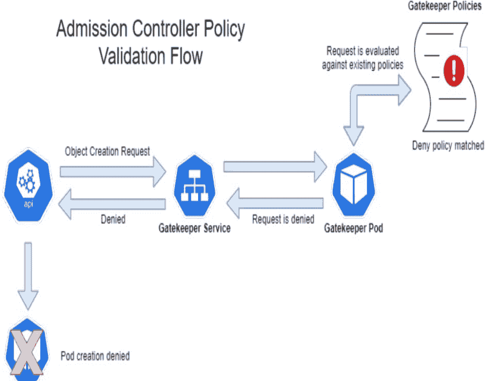
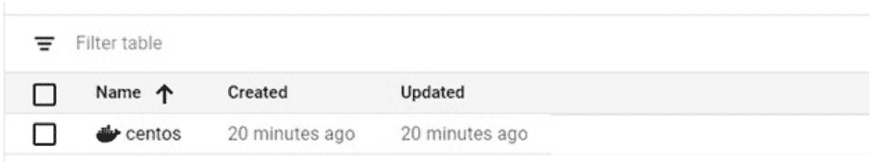
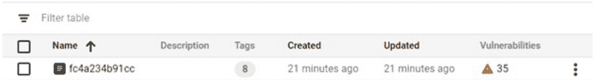
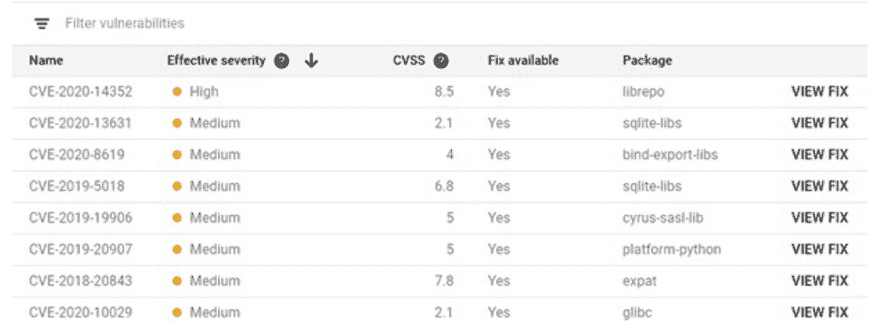
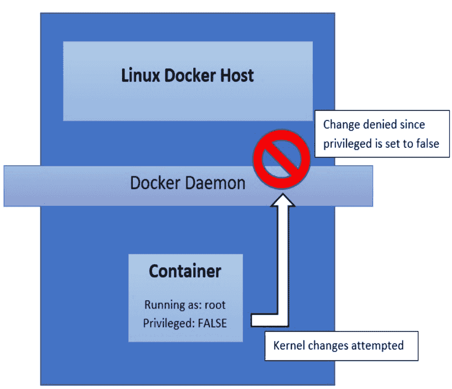
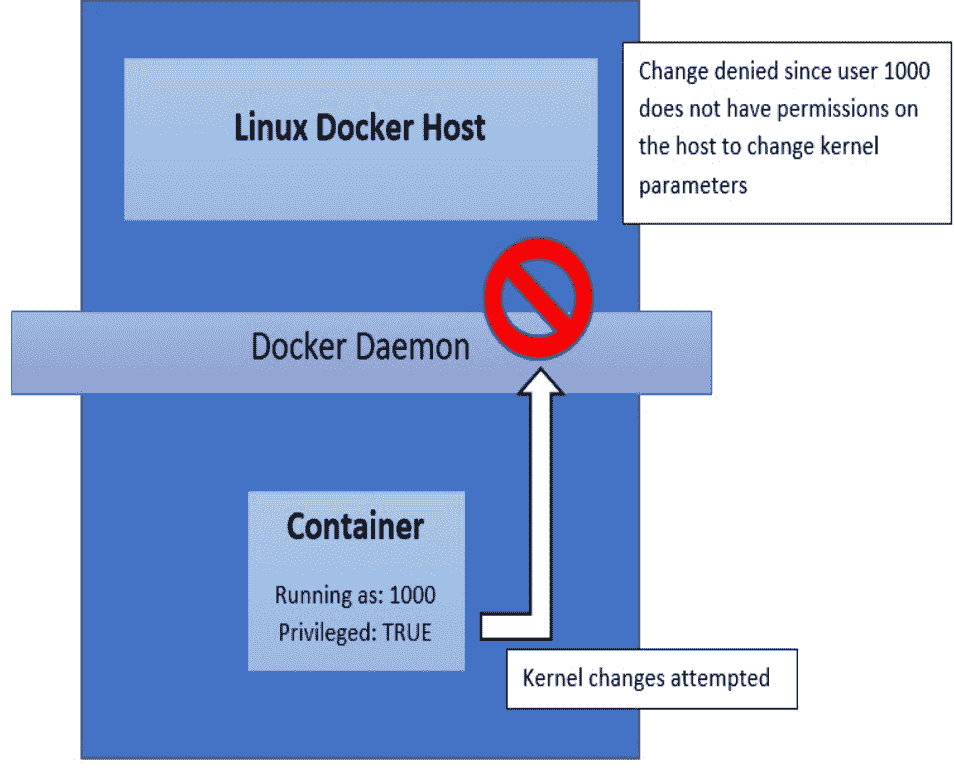
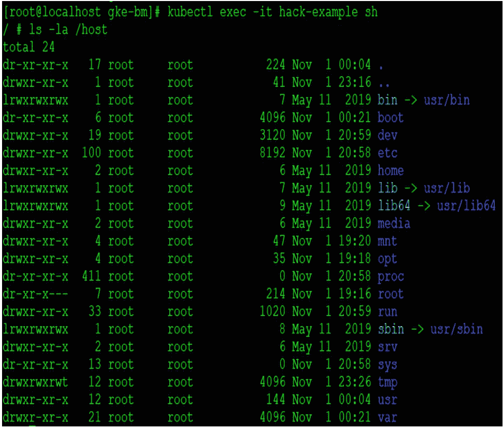

## 16 Using Anthos for security and policies

by Scott Surovich

### This chapter covers:

- Kubernetes security overview
- Hypervisor versus Container runtime security
- Kubernetes security overview and Anthos security features
- Understanding root versus privileged containers
- Using ACM to secure a cluster
- Understanding Container Vulnerability Scanning

Google has made deploying Anthos clusters an easy, automated process. Since the process is automated, administrators may not consider anything past the initial simple cluster creation. When you deploy a cluster without considering post-installation tasks like security, there is a high likelihood that an attacker will be able to take control of your cluster with very little effort.

Like many base installations of a product, a new Kubernetes cluster will include few, if any, enhanced security settings. For most enterprise systems, this is by design. Rather than force a rigid security model on an organization, potentially enabling features that may not be usable in some organizations, they opt to make security a post cluster-installation process that is designed and implemented by the organization.

In today’s connected world, it seems that a day doesn't go by without reading about some new hacking attack. Ransomware, botnets, distributed denial-of-service attacks (DDoS), and countless others are becoming a daily cat and mouse game between organizations and hackers. Regardless of the placement of your cluster, on-prem or off-prem, you need to secure all areas that can be exploited. Failure to sufficiently plan for these attacks can lead to data leaks, service interruptions, fines, or loss of revenue.

In this chapter we will discuss the features that Anthos provides to secure your Kubernetes clusters. Utilities like Anthos Config Management (ACM) and the Anthos Service Mesh (ASM) offer features to secure a cluster, limiting or blocking the actions from bad actors and honest user mistakes.

For example, a default installation of Kubernetes may allow a user to deploy a container that mounts host volumes, uses the host PID and host networking, runs as root, or runs in privileged mode. All of these can lead to different issues, but let's look at one of the most dangerous: privileged containers. A privileged container will allow a user to mount the host's root filesystem into a mount point in the running container. Once the filesystem is mounted, a user is able to exec into the running container and browse the entire filesystem of the worker node. With the host file system mounted, the attacker could go one step further and remount the root filesystem, allowing them to halt a running container, start a new rogue container, or destroy the host operating system filesystem.

Running a privileged container is a commonly used example that shows why you need to add additional security to a cluster. While security policies are usually the first type of policy created for a cluster, you can’t forget about other settings that can have an impact on the cluster and your services. To secure a cluster, you need to understand what an attacker may do that will lead not only to a security breach, but service interruptions and data loss as well.

## 16.1 Technical requirements

The hands-on portion of this chapter will require you to have access to a Google Kubernetes Engine cluster running in GCP with Anthos Configuration Management and Policy Controller enabled.

## 16.2 Hypervisors Versus Container Runtimes

When a new technology is released, it’s commonly deployed without the appropriate knowledge required to run it securely. This often causes people to consider the new technology as less secure than a more mature technology,


像容器与虚拟机之间的区别。直到最近，人们普遍认为容器不如虚拟机安全，许多人指出容器共享主机内核是主要的安全隐患。

这种共享内核为恶意行为者提供了攻击途径，可能允许他们入侵一个安全性不足的容器，并从那里突破到主机本身。如果攻击者突破了容器，他们可能获得对主机操作系统的完全控制。这通常与运行在超visor上的虚拟机形成对比，在虚拟机中，突破是不可能发生的。还是有可能的？

多年来，不同的超visor都存在通用漏洞和暴露（CVEs）（有关 CVEs 的更多信息可访问 https://cve.mitre.org/），导致不同程度的安全问题，包括权限提升，使攻击者能够以管理员权限访问超visor。一旦被攻破，攻击者将能够访问主机上的每个虚拟机，包括用于运行虚拟机的虚拟磁盘。

本节无意引发关于容器安全与虚拟机安全之争。我们的意图是指出没有任何系统是完全安全的，当像 Kubernetes 这样的系统在不了解基本安全的情况下部署时，你将自己和你的组织置于风险之中。

让我们来看看在集群被视为“生产就绪”之前需要检查的一些常见 Kubernetes 安全问题。

## 16.3 Kubernetes 安全概述

一个基础的 Kubernetes 集群通常只启用非常有限的安全设置，如果有的话。这就要求组织自行处理安全问题，其中包括：

- 配置任何基础 Kubernetes 安全功能
- 寻找附加产品来解决基础集群中未包含的任何缺失安全
- 对每种组件的安装和支持进行员工教育
- 扫描镜像中的漏洞
- 启用网络安全以加密工作负载之间的流量

在某些组织中，这些可能听起来不是难以克服的障碍。你可能已经知道各种开源包可以为集群添加安全功能，例如准入控制器，如 OPA（Open Policy Agent）或 Gatekeeper（[https://github.com/open-policy-agent/gatekeeper](https://github.com/open-policy-agent/gatekeeper)）。组织可以决定使用开源项目发布版部署 Gatekeeper，但这将使他们自行处理内部支持或在 Gatekeeper 的 Github 仓库提交问题。当准入控制器出现问题时，可能会对集群产生不利影响，可能导致每个部署请求出现问题。在你亲身经历过准入控制器问题之前，你可能无法完全理解其影响以及拥有支持联系人如何成为拯救集群的关键。

在本書中，我们讨论了 Anthos 如何通过提供由完整 Google 支持支持的集群附加组件，将 Kubernetes 集群提升到下一个水平。安全是 Anthos 擅长的关键领域之一，正如你在 Anthos Config Management 章节中学到的那样，你了解了 ACM 的一些功能，包括配置同步和 Config Connector。ACM 还可用于配置 Kubernetes 安全的基础方面，包括 Roles 和 RoleBindings，但也通过包含 Gatekeeper 策略引擎提供了额外的安全保障。

在更深入地研究 Policy Controller 以及可与其实施的策略之前，让我们快速回顾一下作为基础 Kubernetes 安装的一部分提供的安全机制。

### 16.3.1 理解 Kubernetes 安全对象

作为集群管理员，你需要了解包含的安全选项以及它们如何解决或未解决你组织的<|message|>安全策略。对 Kubernetes 包含的基础安全对象进行全面覆盖超出了本章的范围。它们在此呈现是为了提供一个概述，你可以使用提供的参考链接进行深入了解。

访问部署可能导致服务中断的工作负载和配置。因此，从集群安全角度来看，我们需要制定具体策略，以最大限度地减少部署漏洞的可能性。虽然一些组织能够完全通过以人为本的策略来实现这一点，但最好的安全策略是那些执行机制自动且不依赖人工干预的策略。

与任何计算抽象平台一样，Kubernetes 存在多条攻击途径，尤其是在默认配置中。其中一些在某种程度上始终存在，以提供集群中工作负载的价值。一个存储和检索数据库数据的中间件服务始终需要访问数据库服务器，从而在两个组件之间留下开口。

任何组织都应减少其系统可能的攻击途径。然而，没有一个组织完全相同。因此，大多数 Kubernetes 发行版都带有故意较少限制的安全设置。Kubernetes 管理员的首要任务应该是应用更严格的一组安全策略，以符合其组织的指令和需求。我们无法提供适用于每个组织的每种可能策略的详尽列表[1]。然而，这里有一些适用于大多数集群的基本策略，我们将在这里介绍。

### 特权容器和 root 用户

容器化编排系统的一大优势是通过与底层容器共享系统内核（以及通常文件系统的一部分）来减少资源使用；Kubernetes 也不例外。这些编排器，包括 Kubernetes，包含保护措施以防止容器内的进程直接访问主机机器的资源。然而，编排系统的某些组件可能需要以用户或 root 身份访问主机基础设施的特定部分。在容器内镜像构建器开发之前，这是在容器内干净环境中构建镜像的常见方式。

在 Kubernetes 中，容器“突破”并向主机系统发出命令的能力是通过容器或 Pod 规范上的 `privileged` 标志来控制的。以单个用户身份在主机系统上运行命令在大多数情况下可能用处有限，除非容器以超级用户运行，或假定其身份。出于简单性，许多公开可用的容器镜像在内部以 root 用户运行，以避免容器内的权限问题。然而，如果 `privileged` 标志设置为 true，这将允许容器内的进程突破并以超级用户身份影响主机系统。

必须采取两个保护措施来防止容器以超级用户账户运行：强制容器防止权限提升，以及防止镜像默认以 root 用户运行。

以前，Kubernetes 包含 PodSecurityPolicy 对象类型来强制执行已部署 Pod 的特定策略。然而，PSP 从 Kubernetes 1.21 开始已被弃用，并将在 1.25 版本中以当前形式移除。Kubernetes SIG 决定弃用 PSP 的原因有很多，包括：

- 由于策略的应用方式，难以排查策略。PSP 绑定到 Pod 的 ServiceAccount 或提交请求的 user。
- 无法限制 PersistentVolumeClaims 的类型，这意味着用户可以使用 HostPath 创建 PVC。
- 失败封闭，这意味着如果未定义策略，操作将失败。由于这种行为，你不能在推出集群初期启用 PSP，你需要在为整个集群启用 PSP 之前创建所有策略。

即使在 PSP 被弃用之前，许多组织也因上述限制而跳过使用它们。相反，他们决定实施像 Gatekeeper 这样的准入控制器（以前称为 OPA，或 Gatekeeper 1.0）。

为了保护集群，你需要在能够缓解风险之前思考恶意行为者会尝试执行什么。让我们讨论一下在新集群上线前你需要考虑的一些常见安全问题。


- 集群中 Pod 之间未加密的流量
  - 可能导致数据泄露
- 导致所有 Istio 服务中断

这只是需要考虑以提高集群安全性和可用性的常见问题的简短列表。如果你必须考虑可能影响 Kubernetes 应用的每种场景，可能需要花费数月时间创建解决每个任务的策略，并且无法涵盖你未想到的场景。太常见了，你只会在事件发生后才了解到自己未考虑到的操作。

Anthos 包含提供集群配置管理和增强安全性的产品，包括由社区和 Google 开发的一套策略。但是，在深入介绍 Anthos 安全和策略功能之前，让我们回顾一下通用容器安全，以便我们了解 Anthos 提供的工具的需求。

```
<Reevaluate this...common vulnerabilities, then Policy Controller
<Explain Gatekeeper policies and templates>
<Pull the PSPNoPrivileged example up here and trim>
<Pull the specific namespace exemption up here and combine it with
<Do the global exemptions later in the chapter>
```

## 16.4.1 了解 Policy Controller

ACM 的 Policy Controller 为集群提供了一个准入控制器。准入控制器是根据一组策略评估对象请求的引擎，该引擎将允许或拒绝对象的创建。

当你启用策略引擎时，会创建一个 ValidatingWebhookConfiguration，将引擎作为准入控制器注册到 API 服务器。注册后，API 服务器将对象请求发送到准入控制器进行评估，如下所示。

**图 16.1 准入控制器策略验证流程**



在上述工作流程中，API 服务器收到了创建新 Pod 的请求。由于集群已安装 ACM 并启用了 Policy Controller，请求将被发送到 Gatekeeper 服务，该服务将请求转发到 Gatekeeper Pod，后者检查配置的策略是否存在违规。

此时，你可能会想知道一旦部署 Gatekeeper，集群可能会遇到什么样延迟或性能问题。平均而言，策略评估大约需要 1 毫秒，即使评估较大策略也是如此。像任何允许你创建自己的对象的系统一样，有可能创建会影响策略引擎性能的策略，从而导致整体系统延迟。创建策略超出了本章的范围，如果你想了解有关策略和性能的更多信息，可以在 Open Policy Agent 网站上找到更多详细信息，网址为 [https://www.openpolicyagent.org/docs/latest/policy-performance/](https://www.openpolicyagent.org/docs/latest/policy-performance/)

在图 16.1 所示的示例中，发现了一个拒绝请求的策略，导致准入控制器将拒绝发送给 API 服务器。由于准入控制器返回了拒绝，API 服务器将不会创建对象，并将使用策略引擎提供的错误更新对象的状态。

策略引擎是一个简单的评估系统，检查请求并决定是否允许请求。它们流程相当简单，但策略引擎的真正强大之处在于策略本身，它们提供了决策过程的逻辑。在 ACM 中，我们使用约束模板和约束在集群中实现安全策略。在下一节中，我们将解释约束模板是什么以及它们如何通过创建约束在集群中实现。

## 介绍 Gatekeeper 约束模板

将约束模板视为策略引擎用于对请求做出决策的逻辑。当 Gatekeeper 在集群上启用时，它将创建包含常见用例规则的默认策略集。在撰写本文时，ACM 的策略控制器包含 32 个模板，包括：

- 允许的容器注册表
- Istio 特定策略
- 资源约束
- 提供与 Pod 安全策略类似安全性的替代安全策略

**注意：**

你可以通过访问 [https://cloud.google.com/anthos-config-management/docs/reference/constraint-template-library](https://cloud.google.com/anthos-config-management/docs/reference/constraint-template-library) 找到每个模板的完整列表以及每个模板的描述

每个策略都是一个名为 ConstraintTemplate 的自定义资源类型；你可以通过执行 `kubectl get constrainttemplates` 查看集群中的所有模板。下面显示了一个简短列表。

**图 16.2 约束模板列表**

| NAME | AGE |
| --- | --- |
| allowedserviceportname | 50m |
| destinationruletlsenabled | 49m |
| disallowedauthzprefix | 49m |
| k8sallowedrepos | 49m |
| k8sblockprocessnamespacesharing | 49m |
| k8scontainerlimits | 49m |
| k8sdisallowedrolebindingsubjects | 49m |
| k8semptydirhassizelimit | 49m |
| k8shttpsonly | 49m |
| k8slocalstoragerequiresafetoevict | 49m |
| k8smemoryrequestequalslimit | 49m |
| k8snoexternalservices | 49m |
| k8spspallowedusers | 49m |

约束模板本身只是策略的定义，将用于评估的逻辑。

在下一节中，我们将解释如何使用约束模板创建约束，从而在集群上启用所选策略。

## 启用策略

要启用策略的强制执行，你需要创建一个定义约束的 YAML 文件，该约束将在新对象 **创建** 时进行评估。*这是一个需要牢记的关键行为* —— 由于策略引擎是准入控制器，它仅在对象创建或准入集群时评估对象。它 **不会** 对任何现有对象强制执行策略，直到它们被重新创建为止。这经常被刚接触 Gatekeeper 的用户忽略，是你在集群中实施新策略时需要记住的关键点。

前面我们解释了以特权容器启动的容器可用于破坏主机并最终破坏集群。由于这种可能性，你可能希望拒绝创建特权 Pod，并且由于这是常见用例，ACM 包含一个拒绝特权容器的模板。下面示例清单将创建一个名为 *deny-* 的对象

## 审计约束

在强制执行新约束之前，你应该先对其进行集群测试，以避免任何意外结果。如上一节所述，当你创建新约束时，默认情况下会强制执行它。此默认行为可以更改，从强制执行更改为审计，只需在约束清单中添加 enforcementAction: dryrun 选项即可。使用 psp-privileged-container 示例，我们可以添加 dryrun 选项以将默认强制行为从强制更改为审计。

```
apiVersion: constraints.gatekeeper.sh/v1beta1
kind: K8sPSPPrivilegedContainer
metadata:
  name: psp-privileged-container
spec:
  enforcementAction: dryrun
  match:
    kinds:
      - apiGroups: [""]
        kinds: ["Pod"]
```

现在强制执行已更改为审计，任何违反约束的 Pod 仅会被记录为违规，但仍将被允许启动。此外，与默认强制行为不同，将约束设置为 dryrun 将评估不仅是新请求而且所有正在运行的 Pod。这使你能够验证约束对每个 Pod 的影响，而不仅仅是新请求，因此你将知道它会对任何重启的 Pod 产生什么影响。

设置 dryrun 后，你可以使用 `kubectl get <constraint kind> <constraint name> -o yaml` 查看审计结果。对于我们的示例，我们可以通过执行 `kubectl get K8sPSPPrivilegedContainer psp-privileged-container -o yaml` 查看受影响的 Pod。取决于违规数量，你可能会收到受影响容器的冗长列表。下面输出是运行裸金属 Anthos 的默认集群的简短列表。

```
violations:
  - enforcementAction: dryrun
    kind: Pod
    message: 'Privileged container is not allowed: cilium-agent, {"capabilities": {"add": ["NET_ADMIN", "SYS_MODULE"]}, "pri
```


```
name: anetd-4nldm
namespace: kube-system
- enforcementAction: dryrun
  kind: Pod
  message: 'Privileged container is not allowed: kube-proxy, se true}'
  name: kube-proxy-4z8qh
  namespace: kube-system
```

输出显示，如果我们强制执行此策略，kube-proxy 和 Cilium Pod 将被拒绝启动。这形成了一个两难局面，我们希望禁止特权容器运行，但又需要特权容器来允许系统容器运行。某些容器违背会阻止容器启动的策略的情况并不少见。由于这是常见场景，策略引擎允许你将命名空间从所有策略或仅特定策略的评估中豁免。

## 创建命名空间豁免

一旦创建约束，它将影响启动的每个容器，而不会考虑正在启动的 Pod 类型。许多常见的系统容器，如网络或日志代理，需要可能被集群策略拒绝的权限。由于策略保护集群，它们在集群范围内、跨所有命名空间执行。这对某些策略可能有效，但其他策略可能会阻止合法容器被调度。为了允许例外，准入控制器包含控制项，允许命名空间从所有策略或仅选定策略中豁免。

### 从特定处理中豁免命名空间

要将命名空间从所有 Gatekeeper 流程中豁免，可以创建一个包含要豁免的命名空间的配置对象。你可以使每个命名空间从所有 Gatekeeper 功能中豁免，或仅豁免某些流程，如审计，通过添加一个或多个处理选项。下表显示了可以设置的四个处理选项：

**Table 16.2 Namespace exemption options**

| Process Option | Results of Exception |
|---|---|
| audit | Namespace(s) will not report audit results, but will still be part of the webhook and sync processes. |
| webhook | Namespace(s) will be exempt from the admission controller, but will still be part of the audit and sync processes. |
| sync | Namespace(s) resources will not be reported into Gatekeeper, but will still be part of the audit and webhook processes. |
| * | Exempts the namespace(s) from all Gatekeeper processes. |

例如，我们可能希望将几个命名空间从所有 Gatekeeper 处理中豁免。要豁免所有流程，我们可以创建一个新的 Config，其中包含命名空间，并在 processes 字段中使用 *。下面显示的清单将创建一个配置，使 kube-system 和 gatekeeper-system 命名空间从所有 Gatekeeper 流程中豁免。

```
apiVersion: config.gatekeeper.sh/v1alpha1
kind: Config
metadata:
  name: config
  namespace: "gatekeeper-system"
spec:
  match:
    - excludedNamespaces: ["kube-system", "gatekeeper-system"]
      processes: ["*"]
```

你可以通过添加额外的匹配，为不同命名空间添加不同的流程豁免。例如，你可以创建一个仅使命名空间从 webhook 流程中豁免的匹配，而另一个命名空间可能仅从 Gatekeeper 的审计流程中豁免。

### 从所有策略中豁免命名空间

在某些组织中，为所有 Gatekeeper 策略创建例外可能会违反安全标准。创建命名空间豁免快速且简单，但它将使该命名空间中的每个部署从所有 Gatekeeper 策略中豁免，无一例外。

要将命名空间从所有策略中排除是一个两步过程。第一步是添加策略引擎将允许忽略策略的命名空间列表，第二步是使用 `admission.gatekeeper.sh/ignore=true` 为你想要豁免的命名空间添加标签。

如果你尝试跳过第一步并且仅为命名空间添加标签以豁免它，你将从 API 服务器收到错误，仅豁免命名空间可以具有 ignore 标签：

```
Error from server (Only exempt namespace can have the admission.g
```

在为命名空间添加标签之前，你必须先通过编辑已安装的 configManagement 对象并在 `exemptableNamespaces` 字段中添加命名空间列表来添加命名空间，该字段使用 GCP 控制台添加。

要允许使用 Anthos 控制台将命名空间添加为豁免，你需要编辑集群的配置管理设置。在 GCP 控制台中，打开 Anthos > Config Management，以查看可用集群列表。选择要配置的集群旁边的单选按钮，然后单击 GCP 控制台页面顶部的配置按钮。如果展开设置并滚动到底部，你将看到策略控制器部分，然后单击集群的 ACM 设置，其中包含豁免命名空间列表。

Figure 16.3 Adding an exemption using the GCP console

为命名空间添加标签以忽略 Gatekeeper 将导致准入控制器忽略该命名空间中创建的任何对象的每个策略。 rather than 豁免命名空间免受每个策略的影响，你可能希望考虑将命名空间从单个策略中豁免，从而允许你强制执行某些策略，同时仅豁免对象在命名空间中创建所需的策略。

### 从约束模板中豁免命名空间

如果你发现自己需要将某个命名空间从策略中豁免，但不能将命名空间从所有策略中豁免，你可以向约束本身添加豁免。例如，我们有一个策略要求所有命名空间都分配计费代码。然而，你希望豁免 kube-system 命名空间和将要创建的新命名空间 web-frontend。我们可以通过向约束添加 `excludedNamespaces` 字段来做到这一点：

```
apiVersion: constraints.gatekeeper.sh/v1beta1
kind: K8sRequiredLabels
metadata:
  name: ns-billing
spec:
  match:
    kinds:
    - apiGroups: [""]
      kinds: ["Namespace"]
    excludedNamespaces:
    - kube-system
    - web-frontend
  parameters:
    labels:
    - key: "billing"
```

如果我们尝试创建名为 test-fail 且没有标签的新命名空间，Gatekeeper 将使用以下错误拒绝请求：

```
Error from server ([denied by ns-billing] you must provide labels
```

然而，如果我们尝试在没有标签的情况下创建 web-frontend 命名空间，Gatekeeper 将允许它，因为它包含在约束的 excludedNamespaces 中。

```
[root@localhost gke-bm]# kubectl create ns web-frontend
namespace/web-frontend created
```

ACM 提供细粒度的控制来豁免命名空间，通过提供将命名空间从所有策略或仅特定策略中豁免的能力。你可以为不同命名空间使用每种类型的混合，豁免一个命名空间免受所有策略的影响，而其他命名空间可能仅从某些策略中豁免。尽量避免将命名空间从所有策略中豁免，除非有充分的理由这样做。一旦豁免，对完全豁免的命名空间将永远不会强制执行任何策略。

虽然 Anthos 包含许多约束模板，但在某些情况下你可能需要创建自定义约束。在下一节中，我们将解释如何创建自定义约束模板，从而允许你扩展包含的策略集。

## 创建约束模板

ACM 包含的默认模板库已从早期版本中的少数策略增长到最新版本中的 32+。Google 和社区将继续向默认库添加策略，但你可能对集群有 Google 未提供的独特策略要求。

如果你发现自己需要创建策略，可以通过使用一种名为 Rego 的语言创建自己的策略来创建自定义约束模板。本书的范围不包括深入介绍 Rego，但你可以阅读有关 Rego 的更多信息以及如何使用它来创建策略 https://www.openpolicyagent.org/docs/latest/policy-reference/。

要创建新模板，你需要创建一个新的 ConstraintTemplate 对象，其中将包含用于评估策略的 Rego 代码。Google 提供了文档来帮助你创建模板 https://cloud.google.com/anthos-config-management/docs/how-to/write-a-constraint-template#example_constraint。

下面的示例将创建一个新模板，用于检查创建新容器时是否存在镜像摘要。


```
apiVersion: templates.gatekeeper.sh/v1beta1
kind: ConstraintTemplate
metadata:
  name: k8simagedigests
spec:
  crd:
    spec:
      names:
        kind: K8sImageDigests
  targets:
  - target: admission.k8s.gatekeeper.sh
    rego: |
      package k8simagedigests

      violation[{"msg": msg}] {
        container := input.review.object.spec.containers[_]
        satisfied := [re_match("@[a-z0-9]+([+._-][a-z0-9]+)*:[a
        not all(satisfied)
        msg := sprintf("container <%v> uses an image without a
      }

      violation[{"msg": msg}] {
        container := input.review.object.spec.initContainers[_]
        satisfied := [re_match("@[a-z0-9]+([+._-][a-z0-9]+)*:[a
        not all(satisfied)
        msg := sprintf("initContainer <%v> uses an image withou
      }
```

需要注意的是，Rego 代码包含两个 violation 部分。乍一看，代码似乎对两者相同，但仔细检查后，你会注意到 container := 行上有一个细微的差异。第一个 violation 块将检查所有容器是否使用 digest，而第二个 violation 块将检查所有 initContainers 是否使用 digest。由于它们都是唯一的对象，我们需要在代码中包含每个对象，否则策略引擎将不会检查它。

最后，为了激活约束，我们应用一个使用上述模板创建的新自定义资源 K8sImageDigests 的清单。

```
apiVersion: constraints.gatekeeper.sh/v1beta1
kind: K8sImageDigests
metadata:
  name: container-image-must-have-digest
spec:
  match:
```

- 云安全指挥中心集成
- 审计日志
- Cloud KMS 支持
- 使用开源工具 Kritis 进行签名验证
- 试运行支持
- Breakglass 支持
- 第三方支持，包括 Twistlock、Terraform 和 CloudBees 的支持

除了提供的功能外，你还可以将 BinAuth 与 Google 的 Cloud Build 和容器注册表扫描集成，从而基于构建元数据和漏洞扫描来保护你的供应链。Google 有许多集成文档，可指导你将 BinAuth 与 CircleCI、Black Duck、Terraform 和 Cloud Build 等多个系统集成，位于 Binary Authorization 页面，链接为 https://cloud.google.com/binary-authorization/

## 16.4.3 使用 Gatekeeper 替代 PSPs

随着 Kubernetes 开始弃用 PSPs，你可能希望开始远离使用 PSPs 来保护集群。一种摆脱以 PSPs 作为主要安全机制的方法，是改用 Gatekeeper 策略而不是 PSPs。

Gatekeeper 项目有一个专门用于设计替代 PSPs 的策略的 Github 仓库，地址为 https://github.com/open-policy-agent/gatekeeper-library/tree/master/library/pod-security-policy。

在下一节中，我们将通过学习使用 Google Container Scanner 保护你的镜像来结束本章。

## 16.5 了解容器漏洞扫描

像任何标准操作系统或应用程序一样，容器可能包含已知漏洞的二进制文件。为了保持集群安全，你需要通过持续扫描每个容器来验证容器的完整性。

目前市场上有很多解决方案可以扫描容器漏洞，包括 Aqua Security、Twistlock、Harbor 和 Google 的 Container Registry。这些工具提供不同级别的扫描能力，在大多数情况下需要额外费用。至少，你需要扫描镜像是否存在来自通用漏洞和暴露列表 [Common Vulnerabilities and Exposures，CVE] 的漏洞。

CVE 列表 [2] 是各种软件组件，包括操作系统和库的安全漏洞的公开披露列表。列表中的条目仅包含漏洞的简要概述，不包含影响、风险或如何修复问题等详细信息。要获取 CVE 的详细信息，每个条目都有一个链接，可带你进入国家漏洞数据库 [National Vulnerability Database，NVD]，该数据库将提供有关 CVE 的更多详细信息，包括描述、严重性、参考资料和变更历史。

虽然 Anthos 不包含漏洞扫描程序，但如果你将镜像存储在 Google 的 Container Registry 中，Google 会提供扫描服务。在本节中，我们将解释如何在你的仓库上启用扫描，以及如何查看扫描结果。

### 16.5.1 启用容器扫描

在注册表中启用扫描的第一个要求是在你的 GCP 项目上启用两个 API，即 container analysis API 和 container scanning API。container analysis API 启用项目中的元数据存储，免费，而 container scanning API 将启用漏洞扫描，按扫描的镜像计费。你可以在 https://cloud.google.com/container-registry/pricing 查看扫描 API 的定价详情。

要使用 gcloud CLI 启用所需的 API，请按照以下步骤操作：

- 1. 设置默认项目。我们的示例使用名为 test1-236415 的项目。

- 将新镜像推送到注册表

例如，要将 CentOS 8 镜像添加到注册表，请按照以下步骤操作：

- 1. 从 Docker Hub 下载 CentOS 8 镜像

```
docker pull centos:8
```

- 2. 接下来，使用 Google 注册表信息为新拉取的镜像打标签。当你为将存储在 GCP 注册表中的镜像打标签时，必须遵循特定的命名约定。镜像标签将使用约定 <registry location>-.pkg.dev/<project_ID>/<registry-name>/<image_name>。在示例中，区域为 us-east4，使用项目 test-236415 和名为 docker-registry 的注册表。

```
docker tag centos:8 us-east4-docker.pkg.dev/test1-236415/docker-r
```

- 3. 最后，将新镜像推送到注册表

```
docker push us-east4-docker.pkg.dev/test1-236415/docker-registry
```

在下一节中，我们将解释如何查看你的镜像以及其中发现的任何漏洞。

### 16.5.3 查看镜像漏洞

由于我们的项目已启用所需的 API，每个镜像在推送到注册表时将被扫描。要查看漏洞，请打开 GCP 控制台并点击工具部分下的 Artifact Registry，然后点击 repositories。

图 16.4 导航到你的注册表

这将列出项目中的所有注册表。继续我们的示例，我们创建了一个名为 docker-registry 的注册表，如下图所示。

图 16.5 项目注册表

打开你推送镜像到的仓库并点击镜像以查看镜像。之前，我们将 CentOS 镜像推送到我们的注册表。

图 16.6 镜像列表



点击你想要查看更多详细信息的镜像，将显示镜像的摘要以及镜像包含的漏洞数量。在我们的示例中，

图 16.7 镜像哈希列表



要查看每个漏洞，请点击漏洞列中的数字，这将打开一个新窗口，列出镜像的所有 CVE。根据镜像和扫描结果，你可能会看到不同的链接或 CVE 选项。以我们的 CentOS 镜像示例为例，我们可以看到结果为每个 CVE 提供了查看修复的链接。

图 16.8 带有修复的 CVE 示例列表



在另一个示例中，Ubuntu 镜像的 CVE 中没有列出修复，因此结果屏幕将包含不同的选项。

图 16.9 无修复的 CVE 示例

| Name | Effective severity | CVSS | Fix available | Package |  |
|---|---|---|---|---|---|
| CVE-2018-20839 | Medium | 5 | - | systemd | VIEW |
| CVE-2019-13050 | Low | 5 | - | gnupg2 | VIEW |
| CVE-2018-1000654 | Low | 7.1 | - | libtasn1-6 | VIEW |
| CVE-2019-12904 | Low | 4.3 | - | libgcrypt20 | VIEW |

你可以通过点击名称列中的 CVE 或点击最右侧的 VIEW 链接来查看每个 CVE 的更多详细信息。点击 CVE 名称将带你到供应商网站，而点击 view 链接将提供有关漏洞的更多详细信息。

在本节中，我们介绍了 Google 的容器注册表扫描、如何启用它以及如何查看扫描结果。这只是对该服务的介绍，你可以通过与 Pub/Sub 集成、添加访问控制等来扩展功能。要查看更多文档，你可以访问 Google 的 How-to 指南 https://cloud.google.com/container-analysis/docs/how-to

## 16.6 了解容器安全

在创建安全策略时需要考虑两个主要概念：容器将以哪个用户运行，以及容器是否可以以特权模式运行。这两者最终决定了潜在的容器逃逸对主机拥有的访问权限，如果有的话。

当容器启动时，它将以镜像创建时设置的用户运行，这通常是 root 用户。然而，即使你以 root 运行容器，也不意味着容器内的进程将在工作节点上拥有 root 访问权限，因为 Docker daemon 本身会限制主机级别的访问——这取决于有关特权容器的策略。


为帮助解释这一点，请参考下表了解每个设置以及由此产生的权限。

## 表 16.3 Root 和特权容器权限

| 运行容器用户 | 特权值 | 主机权限 |
|---|---|---|
| 以 root 运行 | False | None |
| 以 root 运行 | True | *Root access* |
| 以非 root 运行 | False | None |
| 以非 root 运行 | True | Limited, only permissions that have been granted to the same user on the host system |

这两个值决定了运行中的容器将在主机上获得什么权限。仅仅以 root 运行镜像并不会允许该容器在主机本身上以 root 身份运行。为了更详细地解释其影响，我们将展示以 root 运行容器时会发生什么，以及允许用户部署特权容器如何使某人接管主机。

## 16.6.1 以 Root 运行容器

多年来，容器安全一直享有某种不好的声誉。许多被用作证据支持这一点的示例实际上并不是容器问题，而是集群上的配置问题。 不久前，许多开发人员创建以 root 运行的新镜像，而不是创建新用户并以新用户运行，从而限制了任何安全影响。这是一个很好的时机来提及，如果你经常从第三方镜像仓库下载镜像，你应该始终在沙箱环境中运行它们，然后再在生产中使用。你不知道镜像是如何创建的，以谁身份运行，或是否包含任何恶意代码 - 在生产中运行之前始终检查镜像。本章的最后一节中，我们将介绍 Google 的 Container Scanning，它将扫描你的镜像以查找已知的安全问题。

你可以使用多种工具来限制恶意容器的部署，包括：

- Container scanning - Included in the Google Container Registry with scanning
- Allowing only trusted container repositories
- Requiring images to be signed

最危险且最常被忽视的安全问题之一是允许容器以 root 运行。为了解释为什么这是不好的做法，让我们使用虚拟机示例 - 你会允许应用程序以 root 或管理员身份运行吗？当然不会。如果你有一个以管理员身份运行进程的 Web 服务器，任何应用程序突破都将获得运行该进程的用户权限。在这种情况下，那将是一个具有 root 或管理员权限的账户，提供对整个系统的完全访问。

为了减轻突破带来的任何问题，所有应用程序都应以其最少所需权限集运行。不幸的是，开发人员以 root 运行容器的情况太常见了。通过以 root 运行容器，任何容器突破都将授予入侵者访问主机上任何资源的权限。Docker hub 或 Github 上的许多镜像都是使用 root 作为默认用户分发的，包括常见的 `busybox` 镜像。

为了避免以 root 运行镜像，你需要在镜像中创建并设置用户账户，或在启动容器时提供用户账户。由于 `busybox` 通常从 Docker hub 拉取，我们可以通过在部署中配置 security context 以非 root 账户运行它。

作为 pod 定义的一部分，可以通过添加 securityContext 字段强制容器以用户身份运行，这允许你设置用户、组和 fsGroup 的上下文。

```
spec:
  securityContext:
    runAsUser: 1500
    runAsGroup: 1000
    fsGroup: 1200
```

使用额外的 securityContext 部署镜像将以用户 1500 执行容器。我们还将组设置为 1000，fsGroup 设置为 1200。我们可以使用 `whoami` 和 `groups` 命令确认所有这些值，如下图 Figure NNNN 所示：

Figure 16.10 A pod running as the root user, and using securityContext to change the defined user and user groups.

```
```shell
busybox-example $ kubectl exec deploy/busybox-example -- whoami
root
busybox-example $ kubectl patch deployment busybox-example -p '
{
  "spec": {
    "template": {
      "spec": {
        "securityContext": {
          "runAsUser": 1500,
          "runAsGroup": 1000,
          "fsGroup": 1200
        }
      }
    }
  }
}'
deployment.apps/busybox-example patched
busybox-example $ kubectl exec deploy/busybox-example -- whoami
whoami: unknown uid 1500
command terminated with exit code 1
busybox-example $ kubectl exec deploy/busybox-example -- groups
1000groups: unknown ID 1000
groups: unknown ID 1200
 1200
command terminated with exit code 1
busybox-example $
```
```

使用的 UID 和组 ID 在镜像中是未知的，因为它是从 Docker hub 拉取的，并且它只包含在创建镜像时包含的用户和组。在你或你组织中创建的镜像中，你会在构建镜像之前添加所需的组，并且不会收到未知 ID 警告。

在本节中，我们解释了如何设置 security context 以在部署时以非 root 用户或组运行镜像。这只涵盖了保护主机免受恶意容器侵害的第一半部分，下一个部分将解释特权容器如何影响我们的安全以及它们如何协同工作以提供对主机的访问。

## 16.6.2 运行特权容器

默认情况下，容器将不带任何主机特权执行。即使你以 root 启动容器，任何尝试编辑任何主机设置的操作都将被拒绝。

Fig. 16.11 Non-privileged container running as root



例如，我们可以尝试从以 root 运行但不是特权容器的容器中设置内核值。

### Fig. 16.12 Example kernel change from a container without privileges

```
[root@localhost ~]# kubectl exec -it root-demo sh
/ $ sysctl kernel.domainname=test.com
sysctl: error setting key 'kernel.domainname': Read-only file system
```

内核更改被拒绝，因为运行的镜像在主机系统上没有提升的权限。如果有理由允许从容器执行此操作，镜像可以作为特权容器启动。要运行特权容器，你需要在 pod 的 securityContext 中允许它。

在下面的屏幕截图中，注意域名更改不会返回错误，验证容器可以修改主机级别设置。

### Fig. 16.14 Host Kernel change allowed from a running container

```
[root@localhost ~]# kubectl exec -it root-demo sh
/ # sysctl kernel.domainname=test.com
kernel.domainname = test.com
```

这次，内核更改之所以成功有两个原因，第一是容器以 root 用户运行，第二是容器被允许作为特权容器启动。

对于最后一个场景，清单已被编辑为以用户 1000 运行，该用户没有 root 权限，并作为特权容器启动。

```
apiVersion: v1
kind: Pod
metadata:
  name: root-demo
spec:
  containers:
  - name: root-demo
    image: busybox
    command: [ "sh", "-c", "sleep 1h" ]
    securityContext:
      privileged: true
      runAsUser: 1000
```

由于容器以标准用户运行，并且容器作为特权容器运行，任何内核更改都将被拒绝。

### Fig. 16.15 Privileged container running as non-root



总之，容器可能在主机上采取的操作的安全性由容器中运行的用户以及容器是否被允许作为特权容器运行来控制。为了保护集群，你需要创建一个策略，为每个这些值定义控制。

现在，你知道为什么不应该允许容器以 root 运行以及为什么应该限制允许作为特权容器运行的 pod，但我们还没有解释如何阻止这些操作在集群上发生。这是 Anthos 擅长的领域！通过提供 Anthos Config Manager，Google 包含了你需要的所有工具来保护你的集群免受这些以及许多其他常见安全设置的影响。

在下一节中，我们将解释如何使用 ACM 通过包含的策略管理器 Gatekeeper 来保护集群。


## 16.7 使用 ACM 保护你的服务网格

正如你在整本书中所看到的，Anthos 不仅仅是提供一个基础的 Kubernetes 集群，还提供了诸如 Anthos Service Mesh (ASM) 以提供服务网格、Binary Authorization、无服务器工作负载以及 ACM 来处理基础设施即代码的额外组件。

在配置管理架构章节中，你学习了如何设计和配置 ACM 以在 Anthos 集群上强制执行部署和对象。在本节中，我们将使用 ACM 的相同功能来保护集群中服务之间的通信。然后我们将转向 ACM 包含的另一个组件 Policy Controller，它提供了一个基于开源项目 Gatekeeper 的准入控制器。

> **注意：** 使用 ACM 启用 mTLS 时，请记住该策略将应用于由外部存储库管理的全部集群，除非你使用 ClusterSelector 来限制将被配置的集群。

### 16.7.1 使用 ACM 强制执行双向 TLS

在章节 Anthos Service Mesh：大规模的安全与可观测性 中，你了解到 ASM 包含使用双向 TLS (mTLS) 加密服务间流量的能力。双向 TLS 是在允许服务之间通信之前验证服务身份的过程，通过 Istio 的 sidecar。一旦身份得到验证，服务之间的通信将被加密。然而，默认情况下，Istio 被配置为使用宽松的 mTLS。宽松的 mTLS 允许未运行 sidecar 的工作负载使用 HTTP（明文）与启用了 sidecar 的服务通信。

对服务网格不熟悉的开发人员或管理员通常会使用宽松设置。虽然这有利于学习 Istio，但允许 HTTP 流量访问运行 sidecar 的服务会使其不安全——抵消了 Istio 和 sidecar 的优势。一旦你对 Istio 熟悉后，你可能想要考虑将宽松策略更改为更安全的严格设置。

你可以通过创建一种名为 PeerAuthentication 的 Kubernetes 对象，为整个网格或仅特定命名空间强制执行严格的 mTLS。决定 mTLS 的正确范围因组织和集群而异。你应该始终在开发环境中测试任何 mTLS 策略更改，然后再在生产环境中实施，以避免任何意外的应用程序故障。

由于这是一个重要的策略，它是展示使用 ACM 作为配置管理工具重要性的完美示例。请记住，一旦对象由 ACM 管理，配置管理器将控制它。这意味着管理器将重新创建因任何原因被编辑或删除的管理对象。对于 mTLS 用例，你应该看到使用 ACM 确保策略被设置的重要性，并且如果被编辑，将被修复为配置的严格值。

要启用全网格严格的 mTLS 策略，你需要创建一个新的 PeerAuthentication 对象，将 mTLS 模式设置为 strict。示例清单如下所示。

```
apiVersion: security.istio.io/v1beta1
kind: PeerAuthentication
metadata:
  name: default
  namespace: istio-system
spec:
  mtls:
    mode: STRICT
```

该清单假设 Istio 已安装在 istio-system 命名空间中。由于命名空间选择器是 istio-system 命名空间，它将为集群中的所有命名空间强制执行严格的 mTLS 策略。

> **注意：** 要为集群中的每个命名空间强制执行严格的 mTLS 策略，PeerAuthentication 对象必须创建在 Istio 安装的同一命名空间中——默认情况下，这是 istio-system 命名空间。

如果你决定实施按命名空间强制执行，清单需要进行单一修改，即命名空间值。例如，如果我们想在名为 webfront 的命名空间上启用 mTLS，我们将使用下面的清单。

```
apiVersion: security.istio.io/v1beta1
kind: PeerAuthentication
metadata:
    name: default
    namespace: webfront
spec:
    mtls:
        mode: STRICT
```

要使用其中任何一个清单与 ACM 一起强制执行严格的 mTLS 网格策略，你只需将其存储在 ACM 存储库中即可。由于策略存储在 ACM 存储库中，它将由控制器管理，任何更改或删除都将导致对象使用严格设置重新创建。

mTLS 策略只是我们如何使用 ACM 和 ASM 一起为集群强制执行安全策略的示例。在下一节中，我们将探讨提供 Anthos 集群额外安全性的新组件，即策略控制器。

## 16.8 结论

ACM 的策略引擎是包含在所有 Anthos 集群中的强大附加组件。Gatekeeper 允许组织创建细粒度的策略，通过提供额外的安全性和稳定性来保护集群免受潜在攻击者侵害。Google 提供了默认策略集合，解决了从社区和 Google 自己的经验中收集到的一些最常见的安全问题。如果包含的策略库不能解决你组织中的安全问题，你可以使用 Gatekeeper 的策略语言 Rego 创建自己的策略。

## 16.9 示例和案例研究

使用本章的知识，解决下面案例研究中的每个要求。

### 16.9.1 Evermore Industries

Evermore Industries 已要求你评估其 Anthos Kubernetes 集群的安全性。集群已按如下方式配置：

- 多个控制平面节点
- 多个工作节点
- ASM 提供 Istio，已配置为宽松 mTLS
- ACM 已配置并启用了策略引擎，包括默认模板库

他们要求你记录任何当前的安全问题并提供补救步骤以满足以下要求：

1. 记录任何安全问题并提供任何利用的证明
2. 容器只能从批准的注册表列表中拉取，包括：
    a. gcr.io
    b. hub.evermore.local
3. 除批准的注册表策略外的所有策略都必须在强制执行前进行测试以评估影响
4. 容器必须拒绝任何特权提升尝试，且不影响任何 Anthos 命名空间，包括：
    a. kube-system
    b. gke-system
    c. config-management-system
    d. gatekeeper-system
    e. gke-connect
5. 容器不得在 kube-system 命名空间以外的任何命名空间中使用 hostPID、hostNetwork 或 hostIPC
6. 所有要求必须仅使用现有的 Anthos 工具解决

下一节包含解决 Evermore 要求的解决方案。你可以跟随解决方案，或如果你感到舒适，配置你的集群以解决要求并使用解决方案验证你的结果。

#### Evermore Industries 解决方案 — 测试当前安全

##### 满足要求：1

第一个要求要求你记录当前集群的任何安全问题。要测试前三个安全要求，你可以部署一个尝试提升容器特权的清单。测试清单应从未在批准列表中的注册表拉取镜像，并设置字段以提升特权和各种主机值。我们在下面提供了示例清单。

```
apiVersion: v1
kind: Pod
metadata:
  labels:
    run: hack-example
  name: hack-example
spec:
  hostPID: true
  hostIPC: true
  hostNetwork: true
  volumes:
  - name: host-fs
    hostPath:
      path: /
  containers:
  - image: docker.io/busybox
    name: hack-example
    command: ["/bin/sh", "-c", "sleep infinity"]
    securityContext:
      privileged: true
      allowPrivilegeEscalation: true
    volumeMounts:
    - name: host-fs
      mountPath: /host
```

该清单将一次性测试所有安全要求。


正在拉取的镜像标签来自 docker.io，而 docker.io 并不在批准的镜像仓库列表中。此外，该容器将宿主机的根文件系统映射到容器内的挂载点 /host，并且它以特权容器的方式启动。

由于容器已成功启动，我们可以记录到：该集群能够从不在可接受列表中的镜像仓库拉取镜像。成功启动还表明，该 Pod 是以特权容器方式启动的，并且对 hostPath 的挂载也成功了。为了证明容器确实可以访问宿主机文件系统，我们可以通过 exec 进入容器并列出 /host 目录。下图显示我们能够成功列出宿主机的根文件系统。

图 16.16 在容器中访问宿主机文件系统



## Evermore Industries 解决方案 - 添加特权约束

### 满足要求：3 和 4

我们需要处理 Evermore 集群的安全要求。为了确保集群不会运行特权 Pod，同时不影响任何 Anthos 系统命名空间中的 Pod，我们需要启用一个带有豁免的约束。但是，在启用约束之前，Evermore 要求对所有约束进行测试，并将受影响的 Pod 输出作为文档的一部分提供。

第一步是创建一个用来创建约束的 manifest 文件。下面展示的 manifest 将创建一个名为 privileged-containers 的约束，且仅处于审计模式。它还会排除 Evermore 在需求文档中提供的所有系统命名空间。

```yaml
apiVersion: constraints.gatekeeper.sh/v1beta1
kind: K8sPSPPrivilegedContainer
metadata:
  name: privileged-containers
spec:
  enforcementAction: dryrun
  excludedNamespaces:
  - kube-system
  - gke-system
  - config-management-system
  - gatekeeper-system
  - gke-connect
  match:
    kinds:
    - apiGroups: [""]
      kinds: ["Pod"]
```

要将审计输出添加到文档中，你必须通过执行下面的 kubectl 命令来描述该约束，并将输出定向到文件中：

```bash
kubectl get K8sPSPPrivilegedContainer psp-privileged-container -o yaml > privtest
```

这将在当前文件夹中创建一个名为 privtest 的文件，其中包含 psp-privileged-container 约束的审计结果。你应该检查该文件，确认其在 violations 部分包含预期的审计结果。以下是我们审计输出的一个简化版本：

```
violations:
  - enforcementAction: dryrun
    kind: Pod
    message: 'Privileged container is not allowed: cilium-agent,
      {"capabilities": {"add": ["NET_ADMIN", "SYS_MODULE"]}, "pri
    name: anetd-4qbw5
    namespace: kube-system
  - enforcementAction: dryrun
    kind: Pod
    message: 'Privileged container is not allowed: clean-cilium-s
      {"capabilities": {"add": ["NET_ADMIN"]}, "privileged": true
    name: anetd-4qbw5
```

你可能已经注意到，审计输出中包含了一些 Pod，这些 Pod 运行在已被添加为排除项的命名空间中。请记住，当你在约束中排除某个命名空间时，该命名空间仍会被审计——排除操作只是停止执行该策略。

由于输出看起来正确，我们可以强制执行该策略，以满足拒绝特权容器的安全要求。要移除现有约束，请使用 *kubectl delete -f <manifest file>* 命令通过 manifest 文件将其删除。

接下来，更新 manifest 文件，从 manifest 中移除 *enforcementAction: dryrun* 这一行，然后重新部署该约束。

## Evermore Industries 解决方案 - 添加主机约束

### 满足要求：3 和 5

Evermore 的第 5 项要求是：除 kube-system 外，拒绝所有命名空间中的 hostPID、hostNetwork 和 hostIPC。同时，按照需求文档所述，我们还需要在实施前测试该策略。

为了满足既定要求，我们需要实施两个新策略。第一个策略是 k8spsphostnamespace，它将阻止对包括 hostPID 和 hostIPC 在内的主机命名空间的访问。最后，要解决阻止 hostNetwork 的问题，我们需要

与之前的约束一样，我们加入了 dryrun 选项，以便在强制执行前测试该约束。一旦测试并部署完成，任何尝试将 hostNetwork 设置为 true 的 Pod 都会被准入控制器拒绝，并返回一条错误信息，说明只允许 hostNetwork=false。

```
Error creating: admission webhook "validation.gatekeeper.sh" deni
```

恭喜！通过部署最后两个约束，我们已经满足了 Evermore 的全部要求。

## 16.10 总结

在本章中，你了解了一些基本的安全概念，例如 root 容器和特权容器如何被用来控制一台未受保护的主机。你还学习了如何使用 Anthos 通过策略来保护集群，以及如何使用 Anthos 配置管理来部署策略，包括：

-   讨论了虚拟机比容器提供更好安全性的观点，这是业界长期以来的讨论话题。这两种模式都有各自独特的安全问题，必须正确部署，并在部署之初就将安全性考虑在内。
-   Kubernetes 安全概述，以及 Anthos 附带的可帮助修复集群安全问题的功能，包括 ACM 和 ASM。
-   了解以 root 或特权容器身份运行的容器所存在的安全问题，以及它们分别如何被用来危害宿主机。
-   使用 ACM 功能，通过 Gatekeeper 和 Anthos 提供的 Constraint Template 库来保护集群。
-   了解 Google 的容器漏洞扫描引擎，以识别容器漏洞。

> [1] Kubernetes.io 确实提供了一组初始建议：https://kubernetes.io/docs/concepts/security/pod-security-standards/

[2] http://cve.mitre.org/cve
