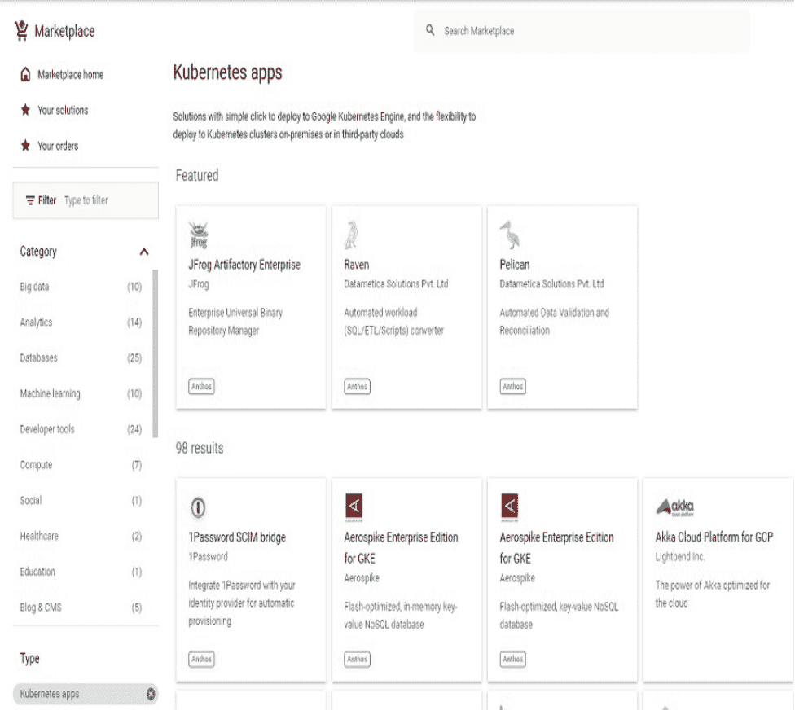
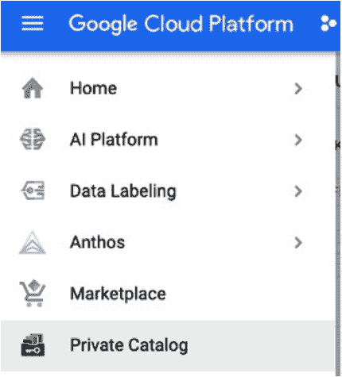
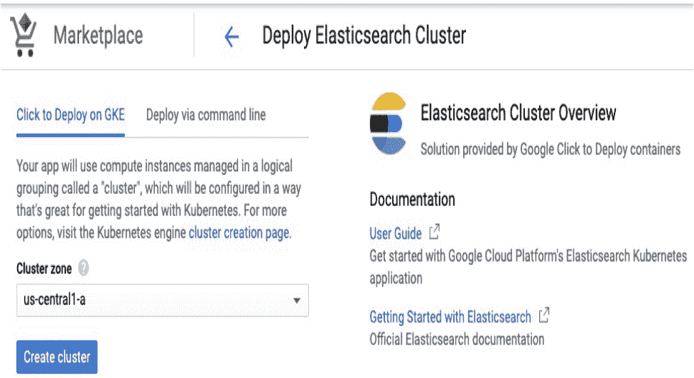
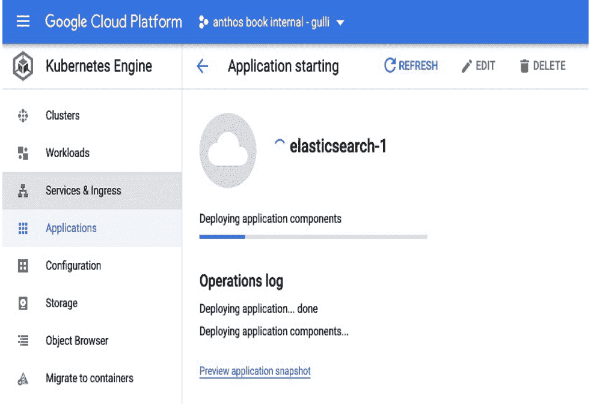
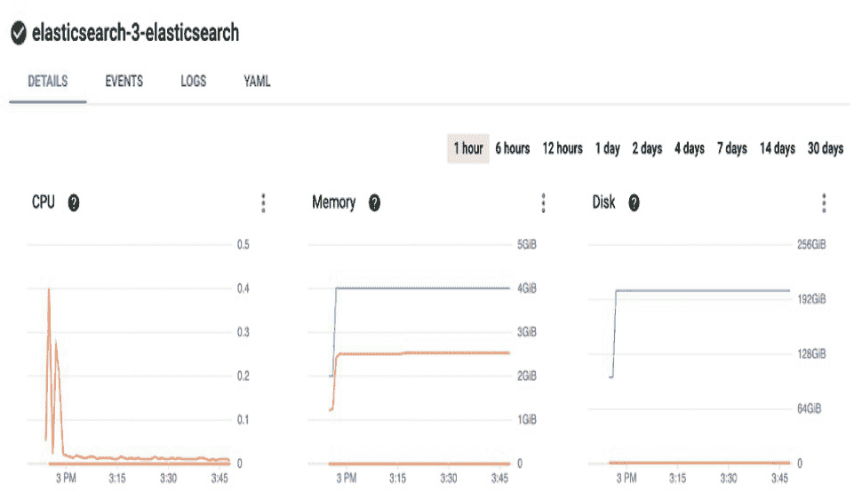
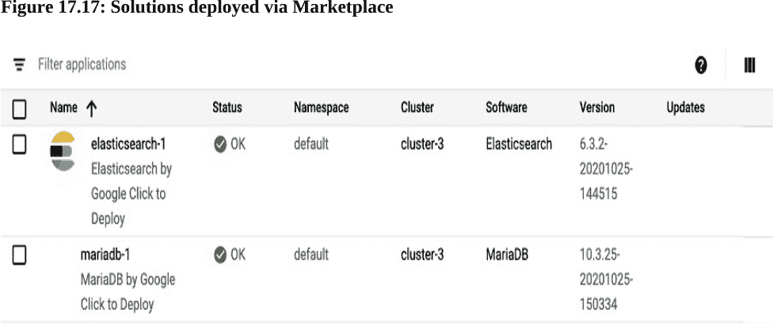
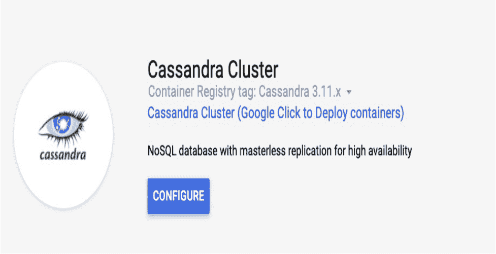
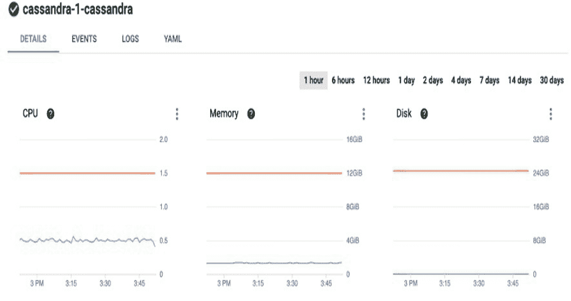
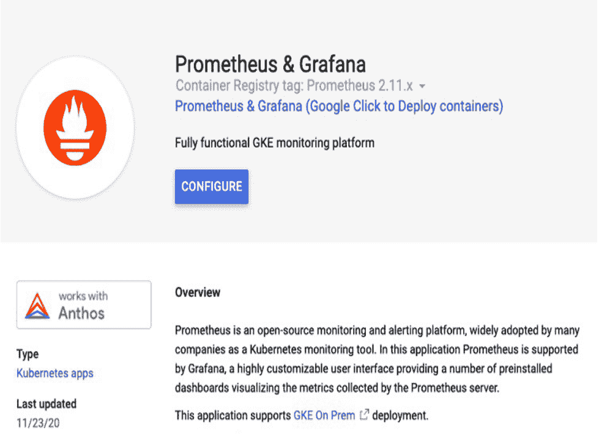
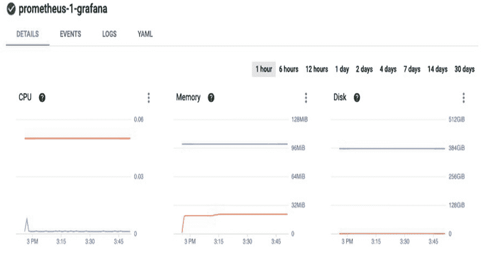

## 17 Google Cloud Marketplace

作者：Antonio Gulli

### 本章涵盖以下内容：

-   Google 公共 Marketplace
-   Google 私有 Marketplace
-   部署 Marketplace 解决方案
-   实际应用场景

Google Cloud Marketplace 是一个一站式解决方案，可用于试用、购买、配置、管理和部署软件产品。通常会有多个供应商提供相同的软件包，从而在操作系统、虚拟机、容器、存储成本、执行环境和 SaaS 服务等方面，为你的特定用例和行业提供一系列可选方案。Google Cloud 会为新用户提供一笔初始赠金，该赠金也可用于 Marketplace。截至 2021 年 1 月，这笔赠金为 300 美元，但未来可能会发生变化。在本章中，我们将讨论如何使用 Google Cloud Marketplace 在不同的 Kubernetes 环境中自动部署软件包，包括 Anthos、GKE 和 GKE on-prem（本地 GKE）。

### 17.1 Google Marketplace

GCP Marketplace 网站为 GCP 客户提供了一个统一平台，用于查找免费和付费应用，这些应用既可以由 Google 提供，也可以由我们的第三方合作伙伴提供，他们扩展了我们在平台上提供的产品。部署时可以使用默认配置，也可以根据特定需求进行定制，例如增加内存、存储或使用更大的 vCPU 来获得更高计算能力。每个软件包都附带了安装后获取帮助的具体说明。请注意，Marketplace 团队会持续更新每个镜像以修复关键问题和缺陷。但是，你有责任更新已部署在自身环境中的解决方案。

Kubernetes。用户只需在 Cloud Marketplace 首页点击 Kubernetes Apps 分类即可。(https://cloud.google.com/marketplace/browse)

目前，GKE 大约有 100 个解决方案可用，涵盖网络、数据库、分析、机器学习、监控、存储等不同领域，如图 17.1 底部所示。

解决方案根据许可模式进行分类：开源、付费或“自带许可”（Bring Your Own License，BYOL）。BYOL 是一种许可模式，允许企业灵活地使用其许可证，无论是在本地还是云端。

图 17.2：适用于 Anthos GKE 环境的解决方案。




截至2022年1月，已有较小的一组（45个解决方案）在GKE on-prem环境中进行了测试。我们可以通过向搜索选项添加适当的过滤器“*deployment-env: gke-on-prem*”（如图2所示）来查看on-prem的解决方案。截至2022年1月，已有78个解决方案在Anthos环境中进行了测试，如图3所示。

**图17.3：可用于Anthos GKE-on-prem环境的解决方案。**

## Marketplace

返回Marketplace页面

您的解决方案

您的订单

筛选类型以进行过滤

## 类别

- 大数据 (4)
- 分析 (3)
- 数据库 (14)
- 机器学习 (3)
- 开发工具 (12)
- 计算 (4)
- 博客与CMS (4)
- 安全 (4)
- 开发栈 (2)
- 网络 (3)

## 类型

Kubernetes应用

## 部署环境

GKE on-prem

45个结果

搜索Marketplace

aqua
Aqua Enterprise Security Platform
Aqua Security Software Inc.
Aqua在Kubernetes上提供云原生安全平台
Anthos

Bitpoke App
Bitpoke
Kubernetes上的WordPress
Anthos

Cassandra Cluster
Google Click to Deploy containers
具有无主复制以实现高可用性的NoSQL数据库
Anthos

paloalto
CN Series NGFW
Palo Alto Networks, Inc.
容器防火墙保护Kubernetes环境
Anthos

Consul
Google Click to Deploy containers
Consul是一个分布式服务网格，用于连接、保护和服务配置
Anthos

适用于GKE的Crunchy PostgreSQL
Crunchy Data
在GKE上可信的开源PostgreSQL即服务
Anthos

etcd
etcd
Google Click to Deploy containers
etcd集群高可用安装
Anthos

Flink Operator
Google Click to Deploy containers
闪电般快速的统一分析引擎
Anthos

Gitlab
Google Click to Deploy containers
GitLab是完整DevOps生命周期的单一应用程序
Anthos

在浏览市场中的解决方案时，您可以通过查找列表上附带的“Works with Anthos”徽标来识别与Anthos兼容的第三方解决方案。在图4中，您可以看到一些解决方案

带有一个小型的Anthos按钮——该按钮用于展示已经过认证可与Anthos配合使用的解决方案。

这些列表符合 **Anthos Ready Program** ([https://cloud.google.com/anthos/docs/resources/anthos-ready-partners](https://cloud.google.com/anthos/docs/resources/anthos-ready-partners)) 的要求，该计划标识了符合Google Cloud互操作性要求并已经过验证可与Anthos平台配合使用的合作伙伴解决方案，以满足企业客户的基础设施和应用程序开发需求。要获得资格，合作伙伴提供的解决方案必须完成、通过并保持集成要求，才能获得“Works with Anthos”徽章。

**图17.4：可用于Anthos环境的解决方案。**

您可以通过Cloud console导航菜单中的“工具”部分访问Private Catalog（见图6）。从那里可以创建新的私有市场、添加应用程序以及配置访问权限。每个Private Catalog应由一个GCP项目托管，并且可以在文件夹和项目级别添加Catalog IAM权限。与GCP组织、文件夹或项目共享目录允许客户与其最终用户共享他们的解决方案。这些步骤非常直观，感兴趣的读者可以上网查找更多信息[^1]。

图17.6：访问Private Catalog。



### 17.1.3 在GKE on-prem集群上部署

如果您的意图是向Anthos GKE on-prem集群部署Marketplace中的解决方案，那么您需要在目标集群上定义一个或多个命名空间，并使用一个secret对其进行注释，该secret将允许您部署选定的解决方案。需要执行以下步骤：

- 1. 如果您的集群运行Istio，则默认情况下，与第三方服务的任何外部连接都会被阻止，因此配置Istio出口流量以允许连接到外部操作系统软件包存储库非常重要（请参阅第5章，Anthos Service Mesh：可扩展的安全性和可观测性）。
- 2. 您需要允许从Google Container Registry下载镜像，方法是创建允许访问marketplace.gcr.io的防火墙或代理规则。
- 3. 在您的GKE on-prem集群中，您可能需要创建一个Google Cloud服务账号。这可以通过类似这样的cloud shell完成：

```
gcloud iam service-accounts create sa-name \
  --description="sa-description" \
  --display-name="sa-display-name"
```

- 4. 您需要使用具有Kubernetes“cluster-admin”角色的Kubernetes服务账号（KSA）的令牌或凭据登录到您的Anthos GKE on-prem集群。（在第4章“Anthos，基于Kubernetes构建的计算环境”中讨论了角色。）这将允许您拥有超级用户访问权限，以对任何资源执行任何操作。从控制台，您可以通过运行以下命令生成一对新的公钥/私钥对并下载到您的机器上：

```
gcloud iam service-accounts keys create ~/key.json \
  --iam-account sa-name@project-id.iam.gserviceaccount.com
```

- 5. 如果您是首次从Cloud Marketplace部署，则需要在集群中通过运行以下命令创建application-system命名空间：

```
kubectl create namespace application-system
```

- 6. 然后，您需要使用以下命令为application-system创建一个包含imagePullSecret的Kubernetes Secret：

```
JSON_KEY_FILENAME=path_to/service_account_key.json
IMAGEPULLSECRET_NAME=gcr-json-key
kubectl create secret docker-registry $IMAGEPULLSECRET_NAME \
  --namespace="application-system" \
  --docker-server=gcr.io \
  --docker-username=_json_key \
  --docker-password="$(cat $JSON_KEY_FILENAME)"
```

- 7. 下一步是通过运行以下命令将imagePullSecret应用到application-system命名空间中的默认Service Account：

```
kubectl patch sa default -n application-system -p ""imagePullSecr
```

8. 最后，对于您要部署应用程序的每个命名空间，您必须使用以下命令创建一个新的Secret，并使用该Secret注释该命名空间：

```
JSON_KEY_FILENAME=path_to/service_account_key.json
IMAGEPULLSECRET_NAME=gcr-json-key
kubectl create secret docker-registry $IMAGEPULLSECRET_NAME \
  --namespace=$NAMESPACE_NAME \
  --docker-server=gcr.io \
  --docker-username=_json_key \
  --docker-password="$(cat ~/$JSON_KEY_FILENAME)"
```

```
kubectl annotate namespace $NAMESPACE_NAME marketplace.cloud.goog
```

9. 一旦按照上一步所述定义了$NAMESPACE_NAME，该命名空间就可以用于在您的本地集群上进行安装。

换句话说，无论是在GCP上还是在本地部署Anthos，只需在目标Kubernetes集群上定义适当的命名空间，并使用拉取解决方案镜像所需的密钥注释该命名空间即可。

在下一节中，我们将介绍如何安装一些预定义的解决方案，这些解决方案属于不同类别，包括现代化工具、数据库、监控和日志记录、CI/CD、生产力和机器学习。

### 17.2 真实场景

在本节中，我们将简要介绍如何部署适用于Anthos的Marketplace解决方案。我们的示例有意采用异构方式，并且属于不同类别。请注意，我们已经在第18章“Migrate for Anthos”中从Cloud Marketplace部署了Migrate for Anthos。因此，我们在这里跳过它，但它是一个非常可靠的用例。让我们再看几个额外的示例。

### 17.2.1 示例1：ElasticSearch

实例名称elasticsearch-1和2个副本。

# 图17.8：部署ElasticSearch解决方案



创建集群可能需要几分钟时间（见图9），这始终是喝杯咖啡休息一下的好理由，让Marketplace替我们完成所有工作。

# 图17.9：为新的ElasticSearch解决方案创建集群


# 点击即可在 GKE 上部署

通过命令行部署

您的应用将使用在一个称为“集群”的逻辑分组中管理的计算实例，其配置方式非常适合 Kubernetes 入门。如需更多选项，请访问 Kubernetes 引擎集群创建页面。

正在区域“us-central1-a”中创建“cluster-3”...

正在创建 •••

一旦集群创建完成，Marketplace 将代表我们开始部署解决方案（参见图 17.10）。

图 17.10：为 ElasticSearch 解决方案部署应用组件。



当部署成功执行后，您可以在所选集群上看到已部署的解决方案，如图 11 所示；确实非常简单。Marketplace 为您节省了大量时间，并加速了维护 Anthos 应用所需的行政管理任务。

## 图 17.11：已部署的 ElasticSearch 解决方案

|  | elasticsearch-3-elasticsearch | 正常 | Stateful Set | 2/2 | default |

一旦从 Marketplace 部署了 ElasticSearch，您就可以使用 Anthos 来管理集群。在图 12 中，您将看到 CPU、内存和磁盘的详细信息。

## 图 17.12：从 Marketplace 部署的 Elasticsearch 的 CPU、内存和磁盘监控



### 17.2.2 示例 2：MariaDB

现在让我们重点讨论如何部署 MariaDB。MariaDB 是一个流行的开源数据库，于 2009 年 MySQL 被 Oracle 收购后，从更流行的 MySQL 关系数据库管理系统中分叉而来。该解决方案（参见图 13）可在以下网址获取：

https://console.cloud.google.com/marketplace/details/google/mariadb

图 17.13：部署 MariaDB 解决方案

# MariaDB

Container Registry 标签：10.3

MariaDB（Google 点击部署容器）

带复制的多实例 MariaDB 安装

配置

# 概览

MariaDB 是 MySQL 关系数据库管理系统的社区开发分支。

此应用支持 GKE On Prem 部署。

了解详情

# 关于 Google Click to Deploy 容器

类型

Kubernetes 应用

上次更新时间

11/23/20

在本例中，我们决定更改默认参数，要求更高的副本数 replicas=2（参见图 14）。

图 17.14：以更高副本数部署 MariaDB 解决方案。


我们的部署结果非常直观（参见图 15）。Marketplace 再次帮助我们在管理 Anthos 集群的同时节省时间。

## 图 17.15：已部署的 MariaDB 解决方案

Marketplace
部署 MariaDB
us-central1-a
创建集群
或选择现有集群
命名空间
default
应用实例名称
mariadb-1
存储类
创建新的存储类
持久化卷的存储大小
32Gi
副本数
2

|  | mariadb-1-mariadb | 正常 | Stateful Set | 1/1 | default | cluster-5 |
|  | mariadb-1-mariadb-secondary | 正常 | Stateful Set | 2/2 | default | cluster-5 |

一旦从 Marketplace 部署了 MariaDB，您就可以使用 Anthos 来管理集群。在图 16 中，您会看到一个检查集群和运行中 Pod 的示例。

## 图 17.16：MariaDB 检查从 Marketplace 部署的解决方案

| 字段 | 值 |
|---|---|
| 集群 | cluster-5 |
| 命名空间 | default |
| 创建时间 | 2020 年 11 月 25 日下午 2:51:23 |
| 标签 | app.kubernetes.io/component: mariadb-server; app.kubernetes.io/name: mariadb-1 |
| 注解 | 显示注解 |
| 日志 | 容器日志、审计日志 |
| 标签选择器 | app.kubernetes.io/component = mariadb-server; app.kubernetes.io/name = mariadb-1 |
| 副本数 | 1 |
| 已观测的代次 | 1 |
| 服务 | mariadb-1-mariadb |
| 持久化卷声明规范 | mariadb-1-data-pvc |

# Pod 规范

| 字段 | 值 |
|---|---|
| 标签 | app.kubernetes.io/component: mariadb-server; app.kubernetes.io/name: mariadb-1 |
| 终止宽限期 | 30 |
| 重启策略 | 始终 |
| 容器 | mariadb, mysqld-exporter |
| 卷 | configmap, tls-volume, replication-config |

# 已管理的 Pod

| 名称 | 状态 | 重启次数 | 创建时间 |
|---|---|---:|---|
| mariadb-1-mariadb-0 | 运行中 | 0 | 2020 年 11 月 25 日下午 2:51:23 |

## 17.2.3 到目前为止我们所做的工作

到目前为止，我们已经在 GKE 上的 Anthos 集群中安装了两种不同的应用。如果我们想检查状态，只需在“应用”下访问我们的 GKE（参见图 16）。

https://console.cloud.google.com/kubernetes/application



## 17.2.4 示例 3：Cassandra

Cassandra 是一个 NoSQL、高度可扩展、高性能的分布式数据库，具有高可用性。部署 Cassandra 集群很容易。您可以在以下网址访问该解决方案：

https://console.cloud.google.com/marketplace/details/google/cassandra?q=anthos




# Cassandra 集群

Container Registry 标签：Cassandra 3.11.x

Cassandra 集群（Google 点击部署容器）

具有无主复制以实现高可用性的 NoSQL 数据库

配置


# 概览

# 类型

Kubernetes 应用

# 上次更新时间

11/23/20

Cassandra 是一个 NoSQL、高度可扩展、高性能的分布式数据库，具有高可用性，且没有单点故障。

此应用支持 GKE On Prem 部署。

此应用提供 Prometheus 指标，并支持 Stackdriver 集成。

了解详情

安装后（参见图 17），您可以访问和管理已部署的解决方案。例如，您可能希望监控给定时间段内的 CPU、内存和磁盘使用情况（参见图 18）。

## 图 17.19：管理 Cassandra 解决方案



### 17.2.5 示例 4：Prometheus 与 Grafana

一旦您理解了机制，安装新解决方案就变得简单了。例如，假设我们想要安装一组更复杂的协同工作的应用。一个典型的例子是 Prometheus 和 Grafana。Prometheus 是一个开源监控和报警平台，被许多公司用作监控工具；Grafana 提供许多仪表板，用于可视化 Prometheus 服务器收集的指标。该解决方案可在以下网址访问（参见图 19）：

https://console.cloud.google.com/marketplace/details/google/prometheus?q=anthos

**图 17.20：部署 Prometheus 和 Grafana 解决方案**



# 概览

Prometheus 是一个开源监控和报警平台，被许多公司广泛用作 Kubernetes 监控工具。在此应用中，Prometheus 由 Grafana 提供支持，Grafana 是一个高度可定制的用户界面，提供许多预装仪表板，用于可视化 Prometheus 服务器收集的指标。

此应用支持 GKE On Prem 部署。

让我们使用默认参数来部署解决方案（参见图 20）：

## 图 17.21：为 Prometheus 和 Grafana 解决方案使用默认参数

# Marketplace

# 部署

点击即可在 GKE 上部署

通过命令行部署

集群

cluster-1 [us-central1-a]

或创建新集群

命名空间

default

应用实例名称

prometheus-1

Prometheus 副本数

2

Prometheus 服务账号

创建新的服务账号

Kube State Metrics 服务账号

创建新的服务账号

Alertmanager 服务账号

创建新的服务账号

Grafana 服务账号

创建新的服务账号

部署完成后，我们可以在应用详情中看到可用的解决方案（参见图 21）：

图 17.22：已部署的 Prometheus 和 Grafana 解决方案


prometheus-1-grafana ✓ OK Stateful Set 1/1 default

当然，你可以使用 Anthos 来管理已部署的解决方案（见图 22）

## 图 17.23：管理 Prometheus 和 Grafana 解决方案



一旦解决方案部署完成，你就可以开始在 Prometheus 时序数据库中记录实时指标。然后你可以使用 Grafana 创建仪表板并监控系统性能。本示例结束了本节。接下来，我们总结迄今为止学到的内容。

## 17.3 总结

在本章中，我们讨论了如何使用公共和私有市场来为开发者部署简单和复杂的负载。

- 公共 Google 市场是由 Google 提供的一项服务，其中包含许多供应商解决方案，包括适用于 Kubernetes 的特定解决方案，无论是在 GCP 还是本地部署。
- 私有 Google 市场允许公司为其内部开发者提供私有解决方案，使公司能够提供与公共市场中 Google 提供的相同部署简便性。
- 在本地部署 Marketplace 解决方案需要额外的设置步骤，而 GCP 集群则不需要。
- 我们部署了一些 Marketplace 解决方案，以展示在现实世界中使用提供的解决方案部署负载是多么容易。

[1] 见 https://cloud.google.com/private-catalog
