## 18 为 Anthos 和 GKE 迁移

作者 Antonio Gulli

### 本章涵盖

- 使用 Migrate for Anthos 的好处
- 推荐迁移的工作负载
- Migrate for Anthos 架构
- 使用 Migrate for Anthos 迁移工作负载
- Migrate for Anthos 的最佳实践

容器为开发者提供了多项优势，包括在部署和配置工作负载时速度提升、资源利用率更高、可移植性以及与虚拟机（VM）相比的成本效益。

然而，许多客户在基于传统框架的 VM 基础设施上运行了数千个历经多年开发的应用。对于这些客户来说，重写这些应用既耗时又昂贵。因此，需要工具来现代化工作负载，并在不从头重写应用的情况下提供现代云原生环境的好处。整个价值主张是在转型项目中减少客户上市时间，并利用现代云基础设施和服务增强和优化传统工作负载。

在 Google，我们认为现代化不必是全有或全无。微服务架构（第 [云是一个新的计算堆栈] 章）将应用结构化为一组高度可维护、可测试、通过 API 松散耦合且可独立部署的服务。然而，即使你一开始没有使用微服务架构，你也可以将应用转换为容器，仍然获得云原生应用通常带来的诸多好处。这就是本章将要介绍的内容。

Migrate for Anthos（简称 M4A）是一种工具，可帮助从 VM 中提取你的遗留工作负载，并自动将其转换为容器，包括执行所需的一切。这包括运行时、系统工具、库、代码、配置和设置。应用迁移后，可以在 Anthos 上运行，无论是在 Google Kubernetes Engine（GKE）上、本地部署，还是在其他云上。

这样，基础设施、硬件以及 OS/内核的管理就被“抽象化”并委托给你的云服务提供商。此外，M4A 生成的工件使你能够转向利用 CI/CD 管道的现代软件开发，并从包管理转向基于容器/镜像的管理。你可以将 M4A 视为实现现代化这一最终目标的加速器，并且这种加速可以大规模进行，同时批量迁移许多遗留应用。M4A 因此可以让你大规模运营数千个遗留应用，通过现代化底层计算基础设施、网络、存储和管理来实现。M4A 支持 Linux 和 Windows 迁移到容器。源环境可以包括 GCP Compute Engine 环境、VMware vSphere 环境、Microsoft Azure VM 环境或 Amazon Elastic Compute Cloud（Amazon EC2）环境。所有工作负载都直接迁移，无需访问原始源代码，也无需重写工作负载或手动容器化工作负载。

大部分迁移工作是自动完成的，用户可以修改生成的迁移计划以微调所需的现代化。在迁移过程执行期间，应用可以继续不间断运行，并且你可以在几分钟内使用容器化应用。如果想回到初始状态，可以无数据丢失地回滚。由 M4A 生成的迁移工作负载容器镜像会自动部署到 Google Container Registry（GCR）或其它本地仓库，并且可以在任何环境中运行，无需在目标工作负载集群上安装任何 M4A 组件。当然，整个 M4A 流程可以通过 Google Cloud Console UI 执行和监控。

现在我们已经设定了背景，让我们详细了解 M4A 的优势。

## 18.1 Migrate for Anthos 优势

M4A 允许我们从 VM 内部解耦更多基础设施，并使用 Kubernetes 管理它。这种现代化将应用管理与现代 IT 技能统一起来。事实上，可以在无需更改/访问代码的情况下将遗留应用提升为云原生环境中的一等对象。规模化的改进包括：

- 使用声明式 API、动态扩缩容、自愈和程序化发布来定义基础设施；
- 提高数据中心的工作负载密度，从而实现更好的资源利用。
- 维护基础设施指标、业务指标、网络策略和项目访问控制；
- 集成 CI/CD 管道和构建系统。

M4A 的优势在不同类别中透明地获得：密度、成本、安全、基础设施、自动化、服务管理以及 Day 2 运营。让我们更详细地讨论每个类别。

**密度。** VM 从底层物理硬件中抽象出来。传统裸机服务器只能支持单个应用，而超visor 虚拟化允许多个 VM 的应用在单个裸机服务器上运行，共享底层资源。让我们看一下利用率：

- 通常，裸机利用率在 5-15%，而虚拟机可将其提高到 30%；
- 容器增强了工作负载密度，因为通常在同一 VM 或裸机服务器上运行多个容器。此外，由于 OS/内核、网络和存储等被抽象化，如本章前面所述，密度也随之增加。

实际利用率增益将取决于环境中的多个特定因素。经常，许多组织在从物理服务器迁移到 VM，再到容器的过程中报告了显著的增益。例如，《金融时报》的内容平台团队报告了服务器成本的降低

## 服务管理。

迁移到容器后，可以使用 Anthos Service Mesh（见第 5 章：Anthos Service Mesh：大规模安全和可观测性）了解服务之间的连接情况，并且可以在不更改代码的情况下获得应用的遥测和可见性。在 Anthos 上透明获得的一些好处包括：

- 加密：应用可以在无需更改代码的情况下进行端到端加密通信。
- 集成日志和监控：你可以在整个应用中获得统一的指标和流量日志。
- 统一可观测性：可以观察服务依赖关系并了解关键客户旅程以及它们如何从端到端影响你的服务等级协议（SLA）。你可以通过在应用上设置服务等级目标（SLO）来实现这一点。
- 运营敏捷性。你可以动态迁移流量、在环境内进行熔断、重试、执行金丝雀发布和 A/B 测试。以金丝雀为例，你可以根据权重将一定量的流量从一个服务迁移到该服务的更新版本。
- 桥接。你可以利用服务网格在本地和多个云之间桥接流量。

总体而言，采用服务网格将增强你对基础设施的理解，而基础设施随着时间的推移可能会变得相当复杂。

## Day 2 运营。

如第 6 章《Anthos 中的运营管理》所述，Anthos 减轻了 Day 2 运营的负担。应用迁移后，你可以受益于许多 Google Cloud Platform（GCP）功能。特别是：

- Cloud Logging 和 Cloud Operations。Cloud Logging 允许你存储、搜索、分析、监控和告警来自 Google Cloud 的日志数据和事件，而 Cloud Monitoring 则提供对云驱动应用的性能、正常运行时间和整体健康状况的可见性。迁移后，这两项服务仅需配置更改即可使用。
- 统一策略和集成资源管理。Anthos 提供了一个


通过 Anthos Config Management 实现声明式期望状态管理，该内容在第 14 章：Anthos Config Management 中有所介绍。声明式意味着用户只需定义期望的最终状态，而 Anthos 则负责定义实现变更的优化步骤。Anthos Config Management 允许您通过高级标签策略和选择器策略，在所有环境中自动化并标准化安全策略和最佳实践。作为用户，您将拥有一个统一的 UI 用于定义统一的策略创建和执行（第 Anthos for Security/Policy 章）。

- 使用 Cloud Build 实现 Day 2 维护流程。Cloud Build 提供对跨多个环境和多种语言构建、测试和部署的自定义工作流的控制。
- CI/CD 流水线。Anthos 集成 CI/CD 流水线以增强环境的敏捷性。这使您能够进行更小的代码变更、功能变更的更快周转、更短的发布周期以及更快的故障隔离。
- GCP Marketplace。Anthos 已集成到 GCP Marketplace 中，包括用于一键部署新应用的私有目录，详细内容在第 19 章：Marketplace for Anthos 中介绍。

M4A 最重要的好处之一是，传统应用被提升为一等对象，在 Day 2 运营方面享有与云原生环境中通常期望的相同优势。

在本节中，我们讨论了使用 Migrate for Anthos 就地现代化 VM 工作负载并自动容器化您的应用而无需重写的优势。如讨论所述，与 VM 相比，容器化应用因所需管理时间更少而提高了敏捷性和效率。此外，它们提供了更高的基础设施密度和相关的成本降低。最后，容器化应用可以从服务网格中受益，体现在可观测性、Day 2 运营简化以及跨环境的统一策略管理和执行。

在下一节中，我们将深入探讨最适合迁移的工作负载。

## 18.2 推荐迁移的工作负载

将应用现代化以适配云可能很困难。复杂的应用通常是多层且通常具有多个依赖项。数据具有重力，迁移可能取决于大量数据，无论是文件还是数据库。传统应用可能使用过时的代码和遗留框架编写，在许多情况下，代码本身可能无法在现代环境中重新编译。在本节中，我们将讨论特别适合自动迁移的各种应用类型。

**无状态 Web 前端。** 第一个合适的类别包括无状态应用，例如 Web 服务器和类似为客户流量提供服务的应用程序。容器通常比虚拟机更轻量，因此根据不同的负载情况更容易进行扩展。

**多 VM、多层堆栈和业务逻辑中间件。** 此类别中包括多层 Web 服务堆栈，例如 LAMP（Linux、Apache、MySQL、PHP/Perl/Python）或 WordPress，因为它们可以分解为多个独立的容器。此类别中还包括 J2EE 中间件，例如 Java TomCat 和其他 COTS（商业现成）应用。在 M4A 的术语中，我们通常说甜点应用类别包括多层基于 Web 的企业应用。

**中型到大型数据库。** 数据库如 Mysql、Postgres 和 redis 得到支持；数据层通常可以与计算层分离，因此容器可以帮助管理轻量级计算。

**低负载和突发工作负载。** 容器是任何计算活动出现间歇性上升和下降的情况的首选解决方案。这是因为它们比虚拟机更轻量。因此，每当我们需要快速设置开发/测试环境、培训环境或实验室时，都应考虑使用 Migrate for Anthos。

总体而言，我们可以说 **理想的迁移候选** 包括以下内容：

- 通过完全重写进行现代化改造不可行或成本过高的工作负载
- 具有未知依赖项，触碰可能导致问题的东西的工作负载
- 正在维护但未积极开发的工作负载
- 不再维护的工作负载
- 没有源代码访问的工作负载

有时自动迁移可能很困难。特别是如果存在对特定内核驱动程序、特定硬件的依赖，或如果软件许可证需要绑定到特定硬件或虚拟机时。另一个相关案例是需要整个 Kubernetes 节点容量的基于 VM 的工作负载，包括高性能和高内存数据库（如 SAP HANA）。除这些非常特定的情况外，所有其他工作负载都应考虑从 VM 迁移到容器。

在本节中，我们快速回顾了适合迁移的相关工作负载。在接下来的几段中，我们将讨论迁移架构和一些迁移的实际示例。

## 18.3 M4A 架构

在本节中，我们将讨论典型的迁移工作流以及虚拟机如何被转换为多个不同的容器。迁移完成后，生成的工件可以在任何地方运行。

注意：不再需要在目标集群上安装迁移组件。

### 18.3.1 迁移工作流

迁移包括三个阶段：设置、实际迁移和优化（见图 1）。让我们更仔细地查看每一步。

在设置阶段，会创建处理集群并定义迁移源。支持的迁移源包括

VMware、AWS EC2、Azure VM、GCE VM 和本地 VMware。自 Anthos Migrate 1.9 版本起，支持迁移的操作系统为 RHEL、CentOS、SUSE、Ubuntu、Debian 和 Windows。该列表一直在扩展，建议在线查看最新列表[8]。

在设置阶段，我们需要设置云登陆区，考虑身份、网络配置、安全和计费。有多个工具可以帮助使基础设施即代码任务更自动化，包括 Cloud Foundation Toolkit[9] 和 Terraform[10]。这些模板可以根据您的具体需求开箱即用，快速构建可重复的企业级基础。此外，在设置期间，您需要发现要迁移的工作负载。期望的工作负载可以通过手动识别或通过诸如 Stratazone[11]（现已被 Google 收购）、ModelizeIT[12]、Cloudomize[13] 或 CloudPhysics[14] 等发现工具来识别。自 M4A 1.5 版本起，已包含原生发现工具，这将在下一节中介绍。

图 18.1：设置和 Migrate for Anthos

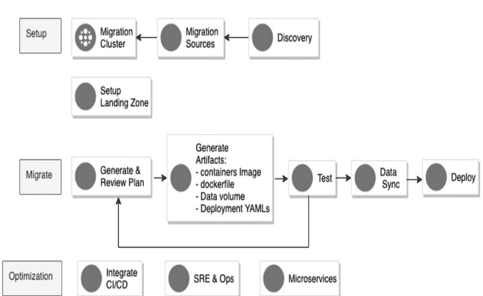

在 **迁移阶段**，运行 M4A 并自动生成新的容器镜像，以及 Dockerfile、数据卷和部署用的新 YAML 文件。我们将在下一节中看到细节，其中将涵盖命令行界面（CLI）和图形用户界面（GUI）流程。一旦这些工件自动生成，它们可以在 GKE/Anthos 或其他云上进行测试，如果一切正常，则可以部署到 GKE/Anthos。还需要注意的是，数据会在迁移过程中自动移动和同步。

Anthos 支持实时迁移，这意味着应用可以在没有任何中断的情况下迁移到现代环境。在幕后，Migrate for Anthos 为源 VM 创建快照，并且源 VM 保持运行和可用，无需停机。与此同时，所有存储操作都在该 VM 的快照上执行。所有工作负载都直接迁移，无需原始源代码。

在 **优化阶段**，已部署的工件可以与 CI/CD 平台集成，例如 Jenkins[15]、Spinnaker[16]、Gitlab CI/CD[17] 和


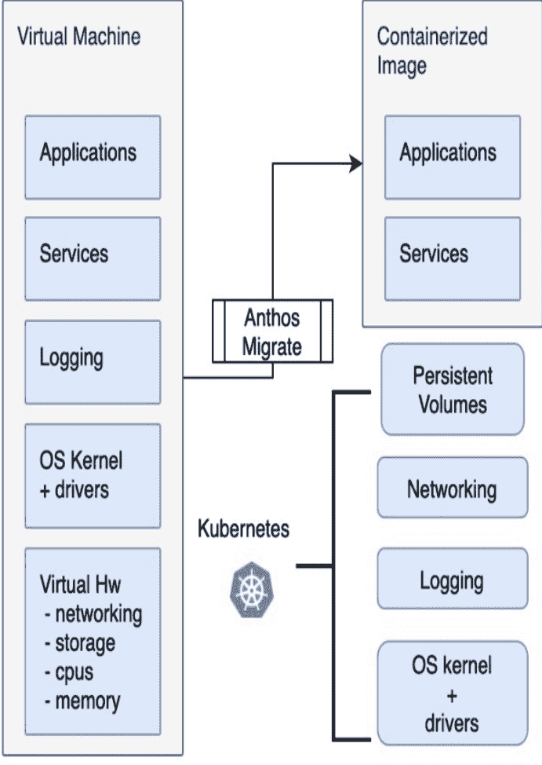

对于每个应用，M4A 会以 Docker 镜像、Dockerfile 和部署 YAML 文件的形式生成 CI/CD 工件。这些包括应用程序、用户服务和持久卷（见图 18.2，右侧）。特别是，存储被重构为 Kubernetes 支持的持久卷。诸如网络、日志和监控以及操作系统内核 + 驱动程序等通用功能被 *抽象化* 并委托给 Kubernetes 管理。持久卷使用 Migrate for Anthos Container Storage Interface (CSI) 驱动程序挂载（见 Anthos、数据和分析 章节）。然后数据直接从源 VM 文件系统流式传输。内部，Migrate 还负责生成命令行输入 (CLI) 和客户资源定义 (CRD[19])。逻辑上，迁移会产生两层容器化镜像：第一层是捕获的用户模式系统，而第二层是迁移的运行时环境，连同所有必要的 CRD。然而，迁移后无需维护第二层，生成的工件可在任何 Kubernetes 兼容发行版[20] 上运行。

与 Kubernetes 环境中应用程序无关的 VM 相关文件和组件会被明确排除。事实上，这种排除意味着好处。如前所述，与虚拟机相比，容器由于其轻量级特性允许更高的密度和成本降低。应用程序生命周期保留在系统容器内。移植后，应用程序可以在任何 Anthos 环境（本地、GCP 等）或任何与 Kubernetes 兼容的发行版上运行，而与 Migrate for Anthos 部署无关。

## 18.3.3 对 Windows 环境的审视

Migrate for Anthos 1.4+ 版本支持从 Windows 服务器将工作负载迁移到 GKE/Windows。与 Linux 环境类似，目标是自动化工作负载的重平台化，然后将其集成到更现代的云环境中。截至 2021 年底，从 Windows Server 2008r2 到 Windows Server 2019 的所有 Windows 服务器平台都可作为目标。目前，仅支持 GCE 作为 Windows 应用现代化的源，直接支持本地 VMWare、AWS 和 Azure 将计划在下一个版本中推出。但是，您可以使用 Migrate for Compute Engine[21] 将 Windows VM 从其他来源迁移或克隆到 Compute Engine，然后将生成的 VM 迁移到容器中。好消息是，迁移后的 Windows VM 不必配置为在 Compute Engine 上运行。

在幕后，迁移通过提取 ASP.net 应用程序和 IIS 配置并将其应用到官方 Windows 2019 服务器镜像之上来工作。适用于 Windows 的 M4A 与使用 IIS 7+、ASP.NET 开发的应用程序配合良好，尤其是 Web 和业务逻辑中间件。迁移的理想场景是 Windows Web 应用程序的无状态层、应用服务器和 Web 前端。

## 18.3.4 对现代化之旅的完整视图

现在我们已经讨论了 Linux 和 Windows 工作负载的现代化之旅，我们提供了一个全面的视图，其中还包括大型机（见图 18.3）。

如果源应用程序是现代应用，则其会被容器化、与 CI/CD 集成，并且可以在 Anthos 上运行，在 Anthos 上与整个生态系统的集成可以促进进一步重构为微服务环境。

如果源应用程序是 Linux 或 Windows 中的传统单体应用程序，则我们可以使用 M4A 将其容器化。

图 18.3：完整的现代化之旅

## 18.4.1 使用适配评估工具

在本节中，我们介绍一种自助式适配评估工具，用于确定工作负载迁移到容器的适用性。该工具由一个名为 *mfit* 的实用程序组成——一个独立的 Linux CLI 工具，用于驱动评估过程，以及专用的 Linux 和 Windows 数据收集脚本，这些脚本可由 *mfit* 自动调用或手动调用——取决于场景。

适配评估工具生成一份报告，展示预 VM 评估结果，包括 VM 迁移到容器的适用性评分以及解决各种障碍的建议。

下表提供了可能的适配评分摘要：

### 表 18.1：适配评估工具生成的适配评分

| Fit score | Description |
|---|---|
| Score 0 | 适配度优秀 |
| Score 1 | 适配度良好，但有一些可能需要关注的发现。 |
| Score 2 | 迁移前需要 **最小** 努力。 |
| Score 3 | 迁移前需要 **中等** 努力。 |
| Score 4 | 迁移前需要 **重大** 努力 |
| Score 5 | 不适配。 |
| Score 6 | 收集的数据不足以评估 VM。 |

### 适配评估流程

适配评估流程包括 3 个不同的阶段，即发现、评估和报告。每个阶段如下所述。

- 1. **Discovery** - 收集有关 VM 的数据并将其存储在本地轻量级数据库中以供后续阶段使用（默认位于 ~/.mfit 文件夹中）。有两种类型的数据发现方法：
  - a) （可选）**VM/库存级发现** - 使用 *mfit* 工具通过 vSphere API 从一个或多个 vCenter 中提取 VM 库存和配置。未来版本的适配评估工具 *将支持从公共云（如 GCP、AWS 和 Azure）提取库存。此方法为可选，适配评估也可以在没有它<|message|> 的情况下进行，尽管会不那么彻底。*
  - b) **Guest 级数据收集** - 包括在待评估 VM 内部运行数据收集脚本。适配评估工具为 Linux VM 提供 bash 脚本，为 Windows VM 提供 powershell 脚本。每个脚本收集有关操作系统配置和运行服务、进程、已安装软件包等的数据，并生成一个归档文件，由 *mfit* 工具导入数据库并在评估阶段稍后使用。运行收集脚本和导入数据的过程可以是手动的，也可以是使用 *mfit* 工具在以下场景中自动化的：
    - Linux only - 通过 SSH 运行收集脚本并收集结果
    - *Linux and Windows on vSphere - 使用 vSphere API 运行收集脚本并收集结果。*
- 2. **Assessment** - 使用 *mfit* 工具分析收集的数据，对每个评估的 VM 应用一组适配评估规则[^25]。
- 3. **Reporting** - 使用 *mfit* 工具生成报告以展示

```
[✓] DB Readable
[✓] DB Writable
[✓] Available Disk Space
[✓] Supported VC version

[+] Found 27 VMs
Collecting data...
27 / 27 [-----------------------------------------------------]
```

您可能会想知道实际上发生了什么，因为发现过程的输出有限，只告诉您预检查已通过并且工具发现了 27 台虚拟机。这只是初始收集步骤，一旦收集完成，您就可以使用 *mfit* 工具评估并创建 VM 报告，我们将在手动收集过程说明后介绍。

### 手动 Guest 级数据收集

#### Linux

截至撰写时，您可以在 **要评估迁移的 VM 上** 使用以下命令下载 Linux 收集脚本：

```
wget https://anthos-migrate-release.storage.googleapis.com/v1.9.0
chmod +x mfit-linux-collect.sh
```

运行收集脚本：

```
sudo ./mfit-linux-collect.sh
```

脚本将在当前目录生成一个名为 `m4a-collect-<MACHINE NAME>-<TIMESTAMP>.tar` 的 tar 文件

#### Windows

截至撰写时，您可以在 **要评估迁移的 VM 上** 从以下 URL 下载 Windows 收集脚本：

```
https://anthos-migrate-release.storage.googleapis.com/v1.9.0/wind
```


运行收集脚本：

```powershell
powershell -ExecutionPolicy Bypass -File .\mfit-windows-collect.ps1
```

该脚本将在当前目录下生成一个名为 `m4a-collect-<MACHINE_NAME>-<TIMESTAMP>.tar/zip` 的 tar 或 zip 文件（取决于操作系统版本）。

## 导入收集的数据文件

在被评估的虚拟机（VM）上运行收集脚本后，通过任意方式将其下载到安装了 *mfit* 的工作站。

然后，使用以下命令将其导入 *mfit* 的本地数据库：

```
./mfit discover import m4a-collect-<MACHINE_NAME>-<TIMESTAMP>.tar
```

## 自动 Guest 级数据收集

*mfit* 内嵌了 guest 收集脚本，可以在以下场景中自动运行这些脚本并获取结果。

### VMware Tools

如果被评估的 VM 运行在 vSphere 上且已安装 VMware Tools，*mfit* 可以使用 vSphere API 自动执行收集脚本（与 VM 操作系统类型相匹配的脚本）并获取结果。

要通过 VMware Tools 运行 guest 级收集，请运行以下命令：

```
./mfit discover vsphere guest -u <vcenter username> --url <https://vcenter.example.com>
```

系统会提示您输入 vCenter 密码和 VM/OS 密码。

### SSH

如果运行 *mfit* 的 Linux 机器可以 SSH 访问被评估的 VM，*mfit* 可以利用这一点自动执行收集脚本并获取结果。

- 要使用当前本地用户的 SSH 密钥（位于 ~/.ssh）通过 SSH 运行 guest 级收集，请运行以下命令：

  ```
  ./mfit discover ssh <vm-ip-or-hostname>
  ```

- 要通过 SSH 并使用其他身份验证选项运行 guest 级收集，请运行以下命令：

  ```
  ./mfit discover ssh -i </path/to/ssh_private_key> -u <remote-user>
  ```

有关通过 SSH 运行 guest 级收集的其他选项，请查阅官方文档或运行 `./mfit discover ssh -help`。

## 评估

要检查发现的 VM 和收集的数据，请运行以下命令：

```
./mfit discover ls
```

要对此数据执行评估，请运行以下命令：

```
./mfit assess
```

这将创建评估结果并将其存储在 mfit 的本地数据库中，以供生成报告时使用。

## 报告生成

完成评估后，我们就可以生成报告了。

要生成独立的 HTML 报告，请运行以下命令：

```
./mfit report --format html > REPORT_NAME.html
```

要生成 JSON 报告，请运行以下命令：

```
./mfit report --format json > REPORT_NAME.json
```

然后可以使用 Google Cloud 控制台显示该报告：

https://console.cloud.google.com/anthos/migrate/report

在本节中，我们讨论了用于确定工作负载是否适合迁移到容器的 fit 评估工具。完成评估并选择适合迁移的工作负载后，我们就可以开始迁移过程本身。这是下一节的主题。

## 18.4.2 基本迁移示例

在这个基本示例中，我们将使用命令行界面（CLI）在 GCE 上设置一台 Compute Engine 虚拟机，然后使用 M4A 将 VM 迁移到 GKE 集群。请注意，我们需要创建另一个 Kubernetes“处理集群”，用于驱动迁移过程本身。处理集群将负责从 VM 中提取应用程序，并将所有工件生成为容器。我们开始吧。

首先，我们创建一个源 VM。在这个基本示例中，VM 将托管 Apache Web 服务器。可以使用以下命令创建 VM：

```
gcloud compute instances create http-server-demo --machine-type=n1-standard-1
```

然后，让我们使用以下命令确保可以从互联网访问 VM：

```
gcloud compute firewall-rules create default-allow-http --direction=INGRESS --priority=1000 --network=default --action=ALLOW --rules=tcp:80 --source-ranges=0.0.0.0/0
```

现在，我们可以使用 GUI（见图 18.4）登录刚刚配置的 VM，并使用以下命令安装 Apache：

```
sudo apt-get update && sudo apt-get install apache2 -y
```

**图 18.4：连接迁移集群**

现在，我们有了一个运行 Apache Web 服务器的源虚拟机。下一步是创建 Kubernetes 处理集群，我们可以使用以下命令来完成：

```
gcloud container clusters create migration-processing --machine-type=n1-standard-1
```

接下来，让我们确保为处理集群授予正确的处理权限。我们需要为 M4A 创建一个特定的服务账号，添加具有 `storage.admin` 权限的策略绑定，创建一个用于访问处理集群的 JSON 密钥，并获取处理集群的凭据。我们可以通过以下四条命令来完成此操作 - 请注意，`named-tome-295414` 是我的项目名称，您应将其替换为您自己的项目名称：

```
gcloud iam service-accounts create m4a-install
gcloud projects add-iam-policy-binding named-tome-295414 --member=serviceAccount:m4a-install@named-tome-295414.iam.gserviceaccount.com --role=roles/storage.admin
gcloud iam service-accounts keys create m4a-install.json --iam-account=m4a-install@named-tome-295414.iam.gserviceaccount.com
gcloud container clusters get-credentials migration-processing
```

获得凭据后，我们可以登录处理集群并安装 M4A。我们使用以下命令来执行此操作 - 请注意，`m4a-install.json` 是我们刚刚创建的 JSON 密钥：

```
migctl setup install --json-key=m4a-install.json
```

我们可以使用 migctl 通过以下命令检查部署是否成功：

```
migctl doctor
[✓] Deployment
```

之后，我们可以设置迁移源，同时需要创建一个特定的服务账号 `m4a-ce-src`、添加迁移过程中所需的 `compute.viewer` 和 `compute.storageAdmin` 策略绑定，并创建 JSON 密钥 `m4a-ce-src.json`。

可以使用以下命令完成此操作：

```
gcloud iam service-accounts create m4a-ce-src
gcloud projects add-iam-policy-binding named-tome-295414 --member=serviceAccount:m4a-ce-src@named-tome-295414.iam.gserviceaccount.com --role=roles/compute.viewer
gcloud projects add-iam-policy-binding named-tome-295414 --member=serviceAccount:m4a-ce-src@named-tome-295414.iam.gserviceaccount.com --role=roles/compute.storageAdmin
gcloud iam service-accounts keys create m4a-ce-src.json --iam-account=m4a-ce-src@named-tome-295414.iam.gserviceaccount.com
```

为源创建凭据后，我们可以继续使用以下命令设置源 - 请注意，`ce` 代表 Google Compute Engine（GCE）：

```
migctl source create ce http-source --project named-tome-295414 --service-account-key-file m4a-ce-src.json
```

创建迁移源后，我们现在可以使用以下命令创建迁移计划，将 VM 容器化：

```
migctl migration create my-migration --source http-source --vm-id=http-server-demo
```

如果您想查看迁移计划（例如修改它），可以使用以下命令：

```
migctl migration get my-migration
```

可以使用以下命令启动实际迁移：

```
migctl migration generate-artifacts my-migration
```

结果，您应该会看到类似如下的输出：

```
running validation checks on the Migration...
migration.anthos-migrate.cloud.google.com/my-migration created
```

迁移启动后，可以使用以下命令检查进度 - 请注意，`-v` 标志会输出详细的状态信息，这在出现问题时非常有用：

```
migctl migration status my-migration
```

迁移结束后，您将看到类似于以下输出的内容：

| 名称 | 当前操作 | 进度 | 步骤 |
| --- | --- | --- | --- |
| my-migration | GenerateMigrationPlan | [2/2] | CreatePvc |

下一步是使用以下命令获取生成的工件：

```
migctl migration get-artifacts my-migration
```

生成完成后，您应该会看到类似如下的内容：

```
Downloaded artifacts for Migration my-migration. The artifacts are available in the current directory.
```

由于我们希望访问已迁移容器内的 Web 服务器，让我们编辑 deployment_spec.yaml 并添加一个特定的节来完成该任务：

```
apiVersion: v1
kind: Service
metadata:
  name: hello-service
spec:
  selector:
    app: http-server-demo
  ports:
  - protocol: TCP
    port: 80
    targetPort: 80
  type: LoadBalancer
```

现在，我们可以将工件部署到 Kubernetes 集群上：

```
kubectl apply -f deployment_spec.yaml
```

```
deployment.apps/app-source-vm created
service/app-source-vm created
service/my-service created
```

使用以下命令检查一切是否正常可能会很有用：

```
kubectl get service
```


因此，您应该会看到类似下面的输出：

```
NAME                 TYPE         CLUSTER-IP       EXTERNAL-IP      PORT
app-source-vm        ClusterIP    None             <none>           <none>
kubernetes           ClusterIP    10.63.240.1      <none>           443
my-service           LoadBalancer 10.63.243.209    35.232.24.49     80:
```

在这里，外部 IP 地址是 35.232.24.49。现在我可以打开浏览器，确认一切正常（参见图 18.5）。

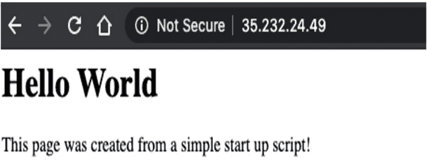

恭喜！您已成功使用 CLI 将运行在 GCE 上的虚拟机迁移到运行在 GKE 上的容器中。如果您想了解另一个基本迁移示例，建议您参考 quicklabs[27] 上的实操实验“Migrate for Anthos: Qwik Start”。

既然您已经知道如何使用 CLI 执行迁移，我们将进入下一节，在那里我们将使用 Cloud 控制台 UI 来执行迁移。

## 18.4.3 Google Cloud Console UI 迁移示例

在本节中，我们使用 M4A 将运行在 Google Compute Engine 上的虚拟机应用迁移到 Google Kubernetes Engine。GKE 处理集群可以位于云端或本地。迁移将通过 Google Cloud Console 提供的图形用户界面（GUI）运行。请注意，CLI 和 GUI 的迁移过程是一致的。

GKE 集群将用作“处理集群”来控制迁移。过程中生成的工件将存储在 Google Cloud Storage（GCS）上，最终的容器映像会推送到 Google Container Registry。在底层，这与 CLI 驱动的迁移完全相同。

第一步是通过以下地址从控制台访问 Anthos Migrate（参见图 6）：

[https://console.cloud.google.com/anthos/migrate](https://console.cloud.google.com/anthos/migrate)

### 图 18.6：访问 Anthos Migrate 以迁移到容器

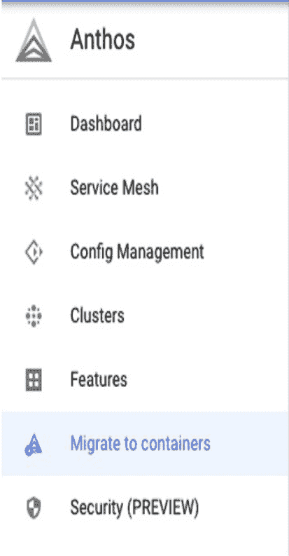

为简单起见，我们将从 Marketplace 部署一台预装了 Tomcat Server 的虚拟机。我们将使用此工作负载将 Tomcat 从虚拟机迁移到容器。

首先，让我们访问带有 Tomcat 的 Google Click-to-Deploy 仓库（参见图 18.7）。URL 为：

https://console.cloud.google.com/marketplace/details/click-to-deploy-images/tomcat

### 图 18.7：将 Tomcat 应用部署到虚拟机

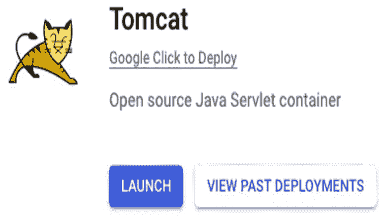

然后，让我们选择要部署的区域（参见图 18.8）：

### 图 18.8：已部署的 Tomcat 应用

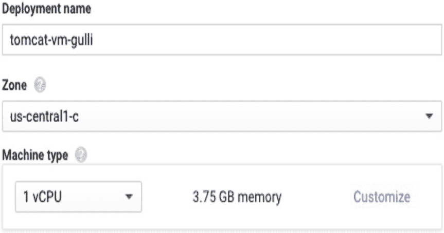

一旦部署了带有 Tomcat Server 的虚拟机，就可以通过外部 IP 访问该网站（参见图 9）。

### 图 18.9：使用 Google Click-to-Deploy 部署的 Tomcat 解决方案


### Tomcat

由 Google Click to Deploy 提供的解决方案

| 站点地址 | http://35.238.48.196/ |
| 管理员用户 | tomcat |
| 管理员密码（临时） | EKDm4yrQ |
| 实例 | tomcat-vm-gulli-vm |
| 实例区域 | us-central1-c |
| 实例机器类型 | n1-standard-1 |

在此部署中，IP 地址是 http://35.238.48.196/，因此如果您访问该网站，应该会看到如图 18.10 所示的输出：

### 图 18.10：从 Web 访问 Tomcat

# It works !

下一步是启动正式的迁移过程。首先要做的是创建一个“处理集群”，该集群将用于控制源虚拟机的迁移。您可以通过访问 Anthos 上的“Migrate to containers”菜单并使用“添加处理集群”选项来完成此任务（参见图 18.11）：

### 图 18.11：开始迁移过程

### 添加处理集群

最好遵循 GUI 中提供的建议，创建一个专门用于处理的新集群（参见图 18.12）：

### 图 18.12：为“处理集群”选择名称

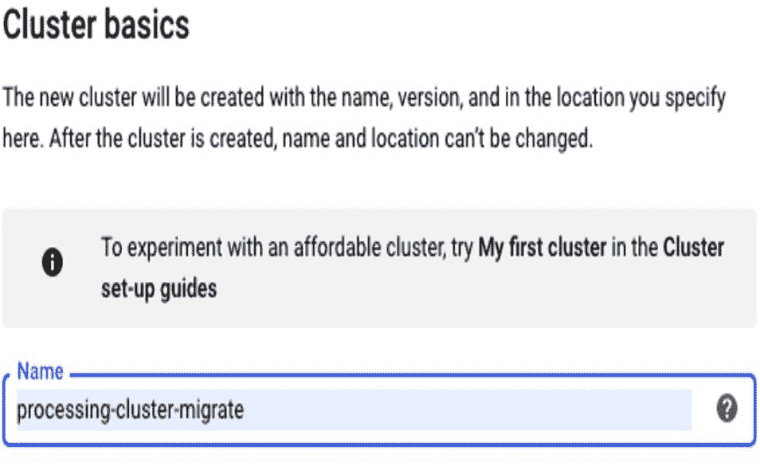

集群就绪后，您应该能够通过 Google Cloud Console 的 GKE 部分看到它（参见图 18.13）。

### 图 18.13：处理集群已准备好使用

### 2 定义源名称和类型

为新的源定义一个名称。

名称 *
migrate-vm-tomcat-gulli

选择要从中迁移工作负载的源环境。

Compute Engine

了解如何定义当前通过工具 CLI 支持的其他源类型（VMWare、AWS 和 Azure）。了解更多

选择名称后，您可以选择源虚拟机所在的项目（参见图 18.19）。

### 图 18.19：选择源虚拟机所在的项目

### 设置迁移

迁移名称 *
tomcat-migr

选择源 *
migrate-vm-tomcat-gulli processing-cluster-migrate

要了解如何添加更多源，请点击此处。

虚拟机操作系统类型 *
Linux

选择待迁移虚拟机的操作系统类型（Windows 或 Linux）。

虚拟机 ID *
tomcat-vm-gulli-vm

指定要迁移的虚拟机的 ID。

迁移意图 *
Image

然后，M4A 将开始生成迁移计划（参见图 18.22）：

### 图 18.22：生成迁移计划

| 迁移名称 ↑ | VM ID | 状态 |
|---|---|---|
| tomcat-migr | tomcat-v... | 正在生成迁移计划 |

在迁移过程中，我们可以使用以下命令检查进度，该命令将输出大量调试信息：

```
migctl migration status my-migration -v
```

一旦生成了迁移计划（参见图 18.23），就可以使用 GUI 检查结果：

**图 18.23：M4A 生成的迁移计划概览**

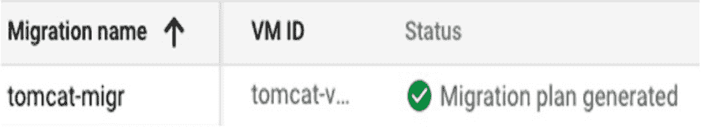

特别是，选项菜单允许我们编辑生成的迁移计划（参见图 18.24）：

**图 18.24：查看并编辑生成的迁移计划**

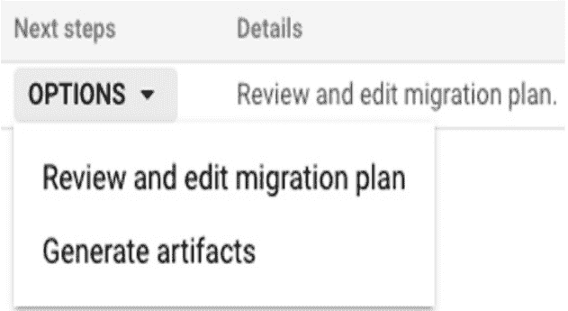

让我们通过编辑迁移计划来看看生成了什么（参见图 18.25）：

**图 18.25：编辑生成的迁移计划**

### 编辑迁移计划

```
```yaml
apiVersion: anthos-migrate.cloud.google.com/v1beta2
kind: GenerateArtifactsFlow
metadata:
  creationTimestamp: null
  labels:
    migration: kuwflyjr
    migration-name: tomcat-migr
    migration-namespace: v2k-system
  name: generate-artifacts-flow-f3d851ee-2b23-48ad-88a8-6f21356d8918
  namespace: v2k-system
  ownerReferences:
  - apiVersion: anthos-migrate.cloud.google.com/v1beta2
    blockOwnerDeletion: true
    controller: true
    kind: Migration
    name: tomcat-migr
    uid: f3d851ee-2b23-48ad-88a8-6f21356d8918
spec:
# Review and set which artifacts to generate.
```
```

通常，您不需要更改迁移计划。但是，如果您需要剔除不需要的虚拟机组件，或者需要添加一些附加配置，这将会很有用。检查并（如有必要）编辑迁移计划后，我们就可以开始生成工件（参见图 18.26）：

**图 18.26：使用编辑后的迁移计划生成工件**


生成迁移计划后，可以通过 Google Cloud Console 中的“工件”标签页进行检查。这些工件包括 Dockerfile、用于部署的容器映像（可直接部署）、容器映像基础层（不可运行的映像层）、部署规范 YAML、迁移计划 YAML 和工件链接 YAML（参见图 18.27）：

### 图 18.27：生成的迁移工件

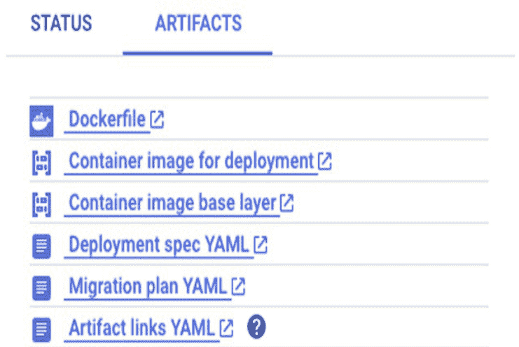

生成的工件存储在 Google Cloud Storage（GCS）中，基础层和映像层分别使用不同的存储桶（参见图 18.28）：

### 图 18.28：存储在 GCS 中的工件

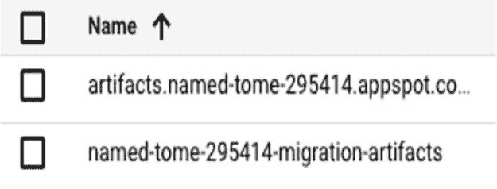

让我们查看一下包含 Dockerfile、部署规范、清单和迁移 YAML 的系统映像（参见图 18.29）：

**图 18.29：Dockerfile、deployment_spec、manifest 和迁移文件**

| 名称 | 大小 | 类型 |
|---|---|---|
| Dockerfile | 700 B | text/plain; charset=utf-8 |
| deployment_spec.yaml | 1.7 KB | text/plain; charset=utf-8 |
| manifest.yaml | 735 B | text/plain; charset=utf-8 |
| migration.yaml | 3.1 KB | text/plain; charset=utf-8 |

此外，为迁移生成的映像会自动推送到 Google Container Registry（GCR），您可以通过控制台浏览这些映像（参见图 18.30）：

**图 18.30：为迁移生成的映像并推送到 GCR**


| 名称 | 主机名 |
|---|---|
| 🔒 tomcat-vm-gulli-vm | gcr.io |
| 🔒 tomcat-vm-gulli-vm-non-runnable-base | gcr.io |

所有生成的产物都可以通过 CLI 下载：

```
migctl migration get-artifacts my-migration
```

其中包括：

- **deployment_spec.yaml**：配置你的工作负载；
- **Dockerfile**：用于构建迁移后 VM 的镜像；
- **migration.yaml**：迁移计划的副本。

## Dockerfile 概述

在本节中，我们将深入研究由 M4A 生成的 Dockerfile（见清单 18.1）。该文件可以编辑以自定义你的镜像，例如安装新软件包或安装升级版的 M4A 运行时。文件包含运行时原始容器仓库、包含源 VM 捕获数据的镜像，以及初始入口点。典型的 M4A Dockerfile 如下：

### 清单 18.1 由 M4A 生成的 Dockerfile

```
# Please refer to the documentation:
# https://cloud.google.com/migrate/anthos/docs/dockerfile-referen

FROM anthos-migrate.gcr.io/v2k-run-embedded:v1.5.0 as migrate-for

# Image containing data captured from the source VM
FROM gcr.io/named-tome-295414/tomcat-vm-gulli-vm-non-runnable-base
```

```
```dockerfile
# If you want to update parts of the image, add your commands here
# For example:
# RUN apt-get update
# RUN apt-get install -y \
# package1=version \
# package2=version \
# package3=version
# RUN yum update
# RUN wget http://github.com

COPY --from=migrate-for-anthos-runtime / /

# Migrate for Anthos image includes entrypoint
ENTRYPOINT [ "/.v2k.go" ]
```
```

我们将在本章后面讨论 M4A 生成的 Dockerfile 的更多细节，当我们讨论迁移后与 CI/CD 管道的集成时。在下一节中，我们将讨论 deployment_spec.yaml 文件的细节。

## deployment_spec.yaml 概述

在本节中，我们将讨论由 M4A 生成的 deployment_spec.yaml。首先，让我们定义一些后面会用到的术语：

- **Stateless：** 当服务器不存储有关客户端会话的任何状态时，应用程序是无状态的。换句话说，没有过去交易的存储知识或引用
- **Stateful：** 当服务器存储有关客户端会话的数据时，应用程序是有状态的。换句话说，当前交易可能受到之前交易发生的影响。出于这个原因，有状态应用程序需要每次处理用户请求时都使用相同的服务器。

有了这个背景，让我们考虑 deployment_spec.yaml。根据 UI 中选择的意图标志，此文件会有所不同：

1. **Intent: Image。** YAML 定义了一个无状态应用程序，其中相同的 Pod 作为服务进行管理。YAML 的不同部分为：
   
   a) **Deployment。** 这是从

### 清单 18.2 由 M4A 生成的 Deployment_spec.yaml

```
# Stateless application specification
# The Deployment creates a single replicated Pod, indicated by th
apiVersion: apps/v1
kind: Deployment
metadata:
  creationTimestamp: null
  labels:
    app: tomcat-vm-gulli-vm
    migrate-for-anthos-optimization: "true"
    migrate-for-anthos-version: v1.5.0
  name: tomcat-vm-gulli-vm
spec:
  replicas: 1
  selector:
    matchLabels:
      app: tomcat-vm-gulli-vm
      migrate-for-anthos-optimization: "true"
      migrate-for-anthos-version: v1.5.0
  strategy: {}
  template:
    metadata:
      creationTimestamp: null
      labels:
        app: tomcat-vm-gulli-vm
        migrate-for-anthos-optimization: "true"
        migrate-for-anthos-version: v1.5.0
    spec:
      containers:
      - image: gcr.io/named-tome-295414/tomcat-vm-gulli-vm:11-13-
        name: tomcat-vm-gulli-vm
        readinessProbe:
          exec:
            command:
            - /code/ready.sh
        resources: {}
        securityContext:
          privileged: true
        volumeMounts:
        - mountPath: /sys/fs/cgroup
          name: cgroups
      volumes:
      - hostPath:
```

| NAME | READY | STATUS | RESTARTS |
|---|---|---|---|
| tomcat-vm-gulli-vm-66b44696f-ttgq6 | 1/1 | Running | 0 |

默认情况下，容器以无负载均衡部署，并使用单个集群内部 IP，只能从集群内部访问（见图 18.31）。这意味着 Kubernetes endpoints 控制器将修改 DNS 配置以返回指向 Pod 的地址，这些 Pod 被标记为 "app": "tomcat-vm-gulli-vm"。当然，你可以更改部署并添加 LoadBalancer。我们通过在部署规范中添加以下内容来实现：

```
apiVersion: v1
kind: Service
metadata:
    name: hello-service
spec:
    selector:
        app: tomcat-vm-gulli-vm
    ports:
      - protocol: TCP
        port: 80
        targetPort: 80
    type: LoadBalancer
```

然后，让我们检查服务是否确实可访问：

```
kubectl get service hello-service
NAME             TYPE          CLUSTER-IP     EXTERNAL-IP      POR
hello-service    LoadBalancer  10.88.10.207   34.67.239.170    80:
```

让我们尝试从互联网访问（见图 18.31）：

## 图 18.31：使用 M4A 迁移后访问 Tomcat 容器


## 它工作了！

如果你通过网络浏览器看到此页面，这意味着你已成功设置 Tomcat。恭喜！

恭喜！你现在拥有一个可路由的容器，其中包含之前在 VM 中可用的完整 Tomcat 安装！迁移是自动完成的，无需重新编译或访问原始源代码。

在结束之前，关于 GUI 的提示。如果你需要编辑多个文件，使用内置的基于 Eclipse 的编辑器可能会非常方便。特别是，编辑器是快速轻松地查看和更改由 M4A 生成的所有文件的好方法（见图 18.32）。

**图 18.32：用于操作迁移配置的内置编辑器。**

```
migctl source create ce my-ce-src --project my-project --json-key
```

其中 my-ce-src 是源的名称，my-project 是项目名称，m4a-ce-src.json 是在为使用 Compute Engine 作为迁移源创建服务帐户后获得的 JSON 密钥文件名称。

然后你可以使用以下命令创建迁移：

```
migctl migration create my-migration --source my-ce-src --vm-id m
```

其中 my-migration 是迁移的名称，vm-id 是 Google Cloud Console 中显示的 Compute Engine 实例的名称。截至 2020 年底，Windows 支持的唯一意图是“Image”。刚刚创建的迁移计划可以用以下命令检索：

```
migctl migration get my-migration
```

如果需要，可以通过编辑文件 my-migration.yaml 来自定义迁移计划。编辑完成后，可以使用以下命令上传编辑后的迁移计划：

```
migctl migration update my-migration
```

下一步是执行迁移并使用以下命令生成产物：

```
migctl migration generate-artifacts my-migration
```

在迁移期间，可以使用以下命令监控状态：

```
migctl migration list
```

迁移完成后，可以使用以下命令访问产物：

```
migctl migration get-artifacts my-migration
```

作为结果，你应该会看到类似以下内容：

```
Artifacts are accessible through `gsutil cp gs://PATH/artifacts.z
```

因此你可以使用以下命令获取产物：

```
```bash
gsutil cp gs://PATH/artifacts.zip ./
```
```

下一步是使用产物构建 Docker 镜像。我们可以使用 Windows powershell 使用以下命令展开 `artifacts.zip`：

```
```powershell
Expand-Archive .\artifacts.zip
```
```

然后使用以下命令登录容器注册表：

```
```bash
docker login gcr.io
```
```

下一步是构建容器：

```
```bash
docker build -t gcr.io/myproject/myimagename:v1.0.0 .\artifacts\
docker push gcr.io/myproject/myimagename:v1.0.0
```
```

构建完成后，容器镜像将位于容器注册表中，并且可以部署到 GKE 集群。请注意，Anthos 的 Google Cloud Console 自 M4A v1.5 起包含 Windows 工作负载支持。体验与之前讨论的 Linux 相同。如果你想看另一个 Windows 迁移的示例，我建议你考虑动手实验室“ Migrate for Anthos: Windows ”，可在 quicklabs[31] 上获得。

## 18.4.5 从其他云迁移

截至 2021 年 11 月，从其他云迁移基于两步方法。首先，虚拟机被迁移（技术上这些被转换为 GCE 实例）。然后，迁移的虚拟机被容器化。

M4A 使用产品 Migrate for Compute Engine (M4CE)[32] 来流式传输位于其他云或本地的虚拟机，将它们移动到 GCE 实例上。Migrate for Compute Engine 可以通过 marketplace[33] 安装，它允许跨多个数据中心和云从 VMWare、Microsoft Azure 和 Amazon EC2 等源平台迁移数千个应用程序。


要使用M4CE，您需要设置站点到站点VPN连接和防火墙规则，以便在管理器所在的VPC与另一云上源虚拟机的VPC之间实现通信。感兴趣的读者可参阅在线防火墙文档[34]。可以基于BGP[35]协议通过GCP Cloud Router[36]设置动态路由，该路由器可运行在Cloud VPN[37]或专用高速Cloud Interconnect[38]上。Cloud Interconnect通过高可用、低延迟的连接将您的本地网络扩展到Google的网络。

此外，数千台虚拟机可以按其逻辑角色分组分批迁移。M4CE允许我们定义Runbook，以决定应迁移哪些虚拟机以及迁移顺序。在实际迁移之前，可以规划一个模拟测试阶段。

M4CE的主要组件包括：

- **迁移管理器**，用于编排迁移。管理器运行在单独的Google Compute Engine虚拟机上，并提供迁移控制台来管理和监控所有系统组件。请注意，管理器可能需要特定权限来处理特定操作，如开启和关闭虚拟机。这些权限可以通过特定策略来定义。
- **云扩展**用于处理从源平台迁移存储。扩展是迁移源和目的地之间虚拟机存储的通道。这些扩展运行在独立的Compute Engine虚拟机上，并在迁移过程中向迁移的工作负载提供数据。请注意，扩展采用双节点主/备配置以实现高可用性；每个节点提供服务，同时为另一个节点提供备份。

不同组件随后部署在源平台上：

- 在**vSphere**上，后端组件将来自VMware的运行时数据提供给Google Cloud上的扩展。虚拟机随后在Compute Engine上使用这些数据。此外，vCenter插件将vSphere连接到迁移管理器。该插件在vCenter上编排迁移。
- 在**Amazon EC2**和**Azure**上，运行时部署一个导入器。该导入器将来自源的运行时数据提供给Google Cloud上的扩展。虚拟机随后在Compute Engine上使用这些数据。

自Migrate 1.9起，还可以将容器部署到GKE Autopilot集群和Cloud Run，但本主题不在本书讨论范围内。

在本节中，我们简要介绍了M4A使用的M4CE在云与本地之间迁移虚拟机。迁移可以在几分钟内完成，而数据在后台透明迁移。感兴趣的读者可以在线了解更多[39]。此外，Qwiklabs提供了便捷的动手实验室，可将EC2实例从AWS迁移到Google Cloud上的Compute Engine[40]。下一节将介绍Google为M4A采用的一些最佳实践。

## 18.5 高级主题：M4A最佳实践

在本节中，我们讨论Migrate for Anthos的一些最佳实践，旨在为客户经常遇到的实时场景提供指导。这是一个相当高级的章节，假设您非常熟悉Kubernetes环境。我们将详细讨论Kubernetes的不同细节。让我们开始吧。

- **虚拟机主机名**。一种便捷的模式是将虚拟机主机名转换为Kubernetes服务名[41]。请注意，服务是一组聚合到单个资源中的Pod端点。因此，保留此命名约定有助于保持一致性。
- **每台虚拟机多个应用/服务**。如果每台虚拟机有多个应用程序或服务，为每个应用程序或服务定义Kubernetes服务可能会更方便。同样，此命名约定有助于保持一致性。
- **hosts文件自定义**。如果您的虚拟机对hosts文件使用特定自定义进行DNS解析，建议使用Kubernetes Pod规范中的hostAliases[42]。向Pod的/etc/hosts文件添加条目可在Pod级别覆盖主机名解析。此外，这有助于复制多个应用环境，如生产、预发布和测试环境。
- **多虚拟机堆栈**。如果您有多虚拟机堆栈环境，将相互依赖的Pod放在同一Kubernetes命名空间并使用短DNS名称可能会更方便。此外，应使用Kubernetes NetworkPolicy限制前端和后端Pod之间的访问。这种组织方式有助于保持环境有序、更安全、更高效。
- **引用外部服务**。如果您的应用程序使用外部服务，则值得考虑使用不带选择器的Kubernetes ExternalName服务[43]，这是Kubernetes中抽象外部后端的最佳实践。
- **NFS文件共享**。目前，M4A不会自动迁移NFS挂载。因此，您需要手动定义NFS持久卷指令并将其添加到生成的Pod YAML中。感兴趣的读者可以在线找到有关挂载外部卷的更多信息[44]。
- **不需要的服务**。迁移是一个整合的时机。因此，适合仔细检查虚拟机上运行的所有服务，并禁用容器不需要的服务。Migrate for Anthos将自动禁用不必要的硬件或环境特定服务，以及一组预定义的额外虚拟机服务。有关自动禁用服务的详细列表，请在线查看[45]。
- **环境变量**。如果您的应用程序需要环境变量，将定义移至Kubernetes Pod YAML是一种良好的做法。这样，您将遵循将所有基础设施以代码管理的理念。
- **使用云实例元数据的脚本**。如果您的脚本查询元数据，则值得将此查询替换为Kubernetes ConfigMap[46]，或再次使用Kubernetes Pod YAML定义中定义的环境变量。
- **应用程序日志**。如果您愿意，可以将使用Migrate for Anthos迁移的工作负载容器生成的日志写入Cloud Logging。默认情况下，M4A将考虑写入init（所有Linux进程的父进程）标准输出的条目，以及/var/log/syslog中的内容。采用此策略将增强环境中自动化水平和应用程序的可观测性。
- **GKE Ingress控制器**。如果迁移到GKE，使用GKE网络Ingress控制器控制访问工作负载的网络流量可能会更方便。这将无需更改应用程序来添加额外的路由规则、VPN、过滤器或VLAN。例如，如果要迁移三层应用程序，可以将其拆分为多个容器。通过GKE Google负载均衡器[47]访问前端服务以实现负载扩展。此外，您可能需要定义网络策略，只允许前端Pod访问应用程序服务，而不允许外部世界访问。同样，您可能需要定义策略，仅允许应用层访问数据库层。这些选择将提高环境的安全性。
- **Linux特定的运行级别3**。在Linux环境中，某些服务默认仅配置为在运行级别5启动。目前，M4A仅达到运行级别3。使用Migrate for Anthos迁移到GKE的虚拟机将在容器中以Linux运行级别3启动。因此，某些服务应配置为在运行级别3自动启动。这些可能包括X11、XDM和用于VNC的GUI。

在本高级部分中，我们讨论了多种可用于微调使用M4A迁移环境的最佳实践。在下一节中，我们将讨论迁移后如何升级镜像。

## 18.6 与CI/CD流水线的迁移后集成

使用M4A生成的工件可用于第二天运维，如软件更新、配置更改、安全补丁以及文件相关操作。这些工件可以轻松集成到由源、构建、测试和部署组成的典型CI/CD流水线中（参见图18.33）。

**图18.33：典型CI/CD开发阶段**


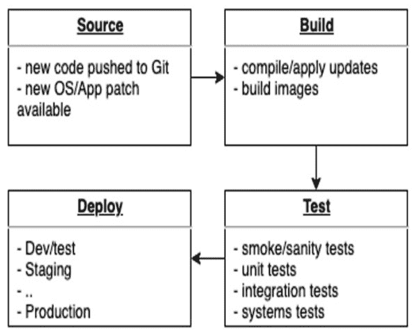

工件是通过多阶段构建生成的，以便可以增量维护，而不会承担使生成的容器镜像膨胀的风险。有关M4A与CI/CD流水线集成的示例，请参见图18.34。

## 图18.34：M4A与CI/CD流水线的集成

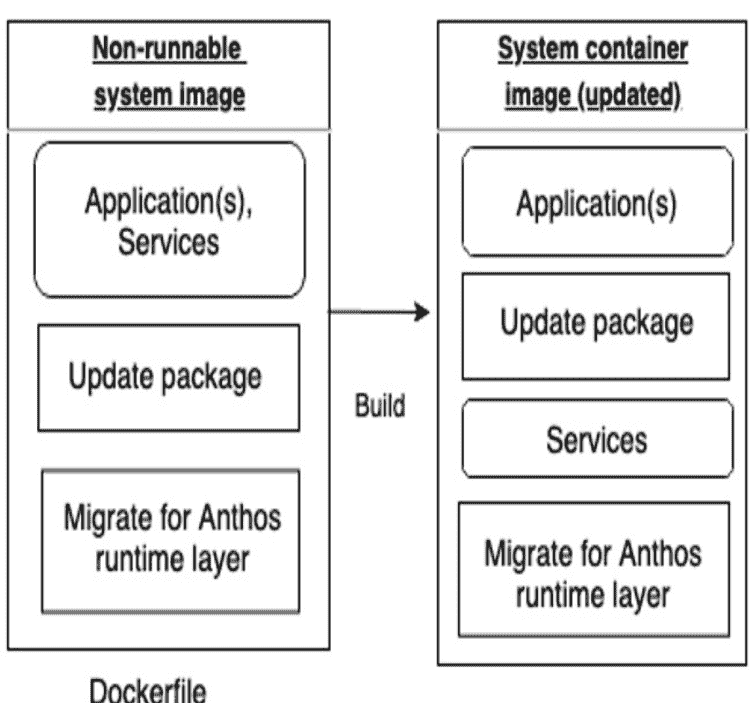

一个典型的Docker工件由两部分组成（见图18.35）。第一部分是M4A运行时，第二部分是不可运行的基础层，代表从迁移的虚拟机捕获的系统镜像层。

如果需要更新M4A运行时，只需适当替换Docker文件中的第一个FROM指令即可。例如，假设需要支持M4A 1.8.1，则可以通过以下新指令轻松实现，该指令将替换当前指令：

```
FROM anthos-migrate.gcr.io/v2k-run-embedded:v1.8.1 as migrate-for
```

如果需要更新应用程序，则可以更改第二个Docker FROM指令。具体来说，您通常从容器注册表下载生成的Docker文件，编辑Dockerfile以应用所需的更改，构建新的分层镜像，并通过滚动更新来更新现有部署。如前所述，这种镜像分层方法

[23] 参见 [https://cloud.google.com/vmware-engine](https://cloud.google.com/vmware-engine)

[24] 参见 [https://cloud.google.com/migrate/anthos/docs/fit-assessment](https://cloud.google.com/migrate/anthos/docs/fit-assessment)

[25] 有关适用性评估规则的列表，请参见：
[https://cloud.google.com/migrate/anthos/docs/fit-assessment#assessment_operation](https://cloud.google.com/migrate/anthos/docs/fit-assessment#assessment_operation)

[26] Google Cloud 控制台报告查看器：
[https://console.cloud.google.com/anthos/migrate/report](https://console.cloud.google.com/anthos/migrate/report)

[27] 参见 [https://google.qwiklabs.com/catalog?keywords=Migrate%20for%20Anthos%3A%20Qwik%20Start](https://google.qwiklabs.com/catalog?keywords=Migrate%20for%20Anthos%3A%20Qwik%20Start)

[28] 参见 [https://cloud.google.com/migrate/anthos/docs/adding-a-migration-source](https://cloud.google.com/migrate/anthos/docs/adding-a-migration-source)

[29] Pod 封装一个或多个应用程序，是 Kubernetes 中最小的执行单元。

[30] 参见 [https://cloud.google.com/migrate/compute-engine/docs/4.11/getting-started](https://cloud.google.com/migrate/compute-engine/docs/4.11/getting-started)

[31] 参见 [https://google.qwiklabs.com/catalog?keywords=Migrate%20for%20Anthos%3A%20Windows](https://google.qwiklabs.com/catalog?keywords=Migrate%20for%20Anthos%3A%20Windows)

[32] 参见 [https://cloud.google.com/migrate/compute-engine](https://cloud.google.com/migrate/compute-engine)

[33] 参见 [https://console.cloud.google.com/marketplace/details/google-cloud-platform/migrate-for-compute-engine](https://console.cloud.google.com/marketplace/details/google-cloud-platform/migrate-for-compute-engine)

[34] 参见 [https://cloud.google.com/vpc/docs/firewalls](https://cloud.google.com/vpc/docs/firewalls)

[35] 参见 [https://en.wikipedia.org/wiki/Border_Gateway_Protocol](https://en.wikipedia.org/wiki/Border_Gateway_Protocol)

[36] 参见 [https://cloud.google.com/network-connectivity/docs/router](https://cloud.google.com/network-connectivity/docs/router)

[37] 参见 [https://cloud.google.com/network-connectivity/docs](https://cloud.google.com/network-connectivity/docs)

[38] 参见 https://cloud.google.com/network-connectivity/docs/interconnect

[39] 参见 https://cloud.google.com/solutions/migrating-vms-migrate-for-compute-engine-migrating-vms

[40] 参见 https://google.qwiklabs.com/catalog?keywords=Migrate%20for%20Compute%20Engine

[41] 参见 https://cloud.google.com/kubernetes-engine/docs/concepts/service

[42] 参见 https://kubernetes.io/docs/concepts/services-networking/add-entries-to-pod-etc-hosts-with-host-aliases/

[43] 参见 https://kubernetes.io/docs/concepts/services-networking/service/#services-without-selectors

[44] 参见 https://cloud.google.com/migrate/anthos/docs/mounting-external-volumes

[45] 参见 https://cloud.google.com/migrate/anthos/docs/planning-best-practices#disable_unneeded_services

[46] 参见 https://kubernetes.io/docs/tasks/configure-pod-container/configure-pod-configmap/

[47] https://cloud.google.com/kubernetes-engine/docs/concepts/ingress
