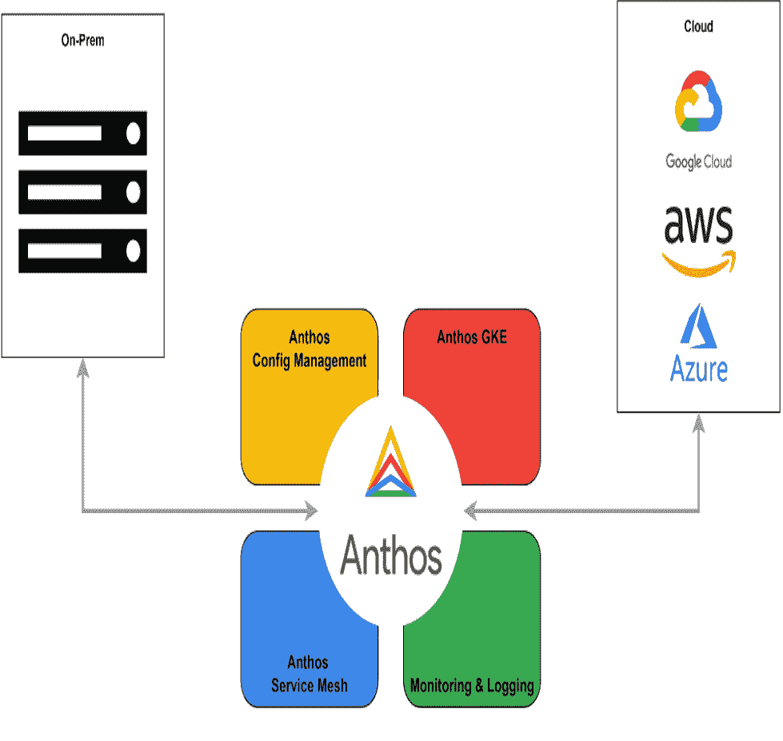
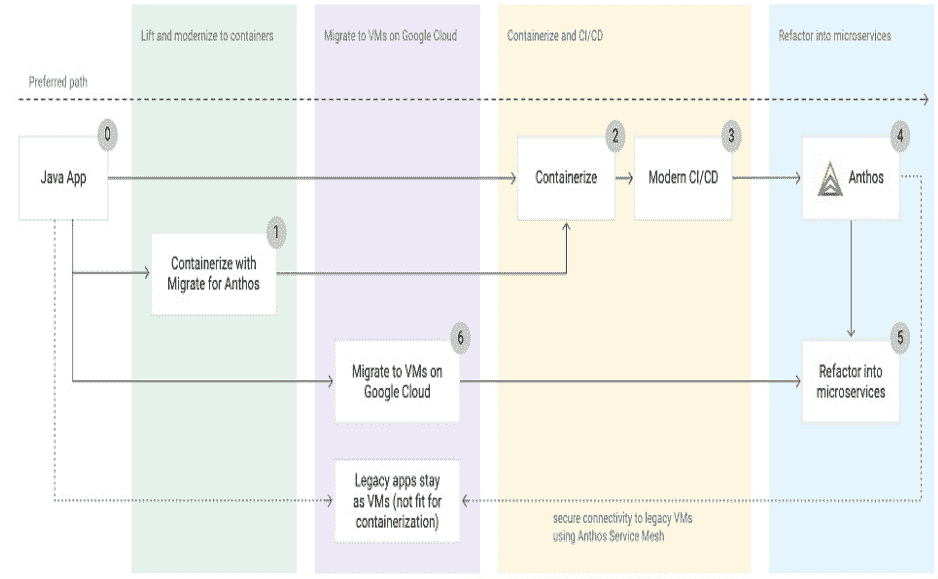
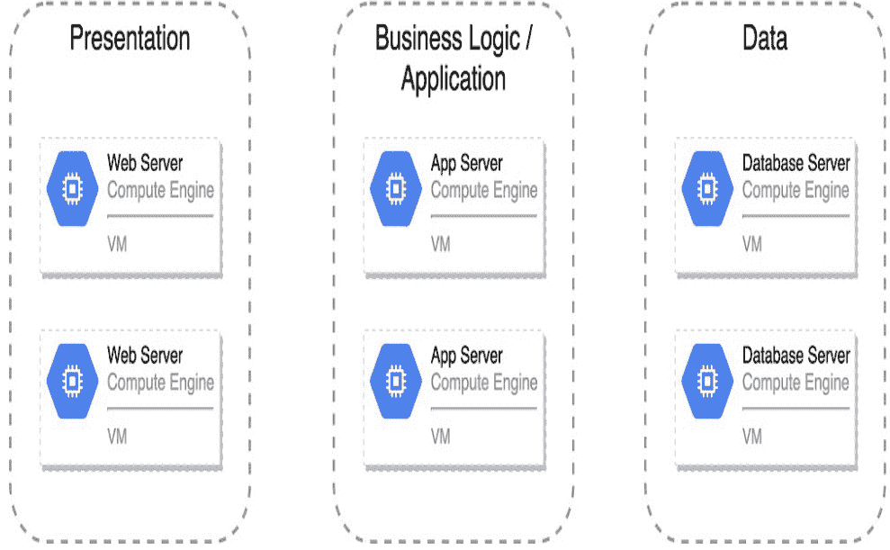
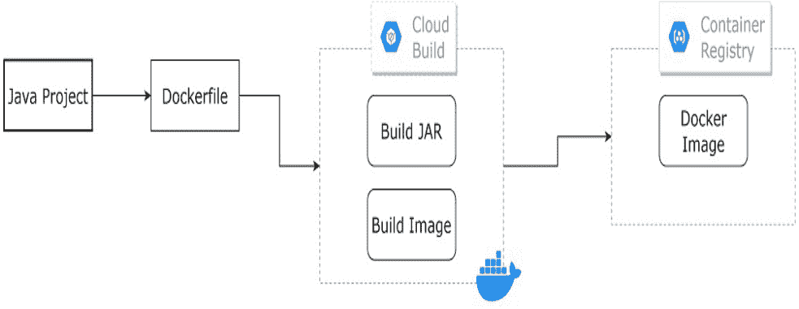
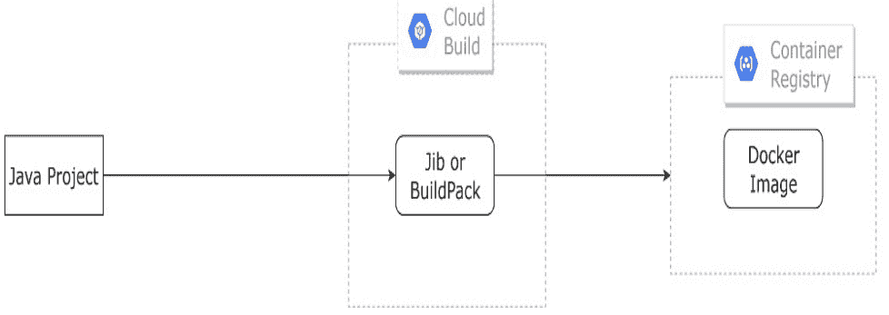
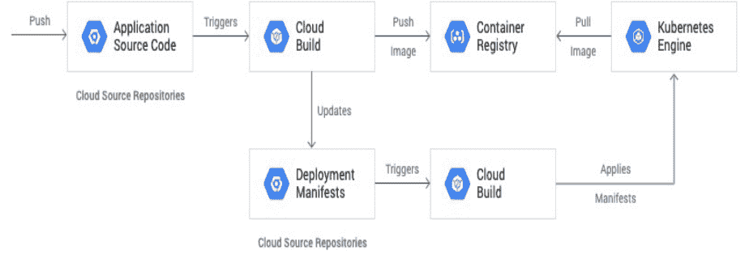
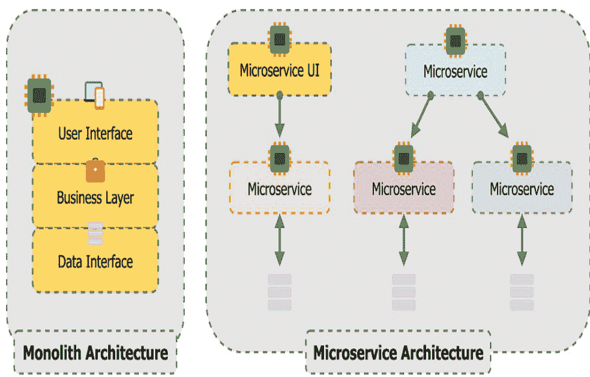
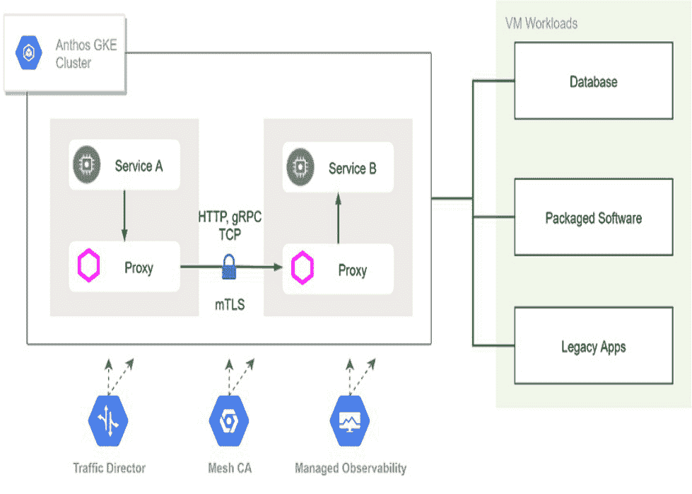

## 19 使用Anthos打破单体架构

作者：Phil Taylor

### 本章涵盖：

- 对遗留应用程序进行现代化改造
- 利用Anthos进行现代化改造
- Anthos对微服务的好处
- 现实世界示例
- 应避免的反模式

在当今市场中，大规模开发和支撑应用程序比以往任何时候都更加困难。随着业务市场的快速加速，应用程序从早期原型迅速演变为大规模应用。借助传统的部署方法和流程，我们可以在应用程序扩展时演进架构，并有机地发现和修复问题。如今，团队为了跟上业务需求所需的速度，我们的架构和部署流程从第一天起就必须具备敏捷性和可扩展性。幸运的是，容器和容器平台（如Anthos）的最新创新，加上微服务架构等现代开发模式，帮助我们在不影响效率、性能或质量的情况下轻松构建和部署应用程序。

## 19.1 对遗留应用程序进行现代化改造

虽然这些新模式和工具非常适合全新开发项目，但支持遗留应用程序可能会令人沮丧，有时甚至令人不知所措。许多团队都面临着在飞行途中重建飞机的同时保持飞机飞行的挑战。把所有鸡蛋放在一个篮子里，只专注于使用现代软件架构模式和容器重建应用程序，这种想法很有诱惑力。我们看到许多团队采用这种方法并失败了。最成功的团队将这一过程视为对原始设计的渐进式改进。

在考虑如何从单体遗留设计过渡到现代架构设计时，我们推荐以下方法。

- 1. 对遗留应用程序的开发和部署流程进行现代化改造。
- 2. 此时，最好考虑有助于改善开发和部署生命周期的语言和/或框架升级或替换。例如，如果我们有一个Java Websphere应用程序，并且该应用程序与Websphere的功能没有紧密耦合，我们可以考虑将其迁移到Apache Tomcat Web服务器框架。
- 3. 现代化改造到容器环境，您可以利用Migrate for Anthos将应用程序的运行环境从虚拟机快速迁移到容器。这将有助于对应用程序的运维进行渐进式改进，从而为您的团队腾出时间专注于现代化工作。
- 4. 添加用于构建和单元测试应用程序的持续集成流水线，将帮助团队更快地发现和修复问题。反过来，这将为他们提供快速的反馈循环，使他们获得开始现代化改造应用程序所需的信心。
- 5. 添加将应用程序部署到较低环境并执行自动化集成测试或用户验收测试的持续部署流水线，将进一步提高团队的生产力。
- 6. 在此阶段，添加端到端的可观测性和插桩是关键。我们不能再依赖登录专用的虚拟机来查看日志或调试应用程序。我们需要能够监控和调查在运行环境中大量节点上可能发生的事件。
- 7. 在此利用GKE或Anthos等托管容器运行环境，将使您的团队能够专注于软件和部署创新，而不是运营容器环境。

接下来，您将需要对遗留应用程序本身进行现代化改造，而不仅仅是开发和部署流程。这将为开发团队和基础设施带来敏捷性、速度和效率。将应用程序拆分成更小的领域，并将其功能解耦为具有公认契约的独立服务，将带来额外的

效率。例如，你将能够独立构建和测试单个业务领域服务，从而快速迭代功能。服务之间的标准契约将定义清晰的边界，帮助你确定何时引入了可能影响其他依赖服务的破坏性变更。你将有两个选择：(1) 增量提取并重写功能，或(2)重写整个应用程序。大多数情况下，这取决于业务目标和对投资的意愿。我们在这里简要介绍选项(1)，因为这是我们看到客户采用的最常见方法。

有多种方法可以剥离边缘功能并将其重写为云原生。许多团队从常见的服务（如身份验证与授权、日志记录等）开始。这种方法能让你的团队先尝到甜头，逐步将应用架构转变为现代微服务设计。

此时你可能会问自己，为什么不直接对旧版应用使用 Migrate for Anthos 然后就此结束呢？答案取决于你的特定用例和应用的生命周期。对于计划停用或替换的应用，该方法可能很合适。对于生命周期较长的应用，你最终需要重写应用，以利用微服务和基于事件的架构等现代架构模式。

上述架构具有许多优势，重点如下：

- 开发优势
  - 更小的团队专注于单一业务问题领域。
  - 现代代码开发与测试技术，支持服务构建、测试和部署的100%自动化。虽然传统应用也能实现100%测试覆盖率和自动化部署，但所需工作量远大于从一开始就采用支持这种模式的设计。
  - 服务解耦使我们能够选择最适合团队所构建业务能力的技术栈。
  - 不同团队可以管理各自的服务。这种方法通常用于让每个团队负责一个服务，团队只需理解与其开发服务相关的业务领域。考虑一个包含支付和税务逻辑的服务。在这种场景下，开发人员需要理解支付交易和网关、PCI合规性以及联邦或地方税务规则等概念。通过在支付和税务之间划分服务领域边界，我们可以减少支持各服务的开发人员所需的领域知识。采用微服务方法后，支付团队不再需要理解联邦或地方税务规则的复杂性，他们只需理解API契约，以便为给定交易添加适当的税款。
- 运维优势
  - 更高的可靠性/高可用性，每个应用服务在设计上都是独立编译和部署的。这会将服务故障的爆炸半径缩小到单个微服务。
  - 可移植性。容器提供了移动性，使我们能够在合适的位置（本地或云提供商）运行服务。虽然虚拟机也能实现这一点，但容器平台使得在其他环境中部署和调度工作负载变得更加容易，或者可以自动将工作负载移动到更好的操作节点，且零停机。
  - 更低的运营成本。容器提供比虚拟机更高的密度，相比虚拟机或物理环境能带来更多节省。
  - 单个服务的需求弹性。通过微服务设计，我们可以自动扩展服务以满足需求，并在空闲时缩减以控制成本。虽然基于虚拟机的设计也能实现这一点，但传统上，团队由于缺乏对虚拟机内单个服务如何扩展的理解，往往会对整个虚拟机进行扩展。
  - 自动化部署流水线。利用基于容器的解决方案，我们可以更轻松地实现端到端运营的自动化。
  - 自愈能力。通过将需要高可用性的服务迁移到容器平台，我们可以更轻松地设置自动化来处理常见的故障和恢复任务。Kubernetes 原生提供存活和就绪检查以及重新调度功能，使这在大多数情况下都是简单的任务。

## 19.2 利用 Anthos 进行现代化改造

Anthos 提供了一套完整的解决方案，用于运行容器化应用，或者我们想要迁移到容器的传统应用。Anthos 可以帮助你在原位实现现代化，将工作负载迁移到云端，并通过在云和本地环境之间保持集群一致性以及先进的服务网格网络功能，更轻松地实现混合应用策略。有关 Anthos 组件的概述，请参见图1。

- Anthos Config Management（第14章）提供了一种简单方法来集中管理“配置即代码”。
- Anthos Service Mesh（第5章）使我们能够指定松散耦合的服务依赖关系，在服务之间建立安全通信通道，并构建集中式可观测性系统。
- Anthos GKE（第4章）为我们在本地或公有云环境中的 Kubernetes 工作负载提供了可靠且一致的运行时环境。
- Cloud Logging 和 Cloud Monitoring（第6章）提供了用于监控、审计和排查集群与工作负载的集中式工具。

图19.1 - Anthos 组件概览

### 19.2.1 现代化改造方法

正如我们在引言中讨论的，有几种方法可以实现应用现代化，而你选择的路径可能因具体应用和业务需求而异。

某些应用或应用中的某些组件可能不太适合容器化。以下是一些可能影响你是否将应用或其组件容器化决策的因素。

- 如果应用是业务关键型且风险过高，你可以考虑先将该应用迁移到 Google Compute Engine (GCE) 虚拟机，然后再进行容器化。先将应用迁移到 GCE，可以降低必须学习新的运维模式来支持该应用所带来的风险。这可以让你的团队有时间先学习 Kubernetes 和 Anthos 并将其应用于不那么关键的工作负载。
- 许可限制。例如，你的应用可能依赖不允许容器化的软件应用程序。
- 运维支持。支持你的应用的团队尚未准备好接受支持容器化应用所需的新工具链。
- 其他因素包括：法规合规要求、与其他应用交互时的性能，或现有硬件投资。

请参考下面的图2，它直观展示了 Java 应用现代化改造的高层级流程。

图19.2 - Java 应用现代化改造

无论你最初使用何种技术栈构建应用，方法都是相同的。还要记住，这只是一个简单示例，你的应用可能包含多个需要交互以提供端到端应用用户体验的应用组件或服务。根据上述标准，你需要决定哪些应用组件将重新平台化到容器中，哪些将保留为虚拟机。然后我们将按照图示执行现代化改造计划。下面的纲要为每一步提供了更清晰的说明。

- 第0步，确定要现代化的目标应用或组件
- 第1步，如果应用适合，我们将利用 Anthos Migrate（第19章）将目标应用容器化
- 第2步，如果应用过于复杂，我们将手动容器化应用，我们将在下一节更详细地介绍这种方法
- 第3步，更新现有 CI/CD 流水线或构建新的流水线，以构建、测试应用并将其部署到 Anthos
- 第4步，使用 Anthos 运维应用，管理配置、安全性以及与遗留应用的连接
- 第5步，将应用重构为微服务架构
- 第6步，将当前不适合容器的遗留应用迁移到 Compute Engine，然后通过利用专为云原生应用设计的现代开源框架，将应用重构为微服务，从而实现现代化改造
- 未纳入现代化改造计划范围的遗留应用将保持其当前形式，并且很可能继续留在遗留数据中心。我们将利用 Anthos Service Mesh 来保护与这些工作负载的连接。例如 ERP 系统、核心主机应用等。

下图（图3）展示了一个三层 Java 应用。在某些情况下，遗留应用正在使用商业 Java 应用服务器（WebSphere、WebLogic）。如果你已经分析了应用源代码，并且它没有利用商业应用服务器的专有功能，那么现在正是转向开源应用服务器（Apache Tomcat、JBOSS）并消除不必要的许可成本的好时机。毕竟你无论如何都要重建应用部署，而且还有

public container images available as starting points for either of the open source application servers mentioned above. If your team is considering a redesign and/or rewrite you may also want to consider moving to modern Java frameworks within your application like [Spring Boot](https://spring.io/projects/spring-boot). If you go down this path you may also consider leveraging the [Spring Cloud GCP](https://spring.io/projects/spring-cloud-gcp) project which will accelerate your migration and provide libraries for interacting with common GCP services like Pub/Sub, Cloud Spanner, Cloud Storage and many more.

Figure 19.3 - Traditional 3-tier Java Application

## Traditional 3-tier Java App

Once you have figured out which applications or application components are best suited for containerization you can follow the steps below.

## Containerize your application

The first step in the journey is getting your application running inside a container.

If you're containerizing an ASP.NET application you will have two approaches to consider, (1) port to .NET Core or (2) leverage Windows Classic Kubernetes nodes. The approach you choose will depend on how easily you can port the application for ASP.NET to .NET Core and how long the application will be supported. In general we would recommend porting the application to .NET Core which will run on Linux thus simplifying your Anthos clusters. Additionally, as with Java applications, it might potentially require a major rewrite.

In this chapter, we will focus on the steps required to replatform a typical enterprise Java application to containers running on Anthos.

There are a couple of tools available for Java developers to make the process of building a container image for your application easier that plug into your existing build workflow (Figure 4). If your team is not comfortable writing container image descriptors, then you may consider using tools such as:

- [Jib](https://github.com/GoogleContainerTools/jib): integrates with Maven and doesn’t require a Docker daemon on the build machine. Developers follow a typical build process and Jib builds and outputs an optimized container image for your application. The optimized container image splits dependencies from classes making it fast and efficient on future builds. Only the layers that have changed will be rebuilt.
- [Google Cloud Buildpacks](https://cloud.google.com/blog/products/containers-kubernetes/google-cloud-now-supports-buildpacks): Buildpacks are designed to abstract the container image building process, so that the developer can follow a normal build process. Based on the CNCF v3 specification these buildpacks output container images following best practices designed to run on GCP container services: Anthos, CloudRun or GKE.

**Figure 19.4 - Docker Build vs Jib/Buildpack Flow**

## Docker Build Flow

## Jib/Buildpack Build Flow

Once you have chosen your path and containerized your application it's time to connect it into a CI/CD build pipeline for faster deployment iterations.

## Build and deploy your application using Modern CI/CD

Next, we will want to build a CI/CD pipeline (Chapter 14) to manage our new build process and deploy our application. This will create more efficiencies in our development process by eliminating manual tasks in favor of automation thus allowing us to build, validate and ship code faster. As we refactor to microservices, we decouple our application services into independently deployed components. This increases the overall complexity to deploy and manage our modern application. Without well defined and complete CI/CD pipelines and an automated approach to address quality control and deployments we see teams slow down rather than speed up.

The diagram below (Figure 5) depicts the necessary stages and flow for building a CI/CD pipeline to build and deploy a Kubernetes application.

## Figure 19.5 - Example CI/CD Pipeline for Kubernetes Application

## Operating your application on Anthos

At this point you will be able to leverage Anthos as a consistent Kubernetes operating environment to reduce your operational overhead while increasing development cycle velocity. Refer to Chapter 6 for more information on operating your application. Moving your applications into containers and adding CI/CD pipelines should give your operators and developers more cycles to focus on modernizing additional applications or move on to a deeper modernization (refactor to microservices) of an application you already have running on Anthos.

## Refactoring your application into Microservices

What we have learned since the invention of public cloud platforms is that there is one architecture that stands above all others for cloud native applications. The microservices architecture was pioneered by companies like Google and has since taken mainstream adoption by many companies that are performing in the elite DevOps (See: https://cloud.google.com/blog/products/devops-sre/announcing-dora-2021-accelerate-state-of-devops-report) space. This chapter is not intended to be the holy grail of building microservice applications, there are plenty of good books on the topic. We will take the time to highlight the architecture and key advantages to this approach. As illustrated in the diagram below (Figure 6), in short, with a monolithic architecture we couple all of the service code into a single compiled application which creates a hard coupling between the technical components and the teams building them. It also means that when that application is running in a single process there are known side effects; an application crash in one component may take out the entire app, scaling the application means scaling all components which leads to waste in our computing environment.

## Figure 19.6 - Monolith vs Microservice Architecture

Most teams leverage Domain Driven Design (See https://martinfowler.com/bliki/DomainDrivenDesign.html) in the design and creation of their microservices. With a microservice architecture, we decouple the services responsible for separate business domains into their own isolated services. This allows us to decouple the teams responsible for developing each service reducing the domain expertise required. We standardize interactions between services by leveraging industry best practices for protocols and data payloads. This provides the following technical and development benefits as outcomes to a microservices based architecture:

- Decompose app into a set of smaller services that are easier to understand
- Faster to develop, easier to maintain as we limited the breath of domain knowledge required.
- They can be developed independently by a team focused on that service increasing overall product development velocity
- Deployed and scaled independently, scaling services not servers
- Makes it easy to enable continuous deployment on complex applications as we can limit our test boundaries to a single service during service development iterations

The business benefits are as follows:

- Increased deployment frequency resulting in reduced time to market (TTM) for new features and patches. We can iterate development and add new capabilities to a single service with little or no impact to other application services.
- Better infrastructure utilization, scale services not servers. Since we have more cleanly defined application service boundaries. We can deploy services individually and only scale the ones we need to scale. In the past it was common for operations teams to scale the entire server or VM since it was a complex task to scale an individual service and they didn’t understand the application well enough to split it up.
- Faster mean time to recovery (MTTR) for security patches. Since microservices are mainly deployed using containers we simply patch the code and redeploy the application leveraging a Kubernetes rolling update with zero downtime. In the past we would have attempted to patch the VM and do an in place upgrade of the application. Most

- 降低部署失败/回滚率。由于我们隔离了服务边界，部署的范围也随之缩小，结合应用的自动化测试和部署，我们的成功率显著提升。

在选择将应用重构为微服务架构时，你可以采取两种方法。(1) 组建一个团队，采用绿地方式重写整个应用。这种方法对生产应用的干扰较小。然而，它会增加整个项目的风险，因为你需要在重写整个应用后才能实现收益。(2) 应用绞杀者模式（[https://martinfowler.com/bliki/StranglerFigApplication.html](https://martinfowler.com/bliki/StranglerFigApplication.html)）逐步迭代遗留应用的设计并将其重构为微服务。

我们建议使用绞杀者模式，因为它降低了采用新设计模式以及将整个应用重构为微服务架构的风险。这可能会增加项目的整体工作量，因为我们需要提取逻辑并将其重新接入现有应用。它使我们能够逐步改进应用架构，每次发布新生产版本时都能提供更多价值。这降低了风险，并能更快地为业务提供价值。

许多团队都在为一个简单的问题而苦恼，从哪里开始？答案因应用而异。然而，模式通常是相同的，寻找支持应用且易于解耦的功能。例如，集中的身份验证和授权服务通常是一个不错的选择。

考虑利用 Google 推荐的框架（[https://cloud.google.com/architecture/migrating-a-monolithic-app-to-microservices-gke?hl=en#which_features_should_you_migrate_first](https://cloud.google.com/architecture/migrating-a-monolithic-app-to-microservices-gke?hl=en#which_features_should_you_migrate_first)）来评估应先迁移哪个功能。框架的摘要已在下面提供。

- 业务流程
- 设计与开发
- 运维
- 人员与团队

### 业务流程

你应评估并考虑迁移该功能对业务用户的影响。开发人员和运维团队需要学习大量新概念才能成功现代化应用。在现代化的早期阶段，你应避免迁移业务关键系统或功能。

### 设计与开发

接下来你应评估该功能的复杂性、其依赖关系以及迁移所需重构的工作量。考虑以下因素：

- 数据使用、模式数量（隔离或共享）以及大小
- 对其他功能的依赖
- 依赖此功能的其他功能
- 连接要求
- 可能在重构中造成复杂性或没有明确解决方案的设计元素

### 运维

在评估应先迁移哪些功能时，你应评估以下内容：

- 与业务的服务等级协议
- 维护窗口和对停机的容忍度

考虑专注于对停机更宽容且没有要求高可用性的关键业务 SLA 的功能。

## 19.3 Anthos 对微服务的益处

微服务架构的目标是将业务服务逻辑解耦为独立的自包含服务，以提供开发加速和性能优化。缺点是你在应用的配置、部署和维护操作中创造了复杂性。Anthos 解决了支持此类应用最常见的问题。

- **一致性：** 跨多个公有云和本地数据中心的统一运行时环境；
- **自动化：** 微服务成功的关键在于你自动化部署整个应用的能力。Anthos 提供配置即代码以实现此能力。你可以使用 ACM 应用配置、安全策略，甚至部署应用组件。
- **依赖管理与安全：** 解耦服务带来的复杂性可通过服务网格更易于管理。不是在应用中嵌入物理服务到服务的依赖，微服务解决方案中流行的模式是嵌入由服务网格解析的逻辑引用。ASM 提供了此能力，以及注入安全策略、强制互 TLS（mTLS）并将传统 VM 桥接到应用中使其如同其他基于 Kubernetes 的服务一样的能力。
- **可观测性：** 一旦将应用拆分为微服务，了解应用性能变得更加困难。不是用精密工具监控一个 Java 进程，你需要监控大量服务的性能并了解何时某个服务降级或损坏。Anthos Service Mesh（ASM）提供了可视化和检查应用性能的能力，以及设置服务等级目标（SLO），以便你能收到警报或让自动化流程修复服务性能。

## 19.4 实际案例

有很多实际案例需要我们在靠近用户的地方运行计算工作负载（即在边缘运行）。这些都是 Anthos 的绝佳用例，Anthos 提供了将配置和安全策略作为代码应用的能力。几个容易识别的是零售或制造相关的用例。

想象你是一家大型邮轮公司，你开发了一种新的用户体验，利用了我们在本书中描述的许多概念。你的团队构建了新的基于微服务的架构，包含 Web 和移动应用用户体验。这种新的数字体验用于为客户提供大量船上功能，如活动规划、餐食订购、活动、公告和礼宾服务。你一直遇到的问题是舰队中没有一致性。你在保持每艘船的硬件和软件更新方面遇到问题，导致用户体验不一致、停机以及更多问题。更新的努力是耗时的手工工作，需要应用补丁和升级软件。因此，尽管你的开发团队采用了现代方法，但你在运营这一复杂解决方案方面仍在挣扎。你需要 Anthos，虽然它不会消除更新硬件或核心网络更改的过程。它会处理其他一切，缩小手动和自动化流程之间的差距，并降低你运营解决方案的开销。Anthos 将为你提供以下能力来掌控你的环境并避免配置和部署问题：

- Anthos GKE，将为你提供受管的 Kubernetes 发行版，确保你在每个环境中运行相同的运行时平台。
- Anthos Service Mesh，将为你提供安全和可观测性能力，以确保你的容器环境和工作负载安全，并且你的开发人员可以通过使用服务等级目标（SLO）轻松发现问题。
- Anthos 配置管理（ACM），将为你提供集中式的策略即代码方法，用于核心集群配置、安全策略和应用部署一致性。

现在想象你的团队已以 Anthos 为运营核心构建了解决方案。你的团队已设计每个集群并记录了核心集群配置和安全策略作为代码，利用 Anthos Config Management。要上线新的船上数据中心，只需机架安装设备、将硬件接入网络、安装 Anthos，然后将集群与控制平面和 ACM 注册。然后 ACM 将使用正确的配置和安全策略引导集群。

## 19.5 应避免的反模式

多年来，我们在帮助团队将应用现代化为微服务架构的过程中发现了一些反模式。

- 大爆炸式方法很诱人：许多团队决定放弃现有成果，一次性重写整个应用为微服务架构。在我们的经验中，这往往导致瀑布式方法，在业务能够实现收益之前耗时显著更长，并超出预算。更好的方法是逐层剥洋葱，一次一层，正如我们在本章前面提到的

利用绞杀者模式。这种方法更符合精益/敏捷的现代化应用思路，并且能更快地带来收益。

- 忽视微服务的原则 (https://martinfowler.com/articles/microservices.html)：要正确创建微服务，我们将把所有功能隔离到一个新服务中。这通常意味着移动接口逻辑、业务逻辑以及有状态服务所需的数据模式。许多团队在此处会出错，并将数据模式保留在共享数据存储中。当团队不了解服务边界或不了解如何解决下游能力如分析或报告时，这会很诱人。在成熟的微服务解决方案中，所有组件必须被隔离并独立版本化和部署。
- 数据驱动迁移 (https://www.oreilly.com/content/microservices-antipatterns-and-pitfalls/)：鉴于我们讨论的第一个反模式，很容易被诱惑过度关注数据并尝试使用数据边界作为服务边界。在遗留系统中这通常是一个错误，一般会导致迁移反复（需要大量迁移迭代才能做对）。相反，请考虑一个中间步骤，先关注逻辑再关注数据。这将使你能够正确确定业务服务边界，并更好地理解如何拆分数据。
- 解耦能力而非代码 (https://martinfowler.com/articles/break-monolith-into-microservices.html)：开发人员和技术经理对所编写的代码拥有所有权，这就是为什么在将单体代码库重构为微服务时，他们会被诱惑提取和重用现有代码。实际上，这种方法成本高且价值低。大多数组织和团队将从重写代码中受益，这使他们能够重新审视业务流程，可能优化遗留流程并在过程中改进代码库（添加单元测试、标准化新语言等）。也有重用现有代码有意义的情况，一个好的例子是提取一个复杂且不被理解或未被记录的算法。在这种情况下，更安全的做法是提取并重用代码，然后在团队理解其作用并能够安全重写后，再进行现代化。

### 19.6 Summary

- 现代化遗留应用不一定需要从完全重写或重构开始。将应用迁移到容器中可以帮助减少运营负担，并为团队创新应用的下一个版本争取时间。
- 在现代化应用时，寻找减少技术债务的机会，例如迁移 Web 服务器框架或更新核心库。
- 减少技术债务的其他方法包括移除用于引导 TLS 安全或可观测性的代码，并依赖 Anthos 在平台层面提供这些能力。
- 如果你将重写或重构应用，请考虑新的设计模式如微服务。
- 避免采用大爆炸方式，应优先考虑对应用的增量改进。
- 利用 Anthos 提供一致的运行时、自动化、依赖管理、安全和可观测性，以确保开发团队在其运行环境中拥有可依赖的一致能力集。
