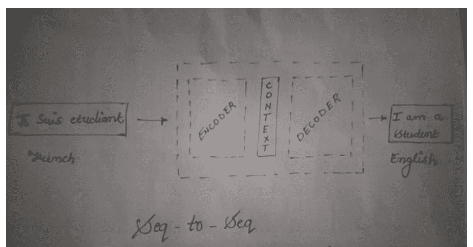
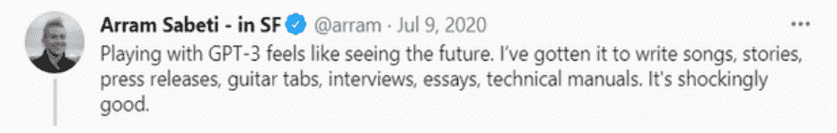
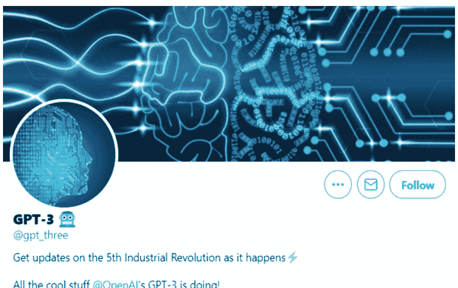
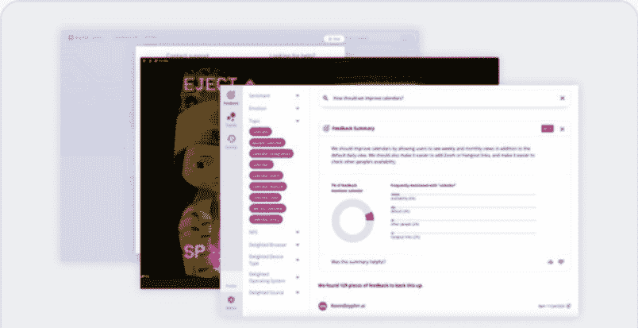

## Chapter 1. The Era of Large Language Models

### A NOTE FOR EARLY RELEASE READERS

With Early Release ebooks, you get books in their earliest form—the authors’ raw and unedited content as they write—so you can take advantage of these technologies long before the official release of these titles.

This will be the 1st chapter of the final book. Please note that the GitHub repo will be made active later on.

If you have comments about how we might improve the content and/or examples in this book, or if you notice missing material within this chapter, please reach out to the authors at sandra.a.kublik@gmail.com and shubhamsaboo111@gmail.com.

> “art is the debris from the collision between the soul and the world” #gpt3

> “technology is now the myth of the modern world” #gpt3

> “revolutions begin with a question, but do not end with an answer” #GPT3

> “nature decorates the world with variety” #GPT3

Imagine waking up to a beautiful, sunny morning. It’s Monday and you know the week will be hectic. Your company is about to launch a new personal-productivity app, Taskr, and start a social media campaign to let the world know about your ingenious product.

Your main task this week is to write and publish a series of engaging blog posts.

You start by making a to-do list:

- Write an informative and fun article about productivity hacks, including Taskr. Keep it under 500 words.
- Create a list of 5 catchy article titles.
- Choose the visuals.

You hit Enter, take a sip of coffee, and watch an article unravel on your screen, sentence by sentence, paragraph by paragraph. In 30 seconds, you have a meaningful, high-quality blog post, a perfect starter for your social media series. The visual is fun and attention-grabbing. It’s done! You choose the best title and begin the publishing process.

This is not a distant futuristic fantasy, but a glimpse of the new reality made possible by advancements in AI. As we write this book, many such applications are being created and deployed to a wider audience.

GPT-3 is a cutting-edge language model created by OpenAI, a company at the frontier of artificial intelligence R&D. OpenAI’s research paper announcing GPT-3 was released in May 2020, following a launch of access to GPT-3 via OpenAI API in June 2020. Since the GPT-3 release, people around the world coming from different backgrounds including technology, art, literature, marketing etc. have already found hundreds of exciting applications of the model that have the potential to elevate the ways we communicate, learn, and play.

GPT-3 is capable of solving general language-based tasks, like generating and classifying text, with unprecedented ease, moving freely between different text styles and purposes. The array of problems it can solve is vast.

In this book, we invite you to think of what problems you might solve with GPT-3 yourself. We’ll show you what it is and how to use it, but first we want to give you a bit of context. The rest of this chapter will discuss where this technology comes from, how it is built, what tasks it excels at, and the potential risks associated with it. Let’s dive right in by looking at the field of natural language processing (NLP) and how large language models (LLMs) and GPT-3 fit into it.

### Natural Language Processing: Under the Hood

Natural Language Processing (NLP) is a subfield of linguistics, computer science, and artificial intelligence concerned with interaction between computer and human language. The goal of NLP is to build systems capable of understanding natural language in the same way as humans. Natural language refers to the way humans communicate with each other.

NLP combines the field of computational linguistics (rule-based modeling of human language) with machine learning and deep learning to create intelligent machines capable of identifying the context and understanding the intent from natural language. Machine Learning is a subfield of AI that deals with the study of machines capable of learning with experiences and performing tasks without being explicitly programmed to do so. Deep Learning is a subset of machine learning, inspired by the way the human brain works. It is a network of neurons also known as Neural Network, that interacts with each other to perform significantly complex tasks with minimal intervention.

The 2010s saw the advent of deep learning and with the maturity of the field came large language models consisting of dense neural networks composed of thousands or even millions of simple processing units called artificial neurons. These models completely revolutionized the field of NLP by making it feasible to perform complex natural language tasks, something that had been possible only in theory so far.

NLP is at the core of many real-world AI applications, such as:

*Spam detection*

The spam filtering in your email inbox assigns a percentage of the incoming emails to the spam folder, using NLP to evaluate which emails look suspicious.

### Machine translation

Google Translate, DeepL and other machine translation programs use NLP to evaluate millions of sentences translated by human speakers of different language pairs.

### Virtual assistants and chatbots

All the Alexas, Siris, Google Assistant, and customer support chatbots of the world fall into this category. They use NLP to understand, analyze and prioritize user questions and requests, and respond to them quickly and correctly.

### Social media sentiment analysis

Marketers collect social media posts about specific brands, conversation subjects, and keywords, then use NLP to analyze how users feel about each topic, individually and collectively. It helps the brands with customer research, image evaluation and social dynamics detection.

### Text summarization

Summarizing a text involves reducing its size while keeping key information and the essential meaning. Some everyday examples of text summarization are news headlines, movie previews, newsletter production, financial research, legal contract analysis, and email summaries, as well as applications delivering news feeds, reports, emails.

> “The way we interact with other humans is through language, says Yannic Kilcher, one of the most popular YouTubers and influencers in the NLP space. “Language is part of every business transaction, every other interaction we have with other humans, even with machines in part we

与某种语言交互，无论是通过编程还是通过用户界面。”因此，毫不奇怪，NLP 作为一个领域已成为过去十年中最令人兴奋的 AI 发现和实现之地。

### 语言模型：更大更好

*语言建模* 是为语言中的句子分配概率的任务。简单的语言模型可以查看一个词并预测接下来最可能出现的词（或词），基于对现有文本序列的统计分析。为了创建一个能够成功预测词序列的语言模型，你需要用大量数据对其进行训练。

语言模型是自然语言处理应用中的关键组件。你可以把它们想象成统计预测机器，你输入文本，得到预测作为输出。你可能从手机上的自动完成功能熟悉这一点。例如，如果你输入 *good*，自动完成可能会给出“morning”或“luck”等建议。

在 GPT-3 之前，没有一种通用语言模型能在 *array* 的 NLP 任务上表现良好。语言模型被设计为执行 *one* 特定的 NLP 任务，例如文本生成、摘要或分类，使用现有的算法和架构。因此，在本书中，我们将讨论 GPT-3 作为通用语言模型的非凡能力。我们将从本章开始，带你逐一了解“GPT”每个字母代表什么，以及构成著名模型的要素是什么。我们将简要概述该模型的历史以及我们今天看到的序列到序列模型是如何出现的。之后我们将带你了解 API 访问的重要性以及它是如何随着用户需求而随时间演变的。建议你在继续阅读后续章节之前先注册一个 OpenAI 账户。

## 生成式预训练 Transformer：GPT-3

GPT-3 的名称代表“generative pre-trained transformer”。让我们逐一解释这些术语，以了解 GPT-3 的构建方式。

#### 生成模型

生成建模是统计建模的一个分支。它是数学上近似世界的一种方法。在本节中我们将讨论两种关键的统计模型：生成式和判别式。*Generative* 模型可以生成新数据。*Discriminative* 模型可以区分不同类型的数据。

这在实践中意味着什么？生成器尽可能从训练数据集中生成逼真的图像，并试图欺骗判别器假装这些图像是原图。判别器通过与从数据集中获得的知识进行比较来分析图像，并试图揭穿伪造品并拒绝它们。

生成器和判别器之间的迭代协同活动会创建逼真的图像，其中判别器将生成的图像批准为真实图像。

例如，生成模型可以生成看起来像真实动物的新动物照片，而判别模型可以区分狗和猫。

我们被大量的易于获取的信息所包围——既在物理世界也在数字世界。棘手的部分是开发能够分析和理解这一宝贵数据宝库的智能模型和算法。生成模型是实现这一目标最有前景的方法之一。

要训练生成模型，你必须准备和预处理一个 *dataset*，它是一组示例，帮助模型学习执行给定任务。通常数据集是某个特定领域的海量数据：例如数百万张汽车图像来教模型什么是汽车。数据集也可以采用句子或音频样本的形式。一旦你向模型展示了许多示例，你必须训练它生成类似的数据。

#### 预训练模型

当你想在任何运动中变得擅长时，你需要训练。你尝试尽可能多次的次数，过程中犯很多错误，并从结果中得出结论。随着时间的推移，你会不断变得更好，并在某个时候达到期望的性能。AI 模型做类似的事情，但与人类运动员不同，它可以在几分钟内进行数百万次练习。

要创建一个表现良好的模型，你需要使用一组特定的变量对其进行训练，称为 *parameters*。模型参数是模型内部的配置变量，其值从训练数据和称为训练的迭代过程中估计。确定模型理想参数的过程称为 *training*。模型通过连续的训练迭代吸收参数值。

*pre-trained model* 是由他人训练并可在公共领域使用的模型。与从头构建模型来解决你的问题相比，你使用在更通用问题上训练的模型作为起点。你可以采用预训练模型并用特别策划的数据集在你选择的领域对其进行更具体的训练。预训练模型可能不是 100% 准确，但它可以让你避免重新发明轮子，从而节省时间和提高性能。

在机器学习中，模型是在 *dataset* 上训练的。数据样本的大小和类型取决于你想要解决的任务。GPT-3 在五个数据集的文本语料库上进行预训练：Common Crawl、WebText2、Books1、Books2 和 Wikipedia。其数据集的范围于 2019 年最终确定。

*Common Crawl*

Common Crawl 语料库包含 PB 级的数据，包括在八年网络爬取中收集的原始网页数据、元数据和文本数据。OpenAI 研究人员使用此数据集的精选、过滤版本。

#### WebText2

WebText2 是 WebText 数据集的扩展版本，WebText 是 OpenAI 创建的内部语料库，通过抓取特别高质量的网页创建。为了筛选质量，作者抓取了 Reddit 上获得至少 3 个 karma 的所有外向链接（karma 是其他用户认为该链接有趣、教育性或只是搞笑的指标）。WebText 包含来自这 4500 万个链接、超过 800 万份文档的 40 GB 文本。

#### Books1 和 Books2

Books1 和 Books2 是两个语料库，或文本集合，包含数万本各种主题书籍的文本。

#### Wikipedia

一个集合，包括在 2019 年最终确定 GPT-3 数据集时来自众包在线百科全书 Wikipedia 的所有英语文章。该数据集大约有 580 万篇英文文章。

该语料库总共包含近一万亿个词。

GPT-3 能够生成并成功处理英语以外的语言。以下是数据集中排名前 10 的其他语言。

| No | Language | Number of documents | % of total documents |
|---|---|---|---|
| 1. | English | 235987420 | 93.68882% |
| 2. | German | 3014597 | 1.19682% |
| 3. | French | 2568341 | 1.01965% |
| 4. | Portuguese | 1608428 | 0.63856% |
| 5. | Italian | 1456350 | 0.57818% |
| 6. | Spanish | 1284045 | 0.50978% |
| 7. | Dutch | 934788 | 0.37112% |
| 8. | Polish | 632959 | 0.25129% |
| 9. | Japanese | 619582 | 0.24598% |
| 10. | Danish | 396477 | 0.15740% |

即使英语（第 1 名，数据集的 93%）与德语（第 2 名，数据集的 1%）之间的差距很明显，但这已经足以用风格迁移和其他任务创建完美的德语文本。对于列表中的其他语言也是如此。

由于 GPT-3 在大量多样化的文本语料库上进行预训练，它可以在用户不提供任何额外示例数据的情况下成功执行令人惊讶数量的 NLP 任务。模型训练于 2019 年停止，因此数据库不包含像 COVID-19、拜登担任美国总统等无处不在的话题。

#### Transformer 模型

为了了解 GPT-3 是如何构建的，我们需要深入了解其底层架构：transformers。神经网络构成了深度学习的核心。它们的名称和结构受人类大脑启发，模仿生物神经元相互信号的方式。神经网络是协同工作的神经元网络或电路。我们将在这里查看两种神经网络：序列到序列模型和 transformer 模型。

##### 序列到序列模型

论文“Attention Is All You Need”(Vaswani, Ashish & Shazeer, Noam & Parmar, Niki & Uszkoreit, Jakob & Jones, Llion & Gomez, Aidan & Kaiser, Lukasz & Polosukhin, Illia (2017)) 由 Google Research 和多伦多大学团队提出，介绍了 transformer 模型的想法：

我们提出了一种新的简单网络架构 Transformer，其完全基于注意力机制，完全摒弃了循环和卷积。实验在两个机器翻译任务上表明，这些模型在质量上更优，同时更易并行化，并且训练所需时间显著更少。("Attention Is All You Need" 论文)

底层序列到序列架构是 Transformer 模型的骨干。

序列到序列 Seq2Seq 将一组元素的序列，例如句子中的单词，转换为另一个序列，例如另一种语言中的句子；句子是序列依赖的，因为词序对于理解句子至关重要。它们在文本摘要和图像描述等任务中取得了巨大成功。

Seq2Seq 模型在翻译方面尤其出色，其中一种语言的单词序列被转换为另一种语言的不同单词序列。Google Translate 于 2016 年底开始在生产中使用类似的模型。

图 1-1. Seq-to-Seq 模型（神经机器翻译）

Seq2Seq 模型由两部分组成：编码器和解码器。想象编码器和解码器为只能说两种语言的人类翻译。两者有不同的母语；就我们的例子而言，我们假设编码器是法语母语者，解码器是英语母语者。两者有共同的第二语言：我们假设是韩语。为了将法语翻译成英语，编码器将法语句子转换为称为上下文的韩语并将其传递给解码器。由于解码器理解韩语并能够阅读该语言，因此它现在可以从韩语翻译成英语。共同工作时，他们可以像图 1-1 所示将法语翻译成英语。

### Transformer 和注意力机制

Transformer 架构也在编码器和解码器的帮助下将一个序列转换为另一个序列，但与现有的序列到序列模型不同。它们于 2017 年发明，旨在提高人工智能在机器翻译任务上的性能。“Transformer 最初是作为语言模型开始的，”Kilcher 解释道，“甚至不是那么大，但后来它们变得很大。”

要使用 Transformer，你需要理解另一个技术概念：*注意力*。注意力机制是一种模仿认知注意力的技术 - 它逐块查看输入序列，并在每一步基于概率决定序列中哪些其他部分很重要。例如，当你阅读这句话时，你始终专注于正在阅读的词，但与此同时你的记忆保留了句子的最重要的关键词以提供上下文。

注意力机制的工作方式类似。回到编码器和解码器的例子，想象编码器写下对句子语义很重要的关键词并连同翻译一起交给解码器。这些关键词使解码器的翻译变得容易得多，因为它现在知道句子的哪些部分很重要以及哪些术语为句子提供上下文。

注意力机制帮助 Transformer 过滤噪声并专注于相关内容：将语义上相互关联的两个词连接起来，而它们本身并没有明显的标记指向彼此。

Transformer 模型受益于更大的架构和更多的数据量。在大型数据集上训练并针对特定任务进行微调可提高结果。Transformer 比任何其他类型的神经网络更好地理解句子中单词的上下文。

现在你知道了“GPT”是什么意思，让我们谈谈那个“3”。

### GPT-3 的简史

GPT-3 由 OpenAI 创建，并且是其重要的里程碑，OpenAI 是总部位于旧金山的 AI 研究先驱。其 stated 任务是“确保人工智能通用智能造福全人类。”以及其创建人工智能通用智能的愿景：一种类型的 AI 不局限于专门任务，而是像人类一样在各种任务上表现良好。

任务声明继续详细说明 OpenAI 对 AI 的民主和伦理方面的重视。民主维度在于决定通过公共 API 或应用程序编程接口发布模型的决定：一种在网站或应用程序和用户之间来回发送信息的软件中介。

API 充当信使，使开发人员能够在应用程序和用户之间建立新的程序化交互。通过 API 发布 GPT-3 模型是一次革命性的举措。在 2020 年之前，由领先研究实验室开发的强大 AI 模型仅可供从事这些项目的少数研究人员和工程师使用。OpenAI API 通过简单的登录为世界各地的用户提供了前所未有的访问世界最强大的语言模型的方式。 (OpenAI 对此举的商业理由是创造一种名为“Model-as-a-Service”的新范式，开发者可按 API 调用付费；我们将在第 3 章更详细地讨论这一点。)

OpenAI 于 2018 年 6 月发布了 GPT-1。开发人员的关键发现是，将 Transformer 架构与无监督预训练相结合产生了有希望的结果。GPT-1，他们写道，被微调用于特定的监督任务以实现“强大的自然语言理解”。

2019 年 2 月，OpenAI 引入了 GPT-2，它大了一个数量级，但其他方面非常相似。两者之间的主要区别在于 GPT-2 可以多任务。它成功证明了半监督语言模型可以在没有该任务的训练示例的情况下在多个任务上表现良好。

OpenAI 研究人员在开发 GPT-3 时尝试了不同模型规模。他们采用现有的 GPT-2 架构并将参数数量增加了 100 倍。由此产生的实验结果是一种具有新颖和非凡能力的形式的模型，即 GPT-3。

而 GPT-2 拥有 15 亿个参数并在 40 GB 文本上训练，GPT-3 拥有 1750 亿个参数并在 570 GB 文本上训练。GPT-2 在下游任务上显示出一些零样本能力，但 GPT-3 在提供示例上下文时可以执行更多新颖的任务。

OpenAI 研究人员发现，仅靠扩展模型参数和训练数据集的大小就导致了如此非凡的进步令人惊讶。他们普遍乐观地认为，这些趋势甚至对于比 GPT-3 更大的模型也将继续存在，使能够通过在小样本上微调即可进行少样本或零样本学习的更强大的学习模型成为可能。

当你阅读本书时，专家估计，超过一万亿参数的基于语言的模型可能正在构建和部署。我们已经进入了大型语言模型的黄金时代，现在是时候你成为其中的一部分了。

GPT-3 引起了公众的广泛关注。MIT Technology Review 将 GPT-3 视为 2021 年十大突破性技术之一。其在执行一系列通用任务时的巨大灵活性，以接近人类效率和准确性而著称，这使其如此令人兴奋。正如早期采用者 Arram Sabeti 在推特上所说（图 1-2）：

图 1-2. Arram Sabeti 的推文

API 的发布在 NLP 中创造了范式转变并吸引了大量测试人员。创新和初创企业以闪电般的速度跟进，许多评论家称 GPT-3 为“第五次工业革命”（见图 1-3）。

图 1-3. GPT-3 生成推文的 Twitter 账号截图

Bakz Awan 是一名转型为企业家和影响者的开发者。他有一个 YouTube 频道“Bakz T. Future”和一个播客，在那里他讨论 GPT-3 现象，是 OpenAI API 开发者社区的主要声音之一。他指出，尽管该模型迄今为止获得了所有关注，但 GPT-3 实际上仍然被低估了：

> “如果你告诉我获取 GPT-3 能做的一切，我会想象你必须进入一个房间，计算机的大小与房间一样大，它运行在 Linux 的专用版本上，我必须输入所有这些命令，我必须进行训练才能使用。那是我对 GPT-3 当前能力的期望。而事实是它不仅今天可用，而且可用。你只需要一个浏览器。如果你曾经在线填写过注册任何网站的报名表，你就可以使用 OpenAI Playground —— 这就是它有多简单。我认为 GPT-3 被低估了。你知道，我认为所有这些模型都被低估了，它们是多么易用、友好、有趣和强大。几乎令人震惊，已经过去一年多了，我仍然同样震惊。”。

在短短时间内，我们看到 GPT-3 几乎无所不能，从撰写文章、故事、剧本、背诵诗歌、即时生成建议、总结复杂文档到创建艺术广告文案。GPT-3 已从仅用于研究的工具发展为在基层创造创新的事物！与之前任何其他人工智能系统不同，它使几乎没有 AI 背景的普通大众能够将他们的想法付诸实践！

根据 OpenAI，在 GPT-3 API 发布仅 9 个月后，人们就用它构建了超过 300 家企业。尽管如此突然，一些专家认为这种兴奋并不夸张。正如 YouTuber 和 LLM 专家 Awan 所说，GPT-3 和其他模型“被低估了它们是多么易用、友好、有趣和强大。几乎令人震惊。”

Daniel Erickson，GPT-3 驱动产品 Viable 的 CEO，赞扬了该模型从大型数据集中提取洞察的能力：“我看到的 GPT-3 的应用类别主要有两种。一种

category is what I call “prompt-based development”. Companies going that path cover use cases such as generating copy for ads and websites. The design philosophy is relatively simple: the company takes your data in, sends it over into a prompt, and displays the API generated result. It solves a task that is easily done by a single API prompt and wraps an UI around that to deliver it to the users,” he shares.

The problem Erickson sees with this category of use cases is that it is already overcrowded, attracting many ambitious startup founders competing with services having similar USP. Instead, Erickson recommends looking at another category of use cases instead, following in the footsteps of Viable. Data driven use cases are not as crowded as prompt-generation use cases, and at the same time they are more profitable and allow you to easily create a moat. The key is to build a large set of data that you can keep adding to and that can provide potential insights. GPT-3 will help you extract valuable insights from it. At Viable, this was the model that let them monetize easily. “People pay a lot more money for data than they do for prompt output,” Erickson explains.

OpenAI @OpenAI · Mar 26
In the 9 months since we launched GPT-3, developers have created extraordinary apps using our API. Today GPT-3’s search, conversation, and text completion powers 300 applications focused on new ideas from productivity and education to creativity and games.

GPT-3 Powers the Next Generation of Apps
Over 300 applications are delivering GPT-3-powered search, conversation, text completion, and other advanced AI features through our API.
openai.com

Figure 1-4. Tweet from OpenAI

### Accessing the OpenAI API

As of 2021, the market has already produced several proprietary AI models that have more parameters than GPT-3. However, access to them is limited to a handful of people within the company’s R&D walls, making it impossible to evaluate their performance on real-world NLP tasks.

Another factor that makes GPT-3 accessible is its simple and intuitive “text-in, text-out” user interface. It doesn’t require complex gradient fine-tuning or updates, and you don’t need to be an expert to use it. This combination of

scalable parameters and relatively open access makes GPT-3 the most exciting, and arguably the most relevant language model to date.

Due to GPT-3’s extraordinary capabilities, there are significant risks in terms of security and misuse associated with making it open-source which we will cover in the last chapter. Keeping that into account OpenAI decided not to release the source code of GPT-3 publicly and came up with a unique, never seen before access sharing model via an API.

The company decided to initially release access to the API in the form of a limited beta user list. There was an application process in place, where people had to fill in a form detailing their background and the reasons for requesting the API access. Only the approved users were granted access to a private beta of the API with an interface called Playground.

In its early days, the waitlist for GPT-3 beta access consisted of tens of thousands of people. OpenAI swiftly managed the applications that started pouring in and adding developers in batches, but also closely monitoring their activity and feedback about the API user experience in order to continuously improve it.

Thanks to the progress with safeguards, OpenAI removed the waitlist in November 2021. GPT-3 is now openly accessible via a simple sign-in. This is a great milestone in the history of GPT-3 and a highly requested move by the community. To get API access, simply go to the sign-up page, sign up for a free account, and start experimenting with it right away.

With free access to GPT-3, users initially get a pool of free credits that allow them to freely experiment with the API. The number of credits is equivalent to creating text content as long as 3 average length novels.

After you use your free credits, you start paying for the usage, or, when you have a justified need, you can request additional credits with the OpenAI API customer support.

OpenAI strives to ensure that API-powered applications are built responsibly. For that reason, they provide tools, best practices and usage

guidelines to help the developers bring their applications to production quickly and safely.

They have also created Content Guidelines to clarify what kind of content OpenAI API can be used to generate. To help developers ensure their applications are used for their intended purpose, prevent potential misuse, and adhere to the content guidelines, they offer a free content filter. OpenAI policy prohibits the use of the API in ways that do not adhere to the principles described in its charter, including content that promotes hate, violence, self-harm, that intends to harass, influence political processes, spread misinformation, spam content, and more.

Once you have signed up for an OpenAI account, you can move on to chapter 2, where we will discuss the different components of API, the GPT-3 Playground, and how to use the API to the best of its abilities for different use cases.
