## Chapter 2. Using the OpenAI API

### A NOTE FOR EARLY RELEASE READERS

With Early Release ebooks, you get books in their earliest form—the authors’ raw and unedited content as they write—so you can take advantage of these technologies long before the official release of these titles.

This will be the 2nd chapter of the final book. Please note that the GitHub repo will be made active later on.

If you have comments about how we might improve the content and/or examples in this book, or if you notice missing material within this chapter, please reach out to the authors at sandra.a.kublik@gmail.com and shubhamsaboo111@gmail.com.

Even though the OpenAI API is the most sophisticated and complex language model in the world, its capabilities are abstracted as a simple “text-in-text-out” interface to end users. This chapter will get you started with using that interface, Playground, and cover the technical nuances of the OpenAI API, because it is always the details that reveal the true gems.

### WARNING

In order to work through this chapter, you will need to sign up for an OpenAI account at https://beta.openai.com/signup. If you haven’t done that, please do so now.

### Navigating the OpenAI Playground

Your OpenAI developer account provides access to the API and infinite possibilities. We’ll start with the Playground, a private web-based sandbox environment that allows you to experiment with the API, learn how its components work, and access developer documentation and the OpenAI community. We will then show you how to build robust prompts that generate favorable responses for your application. We’ll finish the chapter with examples of GPT-3 performing four NLP tasks: classification, named entity recognition (NER), summarization, and text generation.

In an interview with Peter Welinder, VP of Product at OpenAI we asked about the key advice on navigating the Playground for first-time users. He told us his advice depends on the persona of the user. If the user has a machine learning background, Peter encourages them to “start by forgetting the things that they already know, and just go to the playground and try to get GPT-3 to do what you wanted it to do by just asking it”. He suggests users “imagine GPT-3 as a friend or a colleague that you’re asking to do something. How would you describe the task that you want them to do? And then, see how GPT-3 responds. And if it doesn’t respond in the way that you want, iterate on your instructions.”

As YouTuber and NLP influencer Bakz Awan puts it, “The non-technical people ask: Do I need a degree to use this? Do I need to know how to code to use it? . . . Absolutely not. You can use the Playground. You don’t need to write a single line of code. You’ll get results instantly. Anybody can do this.”

NOTE
Before you start using the Playground, we recommend reading OpenAI’s “Getting Started” guide and the developer documentation. You’ll be able to access it with your OpenAI account.

- 1. Log in at https://openai.com. After you’ve authenticated, navigate to the Playground from the main menu.
- 2. Take a look at the Playground screen (Figure 2-1).


-   标记为 1 的大文本框是您提供文本输入的地方。
-   右侧标记为 2 的框是参数设置面板，允许您调整参数。
-   标记为 3 的部分允许您加载现有的 *预设*：示例提示和游乐场设置。您可以提供自己的训练提示或加载现有的预设。

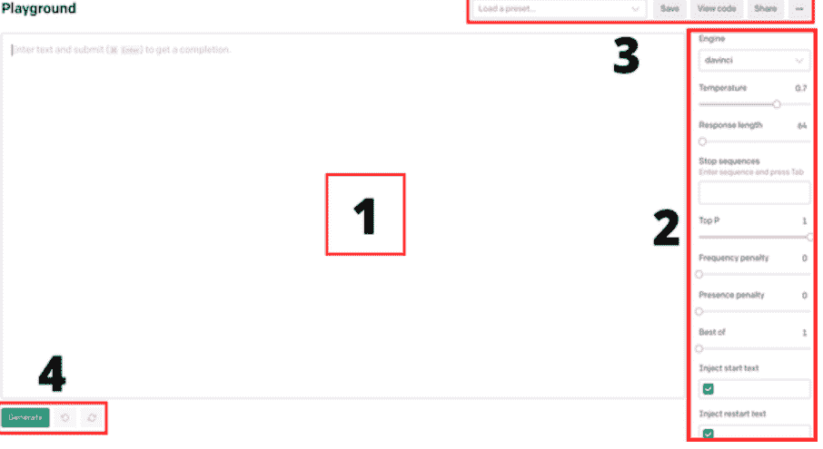

图 2-1。游乐场界面，截图拍摄于 2022 年 1 月 10 日

3. 选择一个现有的问答预设（标记为 3）。这将自动加载训练提示以及相关的参数设置。点击提交按钮（标记为 4）。

4. API 处理您的输入并在同一文本框中提供响应（称为 *completion*）。它还会显示您使用的令牌数量。*Tokens* 是用于确定每次 API 调用定价的词语的数值表示；我们将在本章后面讨论它们。

5. 在屏幕底部右侧您有一个令牌计数，左侧有一个提交按钮（见图 2-2）。

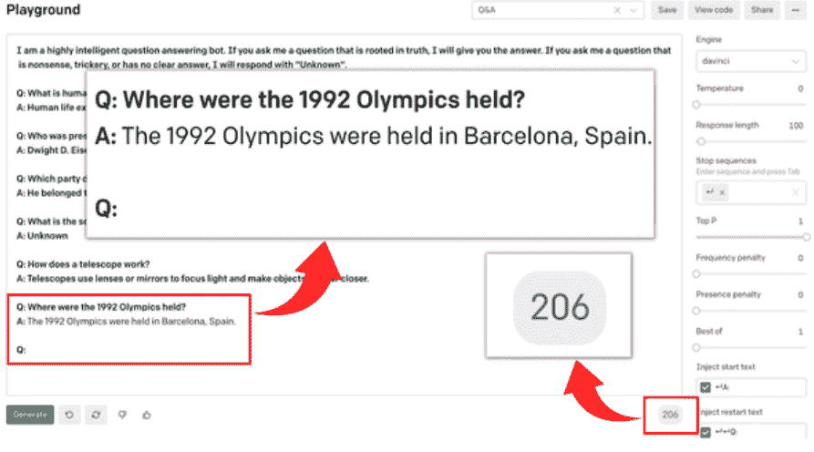

图 2-2。问/答提示完成以及令牌计数

6. 每次您点击生成按钮时，GPT-3 都会将文本输入字段（标记为 1）中的提示和完成内容纳入考虑，并将其视为下一次完成的训练提示的一部分。

以下是您可以在图 2-2 中看到的提示，令牌计数出现在屏幕右下角。

```
I am a highly intelligent question answering bot. If you ask me a question that is rooted in truth, I will give you the answer. If you ask me a question that is nonsense, trickery, or has no clear answer, I will respond with "Unknown".
Q: What is human life expectancy in the United States?
A: Human life expectancy in the United States is 78 years.
Q: Who was president of the United States in 1955?
A: Dwight D. Eisenhower was president of the United States in 1955.
Q: Which party did he belong to?
A: He belonged to the Republican Party.
Q: What is the square root of banana?
A: Unknown
Q: How does a telescope work?
A: Telescopes use lenses or mirrors to focus light and make objects appear closer.
Q: Where were the 1992 Olympics held?
```

而这里是完成内容：

```
A: The 1992 Olympics were held in Barcelona, Spain.
```

现在您了解了游乐场的基本轮廓，让我们深入探讨提示工程和设计的细节。

### 提示工程和设计

OpenAI API 从根本上改变了我们与 AI 模型交互的方式，去除了层层复杂的编程语言和框架。特斯拉 AI 负责人 Andrej Karpathy 在 GPT-3 发布后戏谑地说，编程 3.0 完全是关于提示设计（他在推特上发布的 meme 如图 2-3 所示）。您提供的训练提示与获得的完成质量之间存在直接关系。词语的结构和排列极大地影响输出。理解提示设计是释放 GPT-3 真正潜力的关键。

#### PRE-SOFTWARE:
SPECIAL-PURPOSE
COMPUTER


#### SOFTWARE 1.0:
DESIGN
THE ALGORITHM


#### SOFTWARE 2.0:
DESIGN
THE DATASET


#### SOFTWARE 3.0:
DESIGN
THE PROMPT


图 2-3。Meme 来源不明；Andrej Karpathy 于 2020 年 6 月 18 日在推特上发布。

编写好提示的秘诀在于理解 GPT-3 对世界的了解程度。正如 Awan 所指出的，“它只见过文本。这意味着您不应该期望它了解物理世界，即使它显然确实了解。它可以描述蒙娜丽莎，可以告诉您其意义、重要性、历史等，但它从未见过，因为它只是在文本上训练的。”

您的工作是让模型利用它已有的信息生成有用的结果。在猜词游戏中，玩家给表演者提供足够的信息来猜出秘密词。同样，对于 GPT-3，我们给模型提供足够的上下文（以训练提示的形式），以便其找出模式并执行给定任务。

在设计训练提示时，目标是让模型实现零样本响应：也就是说，看看是否可以在不使用外部训练示例进行预训练的情况下获得您想要的响应。如果不行，就通过展示几个示例而不是整个数据集来推进。设计训练提示的标准流程是先尝试零样本，然后是少样本，然后进行基于语料库的微调（下面会描述）。

GPT-3 是通往通用人工智能的第一步，因此它有其局限性。它并不无所不知，也无法像人类一样推理，但在您知道如何与之交流时，它非常有能力。这就是提示工程的艺术所在。

GPT-3 不是一个说真话的人，而是一个出色的讲故事者。它接收文本输入并尝试用它认为最能完成输入的文本做出响应。如果您给它您最喜欢的小说中的几行，它会尝试以相同的风格继续。它通过在上下文中导航来工作，如果没有适当的上下文，它可能会生成不一致的响应。让我们看一个例子来了解 GPT-3 如何处理输入提示并生成输出：

```
Q: What is human life expectancy in the United States?
A:
```

如果您在没有任何上下文的情况下向 GPT-3 提供这样的提示，本质上就是要求它从其训练数据的宇宙中寻找通用答案。它会产生泛化和不一致的响应，因为模型不知道该使用训练数据的哪一部分来回答这些问题。

另一方面，提供正确的上下文将极大地提高响应质量。它只是限制了模型为回答问题而需要检查的训练数据宇宙，从而产生更具体、更切中要点的响应。

```
I am a highly intelligent question answering bot. If you ask me a question that is rooted in truth, I will give you the answer. If you ask me a question that is nonsense, trickery, or has no clear answer, I will respond with "Unknown".
Q: What is human life expectancy in the United States?
A:
```

您可以将 GPT-3 处理输入的方式想象成与人类大脑相同。当有人在没有适当上下文的情况下向我们提问时，我们往往会给出随机的回答。这是因为在没有适当方向或上下文的情况下，很难得到精确的响应。GPT-3 的情况也是如此，其训练数据的宇宙如此之大，以至于如果没有外部上下文或方向，很难导航到正确的响应。

像 GPT-3 这样的 LLM 在给定正确上下文的情况下能够进行创意写作和回答事实性问题。以下是我们创建高效有效的训练提示的五步公式：

- 1. 定义您试图解决的问题以及它是哪种 NLP 任务，例如分类、问答、文本生成或创意写作。
- 2. 问问自己是否有办法获得零样本解决方案。
- 3. 如果您认为需要外部示例来为您的用例预热模型，请回到步骤 2 并认真思考。

4. 现在思考一下在 GPT-3 的“文本输入、文本输出”界面中您可能会如何以文本形式遇到这个问题。思考所有可能的场景来以文本形式表示您的问题。例如，您想构建一个广告文案助手，可以通过查看产品名称和描述来生成创意文案。因此，要将其框定为“文本输入、文本输出”格式，您可以将输入定义为产品名称和描述，输出定义为广告文案：

```
Input: Betty's Bikes, for price-sensitive shoppers
Output: Low prices and huge selection. Free and fast delivery.
Order online today!
```

5. 如果您最终使用了外部示例，请尽可能少用，并尝试纳入多样性，捕捉所有表示形式，以避免本质上使模型过拟合或使预测产生偏差。

这些步骤将在您从头创建训练提示时作为标准框架。在您能够为数据问题构建端到端解决方案之前，您需要了解有关 API 如何工作的更多内容。让我们通过查看其组件来更深入地了解。

### OpenAI API 如何工作


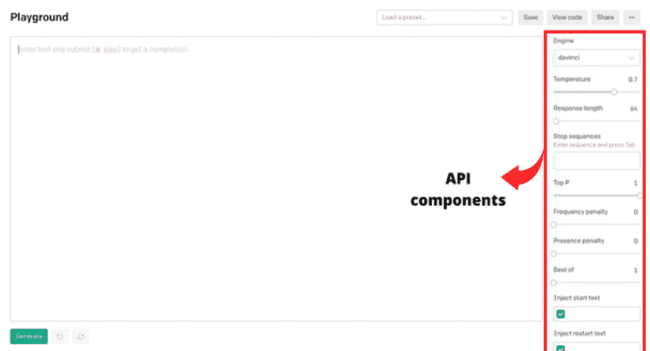

Figure 2-4. Components of API

以下是 GPT-3 API 组件的概述。我们将在本章中详细介绍这些组件。

### Execution Engine

执行引擎决定了用于执行的语言模型。选择合适的引擎是决定模型能力的关键，进而获得正确的输出。GPT-3 提供了四种规模和能力各异的执行引擎：Davinci、Ada、Babbage 和 Curie。Davinci 是最强大的，也是 Playground 的默认引擎。

### Response Length

响应长度限制了 API 在其补全中包含的文本量。由于 OpenAI 按每次 API 调用生成的文本长度收费（正如所提到的，这被转换为 tokens，即单词的数字表示），响应长度对于预算有限的人来说是一个至关重要的参数。更高的响应长度会使用更多 tokens 并花费更多。例如，如果你执行分类任务，将响应文本旋钮设为 100 并不是一个好主意：API 可能会生成无关的文本并使用额外的 tokens，从而在你的账户上产生费用。API 由于技术限制，支持的提示和补全合计最大为 2048 个 tokens。因此，在使用 API 时，你需要考虑到提示和预期补全不会超过最大响应长度，以免出现突然中断的补全。如果你的用例涉及大文本提示和补全，变通方法是想出在 token 限制内解决问题的方法，例如压缩提示、将文本拆分为更小的片段、串联多个请求等。

### Temperature and Top P

*temperature* 旋钮控制响应的随机性，表示范围为 0 到 1。温度值越低，API 会预测模型看到的第一件事；值越高，模型会在预测结果之前评估可能适合上下文的响应。

*Top P* 控制模型应为补全考虑多少个随机结果，如温度旋钮所建议的；它决定了随机性的 *范围*。Top P 的范围也是 0 到 1。接近零的值意味着随机响应将被限制为一定比例：例如，如果值为 0.1，则只有 10% 的随机响应会被考虑用于补全。这使得引擎 *确定性*，意味着对于给定的输入文本，它总是会生成相同的输出。如果值设为 1，API 将考虑所有响应用于补全，承担风险并产生富有创意的响应。较低的值限制随机性；较高的值扩展其视野。

温度和 Top P 对输出有非常显著的影响。有时很难弄清楚何时以及如何使用它们来获得正确的输出。两者是相关的：改变其中一个的值会影响另一个。因此，通过将 Top P 设为 1，你可以允许模型通过探索整个响应范围来释放其创造力，并通过使用温度旋钮来控制随机性。

**NOTE**
我们始终建议只更改 Top P 或温度其中之一，并将另一个旋钮保持在 1。

大型语言模型依赖概率方法而不是传统逻辑。对于相同的输入，它们可以根据模型参数的设置生成多种响应。模型试图在它所训练的数据宇宙中找到最佳概率匹配，而不是每次都寻找完美的解决方案。

正如我们在第 1 章中提到的，GPT-3 的训练数据宇宙巨大，由各种公开可用的书籍、互联网论坛、维基百科文章组成，并由 OpenAI 特别策划，使其能够为给定的提示生成各种各样的补全。这就是温度和 Top P 有时被称为“创造力旋钮”的原因：你可以调整它们以生成更自然或更抽象的响应，并带有一种有趣的创造力元素。

假设你要使用 GPT-3 为你的初创公司生成名称。你可以将温度旋钮设为更高水平以获得最具创意的响应。当我们花了几天几夜试图为我们的初创公司想出完美的名字时，我们调高了温度。GPT-3 及时出手相助，帮助我们想出了一个我们喜爱的名称：Kairos Data Labs。

在其他情况下，你的任务可能需要很少或不需要创造力：例如分类和问答任务。对于这些任务，保持温度较低。

让我们看一个简单的分类示例，该示例根据公司名称将公司归类为一般桶或类别。

Figure 2-5. Temperature component

正如你在图 2-5 中看到的，我再次使用温度来控制随机程度。你也可以通过更改 Top P 同时保持温度旋钮设为 1 来实现这一点。

### Frequency and Presence Penalties

与温度和 Top P 旋钮一样，频率惩罚和存在惩罚旋钮在决定输出时考虑文本提示（之前的补全加上新的输入），而不是内部模型参数。现有文本因此会影响新的补全。*频率惩罚* 通过“惩罚”它来降低模型逐字重复同一行的可能性。*存在惩罚* 增加了它谈论新主题的可能性。

当你想防止相同的补全文本在多次补全中重复时，这些就派上用场了。虽然这些旋钮相似，但有一个重要的区别。频率惩罚适用于建议的文本输出被重复时（例如，模型在之前的补全或同一会话期间使用了完全相同的 token）并且模型选择旧输出而不是新输出。存在惩罚适用于 token 在给定文本中 *存在* 时。

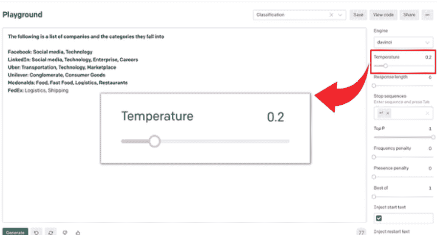

### Best of

GPT-3 允许你在服务器端生成多个补全并在幕后评估它们，以便为你提供最佳的概率结果。使用“best of”参数，你可以指定在服务器端生成的补全数量（n）。模型将返回 n 个补全中的最佳一个。

这使你能够在一次 API 调用中评估多个提示补全，而不是反复调用 API 来检查同一输入的不同补全的质量。然而，使用“best of”成本很高：它花费的 tokens 是提示中 tokens 的 n 倍。例如，如果你将 Best of 值选为 2，那么你将被收取输入提示中 tokens 的双倍费用，因为在后端 API 将生成两个补全并向你展示最好的一个。

Best of 的范围取决于你的用例，从 1 到 20。如果你的用例为需要输出质量一致的客户提供服务，那么你可以将 Best of 值设为更高的数字。另一方面，如果你的用例涉及太多 API 调用，那么将 Best of 值设为较低以避免不必要的延迟和成本是有意义的。我们建议在使用 Best of 参数生成多个提示时保持响应长度最小，以避免额外费用

### Stop Sequence

停止序列是一组字符，指示 API 停止生成补全。这有助于避免使用不必要的 tokens，这对于普通用户来说是一个重要的省钱功能。

你可以为 API 提供最多 4 个序列以停止生成进一步的 tokens。

让我们看一下图 2-9 中的示例语言翻译任务，以了解停止序列的工作原理。在此示例中，英语短语被翻译成法语。我们使用重启序列“English:”作为停止序列：每当 API 遇到该短语时，它将停止生成新的 tokens。

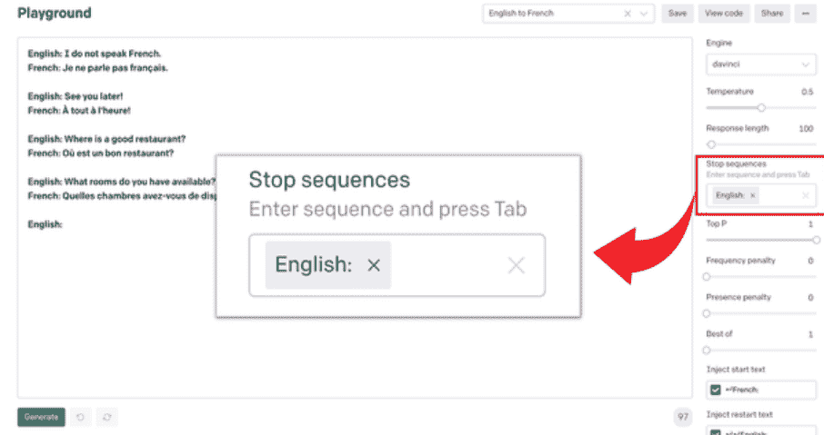

Figure 2-6. Stop Sequence component

### Inject Start Text and Inject Restart Text

*inject start text* 和 *inject restart text* 参数允许你分别在补全的开头或结尾插入文本。你可以使用它们来保持期望的模式。经常，这些设置与停止序列协同工作，如我们的示例所示。提示具有一种模式，其中提供了一个以“English:”为前缀的英语句子（重启文本），并且翻译输出以“French:”为前缀生成（开始文本）。因此，任何人都可以轻松区分两者并创建一个训练提示，使模型和用户都能清楚理解。

每当我们为此类提示运行模型时，模型会自动在输出前注入开始文本“French:”，并在下一个输入前注入重启文本“English:”，以便这种模式得以维持

### Show Probabilities


“show probabilities” 参数位于 Playground 设置面板的底部。在传统的软件工程中，开发者使用调试器来排查（调试）一段代码。你可以使用“show probabilities” 参数来调试你的文本提示。每当你选择此参数时，你会看到高亮的文本。将光标悬停其上会显示模型针对特定输入可能生成的标记列表，以及各自的概率。

你可以使用此参数来检查你的选项。此外，它可以更轻松地看到可能更有效的替代方案。“show probabilities” 参数有三种设置：

#### Most Likely

按概率递减的顺序列出最有可能被考虑用于完成的标记。

#### Least Likely

按概率递减的顺序列出最不可能被考虑用于完成的标记。

#### Full Spectrum

显示可能被选为完成的所有标记的整个宇宙。

让我们在简单提示的上下文中查看此参数。我们希望输出句子以一个简单且众所周知的短语开头：“Once upon a time”。我们向 API 提供提示 “Once upon a”，然后我们检查 show probabilities 选项卡中的 Most Likely 选项。

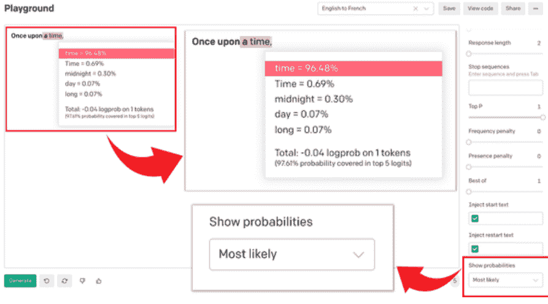

Figure 2-7. Show Probabilities component – most likely tokens

如 Figure 2-7 所示，它生成 “time” 作为响应。因为我们将“show probabilities” 参数设置为“Most Likely”，API 不仅显示响应，还显示可能的选项列表及其概率。

现在你已经有了概述，让我们更详细地查看这些组件。

### Execution Engines

如上所述，OpenAI API 提供四种不同的执行引擎，按参数数量和性能能力区分。执行引擎是 OpenAI API 的驱动力。它们充当“autoML”解决方案，提供自动化的机器学习方法和流程，使机器学习可供非专家使用。它们易于配置并可适应给定的数据集和任务。

四个主要执行引擎以字母顺序命名为著名科学家：Ada（以 Ada Lovelace 命名）、Babbage（以 Charles Babbage 命名）、Curie（以 Madame Marie Curie 命名）和 Davinci（以 Leonardo da Vinci 命名）。让我们深入研究这些执行引擎，以了解在使用 GPT-3 时何时使用哪个执行引擎：

#### DaVinci

Da Vinci 是最大的执行引擎，也是你首次打开 Playground 时的默认引擎。它可以做其他引擎能做的一切，通常只需更少的指令并获得更好的结果。然而，权衡是每次 API 调用成本更高且比其他引擎慢。你可能希望使用其他引擎来优化成本和运行时间。

> NOTE
> 
> 在测试新想法和提示时，我们建议从 Davinci 开始，因为其卓越的能力。用 Davinci 实验是了解 API 功能的绝佳方式。然后，你可以随着对问题陈述越来越熟悉，慢慢向下移动以优化预算和运行时间。一旦你对想要实现的目标有了想法，你可以继续使用 Davinci（如果成本和速度不是问题），也可以转到 Curie 或其他成本更低的引擎，并尝试围绕其能力优化输出。你可以使用 OpenAI 的 Comparison Tool 生成一个 Excel 电子表格，比较引擎的输出、设置和响应时间。

Davinci 应该是需要理解内容的任务的首选，例如总结会议记录或生成创意广告文案。它擅长解决逻辑问题并解释虚构人物的动机。它可以写故事。Davinci 还能够解决一些涉及因果关系的最具挑战性的 AI 问题。

#### Curie

Curie 旨在在功率和速度之间找到最佳平衡，这对于执行高频任务（如大规模分类或将模型投入生产）非常重要。

Curie 在回答问题、执行问答以及作为通用聊天机器人方面也相当出色。例如，如果你正在构建客户支持聊天机器人，你可能会选择 Curie 来更快地处理高流量请求。

虽然 Davinci 在分析复杂文本方面更强，但 Curie 可以以低延迟和闪电般的速度运行。在生产中选择 Davinci 而非 Curie 之前，始终明智的做法是弄清楚你的用例并进行成本效益分析。

#### Babbage

Babbage 比 Curie 快，但无法执行涉及理解复杂意图的任务。然而，它相当有能力，在语义搜索排名和分析文档与搜索查询的匹配程度方面更受欢迎。它比 Curie 和 Davinci 更便宜，是涉及频繁 API 调用的简单问题的首选。

#### Ada

Ada 是所有可用引擎中最快且最便宜的。它可以执行不需要对上下文进行细致理解的简单任务，如解析文本、纠正语法或简单分类。通过在输入中提供更多上下文，通常可以提高 Ada 的性能。对于涉及频繁 API 调用的用例，Ada 可以是首选模型，因为在正确配置设置的情况下，它可以实现与更大模型相似的结果。你对 API 参数的实验越多，你对哪些设置适用于你的用例的理解就越深。

### Instruct Series

基于四个主要模型，OpenAI 推出了 InstructGPT 模型系列，它们在理解指令和遵循指令方面更好，同时比原始 GPT-3 更少有毒、更真实。它们是使用来自 OpenAI 对齐研究的技巧开发的。这些模型是在人类参与的情况下训练的，现在已部署为 OpenAI API 上的默认语言模型。

为了使构建提示的过程更高效，OpenAI 决定公开推出 text-davinci-001、text-curie-001、text-babbage-001、text-ada-001。有了明确的指令，这些模型可以比其基础对应模型产生更好的结果，并且现在是 API 的默认模型。该系列是弥合人类思维方式与模型运行方式之间差距的重要一步。

### NOTE

建议将此模型系列作为所有文本相关任务的默认使用。GPT-3 模型的基础版本可作为 davinci、curie、babbage 和 ada 提供，旨在与我们的微调、搜索、分类和答案端点一起使用。

### Endpoints

Playground 是一个图形化 Web 界面，在幕后调用 OpenAI API，但还有其他几种调用 API 的方式。为此，你需要熟悉其端点：当被调用时进行双向通信的远程 API。在本节中，你将熟悉八个 API 端点的功能和用法。

#### List Engines

列出引擎 API，也称为“元数据 API”，提供可用引擎的列表以及与每个引擎关联的特定元数据，例如所有者和可用性。要访问它，你可以使用 HTTP GET 方法命中以下 URI，而无需传递任何请求参数：

```
GET https://api.openai.com/v1/engines
```

#### Retrieve Engines

当你向检索引擎 API 提供引擎名称时，它会返回有关该引擎的详细元数据信息。要访问，请使用 HTTP GET 方法命中以下 URI，而无需传递任何请求参数：

```
GET https://api.openai.com/v1/engines/{engine_id}
```

#### Completion

Completion 是 GPT-3 最著名且使用最广泛的 API 端点。它只需将文本提示作为输入并返回完成的响应作为输出。它使用 HTTP POST 方法并要求在 URI 路径中提供引擎 ID。作为 HTTP Body 的一部分，Completions 端点接受上一节讨论的几个附加参数。其签名为：

```
POST https://api.openai.com/v1/engines/{engine_id}/completions
```

#### Semantic Search

语义搜索端点允许你提供自然语言查询来搜索一组文档，这些文档可以是单词、句子、段落甚至更长的文本。它将根据文档与输入查询的语义相关程度对文档进行评分和排名。例如，如果你提供文档 ["school", "hospital", "park"] 和查询 "the doctor"，你将为每个文档获得不同的相似度分数。

*相似度分数* 是一个通常在 0 到 300 之间（但有时可能更高）的正分数，其中分数高于 200 通常表示文档与查询在语义上相似。相似度分数越高，文档与查询在语义上越相似（在此示例中，“hospital” 将与 “the doctor” 最相似）。你可以在请求中提供多达 200 个文档作为 API 的一部分。¹

以下是语义搜索端点的签名：

```
POST https://api.openai.com/v1/engines/{engine_id}/search
```


### Files

Files Endpoint 可在 Answers、Classification 和 Semantic Search 等不同端点中使用。它用于将文档或文件上传到 OpenAI 存储中，该存储可在整个 API 功能中访问。同一端点可使用不同的签名来执行以下任务：

- List Files：它仅返回属于用户组织的文件列表，或与特定用户账户关联的文件。这是一个 HTTP GET 调用，无需向请求中传递任何参数。
  
  `GET https://api.openai.com/v1/files`
- Upload Files：它用于上传包含要在各个端点中使用的文档的文件。它将文档上传到 OpenAI 为用户组织已分配的内部空间。这是一个 HTTP POST 调用，需要在 API 请求中添加文件路径。
  
  `POST https://api.openai.com/v1/files`
- Retrieve File：它只需提供文件 ID 作为请求参数即可返回有关特定文件的信息。以下是 Retrieve 端点的签名：
  
  `GET https://api.openai.com/v1/files/{file_id}`
- Delete File：它通过提供文件作为请求参数来删除特定文件。以下是 Delete 端点的签名：
  
  `DELETE https://api.openai.com/v1/files/{file_id}`

### Classification (Beta)

Classification 端点允许您在无需微调的情况下利用一组标记的示例。它使用提供的示例对查询进行分类，从而避免微调，进而消除超参数调优的需求。您可将其用于几乎任何机器学习分类任务。

该端点提供了一种易于配置的“autoML”解决方案，可轻松适应不断变化的标签模式。您可以在请求中提供多达 200 个标记示例，或在查询期间提供预上传的文件。除了提供 URI 路径外，API 端点还需要模型和查询，以及示例。其签名为：

```
POST https://api.openai.com/v1/classifications
```

### Answers (Beta)

截至本文撰写时 2021 年底，GPT-3 的问答端点仍处于 beta 阶段。给定一个问题时，它会基于一组文档或训练示例中提供的信息生成答案。

例如，如果您想在一组 PDF 上实现 QA 端点，您只需使用 files 端点上传它们并在请求参数中提供文件 ID。answers 端点将使用这些文件作为上下文来回答任何查询。它还允许您通过提供 (question, answer) 对形式的训练示例列表来引导模型的上下文语气和响应。它首先搜索提供的文档或示例以找到相关上下文，然后将其与相关示例和问题结合以生成响应。其签名为：

```
POST https://api.openai.com/v1/answers
```

### Embeddings (Beta)

API 的另一个实验性端点 Embeddings 截至 2021 年 12 月仍处于 beta 阶段。Embeddings 是任何机器学习模型的核心，可通过将文本转换为高维向量来捕捉语义。目前，开发人员倾向于使用像 BERT 系列这样的开源模型为其数据创建嵌入，可用于推荐、主题建模、语义搜索等各种任务。

OpenAI 意识到 GPT-3 具有推动嵌入驱动用例并取得最先进结果的巨大潜力。为输入数据生成嵌入非常简单，并以 API 调用的形式封装。要创建表示输入文本的嵌入向量，您可以使用以下 API 签名：

```
POST https://api.openai.com/v1/engines/{engine_id}/embeddings
```

要调用 embeddings 端点，您可以根据用例选择引擎类型，参考以下文档。每个引擎都有其特定的嵌入维度，其中 Davinci 最大，Ada 最小。所有嵌入引擎均源自四个基础模型，并根据用例进行分类，以实现高效且经济实惠的使用。

### Customizing GPT-3

OpenAI 的研究论文“Process for Adapting Language Models to Society (PALMS) with Values-Targeted Datasets by Irene Solaiman and Christy Dennison”（2021 年 6 月）促使该公司推出了一项首创的微调端点，使您能够通过为特定用例定制模型，从而比以前可能实现的获得更多 GPT-3 的价值。定制 GPT-3 可提高 GPT-3 能够执行的任何自然语言任务在您特定用例中的性能。

让我们先解释一下其工作原理。

OpenAI 以半监督方式在特别准备的数据集上预训练了 GPT-3。给定仅包含几个示例的提示时，它通常可以推断出您试图执行什么任务并生成合理的补全。这称为“few-shot learning”，您已在第 1 章中了解过。

用户现在可以在自己的数据上微调 GPT-3，创建专为其项目量身定制的模型版本。定制使 GPT-3 变得可靠，可用于各种用例，并使运行模型更便宜、高效、更快。微调是调整整个模型，使其每次都按您希望的方式执行。您可以使用任何形状和大小的现有数据集，或根据用户反馈增量添加数据。

模型的<|message|> 能力和知识将被缩小并聚焦于用于微调的数据集的内容和语义。这反过来会限制创造力和主题选择的范围，这对于分类内部文档或涉及内部行话的任何用例等下游任务是有益的。其工作原理是通过将 GPT-3 的注意力集中在微调数据上并限制其知识库。

一旦模型完成微调，您就无需在提示中再提供示例了。这节省了成本，降低了响应时间，并提高了输出的质量和可靠性。定制 GPT-3 似乎比提示设计能产生更好的结果，因为在此过程中您可以提供更多示例。

使用不到 100 个示例您就可以开始看到微调 GPT-3 的好处，并且随着添加更多数据，性能会持续提高。在 PALMS 研究论文中，OpenAI 展示了使用不到 100 个示例进行微调如何提高 GPT-3 在某些任务上的性能。他们还发现，示例数量每翻一番，质量往往线性提高。

定制 GPT-3 提高了输出的可靠性，为生产用例提供更一致的结果，您可以信赖。现有的 OpenAI API 客户发现，定制 GPT-3 可显著降低不可靠输出的频率——有一群不断增长的客户可以用他们的性能数据证明这一点。

### Apps Powered by Customized GPT-3 Models

Keeper Tax 帮助自由职业者和兼职人员处理税务。它使用各种模型提取文本并分类交易，然后识别容易被忽略的税务抵扣，帮助客户直接从应用中报税。通过定制 GPT-3，Keeper Tax 的准确率从 85% 提高到 93%。并且它持续改进，原因是每周向其模型添加 500 个新的训练示例，这导致每周约提高 1% 的准确率。

Viable 帮助公司从客户反馈中获得洞察。通过定制 GPT-3，Viable 能够将大量非结构化数据转化为可读的自然语言报告。定制 GPT-3 提高了 Viable 报告的可靠性。通过使用定制的 GPT-3 版本，总结客户反馈的准确率从 66% 提高到 90%。有关 Viable 之旅的深入见解，请参阅第 4 章中我们对 Viable 首席执行官的采访。

Sana Labs 是 AI 在学习领域开发和应用的全球领导者。其平台通过利用最新的 ML 突破来个性化内容，为企业提供个性化学习体验。通过使用其数据定制 GPT-3，Sana 的问题和内容生成从语法正确但一般的响应转变为高度准确的响应。这带来了 60% 的改进，使其用户能够获得更个性化的体验。

Elicit 是一款 AI 研究助手，可直接使用学术论文的研究成果回答研究问题。该助手从大量研究论文语料库中找到最相关的摘要，然后应用 GPT-3 生成论文对该问题的论断。定制的 GPT-3 版本优于提示设计，并在三个方面带来改进：结果更容易理解 24%，准确性提高 17%，整体效果更好 33%。

### How to customize GPT-3 for your application

要开始使用，只需在 OpenAI 命令行工具中运行一个命令，并提供您自己的文件。您的定制版本将开始训练，然后立即在我们的 API 中可用。

在非常高的层面上，为您的应用定制 GPT-3 涉及以下三个步骤：

- 准备新的训练数据并将其上传到 OpenAI 服务器


- 使用新的训练数据对现有模型进行微调
- 使用微调后的模型

### 准备并上传训练数据

训练数据是模型在微调时作为输入的内容。你的训练数据必须是一个 JSONL 文档，其中每一行都是一个训练示例对应的提示-完成对。对于模型微调，你可以提供任意数量的示例，其中强烈建议创建面向价值的数据集，以为模型提供高质量数据和广泛的表示。微调会随着示例数量的增加而提升性能，因此你提供的示例越多，结果越好。

你的 JSONL 文档应如下所示：

```
{"prompt": "<prompt text>", "completion": "<ideal generated text>"}
{"prompt": "<prompt text>", "completion": "<ideal generated text>"}
{"prompt": "<prompt text>", "completion": "<ideal generated text>"}
...
```

其中 prompt text 应包含你想要完成的精确提示文本，而 ideal generated text 应包含你希望 GPT-3 生成的期望完成文本示例。

你可以使用 OpenAI 的 CLI 数据准备工具轻松地将数据转换为此文件格式。CLI 数据准备工具接受不同格式的文件，唯一要求是它们包含提示和完成列/键。你可以传递 CSV、TSV、XLSX、JSON 或 JSONL 文件，它将把输出保存为可用于微调的 JSONL 文件。要执行此操作，你可以使用以下命令：

```
openai tools fine_tunes.prepare_data -f <LOCAL_FILE>
```

其中 LOCAL_FILE 是你为转换准备的文件。

### 训练新的微调模型

一旦按照上述描述准备好训练数据，你就可以借助 OpenAI CLI 进行微调任务。为此，你需要以下命令：

```
openai api fine_tunes.create -t <TRAIN_FILE_ID_OR_PATH> -m
<BASE_MODEL>
```

其中 BASE_MODEL 是你开始使用的基础模型名称（ada、babbage 或 curie）。运行此命令会执行以下几项操作：

- 使用文件端点上传文件（本章前面已讨论过）；
- 使用命令中的请求配置对模型进行微调；
- 在微调作业完成前流式传输事件日志。

日志流式传输有助于实时了解正在发生的情况，并在出现任何事故/失败时及时响应。流式传输可能需要几分钟到数小时不等，具体取决于队列中的作业数量和数据集的大小。

### 使用微调后的模型

一旦模型成功微调，你就可以开始使用它了！你现在可以将此模型指定为 Completion Endpoint 的参数，并使用 Playground 向其发出请求。

> NOTE
> 
> 微调作业完成后，可能需要几分钟时间让你的模型准备好处理请求。如果对你的模型的完成请求超时，很可能是因为你的模型仍在加载中。如果发生这种情况，请在几分钟后重试。

你可以通过将模型名称作为完成请求的 model 参数传递，使用以下命令开始发出请求：

```
openai api completions.create -m <FINE_TUNED_MODEL> -p
<YOUR_PROMPT>
```

FINE_TUNED_MODEL 字段将填充为模型名称。YOUR_PROMPT 将填充为你在此请求中想要完成的提示。

你可以在对新微调模型的这些请求中继续使用本章讨论的所有 Completion Endpoint 参数，如 temperature、frequency_penalty、presence_penalty 等。

NOTE
这些请求上未指定引擎。这是预期设计，OpenAI 计划在未来将其标准化到其他 API 端点中。

有关更多信息，请参阅微调文档。

### Tokens

在深入探讨不同提示如何消耗 tokens 之前，让我们更仔细地了解一下什么是 token。

我们告诉过你，tokens 是词语或字符的数值表示。使用 tokens 作为标准度量，GPT-3 可以处理从几个词到整篇文档的训练提示。

对于常规英文文本，1 个 token 大约由 4 个字符组成。它相当于大约 ¾ 个词，因此 100 个 token 大约有 75 个词。作为参考，莎士比亚全集约有 900,000 个词，大约 1.2M tokens。

为了保持 API 调用的延迟，OpenAI 对提示和完成的限制为 2,048 个 tokens（大约 ~1,500 个词）。

为了进一步了解 tokens 如何在 GPT-3 的上下文中计算/消耗并保持在 API 设定的限制内，让我们带你了解以下几种衡量 token 计数的方法。

在 *Playground* 中，当你在界面中输入文本时，你可以看到右下角页脚中的 token 计数实时更新。它显示在点击提交按钮后文本提示将消耗的 token 数量。你可以每次与 Playground 交互时使用它来监控你的 token 消耗（见图 2-8）。

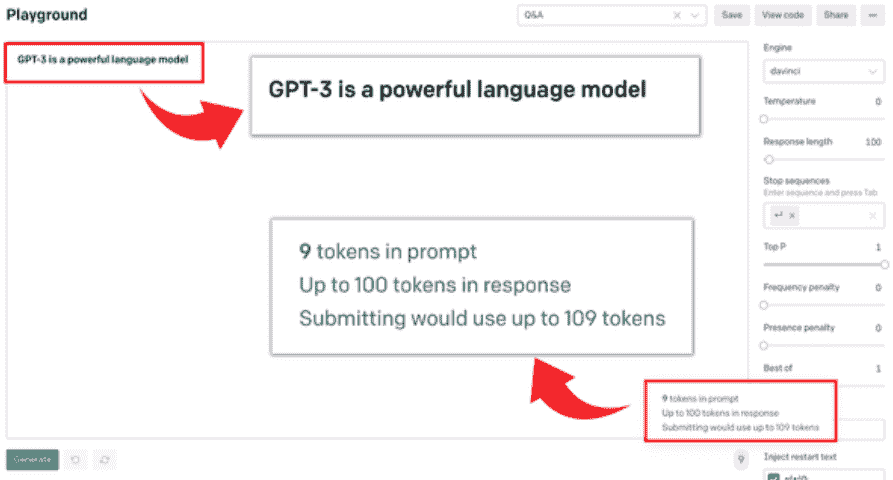

图 2-8. Playground 中的 Token 计数

衡量 token 消耗的另一种方法是使用显式的 *GPT-3 Tokenizer Tool*，它可以让你可视化从单词字符形成 tokens 的过程。你可以通过一个简单的文本框与 Tokenizer 工具交互，在其中编写提示文本，Tokenizer 会显示 token 和字符计数以及详细的视觉化。

### Tokenizer

GPT 系列模型使用 tokens 处理文本，tokens 是文本中常见的字符序列。模型理解这些 tokens 之间的统计关系，并在生成序列中的下一个 token 方面表现出色。

你可以使用下面的工具来了解一段文本将如何被 API 分词，以及该文本的总 token 数量。

```
GPT-3 is the most powerful language model
```

Tokens
10
Characters
41

```
GPT-3 is the most powerful language model
```

一个有用的经验法则是，对于常见的英文文本，一个 token 通常对应 ~4 个字符的文本。这相当于大约 ¾ 个词（因此 100 tokens ~= 75 words）。

图 2-9. OpenAI 的 Tokenizer

为了将 token 计数指标集成到对不同端点的 API 调用中，你可以修补 logprobs 和 echo 属性以及 API 请求，以获取消耗的完整 token 列表。

在下一节中，我们将介绍 tokens 如何根据不同的执行引擎进行定价。

### Pricing

在上一节中我们谈到了 tokens，这是 OpenAI 用于确定 API 调用定价的最小可互换单位。Tokens 比衡量训练提示中使用的词数或句子数更灵活，并且由于 token 的极高粒度，tokens 可以轻松处理并用于衡量各种训练提示的定价。

每次你从 Playground 或以编程方式调用 API 时，在后台 API 会计算训练提示中使用的 token 数量以及生成的完成内容，并根据使用的总 token 数量对每次调用收费。

在撰写本章时（2021 年 12 月），各种 API 引擎的定价如下：

| Model | Price Per 1k Tokens |
|---|---|
| Davinci (Most powerful) | $0.0600 |
| Curie | $0.0060 |
| Babbage | $0.0012 |
| Ada (Fastest) | $0.0008 |

该公司采用云定价模式的“按需付费”。有关最新定价，请查看：https://beta.openai.com/pricing。

OpenAI 通常按每 1k tokens 收取固定费用，费用可能因 API 调用中使用的执行引擎类型而异。Davinci 是最强大且最昂贵的，而 Curie、Ada 和 Babbage 则更便宜更快。

与其监控每次 API 调用的 tokens，OpenAI 提供了一个报告仪表板来监控每日累计 token 使用量。根据你的使用情况，它可能看起来像图 2-10。

### Usage

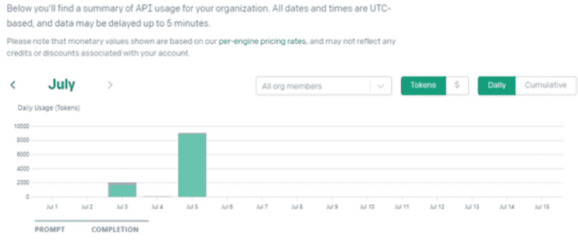

图 2-10. API 使用仪表板

在图 2-10 中，你可以看到显示 API 使用量每日 token 消耗的条形图。仪表板帮助你监控组织的 token 使用量和定价。这有助于你规范 API 使用并保持在预算范围内。还有一个选项可以监控累计使用量以及每次 API 调用的 token 计数明细。这应能为你提供足够的灵活性，以便为组织制定 token 消耗和定价相关的策略。现在你了解了 Playground 和 API 的方方面面，我们将看看 GPT-3 在典型语言建模任务上的表现。


## NOTE

对于刚开始使用 GPT-3 且对 token 消耗难以理解的初学者来说。许多用户输入过长的提示文本，这会导致积分过度使用，进而产生计划外的费用。为避免这种情况，在最初的几天里，请尝试使用 API 控制面板观察所消耗的 token 数量，并查看提示和完成的长度如何影响 token 使用情况。这可以帮助你防止积分失控使用，并将一切保持在预算范围内。

### GPT-3 在传统 NLP 任务上的表现

GPT-3 是 NLP 领域高度先进且复杂的继任者，使用核心 NLP 方法和深度神经网络构建并训练。对于任何基于 AI 的建模方法，模型性能的评估方式如下：首先，你在训练数据上为特定任务训练模型（如分类、问答、文本生成等）；然后使用测试数据（未见过的数据）验证模型性能。

类似地，存在一套标准的 NLP 基准用于评估 NLP 模型的性能并得出相对模型排名或比较。这种比较，或 *相对排名*，使你能够挑选和选择最适合特定 NLP 任务（业务问题）的模型。

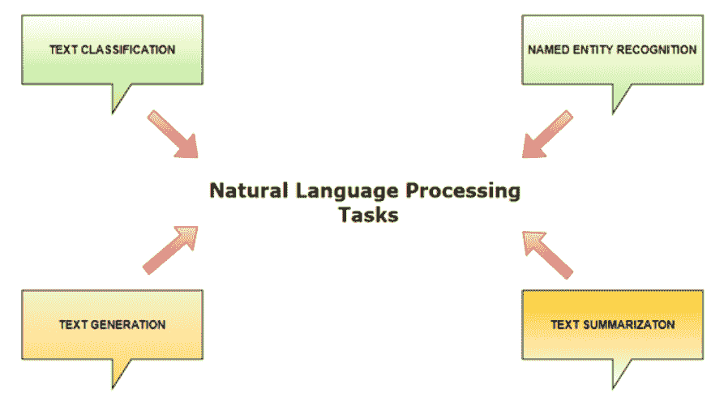

图 2-11. 传统 NLP 任务

在本节中，我们将讨论 GPT-3 在一些标准 NLP 任务上的表现，并将其与类似模型在各自 NLP 任务上的表现进行比较。

### 文本分类

文本分类是将文本归类到有组织的组中的过程。通过使用 NLP，文本分类可以自动分析文本，然后根据其上下文分配一组预定义的标签或类别。

文本分类涉及分析作为输入提供的文本并为其分配标签、分数或其他表征文本的属性。文本分类的一些常见示例是情感分析、实体识别以及异常或离群点检测，我们将在本节后面部分讨论这些内容。

你可以使用多种方法让 GPT-3 对文本进行分类，从零样本分类（你不向模型提供任何示例）到单样本和少样本分类（你向模型展示一些示例）。

### 零样本分类

现代人工智能长期以来一直致力于开发能够对从未见过的数据执行预测功能的模型。这个重要的研究领域称为零样本学习。类似地，*零样本分类* 是一种分类任务，其中模型在对文本片段进行分类时无需事先训练和微调。GPT-3 目前对未见数据的结果要么优于为特定目的微调的最先进 AI 模型，要么与之相当。为了使用 GPT-3 执行零样本分类，我们必须为其提供兼容的提示。在第 2 章中，我们将更详细地讨论提示工程。

以下是零样本分类的一个示例，其目标是执行事实核查分析，以确定推文中包含的信息是否正确或不正确。图 2-12 显示了基于零样本示例的信息正确性分类的相当令人印象深刻的结果。

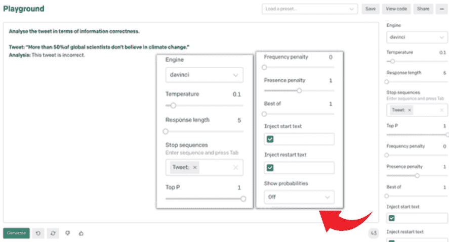

图 2-12. 零样本分类示例

以下是我们的提示：

```
Analyse the tweet in terms of information correctness.
Tweet: "More than 50% of global scientists don’t believe in climate change."
Analysis:
```

输出结果为：

```
The tweet is incorrect.
```

### 单样本/少样本分类

文本分类的另一种方法是使用单样本或少样本训练示例对 AI 模型进行微调，也称为单样本或少样本文本分类。当你提供如何对文本进行分类的示例时，模型可以根据你提供的样本学习有关对象类别的信息。这是零样本分类的超集，允许你通过向模型提供一些示例来对文本进行分类。这对于需要一定程度上下文设置的下游用例尤其有用。

让我们来看一个少样本分类的以下示例。我们要求模型执行推文情感分析分类，并提供三个推文示例来说明每种可能的标签：积极、中性和消极。正如以下屏幕截图所示，配备了基于少数示例的如此详细上下文的模型，能够非常轻松地执行下一条推文的情感分析。

## NOTE

当你从书中重现提示示例或创建自己的提示时，请确保在提示中保持足够的行间距。段落后额外的一行可能会导致非常不同的结果，因此你需要尝试一下，看看什么对你最有效。

以下是我们的提示：

```
Analyse the tweet in terms of its sentiment. Depending on the sentiment, classify it as positive, neutral, or negative.
Tweet: "I'm seriously worried that super intelligent AI will be disappointed in humans."
Sentiment analysis(positive, neutral, negative): negative
Tweet: "I cannot wait for super intelligent AI to emerge and deepen our understanding of the Universe."
```

Sentiment analysis(positive, neutral, negative): positive
Tweet: "I think it is neither super likely nor super unlikely that the super intelligent AI will emerge one day."
Sentiment analysis(positive, neutral, negative): neutral
Tweet: "Super intelligent AI is going to be the most exciting discovery in human history."
Sentiment analysis(positive, neutral, negative):

#### And the output:

positive

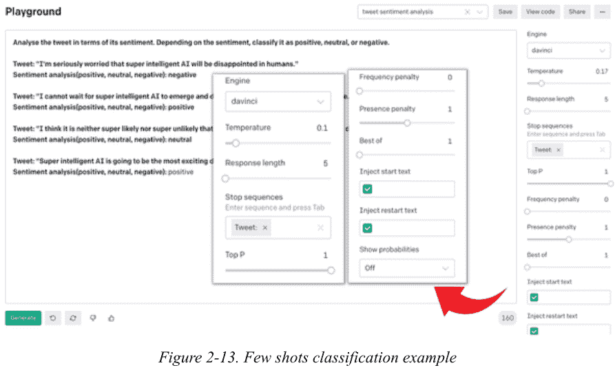

### 批量分类

在了解了 GPT-3 的少样本分类之后，让我们深入研究批量分类，它允许你在一个 API 调用中批量分类输入样本，而不是每次 API 调用只分类一个示例。它适用于你希望一次性对多个示例进行分类的应用，就像我们检查过的推文情感分析任务一样，但是一次分析几条推文。

与少样本分类一样，你希望为模型提供足够的上下文以实现所需结果，但采用批量配置格式。在这里，我们使用批量配置格式中的各种示例定义推文情感分类的不同类别。然后我们要求模型分析下一批推文。

以下是我们的提示：

```
Analyse tweets in terms of their sentiment. Depending on their sentiment, classify them as positive, neutral, or negative.
Tweet: "I'm seriously worried that super intelligent AI will be disappointed in humans."
Sentiment analysis(positive, neutral, negative): negative
###
Tweet: "I cannot wait for super intelligent AI to emerge and deepen our understanding of the Universe."
Sentiment analysis(positive, neutral, negative): positive
###
Tweet: "I think it is neither super likely nor super unlikely that the super intelligent AI will emerge one day."
Sentiment analysis(positive, neutral, negative): neutral
###
Tweet: "Super intelligent AI is going to be the most exciting discovery in human history."
Sentiment analysis(positive, neutral, negative): positive
###
Tweet:
1. "I'm seriously worried that super intelligent AI will be disappointed in humans."
2. "I cannot wait for super intelligent AI to emerge and deepen our understanding of the Universe."
3. "I think it is neither super likely nor super unlikely that the super intelligent AI will emerge one day."
4. "Super intelligent AI is going to be the most exciting discovery in human history."
5. "This is the latest report on the state of the AI"
Tweet sentiment:
1. negative
2. positive
3. neutral
4. positive
5. neutral
Tweet:
1. "I can't stand bad techno music"
2. "This is a tweet"
3. "I can't wait for going to the Moon!!!"
4. "AI is super cute ♡"
5. "Got VERY ANGRY now!!! 7줄Tweet sentiment:
1.
```


And the output:

+   1. negative
+   2. neutral
+   3. positive
+   4. positive
+   5. negative

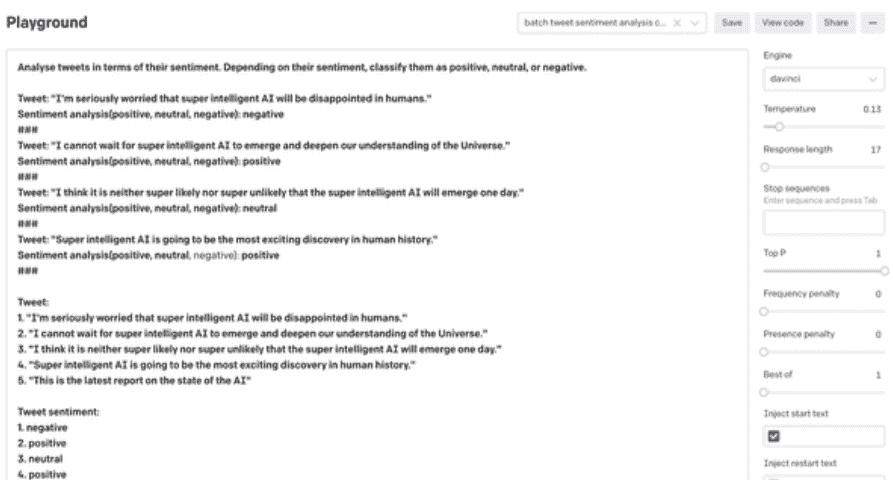

Figure 2-14. Batch classification example (Part-1)

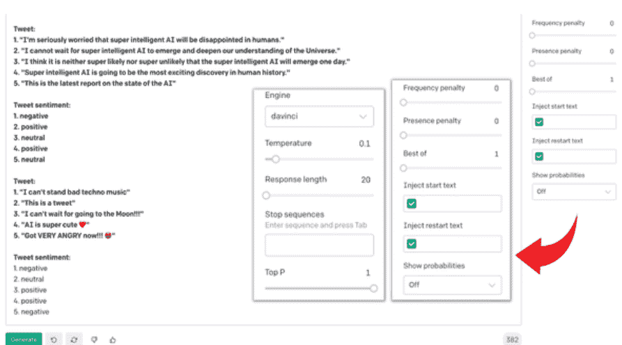

Figure 2-15. Batch classification example (Part-2)

As you can see in Figure 2-14 the model recreated the batch sentiment analysis format and classified the tweets successfully. Now let’s move on to see how it performs at the Named Entity Recognition tasks.

### Named Entity Recognition

Named entity recognition is an information extraction task that seeks to locate and classify named entities mentioned in unstructured text into pre-defined categories such as person names, organizations, locations, expressions of time, quantities, monetary values, percentages, etc.

NER helps to make the responses more personalized and relevant but the current state-of-the-art approaches require massive amounts of data for training before you even start with the prediction. GPT-3, on the other hand, can work out of the box for recognizing general entities like people, places, and organizations without humans providing even a single training example.

In the following example we used a davinci-instruct-series version of the model that was in beta at the time of writing this book and the model gathers prompts to train and improve the future OpenAI API models. We

gave it a simple task: to extract contact information from an example email. It successfully completed the task on the first attempt (Figure 2-16).

#### Here is our input:

```
Extract the name and mailing address from this email:
Shubham,
It was great to talk to you the other day!
I'm SO looking forward to start working on our book.
Here's my address 1307 Roosevelt Street, San Francisco CA
94107
Best,
Sandra Kublik
Name and mailing address:
```

#### And the output:

```
Sandra Kublik
1307 Roosevelt Street, San Francisco CA 94107
```

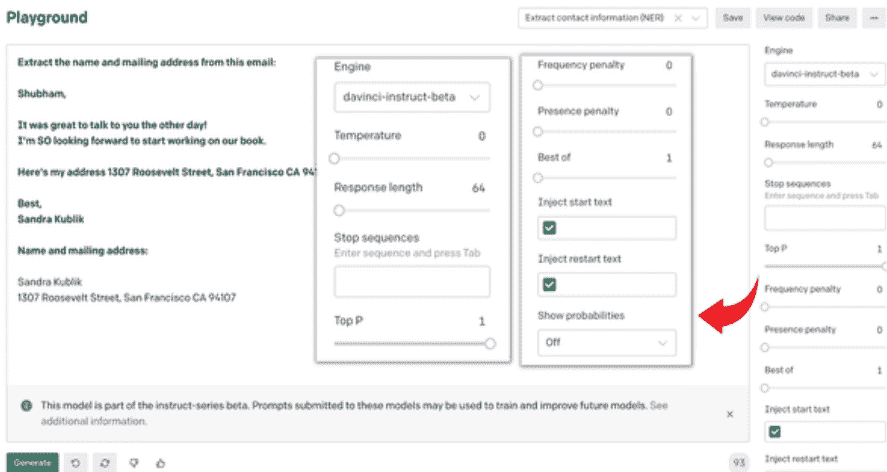

Figure 2-16. NER example

### Text Summarization

*Text summarization* is a technique for generating a concise and exact summary of lengthy texts while focusing on the sections that convey useful information, without losing the overall meaning. GPT-3 based text

summarization aims to transform lengthy pieces of texts into their condensed tl;dr² versions. Such tasks are generally difficult and costly to accomplish manually. With GPT-3, it is a matter of a single input and a few seconds!

NLP models can be trained to comprehend documents and identify the sections that convey important facts and information before producing the required summarized texts. However, such models need a large amount of training samples before they can learn the context and start summarizing the unseen input.

GPT-3 solves this problem with its zero-shot and few-shot approach towards text summarization. With GPT-3 there are multiple ways you can go about summarizing the text involving basic summaries, one-line summaries, grade-level summaries depending on your use-case. Let’s have a quick walkthrough of these approaches.

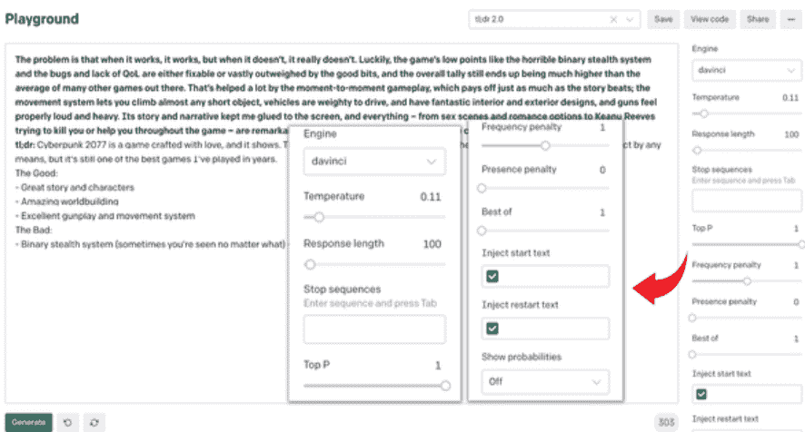

Figure 2-17. Text summarization example

Most of the time the model is able to generate decent results in the form of a review summary, but sometimes it can output irrelevant results depending on the prior context. To avoid the problem of getting unwanted results, you can set the Best of parameter to 3 which will always give you the best of

three results generated by the API. In the example shown in Figure 2-17, after a few tries and minor parameter tweaking, we got decent results.

Here is our prompt:

```
The problem is that when it works, it works, but when it doesn’t, it really doesn’t. Luckily, the game’s low points like the horrible binary stealth system and the bugs and lack of QoL are either fixable or vastly outweighed by the good bits, and the overall tally still ends up being much higher than the average of many other games out there. That’s helped a lot by the moment-to-moment gameplay, which pays off just as much as the story beats; the movement system lets you climb almost any short object, vehicles are weighty to drive, and have fantastic interior and exterior designs, and guns feel properly loud and heavy. Its story and narrative kept me glued to the screen, and everything - from sex scenes and romance options to Keanu Reeves trying to kill you or help you throughout the game - are remarkably well done. Cyberpunk 2077 is a game crafted with love, and it shows. tl;dr:
```

And the output:

```
Cyberpunk 2077 is a game crafted with love, and it shows. The story is great, the gameplay is great, the worldbuilding is great. It’s not perfect by any means, but it's still one of the best games I've played in years.
The Good:
- Great story and characters
- Amazing worldbuilding
- Excellent gunplay and movement system
The Bad:
- Binary stealth system (sometimes you're seen no matter what) - Bugs
```

Since many people spend hours per day reading and writing emails, summarizing them is a widely desired use case for GPT-3. Let’s see how GPT-3 does with summarizing a three-paragraph email into one crisp line (Figure 2-18).

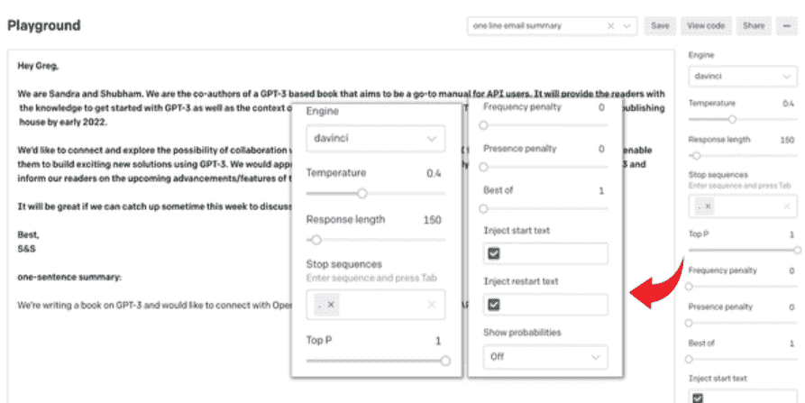

Figure 2-18. Email summarization example

To achieve the desired result, we pasted the full email and then simply added “one-sentence summary:" at the end. We also included a “.” stop sequence to tell the model that it should stop its summary generation after a single sentence.

#### Our prompt:

```
Hey Greg,
We are Sandra and Shubham. We are the co-authors of a GPT-3 based book that aims to be a go-to manual for API users. It will provide the readers with the knowledge to get started with GPT-3 as well as the context of the growing ecosystem surrounding it. The book will be released by O’Reilly publishing house by early 2022.
We’d like to connect and explore the possibility of collaboration with OpenAI to evangelize access to API for people from all backgrounds and enable them to build exciting new solutions using GPT-3. We would appreciate your input to ensure we accurately represent OpenAI's stance on GPT-3 and inform our readers on the upcoming advancements/features of the API.
It will be great if we can catch up sometime this week to discuss it further?
Best,
S&S
one-sentence summary:
```

#### And the output:

```
We’re writing a book on GPT-3 and would like to connect with OpenAI to get a better understanding of the API and the future developments
```

### Text Generation

Before the introduction of GPT-3, there was a general understanding that AI models are capable of carrying a short conversation with humans that answer specific questions or handle specific tasks. However the models were not sophisticated enough to handle complicated text generation tasks and started to lose track whenever they encountered something complex or abstract.

In the complicated world of natural language generation, GPT-3 has shaken the notion of language models being limited to trivial tasks. Text generation is the greatest strength of GPT-3. It is capable of generating textual content that is almost indistinguishable from human-written text. GPT-3 is trained on billions of words from the training dataset to generate text in response to a variety of prompts. It generates an average of 4.5 billion words per day, according to OpenAI.

In the next example, we experiment with using GPT-3 to create content for a personal productivity app startup. We gave the model only minimal context. It generated many of the examples in Figure 2-19 on the first take.

#### Article Generation

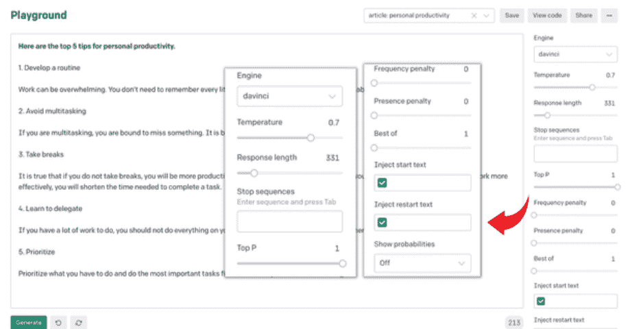

Figure 2-19. Article generation example

#### Our prompt:

Here are the top 5 tips for personal productivity.

#### And the output:

+   1. Develop a routine
+   Work can be overwhelming. You don’t need to remember every little detail. By having a routine, you will be able to work more efficiently.
+   2. Avoid multitasking
+   If you are multitasking, you are bound to miss something. It is better to work on one task at a time.
+   3. Take breaks
+   It is true that if you do not take breaks, you will be more productive. However, if you take breaks too often you will get tired and stressed. If you work more effectively, you will shorten the time needed to complete a task.
+   4. Learn to delegate
+   If you have a lot of work to do, you should not do everything on your own. Delegate some of the work to others.
+   5. Prioritize
+   Prioritize what you have to do and do the most important tasks first. Don’t worry about the small things.

### Social Media Post Generation


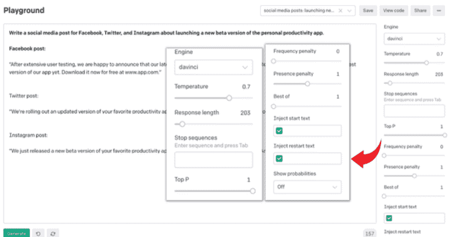

图 2-20. 社交媒体帖子生成示例

### 这里是我们的提示：

为 Facebook、Twitter 和 Instagram 编写一篇关于发布个人效率应用新 beta 版本的社交媒体帖子。
Facebook 帖子：

### 以及输出：

"经过广泛的用户测试，我们很高兴地宣布，我们的最新更新现已可供下载！我们的团队努力打造了迄今为止最好的应用版本。立即免费下载，网址为 www.app.com。"
Twitter 帖子：
"We're rolling out an updated version of your favorite productivity app! Now available on iOS and Android. #productivity #beta"
Instagram 帖子：
"We just released a new beta version of your favorite productivity app! Download it today for free on iOS and Android. #productivity #beta"

### 结论

在本章中，我们介绍了 OpenAI playground、提示工程以及 OpenAI API 的不同组件，随后通过游乐场示例涵盖了主要 NLP 任务。到目前为止，你已经了解了 API 如何与不同组件协同工作，以及如何使用 Playground 作为基础来设计和试验不同的训练提示。

在下一章中，我们将指导你如何使用 GPT-3 与不同的编程语言集成 API 到你的产品中，或从头构建一个全新的应用程序。

- 1 对于超过 200 份文档，OpenAI 提供了一个 beta API。
- 2 “too long; didn’t read.” 的长期互联网缩写。
