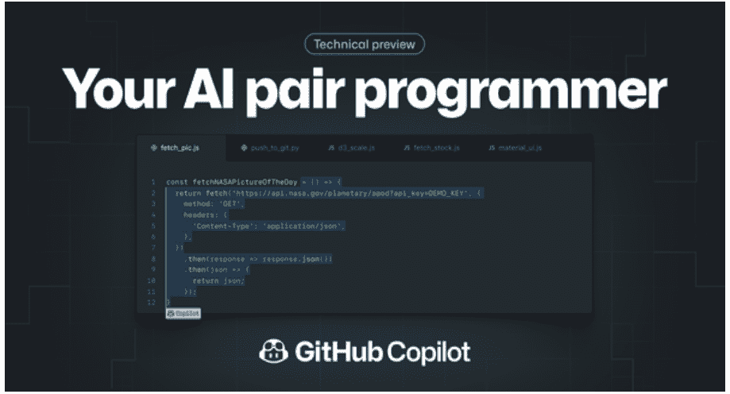
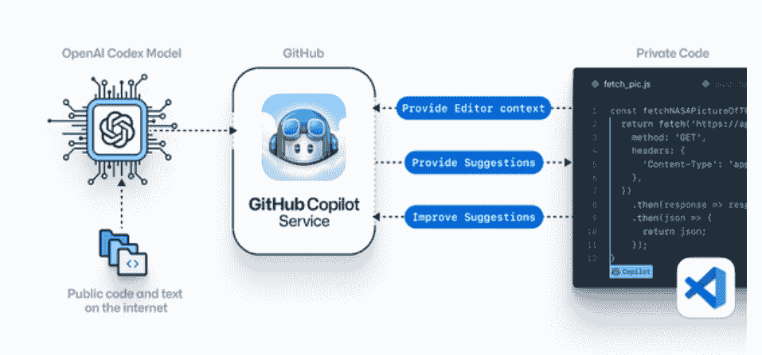

## Chapter 5. GPT-3 for Corporations

### A NOTE FOR EARLY RELEASE READERS

With Early Release ebooks, you get books in their earliest form—the authors’ raw and unedited content as they write—so you can take advantage of these technologies long before the official release of these titles.

This will be the 5th chapter of the final book. Please note that the GitHub repo will be made active later on.

If you have comments about how we might improve the content and/or examples in this book, or if you notice missing material within this chapter, please reach out to the authors at sandra.a.kublik@gmail.com and shubhamsaboo111@gmail.com.

When a new innovation or technical shift happens, big corporations are usually the last to adopt it. Their hierarchical structures are composed of various authoritarian levels, and standard processes of legal approvals and paperwork often limit freedom to experiment, making it difficult for enterprises to be early adopters. But this doesn’t seem to be the case with GPT-3. As soon as the API was released, corporations started experimenting with it. However, they ran into a significant barrier: data privacy.

In its simplest form, all a language model does is to predict the next word given a series of previous words. As you learned in Chapter 2, OpenAI has devised several techniques to transform the functioning of language models like GPT-3 from simple next-word prediction to more useful NLP tasks such as answering questions, summarizing documents, and generating

context-specific text. Typically, the best results are achieved by ‘fine-tuning’ a language model or conditioning it to mimic a particular behavior by providing it with a few examples using domain-specific data. You can provide examples with the training prompt, but a more robust solution is to create a custom-trained model using the fine-tuning API.

OpenAI offers GPT-3 in the form of an open-ended API, where users provide input data and the API returns output data. Properly securing, handling, and processing user data is a key concern for corporations looking to use GPT-3. OpenAI’s Welinder notes that, while enterprise leaders have expressed a variety of concerns about GPT-3, “SOC2 compliance, geofencing, and the ability to run the API within a private network were the biggest of them.”

OpenAI’s measures for model safety and misuse are thus designed to cover a wide range of issues under the umbrella of data privacy and security. For example, Adams, founder of Stenography, tells us about the privacy and security aspects of the OpenAI API. “As it stands, Stenography is a pass-through API—it’s like a toll road. So that people will pass in their code, and then receive a signal that says that they have used the API, and then it passes the input without saving or logging it anywhere.” Outside of those guardrails, Stenography is a superset of OpenAI’s Terms of Use.

We talked to representatives of several corporations about what’s stopping them from using OpenAI API in production. Most highlighted two common concerns:

- The GPT-3 API endpoint exposed by OpenAI should not retain or save any part of the training data provided to it as part of the model fine-tuning/training process.
- Before sending their data to OpenAI API, companies want to make sure that there’s no way for a third party to extract or access the data by providing any input to the API.

OpenAI responded to the above customer concerns and questions around data handling and privacy by offering security reviews, enterprise contracts,

data processing agreements, third-party security certification efforts, and more. Some of the issues that customers and OpenAI discuss include whether the customer’s data can be used to improve OpenAI models, which may improve performance in the customer’s desired use cases but comes with concerns around data privacy and internal compliance obligations; limits around the storage and retention of customer data, and obligations around security handling and processing of the data.

The rest of this chapter delves into three case studies that show how global enterprises like GitHub, Microsoft, and Algolia are navigating these questions and using GPT-3 at scale. You’ll also learn how OpenAI has adapted to the demand for enterprise-grade products by collaborating on Microsoft Azure’s OpenAI service.

### Case Study: GitHub Copilot

Let’s start this journey with GitHub Copilot, one of the hottest products of 2021. GitHub Copilot is a first-of-its-kind AI pair programmer that helps users write code faster and with much less work. Oege De Moor, VP of GitHub Next, says the mission is “to reach all developers, with an ultimate goal to make programming accessible to everyone.” Automating mundane tasks, like writing redundant code and writing unit test cases, allows developers to “focus on the truly creative part of the job which involves deciding what the software should actually do” and to “think more about the product concept rather than being stuck in figuring out the code.”

As Awan told us: “I’m excited to work on more side projects now, because I know I’ll have the help of GitHub Copilot. It’s almost like I have a co-founder now. Codex and copilot are writing 2 to 10% of my code, something like that. So it has already made me 2 to 10% more accelerated. And all of this is on an exponential scale. So what will GPT-3 be like next year? What will Codex be like next year? I may be 30% more accelerated.” Let’s dive into the inner workings of the Copilot.

Figure 5-1. GitHub Copilot

#### How it works

GitHub Copilot 根据你正在处理的代码，从诸如文档字符串、注释和函数名称等信息中提取上下文。然后它会在你的编辑器中自动建议下一行代码，甚至是整个函数，以生成样板代码并建议与代码实现相匹配的测试用例。它通过用户代码编辑器的插件与广泛的框架和编程语言配合使用，使其几乎不依赖特定语言，同时轻量且易于使用。

OpenAI 研究科学家 Harri Edwards 指出，Copilot 对于在新语言或框架中工作的程序员来说也是一个有用的工具：“尝试通过谷歌搜索一切来在不熟悉的语言中编码，就像只带一本短语手册在外国国家导航一样。使用 GitHub Copilot 就像雇了一个翻译。”

GitHub Copilot 由 OpenAI 的 Codex 提供支持，Codex 是 GPT-3 模型的后继者，正如我们在第 4 章中所指出的，它专门设计用于解释和编写代码。De Moor 说：“GitHub 拥有超过 7300 万开发者，其中包含大量公共数据，体现了社区的集体知识。” 这意味着 Codex 可以用于训练的数十亿行公开代码。它既理解编程语言也理解人类语言。

Figure 5-2. Working of GitHub Copilot

Codex 依靠简单的英文中的支持性注释或说明来生成相关代码。Copilot 编辑器扩展智能地选择将哪些上下文发送到 GitHub Copilot 服务，后者进而运行 OpenAI 的 Codex 模型来综合建议。即使 Copilot 生成了代码，用户仍然掌控一切：你可以循环浏览建议的选项，选择接受或拒绝，并手动编辑建议的代码。GitHub Copilot 会根据你所做的编辑进行调整并匹配你的编码风格。De Moor 解释说：“它将自然语言与源代码联系起来，因此你可以在两个方向上使用它。你可以用源代码生成注释，也可以用注释生成源代码，这使其极其强大。”

这一功能也间接改变了开发者编写代码的方式。当他们知道自己用人类语言（如英语）编写的代码注释将成为模型训练的一部分时，他们会“写出更好、更准确的注释以从 Copilot 获得更好的结果”，De Moor 说。

许多批评者担心将此工具交给无法判断代码质量的人手中可能会在代码库中引入错误或缺陷。De Moor 与此相反的观点告诉我们：“我们收到了大量开发者的反馈，Copilot 让他们编写出更好、更高效的代码。” 在当前的技术预览版中，如果你不了解软件中不同组件的工作原理，就无法让 Copilot 帮助你编写代码，你必须能够精确地告诉 Copilot 你希望它做什么。

Copilot 鼓励健康的开发者实践，例如编写更准确的注释，并以更好的代码生成作为回报。

Copilot 不仅限于编程的通用规则，它还能弄清楚特定领域的细节，例如编写用于作曲音乐的程序。要做到这一点，你需要理解音乐理论来编写此类程序。De Moor 补充道：“看到 Copilot 如何从其庞大的训练数据中 somehow 学会了这一点，真是令人惊叹。”

#### Developing Copilot

De Moor 说设计 Copilot 的挑战之一是创造合适的用户体验，让你“以协作的方式使用这个模型而不显得侵入性”。目标是让它感觉像与一位编程伙伴或同事合作，他“更了解琐碎的编码工作，这样你就可以更专注于创造重要的东西。”

开发者不断寻找现有问题的解决方案，并经常参考 StackOverflow、搜索引擎和博客来查找实现和代码语法细节——这意味着在编辑器和浏览器之间来回切换很多次。正如 De Moor 所指出的，“作为一名开发者，当你可以在自己的环境中保持专注并思考问题，而不是不断切换上下文时，你会更高效。” 这就是为什么 GitHub 团队设计 Copilot 在开发环境内部提供建议。

#### What does low-code/no-code programming mean?

目前，开发软件相关产品或服务需要技术或科学背景——例如，你必须学习至少一种编程语言。这仅仅是个开始，即使使用传统技术开发最小可行产品（MVP），你也必须了解涉及前端（用户如何与软件交互）和后端（处理逻辑如何工作）的不同软件工程部分。它在流程中引入了大量复杂性，并为那些不具备技术或工程背景的人设置了进入壁垒。

目前，开发软件需要技术或科学背景——例如，你必须学习至少一种编程语言。这为那些没有接受过此类培训的人设置了进入壁垒。De Moor 将 Copilot 视为让技术更易于访问和包容的一步。如果开发者“越来越少地担心开发细节，只需解释设计，解释我们想要做什么的目的”，而 Copilot 处理细节，那么更多的人将能够使用这些工具创建新产品和服务。

已经存在多个无代码编程平台，但 De Moor 说许多用户发现其限制很受约束，本质上，“通过使其更视觉化、更图形化、更易于使用，从而极大地简化了编程体验。这些东西很适合入门，但不幸的是，它在可以用这些平台构建的东西上带来了限制。” De Moor 认为 Copilot 同样易于使用，但通过使用完全可操作的编程工具而非简化版本，提供了更多选择。

#### Scaling with the API

就语言模型而言，扩展性长期以来被低估，这是因为奥卡姆剃刀等理论概念以及当神经网络扩展到显著规模时出现的消失结果。在传统的深度学习中，保持模型规模小、参数更少以避免梯度消失问题并在模型训练过程中引入复杂性一直是常态。

奥卡姆剃刀意味着“简单模型是最好的模型”，自人工智能诞生以来一直是 AI 社区的圣经。它一直是训练新模型的参考中心，限制了人们对规模的实验。

2020 年，当 OpenAI 发布其旗舰语言模型 GPT-3 时，扩展的潜力进入了聚光灯下。这是在 AI 社区普遍观念开始转变的时候，人们开始意识到“规模的礼物”可以催生更通用的通用人工智能，其中像 GPT-3 这样单一的模型可以执行一系列任务。

托管和管理像 GPT-3 这样规模的模型需要在许多不同层面具备复杂性，包括模型架构的优化、部署方式以及公众如何访问它。De Moor 告诉我们：“当我们推出 Copilot 时，最初阶段使用的是 OpenAI API 基础设施，然后在发布后出现了响应爆炸，很多人报名并想要使用该产品。”

尽管 API 能够处理大量请求，但请求的数量和频率仍然让 OpenAI 团队感到惊讶。De Moor 和他的团队“意识到了部署需要更高效、更大的基础设施，幸运的是，正好是 Microsoft Azure OpenAI 浮出水面的时候”，使他们能够切换到 Azure 部署基础设施。

当我们询问构建和扩展 Copilot 的体验时，De Moor 分享说：“早期我们有一种误导性的信念，认为准确性是最重要的事情，但产品旅程稍后我们意识到，这实际上是在强大的 AI 模型和完美的用户体验之间的权衡。” Copilot 团队很快意识到，就像任何规模足够的深度学习模型一样，速度和建议准确性之间存在权衡。

通常，深度学习模型的层数越多，它就越准确。然而，如果深度学习模型层数越多，运行速度就会越慢。Copilot 团队必须 somehow 在两者之间找到平衡

De Moor 解释说：“我们的用例要求模型以极快的速度提供响应，并提供多种替代建议，如果不够快，用户很容易就会超过模型的速度并自行编写代码。因此，我们发现一个稍弱但能快速给出响应同时保持结果质量的模型是合适的。”

GitHub Copilot 的快速用户采用和兴趣让团队中的每个人都感到惊讶，但这还不止于此。由于产品的实用性和代码建议的质量，团队看到使用 Copilot 生成的代码量呈指数级增长。De Moor 说：“平均而言，35% 的新编写代码是由 Copilot 建议的。随着我们更接近在模型能力和建议速度之间找到合适的平衡，这一数字将继续增加。”

当被问及作为 Copilot 请求一部分提交的代码的数据安全和隐私方面时，Moor 告诉我们：“Copilot 架构设计的方式是，当用户将代码输入 Copilot 时，不会出现代码在用户之间泄露的可能性。GitHub Copilot 是一个代码合成器，而不是搜索引擎：它建议的大部分代码都是唯一生成的，从未见过。我们发现大约 0.1% 的时间，建议中可能包含一些与训练集逐字相同的片段。”

#### GitHub Copilot 的下一步是什么？

De Moor 认为 Copilot 在代码审查以及编写方面都有巨大潜力。“想象一个自动代码审查工具，它会自动查看你的更改并提出建议以使你的代码更好、更高效。今天 GitHub 的代码审查流程由人工审查员组成，我们也在探索 Copilot 审查的想法。”

另一个正在探索的功能是代码解释。De Moor 解释说，用户可以选择一段代码片段，“Copilot 可以用简单的英语解释它。”这有可能成为一个有用的学习工具。此外，De Moor 说，Copilot 希望提供有助于“将代码从一种编程语言翻译成另一种编程语言”的工具。

Copilot 为不仅仅是开发人员，而是任何想要发挥创造力并构建软件将想法变为现实的人打开了无限机会的大门。在 GitHub Copilot 和 OpenAI 的 Codex 之前，在发布之前，生成生产级代码、AI 辅助代码审查以及将代码从一种语言翻译到另一种语言等功能一直是一个遥不可及的梦想。大型语言模型与无代码和低代码平台的结合将使人们能够释放创造力，构建有趣且意想不到的应用程序。

## 案例研究：Algolia Answers

Algolia 是一家知名搜索解决方案提供商，其客户从财富 500 强公司到新一代初创公司不等。它提供一种符号化、基于关键字的搜索 API，可与任何现有产品或应用程序集成。2020 年，Algolia 与 OpenAI 合作，将 GPT-3 与其已有的搜索技术连接起来。下一代产品由此诞生，即 Algolia Answers，它使客户能够为搜索查询构建一个智能的、语义驱动的单一搜索端点。Algolia 产品经理 Dustin Coates 说：“我们构建的是其他公司使用的技术。”

Coates 说，他团队所说的 *智能搜索* 大致是指“你搜索某样东西，立即得到响应——不仅仅是返回记录，你返回的是文章——而是返回真正回答问题的东西。”简而言之，这是一种“人们不必完全输入单词的搜索体验。”

#### 评估 NLP 选项

Algolia 设立了一个专门团队来从事这一领域的工作，Claire Helme-Guizon 是该团队的早期成员之一。当 OpenAI 联系他们询问 Algolia 是否对 GPT-3 感兴趣时，Coates 的团队将其与竞争技术进行了比较。Algolia ML 工程师 Claire Helme-Guizon，原 Algolia Answers 团队成员解释说：“我们研究了类似 BERT 的模型，以优化速度，DistilBERT，以及更稳定的模型如 RoBERTa，还有 GPT-3 的不同变体，如 DaVinci、Ada 等。”他们创建了一个评级系统来比较不同模型的质量并了解其优缺点。他们发现 Coates 说“它在返回的搜索结果质量方面表现非常好。”速度和成本是弱点，但 API 最终成为决定性因素，因为它允许 Algolia 使用该模型而无需维护其基础设施。Algolia 询问现有客户是否会对这种搜索体验感兴趣，反馈非常积极。

即使有这种质量的结果，Algolia 仍然有很多疑问：它对客户如何工作？架构是否可扩展？在财务上是否可行？为了解答这些问题，Coates 解释说：“我们塑造了具有更长文本内容的特定用例，”例如出版和帮助台。

对于某些用例，仅依靠 GPT-3 获取搜索结果就足够了，但对于其他复杂用例，你可能需要将 GPT-3 与其他模型集成。GPT-3 在训练数据截止到某一时间点，因此在涉及新鲜度、受欢迎程度或个性化结果的用例中表现不佳。谈到结果质量时，Algolia 团队面临的挑战是 GPT-3 生成的语义相似度分数并不是客户关心的唯一指标。他们需要以某种方式将相似度分数与其他衡量标准融合，以确保客户获得令人满意的结果。因此，他们引入了其他开源模型，以便结合 GPT-3 突出最佳结果。

#### 数据隐私

Coates 说，Algolia 在引入这项新技术时面临的最大挑战是法律方面的。“在整个项目中，最难的事情可能是通过法律、安全和采购，因为你正在发送客户数据并将其输入这个机器学习模型。我们如何删除这些数据？我们如何确保其符合 GDPR¹？我们如何处理所有这些事情？我们如何知道 OpenAI 不会拿这些数据去为其他人的模型提供喂养？所以有很多问题需要回答，很多协议需要达成。”

#### 成本

我们迄今为止看到的大多数 GPT-3 用例都是面向消费者的业务对消费者（B2C）产品，但对于 Algolia 这样面向企业的业务对企业（B2B）公司来说，情况不同。不仅需要 OpenAI 的定价对他们有效，而且他们还需要为客户优化定价，以便“我们能够盈利，同时客户仍然对我们正在构建的东西感兴趣。”

在搜索解决方案业务中，成功是基于吞吐量来衡量的。因此，自然会考虑质量、成本和速度之间的权衡。Coates 说：“即使在我们知道成本之前，Ada 对我们来说就是正确的模型，因为速度快。但即使假设 Davinci 足够快，我们可能仍然会因为成本考虑而选择 Ada。”

Helme-Guizon 指出，影响成本的因素包括，“标记的数量，以及你发送的文档数量及其长度。”Algolia 的方法是构建“尽可能小的上下文窗口”——即一次发送到 API 的数据量——同时仍“在质量方面足够相关。”

那么他们是如何解决这个问题的呢？“我们在 OpenAI 宣布定价之前就开始了，并且我们已经走了很远，并且看到质量足够好，就像我们在其他地方看到的那样，而不知道定价是什么。所以那段时间有很多不眠之夜，不知道定价是什么。然后一旦我们知道了定价，就要想办法降低成本。因为当我们第一次看到定价时，我们不确定是否能让它发挥作用。”

他们确实投入了大量工作来为其使用场景优化价格，因为根据 Coates 的说法，定价将是“每个人试图在其之上建立业务时都会面临的”普遍挑战。因此，强烈建议开始，因为“速度会太慢，或者成本在货币上会太高。”第二个是投放“足够宽的网以获取所有相关文档，同时将时间和成本控制在可控范围内。”

### Lessons Learned

因此，如果 Algolia Answers 今天要从头开始，他们会做哪些不同的事情？“有时使用 GPT-3 会让人感到不知所措，”Coates 说。“我们会在产品开发的早期阶段提出一些第一性原理问题，例如，‘我们是否愿意在语义理解方面承受打击，因为我们对其他一切都采取了如此大的增长？’我认为我们会更早地更多地思考延迟以及不同排名因素的汇合。”他补充说，他可以看到该项目“回到基于 BERT 的模型。我们可能会说原始质量与我们将从 GPT-3 中获得的质量不同。这一点毋庸置疑。但我认为，尽管我们爱上了这项技术，但我们发现了我们没有解决的客户问题，而技术必须跟随客户问题，而不是相反。”

那么 Algolia 对搜索的未来有何看法？“我们不相信任何人真正解决了融合文本相关性和语义相关性的问题。这是一个非常困难的问题，因为你可能会遇到文本上相关但实际上并不能回答问题的情况，”Coates 说。他设想“更传统的、文本为基础的、更易于理解和解释的一面与这些更先进的语言模型结合起来。”

### Case Study: Microsoft’s Azure OpenAI Service

Algolia 在 OpenAI API 上已经成熟，但很快他们希望在欧洲扩展业务——这意味着他们需要 GDPR 合规性。他们开始与微软合作，后者正在推出其 Azure OpenAI 服务。在下一个案例研究中，我们将对该服务进行研究。

#### A Partnership That Was Meant to Be

微软和 OpenAI 于 2019 年宣布合作，目标是让微软 Azure 客户能够访问 GPT-3 的功能。该合作基于共同的愿景，即确保人工智能和 AGI 得到安全可靠的部署。微软向 OpenAI 投资了 10 亿美元，资助了 API 的推出，该 API 运行在 Azure 上。该合作最终以交付 API  culminate，从而让更多人能够访问大型语言模型。

Dominic Divakaruni，Azure OpenAI 服务的主管产品经理兼负责人表示，他一直认为这种合作是一种注定要发生的合作，他指出微软首席执行官 Satya Nadella 和 OpenAI 首席执行官 Sam Altman 都经常谈论确保人工智能的利益是可及的并且广泛分布的。两家公司也都关注人工智能创新的安全性。

Divakaruni 表示，目标是“利用彼此的优势”，特别是 OpenAI 的用户体验和建模进展以及微软与公司现有的关系、大型销售团队和云基础设施。鉴于其客户群，微软 Azure 了解企业云客户在合规性、认证、网络安全和相关问题方面的基本要求。

对于微软来说，对 GPT-3 的兴趣很大程度上始于它开创了新领域，并且在 LLM 类别中的任何其他模型之前就已可用。微软投资的另一个关键因素是它获得了独家使用 OpenAI 知识产权资产的能力。尽管有 GPT-3 的替代品，Divakaruni 表示 OpenAI API 的集中化是独一无二的。他指出，像文本分析或翻译这样的服务的模型需要在云提供商方面进行“相当多的工作”才能改编成 API 服务。然而，OpenAI 提供“用于各种任务的相同 API”，而不是“为特定任务创建的专用 API。”

#### An Azure-Native OpenAI API

OpenAI 知道云基础对于他们扩展至关重要。从 OpenAI API 的诞生开始，想法一直是也在 Azure 中实例化 API，以便接触到更多客户。Divakaruni 提到 OpenAI API 和 Azure OpenAI 服务平台之间有更多相似之处而非差异。从技术角度来看，目标非常相似：为人们提供相同的 API 和访问相同的模型。Azure OpenAI 服务的形态将更具 Azure 原生性，但他们希望与 OpenAI 客户的开发人员体验保持一致，尤其是当他们从 OpenAI API 毕业到 Azure OpenAI 服务时。因此，这两项服务的产品功能上有所不同。

在撰写本书之时，我们捕捉到 Azure OpenAI 服务团队仍在启动平台，在他们广泛向客户发布之前还有很多需要修复的地方。OpenAI 服务现在正不断向其服务中添加更多模型，并且他们希望最终达到同等水平或在可用模型方面仅比 OpenAI API 晚几个月。

#### Resource Management

两项服务之间的一个区别在于它们如何处理资源管理。资源是通过服务提供的可管理项目（无论是 OpenAI API 还是微软 Azure）。在 OpenAI 的上下文中，资源的示例将是 API 账户或与账户关联的信用池。Azure 提供更复杂的资源集，例如虚拟机、存储账户、数据库、虚拟网络、订阅和管理组。

虽然 OpenAI 为每个组织提供一个单一的 API 账户，但在 Azure 中，公司可以创建多个不同的资源，并对其进行跟踪、监控并分配到不同的成本中心。“这只是在总体上又是一个 Azure 资源。” 微软 Azure OpenAI 服务的高级项目经理 Christopher Hoder 表示，这使得开箱即用变得很容易。

*资源管理* 在 Azure 中是一种部署和管理功能，使客户能够在 Azure 账户中创建、更新和删除资源。它附带访问控制、锁定和标签等功能，以在部署后保护和组织客户资源。

Hoder 表示，Azure 有多个资源管理层，可让公司和组织更好地管理价格和资源。在高层，有一个组织 Azure 账户，在该账户内有多个 Azure 订阅。在此之下，有资源组，然后是资源本身。“所有这些都可以被监控、分割和访问控制，”Hoder 补充道，这对于大规模部署尤其重要。

#### 安全和数据隐私

虽然微软迄今为止在公开场合对安全问题并未多谈，但 Divakaruni 告诉我们，该公司专注于三个主要方面：内容过滤、滥用监控和以安全为先的方法。该团队正在开发更多安全强制元素，并计划在正式推出之前利用客户反馈来了解哪些元素对用户最有意义。

他们还在制作文档，阐述隐私政策实施方式的架构，并将与客户分享，以提供保证，即他们在保护客户数据同时，确保负责任地使用人工智能的义务得到维护。“很多来找我们的客户都担心 OpenAI 目前的实现方式，因为它更开放，我们正在解决这些问题，”Divakaruni 表示。

内容过滤以 PII（个人身份信息）过滤器的形式引入，过滤器可阻止性内容和其他类型的内容，其范围他们仍在确定中。“那里的理念是为客户提供合适的旋钮，以便根据其特定领域调整和迭代内容，”Divakaruni 表示。

微软的企业客户对安全要求很高。Azure OpenAI API 服务团队利用了其为其他产品（如 Bing 和 Office）所做的工作。微软拥有模型开发的传统并不断突破极限。“Office 很长一段时间以来就提供了语言产品。因此，有相当广泛的内容审核能力……我们有一个专门的科学团队，致力于为这些模型和这一领域构建合适的过滤器，”Divakaruni 表示。

OpenAI API 用户经常要求地理围栏，这是一种在现实世界地理区域周围设置虚拟边界的技术。如果数据被移出指定半径，它可以触发地理定位手机或其他便携式电子设备中的操作。例如，它可以在人员进入或离开地理围栏时提醒管理员，并以推送通知或电子邮件的形式向用户移动设备发出警报。地理围栏使企业能够准确跟踪、向其营销对象以及在地理围栏创建数据孤岛以将数据保留在特定位置时有效地提醒管理员。

Azure 的地理围栏功能仍在开发中，但 Divakaruni 表示，它已在实验基础上为少数精选客户实施，例如 GitHub Co-pilot。

#### 企业级模型即服务

虽然 Azure OpenAI 服务已在平台上与许多大型企业客户展开合作，但出于隐私考虑和公众舆论的敏感性，公司尚未准备好公开讨论他们。现阶段他们可以提及的是其内部服务的例子。GitHub Copilot 最初使用 OpenAI API，但现在主要出于规模原因，已过渡到 Azure OpenAI 服务。运行在 Azure 上的其他内部服务示例包括 Dynamics 365 客户服务、Power Apps、ML 转代码以及 Power BI 服务。

Divakaruni 表示，他们看到金融服务行业和希望提升客户体验的传统企业表现出很大兴趣。“有大量文本信息需要处理，并且有大量需要摘要的需求，以及帮助分析师例如快速锁定对他们而言相关且有意义的文本。客户服务行业，我认为也是一个尚未开发的巨大领域。有大量信息被锁定在音频中，可以转录，在呼叫中心信息中可能包含对试图改善客户体验的公司有意义的洞察。”他们看到的另一组用例是公司通过为其内部 API 和软件开发工具包训练 GPT-3 来加速其开发人员生产力，从而使这些工具对员工更易访问。

Divakaruni 指出，许多核心优势不在于 AI 或 ML 的企业希望以增加其业务流程的实质价值或提升客户体验的方式应用 AI。他们利用微软的领域优势来帮助他们构建解决方案。Azure OpenAI Service 团队完全预计其复杂的模型即服务方法将成为主流，Hoder 表示。他指出，微软通过将其嵌入 Office 和 Dynamics 等消费应用中提供即用型体验。需要更独特或定制化支持的客户会向下进入 Power 平台等服务，该平台面向业务用户和开发人员，提供无代码或低代码方式来定制机器学习和 AI。“如果你再往下走一点，更定制化，更面向开发者，你就会到达认知服务。这一直是我们通过基于 REST API 的服务提供 AI 能力的方式。”

“现在我们正在引入 OpenAI 服务的更精细层……然后在最底层，我们有面向数据科学的工具 Azure Machine Learning” Hoder 解释道。

微软看到对 Azure OpenAI 服务有很大的客户需求，但也能够证明其迄今为止在其他服务（如语音服务和表单识别器）方面的成功。“我们看到对能够拍摄图像、以结构化方式提取信息并从 PDF 中提取表格和其他信息以进行自动数据摄取，然后结合分析和搜索能力的需求很大。” Hoder 表示。（参见例如，客户如何使用其基于 REST API 的 AI/ML 服务的本案例研究。）

#### 其他微软 AI 和 ML 服务

Azure OpenAI 服务会影响微软产品线中的其他 AI/ML 服务，如 Azure ML Studio 吗？Divakaruni 告诉我们，市场上两者都有立足之地：“这绝对不是赢家通吃。市场需要多种解决方案来满足特定的客户需求。”他告诉我们。客户的需求可能大不相同。他们可能需要为其特定用例生成然后标记数据。他们可以使用 Azure Machine Learning 或 SageMaker 等平台从头构建模型，然后为该目的训练一个蒸馏的、更小的模型。

当然，这是一个大多数人无法触及的利基。Hoder 指出，将数据科学能力带给客户“扩大了访问，实现了民主化。” Divakaruni 同意：“你会越来越多地看到一种趋势，即最复杂、最先进的模型是通过服务来提供的，而不是人们去自己构建。”为什么？“基本事实是，训练这些模型需要大量的计算和大量数据。能够开发这些模型的公司不幸的是很少。但这是我们的责任，我们要让它们为世界所用。”

通常，能够负担得起昂贵资源的公司的数据科学团队强烈偏好为其特定用例构建自己的知识产权，使用像 Azure ML Studio 这样的低级 ML 平台。Divakaruni 认为，这种需求不太可能消失。

#### 企业建议

Divakaruni 表示，正在研究 Azure OpenAI 服务的企业，可以像研究任何其他云服务一样来研究它：你从最适合自己的地方开始，然后看看各种技术是否满足你的需求。“虽然技术很酷，而且确实有惊艳的效果，但你仍然必须从‘这对我作为企业、对于我的团队来说最适用在哪里？’开始。然后再用一套技术来解决这个问题。”

下一步是研究如何从实验过渡到生产：“你还需要构建哪些其他东西？” Divakaruni 将此步骤称为“应用胶水，需要有人在周围注入，确保这些模型实际上表现良好，并且可以在实时应用场景中使用”。这是一项非同小可的任务，但企业需要考虑这一点，以了解基于 GPT-3 的应用程序需要什么样的投资。Divakaruni 建议提问：“当有自动化围绕时，这个模型是否真的在产生相关的内容？当该能力真正构建到应用程序中时，它是否在做它应该做的事情？”

#### OpenAI 或 Azure OpenAI 服务：你应该使用哪个？

那么，有兴趣探索 GPT-3 的公司的问题是：OpenAI API 还是 Azure OpenAI 服务？Divakaruni 认为，对于正在探索选项但没有具体项目实施计划的公司来说，OpenAI API 版本更合适。就访问而言，OpenAI 绝对领先，其 Playground 让个人用户和公司更容易在那里进行实验。OpenAI API 还允许访问最新的实验模型和 API 端点，从而扩展 API 的功能。

另一方面，Azure OpenAI 服务的目标用户群体是具有生产用例的用户，他们“从 OpenAI API ‘毕业’”，或需要满足不同的合规和隐私法规。两个组织都鼓励客户进行实验，并通过 OpenAI API 验证其用例并使其更加成熟。如果该平台满足他们的需求，微软鼓励客户继续使用 OpenAI API，但当他们的生产需求变得更加成熟并开始需要更多合规性时，他们应考虑过渡到 Azure。

### 结论

在本章中，你看到了公司如何大规模使用基于 GPT-3 的产品，以及新的 Microsoft Azure OpenAI 服务如何为有兴趣成为 GPT-3 生态系统一部分的企业铺平道路。我们深入探讨了扩展 GPT-3 驱动产品的细微差别，并分享了大型企业级产品之旅中的一些技巧。在第 6 章中，我们将研究围绕 OpenAI API 和更广泛的 LLM 的一些争议和挑战。

1 欧盟《通用数据保护条例》要求禁止公司躲在难以理解的晦涩条款后面。它要求公司明确定义其数据隐私政策并使其易于访问。
