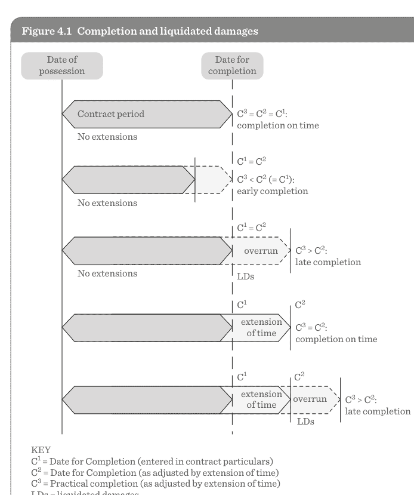

# 4 占有与完工

4.1 占有或开工日期以及工程完工日期是任何建筑合同中的关键日期，IC16 要求在合同条款中填入“占有日期”和“完工日期”。IC16 还提供分阶段进行工程的便利。如果需要，则工程必须划分为明确识别的“分部”，并为每个分部分别填写“占有日期”和“完工日期”。承包商须在占有日期占有工程，并在完工日期前完成，若未能做到可能须支付约定赔偿金。

4.2 规定了推迟占有日期和延长完工日期的安排。如果纳入补充条款 3，也可能导致完工日期的约定调整。如果工程分为分部，则开工、完工、推迟和延长方面的规定对每个分部独立适用。

4.3 在投标时向承包商提供具体日历日期而非“待商定”或“批准后八周”等模糊指示是良好做法。开工日期和工程进行的季节会影响承包商的成本，因此，若未给出明确日期，将无法准确比较投标。此外，到签署合同文件时，承包商很可能抗议现在提出的日期并非投标时所假设的日期，并可能坚持要求调整合同金额。

4.4 如果在日期未达成适当协议的情况下开工，合同将受《1982 年货物与服务供应法》或《2015 年消费者权利法》的约束，该法规定工程应在合理时间内完成。如果承包商未能在合理时间内完成，雇主将无法索取约定赔偿金，并必须证明其希望追回的任何损失。

4.5 任何指定分包商必须根据分包文件（ICSub/NAM/C cl 2.2）中约定的计划进行其工作。分包商在投标邀请中被告知其工作可开始的预期日期范围（ICSub/NAM/IT cl 9）。分包商须在其投标中提供有关计划安排要求的详细资料（ICSub/NAM/T cl 1）。这些细节包括准备图纸所需的时间、纳入任何意见所需的时间、制造和交付所需的时间、开工通知所需的时间以及在现场进行工作所需的时间。对于后者，若工程分阶段进行，可规定分别列出时间段。

### 承包商占有

4.6 工地占有是合同的基本条款。未能向承包商交付占有构成雇主的严重违约，可能构成毁约，从而使承包商有权将合同视为终止。仅交付部分工地或分阶段交付可能构成违约，除非该意图已在合同文件中明确说明（*Whittal Builders v Chester-le-Street DC*）。此类违约构成第 2.20.6 条、第 4.17.4 条和第 8.9.2 条下的“障碍”，使承包商有权索取延期、直接损失和/或费用，并在暂停的情况下终止其雇佣。

> *Whittal Builders Co. Ltd v Chester-le-Street District Council (1987) 40 BLR 82*
> 
> Whittal Builders 与议会按 JCT63 合同进行 90 套住宅的现代化工程。合同文件未提及分阶段的可能性，但议会以零散方式向承包商交付房屋。尽管此类工程经常分阶段进行，法官仍认定雇主因未在合同开始时向承包商交付全部 90 套住宅而违反合同，且承包商有权获得损害赔偿。

### 4.7

占有程度应为不得有任何干扰妨碍承包商以其选择的任何方式或顺序工作。对于大多数工程而言，这意味着承包商必须在实际完工前获得整个工地的明确占有。第 2.4 条通过规定“雇主不得在实际完工证书签发日期前占有工程的任何部分或部分”来支持这一点。若不打算明确占有，则投标文件应详细列出限制并相应修改合同。工地及雇主控制范围内的周边区域的出入也应明确，以防引发争议（见 *The Queen in Rights of Canada v Walter Cabbott Construction Ltd*）。如果雇主希望在承包商占有期间出于任何目的使用工程的任何部分，这也应在投标文件中明确说明，否则只能在承包商同意的情况下进行（cl 2.6.1）。同样，如果雇主希望承包商允许他人进入进行工作，这也应明确说明（cl 2.7.1）。

> *The Queen in Rights of Canada v Walter Cabbott Construction Ltd (1975) 21 BLR 42*
> 
> 此加拿大案例（联邦上诉法院）涉及在某工地（合同 1）建造孵化场的工程，该工地还计划进行多个与池塘相关的项目。池塘工程无法在不占用孵化场部分工地的情况下进行。池塘工程在合同 1 之前启动，导致合同 1 开始时承包商出现出入问题。法院确认（第 52 页）初审法官的观点，即“工程工地”在全新结构的情况下，必须不仅包括完工结构实际占用的土地，还包括在业主控制范围内且为有效开展工程所合理必要的周边区域。

### 4.8

如果在合同条款中说明第 2.5 条适用，则雇主可在未经承包商同意的情况下推迟工程或任何分部的占有（需注意，如果未作出正确的删除，该条款将不适用）。该条款允许推迟不超过六周；如果偏好更短的最长期限，必须在投标文件中说明并填入合同条款（cl 2.5）。当工程分为分部时，可为每个分部填写不同的最长期限。超出规定期限的任何延误均构成合同违约。

4.9 业主有权推迟交付占有，因此通知承包商的函件应由业主在合同管理员的建议下发出。虽然合同并未要求这样做，但在计划开工日期之前尽早发出是明智的。承包商有权获得工期延长（cl 2.20.3）以及损失和/或费用（cl 4.15.1），提前通知应能将损失降至最低。该条款必须严格按照条件执行，任何超出合同条款中规定的期限的延误都将构成违约。

4.10 当然，双方始终可以重新谈判任何合同的条款。因此，如果交付占有出现延误超过合同条款中规定的期限，或合同条款已说明第2.5条不适用，双方可能需要同意新的交付占有日期，通常需向承包商提供经济补偿。任何超出约定日期的进一步延误，当然将构成违约。

## 进度

4.11 通常会默示建筑合同中承包商应“有规律且勤勉地”进行施工，而这在 IC16 中是明示条款（cl 2.4）。承包商可以自行安排其工作方法和作业顺序，但须遵守合同文件、法定要求以及施工阶段计划（cl 2.1）。即使承包商选择的顺序可能导致波动条款运作时业主产生额外成本，也已被认定为如此（GLC v Cleveland Bridge and Engineering）。

> *Greater London Council v Cleveland Bridge and Engineering Co. (1986) 34 BLR 50 (CA)*
> 
> 大伦敦议会（GLC）聘请克利夫兰桥梁公司为泰晤士河防潮闸制造和安装闸门及闸臂。专门起草的合同规定了克利夫兰桥梁公司必须完成工程某些部分的日期。第51条是波动条款，允许在合同执行期间例如工资率或材料价格上涨或下跌时对合同金额进行调整。该条款还包含“前提是不得考虑因承包商的违约或疏忽而导致承包商发生的任何成本增加的金额”的表述。合同期限较长，克利夫兰桥梁公司将部分工作留到期限的最后阶段进行，但仍按时交付了闸门。结果是 GLC 必须就最后一刻完成的工作支付大量波动费用。GLC 主张承包商未能有规律且勤勉地进行施工，因此构成违约。法院裁定，即使承包商施工进度缓慢在某些情况下可能赋予业主根据终止条款终止承包商雇佣的权利，但这本身并不构成第51条所指的违约。承包商可以按其希望的任何方式组织工作，只要按时完工即可：因此其有权获得全部波动费用。

4.12 根据 IC16，承包商没有编制总进度计划的要求。当然，通过工程量清单或规范引入此类要求并无不可，但应明确说明这不会成为合同文件。如果需要，则明智的做法是在合同签订前规定承包商提交该计划。一旦工作开始，从承包商处获取进度计划 notoriously 困难——有时最终编制的进度计划可能包含事后合理化的成分，以显示早期事件导致了问题和延误。如果要求，也建议要求进行关键路径分析，因为否则很难评估延误的影响。

4.13 进度计划的一项功能是表明何时需要合同管理员提供信息，如果未使用信息发布计划，则承包商可以提交此类进度计划，即使未要求提交。同样，进度计划不具有合同约束力。应记住，即使承包商的进度计划显示有提前完工的意图，业主也没有默示义务使其能够实现该提前完工（Glenlion Construction v The Guinness Trust），特别是合同管理员提供信息的义务不会根据该进度计划进行评估。然而，如果显示提前完工，则通知业主是明智的，因为业主应注意可能比预期更早收到建筑物的可能性。

> *Glenlion Construction Ltd v The Guinness Trust (1987) 39 BLR 89*
> 
> 吉尼斯信托基金聘请 Glenlion Construction 在肯特郡布罗姆利进行住宅开发相关工程。合同采用 JCT63，要求承包商在竣工日期“之前或于当日”完工，并提供进度计划。随后出现了争议并进入仲裁，关于承包商进度计划的若干法律问题随后在法庭上提出。承包商后来以损失和费用为由提出索赔，理由是其仅因建筑师未能在所示日期提供必要的信息和指示，才无法进行经济施工并实现其进度计划中显示的提前竣工日期。法院裁定，无论 Glenlion 是否受合同约束必须编制进度计划，也无论其是否实际编制了进度计划，Glenlion 均有权在竣工日期之前完工。因此，Glenlion 有权以能够实现更早竣工日期的方式进行施工。然而，并不存在默示义务要求业主（或建筑师）履行其义务以使承包商能够按进度计划中显示的任何提前竣工日期完工。

## 竣工

4.14 在建筑合同中规定确切竣工日期的最重要原因是，它提供了在未完工情况下可支付损害赔偿的固定时间点。通常，在建筑合同中，损害赔偿为“约定”损害赔偿，通常按超期每周的费率固定。

4.15 承包商有义务在竣工日期前完成工程，一般接受可能妨碍按期完工的所有事件的风险。如果业主造成延误或以某种方式妨碍完工，则承包商可免除此义务。此外，大多数合同均包含条款，允许在因业主或中立延误事件造成的某些延误情况下调整竣工日期。当然，合同日期始终可以通过协议进行调整。

4.16 在某些合同中，必须在特定日期前完成，否则结果将毫无价值。这有时被称为“时间是合同的本质”。违反此类条款将被视为根本违约，并赋予业主终止合同履行的权利，并将其自身的所有义务视为终止。“时间是合同的本质”这一表述在 IC16 等建筑合同中几乎从不适用，因为工期延长和约定损害赔偿条款的存在意味着双方的意图并非如此。

4.17 在 IC16 中，合同条款中载入“竣工日期”，即签订合同时约定的日期。如果使用分段竣工条款，则将为每个部分分别列出日期。IC16 规定授予工期延长，并在整个文件中提及“竣工日期”，即竣工日期，或工期延长后的任何延长日期。即使大量工程被省略，也没有将合同期限缩短至早于竣工日期的条款。如果承包商未能在竣工日期前完工，则需支付约定损害赔偿金（见图 4.1）。

### 图 4.1 竣工与违约金

**图例**
- C¹ = 竣工日期（载入合同条款中）
- C² = 竣工日期（经工期延长调整后）
- C³ = 实际竣工（经工期延长调整后）
- LDs = 约定损害赔偿金

## 工期延长

### 原则
包含工期延长条款在建筑合同中的主要原因是为保护雇主在承包商因部分由雇主负责的行为导致未能按时完工时主张约定赔偿金的权利。如果没有此类条款，且延误是由雇主造成的，这实际上构成雇主违约，承包商将不再受限于按完工日期完工（*Peak Construction v McKinney Foundations*）。因此雇主将丧失约定赔偿金的权利，即使延误的很大责任在于承包商。基于同一原则，如果合同虽规定可授予工期延长，但这些条款未被执行，雇主在延误部分由其负责的情况下将无法追索损害赔偿。“工期放任”（time at large）一词常被用来描述这种情况。然而严格来说这是对该短语的误用，因为在大多数情况下，承包商仍有义务在合理时间内完工。

> *Peak Construction (Liverpool) Ltd v McKinney Foundations Ltd (1970) 1 BLR 111 (CA)*
> 
> Peak Construction 是为利物浦市政当局建造一栋多层公寓楼项目的总承包商。
> 主合同并非采用任何标准格式，而是由市政当局起草。McKinney Foundations Ltd 是被指定设计和施工桩基的分包商。桩基完工且分包商已撤离现场后，其中一根桩被发现存在严重缺陷，经进一步调查后在数根其他桩中发现了轻微缺陷。在各方就最佳补救策略进行讨论期间，工程被暂停。市政测量师未接受最初的补救建议，双方同意由一名独立工程师准备方案。市政当局拒绝事先同意接受其决定，并拖延任命。总共耗时58周工程才得以恢复（尽管补救工作仅耗时六周），总承包商就此向分包商提起损害赔偿索赔。初审的正式仲裁员裁定全部58周的延误均由指定的分包商造成，并基于市政当局向总承包商主张的部分约定赔偿金，判处分包商违约赔偿金40,000英镑。McKinney 上诉，上诉法院认为58周的延误不可能完全归因于分包商的违约，部分原因是市政当局的拖延。鉴于此，且合同中没有为市政当局造成的延误延长工期的条款，其丧失了主张约定赔偿金的权利，对分包商判处的损害赔偿中这一部分被驳回。即使合同包含此类条款，建筑师未能行使该权利也会阻止市政当局主张约定赔偿金。唯一的补救措施是市政当局证明其因违约所遭受的实际损失。

### 程序
在IC16中，授予工期延长的条款规定在第2.19和2.20条下。承包商必须立即以书面形式通知合同管理员当工程进度正在或可能被延误时。无论完工是否可能延误，无论原因如何，均须发出通知（即发出通知的要求不限于承包商主张工期延长的情形）。通知应说明延误原因，但承包商无需确定该原因是否属于第2.20条所列的“相关事件”，合同管理员签发适当工期延长的义务也不取决于承包商是否已作出此类确定。然而，承包商有义务向合同管理员提供其合理要求的任何信息（第2.19.4.2条），并在出现进一步延误时发出进一步通知（第2.19.5条）。

4.20 虽然法院尚未就IC16作出裁决，但似乎在完工日期之前，通知很可能构成授予工期延长的先决条件；换言之，除非已发出有效通知，否则合同管理员不得签发延长。无论如何，若无承包商提供的信息，很难作出评估，第2.19.4.2条明确表明工期延长的授予取决于提供合理必要的信息（相关案例为 Steria Ltd v Sigma Wireless Communications Ltd）。

### Steria Ltd v Sigma Wireless Communications Ltd (2007) 118 Con LR 177
> 本案涉及一项提供计算机辅助调度系统的分包合同，其中承包商Sigma在缺陷责任期结束时拒绝向分包商Steria支付到期尾款。Sigma 主张 Steria 延误了分包工程的完工，因此有权扣留约定赔偿金。作为回应，Steria 主张其有权获得工期延长。双方就合同中的通知条款是否构成先决条件产生争议。相关条款规定“前提是分包商应在合理期限内就导致延误的情况向承包商发出书面通知，则完工时间应延长至在所有情况下合理的时间…”。法院认为使用“provided”一词设定了明确且无条件的限制，即Steria只有在发出合规通知的情况下才有权获得延长。即使通知要求未明确警告不遵守的后果，它仍可作为先决条件发挥作用。

4.21 在发出通知后，合同管理员必须随后评估造成的延误，并在适当情况下签发工期延长。延长只能给予第2.20条所列事件造成的延误。

4.22 关于相关事件，应注意以下几点：
- 承包商在行使因雇主未支付到期款项而产生的暂停权后，有权获得延长（第2.20.5条）；
- “任何阻碍、妨碍或违约”（第2.20.6条）涵盖雇主、合同管理员、数量测量师或任何“雇主人员”可能采取的非常广泛的行为，例如，未按信息发布计划所示时间提供图纸；
- 第2.20.7条仅适用于独立运营的法定承办人。法定承办人根据与雇主的合同进行的工程属于第2.20.6条范围，而如果根据与承包商的合同进行，任何延误均由承包商承担风险；
- 天气必须异常且恶劣（即非该季节预期出现的天气，第2.20.8条）。天气的影响是在实际施工时评估，而非根据承包商计划本应施工时评估。承包商通常会提供天气记录以支持其主张；
- 指定的风险（第2.20.9条）在某些情况下可包括承包商自身过失造成的事件；
- 第2.20.10条下的民众骚乱和恐怖主义包括恐怖主义威胁以及相关当局为应对此类威胁而采取的活动；
- 关于罢工（第2.20.11条）提供了非常广泛的保护，不仅包括直接影响工程的罢工，还包括导致货物和材料准备及运输困难的罢工。此类罢工不一定局限于英国，鉴于当前海外供应链的广泛程度，其影响可能相当大。然而通常认为，2000年的燃油税封锁并非属于本条款下的事件（或事实上不构成任何其他相关事件）；
- “不可抗力”（第2.20.13条）是一个法语术语，用来指“所有独立于人的意志且不在其控制范围内的情况”。它包括不可抗力事件和其他超出各方控制范围的事项。然而，该类别下的许多事项，例如罢工、火灾和天气，已在合同其他地方处理。

4.23 关于工期延长决定的作出时间没有时限（第2.19.1条）。然而条款规定“尽快”，并且未能授予应得的延长可能导致工期放任，因此合同管理员应注意合理迅速地处理此事。将此事搁置至项目结束显然是不明智的。条款并未要求合同管理员在决定不予延长时通知承包商，但告知承包商情况是合理的。也不存在解释为何授予延长的义务。

4.24 合同管理员可在完工日期或任何延长日期之后发生的某些事件方面授予进一步的工期延长，即承包商处于“应负责任延误”状态时（Balfour Beatty v Chestermont Properties），并且必须在应予延长时授予，无论承包商是否已发出通知（第2.19.2条）。在此情况下，延长被加到已过去的日期上，称为“净”延长方法。可授予延长的事件范围小于完工日期前可授予延长的事件范围：它不包括许多中性事件，例如指定风险造成的延误，或承包商因不可控原因无法获得必要劳动力。

> *Balfour Beatty Building Ltd v Chestermont Properties Ltd (1993) 62 BLR 1*
> 
> 在一份JCT80合同中，工程未在修订后的完工日期前完工，建筑师签发了未完工证书。
> 建筑师随后签发了一系列变更指令和进一步的工期延长，其效果是将完工日期定在首项变更指令之前两个半月。他随后签发了另一份未完工证书，雇主随即扣除约定赔偿金。The

> 承包商将此事提交仲裁，随后就仲裁员作出的初步问题裁决提出上诉。法院裁定，建筑师根据第25.3.1.1条授予延期时间的权力仅适用于在原定或之前确定的竣工日期之前发生的有关事件，但根据第25.3.3条授予延期的权力适用于任何有关事件。建筑师有权追溯性地增加延期时间（称为‘net’方法）是正确的。

4.25 合同管理人可在实际竣工后最多12周内的任何时间作出进一步延期（cl 2.19.3），并可复核之前给予的任何延期。最终复核可以延长之前确定的日期，但不得提前，尽管合同管理人可能能够将工程减少或省略对另一延误事件的影响进行抵消。很明显，在此阶段，承包商没有通知义务。如果决定不再给予进一步延期，则没有通知承包商的义务，但再次这样做是合理的。

## 评估

4.26 承包商有权获得合同项下应得的延期，合同管理人在执行条款时有任何失误即构成雇主的违约。另一方面，合同管理人无权授予延期，除非合同中规定，并且仅针对第2.20条所列的有关事件造成的延误。

4.27 合同管理人应对收到的每份通知作出客观评估。其目的是确定，如果延误是由所引述事件造成的，延误是否可能扰乱进度表从而推迟最终竣工日期，如果会，则评估该最终延误的可能程度。承包商的进度表可作为指导，在进度表显示关键路径时可能特别有用，但尽管它可能是有说服力的证据，却不是决定性的或具有约束力的。对进度的影响是相对于延误事件发生时正在进行的工程进行评估，而不是相对于原计划进行的工程进行评估。

4.28 第2.19条包含重要但书，即承包商必须‘不断尽最大努力防止延误’（cl 2.19.4.1）。该但书是指防止由有关事件造成的延误，而不是防止事件本身。因此，合同管理人可以假定承包商将采取措施尽量减少延误对竣工日期的影响，例如通过重新安排剩余工程。“尽最大努力”一词似乎意味着比‘reasonable’或‘practicable’更多，但不太可能延伸到过度支出。第2.19.4.1条还规定，承包商应‘尽一切合理要求令建筑师/合同管理人满意以继续进行工程’。然而，如果合同管理人要求相当于变更的措施，则可能导致损失和/或费用索赔。还应注意，如果延误是由第2.14.1条和第2.14.2条（仅限ICD16 only）规定的违约行为造成，则不得给予承包商延期时间，即承包商建议中的错误或提交承包商设计文件延误。

4.29 任何延误对竣工的影响——考虑到承包商的‘best endeavours’——并不总是容易预测。合同管理人需要作出意见，在此过程中合同管理人对双方负有公平和合理的义务（*Sutcliffe v Thackrah*，见第7.3段）。即使延误是由合同管理人造成的，例如合同管理人未能在合同规定的时限内发出图纸时，也适用此规定。

4.30 有时会出现两个或多个延误事件同时发生或部分重叠的情况，这可能导致关于授予延期时间的问题。关于涉及两个或多个有关事件（cl 2.20）的并发延误，通常的做法是就主要事件授予延期，但这仅在主要事件开始于任何其他事件之前且结束于任何其他事件之后时才合适。即便如此，如果主要事件不是损失和费用的依据，仍可能就其他延误事件给予（*H Fairweather & Co. v Wandsworth*）。

> *H Fairweather & Co. Ltd v London Borough of Wandsworth (1987) 39 BLR 106*
> 
> Fairweather与伦敦旺兹沃斯区议会签订合同建造478套住宅。合同采用JCT63。Pipe Conduits Ltd是地下供暖工程的指定分包商。出现争议后任命了仲裁员作出临时裁决。关于裁决中产生的若干法律问题获准上诉。仲裁员认定，如果延误可归因于一个以上事件，应就主要原因授予延期。罢工是主要原因，仲裁员因此授予81周延期，并明确说明该原因不享有直接损失和/或费用索赔权。法院指出，延期时间并非授予直接损失和/或费用索赔的先决条件，承包商有权就导致延误的其他事件索赔直接损失和/或费用。

4.31 当一个重叠的延误事件是第2.20条事件而另一个不是时，换句话说，一个是雇主风险，另一个是承包商风险，就应给予何种延期时间会产生困难问题。许多评估人员的本能反应可能是‘split the difference’，鉴于双方都对延误有贡献。然而，更合乎逻辑的做法是，承包商应就有关事件造成的延误全程获得延期时间，而不论在重叠期间承包商也在造成延误这一事实。采取任何其他方法，例如将重叠期一分为二并仅授予承包商一半延期，可能导致承包商因部分由雇主造成的延误而须支付违约金。法院通常采用此分析（*Henry Boot Construction (UK) Limited v Malmaison Hotel*）。最近，在备受关注的苏格兰案件*City Inn Ltd v Shepherd Construction Ltd*中，法院表示按比例的方法会更公平。然而，该决定对英格兰法院没有约束力，且未被遵循（见*Walter Lilly & Co. Ltd v Giles Mackay & DMW Ltd*）；因此，Malmaison方法仍是正确的做法。

> *Henry Boot Construction (UK) Ltd v Malmaison Hotel (Manchester) Ltd (1999) 70 Con LR 32 (TCC)*
> 
> 雇主Malmaison聘请Henry Boot在曼彻斯特皮卡迪利建造一家新酒店。竣工日期定为1997年11月21日，但直至1998年3月13日才完成。然而，建筑师签发了延期，将竣工日期修订为1998年1月6日。Malmaison从合同价款中扣除违约金。尽管Henry Boot就若干 alleged 有关事件索赔进一步延期，但未授予进一步延期。该案进入仲裁，裁决通过法院程序受到挑战。其他事项中，法官考虑了并发问题。如果可以证明存在两个相等且并发的延误原因，雇主和承包商分别负责，则承包商仍有权获得延期。Dyson法官通过举例说明其对并发的观点：项目开工因异常恶劣天气（有关事件）被推迟一周，同时承包商也出现劳动力短缺（非有关事件）。实际上，两个延误和原因并发。在这种情况下，Dyson法官表示应授予承包商一周延期，建筑师不应以项目本会因劳动力短缺而延误为由拒绝承包商延期。

### *City Inn Ltd v Shepherd Construction Ltd [2008] CILL 2537, Outer House Court of Session*

在审理一起关于JCT80合同形式的延期时间争议案件时，法院考虑了先前的判例和延期条款的原则，并列出了若干论点。其中包括，如果存在若干延误原因且可以确定主要原因，评估人员可以使用主要原因并排除无关原因。然而，如果存在两个延误原因，其中只有一个是承包商违约，评估人员可以对两个事件之间的延误进行分摊。CILL编辑称此做法在并发问题上‘further than any recent authority’。评估人员应注意，这是一起苏格兰案件，迄今尚未被英格兰法院遵循。

### *Walter Lilly & Co. Ltd v Giles Mackay & DMW Ltd [2012] EWHC 649 (TCC)*

本案涉及在伦敦南肯辛顿为Mackay夫妇及另外两个家庭建造豪华新房的合同。合同于2004年签订，采用JCT Standard Form of Building Contract 1998 Edition并附Contractor’s Designed Portion Supplement。合同总价为£15.3 million，竣工日期为23 January 2006，违约金设定为£6,400 per day。实际竣工于August 2008获认证。承包商（Walter Lilly）发出234份延误通知和延期请求，其中不到四分之一得到答复。承包商就包括额外延期在内的事项提出索赔。法院授予延期至实际竣工日期。法院借此机会回顾了处理并发延误的方法，包括*Henry Boot Construction (UK) Ltd v Malmaison Hotel (Manchester) Ltd*一案（确立承包商有权就由两个或多个事件造成的延误获得全额延期，前提是一个事件符合合同项下的延期资格），以及苏格兰案件*City Inn Ltd v Shepherd Construction Ltd*的替代方法（其中延误在事件之间进行分摊）。法院决定前者是本案的正确方法。作为其推理的一部分，法院指出，有关条款中没有任何内容表明如果承包商部分负有责任，延期时间应予减少。

## 部分占有

4.32 雇主可通过执行第2.25条在实际竣工前占有已完成的工程部分。‘Partial possession’需要承包商同意，不得无理拒绝。为使该条款生效

合同管理员必须向承包商发出书面声明，精确说明‘相关部分’的范围以及占有日期（‘相关日期’）。此事应谨慎处理，甚至可使用图纸说明范围，并在相关情况下与保险公司沟通。声明必须在该部分被占有后立即发出，但在实践中，提前传阅图纸和信息是明智的，以便各方清楚了解将发生的情况。部分占有可能会影响现场的其他作业，在这种情况下可能构成‘障碍’，因此应警告雇主可能产生的合同后果，包括延误以及损失和/或费用索赔。

4.33 对于工程的‘相关部分’，‘视为已发生’实际完工，且该部分的修复期被视为已于相关日期开始。完工证明必须就该部分单独签发（cl 2.27）。然而，似乎该部分仍属于工程的一部分，且仍需包含在实际完工证书之下。值得注意的是，该条款并未规定该部分工程必须已达到实际完工，但在考虑到合同后果的情况下，雇主在未达到前即占有该部分是不明智的（见第4.43段）。

4.34 约定赔偿金按工程‘相关部分’价值与合同总价的比例减少（cl 2.29）。条款4.9.1的效力是就该比例的工程释放一半保留金。如果适用保险选项A、B或C2，雇主可能希望考虑为该部分投保，因为承包商投保工程的义务将终止（cl 2.28）。

4.35 需要注意的是，尽管仍有大量工程未完成，法院仍在租户实质上占有整栋建筑、允许承包商进入进行修复工程的情况下认定已对全部工程‘部分占有’（见Skanska Construction (Regions) Ltd v Anglo-Amsterdam Corporation Ltd）。如果各方不打算让条款2.25适用于整个项目，他们必须在措辞严谨的协议中明确任何拟议占有的合同后果（见下文）。

> *Skanska Construction (Regions) Ltd v Anglo-Amsterdam Corporation Ltd (2002) 84 Con LR 100*
> 
> Anglo-Amsterdam Corporation (AA) 聘请 Skanska Construction (Skanska) 根据 JCT81 承包商设计合同形式建造一座专用办公设施。条款16已被修改，规定除非证明人确信任何未完成工程‘非常微小且性质轻微且不构成建筑物有益占用的根本要素’，否则不得证明实际完工。合同表格的条款17规定，实际完工被视为在雇主占有‘工程的任何部分或各部分’之日发生。
> 
> AA 写信给 Skanska 确认拟议的租户将在完工日期开始进行建筑物的装修工程。然而，空调系统未正常运行，且 Skanska 未能提供操作和维护手册。在此日期之后，租户接管了安保和保险的责任，且 Skanska 获准进入以完成未完工程。AA 声称 Skanska 完工延误，并按每周 £20,000 的费率就约九周期间适用了约定赔偿金。Skanska 辩称建筑物已按时达到实际完工，或者，另选地，工程已发生部分占有，因此其根据条款17支付约定赔偿金的责任已终止。
> 
> 该案进入仲裁，Skanska 提出上诉。法院对该决定不满意，并认定条款17.1在占有全部工程部分时也可适用，并不限于仅占有部分或某些部分的占有。因此，法院认定工程整体的‘部分占有’事实上已在实际完工日期前约两个月发生，即 AA 同意租户开始装修工程之时。因此，尽管仍有大量工程未完成，Skanska 有权收回 AA 已扣除的约定赔偿金。

## 实际完工前的使用或占有

4.36 条款2.6规定了雇主希望在承包商仍占有期间‘使用或占有工地或工程或其部分’的情况。需要承包商的书面同意。雇主可能需要此类使用的目的仅被描述为‘储存或其他’，虽然这可能表明意图是有限的，但在理论上至少该条款对此类使用或占有的形式没有限制。在实践中，占有在某些情况下可能会对工程进展造成‘障碍’，因此构成条款2.20.6下的相关事件以及条款4.17.4下的相关事项。在占有发生之前达成合同后果的协议是明智的，除非可以确定使用或占有不太可能造成延误。在承包商被要求给予同意之前，雇主或承包商（视情况而定）必须通知保险公司。任何所需的额外保费均计入合同总价（cl 2.6.2）。

4.37 可能出现承包商未在完工日期前完工的情况，并且尽管没有任何工程部分足够完工以允许雇主根据条款2.25占有这些部分，雇主仍渴望占有至少部分工程。合同中没有任何条款允许这种情况。RIBA Journal（1992年2月）‘实践栏目’中提出了一项建议，该建议在实践中屡次证明有用（见图4.2）：作为被允许占有场所的回报，雇主同意在占有期间不索赔约定赔偿金。实际完工显然无法证明，且在实际完工前不会释放保留金。工程投保事宜需与保险公司协商解决。

4.38 由于此类安排超出了合同条款，应由双方签署的正式起草协议予以涵盖。（上述Skanska v Anglo-Amsterdam Corporation案以及Impresa Castelli v Cola案说明了起草明确协议的重要性。）此外，明智的做法可能是约定，如果承包商在约定期限结束前仍未达到实际完工，约定赔偿金将重新开始计算，可能按降低的费率。在大多数情况下，此安排对双方都有利，肯定优于签发列出‘除…外’项目的 heavily qualified 实际完工证书。

### 图4.2 ‘实践’栏目，RIBA Journal（1992年2月）

## JCT合同下实际完工前的雇主占有

在完工日期已过后，雇主希望在承包商尚未达到实际完工前即占有工程的情况并不罕见。在这种情况下，需要雇主与承包商之间达成临时协议来处理此事。关于此类协议，成员可能希望参考以下说明…

缺陷责任期直至建筑师准备的清单中提及的未完成项目完成，但自占有之日起免除承包商因延误而承担约定赔偿金的责任，并对保险安排作出必要的变更。在这种情况下，不应使用实际完工证书表格，或应修改该表格以说明或提及特别约定的安排。在作出此类安排时，建筑师应获得业主-雇主的授权。

## 未完成项目

当建筑师已知存在未完成项目时，未经雇主与承包商之间特别约定的安排，不得证明实际完工。例如，在合同完工日期已过的合同中，可以如此约定，未完工的建筑物将被接管用于占有，但须推迟保留金的释放和开始

当雇主要求过早实际完工时，需要特别谨慎，尤其是当有其他人有权依赖实际完工证书的签发及其后果时。在仅有部分工程准备好移交的情况下，可以操作部分占有条款，以使雇主在承包商同意的情况下占有已完工部分。

## Impresa Castelli SpA v Cola Holdings Ltd (2002) CLJ 45

Impresa 同意为 Cola Holdings Ltd（Cola）建造一座大型四星级酒店，采用 JCT 承包商设计建筑合同标准表格，1981年版。合同规定工程应在占有之日起19个月内完成。随着工程进展，显然1999年2月的完工日期无法实现，双方同意将完工日期推迟至1999年5月（卧室于3月提供给Cola），并将约定赔偿金条款更新为每天£10,000，而非原先的每天£5,000。协议达成后，又遇到了进一步的进度困难，这意味着1999年5月的完工日期也无法实现。双方签订了第二份变更协议，其中记录将允许Cola进入酒店的部分区域，以便在1999年9月前使其完全投入运营，尽管某些工程尚未完成（包括空调）。1999年9月，酒店的部分区域被移交，但Cola声称这些部分并未妥善完工。随后签订了第三份变更协议，规定了实际完工的新日期以及约定赔偿金的适用。

纠纷随之产生，其中Cola就约定赔偿金的权利提出索赔。Impresa 辩称其已对大部分工程取得部分占有，因此应按降低的日约定赔偿金费率支付。法院认定，尽管各

变更协议本可以使用“部分占有”一词，事实上他们却使用了“准入”一词。法院必须考虑根据合同第17.1条是否发生了部分占有，该条款规定在取得部分占有 时视为实际完工，还是可口可乐的存在仅属于合同第23.3.2条下的“使用或占用”。法院在变更协议中找不到任何表明发生了部分占有的内容。因此法院裁定所发生的情况属于合同第23.3.2条所指的使用和占用，因此约定的损害赔偿条款可予执行。

## 实际完工

4.39 合同管理人有义务在合同管理人认为符合以下两个标准时，签发工程或某一部分的实际完工证书（cl 2.21.1）：
- 工程已达到实际完工（见下文）；
- 承包商已充分遵守第3.18条（为健康与安全档案提供所需信息）。

此外，仅在IC16的情况下，承包商必须已充分遵守第2.32条（提供竣工图）。

4.40 第2.21条随后继续规定“工程或该部分的实际完工应被视为就本合同所有目的而言已于该证书所载日期发生”。尽管第2.21条的措辞有些循环，实质上说“工程或该部分的实际完工”是在“工程或该部分的实际完工”加上另一事件发生时予以证明，建议对该条款的正确分析是，只有当两个条件均满足时才发生实际完工，其主要论据是证书上只填写一个日期。该日期应为最后条件得到满足的日期；换句话说，如果在收到竣工图之前存在延迟，则其收到的日期应为证书上的日期，而不论工程在数天甚至数周前已完工的事实。

4.41 应当注意，“充分遵守”一词的使用可能允许合同管理人在缺少一些非常次要的信息的情况下酌情签发证书。然而，合同管理人应非常谨慎，避免使雇主处于违反2015年《建筑（设计与管理）条例》的情况。

4.42 判断工程何时达到实际完工往往会造成一定困难。建议实际完工是指根据合同和后续指示要求完成的全部工程。虽然已有判例认为，在存在极少量未完成工程项目的情况下，合同管理人可根据de minimis原则（H W Nevill (Sunblest) v William Press）酌情证明实际完工，但此项酌情权应极其谨慎行使。与许多承包商的意见相反，如果仍有未决事项，即使项目“基本”完工，或甚至已可供客户占用，也没有义务签发证书。

> *H W Nevill (Sunblest) Ltd v William Press & Son Ltd (1981) 20 BLR 78*
> 
> William Press与Sunblest签订合同，依据JCT63合同为一家新面包房进行基础工程、土方工程和排水工程。实际完工证书已签发，新承包商开始另行签订合同建造面包房。随后为首份合同签发了修补缺陷证书和最终证书，其后发现排水系统和硬质地面存在缺陷。William Press返回现场并纠正了缺陷，但第二份合同因此延迟了四周，Sunblest因此遭受损失。其提起诉讼，声称William Press违反合同，而在抗辩中，William Press认为原告因最终证书的conclusive效力而被禁止提出索赔。Newey法官裁定最终证书并不构成对间接损失索赔的障碍。在作出该决定时，他考虑了实际完工证书的含义和效力，并表示“我认为第15(1)条中的‘实际’一词赋予建筑师一项酌情权，即在未进行非常微小的de minimis工程的情况下证明William Press已履行其根据第21(1)条的义务，但如果William Press所做的工作存在任何显而易见的缺陷，则建筑师就不能签发实际完工证书”（第87页）。

4.43 极其谨慎行事的原因是，过早证明可能导致相当大的复杂问题。尽管雇主急于迁入新完工的工程，可能要求提前完工，而承包商急于避免损害赔偿，可能更热情，但签发证书的诱惑，特别是附带长串未决工作清单的证书，应予抵制。合同管理人应向雇主解释，他们在合同上将处于困难境地，因为以下合同问题仍未解决：
- 保留金的一半将被释放，只剩下另一半在手（cl 4.9.1）。这使雇主面临相当大的风险，因为合同条款中规定的5%中剩余的2.5%仅用于覆盖潜在缺陷；
- 修补期开始（cl 2.30）；
- 通知承包商第2.30条下所有必要未决工作的责任转移到合同管理人。如果合同管理人遗漏任何项目，承包商将无权进入现场完成——因此合同管理人不可避免地会参与管理并安排未决工作的进度；
- 现场占有现在转移给雇主，承包商将不再为工程投保；
- 承包商对损害赔偿的责任终止；
- 雇主将成为《1957年和1984年占有人责任法》目的下的“占有人”，也可能面临健康与安全索赔。

4.44 证书必须在满足第2.21条标准时立即签发。承包商有义务在完工日期“或之前”完成工程，一旦实际完工得到证明，雇主就有义务接受工程。希望仅在合同规定的日期接受工程的雇主需要修改措辞。如果使用分段完工，则必须为工程的每个部分证明实际完工。

## 实际完工时的程序

4.45 合同未规定实际完工时必须发生的事宜的程序性要求，它仅要求合同管理人予以证明。合同账单可能会规定程序，合同管理人在招标阶段应仔细检查，以确保程序令人满意。

4.46 在实际完工之前，合同管理人签发“遗留问题”清单似乎已成为普遍做法，有时非常详细，并按房间列出。合同并不要求这样做，大多数标准聘用条款也不要求这样做。根据合同，质量控制和遗留问题的责任完全由承包商承担。合同管理人承担此角色可能会协助承包商，尽管这似乎有利于雇主，但可能导致责任归属混淆，从而在未来造成问题。如果合同管理人认为工程尚未完成，无需以详细的未决项目清单来证明这一观点。建议的最佳做法可能是提请注意典型项目，但要明确该清单仅供参考，并不全面。

4.47 承包商安排“移交”会议是常见做法。该术语在IC16中未使用，尽管移交会议可能有用，特别是向雇主介绍完工项目时，安排或举行会议的事实在合同上并无意义。即使已举行会议，雇主在会上表示认可工程，或承包商书面声明工程已完工，决定何时达到实际完工仍是合同管理人的责任。

## 未按完工日期完工

4.48 如未能在完工日期前完工，合同管理人须将此事实证明为未完工证书（cl 2.22）。应注意，签发证书是合同管理人的义务，而非酌情事项。应及时签发，因为该证书是扣除损害赔偿的先决条件（cl 2.23）。如果工程分为若干部分，则每个未完工部分都需要单独的证书。一旦证书签发，承包商即被视为处于“应责延误”状态。雇主在发出必要通知的前提下，可随后从下一期中期证书中扣除损害赔偿，或将该款项作为债务追回。请注意，从此时起波动条款将被冻结。如果日后设定新的完工日期，则会取消未完工证书，合同管理人如有必要必须签发进一步的未完工证书。

## 损害赔偿

4.49 每个部分或工程的约定损害赔偿费率载于合同条款中。这通常以每延迟一周（或其他单位）的特定金额表示，由承包商在未能按完工日期完工时承担（请注意，如果工程分为若干部分，可能存在几种不同的费率）。由于最高法院的两次判决，目前不再认为

必须确保金额是基于对可能遭受损失的真实预估计算得出的（Cavendish Square Holdings v El Makdessi and ParkingEye Limited v Beavis；另见 Alfred McAlpine Capital Projects v Tilebox）。只要该金额与可能损失“不成比例”，损害赔偿即可在无需证明实际遭受损失的情况下获得追偿，无论实际损失显著低于或高于可追偿金额（BFI Group of Companies v DCB Integration Systems）。换句话说，一旦费率达成一致，双方均受其约束。当然，出于实际原因，费率在纳入投标文件之前应始终与雇主讨论，并应包含一笔金额以提供充分补偿，涵盖其中包括在此期间可能收取的任何额外专业费用。如果填入“nil”，则可能阻止雇主就任何损害提出索赔（Temloc v Errill），而如果合同条款留空，雇主可能能够索赔一般性损害。

### Cavendish Square Holdings v El Makdessi and ParkingEye Limited v Beavis, Supreme Court 2015

在本案这一里程碑案件中，最高法院重申了关于违约金条款是否可能被视为罚金的法律。判断一项规定是否具有罚金性质的关键标准是，所规定的金额与“可能证明由违约导致的最大损失”相比是否“过高或显失公平”；以及该金额是否对违约方造成损害，该损害与“守约方的任何合法利益”相比“不成比例”。在确定这些问题时，法院必须考虑更广泛的商业背景。

### Alfred McAlpine Capital Projects Ltd v Tilebox Ltd [2005] BLR 271

本案包含有关违约金与罚金区别的法律的有用总结。一份 JCT98 合同包含每周 £45,000 的违约金条款。根据案情，这是一项对损失的真实预估，而开发商 Tilebox 实际遭受的损失更高。因此承包商未能获得该条款构成罚金的宣告。法官还考虑了对事实的不同（假设性）解释，即每周总损失达到 £45,000 的可能性极小，尽管只是可以设想。在这种情况下，法官也认为该条款不构成罚金。在作出这一决定时，他考虑了损失金额难以预测、该数字是对损失的真实估算尝试、该数字在合同订立时已讨论过以及当时双方均由律师代理的事实。

### BFI Group of Companies Ltd v DCB Integration Systems Ltd [1987] CILL 348

BFI 依据《小型建筑工程协议》聘用 DCB 对其运输仓库的办公室和车间进行翻新和改建。BFI 在延长的竣工日期获得了建筑物的占有，但由于卷帘门尚未安装，其中六个车辆车位中的两个在之后六周内仍无法使用。由此产生争议并提交仲裁。仲裁员裁定完成这两个车位的延误并未导致 BFI 任何收入损失，因此 BFI 无权获得任何违约金。BFI 获准向高等法院上诉。HH Judge John Davies QC 裁定 BFI 有权获得违约金。是否实际存在损失完全无关紧要。违约金并非自雇主取得占有之日起计算，而是直至实际竣工为止，而这两者可能并非同时发生。因此，雇主已使用建筑物的事实也不相关。

### Temloc Ltd v Errill Properties Ltd (1987) 39 BLR 30 (CA)

Temloc 与 Errill Properties 签订合同，在普利茅斯附近建设一个开发项目。合同采用 JCT80，价值为 £840,000。合同条款中第 24.2 条违约金及已确定损害赔偿项下填写了“£ nil”。实际竣工比修订后的竣工日期晚约六周获证。Temloc 就部分已认证金额未支付向 Errill Properties 提起索赔，而 Errill 则反诉迟延竣工损害赔偿。法院裁定“£ nil”的效力并非应忽略该条款（因为例如它表明无法预先评估费率），而是双方已同意迟延竣工时不支付损害赔偿。第 24 条是一项穷尽性救济，涵盖通常可归因于未能按时竣工的所有损失。因此，被告不能因此诉诸违约的普通法一般损害赔偿救济。

### 4.50 在可索赔违约金之前，必须满足以下先决条件：

- 承包商必须未能在竣工日期或任何延长的日期前完成工程；
- 合同管理员必须已签发未竣工证书（cl 2.22）；
- 合同管理员必须已履行有关授予延期的一切职责（cl 2.19.2）；
- 雇主必须在最终证书日期之前向承包商发出其意图的书面通知（cl 2.23.1.2）。

### 4.51 第 2.23.1.2 条通知必须合理清晰，但无需大量细节（Finnegan v Community Housing Association）。只要这些条件已满足，雇主即可通过进一步通知“不迟于根据第 4.21 条应付金额的最终付款日期前 5 天”追回违约金（cl 2.23.1）。应发出通知取决于雇主是打算从应付款项中扣除违约金，还是要求承包商向雇主支付该款项（cl 2.23.2）。如果雇主希望将该金额作为债务追回，则必须按照第 2.23.2.1 条的规定通知。如果雇主希望从证书项下应付金额中扣除违约金，则需要发出第 2.23.2.2 条通知。除此通知外，第 2.23.2.2 条脚注 [38]（ICD16 中为 [40]）规定雇主必须根据第 4.12.5 条发出适当的“付款减少通知”。尽管付款减少通知似乎在一定程度上重复了第 2.23.2.2 条通知，因为如果措辞正确，一份文件可以涵盖两项条款，但最好严格遵循脚注并发出两份分别严格符合各自条款的单独通知。

### JF Finnegan Ltd v Community Housing Association Ltd (1995) 77 BLR 22 (CA)

Finnegan Ltd 受住房协会雇佣，在西伦敦 Coram Street 建造 18 套公寓。承包商未能按时完成工程，合同管理员签发了未竣工证书。在实际竣工证书之后，签发了中期证书。雇主随兑现证书的支票发出通知，其中提供的信息极少（即未说明违约金及已确定损害赔偿（LADs）如何计算）。上诉法院认为这足以满足第 24.2.1 条对雇主书面通知的要求。Peter Gibson LJ 指出（第 33 页）：

> 我认为书面要求中必须包含的事项只有两项。一项是雇主是否就 LADs 要求付款或扣除。另一项是该要求是否涉及 LADs 金额的全部或部分（如果是部分，则为哪一部分）。

他随后指出（第 35 页）：

> 我不愿将技术性要求引入该商业协议中，这些要求可能 desirable 但并非条款用语所要求且并非绝对必要。

有关通知的要求现已更改。然而，似乎没有理由认为一般性评论不再适用，即所需信息量不会超过合同条款中规定的最低限度。

### 4.52 如果在签发未竣工证书后授予延期，则该证书将被取消。如果承包商随后未能在新的竣工日期前完成，则必须签发新的未竣工证书（cl 2.22）。雇主必须在必要时退还已就截至新竣工日期期间追回的任何违约金（cl 2.24），并且必须在合理时间内退还（Reinwood v L Brown & Sons）。第 2.23.3 条还规定，雇主根据第 2.23.1.2 条发出的任何通知仍然有效，除非雇主另行书面说明，即使已授予进一步延期。尽管如此，建议如果意图是扣留应付款项且扣除被推迟至稍后证书，则应发出新的通知。

### Reinwood Ltd v L Brown & Sons Ltd [2007] BLR 305 (CA)

本争议涉及一份 JCT98 合同，竣工日期为 2004 年 10 月 18 日，LADs 费率为每周 £13,000。项目延误，2005 年 12 月 7 日，承包商提出延期申请。2005 年 12 月 14 日，合同管理员根据第 24.1 条签发了未竣工证书。2006 年 1 月 11 日，合同管理员签发了第 29 号中期证书，显示应付净额为 £187,988。最终付款日期为 2006 年 1 月 25 日。

2006 年 1 月 17 日，雇主根据第 24.2 条和第 30.1.1.3 条发出通知，表示其意图扣留 £61,629 的 LADs，雇主于 2006 年 1 月 20 日如期支付 £126,359。

2006 年 1 月 23 日，合同管理员授予延期至 2006 年 1 月 10 日，之后承包商致函雇主称延期的效力

关于延期及完工日期的修订，雇主现在有权扣留的金额不得超过 £12,326。因此，第 29 号中期证书项下的应付金额为 £175,662。其后，承包商部分基于雇主迟延偿还余额而终止合同。

上诉围绕以下问题进行：非完工证书因授予延期而被取消是否意味着雇主不再能为扣减 LADs 提供正当理由。雇主的上诉获准。法官指出“如果在雇主发出扣减意向通知时，从付款证书中扣减 LADs 的条件已满足，则雇主有权扣减通知中规定的 LADs 金额，即使非完工证书随后因授予延期而被取消。”然而，雇主必须在合理时间内偿还多扣的金额。

4.53 在 *北爱尔兰环境部诉法兰斯案* 中裁定，承包商有权就已偿还的违约金获得利息。然而，该裁决涉及 JCT63，且鉴于 IC16 明确提及偿还但未规定应付利息，似乎在这种情况下不应支付利息。这一观点由卡尔法官阁下在 *芬尼根诉社区住房协会案*（1993）65 BLR 103（第 114 页）的初审判决中采纳。

### *北爱尔兰环境部诉法兰斯（建筑）有限公司案* (1982) 19 BLR 1 (NI)

Farrans 受雇于 JCT63 下建造一栋办公楼。原定完工日期为 1975 年 5 月 24 日，但随后延期至 1977 年 11 月 3 日。在合同履行期间，建筑师签发了四份非完工证书。截至 1977 年 7 月 18 日，雇主已扣减 £197,000 的违约金，但在第二份非完工证书之后，已偿还其中 £77,900 的扣减款。此后在签发后续非完工证书后重复了该过程。Farrans 在北爱尔兰高等法院提起诉讼，要求就随后已偿还的款项支付利息。法院裁定承包商胜诉，称雇主基于第一、第二和第三份证书扣减款项构成违约，因此承包商有权获得利息。应注意 BLR 评论，其质疑根据第 24.2 条授权的违约金扣减是否可被视为追溯性违约。然而，该案尚未被推翻。

4.54 证书应始终显示应付承包商的全部金额。扣减违约金仅由雇主作出。雇主不会因未从首份或任何可合法扣减的证书中扣减损害赔偿而被视为放弃其索赔，并且始终可在最终证书之前任何时间将其作为债务追回。
