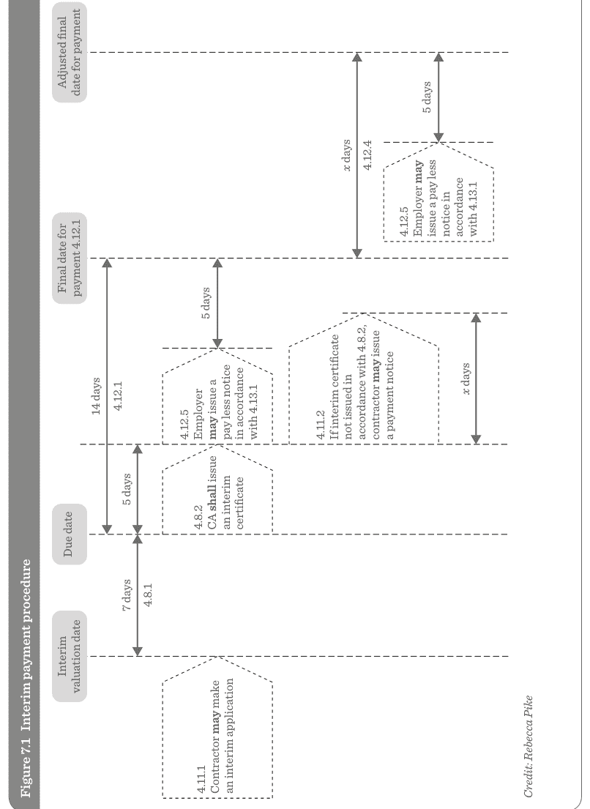
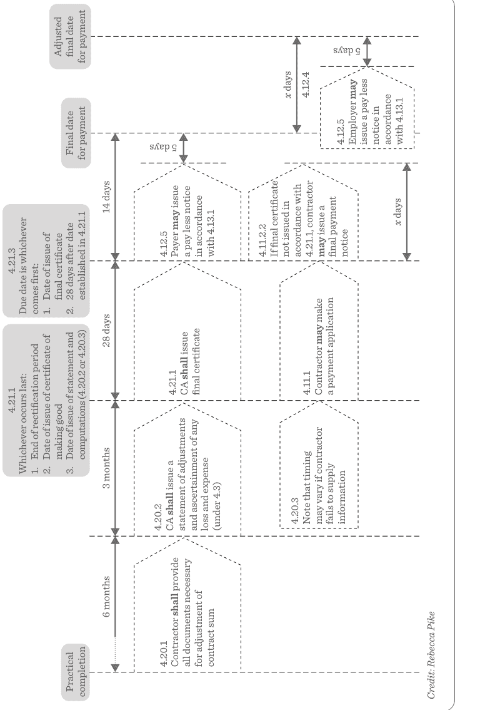

# 7 认证

7.1 IC16 下合同管理员最重要的职责之一是签发付款证书。若未能以合理的谨慎程度履行此职责，将使雇主面临相当大的风险。承包商在合同履行期间破产的情况并不罕见，如果证书被高估，雇主可能会遭受本可避免的损失。

7.2 另一方面，承包商有权获得合同条款规定应支付的款项，而通过《住房补助、建筑和再生法》（HGCRA）1996 年引入的规定部分原因就是雇主无正当理由扣留付款的情况屡见不鲜。因此，合同管理员必须公平地执行这些规定，不得受雇主试图延迟认证或减少所示金额以适应其自身经济状况的任何企图的影响。

7.3 从著名的 Sutcliffe v Thackrah 案可以很清楚地看出，未能正确认证可能构成对雇主的违约。至于合同管理员对承包商的注意义务，其立场则不太明确。在 Michael Salliss & Co. v Calil and W F Newman & Associates（1987）13 Con LR 69 案中，认证人被认定对承包商承担责任。尽管此案似乎在 Pacific Associates Inc. v Baxter（1988）44 BLR 33（CA）案中被超越，但后者涉及非标准条款，如果这些条款不存在，可能对结果产生重大影响。

> **Sutcliffe v Thackrah (1974) 4 BLR 16 (CA)**
> 
> 一位建筑师就建造一栋住宅的合同签发了证书。承包商的雇佣关系因正当理由而终止，随后承包商被宣布破产。随后发现， interim 证书中包含的大量工程存在缺陷，建筑师被认定存在过失。在上议院审议建筑师的角色时，Lord Reid 指出（第 21 页）：
> 
> > 在建筑合同的执行过程中，可能会出现许多需要作出决定的事项，这些决定会影响承包商获得的款项数额。建筑物所有者和承包商订立合同时的理解是，在所有此类事项中，建筑师将以公平和公正的方式行事，因此业主与建筑师的合同中必须隐含着建筑师不仅应尽到应有的注意和技能，而且还应公平地作出此类决定，在其客户和承包商之间保持平衡。

7.4 IC16 中的付款条款符合《住房补助、建筑和再生法》（HGCRA）1996 年第二部分，并经《地方民主、经济开发和建筑法》（LDEDCA）2009 年修订。其结果是一套相当复杂的付款条款，在某些方面可能与此前相对简单的形式不成比例。尽管如此，1996 年法案的规定当然对该法适用的所有合同具有强制性，且在未征求专家意见的情况下不应修改其余条款。简而言之，中期付款通常在签发中期证书后进行，并设有条款确保即使未签发证书承包商也能获得付款。承包商可通过中期申请提交其对证书应涵盖内容的意见，但估价由合同管理员决定。如果未签发证书且已提出申请，则申请中载明的金额将成为到期应付金额。或者，如果未签发证书且未提出申请，在证书签发日期届满后，承包商可发出付款通知。该通知中所示金额将成为应付款项。

### 预付款

7.5 IC16 包括向主承包商预付款的可选条款。必须在合同特定条款中作出记录以显示是否适用（cl 4.7）。如果适用，金额将以固定金额或合同价款的百分比形式填入。该记录还必须显示向承包商付款的时间以及向雇主偿还的时间。可能需要提供保函，在这种情况下，只有在承包商提供保函后才付款（IC16 在附表 3 第 1 部分包含预付款保函格式）。

7.6 即使有保函支持，就建筑合同而言，预付款始终存在风险，且该程序不可避免地会给雇主带来额外费用。雇主在同意此类安排之前，应非常清楚将获得何种补偿性利益，例如合同价款的减少。最终，这是雇主的决定，但合同管理员可能需要解释条款并提供初步建议。

### 中期证书 – 时间

7.7 每次中期付款的到期日为相关“Interim Valuation Date”后七天（cl 4.8.1）。合同特定条款要求各方填入首次中期估价日，如果未填入，则为占有日起一个月。后续中期估价日为每月同一日期，或最近的非星期六、星期日或银行假日的日期。合同管理员必须在每次到期日起五天内签发中期证书（cl 4.8.2）且付款必须在到期日起 14 天内完成（cl 4.12.1）。其效果是，除非证书实际在到期日签发，否则雇主的付款期限会缩短。下面讨论的其他时间期限也与到期日相关，而非证书签发日期。证书签发给雇主，并向承包商发送副本（cl 1.8）。

### 估价及应付金额的确定

7.8 应付承包商的中期付款金额应按照第 4.9 条的规定计算。其评估有两种方法：一种是通过接受

承包商付款申请中所述金额，或通过数量测量师的估价（见图7.1）。后者传统上一直是根据JCT格式评估付款的基础。

7.9 第4.11.1条赋予承包商提交中期证书价值自行评估的权利。‘付款申请’必须不迟于相关估价日期提出，并应直接发送给数量测量师（而非通过合同管理员）。随后数量测量师可以同意或不同意该估价。数量测量师没有义务指出任何差异产生的原因或通知承包商；然而，实践中数量测量师可能会对申请作出回应。合同管理员应要求数量测量师转发所有通信的副本，并就申请事项向合同管理员保持通报。

7.10 无论是否收到中期申请，数量测量师通常会在到期日前进行估价（估价是确定承包商申请是否正确所必需的）。估价应涵盖中期估价日期到期的金额（cl 4.9）。数量测量师的估价可在‘ whenever the Architect/Contract Administrator considers them necessary’进行（cl 4.8.3）。然而，数量测量师和合同管理员的角色截然不同，最终由合同管理员决定证书上应列示的金额。

## 证书的涵盖范围

7.11 第4.8.2条要求中期证书不仅说明合同管理员‘considers to be or have been due to the Contractor at the due date’的款项，还说明‘the basis on which that sum has been calculated’。此处不太需要大量细节；一份简短的清单可能已足够。最终证书也包含类似规定。

7.12 应付金额的计算依据载于第4.9条。实质上，这包括一份包含项目，分为第4.9.1条和第4.9.2条下的两组，以及一份载于第4.9.3条的扣除项目清单。第4.9.1条规定的包含项目可概括为以下项目的总额的95%（或合同具体条款中规定的其他比例）：
- 妥善执行的工程总价值（cl 4.9.1.1）；
- 现场妥善放置的材料和货物总价值（cl 4.9.1.2）；
- 场外材料、货物或物品的价值，前提是它们为‘Listed Items’（cl 4.9.1.3和4.10）。

7.13 上述金额应根据适用的波动条款进行调整（cl 4.9.1）。工程价值将使用账单或计价文件中所示的费率计算，以适用者为准。如果包含计价活动清单，则中期证书中就活动清单所列任何项目所包含的金额，应为将妥善执行工程的百分比乘以活动清单中所示该工程价格所得金额的总和（cl 4.9.1）。

7.14 除上述外，估价还应包括以下项目的100%总额（如适用）（cl 4.9.2）：
- 费用和收费（cl 2.3）；
- 检查和测试（cl 3.14和3.15.3）；
- 承包商暂停权–成本和费用（cl 4.14）；
- 波动–指定分包商（clause 4.4）；
- 波动（第4.9.1条以外）；
- 损失和费用（cl 4.15）；
- 保险费（cl 2.6、6.5、6.10、6.11、6.12.2和6.18）；
- 修复损坏工程的款项（保险选项B或C，cl 6.13.5.3和cl 6.13.4）。

7.15 在得出总额之前，第4.9.3条要求在适用情况下作出若干扣除，即可在下列条款下扣除的任何金额：
- 第2.9条（设置错误）；
- 第2.30条（同意不予修补的缺陷）；
- 第3.9条（雇主因未遵守指示而产生的费用）；
- 第4.4条（波动–指定分包商）
- 第6.10.2条（恐怖主义保障）；
- 第6.12.2条（承包商保险违约）或第6.17.2条（联合消防规范）（cl 4.9.3）；
- 承包商就任何未根据第4.9.1条调整的适用波动而允许的金额。

7.16 第4.9条规定，上述估价评估‘subject to any agreement between the Parties as to stage payments’。IC16中（指南IC/G中亦然）未对分期付款作出其他提及。这与DB16形成对比，DB16在第4.12条中规定了使用分期付款的替代制度。在分期付款制度下，承包商在阶段完成前不会就该阶段获得任何付款（与‘activity schedule’制度不同，后者即使活动未完成也会按比例付款）。如果各方希望采用分期付款制度，他们需要在事先就其运作方式达成明确协议，并在合同中纳入适当条款——DB16中的程序可作为范例。

## 妥善执行的工程价值

7.17 合同管理员应在以合理勤勉标准进行检查后方可签发证书。合同管理员不应包含任何似乎未妥善执行的工程，无论其是否即将得到补救或保留金是否足以覆盖补救工作（Townsend v Stone Toms和Sutcliffe v Chippendale & Edmondson）。合同管理员还应注意Dhamija v Sunningdale Joineries Ltd一案，该案指出数量测量师不负责确定已执行工程的质量。如有疑问，合同管理员可进行或要求测试（cl 3.14）。然而，IC16明确指出中期证书并非工程符合合同的决定性证据（cl 1.10）。

## Townsend v Stone Toms & Partners (1984) 27 BLR 26 (CA)

汤森德先生聘请Stone Toms担任索美塞特郡一座农舍翻新工程的建筑师。John Laing Construction Ltd受雇按JCT67固定费用形式的主成本合同进行工程。在缺陷责任期结束后，建筑师签发了一份中期证书，其中包括已列入缺陷清单且建筑师明知尚未纠正的工程价值。汤森德先生对Stone Toms和Laing均提起诉讼。Laing向法院支付了£30,000，该款项被汤森德先生接受为全部及最终和解。汤森德先生随后继续对建筑师提起诉讼，主张他有权追回若继续对Laing提起诉讼本可获得的任何超出部分。官方仲裁员评估对Laing的索赔总额仅为£25,000，因此无超出部分可追回。副官方仲裁员还认定建筑师签发中期证书并不存在过失。汤森德先生提出上诉，上诉法院虽然认可下级法院关于向法院付款效力的决定，但裁定建筑师存在过失。Oliver LJ指出（第46页）：

> the whole purpose of the certification is to protect the client from paying to the builder more than the proper value of the work done, less proper retention, before it is due. If the architect deliberately over-certifies work which he knows has not been done properly, this seems to be a clear breach of his contractual duty, and whether certification is described as ‘negligent’ or ‘deliberate’ is immaterial.

## Sutcliffe v Chippendale & Edmondson (1971) 18 BLR 149

(Note: this case is the first instance decision which was appealed to the Court of Appeal sub nom. Sutcliffe v Thackrah, discussed at paragraph 7.3.)

苏特克利夫先生聘请建筑师Chippendale & Edmondson负责建造一栋新房的项目。双方未就聘用条款达成一致，但建筑师仍继续设计房屋、邀请投标并安排按JCT63聘用承包商。工程进展缓慢，且接近尾声时明显许多工程存在缺陷。在苏特克利夫先生完全失去信心、解雇建筑师并将承包商赶离现场之前，建筑师已签发了十份中期证书。此后他委托另一承包商和其他顾问以约£7,000的费用完成工程，除此之外，由于原承包商已对其取得判决，他还被迫全额支付全部十份证书。由于该承包商随后被宣告破产，苏特克利夫先生对建筑师提起索赔。建筑师主张，其中包括其监督职责不延伸至通知数量测量师应从估价中排除的缺陷工程。His Honour Judge Stabb QC裁定苏特克利夫先生胜诉，指出‘I do not accept that the words “work properly executed” can include work not then properly executed but which it is expected, however confidently, the Contractor will remedy in due course’（第166页）。

## *Dhamija and another v Sunningdale Joineries Ltd and others [2010] EWHC 2396 (TCC)*

原告因其住宅设计和施工中 alleged 的缺陷，对建筑承包商、建筑师以及数量测量师（McBains）提起诉讼。与数量测量师之间既无书面合同也无口头合同，但原告主张存在一项默示条款，即数量测量师仅对承包商已妥善完成且明显无缺陷的工作进行估价。法院裁定，数量测量师的聘用条款中包含一项默示条款，即在为中期证书目的估价工程时，数量测量师应以普通胜任和经验的数量测量师的合理技能和谨慎行事。然而，法官裁定数量测量师并无默示义务在估价中排除缺陷工程的价值，即使缺陷再明显。这项责任专属于合同项下指定的建筑师。此外，数量测量师也无默示义务向建筑师报告缺陷的存在。

7.18 已列入证书的工作若随后被证明存在缺陷，其价值可在下一张证书中予以省略。然而，合同似乎并不允许出具“负数”证书，即由承包商偿还。不同于最终付款条款（cl 4.21.2），条款 4.8 仅提及“雇主付款”，而 4.9.1 仅提及应付承包商的款项。此外，条款 4.12.5 明确假定只有在最终证书方面才可能存在应付雇主的余额。综合来看，似乎不太可能将合同解释为允许负数付款。如果出现此类情况，寻求法律建议可能是明智的，特别是当金额较大时。

7.19 工程价值将根据计价文件所示的费率计算，任何因变更产生的工作按估价规则所列方式估价。如果包含计价活动清单，则中期证书中就活动清单所列任何项目所包含的金额，应为按已妥善完成的工作百分比乘以活动清单所示该工作的价格所得金额的总和。然而，使用活动清单并不减轻合同管理员确定所有已认证工作均已按照合同执行之义务。

## 未固定的材料

7.20 中期证书应包括已运至现场但尚未纳入工程的材料（cl 4.9.1.2）。尽管有旨在保护雇主的详细规定，纳入这些项目仍存在一定风险。一旦材料被建入，根据普通法，它们通常会成为土地所有者的财产，无论承包商是否已为其付款。即使与分包商或供应商的合同中存在保留所有权条款，也会如此。保留所有权条款是指规定所售货物在未付清价款前不成为买方财产的条款，即使货物已由买方占有。

7.21 然而，如果材料尚未建入，即使材料已获认证并已付款，雇主仍可能面临风险。承包商可能因材料买卖合同中的保留所有权条款而实际上并不拥有已付款的材料。根据《1979年货物销售法》第16至19条，货物所有权通常在买方占有货物时转移，但保留所有权条款在供应商与承包商之间仍然有效，即使承包商已为货物付款，只要货物尚未建入即可。然而应注意，雇主可能通过该法第25条的适用获得一定保护，该条在某些情况下允许雇主将承包商视为有权转让货物所有权，即使事实上并非如此（参见 Archivent v Strathclyde Regional Council）。

> *Archivent Sales & Developments Ltd v Strathclyde Regional Council (1984) 27 BLR 98 (Court of Session, Outer House)*
> 
> Archivent 同意向为 Strathclyde 地区委员会建造一所小学的承包商出售若干通风器。买卖合同包括条款“在公司收到全额价款之前，公司供应的货物所有权不转移给客户”。通风器被交付并列入根据主合同（JCT63）出具的证书中，该证书已获付款。承包商在支付 Archivent 之前进入接管程序，Archivent 随后向委员会索回通风器或其价值的款项。委员会主张《1979年货物销售法》第25(1)条使其拥有无可置疑的所有权。法官裁定委员会胜诉。尽管分包合同中的条款成功保留了分包商的所有权，但雇主仍有权享有《1979年货物销售法》第25(1)条的利益。承包商占有通风器并拥有表面上的权力将其所有权转让给雇主，而雇主是善意购买者。

7.22 与合法所有权有关的另一风险是承包商未能向已购买材料的国内分包商付款，而分包商主张对未固定材料的拥有权。此处的风险可能更高，因为工作与材料合同不受《1979年货物销售法》管辖。因此不能假定所有权随占有而转移。

7.23 IC16 以多种方式尝试处理与所有权相关的问题。首先，已运至现场并拟用于工程的未固定材料和货物，未经合同管理员书面同意不得移除（cl 2.17）。移除即构成违约，因此雇主可就未经授权移除所遭受的损失向承包商索赔。即使材料或货物尚未列入任何证书，此规定同样适用。其次，无论在现场或场外，已列入已付款证书的未固定材料和货物应成为雇主的财产（cl 2.17），承包商因此不得对所有权提出异议。

7.24 然而，主合同的条款 2.17 仅在合同双方之间具有约束力，并不对任何分包商施加义务。雇主面临的风险是，如果承包商破产，分包商或供应商仍可能对未固定的货物主张合法所有权，即使雇主已为其付款（参见 Dawber Williamson Roofing v Humberside County Council）。因此主合同要求所有分包合同均包含与 2.17 类似的条款，关于不得从现场移除以及付款时所有权转移（cl 3.6.2.1）。分包合同必须包括一项条款，规定一旦材料和货物根据主合同获得认证并付款后即成为雇主财产，且分包商“不得否认”此点（cl 3.6.2.1.1，等同规定包含于 ICSub/NAM/C 第 2.11 条）。即使总承包商已破产，该规定亦适用。即使如此，在某些情况下仍可能无法保护雇主，因为如果分包商不具有“良好所有权”，其就无法转让。因此，例如，它可能无法阻止分包商的分包商主张所有权。

> *Dawber Williamson Roofing Ltd v Humberside County Council (1979) 14 BLR 70*
> 
> 原告与 Taylor and Coulbeck Ltd（T&C）签订分包合同，供应并安装屋面石板。被告与总承包商的合同采用 JCT63。根据其分包合同（采用 DOM/1）的第1条，原告被视为已获悉主合同所有条款的通知，但合同中并无关于所有权何时转移的其他规定。原告将16吨屋面石板运至现场，并列入中期证书中，被告已付款。随后 T&C 在未向分包商付款的情况下进入清算，分包商遂提起索赔，要求支付款项或退还石板。法官允许该索赔，裁定 JCT63 第14条仅在总承包商拥有良好所有权时才能转移财产。（与上述引用的 Archivent 案的区别在于，本案的分包合同为工作与材料合同，不适用《1979年货物销售法》。）

7.25 根据 IC16 条款，合同管理员有义务将未固定材料列入中期证书，即使雇主仍面临此有限风险，前提是材料未提前交付且得到妥善保护。合同管理员应仔细注意该条件（cl 4.9.1.2）的确切措辞。

## ‘列明项目’

7.26 中期证书可能就任何“列明项目”包括金额（cl 4.9.1.3）。若要适用本规定，则清单必须附于承包商投标的工程量清单（或规范/工程进度表）中。只要满足某些先决条件，任何列明项目的价值必须在项目运至现场前列入中期证书：
- 列明项目符合合同（cl 4.10.1）；
- 承包商已提供合理证明证明其拥有该财产（cl 4.10.2.1）；
- 承包商提供证明项目已针对指定风险投保，直至运至现场（cl 4.10.2.2）；
- 列明项目已被“另行存放”或清晰标记并识别（cl 4.10.3）；
- 如果项目未“唯一识别”，或合同细则要求，承包商已提供保函（cl 4.10.4、cl 4.10.5 及附表3第2部分）。

7.27 合同管理员无权酌情认证任何场外项目，除已列明者外。这使双方的立场明确，即仅“列明”的场外材料方可认证。一经认证，这些项目即成为雇主的财产，即使它们在场外（cl 2.18）。因此，合同管理员应谨慎避免在任何证书中列入未列明的场外材料，因为只有列明项目才受条款 2.18 关于雇主所有权及损失或损坏责任的保障所覆盖。

## 因暂停而产生的费用和开支

条款 4.14.2 规定 '当承包商根据条款 4.14.1 行使其暂停权时，他有权获得因行使该权利而合理产生的费用和开支的合理金额'。这些金额也应计入中期估价。短语“费用和开支”源自 LDEDCA 2009，表明其范围比根据条款 4.15 损失和/或费用索赔可主张的损失范围更为有限，例如仅限于“直接且可确定的成本”。然而，有效的暂停是由于雇主违约造成的，对于此承包商可在普通法下索赔损害赔偿，因此合同管理员不将本条款解释得过于严格可能是明智的。

## 应付金额

在计算出条款 4.9.1 中的项目加上条款 4.9.2 中的项目，再减去条款 4.9.3 中的项目后，在得出应付金额之前还需要进行一些进一步调整，即扣除应退还的任何预付款金额，以及已认证的任何前期金额（cl 4.9）。该计算的结果即为中期付款证书上所示的应付金额。

## 保留金

必须计入总估价的某些项目须按 5% 减少（cl 4.9.1）。如果需要 5% 的替代比例，则应在合同具体条款中注明。扣留金额的一半在实际完工时释放，剩余一半随最终证书释放。该金额通常被称为“保留金”，尽管 IC16 未使用此术语。与 SBC16 不同，本合同不包括使用承包商提供的债券代替保留金作为雇主替代担保的选项。如果偏好此选项，则需要在招标阶段明确说明并对合同进行修改。

雇主，如果不是地方或公共机构，则为承包商持有被扣留的保留金之受托人（cl 4.13.3），但没有义务为承包商投资该款项，并可享有产生的任何利息利益。雇主有权从保留金中扣除承包商所欠的任何款项，包括因抵销权而到期支付的款项。

尽管 IC16 没有规定要求雇主将扣留的比例存入单独的银行账户，但一系列案例已确立，在要求雇主作为受托人持有资金的任何合同中，均会默示此类义务（参见 Rayack v Lampeter、Wates Construction v Franthom Property 和 Finnegan v Ford Sellar Morris）。然而，在雇主破产后，法院不会下令将资金存入单独账户（参见 Mac-Jordan Construction v Brookmount Erostin）。承包商除无担保债权人之外的任何特殊索赔权。为安全起见，承包商必须在雇主仍具偿付能力时坚持将资金存入单独账户。关于保留金及受托人地位有效性的这一困境，引发了分别由雇主和承包商提供的债券和担保债券作为替代方案的问题。

### Rayack Construction Ltd v Lampeter Meat Co. Ltd (1979) 12 BLR 30

Rayack Construction 同意在其工厂为 Lampeter Meat Company 建造两座肉类加工厂。该合同是 JCT63 的修改版本，要求在证书日期后 90 天内支付已认证金额，并允许雇主扣除 50% 的保留金。合同还包含一条与条款 4.13.3 相似的条款，规定雇主对保留金的权益为受托人对承包商的信托性质，但未包含要求将保留金存入单独银行账户的规定。法院尽管如此仍裁定，雇主有义务将该基金存入单独账户。否则该条款将无实际适用性，因为它无法保护承包商免受雇主破产的后果。

### Wates Construction (London) Ltd v Franthom Property Ltd (1991) 53 BLR 23 (CA)

Wates 与 Franthom 根据 JCT80 签订合同，在肯特建造一家酒店。条款 30.5.3（要求 Franthom 将保留金存入单独账户）已被删除，但除此之外，保留金条款在所有实质性方面与 IC16 中的条款相同。尽管 Wates 要求如此，Frantom 拒绝将约 £84,000 的累积保留金存入单独账户。Wates 随后提起法律诉讼。Newey 法官命令 Franthom 将资金存入单独账户，Frantom 随后提出上诉。法院驳回上诉，称“如果不设立单独银行账户，则需要明确的明示规定”。该条款被删除这一事实本身并不能表明各方的意图；其效果与该文字从未存在过相同。

### J F Finnegan Ltd v Ford Sellar Morris Developments Ltd (1991) 53 BLR 38

Finnegan 是 Ashford 工程 JCT81 合同的承包商。工程达到实际完工后，雇主就承包商承认应付的约 £20,000 的款项主张约 £60,000 的违约金。根据条款 30.4.2.2，如果承包商要求，雇主有义务将扣除的保留金存入单独账户。Finnegan 提起诉讼以追回到期款项。雇主反诉违约金，Finnegan 随后要求将保留金存入单独账户。雇主拒绝，Finnegan 申请禁令。法官尽管是在实际完工很久之后仍批准了禁令。合同并未要求每次扣除保留金时提出请求，也未要求在扣除时提出请求。

### Mac-Jordan Construction Ltd v Brookmount Erostin Ltd (1991) 56 BLR 1

一名开发商为承包商持有超过 £100,000 的保留金，但同时也欠银行巨额债务（由抵押担保的浮动贷款）。开发商进入破产，银行任命了行政接管人。承包商随后寻求法院禁令以设立单独保留金基金，但上诉法院以此将给予无担保债权人（承包商）优先于破产债务人其他无担保债权人的理由拒绝。承包商对保留金的权利被说明为“对金钱支付的不清偿且无担保的合同权利”不止于此（Scott LJ 第 15 页）。

## 预付款和债券

如果各方选择使用预付款条款，则合同具体条款中指明的付款在首张付款证书到期签发前支付给承包商，但仅在承包商提供所需债券后（cl 4.7）。付款直接由雇主支付给承包商，合同管理员应确保收到有关此事的任何 correspondence 的副本。偿还时间安排也将在合同具体条款中列出，例如可在项目期间分阶段进行，且偿还额从相关证书下的估价中扣除。需注意，每月应扣除的金额应为偿还额的累计总额，最终扣除额应等于原始预付款，且该最终扣除额应出现在所有后续证书中，包括最终证书。

## 增值税

合同金额不含任何增值税（cl 4.5.1），雇主有义务向承包商支付任何应缴增值税。如果在基准日后向雇主提供的任何供应变为免税，则雇主可能需要向承包商偿还其已支付但无法收回的进项税额（cl 4.5.2）。如同 IC11，本表格不包含有关增值税的详细规定，因此如果需要特定安排，则需另行起草协议。

## 付款程序

每张中期证书的最终付款日期为其到期日起 14 天（cl 4.12.1）。由于时间从到期日起算，而非证书日期，如果证书晚于到期日签发，则付款所需时间将缩短（参见图 7.1）。付款应在最终付款日期前到达承包商，因此应考虑邮寄时间。

如果雇主打算从已认证金额中扣留任何款项，则必须在最终付款日期前不少于五天以“付款减少通知”的形式书面通知承包商（cl 4.12.5）。付款减少通知应由雇主签发，除非雇主已通知承包商合同管理员、数量测量师或其他人员获授权代表其签发通知（cl 4.13.1.1）。付款减少通知应载明雇主认为在通知发出之日应付给承包商的金额以及“该金额的计算依据”（cl 4.13.1）。如果发出付款减少通知，雇主必须在最终付款日期前至少向承包商支付该通知中载明的金额（cl 4.12.5）。

## 未签发证书时的付款

合同包含在到期日过后仍未提供中期证书时的补救措施。如果承包商尚未提交付款申请，其可在签发日期过后任何时间向数量测量师发送付款通知（cl 4.11.2.2）。通知应载明金额为

### 图7.1 中期付款程序

承包商‘认为在根据第4.8条或第4.21.3条确定的相关到期日应付给他，以及该款项的计算依据’（cl 4.11.2.2）。通知上显示的款项将成为应付金额。在承包商已提交付款申请的情况下，无需采取进一步行动，因为该申请将被视为付款通知（cl 4.11.2.1）。应注意的是，在未签发中期证书的情况下，发包人不得在承包商提交付款通知之前签发少付通知（cl 4.13.1.1；即其不能将少付通知用作缺失证书的替代品）。

7.38 在发出付款通知时，第4.12.4条规定‘其中指定的款项的最终付款日期在所有目的上应被视为推迟，与付款证书的最后签发日期之后付款通知发出的天数相同’。这最好通过示例来理解：如果付款通知是在证书最后签发日期之后六天发出（即在到期日之后总共11天），则最终付款日期将为到期日之后20天（即14天加6天）。如果发包人不同意付款通知上显示的金额，则必须发出如上所述的少付通知（在本例中，将在通知后四天内）。

## 使用少付通知进行扣减

7.39 少付通知最常见的用途是进行违约金扣减（cl 2.23.2）。然而，它也可能在其他情况下使用，例如纠正算术错误或与第4.9条扣减有关，但前提是这些扣减尚未根据证书要求得到核算。

7.40 此外，在某些情况下，发包人可能有权对缺陷工程进行扣减。在1996年《房屋建筑法》之前，很明确的是，如果发包人有合理理由认为证书可能包含了缺陷工程，因而被高估，则发包人无需支付全额，但可以就缺陷造成的损失提出反诉，或作为对索赔的抗辩。律师通常将后一种程序称为‘减损’。

7.41 现在普遍认为，在可能存在此类权利的情况下，只能通过上述讨论的‘Pay Less Notice’程序行使该权利。因此，除非扣减由通知涵盖，否则发包人将无法扣留金额以涵盖证书中包含的任何缺陷工程（Rupert Morgan Building Services (LLC) Ltd v David Jervis and Harriet Jervis）。事实上，法院在没有有效少付通知的情况下，一贯维护承包商有权获得已认证（或已通知）的全额款项，尽管发包人多次、且常常巧妙地试图避免付款（参见例如 Kersfield Developments v Bray and Slaughter）。

> *Rupert Morgan Building Services (LLC) Ltd v David Jervis and Harriet Jervis [2004] BLR 18 (CA)*
> 
> 一对夫妇通过建筑与测量学会（'ASI'）出版的标准格式合同聘请了一名建筑商对其小屋进行工程。第七份中期证书的金额约为£44,000加增值税。雇主承认其中一部分金额应付，但对余额约£27,000提出异议。建筑商寻求对余额的即决判决。雇主未按合同要求发出‘a notice of intention to withhold payment’。建筑商认为，根据HGCRA 1996第111(1)条，其后可推断雇主‘may not withhold payment’。雇主坚持认为，他们可以通过抗辩证明未付余额所构成的工程项目‘were not done at all, or were duplications of items already paid or were charged as extras when they were within the original contract, or represent “snagging” for Works already done and paid for’。上诉法院裁定，在没有有效的扣留通知的情况下，发包人无权对合同管理员的证书进行抵销。

## *Kersfield Developments (Bridge Road) Ltd v Bray and Slaughter Ltd [2017] EWHC 15 (TCC)*

承包商 Bray and Slaughter（Bray）与 Kersfield 签订合同对一座豪宅进行翻新。合同采用 JCT DB11，金额为£5 million。在 Kersfield 未支付 Bray 的付款申请号19后，Bray 因 Kersfield 未在合同期限内送达付款通知或少付通知而获得对其有利的裁决决定，金额为£1.2 million。Kersfield 提起 TCC诉讼。它要求法院宣告其有权启动进一步裁决以确定其现在有争议的 Bray 付款申请的正确价值。Kersfield 依据《方案》裁决规则第20段，该段规定裁决员可以‘open up, revise and review any decision taken or any certificate given by any person referred to in the contract unless the contract states that the decision or certificate is final and conclusive’。法院驳回了这一论点，认定付款通知和少付通知不符合《方案》第20段下的‘decisions’或‘certificates’资格。在此过程中，法院遵循了早期案件中确立的原则，例如 *ISG Construction Ltd v Seevic College [2014] EWHC 4007 (TCC)* 和 *Galliford Try Building Ltd v Estura Ltd [2015] EWHC 412 (TCC)*。

## 证书未获付款时承包商的地位

7.42 IC16 包含若干条款，用以在发包人未能向承包商支付到期款项时保护承包商。第4.12.6条规定未付金额应计收简单利息。定义的'Interest Rate'设定为英格兰银行基准利率上浮5 per cent，利息从最终付款日起算至金额付清之日。最终证书也包含类似规定。（应注意的是，如果该规定被删除，承包商通常根据 Late Payment of Commercial Debts (Interest) Act 1998 享有法定利息权利。）如果发包人在少付通知后作出有效扣减，建议该金额无需支付利息。该条款并非指证书上注明的金额，而是指'a sum due to the Contractor under these Conditions'，这将考虑有效扣减。

7.43 承包商还根据第4.14条享有'right of suspension'。该权利由 HGCRA 1996, Part II 要求。如果发包人在最终付款日未向承包商付款，承包商有权暂停履行合同项下的所有义务，这不仅包括工程的实施，例如还可能延伸至任何保险义务。该未付款被说明为'sum payable in accordance with clause 4.12'，因此如果发包人已发出少付通知，承包商不得暂停工程。承包商必须已向发包人发出书面通知，说明其暂停工程的意图并陈述暂停理由，且违约必须继续存在另外七天。付款后承包商必须恢复工程。在这些情况下，暂停不会赋予发包人终止承包商雇佣的权利。暂停造成的任何延误可能构成相关事件（cl 2.20.5）且任何合理成本和费用均可根据第4.14.3条索赔（见第7.28段）。

7.44 承包商如果发包人未支付到期款项，也有权终止其雇佣（cl 8.9.1.1）。承包商必须发出此意图的通知，其中按合同要求说明违约情况（见第9.27段）。

## 承包商对已认证金额有异议时的地位

7.45 由于引入了付款通知条款，签发证书已不再是承包商获得付款权利的前提条件。然而，一旦签发了证书，承包商仅有权获得所示金额，即使该金额被低估，也无论其在中期付款申请中提出了什么内容（*Lubenham v South Pembrokeshire District Council*）。该案指出，承包商仅有权获得证书中注明的款项，即使证书包含错误，例如因包含不当扣减。承包商的补救措施是要求在下一张证书中更正错误，或提起诉讼（如裁决）以调整证书。（该规则存在例外，例如发包人干预了证书的签发，在这种情况下承包商可能有权就正确金额获得即决判决）。即使中期证书显示负数金额，即承包商应向发包人支付的金额，也似乎如此，这可能发生在合同管理员认定前期证书中工程被高估，或存在其他错误时。与最终证书不同，中期付款相关条款并未赋予承包商发出少付通知的权利。

> *Lubenham Fidelities and Investments Co. Ltd v South Pembrokeshire District Council (1986)*
> 33 BLR 39 (CA)
> 
> Lubenham Fidelities 是一家担保人，选择根据 JCT63 完成两座建筑。建筑师 Wigley Fox Partnership 签发了多份中期证书，其中说明了已完成工程的总价值，但也在证书面上对违约金和缺陷工程进行了扣减。Lubenham 抗议称证书计算不正确，撤回了其承包商并发出终止合同的通知。议会在发出合同终止通知后不久，Lubenham 以其通知有效为由对议会提起索赔，并以建筑师的疏忽导致其损失为由对 Wigley Fox 提起索赔。法院裁定议会没有义务支付超过证书金额的款项，并且无论低估的原因如何，正确程序不是撤回劳动力，而是要求在下一张证书中更正错误，或通过仲裁解决此事。Lubenham 对 Wigley Fox 的索赔失败，因为造成损失的是工程的暂停而非证书，且建筑师并未有意干预合同的履行。

## 实际竣工后的中期付款

7.46 实际竣工后，证书继续按月间隔签发（cl 4.8）。虽然在此期间不应再进行任何工程（除经指示的修复工程外），但款项仍可能到期；例如，当实际竣工前尚未解决的损失和/或费用索赔时。雇主保留从这些证书项下到期款项中扣除保留金的权利，但该比率可能较低。（适用于修复期间的比率需要在合同明细中另行列明；如未填入比率，则为 97.5%。）

## 最终证书

7.47 总结而言，到最终证书阶段时应已签发以下证书：
- 按月间隔签发的中期证书，并适用规定的保留金百分比（cl 4.8.1 和 4.9.1）；
- 实际竣工证书（cl 2.21）；
- 修复期间按月间隔签发的中期证书，并适用规定的（可能较低的）保留金百分比（cl 4.8.1 和 4.9.1）；
- 修复完成证书（cl 2.31）。

7.48 最终证书必须在合同中规定的具体时限内签发（见图 7.2）。实际上，签发的最迟日期往往由调整合同价款的计算过程决定。承包商须在工程实际竣工后不超过六个月内向合同管理员或数量测量师发送所有必要信息（cl 4.20.1）。在收到这些信息后不超过三个月内，合同管理员，或应要求的数量测量师，对到期金额作出最终评估，包括任何损失和费用金额（cl 4.20.2.1），数量测量师编制合同价款最终调整声明（cl 4.20.2.2），该声明必须在该三个月期限内发送给承包商（cl 4.20.2）。

7.49 然后在该声明后 28 天内签发最终证书（或在修复完成证书签发后 28 天内或最后修复期届满后 28 天内，以较晚者为准）（cl 4.21.1）。值得注意的是，已有判例认为最终证书可以与声明同时签发，尽管允许承包商有时间审阅文件是良好的做法（Penwith District Council v V P Developments）。另需注意，文件不一定必须标题为“最终证书”或采用任何特定格式才能符合第 4.21 条：其是否构成最终证书将取决于各案的具体事实（Cantrell v Wright and Fuller）。

> *Penwith District Council v VP Developments Ltd [1999] EWHC Technology 231*
> 
> Penwith 聘用 VP 对 Hayle 的 91 套房屋进行维护工程。
> 合同采用 JCT80。
> 实际竣工于 1990 年 9 月 21 日进行，修复完成证书于 1991 年 10 月 30 日签发。
> VP 于 1991 年 1 月 14 日提交了最终账目草案。
> 实际竣工后签发了三份中期证书，最后一份于 1992 年 7 月 10 日签发。
> 最终证书于 1993 年 4 月 8 日签发，并附有一份文件说明最终证书上数额的计算方法。
> VP 在三年后发出仲裁通知。
> 其主张由于最终证书无效，因此不受第 30.9 条终局性条款的限制。
> 仲裁员裁定支持 VP，称合同的意图是承包商应至少有三个月时间审阅第 30.6.1 条所述的最终账目核定。
> Penwith 上诉，Humphrey Lloyd 阁下法官裁定合同条款要求无需经过任何最短期限；所有提及的时限均为最高时限。
> 他还裁定不能推定此类条款，“1980 年 JCT 表格是一份冗长而复杂的文书，其显然旨在涵盖大多数可设想的情况并堵住人们反复试图在其结构中寻找漏洞的种种企图”。

### 图 7.2 最终付款程序

## (1) B R Cantrell (2) E P Cantrell v Wright and Fuller Ltd [2003] BLR 412

Cantrell 以 JCT80 形式聘用 Wright 在 Suffolk 的 Woodbridge 建造一所疗养院的扩建部分。工程于 1998 年 2 月 23 日达到实际竣工。实际竣工后，合同管理员既未签发延期证书，也未签发未竣工证书。在数量测量师会面后，达成了一份题为“最终账目”的文件。1999 年 3 月 12 日，合同管理员向原告人发送了最终账目以及约 £25,000 的中期证书。1999 年 3 月 29 日，合同管理员签发了另一份证书，其中提及“最终付款”，并附有一封信件称其为“最终证书”。雇主的律师立即对合同价款的调整提出质疑，承包商的律师要求付款。2002 年 5 月发出仲裁通知并任命仲裁员。当事人对 1999 年 3 月的文件是否符合第 30.8 条的最终证书存在争议。如果是，则其终局效力将驳回部分索赔事项。仲裁员裁定该证书为最终证书。

最终证书必须载明根据第 4.3 条调整后的合同价款，该条款列出了合同价款的所有扣除和增加额（cl 4.21.2.1）。合同承认最终证书可以为负数金额——换言之，它可以证明承包商须向雇主付款（cl 4.21.2）。最终证书的付款截止日期为到期日起 14 天，到期日为最终证书签发日期，或应签发期间的最后日期，以较早者为准（cl 4.12.1 和 4.21.3）。最终证书适用上文关于中期证书所述的付款少于通知条款，但在此情况下承包商也享有发出付款少于通知的权利（cl 4.12.5.2）。

## 未签发最终证书时的付款

如果在规定的 28 天期限内未签发最终证书，则与中期付款一样，承包商可向雇主发送最终付款通知（cl 4.11.2），在这种情况下，最终付款日期将被推迟（见第 7.38 段）。该通知应说明承包商认为应付的款项以及该款项的计算依据（cl 4.11.1）。如果雇主不同意通知中显示的金额，则可根据第 4.12.5 条发出付款少于通知。雇主届时仅有义务支付付款少于通知中显示的金额。

7.52 在不太可能的情况下，既未签发最终证书也未发出付款通知，合同仍规定了最终付款的到期日。第 4.21.3 条规定“最终付款的到期日应为最终证书的签发日期，或如果该证书未在第 4.21.1 条所述的 28 天期限内签发，则为该期限的最后一天”。这为承包商提供了保障，即即使其未发出付款通知，在任何后续诉讼中仍将有一个参考点，可据此计算利息，利息基于后来确定应在当时支付的款项计算。

## 最终证书的终局效力

7.53 最终证书是已对合同价款作出适当调整的决定性证据（cl 1.9.1.2），承包商不得再提出任何延期索赔（cl 1.9.1.3），或直接损失和/或费用的报销索赔（cl 1.9.1.4）。它也是决定性证据，证明凡明确规定须经合同管理员批准的事宜均已获批准（cl 1.9.1.1），但除这些事宜外，它并不能证明其他材料、工艺等符合合同。

7.54 如果在最终证书签发前或其签发日期后 28 天内开始争议解决程序，则在程序结束前，终局效力将被“中止”（证书不具有终局性），涉及争议事项（cl 1.9.2）。程序在作出决定、裁决或判决时结束，或如果任何一方在 12 个月期间内未采取进一步行动（cl 1.9.3）。在争议已在裁决中提出且裁决员的决定在最终证书之后作出时，如果任何一方希望挑战该决定，则必须在决定日期后 28 天内启动程序（cl 1.9.2.2）。法院不得延长 28 天期限后提出事项的限制，因为该限制是证据上的限制而非提起诉讼的限制。换言之，可以开始仲裁，但不得提出证据。

7.55 在 Colbart Ltd v H Kumar 和 Crown Estates Commissioners v John Mowlem 案的判决后，近年来最终证书的终局效力一直是激烈争论的焦点。JCT 已修改其合同中的相关条款，以便雇主在 28 天截止期后就不符合合同的工程或材料提出索赔，只要合同文件中未在某处规定这些事项须经合同管理员“批准”。尽管如此，作者偶尔会遇到一些做法，虽然使用新表格，但仍实施永不签发最终证书或在证书正面附带修改或声明的政策，所有这些措施均在案件作出后不久的困难时期采用。目前已不再有采取此类步骤的正当理由，事实上这将构成雇主的违约行为，从而使雇主面临相当大的风险。只要合同管理员已采取合同要求的所有步骤，并在适当阶段对工程进行了适当的检查，证书必须按照合同要求签发。

## Colbart Ltd v H Kumar (1992) 59 BLR 89

Colbart Ltd，一家承包商，与 Kumar 先生签订了基于 IFC84（附带第1和第2号修正案）的合同，承接其在伦敦东南部的房产工程。1990年11月，合同管理人签发了实际竣工证书，一周后签发了倒数第二证书，再过三周后签发了修补缺陷证书和最终证书。在倒数第二证书签发三个月后、最终证书签发六周后，承包商就已认证的款项提起诉讼。作为对该索赔的抗辩的一部分，Kumar 先生主张部分已认证的工程存在缺陷。IFC84 此版第4.7条规定，最终证书是“关于材料质量或工艺标准在合理程度上需令建筑师/合同管理人满意的事项的决定性证据”。法官指出，其决定性效力延伸至标准本身即属合同管理人意见事项的项目。材料或工艺质量是否本质上属于合同管理人的意见事项，是每个案件中的事实和程度问题。在本项目中，导致投诉的缺陷工程即属此类情况，因此承包商的索赔并无可辩驳的抗辩理由。

## Crown Estates Commissioners v John Mowlem & Co. Ltd (1994) 70 BLR 1 (CA)

Crown Estates 委托 Mowlem 在原肯辛顿宫兵营旧址建设商业开发项目。最终证书于1992年12月2日签发，1993年4月6日，Crown Estates 发出仲裁通知。随后其依据《1979年仲裁法》第27条发出传票，申请延长启动仲裁的时间，以便使该通知有效。除传票外，一审法官还被要求考虑最终证书在仲裁中具有决定性证据效力的范围问题，因为这将影响仲裁中可以提出的事项。法官签发了延期令，并裁定最终证书仅对明确规定需令合同管理人满意的事项具有决定性效力。Mowlem 上诉，上诉获准。上诉法院指出，第30.9.1.1条和第30.9.3条并未限制提起仲裁程序的时间，因此法院根据《1979年仲裁法》无权否定该证书的效力。法院还裁定，由于所有工程和材料标准及质量本质上均属合同管理人的意见事项，最终证书对所有此类事项均构成决定性证据。
