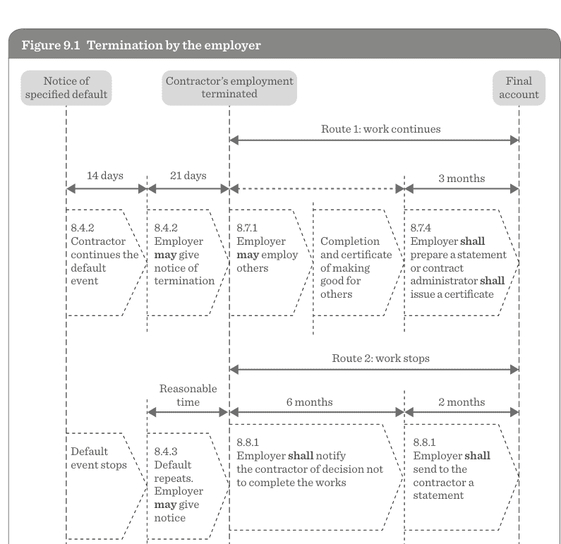
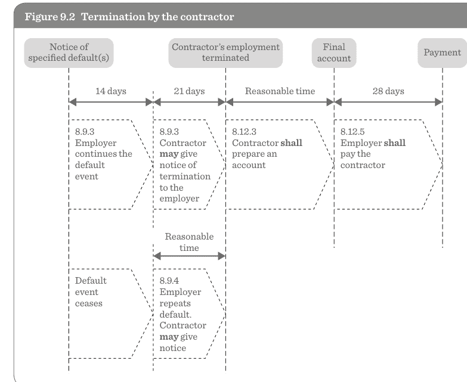
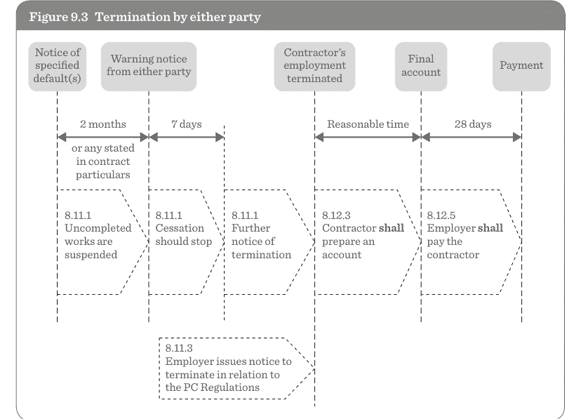

# 9 违约与终止

9.1 鉴于建筑施工的复杂性和不可预测性，项目在完工前几乎不可能不出现一方或另一方违反合同条款的情况。这一点为大多数建筑合同形式所承认，这些形式通常包括处理可预见情况的条款。这些条款避免了争端的产生或提起法律诉讼的需要，因为各方已事先就处理违约的机制达成一致。这方面的一个明显例子是约定赔偿金的条款——如果项目未在合同约定的日期前完工，承包商在技术上即构成违约，但所有后果和处理该问题的程序均已在合同中规定。然而，一些违约可能产生如此重大的后果，以至于另一方可能更愿意不继续履行合同，对于这些更严重的违约，合同中包含终止承包商雇佣的条款。

### 毁约或终止

9.2 在任何合同中，如果一方当事人的行为使另一方难以或不可能履行其合同义务，受损方可能会主张履行受阻，并提起损害赔偿或按已完成工作量计酬的诉讼。例如在建筑工程中，如果雇主拒绝允许进入场地的一部分，就会发生这种情况。

9.3 如果无法期望某方继续履行，则受损方可以主张合同已被毁约。毁约发生于一方明确表示其不再有意受合同条款约束时。这种意图可能是明确表示的，也可能是由当事人的行为所暗示的。

9.4 大多数 JCT 合同包含终止条款，规定在可能构成毁约或未达到毁约程度的情况下有效终止承包商的雇佣。应注意的是，终止的是合同项下承包商的雇佣关系，而非合同本身的终止。这意味着各方仍受其条款约束，并可就因违反其条款而遭受的损失提起诉讼。

9.5 如果发生毁约，则无需援引终止条款，因为受损方可以接受毁约并终止合同。然而，终止条款对于明确雇佣终止的确切情况、程序和后果很有用。这些程序必须谨慎遵循，因为如果未严格按照合同条款执行，这本身就可能构成对合同的毁约。这反过来可能赋予另一方将合同视为已结束并索赔损害赔偿的权利。

9.6 雇主可在承包商出现特定违约时启动终止，例如中止工程或未能遵守《建筑（设计与管理）条例》2015（cl 8.4）或在承包商资不抵债的情况下（cl 8.5），或在腐败案件或《公共合同条例》2015 相关的某些情况适用时（cl 8.6）。承包商可在雇主出现特定违约时启动终止，例如未能支付证书上到期金额或特定事件导致工程中止超过合同细则中载明的期间（cl 8.9），或在雇主资不抵债的情况下（cl 8.10）。在中性原因导致未完工程中止达合同细则所列期间的情况下，任何一方均可行使终止权（cl 8.11）。

### 雇主的终止

9.7 合同规定在特定情况下雇主可终止合同（cl 8.4）。IC16 明确规定终止承包商雇佣的权利“不影响任何其他权利和救济”（cl 8.3.1）。雇主可在实际完工前承包商出现特定违约（cl 8.4.1）、承包商资不抵债（cl 8.5）或腐败（cl 8.6）时启动终止。如果雇主是地方或公共机构，《公共合同条例》2015 第 73(1)(b) 条规定的情况（被定罪各种罪行）也将产生终止权（cl 8.6）。

9.8 合同中规定的程序必须严格遵循，尤其是关于发出通知的程序（见图 9.1）。如果发生违约，合同管理员应发出“特定”违约或违约事项的警告通知（cl 8.4.1）。如果违约在收到通知之日起 14 天内持续，则雇主可在 14 天期满后 21 天内发出进一步通知终止承包商的雇佣（cl 8.4.2）。如果承包商终止违约，或雇主未发出进一步通知，而承包商随后再次违约，雇主可在“此类重复后合理时间内”终止（cl 8.4.3）。雇主仍必须发出终止通知，但合同管理员无需发出进一步警告。似乎对违约的重复没有时间限制。然而，如果已过去相当长一段时间，雇主在发出终止通知前发出进一步警告通知可能是审慎的做法。

9.9 应注意的是，为有效，所有通知必须严格按照第 1.7.4 条发出，即“亲手递交或通过挂号签收或特快专递邮寄”（cl 8.2.3）。应注意的是，这与旧措辞“实际送达”不同，因此传真或电子邮件可能不可接受，如 Construction Partnership v Leek Developments 案所示。由于时限至关重要，通常明智的做法是确认送达的收据。

> *Construction Partnership UK Ltd v Leek Developments Ltd [2006] CILL 2357 TCC*
> 
> 根据 IFC98 合同，终止通知是通过传真送达的，但并非亲手递交或通过特快专递或挂号递送。（一封信已通过普通邮寄发出，但不明确是否已收到。）第 7.1 条要求违约和终止通知的实际送达，承包商对传真通知是否有效提出质疑。因此法院必须决定“实际送达”意味着什么。它裁定其含义即字面意思：“送达 simply 意味着通过适当方式传输以使其被收到”。在本案中，
> 
> 各方同意传真已被收到，因此通知符合条款。CILL 编辑指出“从实际层面看，该判决相当重要”，因为此前曾假设“实际送达”意味着亲手物理递送。在他们看来，电子邮件可被视为适当的送达方式，尽管本案并未作出此决定。

9.10 雇主终止的理由必须明确确立并表达。合同明确规定终止不得被不合理或恶意行使（cl 8.2.1）。在发出任何通知之前，合同管理员应检查，例如，所有工期延长是否已按照合同处理。根据第 8.4.1.1 条，工程中止必须是整体且实质性的，且“无合理原因”。然而，承包商可能在第 4.17 条提及的任何事项中找到“合理原因”。根据第 4.14 条行使中止工程的权利，只要其按照合同条款行使，就不构成终止的理由。

### 图 9.1 雇主的终止

### 特定违约

9.11 可能导致终止的特定违约是指承包商：
- “全部或实质性地中止工程的进行”（cl 8.4.1.1）；
- “未能定期和勤勉地进行工程”（cl 8.4.1.2）；
- 拒绝或忽视遵守要求承包商移除缺陷工程的书面指示（cl 8.4.1.3）；
- 未遵守第 3.5 条（分包）、第 3.7 条（指定人员）和第 7.1 条（转让）（cl 8.4.1.4）；或
- 未遵守第 3.18 条（CDM 条例）（cl 8.4.1.5）。

9.12 一般而言，只有严重的违约才足以证明终止的合理性，尽管任何违反 CDM 条例规定而使雇主面临当局行动风险的情形就已足够。

9.13 第 8.4.1.1 条涉及工程中止，但值得注意的是，虽然在 SBC16 中该条款增加了“或承包商设计部分的工程设计”，但该短语未包含在 ICD16 中。这不应造成问题，因为根据第二项序言，工程包括承包商设计部分的工程设计和施工，因此任何设计活动的中止也构成工程的中止。

9.14 承包商“未能定期和勤勉地进行工程”（cl 8.4.1.2）的违约 notoriously 难以确立，尽管详尽的记录会有帮助，但合同管理员通常可以理解地不愿发出第一次警告通知。这不仅仅是落后于任何提交的进度计划，即使明显项目将大幅延误。然而，现场工程的完全停止程度稍低的情况就足以构成理由。

9.15 例如在 London Borough of Hounslow v Twickenham Garden Developments 案中，被告强烈攻击了合同管理员的通知。然而在近期一案中，合同管理员因未能发出通知而被认定为疏忽（West Faulkner Associates v London Borough of Newham）。应记住的是，如果没有合同管理员发出的第一次“警告通知”，雇主就不能发出终止通知。

> *London Borough of Hounslow v Twickenham Garden Developments (1970) 7 BLR 81*
> 
> 伦敦豪斯洛区议会与特威克纳姆花园发展公司签订合同，在米德尔塞克斯的赫斯顿和艾尔斯沃思进行下部结构工程。合同采用 JCT63。合同工程因罢工停止约八个月。工程恢复后，建筑师发出违约通知，称承包商未能定期和勤勉地进行工程，如果没有明显改善，合同将被终止。雇主随后继续终止承包商的

employment. 承包商对通知和解除决定的有效性提出异议，并拒绝停工并离开现场。Hounslow 向法院申请禁令以移除承包商。法官强调，禁令是一种严厉的救济措施，在授予之前，必须有明确且无可争议的证据证明 Hounslow 案的主张合理性。提交给他的证据显示月度证书金额和现场工人数量显著下降，未能提供此证据。

## West Faulkner Associates v London Borough of Newham (1992) 61 BLR 81

West Faulkner Associates 受伦敦纽汉区议会聘请，为由多栋公寓楼组成的一个住宅区进行翻新。业主被分阶段从公寓中疏散，以便承包商 Moss 进入施工现场，据协议，Moss 将按照分阶段移交和完工的计划进行施工，每栋楼需九周。Moss 几乎立即就落后于计划。然而，Moss 在现场拥有大量劳动力，并不断承诺修改其计划和工作方法，以解决建筑师多次提请注意的延误、工程质量差和不安全的工作做法问题。实际上，Moss 完全组织混乱，且没有明显改善。建筑师采纳了造价工程师的建议，认为以“未能定期和勤勉地进行”作为理由难以证明，于是决定不发出通知。因此，Newham 无法发出解除通知，被迫与承包商协商和解，并解雇了建筑师，后者随后就其费用提起索赔。

法官裁定，建筑师在未对使用解除条款给予适当考虑方面违反了合同。在其判决中，他指出“定期且勤勉地”应合在一起解释，其本质上仅仅意味着承包商必须以实现其合同义务的方式进行工作。“这要求他们规划工作、领导和管理其劳动力、提供充足且适当的材料并雇佣合格的工匠，以便工程按可接受的标准完成，并且所有时间、顺序和其他规定都得到履行”（Newey 法官，第 139 页）。

## 承包商的资不抵债

9.16 资不抵债是指无法在债务到期时支付债务。资不抵债的个人可能被宣布破产。资不抵债的公司可根据具体情况以多种方式处理：例如，自愿清算（公司自行决议解散）；强制清算（公司由法院命令清算）；行政接管（由指定接管人进行的一项旨在协助公司重组的程序）；行政令（根据请愿书由法院作出，同样旨在重组而非清算，并由指定接管人管理）；或自愿安排（公司与债权人就债务偿付达成协议）。IC16 在合同第 8.1 条中对“Insolvent”一词作出了完整定义。处理资不抵债的程序主要受 1986 年《破产法》和 2016 年《破产规则》（自 2017 年 4 月起生效）的管辖。根据这些规定，被授权监督法定资不抵债程序的人员被称为“insolvency practitioner”。

9.17 根据 IC16，承包商在清算或资不抵债的情况下必须以书面形式通知雇主（cl 8.5.2）。雇主有权选择终止（cl 8.5.1）或采取更具建设性的方法。这是为了让指定的资不抵债从业人员有时间在可能的情况下提出重组方案。通常，雇主的利益在于以尽可能少的额外延误和成本完成工程，而一个缓冲期可以让所有可能性得到探索。在此期间，合同规定“第 8.7.3 至 8.7.5 条以及（如相关）第 8.8 条应如同已发出该通知一样适用”（cl 8.5.3.1）。这意味着即使未发出终止通知，雇主除按这些条款规定的情况外，无义务作出进一步付款（见第 9.24 段）。承包商被免除“执行和完成工程”的义务（cl 8.5.3.2）。雇主随后可采取合理措施确保现场、工程和材料的安全和受保护，承包商不得妨碍此类措施（cl 8.5.3.3）。

9.18 完成项目有三种选择。第一种允许安排承包商继续并完成工程。除非资不抵债从业人员能够安排资源支持，否则这可能不是现实的选择。然而，如果实际完工临近，且承包商应得款项，则允许在资不抵债从业人员控制下完成可能是有利的。

9.19 根据第二种选择，可将另一承包商 novated 以完成工程。在“真正 novation”中，替代承包商接管所有原始义务和权益（包括按时完成和在合同金额内完成）。更可能的是第三种选择，“有条件 novation”，届时合同完工日期等将须重新谈判，且替代承包商可能希望免除对原承包商已完成工程部分承担责任。

9.20 决定哪种选择最符合各方利益是雇主在合同管理员和资不抵债从业人员的建议下解决的问题。采取某一特定行动可能有其优点，也可能采取更务实的方法更有优势。例如，在安排 novation 或谈判完成合同之前，可能明智的做法是先在临时安排下继续由原承包商进行。

## 终止的后果

9.21 如果雇主根据第 8.4、8.5 或 8.6 条行使其终止权，则实现完工的唯一方式是通过任命雇主选择的新的承包商。合同赋予雇主根据第 8.7.1 条雇用他人完成工程的权利。这包括修补已完成工程中的任何缺陷，以及在 ICD16 的情况下，完成设计部分。雇主有权在征得所有者同意的情况下使用现场上不属于原承包商的任何临时建筑物、设备等（cl 8.7.1）。

9.22 雇主还可要求承包商：
- 将属于承包商的任何临时建筑物、设备等从现场移除（cl 8.7.2.1）；
- 向雇主提供所有承包商设计文件的副本（cl 8.7.2.2，仅限 ICD16）；
- 要求原承包商将任何分包合同的权益转让给雇主（在权益可转让的范围内）（cl 8.7.2.2，ICD16 中为 cl 8.7.2.3）。

9.23 如果雇主决定根据第 8.7.1 条雇用他人，此类雇用必须谨慎处理，因为由另一承包商开工的建筑物的完工总是困难的。完成合同可能源于谈判或竞争性招标，但如果剩余工程量大，招标路线可能是明智的，因为雇主随后可能需要证明所产生的成本是合理的。应在终止时对完工的准确状态作出记录，包括任何缺陷工程。

9.24 终止后，第 8.7.3 条规定“除根据第 8.7.5 条或第 8.8.2 条可能到期给他的任何金额外，承包商不再到期任何款项……”。它还规定，如果已发出付款少于通知（cl 8.7.3.1）或承包商已资不抵债（cl 8.7.3.2），雇主无需支付已到期的款项。这反映了经修订的《HGCRA》第 111(10) 条以及 Melville Dundas v George Wimpey 的判决。然而，应注意的是，雇主仍可能有义务支付由 adjudicator 判定的金额（Ferson v Levolux）。

> *Melville Dundas Ltd v George Wimpey UK Ltd [2007] 1 WLR 1136 (HL)*
> 
> 根据 WCD98 签订的合同，承包商已进入接管程序，使雇主有权解除承包商的雇佣关系。承包商于 2003 年 5 月 2 日申请中期付款，付款最后期限为 5 月 16 日（申请后 14 天），解除决定于 5 月 30 日生效。承包商以未发出扣留通知为由主张该付款。枢密院以三比二多数裁定雇主无义务作出任何进一步付款。承认根据 WCD98，解除后中期付款在合同上不可支付，且上议院认为这与 1996 年《HGCRA》的付款规定并不不一致。虽然该法要求在没有通知的情况下承包商有权获得付款，但这并不意味着在承包商资不抵债后该权利必须继续维持，即解释解除的效果为付款不再到期并不不一致。该法关注的是付款人与收款人之间的利益平衡，如作相反解释，将使承包商的债权人受益而损害雇主的利益，而该法并不意图如此。

> *Ferson Contractors Ltd v Levolux AT Ltd [2003] BLR 118*
> 
> Ferson 为承包商，Levolux 为 GC/Works 分包合同中的分包商。关于 Levolux 第二次付款申请产生争议；索赔金额为 £56,413，但仅支付了 £4,753。发出了一份扣留通知，其中规定了金额但未说明扣留理由。Levolux 将索赔提交 adjudication，裁决人裁定该通知不符合 1996 年《HGCRA》第 111 条，且 Ferson 应支付全部金额。Ferson 拒绝付款，Levolux 寻求执行该决定。在 adjudication 之前，Levolux 已暂停工作，Ferson 认为该暂停是

> 非法，已确定合同。它现在主张，由于第29条规定‘承包商一方可能到期或正在到期的所有款项对分包商而言应停止到期或不再到期’，他们无需支付该金额。上诉法院维持了初审法官的决定，即该金额应予支付：‘合同必须解释为实现议会的意图’。

9.25 终止后，必须列出名义最终账目，说明应付或欠付金额，可在雇主准备的声明中或合同管理员证书中列出（cl 8.7.4）。该账目必须在‘工程完工并修补缺陷’后的三个月内编制，这为雇主提供了评估因终止而产生的损失的期限。账目上显示的净额应由承包商支付给雇主（更可能的结果），或由雇主支付给承包商，视情况而定（cl 8.7.5）。

9.26 终止的一个后果是，承包商有序撤离现场通常需要时间，雇主在最终付款前确定未结金额也需要时间。如果雇主决定在终止后不再继续施工，雇主须在该通知之日起六个月内以书面形式通知承包商（cl 8.8）。在通知后两个月内（或如果未进行任何工作且未发出通知，则在终止后六个月内），雇主必须根据第8.8条的规定向承包商发送一份说明工程价值和所受损失的声明。

9.27 承包商根据第8.9条享有对等权利，在雇主出现特定违约（cl 8.9.1）、特定暂停事件（cl 8.9.2）或雇主资不抵债（cl 8.10）的情况下终止其自身雇佣关系。特定暂停事件必须导致未完工程的全部暂停，持续时间为合同特定条款中规定的时间（如果未填写期限，则默认期限为两个月）。在特定违约或暂停事件的情况下需要发出通知，通知必须指明违约或事件。如果违约或事件在收到通知之日起14天内持续，承包商可在14天期满后21天内通过进一步通知终止雇佣关系（cl 8.9.3）（见图9.2）。或者，如果雇主终止违约或暂停事件停止，且承包商未发出进一步通知，若雇主再次违约，承包商可在‘此类重复后合理时间内’终止（cl 8.9.4）。这些通知必须按照第1.7.4条规定的方式发出，即‘由手递送或通过挂号签收或特快专递邮寄’（cl 8.2.3）。

9.28 第8.9条的理由与赋予雇主终止权的理由不同。它们包括根据第4.12条未按规定支付应付给承包商的金额（cl 8.9.1.1）、阻碍证书的签发（cl 8.9.1.2）、未遵守第7.1条有关转让的合同规定（cl 8.9.1.3）或未遵守第3.18条下的CDM义务（cl 8.9.1.4）。还有一些事项直接涉及合同管理员的职责，例如，全部或实质上全部工程的施工因有关不一致、变更或推迟的指示而暂停（cl 8.9.2.1），或由于

### 图9.2 承包商终止

任何雇主或合同管理员的‘妨碍、阻止或违约’（cl 8.9.2.2），但前提是该指示或违约并非由承包商的过失或违约所致。暂停期为两个月，除非另有规定。在长期复杂项目中，如果出现意外的技术问题，两个月可能不足，因此考虑插入更长的期限可能是明智的。

9.29 承包商如果考虑因其认为雇主未付款而终止，应特别谨慎。合同明确要求未支付‘到期金额’（cl 8.9.1.1），而不仅仅是承包商可能申请的金额。如果承包商在计算上出现错误，雇主可能有权支付较少的金额。此外，合同赋予雇主对到期金额进行各种调整和扣除的权利。正确行使这些权利不构成未支付到期金额。如果承包商在没有正当理由的情况下试图终止其雇佣关系，这将构成拒绝履行，对承包商产生严重后果。更审慎的做法是在继续进行工程的同时，通过 adjudication 提出有争议的付款。

9.30 在雇主破产或资不抵债的情况下，承包商终止是可选的（cl 8.10.1）。承包商必须发出通知，终止自收到通知之日起生效。

## 承包商终止的后果

9.31 根据第8.9条或8.10条终止后，合同规定，除该条款另有规定外，承包商不再到期应付任何款项（cl 8.12.1）。承包商须从现场移除工具等，并且在ICD16的情况下，向雇主提供第2.32条提及的‘竣工图’副本（例如承包商的设计文件和相关信息）（cl 8.12.2）。承包商随后应尽快编制账目，列出终止日期的工程总价值，加上第8.12.3条规定的与终止相关的其他费用。这些可能包括拆除费用以及因终止而产生的任何直接损失和/或损害。实际上，承包商对因终止而可能造成的任何损害获得赔偿。

## 雇主或承包商均可终止

9.32 任一方均有权在工程的施工因第8.11.1条所列的一项或多项事件而全部或实质上全部暂停，持续时间为合同特定条款中插入的期限时终止承包商的雇佣关系（如果未填写期限，则默认期限为两个月）。这些事件包括不可抗力、由工程保险单承保的任何风险或除外风险造成的工程损失或损害、民事骚乱以及政府或地方或公共当局行使的非因承包商违约而引起的法定权力。该

承包商在工程受损情况下终止的权利以但书为限，即该事件不得由承包商的过失造成（cl 8.11.2）。此外，如果因雇主根据第2.15条（差异）、第3.11条（变更）或第3.12条（推迟）发出的指示而暂停工作，且该指示是由于法定承接商的过失或违约而发出，任一方均可终止（cl 8.11.1.2）。

9.33 任一方均可发出通知，承包商的雇佣关系将在收到通知后七天终止，除非暂停在收到该通知之日起七天内停止。如果暂停在此期间后未停止，当事人可通过进一步通知终止合同（cl 8.11.1，见图9.3）。如果雇主是地方或公共当局，当《2015年公共合同条例》第73(1)(a)或(c)条规定的情况（条例的各种违反）适用时，雇主可发出通知（cl 8.11.3）。这似乎导致立即终止。

9.34 终止后，第8.12.1条（不再到期应付任何款项）和第8.12.2条（移除工具等，以及在ICD16的情况下提供竣工图）适用。然后按与承包商终止相同格式编制账目（cl 8.12.3，见第9.24段），除此之外，在本例中，与承包商造成的直接损失和/或损害相关的金额仅在因雇主过失造成的特定风险导致时才包括在内。

## 指定分包商雇佣关系的终止

9.35 承包商负责采取行动终止指定分包商的雇佣关系。合同规定，指定分包商的雇佣关系不得通过ICSub/NAM/C第7.4至7.6条的操作以外的方式终止，且承包商不得通过接受分包合同的拒绝履行而终止分包合同（附表2:6）。要求此项的原因是，一旦指定分包合同终止，承包商须采取措施从分包商处追回因终止而由雇主应付给承包商的额外金额（附表2:10.2.1）。如果承包商未完全遵守分包合同的规定，追回这些损失的机会将大大降低。

9.36 承包商必须告知合同管理员可能导致指定分包合同终止的任何事件。在某些情况下，这可能为合同管理员提供机会进行一些调查并提前评估如果发生终止时可能的替代行动方案。

9.37 承包商必须在合同终止后立即通知合同管理员。合同管理员随后必须发出指示，该指示可能指定另一人执行工作，要求承包商完成工作或省略未完成工作（附表2:7）。终止的后果随后取决于分包商最初是在合同文件、合同账单/规范/工作进度表中指定，还是在与暂定金额有关的指示中指定。

9.38 如果分包商最初在投标文件中指定，则指定替代者的指示被视为可能构成延长的理由

时间，但不作为产生直接损失和/或费用事项（附表2：8.1）。合同总价应根据首选分包商对未完工程的价格与替代分包商的价格之间的差额进行调整，尽管替代分包商价格中用于纠正缺陷工程的任何金额不得计入合同总价。其效果是承包商仍需对原指定人员完成的任何缺陷工程负责。省略工程或要求承包商执行工程的指示被视为第5.3条下的变更，且为可能导致工期延长及直接损失和/或费用赔偿的事件。

9.39 如果终止涉及根据暂定金额指令指定的分包商，则合同管理人的指令被视为暂定金额下的进一步指令，因此可能导致合同总价调整、工期延长及直接损失和/或费用赔偿（附表2：9）。合同管理人应注意在终止后发出指令时不得无故拖延，因为这也可能成为根据第2.20.2.1条提出工期延长索赔、第4.18.2.1条提出直接损失和/或费用索赔的理由，并在特殊情况下甚至可能导致根据第8.11.1.2条终止合同。

9.40 如果指定分包商的雇佣并非按照合同条款终止，则合同管理人仍需按上述方式发出指令，但合同规定这些指令不会产生工期延长或直接损失和/或费用赔偿的权利，且合同总价不会进行调整，除非适用合同条款会导致减少（附表2：10）。其效果是将此类终止后果的全部风险置于承包商身上。
