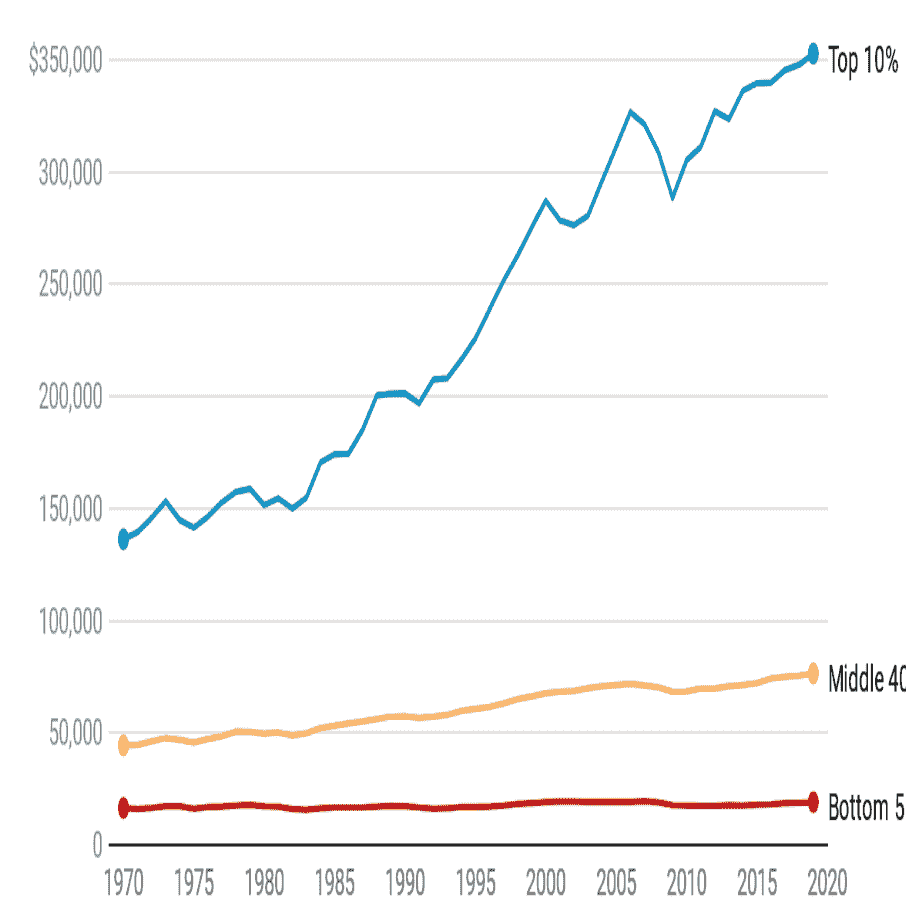
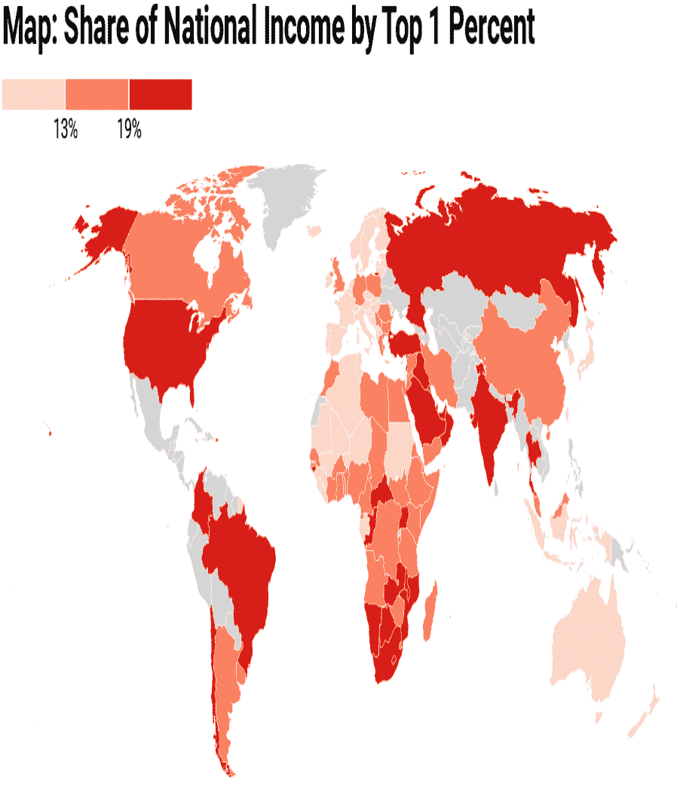

# 数据可视化实用指南：从电子表格到代码的交互式叙事

## 本书使用的约定

本书使用以下排版约定：

- *斜体*

  表示新术语、URL、电子邮件地址、文件名、列名和文件扩展名。

- `Constant width`

  用于程序列表，以及在段落中引用程序元素，如变量或函数名、数据库、数据类型、环境变量、语句和关键字。

- **等宽粗体**

  表示需要用户按字面输入的命令或其他文本。

- *等宽斜体*

  表示应替换为用户提供的值或由上下文确定的值的文本。

> 提示
> 
> 此元素表示提示或建议。

> 注意
> 
> 此元素表示一般说明。

> 警告
> 
> 此元素表示警告或注意。

## O'Reilly 在线学习

> 注意
> 
> 40多年来，*O'Reilly Media* 一直提供技术和商业培训、知识与洞察，帮助公司取得成功。

我们独特的专家和创新者网络通过图书、文章和在线学习平台分享他们的知识和专长。O'Reilly 的在线学习平台可让你按需访问实时培训课程、深度学习路径、交互式编码环境，以及来自 O'Reilly 和 200 多家其他出版商的庞大文本和视频资源。更多信息，请访问 http://oreilly.com。

## 如何联系我们

请将有关本书的评论和问题发送给出版商：

O'Reilly Media, Inc.

1005 Gravenstein Highway North

Sebastopol, CA 95472

800-998-9938（美国或加拿大）

707-829-0515（国际或本地）

707-829-0104（传真）

我们为本书设立了一个网页，其中列出了勘误、示例和任何其他信息。你可以通过 https://learning.oreilly.com/library/view/9781492085997 访问此页面。

如需对本书发表评论或提出技术问题，请发送电子邮件至 bookquestions@oreilly.com。

了解我们图书和课程的最新资讯，请访问 http://oreilly.com。

在 Facebook 上找到我们：http://facebook.com/oreilly

在 Twitter 上关注我们：http://twitter.com/oreillymedia

在 YouTube 上观看我们：http://www.youtube.com/oreillymedia

## 致谢

2016年，我们以另一个书名*《数据可视化面向所有人》*发布了本书的早期草稿，作为三一学院学生及其在康涅狄格州哈特福德的社区伙伴入门课程的一部分，旨在通过交互式图表和地图讲述他们组织的数据故事。Veronica X. Armendariz（三一学院2016届）担任了出色的助教，并提供了初步教程。2017年，草稿进一步扩展，当时我们与出色的联合讲师Stacy Lam（三一学院2019届）和David Tatem（教学技术专家）推出了同名的**免费三一学院edX在线课程**，他们贡献了丰富的想法和无数的时间。

迄今为止，已有超过23,000名学生开始了edX课程，但**实际完成六周课程的只有一小部分**。同时感谢制作edX课程视频的三一学院信息技术服务部门的员工和朋友们：Angie Wolf、Sean Donnelly、Ron Perkins、Samuel Oyebefun、Phil Duffy和Christopher Brown。为早期草稿工作的学生所提供的资金由三一学院社区学习与信息技术服务办公室慷慨提供。

我们要感谢许多个人和组织，他们帮助我们学会了我们在本书中传授的几项技能，尤其是此前在*《康涅狄格州镜报》*担任数据记者的Alvin Chang和Andrew Ba Tran；康涅狄格大学图书馆地图与地理信息中心（MAGIC）的Michael Howser、Steve Batt及其同事；以及三一学院网络开发总监Jean-Pierre Haeberly。还要感谢所有在由乔治梅森大学Roy Rosenzweig历史与新新媒体中心和安德鲁·W·梅隆基金会赞助的人文与技术营地（THATCamp）活动中激励杰克*对代码产生好奇*，并鼓励他和他的学生在阳光基金会赞助的透明度训练营中为公共利益探索公民技术的人们。

我们也很感激有机会在数据研讨会上分享我们正在进行的工作，这些研讨会由Scott Gaul和Doug Shipman（此前曾任职于哈特福德公共捐赠基金会）以及康涅狄格州数据协作组织的Michelle Riordan-Nold主持。

在读者、教育者和编辑的反馈指导下，我们在2020年重写了整个草稿，以重组结构、深化概念并增强教程。我们感谢O’Reilly Media每一位与我们合作将最终成果呈现给你的员工，尤其是我们出色的开发编辑Amelia Blevins、细致入微的文字编辑Stephanie English、条理清晰的生产编辑Katie Tozer，以及他们团队的其他成员：Nick Adams、Jonathan Hassel和Andy Kwan。我们也感谢O’Reilly对三位技术审阅人的支持，他们提供了出色的评论，帮助我们改进手稿：Carl Allchin、Derek Eder和Erica Hayes。

还要感谢以下读者，他们友好地分享了关于草稿文本或代码模板的反馈：Jen Andrella、Gared Bard、Alberto Cairo、Fionnuala Darby-Hudgens、Nick Klagge、Federico Marini、Elizabeth Rose、Lisa Charlotte Rost、Xavier Ruiz、Laura Tateosian、Elizabeth von Briesen和Colleen Wheeler。

## Introduction

### Why Data Visualization?

In this book, you’ll learn how to create true and meaningful data visualizations through chapters that blend design principles and step-by-step tutorials to make your information-based analysis and arguments more insightful and compelling. Just as sentences become more persuasive with supporting evidence and source notes, your data-driven writing becomes more powerful when paired with appropriate tables, charts, or maps. Words tell us stories, but visualizations show us *data stories* by transforming quantitative, relational, or spatial patterns into images. When visualizations are well-designed, they draw our attention to what is most important in the data in ways that would be difficult to communicate through text alone.

Our book features a growing number of free and easy-to-learn digital tools for creating *data visualizations*. We broadly define this term primarily as *charts*, which encode data as images, and *maps*, which add a spatial dimension. While *tables* do not illustrate data in the same way, we include them in this book because of our pragmatic need to direct new learners through a decision-making process that often results in building one of these three products. Furthermore, in this digital era we define data visualizations as images that can be easily reused by modifying the underlying information, typically stored in a data file, in contrast to *infographics* that are generally designed as single-use artwork.¹

As educators, we designed *Hands-On Data Visualization* to introduce key concepts and provide step-by-step tutorials for new learners. You can teach yourself, or use the book to teach others. Also, unlike many technical books that focus solely on one tool, our book guides you on how to choose among more than 20 free and easy-to-use visualization tools that we recommend. Finally, while some other books focus on only *static* visualizations that can be distributed only on paper or PDF documents, we demonstrate how to design *interactive* tables, charts, and maps, and embed them on the web. Interactive visualizations engage wider audiences on the internet by inviting them to interact with the data, explore patterns that interest them, download files if desired, and easily share your work on social media.

Data visualizations have spread widely on the internet over the last decade. Today in our web browsers, we encounter more digital charts and maps than we previously saw in the print-only past. But rapid growth also raises serious problems. The “information age” now overlaps with the “age of disinformation.” Now that nearly anyone can post online, how do you make wise decisions about whom to trust? When presented with conflicting data stories about divisive policy issues such as social inequality or climate change, which one do you believe? In the next section, we’ll delve into this thorny topic by exploring what types of evidence persuades you, and why. And we’ll share this dirty little secret about data visualization: it illuminates our path in pursuit of the truth, but it also empowers us to deceive and lie.

### What Can You Believe?

To begin, how do you know whether to believe us, the authors of this book? Could we be lying to you? How do you determine what information is truthful? Let’s start with a simple one-sentence statement.

**Example I-1.**

> *Economic inequality has sharply risen in the United States since the 1970s.*

Do you believe this claim—or not? Perhaps you’ve never thought about the topic in this particular way before now (and if so, there’s a lot of information out there to help). It’s possible your response depends on whether this statement blends in with your prior beliefs, or pushes against them. Or perhaps you’ve been taught to be skeptical of claims lacking supporting evidence (and if so, thank your teachers). So let’s move on to a more complex two-sentence statement, one that cites a source.

**Example I-2.**

> *In 1970, the top 10% of US adults received an average income of about $135,000 in today’s dollars, compared to the bottom 50% who earned around $16,500. This inequality gap grew sharply over the next five decades, as the top tier income climbed to about $350,000, while the bottom half barely moved to about $19,000, according to the World Inequality Database.²*

Is Example I-2 more believable than Example I-1? It makes a more precise claim by defining economic inequality in terms of average income for the upper 10% versus the bottom 50% over time. Also, Example I-2 pins its claims to a specific source, and invites us to read further by following the footnote. But how do these factors influence its persuasiveness? Does Example I-2 lead you to ask about the trustworthiness of the source and how it defines “income?” Does the wording make you wonder about the other 40% of the population between the two extremes?

To answer some of those questions, let’s supplement Example I-2 with a bit more information, as shown in Table I-1.

**Table I-1. Average US adult income, 1970–2019ᵃ**

| US Income Tier | 1970 | 2019 |
|---|---|---|
| Top 10% | $136,308 | $352,815 |
| Middle 40% | $44,353 | $76,462 |
| Bottom 50% | $16,515 | $19,177 |

ᵃ Shown in constant 2019 US dollars. National income for individuals aged 20 and over, prior to taxes and transfers, but includes pension contributions and distributions. Source: World Inequality Database 2020.

Does Table I-1 make Example I-2 more persuasive? Since the table contains essentially the same information as the two sentences about top and bottom income levels, it shouldn’t make any difference. But the table communicates the evidence more effectively, and makes a more compelling case.

For many people, it’s easier to read and grasp the relationship between numbers when they’re organized in a grid, rather than complex sentences. As your eyes skim down the columns, you automatically notice the huge jump in income for the top 10%, which nearly tripled over time, while the bottom 50% barely budged. In addition, the table fills in more information that was missing from the text about the middle 40%, whose income grew over time, but not nearly as much as the top tier. Furthermore, the note at the bottom of the table adds a bit more context about how the data is shown in constant 2019 US dollars, which means that the 1970s numbers were adjusted to account for changes to the cost of living and purchasing power of dollars over a half-century. The note also briefly mentions other terms used by the World Inequality Database to calculate income (such as taxes, transfers, and pensions), though you would need to consult the source for clearer definitions. Social scientists use different methods to measure income inequality, but generally report findings similar to those shown here.³

### Some Pictures Are More Persuasive

Now let’s substitute a data visualization—specifically the line chart in Figure I-1—in place of the table, to compare which one is more persuasive.

**Average US Adult Income, by Percentile, 1970-2019**

Note: Shown in constant 2019 US dollars. National income for individuals aged 20 and over, prior to taxes and transfers, but includes pension contributions and distributions.

Chart: by HandsOnDataViz • Source: World Inequality Database 2020 • Created with Datawrapper

**Figure I-1.** Explore the interactive line chart of US adult income inequality over time.

Is Figure I-1 more persuasive than Table I-1? Since the line chart contains the same historical start and stop points as the table, it should not make any difference. But the line chart also communicates a powerful, visualized data story about income gaps that grabs your attention more effectively than the table.

As your eyes follow the colored lines horizontally across the page, the widening inequality between the top versus the middle and bottom tiers is striking. The chart also packs so much granular information into one image. Looking closely, you also notice how the top-tier income level was relatively stable during the 1970s, then spiked upward from the 1980s to the present, and grew more distant from other lines. Meanwhile, as the middle-tier income rose slightly over time, the fate of the lowest-tier remained relatively flat, reached its peak in 2007, and then dipped back downward for much of the past decade. The rich got richer, and the poor got poorer, as the saying goes. But the chart reveals how rapidly those riches grew, while poverty remained recalcitrant in recent years.

Now let’s insert Figure I-2, which contains the same data as Figure I-1, but presented in a different format. Which chart should you believe? Remember, we warned you to watch out for people who use data visualizations to tell lies.

让我们将收入不平等的分析范围扩展到一个国家之外。**示例1-3**引入了比较证据及其来源。此前的美国示例展示的是三个收入层级的历史数据，而这一全球性示例则聚焦于每个国家最富有的前1%人群可用的最新年份数据。此外，这一国际比较不再以美元衡量收入，而是衡量国民收入中由前1%人群所持有的百分比份额。换句话说，它揭示了每个国家最富有的1%人群所吃掉的蛋糕份额有多大。

### 示例 1-3

> 美国的收入不平等更为严重，最富有的1%人口目前获得了国民收入的20%。相比之下，在大多数欧洲国家，最富有的1%人口所占份额较小，在国民收入的6%至15%之间。

沿着同样的思路，让我们为**示例1-3**补充一个可视化图表来评估其说服力。虽然我们可以制作表格或图表，但这些都不是在数据集中快速展示超过120个国家信息的最有效方式。由于这是空间数据，让我们将其转化为交互式地图，以帮助我们识别任何地理模式，并鼓励读者探索全球各地的收入水平，如**图1-3**所示。

地图由HandsOnDataViz制作 • 来源：世界不平等数据库 • 使用Datawrapper创建

*图1-3.* 探索世界收入不平等的*交互式地图*，该地图以人口中最富有的1%所持有的国民收入份额为衡量标准，基于可得的最新年份数据。来源：*《世界不平等数据库2020》*。

**图1-3**比**示例1-3**更有说服力吗？虽然地图和文字呈现的是关于美国与欧洲收入不平等的相同数据，两者本应没有差别。但地图将你带入一个有力的故事，生动地展示了贫富之间的差距，与上面的图表示例类似。地图中的颜色发出危机信号，因为在许多文化中红色代表紧迫性。美国（以及包括俄罗斯和巴西在内的其他几个国家）的收入不平等在……上十分突出

这是一个难以教授的棘手主题——有时与其说是科学，不如说是艺术。我们知道图表和地图就像文字一样可以被操纵，用以误导受众，我们将在书中演示常见的欺骗手法，帮助你识别他人作品中的此类问题，并在自己的作品中自觉避免。但新手可能会对数据可视化那些有些模糊的规则感到困惑。通常一个问题的答案并非唯一，而是存在多种可行的解决方案，每种方案各有其优缺点。

作为学习者，你的任务是不断寻找更好的答案，而不必期望找到唯一正确的答案，尤其是随着可视化方法和工具不断演进，人们会发明新的方式来展现真相。

## 本书结构

我们将本书各章组织为一份数据可视化的入门实践指南，涵盖从电子表格到代码的各个方面。此外，我们只假设你具备基本的电脑操作能力、对中学数学的模糊记忆，以及对用数据讲故事的天生好奇心，除此之外无需任何先验技能。你可以把本书设想为四个部分。

在第一部分中，你将培养构想数据故事所需的基础技能，并了解讲述故事所需的工具和数据。我们将从第1、2、3、4和5章循序渐进地展开。这些章节包含动手实践教程，强调在做中学。

在第二部分中，你将使用易于学习的拖放工具构建大量可视化图表，并弄清楚哪些类型最适合不同的数据故事。我们将从第6、7和8章入手，加深你对每章所强调的解读风格的理解。在第9章中，你将学习如何将这些交互式可视化图表全部嵌入常见的Web平台，以便读者探索你的数据并更广泛地分享你的作品。

在第三部分中，你将进阶到更强大的工具，特别是代码模板，它们让你能更自由地定制可视化图表的外观，并决定在何处在线托管它们。我们将从第10章开始，带你了解一个流行的开源代码平台的简易Web界面。接着你将通过第11和12章的练习进行构建，并在第13章中探索更高级的空间工具。在本书末尾，我们附上了“附录：修复常见问题”，供你在不小心弄坏代码时查阅，这也是了解代码工作原理的好途径。

在第四部分中，我们将回到本引言的核心主题——用数据讲述真实而有意义的故事——来总结你所掌握的所有可视化技能。在第14章中，你将学习如何利用图表和地图“说谎”，以便更好地讲述真相。最后，第15章强调：数据可视化的目标不仅仅是制作关于数字的图片，而是打造一个真实的叙事，让读者信服你的解读为何重要、以何种方式重要。

## 小结

现在，你已经对我们这本书的主要目标有了更清晰的认识。我们的目标是让你学会如何利用交互式数据可视化讲述真实而有意义的故事，同时留意人们可能利用它们进行误导的各种方式。在下一章中，让我们着手明确你想要讲述的数据故事，以及在选择合适工具时需要考虑的因素。

1 请注意，其他数据可视化书籍可能对这些术语的使用有所不同。例如，在阿尔贝托·凯罗（Alberto Cairo）的《图表如何说谎：更聪明地对待视觉信息》（W.W. Norton & Company出版社，2019年）中，所有可视化都被定义为“图表”，https://oreil.ly/wXcBX，第23页。

2 世界不平等数据库，《美国收入不平等，1913–2019》，访问于2020年，https://oreil.ly/eUYZn。

3 世界不平等数据库建立在经济学家托马斯·皮凯蒂（Thomas Piketty）、伊曼纽尔·赛斯（Emmanuel Saez）及其同事们的研究成果之上，他们不仅基于自我报告调查，还基于提交给美国国税局的大量纳税申报单样本，构建了美国历史收入数据。参见世界不平等数据库（WID）中的“方法论”，2020年，https://oreil.ly/F4SNk。参见查德·斯通（Chad Stone）等人所著《收入不平等历史趋势统计指南》中的方法论概述（预算与政策优先中心，2020年1月13日），https://oreil.ly/uqAzm。皮尤慈善信托基金在朱莉娅·梅纳塞·霍洛维茨（Julia Menasce Horowitz）、露丝·伊格利尼克（Ruth Igielnik）和拉凯什·科克哈尔（Rakesh Kochhar）所著《美国收入和财富不平等趋势》（皮尤研究中心社会与人口趋势项目，2020年1月9日）中提出了关于美国收入不平等的类似研究结果，https://oreil.ly/W5nPq。

4 世界不平等数据库，《前1%人群的国民收入份额》，2020年，访问于2020年，https://oreil.ly/fvQQV。
