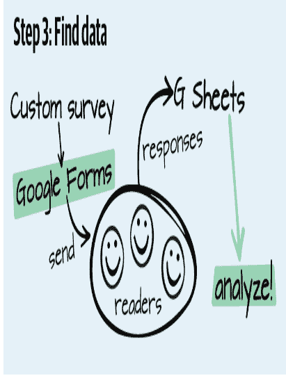
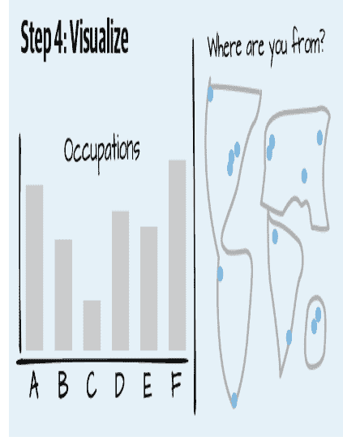

# 第一部分：基础技能

### 步骤1：问题

我们需要了解读者在数据可视化方面的背景和兴趣，以便编写一本更好的、能满足他们需求的入门指南。

### 步骤2：陈述→问题

我们这本书的读者如何描述他们此前在数据可视化方面的经验、教育水平和学习目标？

### 步骤3：查找数据

### 步骤4：可视化

这个练习能在多个方面帮助你，无论你是独自完成，还是更好的是与同事团队一起完成，如图1-1所示。首先，通过将想法从脑海中迁移到纸上，你不仅能让自己思路更清晰，也能让他人更容易看到你的思考。当想法被勾勒出来时，你可以进行反思、听取反馈、划掉不太好的想法，并在新的纸上用更好的想法取而代之。如果你最初的草图过于复杂或令人困惑，可以将这些想法拆解到不同的页面上，使其更加连贯。

*图 1-1.* 数据故事草图练习可以单独完成，但与一群人一起做效果更好。在我们的数据可视化课程中，大学生和来自当地非营利组织的社区合作伙伴共同为他们的项目构建数据故事框架。

其次，将你的表格当作分镜脚本来看。把它们摊开在桌上，移动它们以便重新排序顺序，并开始定义故事的三个基本阶段：开头、中间和结尾。此外，这些页面可以帮助你思考如何向更大范围的受众传达你的数据故事，例如演示文稿幻灯片，或用于你下一次报告或网页的段落和图片。不要扔掉它们，因为我们在本书结尾的**第 15 章**会再次回到这个练习。

最后，这个草图练习可以帮助你确定在本书正文中应重点关注哪些章节。如果你对在哪里寻找数据感到困惑，请查看**第 3 章**。如果你正在考虑制作图表或地图，但需要不同类型的示例，请查看**第 6 章和第 7 章**的开头部分。

现在你对想要讲述的故事有了更清晰的认识，并且对想要创建的可视化有了一些初步想法，在接下来的两个部分中，我们将讨论完成工作的工具，以及在选择工具时应考虑的因素。

## 选择工具时的十个因素

在看似无穷无尽的数字工具之间做决定可能会让人感到不知所措。为了帮助你做出决定，我们列出了在评估新可视化工具或在线服务时所考虑的 10 个关键因素。在比较选项时，许多决定都涉及某种类型的权衡，即在相互竞争的需求之间取得平衡，例如易用性与丰富功能。 通过确定关键因素，我们相信每位读者都能就哪些工具为你提供最佳权衡做出更明智的决定，因为我们每个人都不同。此外，我们将类别表述得较为宽泛，因为这些概念可以应用于你数字生活的其他领域，但随后会提供关于数据可视化方面的更多具体背景。

### 1. 易于学习

学习新工具需要花费多少时间？在我们忙碌的生活中，这通常是最重要的因素，但也因人而异，因为你投入的时间和精力取决于你使用相关工具的先前经验以及掌握关键概念的能力。

在本書中，我们使用“易用工具”这一标签来标识最适合初学者使用的工具，甚至一些高级用户也更喜欢它们。它们通常具有 GUI，意味着你通过下拉菜单或拖放步骤来操作它们，而不是记住要在空白屏幕中输入的命令。更好的工具还提供用户友好的错误信息，在走错方向后引导你回到正确方向。

在本书后面的部分，我们将介绍提供更多控制和可视化自定义功能的强大工具，例如可以复制和编辑的代码模板，这比从头编写要容易得多。总的来说，在决定将哪些工具纳入本书时，我们将易于学习放在了首位。事实上，我们从本书的早期草稿中删除了一个流行的免费拖放工具，因为即使是我们自己也难以遵循我们自己的使用说明。当面临几个不错的选择时，选择简单性。

### 2. 免费或价格实惠

该工具是否免费使用？还是基于 Freemium 模式，提供免费的基础功能，而高级功能则收费？还是需要一次性购买或按月订阅费用？当然，什么是实惠的答案对每个读者来说都会有所不同。

我们完全理解许多软件开发商的商业模式需要稳定的收入，我们两人也愿意为工作中必需的特定工具付费。如果你经常依赖某个工具来完成工作，且没有明显的替代方案，那么为其持续存在提供财务支持符合你的最佳利益。但在创建本书时，我们对可供用户免费使用的高质量数据可视化工具的广泛选择印象深刻。为了提高所有读者的可视化数据获取能力，我们推荐的每个工具都是免费的，或其核心功能可免费使用。

### 3. 功能强大

该工具是否提供你预期需要的所有功能？例如，它是否支持为你的项目构建足够类型的数据可视化？虽然更多通常更好，但某些类型的图表晦涩且很少使用，例如雷达图和瀑布图。此外，还要注意你上传数据的数量限制，或你创建的可视化的限制。例如，我们之前从本书的早期版本中删除了一个 Freemium 工具，当公司开始要求如果你的地图在网络上被查看超过一百次就需要付费许可证时。此外，该工具在多大程度上允许你自定义可视化的外观？由于拖放和 Freemium 工具通常限制你的显示选项，你可能需要在它们与更强大和可定制的工具之间做出权衡。在本书中，我们从易用工具开始，并在每一章中逐步介绍更高级的工具，以帮助你确定简单性和功能之间的理想组合。

### 4. 有支持

开发人员是否定期维护和更新该工具，并对问题或疑问做出回应？是否有活跃的用户社区支持该工具并分享使用知识？如果你像我们一样使用数字工具的时间很长，你会认识到我们失去一些工具的痛苦，因为它们的开发人员停止了支持。例如，Killed By Google 列出了近两百个该多亿美元公司关闭的应用程序和在线服务。其中之一是流行的可视化工具 Google Fusion Tables，它曾在本书早期版本的一整章中占据一席之地，当 Google 在 2019 年关闭该工具后 10 年运行后，我们将其删除。

虽然我们谁也无法预测哪些在线工具会持续存在，但在将它们纳入本书之前，我们寻找了活跃支持的迹象，例如定期更新、GitHub 开发人员网站上获得的星标，以及 Stack Overflow 用户论坛中得到解答的问题。但永远不要假设未来会与过去相似。数字工具的持续演变意味着有些工具会灭绝。

### 5. 可移植

你能多容易地将数据迁移进出工具？例如，我们停止推荐一家知名软件公司创建的在线故事地图工具，当我们发现用户可以轻松上传位置、文本和照片，但无法导出他们所有的工作时！

由于数字技术不可避免地发生变化，所有数据都需要迁移到另一个平台，而为这次最终过渡做好准备是你的责任。将问题视为历史保存，以增加你的项目在未来某个未知平台上继续运行的可能性。如果你的当前工具开发商宣布下个月关闭，你能否轻松地以常用文件格式提取所有底层数据以上传到不同的工具？使你的可视化面向未来的关键步骤是确保你的数据文件可以轻松地与生成图表或地图的演示软件分离。在为本书推荐工具时，我们偏爱支持便携式数据下载以便将来迁移的工具。

### 6. 安全和私密

### 色盲检查

Deuteranopia 是一种红绿色盲形式（男性占 1%）。

### 最常见的桌面屏幕阅读器

来源：WebAIM。点击点以访问官方屏幕阅读器网站

图 1-2。左侧为 Datawrapper 内置的色盲检查。右侧为为低视力可访问性设计的 Highcharts 折线图。

这些是我们决定是否将另一项添加到我们的数字工具包时考虑的 10 个因素。经常需要做出妥协，正如你将在下一节中读到的那样。当然，你的因素列表可能会有所不同，可能包括其他至关重要但有时更难判断的价值观，例如软件开发商的道德商业实践或对公共利益的贡献。无论你重视哪些标准，都要在决策过程中明确它们，并告知他人是什么影响了你的选择。

还应考虑他人在工具决策方面的观点。当可视化设计师 Lisa Charlotte Rost 写到她用 24 种不同工具重新制作一张图表的有趣实验时，她得出的结论是“没有完美的工具，只有适合特定目标的人的好工具”。相关的是，当数字历史学家 Lincoln Mullen 提供关于明智选择数字工具的建议时，他的第一个建议是：“最好的工具是你已经用来完成工作的工具。”不要陷入熟悉的陷阱，相信你的生产力会提高，只要你开始使用又一个新工具。Mullen 的第二条建议是：“优先选择你当地同事使用的工具。”即使不同的工具客观上更好，它也可能被在本地环境中使用不太出色的应用程序的人提供的相互支持和协作的好处所抵消。¹

现在你已经考虑了工具决策背后的不同因素，在下一节中你将看到我们对本书读者的推荐概述，以及每个工具的简要描述和我们介绍它们的章节链接。

## 我们推荐的工具

在创建本书时，我们旨在确定初学者可能面临的最基本的数据可视化任务，以及完成这些任务所需的数字工具包。在上一节中，我们列出了影响我们工具推荐的 10 个因素，例如易于学习、免费或价格实惠、功能强大。在本节中，我们列出了本书中介绍的所有工具，并附带推荐用途和它们出现的章节参考，如表 1-1 所示。你的数据可视化项目可能只需要使用其中少数几个，甚至只有一个工具。但了解不同类型的工具很重要，因为如果你不知道它们存在，就可能意识不到它们如何帮助你。

| 工具 | 收集 | 清理 | 图表 | 地理编码 | 地图 | 表格 | 代码 | 转换 |
|---|---|---|---|---|---|---|---|---|
| Google Sheets spreadsheet/charts | 第2章 | 第4章 | 第6章 | 第2章 |  | 第8章 |  |  |
| LibreOffice Calc spreadsheet/charts | 第2章 |  |  |  |  |  |  |  |
| Airtable relational database | 第2章 |  |  |  |  |  |  |  |
| Tabula PDF table extractor |  | 第4章 |  |  |  |  |  |  |
| OpenRefine data cleaner |  | 第4章 |  |  |  |  |  |  |
| Datawrapper charts/maps/tables |  |  | 第6章 | 第7章 | 第7章 | 第8章 |  |  |
| Tableau Public charts/maps/tables |  |  | 第6章 |  | 第7章 | 第7章 |  |  |
| Chart.js code templates |  |  | 第11章 |  |  |  |  |  |
| Highcharts code templates |  |  | 第11章 |  |  |  |  |  |
| Google My Maps simple map maker |  |  |  | 第7章 | 第7章 |  |  |  |
| Leaflet map code templates |  |  |  |  | 第12章 |  |  |  |
| GitHub edit & host code |  |  |  |  |  |  | 第10章 |  |
| GitHub Desktop & Atom code editor |  |  |  |  |  |  | 第10章 |  |
| GeoJson.io edit & draw geodata |  |  |  |  |  |  |  | 第13章 |
| Mapshaper edit & join geodata |  |  |  |  |  |  |  | 第13章 |
| Map Warper georeference images |  |  |  |  |  |  |  | 第13章 |

如果这个列表乍一看让人感到不知所措，不用担心！新手用户只需掌握两款易于学习的工具，就能完成本书中大部分的12个入门级章节。先从“选择你的电子表格工具”开始，然后进阶到“Datawrapper 图表”。仅凭这两款工具，你就能创建令人惊叹的数据可视化。此外，它们配合得很好，因为 Datawrapper 允许你直接从 Google Sheets 导入和更新数据。

除了表1-1中介绍的工具外，你在正文中还会看到许多其他有用的插件和助手提及，包括 ColorBrewer 用于选择地图颜色（“地图设计原则”），Google Sheets 的 Geocoding by SmartMonkey 插件（“在 Google Sheets 中地理编码地址”），以及 W3Schools TryIt iframe 页面。此外，建议通过安装电子前沿基金会提供的免费 Privacy Badger 浏览器扩展来增强你的网络安全，以便查看和控制谁在追踪你，并同时查阅 EFF 的《监控自卫指南》。

我们经常在工具上做出妥协，因为某些工具在某些标准上表现出色，但在其他标准上则不然。例如，我们书中教程中最常出现的工具是 Google Sheets，因为它易于学习、免费且功能强大。但 Google Sheets 并非开源，有些人担心将太多信息交给 Google。为了解决后一点问题，使这种妥协更容易接受的一种方法是为你的数据可视化工作创建一个特定的 Google 账户，与你用于私生活的账户区分开来。

最后，我们认识到数字工具在不断变化和演进。有些工具我们是在撰写本书时，有人提及或在推特上分享才发现的。随着时间的推移，我们预计有些工具将不再可用，同时我们也期待发现能更好地讲述我们数据故事的新工具。

## 使用密码管理器

最后，我们强烈推荐使用密码管理器：把它想象成“一统众工具”的工具！密码管理器可以帮助你跟踪在使用上述众多在线工具时创建的所有账户。我们推荐安装 Bitwarden，这是一款开源密码管理器，为 Windows、Mac 和 Linux 电脑、所有主流网络浏览器以及 iOS 和 Android 移动设备提供免费的核心功能。安装 Bitwarden 时，你创建一个通用密码（请务必不要忘记），它可授予你访问所编目的所有账户用户名和密码的权限。你还会在首选的网络浏览器中安装 Bitwarden 扩展。当你在浏览器中注册新账户时，密码管理器通常会询问你是否希望以端到端加密的方式将该信息存储在你的保险库中。此外，当你日后访问该网站时，密码管理器通常会识别它并一键输入你的登录凭据，如图1-3所示。

我们建议将密码存储在 Bitwarden 等工具中，而不是存储在特定的网络浏览器（如 Chrome 或 Firefox）中，原因有二。首先，你可以设置 Bitwarden 在不同浏览器和多台设备之间同步和访问你的密码，包括你的笔记本电脑和智能手机。其次，如果你的主要浏览器或电脑崩溃，你仍然可以在线访问你的安全 Bitwarden 保险库，这意味着你可以在另一台电脑上继续工作。

## Datawrapper

## 登录

很高兴再次见到你。登录以访问你的图表并创建新图表。

EMAIL

PASSWORD

记住登录？

登录

想不起密码？

另外你也可以通过以下方式登录：Github Google 你同意我们的使用条款。

搜索保险库

LOGINS

Datawrapper

Tab

My Vault

Generator

Settings

## 摘要

现在你对本书中推荐的各种数据可视化工具有了更好的了解，以及在一般情况下如何明智地在工具之间做出选择。始终将数据故事放在首位，因为工具只是实现这一目标的手段。下一章旨在加强你在使用我们数据可视化工具包中最常见的工具——电子表格——方面的技能。

1 Lisa Charlotte Rost，“What I Learned Recreating One Chart Using 24 Tools”（Source，2016年12月8日），https://oreil.ly/qIVcx；Lincoln Mullen，“How to Make Prudent Choices About Your Tools”（ProfHacker，2013年8月14日），https://oreil.ly/YsqCs。另见 Audrey Watters 的教育工具标准，“The Audrey Test: Or, What Should Every Techie Know About Education?”（Hack Education，2012年3月17日），https://oreil.ly/cD9-Q。
