# 第2章. 加强你的电子表格技能

在开始设计数据可视化之前，确保我们的电子表格技能跟上进度非常重要。在教授这一主题时，我们听到很多人描述他们“从未真正学会”如何在正式的学校教育或工作培训中使用电子表格工具。但电子表格技能至关重要，不仅能作为繁琐任务的惊人省时工具，更重要的是帮助我们发现数据中隐藏的故事。

我们将在本书后面构建的交互式图表和地图都基于数据表，我们通常使用电子表格工具（如 Google Sheets、LibreOffice 或 Microsoft Excel）打开这些表。电子表格通常包含数值或文本数据的列和行，如图2-1所示。第一行通常包含标题，即描述各列中数据的标签。此外，列会自动用字母标记，行用数字标记，以便网格中的每个单元格或方框都可以被引用，例如 C2。当你点击一个单元格时，它可能会显示一个公式，该公式会自动运行一个引用其他单元格的计算。公式总是以等号开头，可能只是简单地将其他单元格相加（如 =C2+C3+C4），或包含执行特定操作的函数（如计算单元格范围的平均值：=average(C2:C7)）。一些电子表格文件包含多个工作表（有时称为工作簿），底部每个标签打开一个特定的工作表。

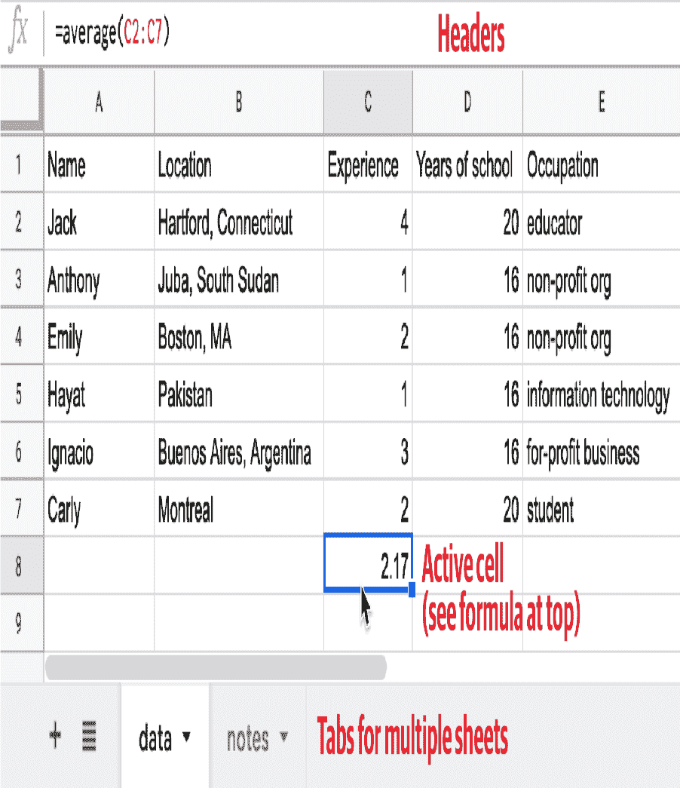

*Figure 2-1. A typical spreadsheet, with headers, tabs, and the active cell displaying a formula.*

在本章中，我们将首先回顾“共享你的 Google Sheets”、“上传并转换为 Google Sheets”、“在 Google Sheets 中地理编码地址”以及“使用 Google Forms 收集数据”中的基本步骤。然后我们将继续介绍组织和分析数据的方法，例如“排序和筛选数据”、“使用公式计算”以及“使用数据透视表汇总数据”。最后，我们将研究“使用 VLOOKUP 匹配列”和“电子表格”中连接不同工作表的方法


“Versus Relational Database”。我们以初学者用户为出发点来说明所有这些方法，意味着它们不需要任何先前的背景知识。

我们将使用可能引起你兴趣的示例数据来练习其中几种技能，因为其中包含了像你这样的人。到目前为止，已有超过三千名本书读者对他们的大致位置、之前的经验和教育水平以及学习数据可视化的目标进行了简短的公开调查。如果你还没有这样做，请填写调查以贡献你自己的回答，同时也能更好地了解问题是如何提出的，然后查看公开示例数据集中的结果。

如果你想学习如何让计算机为你完成更多枯燥的数据准备工作，本章绝对适合你。或者如果你已经非常熟悉电子表格，你至少应该浏览本章，也许你会学到一两招，帮助你在本书后面的章节中更高效地创建图表和地图。

## 选择你的电子表格工具

你应该使用哪些电子表格工具？正如我们在第1章中更详细描述的那样，答案取决于你对工作中不同问题的回答。

首先，你的数据是公开的还是私有的？如果是私有的，请考虑使用可在计算机上运行的可下载电子表格工具，以降低使用会自动将数据存储在云中的在线电子表格工具时可能发生意外数据泄露的风险。其次，你是独自工作还是与他人合作？对于协作项目，请考虑使用专为允许其他团队成员同时查看或编辑数据而设计的在线电子表格工具。第三，你是否需要以任何特定格式导入或导出数据（我们将在下一节中描述），例如逗号分隔值（CSV）？如果是，则选择支持该格式的电子表格工具。最后，你更喜欢免费工具，还是愿意为其付费，或捐款支持开源开发？

以下是三种常见电子表格工具在这几个问题上的比较：

### Google Sheets

一种免费的在线电子表格工具，可在任何现代网络浏览器中使用，并自动将你的数据存储在云中。虽然上传的数据默认是私有的，但你可以选择与特定个人或互联网上的任何人共享，并允许他们查看或编辑以实现实时协作，类似于 Google 文档。Google Sheets 还支持以 CSV、OpenDocument 电子表格（ODS）、Excel 和其他格式导入和导出数据。

你可以使用与 Google 邮件账户相同的用户名注册免费的个人 Google Drive 账户，或使用新用户名创建单独账户以减少 Google 对你私人生活的侵入。另一个选择是为 Google Workspace 企业账户订阅付费（以前称为 G Suite），它提供几乎相同的工具，但共享设置专为大型组织或教育机构设计。

### LibreOffice

一套免费的可下载工具，包括其 Calc 电子表格，可用于 Mac、Windows 和 Linux 计算机，是 Microsoft Office 越来越受欢迎的替代品。当你下载 LibreOffice 时，其赞助组织 Document Foundation 会请求捐赠以继续其开源软件开发。Calc 电子表格工具以其原生 ODS 格式导入和导出数据，以及 CSV、Excel 等格式。虽然在线协作平台正在开发中，但尚未可供广泛使用。

### Microsoft Excel

Microsoft Office 套件中的电子表格工具，有不同版本可用，尽管公司随着时间的推移更改了产品名称，因此常常混淆。订阅 Microsoft 365 可为你提供两个版本：功能齐全的可下载版 Excel（大多数人简单说“Excel”时所指的就是它），适用于 Windows 或 Mac 计算机和其他设备，以及通过浏览器访问的更简单的在线 Excel，包括通过 Microsoft 在线托管服务与协作者共享文件。

如果你不愿为订阅付费，任何人都可以注册 Microsoft Office 在线版的免费在线 Excel 版本，但这不包括功能齐全的可下载版本。在线 Excel 工具存在限制。例如，无论是付费版还是免费版的在线 Excel 都不允许你以单页通用 CSV 格式保存文件，而这是后面章节中某些数据可视化工具所需的重要功能。你只能使用可下载的 Excel 工具导出为 CSV 格式，而该工具仅在付费的 Microsoft 365 订阅中可用。

决定使用哪些电子表格工具并非简单的选择。有时我们的决定会因项目而异，取决于成本、数据格式、隐私问题以及任何协作者的个人偏好。偶尔我们也遇到同事或客户特别要求我们通过电子邮件发送不敏感的电子表格数据附件，而不是通过为协作而设计的电子表格工具平台共享。因此，最好熟悉上面提到的三种常用电子表格工具，并了解它们各自的优缺点。

在本書中，我们主要使用 Google Sheets 作为大多数示例。我們通过本书分发的所有数据都是公开的。此外，我们希望使用专为协作而设计的电子表格工具，以便我们可以与像你这样的读者分享数据文件的链接，以便你可以查看我们的原始版本，并复制到自己的 Google Drive 中进行编辑，或下载为不同格式在 LibreOffice 或 Excel 中使用。我们教授的大多数电子表格方法在所有电子表格工具中看起来都相同，我们会在相关时指出例外情况。

## 常见数据格式

电子表格工具以不同格式组织数据。当你将电子表格数据下载到计算机时，你通常会看到其文件名，后跟一个点和一个简短的扩展名，表示数据格式。我们在本書中使用最常见的数据格式是：

- .csv

CSV，一种用于单页简单数据的通用格式，不保存公式或样式。

- .ods

ODS，一种标准化的开放格式，可保存多标签页、公式、样式等。

- .xlsx（或旧的 .xls）

Excel，一种 Microsoft 格式，支持多标签页、公式、样式等。

- .gsheet

Google Sheets，也支持多标签页、公式、样式等，但你通常不会在计算机上看到它们，因为它们主要设计为在线存在。

### TIP

Mac 计算机默认隐藏文件名扩展名，这意味着你可能无法看到句点后的简写文件格式，例如 data.csv 或 map.geojson。我们建议你通过前往 Finder > 首选项 > 高级，并勾选“显示所有文件名扩展名”来更改此设置。

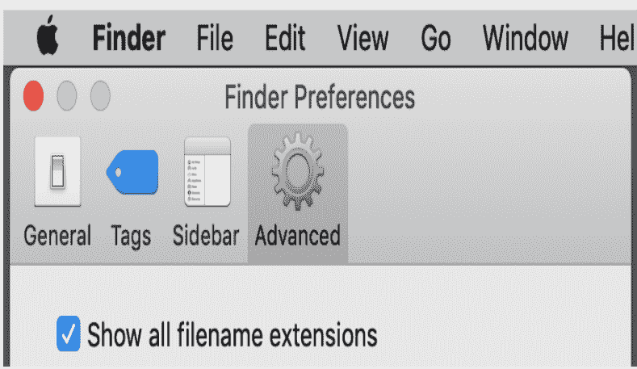

## 下载为 CSV 或 ODS 格式

在第 1 章中，你了解了我们为何推荐支持可移植性的软件，以便你随着技术发展将数据迁移到其他平台。切勿将重要数据上传到无法轻松取回的工具中。理想情况下，电子表格工具应允许你以通用或开放的数据文件格式导出你的工作，例如 CSV 和 ODS，以最大化你迁移到其他平台的选项。

### WARNING

如果你在任何包含多个标签页和公式的电子表格中工作，CSV 导出将只保存活动工作表（即你当前正在查看的那个），并且只保存该工作表中的数据（这意味着如果你插入了公式来运行计算，只有结果会显示，而不是公式）。本书后面你可能需要创建 CSV 文件导入到数据可视化工具中，因此如果源文件是包含公式的多标签页电子表格，请保留一份原始副本。


我们之所以在本书中介绍 Google Sheets，其中一个原因是它可以将数据导出为多种常见格式。要尝试一下，请在新标签页中打开这个 Google Sheets 示例数据文件，然后前往 File > Download 以导出 CSV 格式（仅导出活动工作表中的数据）或 ODS 格式（可保留多标签工作表中的数据和大部分公式），或如 图 2-2 所示的其他格式，例如 Excel。同样，在可下载的 LibreOffice 及其 Calc 电子表格工具中，选择 File > Save As 可将数据以原生 ODS 格式保存，或导出为 CSV、Excel 或其他格式。

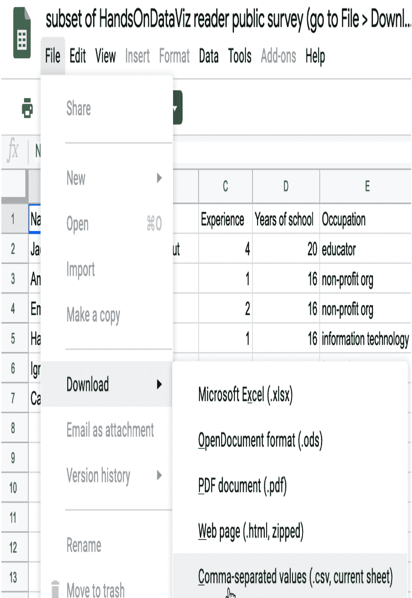

Figure 2-2. In Google Sheets, go to File > Download to export data in several common formats.

但在 Microsoft Excel 中导出数据可能会更棘手。使用浏览器中的在线 Excel 工具（免费或付费版本），你无法将文件保存为通用的单 sheet CSV 格式，而本书后续章节中的一些数据可视化工具需要此步骤。只有可下载的 Excel 工具（现需付费订阅）才能导出 CSV 格式。而且在使用可下载的 Excel 工具保存为 CSV 格式时，步骤有时会让人感到困惑。

首先，如果你看到多个 CSV 选项，请选择 CSV UTF-8，这在不同计算机平台上效果最佳。其次，如果你的 Excel 工作簿包含多个工作表或公式，你可能会看到警告，提示无法以 CSV 格式保存，因为 CSV 仅保存活动工作表（而非所有工作表）中的数据（而非公式）。如果你理解这一点，请点击 OK 继续。第三，在下一个屏幕中，Excel 可能会警告你在将 Excel 文件保存为 CSV 格式时“可能丢失数据”，原因如前所述。总的来说，使用可下载的 Excel 工具时，先以 XLSX 格式保存 Excel 文件的完整版本，然后再导出单个工作表为 CSV 格式。

一旦你学会如何将电子表格数据导出为开放格式，你就可以将其迁移到我们在后续章节中介绍的其他数据可视化工具或平台。数据可移植性对于确保你的图表和地图能够长期保存至关重要。

## Make a Copy of a Google Sheet

本书中我们使用 Google Sheets 提供了多个数据文件。我们的链接指向在线文件，并且我们将共享设置设为允许任何人查看——但不能编辑——原始版本。这使每个人都能访问数据，但不会有人意外修改内容。要完成本章中的多个练习，你需要学习如何制作我们 Google Sheets 的自己的副本——你可以编辑——而不改变我们的原件。

- 1. 在浏览器新标签页中打开这个 [Hands-On Data Visualization 读者公开调查回复的 Google Sheet](#)。我们将其设为“仅查看”，因此互联网上的任何人都可以查看内容，但不能编辑原始文件。了解有关调查的更多信息，请参阅本章顶部。
- 2. 点击右上角的蓝色按钮登录你的 Google 账号。
- 3. 前往 File > “Make a copy” 在你的 Google 云端硬盘中创建此 Google Sheet 的副本。你可以重命名文件以去掉“Copy of…”
- 4. 为了让你的 Google 云端硬盘文件井然有序，将它们保存在具有相关名称的文件夹中以便更容易找到。例如，你可以点击 My Drive 和 New Folder（图像）为你的数据创建一个文件夹，然后再点击 OK。


你的 Google Sheet 副本默认仅对你自己私密。在下一节中我们将学习共享 Google Sheet 数据给其他人的不同选项。

## Share Your Google Sheets

如果你与其他人合作进行项目，Google Sheets 提供了多种方式在线共享你的数据，甚至与没有 Google 账号的人共享。当你创建新 Sheet 时，其默认设置是私密的，意味着只有你可以看到或编辑其内容。在本节中，你将学习如何使用 Share 按钮扩展这些选项：

- 1. 登录你的 Google 云端硬盘账号，点击 New，选择 Google Sheets，并创建一个空白电子表格。你需要为文件命名才能继续下一步。
- 2. 点击右上角的 Share，你的选项将出现在“Share with people and groups”屏幕上。

### Share with people and groups

Add people and groups

Hands-On Data Visualization (you)

handsondataviz@gmail.com

Owner

Feedback?

Done

### Get link

Restricted Only people added can open with this link

Change to anyone with the link

Copy link

3. 在屏幕上半部分，你可以通过在“Add people and groups”字段中输入他们的 Google 用户名来与特定个人共享访问权限。对于你添加的每个人员或群组，在下一个屏幕中，选择下拉菜单将他们分配为文件的 Viewer、Commenter 或 Editor。决定是否要通过链接和可选消息通知他们。

4. 在屏幕下半部分，你可以通过点击“Change to anyone with the link”更广泛地共享访问权限。在下一个屏幕中，默认选项是允许任何拥有链接的人查看文件，但你可以将其更改为允许任何人对其进行评论或编辑。此外，你可以点击“Copy link”将数据的网络地址粘贴到电子邮件或公共网站中。

## TIP

如果你不想向人们发送一个又长又难看的 Google Sheet 网址，例如：

https://docs.google.com/spreadsheets/d/1egX_akJccnCSzdklAaDdrEGE5HcaTriOW-Yf6mJ3Uo

请使用免费的链接缩短服务。例如，通过使用我们的免费 Bitly.com 账号及其方便的 Chrome 浏览器扩展或 Firefox 浏览器扩展，我们可以粘贴一个长 URL 并自定义后半部分使其更短，例如 bit.ly/reader-responses。如果其他人已经占用了你偏好的自定义名称，你需要想一个不同的名称。请注意 bit.ly 链接区分大小写，因此我们更喜欢将后半部分自定义为全小写以匹配前半部分。

现在你已经了解了共享 Google Sheet 的不同选项，让我们学习如何上传和转换不同格式的数据。

## Upload and Convert to Google Sheets

我们之所以在本书中介绍 Google Sheets，部分原因是它支持数据迁移，意味着能够以多种常见格式导入和导出文件。但导入效果最佳时，你需要勾选“Convert uploads”框，该框隐藏在 Google 云端硬盘设置齿轮符号内。勾选此框会自动将 Microsoft Excel 表格转换为 Google Sheets 格式（同时也将 Microsoft Word 和 PowerPoint 文件转换为 Google 文档和幻灯片格式），从而便于编辑。如果你不勾选此框，Google 将保留你的文件为原始格式，这使得编辑更困难。Google 在新账号上默认关闭此转换设置，但我们将教你如何打开它，以及这样做的益处：

- 1. 找到可在计算机上使用的示例 Excel 文件。如果你没有，可以打开并保存以下载到计算机的这个 Hands-On Data Visualization 读者公开调查回复子集的 Excel 文件。
- 2. 登录你的 Google 云端硬盘账号，点击右上角的齿轮符号打开设置屏幕（ ）。请注意，此全局齿轮符号 > 设置出现在 Google 云端硬盘级别，而不是每个 Google Sheet 内部。
- 3. 在设置屏幕上，勾选“Convert uploaded files to Google Docs editor format”框，然后点击 Done。这会全局打开转换设置，意味着你未来上传的所有可能文件——包括 Microsoft Excel、Word、PowerPoint 等——都将被转换，除非你将其关闭。


### Settings

DONE

General

Notifications

Manage Apps

### Storage

0 bytes of 15 GB used

Buy storage

View items taking up storage

### Convert uploads

Convert uploaded files to Google Docs editor format

4. 将示例 Excel 文件从计算机上传到你的 Google 云端硬盘。将其拖放到所需文件夹或使用 New 按钮并选择“File upload”。

如果你忘记勾选“Convert uploads”，Google 云端硬盘将以原始格式保留上传的文件，并显示其图标和文件名扩展名，如 .xlsx 或 .csv。

Google Sheets file

Microsoft Excel file.xlsx

Comma Separated Values file.csv

## TIP

Google 云端硬盘现在允许你编辑 Microsoft Office 文件格式，但并非所有功能都保证跨平台正常工作。此外，Google 云端硬盘现在允许你通过使用 File > “Save as Google Sheets”菜单将特定上传的 Excel 文件转换为其 Google 格式。最后，要在保持全局转换设置关闭的情况下将单个文件转换为你的 Google 云端硬盘，从任何 Google Sheet 内部你可以选择 File > Import > Upload。但我们建议大多数人按照前述说明打开全局转换设置，除非你有意使用 Google 云端硬盘编辑 Excel 格式文件，并且理解某些功能可能无法正常工作。


既然你已经知道如何上传和转换现有数据集，在下一节中，你将学习如何安装和使用一个 Google Sheets 插件工具，将地址数据地理编码为纬度和经度坐标。

## 在 Google Sheets 中对地址进行地理编码

在本节中，你将学习如何通过安装免费的 Google Sheets 插件工具来对数据进行地理编码。这使你可以直接在电子表格中对地址进行地理编码，这在第 12 章使用 Leaflet 地图代码模板时会非常有用。

地理编码是指将地址或位置名称转换为地理坐标（或 x 和 y 坐标），以便在地图上标绘，如图 2-3 所示。例如，纽约市地区的自由女神像位于 40.69, -74.04。第一个数字是纬度，第二个是经度。由于赤道是 0 度纬度，正纬度表示北半球，负纬度表示南半球。类似地，本初子午线是 0 度经度，穿过英国格林尼治。因此，正经度位于本初子午线以东，负经度位于以西，直到你到达地球的另一侧，大致在太平洋的国际日期变更线附近。

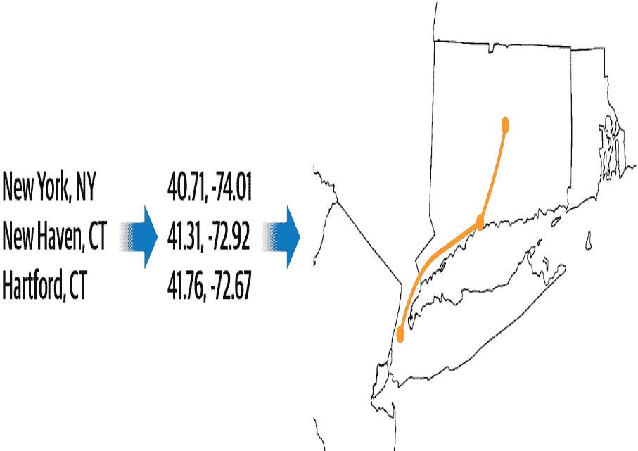

图 2-3. 要在地图上标注地址，首先需要对其进行地理编码。

如果你只有一两个地址，可以使用 Google Maps 快速对其进行地理编码。搜索一个地址，右键单击该点，然后选择“这是什么？”以弹出一个显示其纬度和经度的窗口，如图 2-4 所示。

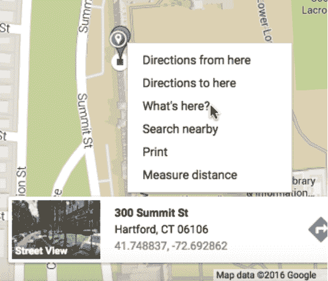

图 2-4. 要对单个地址进行地理编码，请在 Google Maps 中搜索并右键单击“这是什么？”以显示坐标。

但如果你需要对十几个或一百个地址进行地理编码呢？要在电子表格中对多个地址进行地理编码，请安装一个名为 Geocoding by SmartMonkey 的免费 Google Sheets 插件，它由西班牙巴塞罗那的地理路线规划公司 SmartMonkey 的首席执行官 Xavier Ruiz 创建。插件由第三方公司创建，用于扩展 Google Sheets、Google Docs 及相关工具的功能。插件经过验证符合 Google 的要求，并通过其 Google Workspace Marketplace 分发。

要安装此 Google Sheets 插件以对地址进行地理编码，请按照以下步骤操作：

- 1. 登录你的 Google Drive 账户，前往 Geocoding by SmartMonkey 插件页面，点击蓝色按钮将其安装到你的 Google Sheets 中。插件在安装前会请求你的许可，如果你同意，请按 Continue。在下一个窗口中，选择你的 Google Drive 账户，如果你同意条款，请点击 Allow 完成安装。Google 会通过电子邮件确认你已安装此可访问你账户的第三方应用。如果愿意，你以后随时可以查看权限并撤销访问权限。

- 2. 转到你的 Google Drive 并创建一个新的 Google Sheet。选择 Add-ons 菜单以查看新的“Geocoding by SmartMonkey”选项，然后选择“Geocode details”。该插件将创建一个包含示例数据的新工作表，并为三个新列显示结果：Latitude、Longitude 和“Address found”。始终通过将“Address found”列与原始输入的 Address 列进行比较来检查地理编码结果的质量。

  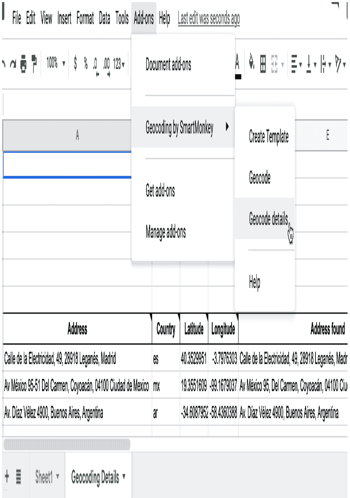

- 3. 粘贴你自己的地址数据以替换工作表中的示例数据，然后像第 2 步那样进行地理编码。请遵循以下指南以提高结果质量：

  - 不要跳过 Address 列中的任何行。
  - 使用地址所在国家邮政服务的格式插入完整地址。用空格分隔各项。
  - 你可以将 Country 列留空，但其默认值为 US。要指定其他国家，请使用其顶级互联网域名代码，例如西班牙用 es。
  - 如果你的原始数据将街道、城市、州和邮政编码拆分到不同列，请参阅“将数据合并到一列”。
  - 给工具留出处理时间。例如，如果你输入 50 个地址，预计至少需要等待 15 秒才能获得地理编码结果。
  - 始终检查结果质量，切勿假设任何提供商的地理编码服务都是准确的。

如果你需要更快的美国地址地理编码服务，并且一次上传最多可处理 10,000 个请求，请参阅第 13 章的“使用美国人口普查进行批量地理编码”。

既然你已经知道如何使用 Google Sheets 插件对地址进行地理编码，在下一节中，你将学习如何使用在线表单收集数据，并将其作为电子表格访问。

## 使用 Google Forms 收集数据

在本章开头，我们邀请你和本书的其他读者填写一份简短的在线调查问卷，该问卷会在示例数据集中公开分享所有回复，以便我们更了解像你这样的人，并继续修订以符合你的期望。在本节中，你将学习如何创建自己的在线表单，并将结果链接到实时 Google Sheet。

在你的 Google Drive 账户中，点击 New 并选择 Google Forms。Google Forms 的 Questions 选项卡允许你设计不同类型的响应问题：短答案和段落长度答案、多项选择、复选框、文件上传等，如图 2-5 所示。此外，Google Forms 会尝试解释你输入的问题，并预测性地为其分配类型。

### 姓名

告诉我们你的名字或首字母缩写（例如 Jack 或 JD）。姓氏可选。

短答案文本

### 位置

插入一个 Google Maps 可以识别的大致位置（例如 Hartford, CT 或 Kan Africa）。街道地址可选。

短答案文本

### 网页链接

可选：如果你希望其他人更了解你，请添加一个公开的网页地址，例如：https://twitter.com/DoughertyJack 或其他社交媒体页面。

短答案文本

- 单选
- 段落
- 多选
- 复选框
- 下拉列表
- 文件上传
- 线性刻度
- 单选网格
- 复选框网格
- 日期
- 时间

图 2-5. Google Forms 的 Questions 选项卡允许你指定不同类型的响应。

为每个问题设置一个非常简短的标题，因为它们将作为你稍后创建的链接电子表格中的列标题。如果某个问题需要更多解释或示例，请点击右下角的三点烤肉串菜单，选择 Show > Description，这将打开一个文本框，你可以在其中输入更多细节，如图 2-6 所示。此外，你可以选择 Show > “Response validation”（响应验证），这要求用户遵循特定格式，例如电子邮件地址或电话号码。此外，你可以选择 Required 字段，要求用户在继续之前必须回答问题。更多选项请参阅 Google Forms 支持页面。

图 2-6. 点击三点烤肉串菜单，选择 Show > Description 为任何问题添加细节。

### 注意

三点菜单符号的另一个名称是*烤肉串菜单*，因为它类似于中东食物串在签子上烤制，与许多移动设备上的三线*汉堡菜单*形成对比。软件开发人员一定是饿了。


要预览你的在线表单在收件人眼中的外观，请点击页面顶部附近的眼睛符号（👁）。当表单完成后，点击 Send 通过电子邮件、链接分发，或将实时表单作为 iframe 嵌入网页。有关后一种选项的更多信息，请参阅第 9 章。

Google Forms 的 Responses 选项卡将显示你收到的各个结果，并且还包含一个强大的按钮，可在链接的 Google Sheet 中打开数据，如图 2-7 所示。

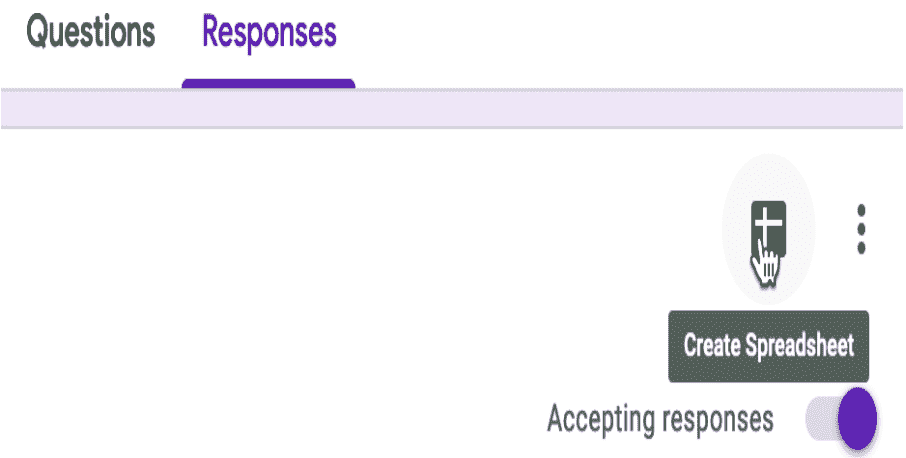

*图 2-7. Google Forms 的 Responses 选项卡包含一个按钮，可在链接的 Google Sheet 中打开结果。*

既然你已经学会了如何使用在线表单和链接的电子表格收集数据，接下来的两节将教你如何排序、筛选和透视表格，以开始分析其内容及其揭示的故事。

## 排序和筛选数据

电子表格工具可帮助你更深入地挖掘数据，并将你发现的故事浮出水面。组织数据的一个基本步骤是按特定列*排序*表格，以快速查看其最小值、最大值以及介于两者之间的范围。一种相关的方法是*筛选*整个表格，仅显示包含特定值的行，以帮助它们脱颖而出。


for further study among all of the other entries. Both of these methods become more powerful when your spreadsheets contain hundreds or thousands of rows of data. To learn how to sort and filter, let's explore the reader survey sample dataset we described at the top of the chapter:

- 1. Open this Google Sheet of *Hands-On Data Visualization* reader public survey responses in a new tab in your browser.
- 2. Log in to your Google Sheets account, and go to File > “Make a copy” to create your own version that you can edit.
- 3. Before sorting, click the upper-left corner of the sheet to select all cells. When the entire sheet becomes light blue, and all of the alphabetical column and numerical row headers become dark gray, this confirms you’ve selected all cells.

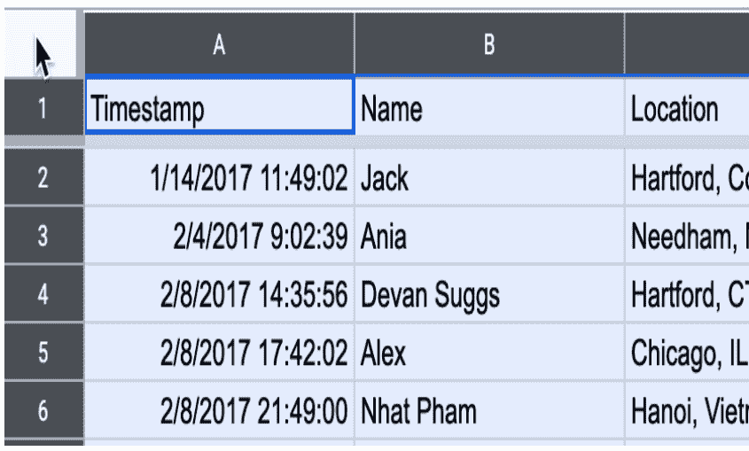

> **WARNING**
>
> If you forget to select all cells, you might accidentally sort one column independently of the others, which will scramble your dataset and make it meaningless. Always select all cells before sorting!

- 4. In the top menu, go to Data > “Sort range” to review all of your sort options. In the next screen, check the “Data has header row” box to view the column headers in your data. Let’s sort the “Experience with data visualization” column in ascending order (from A to Z), to display the minimum at the top, the maximum at the bottom, and the range in between.

```
Sort range from A1 to Z3887

Data has header row

Sort by Experience with data v...

A → Z

Z → A

Add another sort column

Cancel

Sort
```

Scroll through your sorted data and you’ll see that more than one thousand readers rated themselves as beginners (level 1) with data visualization.

> **TIP**
>
> When working with large spreadsheets, you can “freeze” the first row so that column headers will still appear as you scroll downward. In Google Sheets, go to View > Freeze and select one row. You can also freeze one or more columns to continuously display when scrolling sideways. LibreOffice has the same option to View > “Freeze Rows and Columns,” but Excel has a different option, called Window > Split.

- 5. Now let’s try filtering your sheet. Go to Data > “Create a filter,” which inserts downward arrows in each column header. Click on the downward arrow-shaped toggle in the Occupation column and see options to display or hide rows of data. For example, look under “Filter by values,” then click Clear to undo all options, then click “educator” to display only rows with that response. Click OK.

```
Years of school

Occupation

- Sort A → Z
- Sort Z → A
- Sort by color
- Filter by color
- Filter by condition
- Filter by values

Select all - Clear

(Blanks)
educator
for-profit business
```

Now your view of reader responses is sorted by experience and filtered to show only educators. Scroll through their one-sentence goals for learning about data visualization. How do they compare to your own goals? In the next section, we’ll learn how to start analyzing your data with simple formulas and functions.

## Calculate with Formulas

Spreadsheet tools can save you lots of time when you insert simple formulas and functions to automatically perform calculations across entire rows and columns of data. Formulas always begin with an equal sign, and may simply add up other cells (such as =C2+C3+C4), or may contain a function that performs a specific operation (such as calculating the sum of a range of cells: =SUM(C2:C100)). In this section, you’ll learn how to write two formulas with functions: one to calculate an average numeric value, and another to count the frequency of a specific text response. Once again, let’s learn this skill using the reader survey sample dataset we described at the top of the chapter:

- 1. Open this Google Sheet of *Hands-On Data Visualization* reader public survey responses in a new tab in your browser.
- 2. Log into your Google Drive account, and go to File > “Make a copy” to edit your own version.
- 3. Add a blank row immediately below the header to make space for our calculations. Right-click on row number 1 and select “Insert 1 below” to add a new row.
- 4. Let’s calculate the average level of reader experience with data visualization. Click on cell E2 in the new blank row you just created, and type an equal symbol (=) to start a formula. Google Sheets will automatically suggest possible formulas based on the context, and you can select one that displays the average for current values in the column, such as =AVERAGE(E3:E2894), then press Return or Enter on your keyboard.

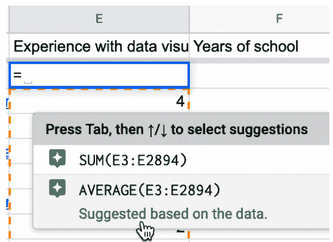

Since our live spreadsheet has a growing number of survey responses, you’ll have a larger number in the last cell reference to include all of the entries in your version. Currently, the average level of reader experience with data visualization is around 2 on a scale from 1 (beginner) to 5 (professional), but this may change as more readers fill out the survey. Note that if any readers leave this question blank, spreadsheet tools ignore empty cells when performing calculations.

> **TIP**
>
> In Google Sheets, =AVERAGE(E3:E) is another way to write the formula, which averages all values in column E, beginning with cell E3, without specifying the last cell reference. Using this syntax will keep your calculations up to date if more rows are added, but it does not work with LibreOffice or Excel.

- 5. Part of the magic of spreadsheets is that you can use the built-in hold-and-drag feature to copy and paste a formula across other columns or rows, and it will automatically update its cell references. Click in cell E2, then press and hold down the blue dot in the bottom-right corner of that cell, which transforms your cursor into a crosshair symbol. Drag your cursor to cell F2 and let go. The formula =AVERAGE(F3:F2894) or =AVERAGE(F3:F) will be automatically pasted and updated for the new column, depending on which way you entered it to begin with. Once again, since this is a live spreadsheet with a growing number of responses, your sheet will have a larger number in the last cell reference.

- 6. Because the Occupation column contains a defined set of text responses, let’s use a different function to count them using an if statement, such as the number of responses if a reader listed “educator.” Click in cell G2 and type the equal symbol (=) to start a new formula. Google Sheets will automatically suggest possible formulas based on the context, and you can select one that displays the count if the response is “educator” for current values in the entire column. You can directly type in the formula =COUNTIF(G3:G2894,"=educator"), where your last cell reference will be a larger number to reflect all of the rows in your version, or type in the Google Sheets syntax =COUNTIF(G3:G,"=educator") that runs the calculation on the entire column without naming a specific endpoint.

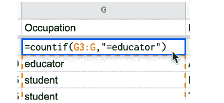

Spreadsheet tools contain many more functions to perform numerical calculations and also to modify text. Read more about functions in the support pages for Google Sheets, LibreOffice, or Microsoft Excel.

See additional spreadsheet skills in later chapters of the book, such as “Find and Replace with Blank”, “Split Data into Separate Columns”, and “Combine Data into One Column” in Chapter 4. See also “Pivot Points into Polygon Data” and “Normalize Your Data”.

Now that you’ve learned how to count one type of survey response, the next section will teach you how to regroup data with pivot tables that summarize all responses by different categories.

## Summarize Data with Pivot Tables

Pivot tables are another powerful feature built into spreadsheet tools to help you reorganize your data and summarize it in a new way, hence the name “pivot.” Yet pivot tables are often overlooked by people who were never taught about them or have not yet discovered how to use them. Let’s learn this skill using the reader survey sample dataset we described at the top of the chapter. Each row represents an individual reader, including their occupation and prior level of experience with data visualization. You’ll learn how to “pivot” this individual-level data into a new table that displays the total number of reader responses by two categories: occupation and experience level.

- 1. Open this Google Sheet of *Hands-On Data Visualization* reader public survey responses in a new tab in your browser. Log into your Google Drive account, and go to File > “Make a copy” to edit your own version.
- 2. Or, if you have already created your own copy for the prior section on Formulas and Functions, delete row 2 that contains our calculations, because we don’t want those getting mixed into our pivot table.
- 3. Go to Data > “Pivot table,” and on the next screen, select Create in a new sheet. The new sheet will include a pivot table tab at the bottom.

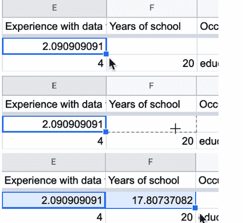


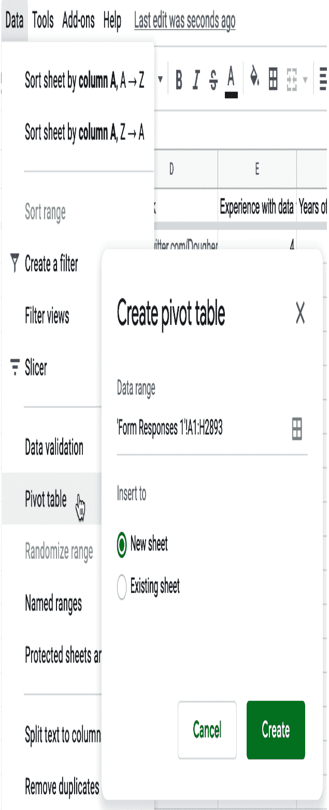

4. 在“数据透视表编辑器”屏幕中，你可以通过添加行、列和值来重新分组来自第一张表的数据。首先，点击“行”添加按钮并选择“职业”，它会显示该列中的唯一条目。

## 数据透视表编辑器

'Form Responses 1'!A1:H2893

### 建议

### 行

添加

### 职业

排序

升序

按以下排序

职业

显示总计

### 列

添加

### 值

添加

### 筛选条件

添加

### 职业

教育工作者

营利性企业

政府

信息技术

新闻业

非营利或非政府组织

未就业

其他

退休

学生

总计

5. 接下来，要统计每个条目的回复数量，点击“值”添加按钮并再次选择“职业”。Google Sheets 将自动按 COUNTA 汇总值，意味着它显示每种文本回复的频率。

目前，按读者列出的前三名职业是信息技术、营利性企业和学生。这是一个实时电子表格，因此随着更多读者回复调查，这些排名可能会发生变化。

## 数据透视表编辑器

'Form Responses 1'!A1:H2893

建议

行

添加

职业

排序

升序

按以下排序

职业

显示总计

列

添加

值

添加

职业

汇总方式

COUNTA

显示为

默认

|   | A | B |
|---|---|---|
| 1 | 职业 | 职业的 COUNTA |
| 2 |  | 0 |
| 3 | educator | 149 |
| 4 | for-profit business | 471 |
| 5 | government | 124 |
| 6 | information technology | 713 |
| 7 | journalism | 27 |
| 8 | non-profit or non-governmental organization | 204 |
| 9 | not employed | 208 |
| 10 | other | 330 |
| 11 | retired | 18 |
| 12 | student | 561 |
| 13 | Grand Total | 2805 |

6. 此外，你可以创建读者回复中职业和经验的更高级数据透视交叉表。点击“列”按钮添加“数据可视化经验”。

## 数据透视表编辑器

### 行

职业

排序
升序
按以下排序
职业
显示总计

### 列

数据可视化经验

排序
升序
按以下排序
数据可视化经验
显示总计

### 值

职业

汇总方式
COUNTA
显示为
默认

|  |  | 1 | 2 | 3 | 4 | 5 | Grand Total |
|---|---|---|---|---|---|---|---|
| 职业 |  |  |  |  |  |  | |
|  |  | 0 | 0 | 0 | 0 | 0 | 0 |
| educator |  | 61 | 39 | 35 | 8 | 6 | 149 |
| for-profit business |  | 3 | 151 | 128 | 136 | 47 | 6 | 471 |
| government |  | 2 | 39 | 36 | 35 | 10 | 2 | 124 |
| information technology |  | 4 | 238 | 151 | 205 | 76 | 39 | 713 |
| journalism |  | 9 | 8 | 8 | 1 | 1 | 27 |
| non-profit or non-governmental organization |  | 1 | 61 | 69 | 54 | 14 | 5 | 204 |
| not employed |  | 1 | 83 | 61 | 36 | 16 | 1 | 208 |
| other |  | 3 | 167 | 67 | 70 | 16 | 7 | 330 |
| retired |  | 6 | 5 | 7 |  |  | 18 |
| student |  | 9 | 279 | 135 | 102 | 24 | 12 | 561 |
| Grand Total |  | 23 | 1104 | 699 | 688 | 212 | 79 | 2805 |

更进一步，筛选数据以按另一类别限制数据透视表结果。例如，在下拉菜单中，你可以点击“筛选条件”添加按钮，选择“受教育年限”，然后在“按值筛选”下选择“清除”，然后勾选 20 以仅显示列出 20 年或以上的人。

决定在“数据透视表编辑器”中如何添加“值”可能具有挑战性，因为有多种汇总数据的选项，如图 2-8 所示。Google Sheets 会根据上下文提供自动猜测，但你可能需要手动选择最佳选项以按所需方式表示你的数据。汇总值的最常见选项有三种：

### SUM

数值回复的总和。 （读者的受教育总年数是多少？）

### COUNT

数值回复的频率。 （有多少读者列出了 20 年的受教育年限？）

### COUNTA

文本回复的频率。 （有多少读者将职业列为“教育工作者”？）

### 值

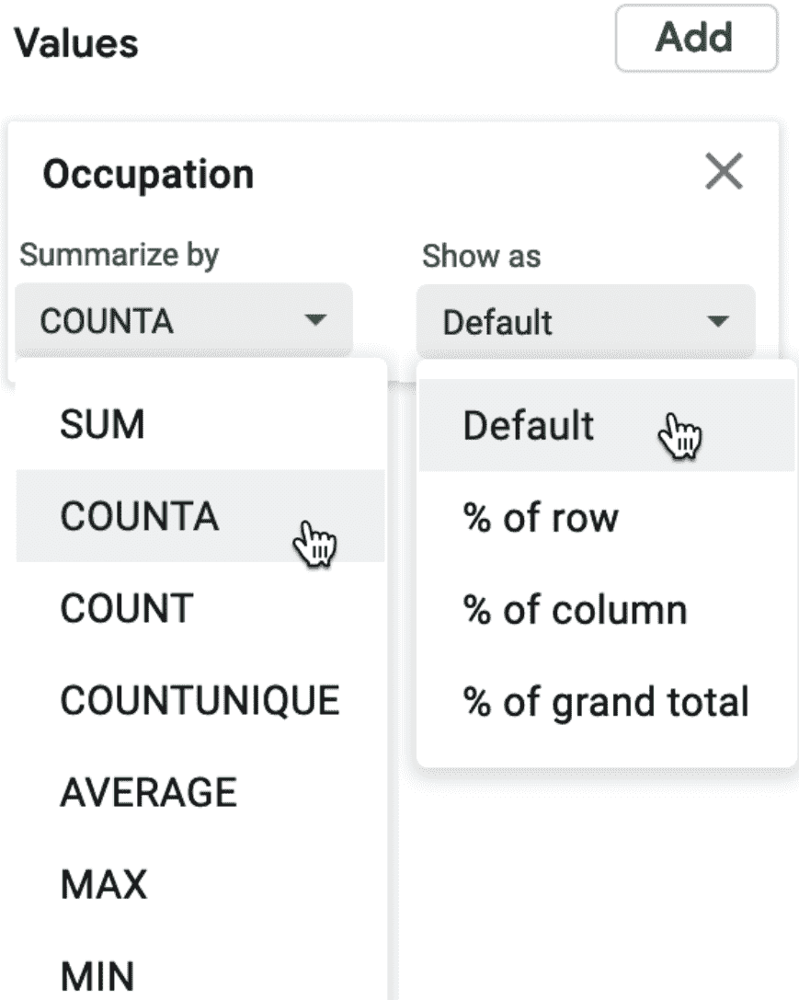

图 2-8. 在数据透视表编辑器中，查看汇总值的多个选项。

尽管 Google Sheets 数据透视表默认显示原始数字，但在“显示为”下拉菜单下，你可以选择将其显示为行的百分比、列的百分比或总计的百分比。

虽然设计数据透视表在其他电子表格工具中看起来可能不同，但概念是相同的。了解有关数据透视表如何工作的更多信息，请访问 Google Sheets 或 LibreOffice 或 Microsoft Excel 的支持页面。记住你可以下载 Google Sheets 数据并导出为 ODS 或 Excel 格式，以便在其他工具中尝试数据透视表。

现在你已经了解了如何使用数据透视表重新分组和汇总数据，在下一节中你将学习一种相关方法，使用 VLOOKUP 在不同电子表格之间连接匹配的数据列。

## 使用 VLOOKUP 匹配列

电子表格工具还允许你“查找”一张表中的数据并自动查找并粘贴另一张表中匹配的数据。本节介绍 VLOOKUP 函数，其中 V 代表“垂直”，意味着跨列匹配，这是查找数据的最常见方式。你将学习如何在第一张表中编写一个函数，查找第二张表中选定列中的匹配单元格，并将相关数据粘贴到第一张表的新列中。如果你曾经面临在两个不同电子表格之间手动查找和匹配数据的繁琐任务，这种自动化方法将为你节省大量时间。

这里有一个说明为什么以及如何使用 VLOOKUP 函数的场景。图 2-9 显示了两个不同的工作表，其中包含关于在美国不同地区帮助饥饿人群的食品银行的示例数据，取自 Feeding America: Find Your Local Food Bank。第一张表列出了每个食品银行的个人，第二张表列出了每个食品银行的地址，两者共享一个名为 *organization* 的公共列。你的目标是生成一张用作邮件列表的工作表，其中每一行包含一个个人的姓名、组织和完整邮寄地址。由于我们使用的是小型数据样本以简化本教程，手动复制粘贴数据可能很诱人。然而，想象一下实际案例中包含超过两百个美国食品银行和更多个人，使用自动化方法匹配和粘贴数据是必不可少的。

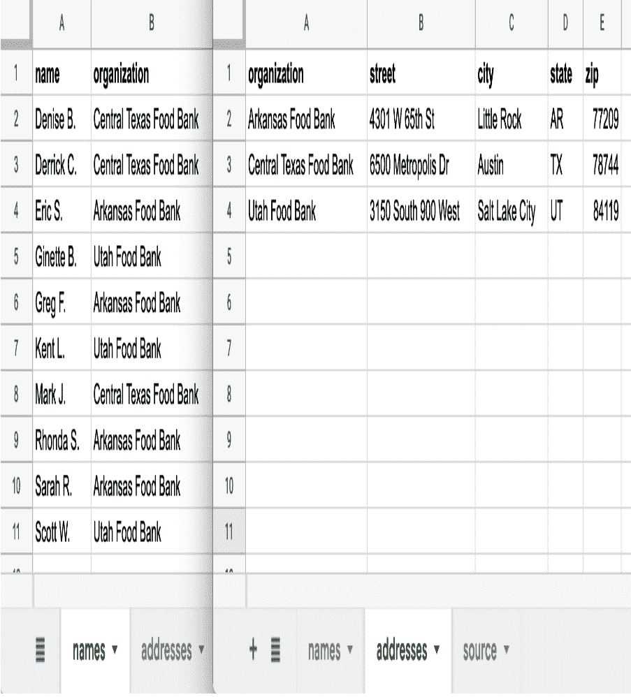

*图 2-9. 你的目标是创建一个邮件列表，将左侧工作表中的个人姓名和组织与右侧工作表中的地址匹配。*

以下是使用 VLOOKUP 匹配数据的步骤：

- 1. 在新浏览器标签页中打开此 Google Sheet 的食品银行示例姓名和地址。登录你的 Google Drive，然后转到 文件 > “创建副本” 以创建可编辑的自己的版本。
  
  我们通过将两个表格放在同一个 Google Sheet 中简化了这个两表问题。点击第一个标签页，名为 names，以及第二个标签页，名为 addresses。将来，如果你需要将两个单独的 Google Sheet 移入同一个文件，请转到一个工作表的标签页，右键点击标签页选择“复制到” > “现有电子表格”，并选择另一个工作表的名称。

- 2. 在你可编辑的 Google Sheet 副本中，names 标签页将是我们创建邮件列表的目的地。转到 addresses 工作表，复制 street、city、state、zip 的列标题，并将它们粘贴到 names 工作表的 C1 到 F1 单元格中。这创建了新的列标题，我们的查找结果将自动粘贴到此处。

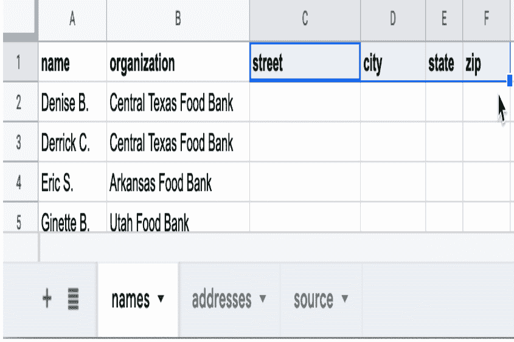

- 3. 在 names 工作表中，点击 C2 单元格并输入 =VLOOKUP，Google Sheets 将建议你以此格式完成完整公式：

```
VLOOKUP(search_key, range, index, [is_sorted])
```

以下是每个部分的含义：

search_key

你希望在第一张表中匹配的单元格。

range

在第二张表中搜索匹配项和所需结果的至少两列。

index

第二张表范围内包含所需结果的列，其中 1 = 第一列，2 = 第二列，等等。

[is_sorted]

输入 false 仅查找精确匹配，这在这种情况下是有意义的。否则，如果第二张表范围的第一列已排序并且你接受最接近的匹配，即使不是精确匹配，则输入 true。

- 4. 一个选项是直接在 C2 单元格中输入此公式，使用逗号分隔符： =VLOOKUP(B2,'addresses'!A:E,2,false)。另一个选项是点击 Google Sheets 建议的“VLOOKUP 垂直查找”灰色框，并点击相关单元格、列和工作表以自动为你输入公式。这里的新内容是 names 工作表中的此公式引用 addresses 工作表中 A 到 E 列的范围。按键盘上的 Return 或 Enter。


让我们分解你在 names 工作表的 C2 单元格中输入的公式的每个部分：

B2
search_key：你希望在 names 工作表中进行匹配的组织列中的单元格。

'addresses'!A:E
你搜索匹配项和结果的区域，位于 addresses 工作表的 A 至 E 列。

2
索引：表示你期望的结果出现在该范围的第二列（街道）。

false
仅查找完全匹配项。

5. 输入完整的 VLOOKUP 公式后，它将显示第一个组织 Central Texas Food Bank 的完全匹配项，其地址是 6500 Metropolis Drive。单击并按住 C2 单元格右下角的蓝色小点，将十字光标拖过 D 至 F 列，然后松开，这将自动为城市、州和邮政编码列粘贴并更新公式。

6. 最后，使用相同的按住并拖动的方法向下粘贴并更新公式，以填充所有行。

## 警告

如果你将此电子表格保存为 CSV 格式，计算结果将出现在 CSV 工作表中，但你创建用于生成这些结果的任何公式都会消失。请始终保留原始电子表格，以提醒自己这些公式是如何构建的。

你已成功创建了一个邮件列表——包括每个人的姓名、组织和完整邮寄地址——使用 VLOOKUP 函数匹配并粘贴来自两个工作表的数据。现在你了解了如何使用公式连接不同的电子表格，下一节将教你如何借助关系数据库管理多个电子表格之间的关系。

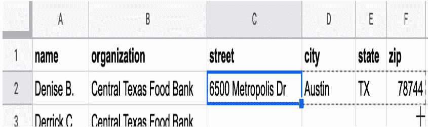

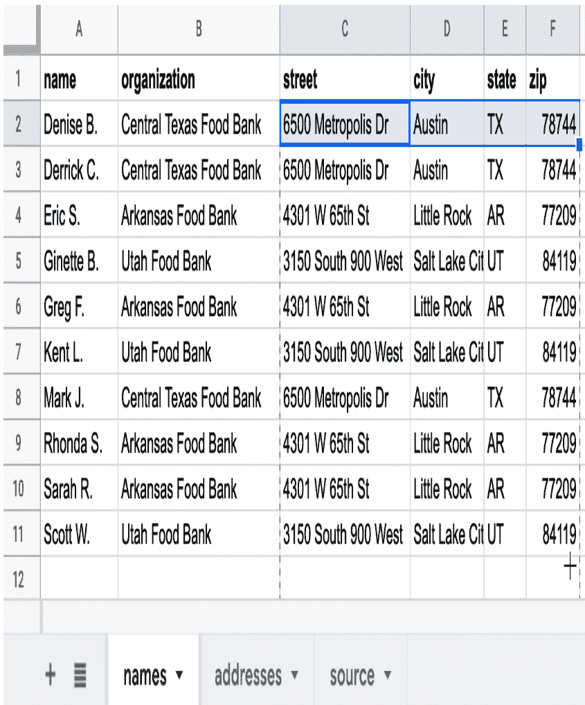

你的数据视图，可与他人共享，我们将在第 9 章中讨论这一主题。更多功能请参阅 Airtable 支持页面。

理解“平面文件”电子表格与关系数据库之间的概念差异非常重要，这有助于你确定何时使用一种工具而非另一种。正如你在前面章节中学到的，电子表格是你开始整理和分析数据的最佳选择，可以使用排序、筛选、透视和查找等方法，帮助揭示你可能希望可视化的底层故事。但在维护包含内部链接的大量数据（例如一对多关系，比如一个组织有多名员工）时，关系数据库是你的最佳选择。

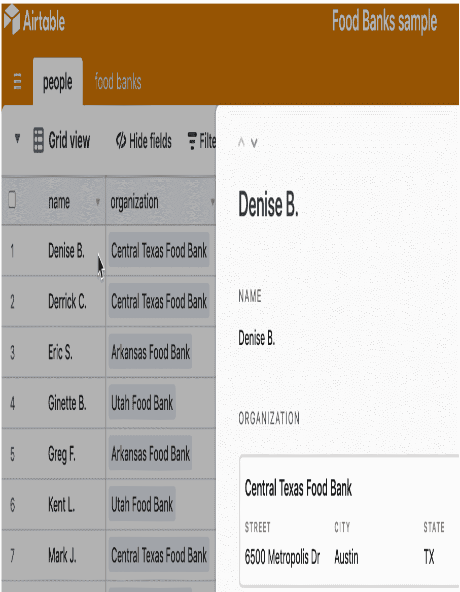

图 2-11。在这个 Airtable 演示中，单击一个工作表中的某一行，即可展开并查看其在另一个工作表中的链接数据。

## 总结

如果你是那些在学校或工作中“从未真正学过”电子表格的众多人之一，或者你一路上零散自学了一些，我们希望本章能够成功增强你的技能。本书后续所有章节，尤其是第 6 章设计交互式图表和第 7 章设计交互式地图，都需要你对电子表格有基本的熟悉。除了在处理繁琐的数据任务时成为惊人的省时工具之外，本书介绍的电子表格工具和方法旨在帮助你共享、排序、计算、透视和查找匹配数据，其更广泛的目标是可视化你的数据故事。

下一章将介绍查找和审视数据的策略，特别是在政府和非营利组织运营的开放数据网站上，你还需要电子表格技能来下载和组织公共信息。
