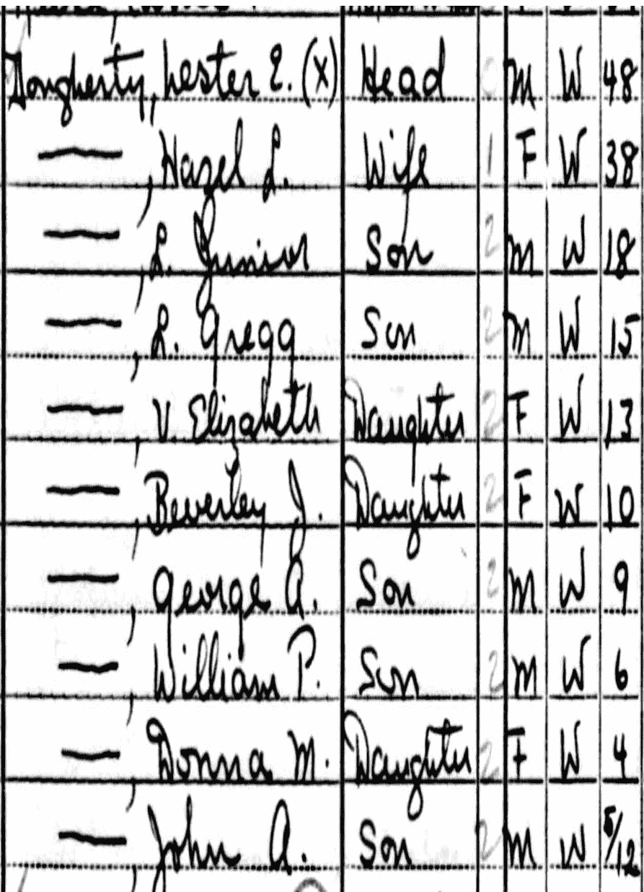
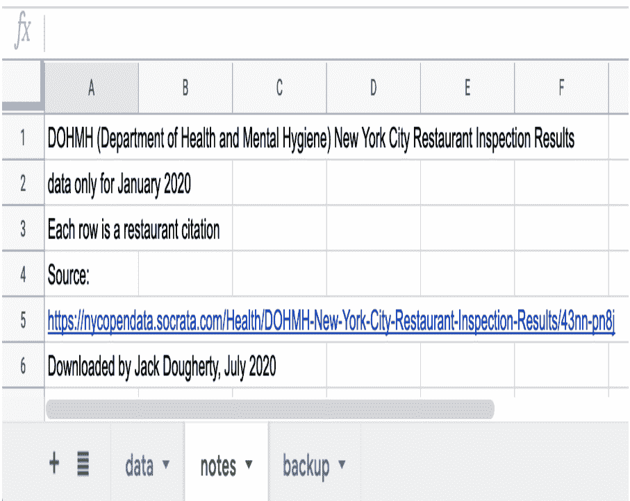
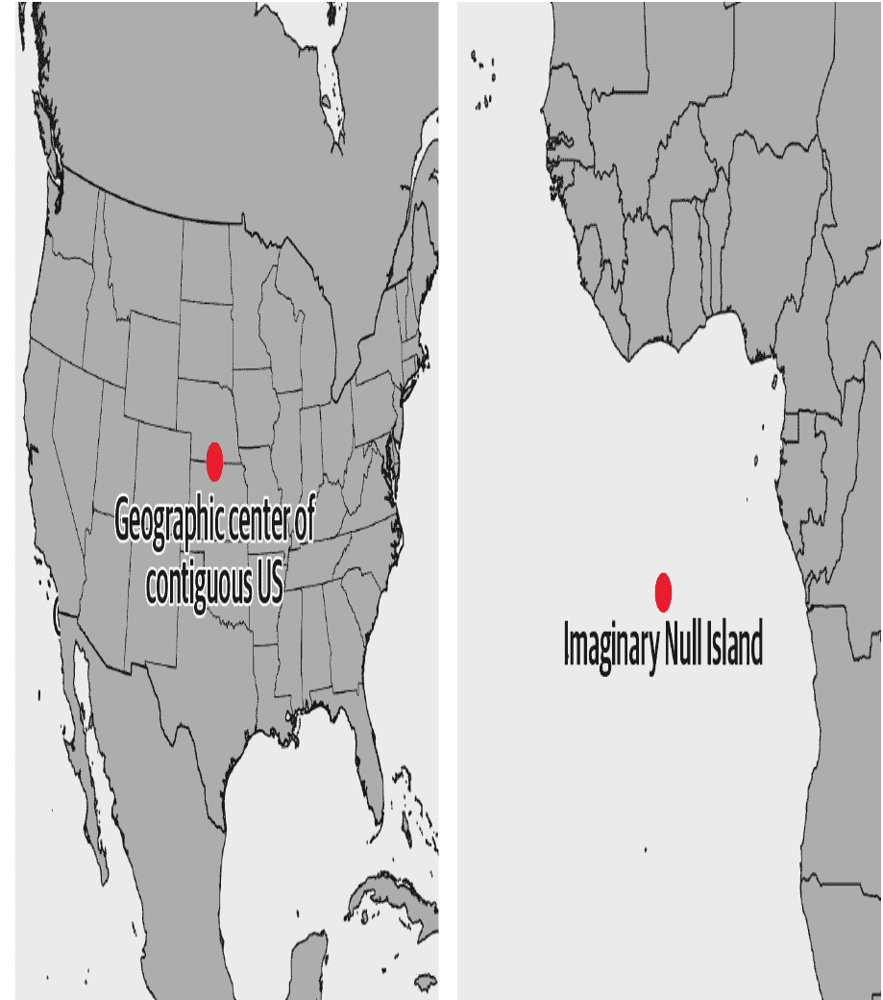

# 第3章 查找并审视你的数据

在可视化项目的早期阶段，我们通常会从两个相互关联的问题开始：*我在哪里可以找到可靠的数据？* 找到之后，*这些数据真正代表什么？* 如果你没有深入思考这两个双重问题，就过快地开始构建图表和地图，你可能会创造出毫无意义，或者更糟的是具有误导性的可视化。

本章将在“搜索的指导性问题”、“公共与私人数据”、“屏蔽或聚合敏感数据”、“开放数据存储库”、“为数据注明来源”、“识别不良数据”中分解这两个广泛的问题。最后，一旦你找到了一些文件，我们将在“审视你的数据”中提出一些方法来质疑并承认数据的局限性。

信息不会凭空神奇出现。相反，人们在其所处时代的社会背景和权力结构中，带着明确或隐含的目的收集和发布数据。作为数据可视化倡导者，我们强烈支持基于证据的推理，而不是基于信息不足的替代方案。然而，我们警告不要盲目接受所谓的数据客观性，因为数字和其他形式的数据*并非*中立。因此，在处理数据时，请停下来更深入地追问：*谁的故事被讲述了？* *谁的观点未被提及？* 根据*《数据女性主义》*作者凯瑟琳·迪伊格纳齐奥和劳伦·克莱因的说法，只有提出这类问题，我们才能“开始看到特权是如何嵌入我们的数据实践和数据产品中的。”¹

## 搜索的指导性问题

对许多人来说，数据搜索只是在网上用谷歌搜索一些关键词。有时可行，有时不可行。当这种方法失败时，我们会反思与才华横溢的图书馆员、记者和研究人员一起工作时学到的关于数据搜寻的许多经验。他们共同教会了我们一组指导性问题，勾勒出一个关于*如何搜索*数据的更周全的过程。

### 你究竟想用数据回答什么问题？

请把这个问题写下来——以问句的形式，在末尾加上问号——以澄清你自己的思路，同时你也可以清楚地向能帮助你的人传达。很多时候，我们的大脑会自动跳到寻找*答案*，而没有反思如何以不限制可能结果范围的最佳方式来构建*问题*。

回顾那些给你留下深刻印象的数据可视化项目，找出驱动它们的根本问题。在对美国阿片类药物流行病的报道中，*《华盛顿邮报》*和西弗吉尼亚州的*《查尔斯顿公报-邮报》*通过法律斗争成功获取了美国缉毒局的数据库，而联邦政府和制药行业曾试图将其保密。2019 年，一个数据记者团队将该数据库与交互式地图一起发布，以回答他们的一个核心问题：*按人均计算，有多少处方阿片类药物被送往美国的每个县，哪些公司和分销商对此负责？* 他们的地图显示，阿巴拉契亚地区几个农村县出现高聚集，在 2006 年至 2014 年期间，这些县平均每年每个居民收到超过 150 粒阿片类药丸。此外，在此期间，只有六家公司分销了全美 1000 亿粒羟考酮和氢可酮药丸中的四分之三以上：McKesson Corp.、Walgreens、Cardinal Health、AmerisourceBergen、CVS 和 Walmart。² 即使你处理的数据不如这样庞大或具有争议性，更广泛的教训是明确确定你试图回答的问题。

另外，随着研究的推进而修改你的问题，这完全正常。例如，杰克和他的学生们曾以一个天真的问题开始一个数据项目：*20 世纪 60 年代康涅狄格州公立学校的考试成绩是多少？* 我们很快发现，我们今天所知的标准化州级学校考试直到 20 世纪 80 年代中期的学校问责运动才出现在康涅狄格州这样的州。即便如此，在 20 世纪 90 年代报纸开始每年以印刷形式公布一次结果之前，公众并未广泛看到这些结果。后来，随着互联网在 20 世纪 90 年代末和 21 世纪初的扩展，房地产公司、学校评级公司和政府机构开始在网上持续发布数据。根据这些发现，我们将研究问题修改为：*康涅狄格州的购房者何时以及如何开始关注学校考试成绩，这些成绩又如何影响他们为进入特定公立学校学区而愿意支付的价格？*³ 当证据指引你走向更好的方向时，要准备好完善你的问题。

### 哪些类型的组织可能收集或发布了你要找的数据？

如果可能涉及政府组织，那么是什么级别：地方、区域、州/省、国家还是国际？哪个政府部门：行政、立法还是司法？或者哪个特定政府机构可能负责编制或分发这些信息？由于所有这些不同的结构可能令人不知所措，请向受过处理政府文件和数据库培训的图书馆员求助，他们通常就职于州政府图书馆或参与美国联邦寄存图书馆计划的地方机构。或者你所需的数据是否可能由非政府组织编制，例如学术机构、记者、非营利组织或营利性公司？弄清楚*哪些组织*可能收集和发布了这些数据，可以帮助你找到他们通常发布的数字或印刷材料，以及在该特定领域集中搜索的最合适工具。

## 可用的数据层级有哪些？

信息是拆分为单个案例还是汇总成更大的群体？较小的数据单元允许你做出更细粒度的解读，而较大的单元可以帮助你识别更广泛的模式。图书管理员可以帮助我们解读组织为何以及如何以不同层级发布数据。例如，美国人口普查每 10 年收集一次全国每个居民的数据。根据法律，每个人的个人层级数据在 72 年内保密，然后向公众发布。目前，你可以在美国国家档案馆和其他网站上搜索 1940 年人口普查及更早年代的具体个人，如图 3-1 所示。

图 3-1. Jack 父亲家庭的个人层级 1940 年美国人口普查数据摘录。

与此同时，美国人口普查通过将个人记录汇总到更大的地理区域来发布当前年份的数据，以保护人们的隐私。利用美国人口普查地理实体标准层级，我们在图 3-2 中创建了一张简化的地图，以展示康涅狄格州哈特福德最常见地理区域之间的关系：

- State
- County
- County subdivisions (equivalent to Connecticut towns and cities)
- Census tracts (designated areas, roughly 1,200–8,000 people)
- Block groups (subunit of tracts, roughly 600–3,000 people)
- Census blocks (subunit of block groups, but not always a city block)⁴

- State (Conn.) —
- Counties (Conn.) —
- County subdivisions (Hartford County) —
- Census tracts (Hartford) —
- Census block groups (Hartford) —
- Census blocks (Hartford) —

East Hartford

## 先前的出版物是否使用了类似的数据，如果有，我们如何追溯其来源？

我们许多最好的想法始于阅读一篇描述其证据来源的文章或书籍，并设想以新的方式可视化该数据的方式。多次，我们偶然发现印刷出版物中的数据表，或许是旧网页，这激发了我们追踪更新版本以探索的兴趣。即使是过时的数据也有帮助，因为它展示了某人在某一时间点是如何收集它的。跟随脚注追溯其起源。使用 Google Scholar 和更专业的科研数据库（如果需要请向图书管理员寻求帮助）来追踪先前出版数据的来源。一个好处是，如果你能找到更新的数据，你可能能够设计一个比较随时间变化的可视化。

## 如果没有人收集你正在寻找的数据怎么办？

有时这种情况的发生不仅仅是简单的疏忽。在《数据女性主义》中，Catherine D’Ignazio 和 Lauren Klein 强调数据收集问题“与更大的权力和特权问题直接相关”，并讲述了网球明星 Serena Williams 的故事。当 Williams 在 2017 年生育女儿时经历了危及生命的并发症，她呼吁公众关注她作为一名黑人女性在医院需要为自己倡导的方式。经历之后，她在社交媒体上写道“黑人女性死于孕产相关原因的可能性是白人女性的 3 倍以上”，并引用了美国疾病控制与预防中心（CDC）。当记者跟进调查时，他们发现了产妇死亡率详细数据的缺失，以及 2014 年联合国报告所描述的美国医疗保健系统数据收集“特别薄弱”方面。记者报道称，“仍然没有全国性的系统来追踪怀孕和分娩期间发生的并发症”，尽管对于其他健康问题，如心脏病发作或髋关节置换，已有可比系统。

权力结构旨在统计那些生活被高度重视或处于高度监视下的人。D’Ignazio 和 Klein 呼吁我们批判性地审视这些权力系统，收集数据以抵消其影响，并使这一过程中的每个人的劳动更加可见。5 如果没有人收集你正在寻找的数据，也许你可以采取有价值的步骤公开承认这一问题，并可能自己收集它。

寻找数据远不止于在谷歌上搜索关键词。通过反思图书管理员、记者和其他研究人员教给我们的提问类型来加深你的搜索：可能——或可能不会——收集数据的组织类型是什么？在什么层级？在任何先前的时点？以及在何种社会和政治背景下？在下一节中，你将了解有关公共和私人数据的相关问题。

## 公共和私人数据

在搜索数据时，你还需要了解关于公共和私人数据的争论。不仅这些争论影响了你可能在可视化中合法使用的种类的数据，而且它们还提出了关于任何人是否应该能够收集或传播个人私人信息的更深层次的伦理问题。本节提供了我们对这些争论的一般观察，主要基于我们在美国的背景。由于我们不是律师（谢天谢地！），如果需要，请就你的具体情况咨询法律专家。

第一个争论问：应该允许任何人收集关于私人个人的数据到什么程度？

一些“大数据”批评者担心，随着数字时代个人公民数据的收集增加，政府变得越来越像极权主义的“老大哥”。在美国，2013 年举报人 Edward Snowden 披露国家安全局利用电信公司提供的美国公民电子邮件和电话记录进行全球监控后，担忧加剧。哈佛商学院教授、著作《监控资本主义时代》的 Shoshana Zuboff 警告称，企业收集和商品化大量可单独识别的个人数据以谋取利润构成同等威胁。6 由于数字商业的兴起，强大的科技公司拥有你和其他人认为私人的数据：

- Google 知道你输入到其搜索引擎的词语，如在 Google Trends 中以汇总形式显示。同样，Google 的 Chrome 浏览器通过 cookie 跟踪你的网络活动，正如《华盛顿邮报》科技记者 Geoffrey Fowler 所描述的。7
- Amazon 监听并记录你与 Alexa 家庭助手的对话，正如 Fowler 所述。8
- Facebook 跟踪你偏好的朋友和政治事业，Fowler 还报道了它如何跟踪你的离 Facebook 活动，例如在其他企业进行的购买，以改善其定向广告。9

一些人指出，大型企业收集的“大数据”可以带来公共利益。例如，Apple 分享了从 iPhone 用户收集的汇总移动数据，以帮助公共卫生官员比较在 COVID-19 大流行期间哪些人群待在家中而不是出行。其他人指出，企业在很大程度上自行设定了收集数据的方式和用途。虽然加州于 2020 年开始实施其《消费者隐私法》，该法承诺允许个人审查和删除公司收集的关于他们的信息，但美国州和联邦政府尚未完全进入这一政策领域。如果你使用的是由公共或私人组织从个人收集的数据，请了解这些争议，以帮助你做出明智和合乎道德的选择，决定在可视化中包含什么。

第二个问题是：*当我们的政府收集数据时，应该在多大程度上公开？*

在美国，1966 年的《信息自由法》及其后续修正案旨在开放联邦政府的信息获取渠道，其观点是增加透明度将促进公众监督并促使官员做出积极改变。此外，各州政府在其自己的信息自由法下运作，有时称为“公开记录”或“阳光法”。当人们说他们提交了“FOI”时，意思是他们向政府机构发送了书面请求，要求获取他们认为根据法律应公开的信息。但联邦和州的 FOIA 法律很复杂，随着时间的推移法院对案件的解释也不同，如《开放政府指南》由新闻自由新闻委员会和国家信息自由联盟所述。有时政府机构迅速同意并遵守 FOI 请求，而其他时候他们可能会延迟或拒绝，这可能会迫使请求者通过耗时的诉讼来尝试解决该问题。在全球范围内，超过一百个国家拥有自己的信息自由法，最古老的是瑞典 1766 年的《新闻自由法》，但这些法律差异很大。

在大多数情况下，美国联邦和州政府收集的个人层级数据被视为私人，除非我们的政府程序确定更广泛的利益通过使其公开而得到服务。为了说明这一区别，让我们从两个美国联邦法律保护个人层级数据隐私的案例开始：

- 病人层级的健康数据通常受《健康保险流通与责任法》隐私规则保护，通称 HIPAA。为了让公共卫生官员追踪人群中疾病的广泛趋势，个人患者数据必须汇总成更大的匿名数据集，以保护特定个人的保密性。
- 同样，学生层级的教育数据通常受《家庭教育权利和隐私法》保护，通称 FERPA。公共教育官员定期将个人学生记录汇总成更大的匿名公共数据集，以追踪学校、学区和州的整体进展，而不透露可单独识别的数据。

另一方面，这里有三个政府裁定公共利益通过使个人层级数据广泛可用而得到服务的案例：

- 个人对政治候选人的捐款在美国联邦选举委员会数据库中是公开信息，以及非营利组织的关联数据库，如国家政治金钱研究所的 Follow The Money 和负责政治中心的 Open Secrets。后两个网站描述了更多通过政治行动委员会提交的捐款以及竞选财务法律的争议性例外情况。在美国各地，州级政治捐款法律差异很大，这些公共记录存储在单独的数据库中。例如，任何人都可以搜索康涅狄格州竞选报告信息系统，找到 Jack 对州级政治竞选的捐款。
- 个人产权记录是公开的，并且越来越多地由许多地方政府在线托管。一家私人资助的公司编制了这个美国公共记录目录，其中包含指向县和市政产权记录的链接（如有）。例如，任何人都可以搜索康涅狄格州西哈特福德镇的物业评估数据库，找到 Jack 拥有的房产、其平方英尺和购买价格。
- 免税组织的官员个人薪资是公开的，这些组织每年必须在美国国税局（IRS）990 表格上申报。例如，任何人都可以搜索 ProPublica 的 Nonprofit Explorer，并在 Jack 的雇主和 Ilya 的母校哈特福德 Trinity College 的顶级官员的薪资和其他薪酬上查看。

社会和政治压力不断改变关于政府收集的个人层级数据应多大程度上公开的边界。例如，Black Lives Matter 运动逐渐使有关警察暴力行为的个人层级数据更广泛可用。例如，在 2001 年，新泽西州要求地方警察部门记录警官的任何“使用武力”，无论轻重，例如开枪。但没有人能轻松搜索这些纸质表格，直到 NJ Advance Media 的记者团队提交了五百多份公共记录请求并编制了 The Force Report 数字数据库，任何人都可以查找个人警官并调查暴力行为模式。同样，ProPublica 记者团队创建了 The NYPD Files 数据库，允许任何人按姓名或辖区搜索针对纽约市警察的平民投诉的已结案件，以寻找已证实的指控模式。

每个使用数据的人都需要了解关于什么应公开或私人的关键争论，积极参与关于谁的利益正在得到服务的政策讨论，并为带来积极改变做出贡献。在下一节中，你将了解在处理敏感的个人层级数据时需要做出的伦理选择。

## 掩盖或汇总敏感数据

即使个人层级数据在法律上可公开访问，我们每个人都有责任在创建数据可视化时做出伦理决定是否以及如何使用它。在处理敏感数据时，一些伦理问题需要问是：*公开分享个人层级数据可能造成的风险是否会造成比好处更大的伤害？* 以及 *是否有一种方式可以在不公开可能侵犯个人隐私的细节的情况下讲述相同的数据故事？*

这些伦理问题没有简单的答案，因为每个情况都不同，需要权衡个人伤害的风险与关于重要公共问题的更广泛知识的好处。本节澄清了一些

替代盲目重新分发敏感信息的方法，例如遮蔽和聚合个人层面数据。

想象一下，你正在探索犯罪数据，希望创建一个交互式地图，展示几个街区中不同类型的 911 报警电话的频率。如果你按照“开放数据存储库”中的描述搜索有关报警电话的公共数据，你会看到由报警中心发布的共享个人层面数据的不同政策和做法。在美国的许多州，有关性犯罪或虐待儿童受害者（例如警方被派往的地址）的信息被视为机密，并免于公开发布，因此不会包含在开放数据中。但一些警察部门确实会以如下格式发布包含完整地址的其他类型犯罪报警电话的开放数据：

| 日期 | 完整地址 | 类别 |
| 1月1日 | 1234 Main St | 加重攻击 |

虽然这些信息是公开可用的，但如果你的数据可视化中重新分发包含受害者完整地址的暴力犯罪详细信息，有可能对受害者造成某种身体或情感伤害。

一种替代方案是遮蔽敏感数据中的细节。例如，一些警察部门在开放数据报告中隐藏街道地址的最后几位数字，以保护个人隐私，同时仍然显示大致位置，格式如下：

| 日期 | 遮蔽地址 | 类别 |
| 1月1日 | 1XXX Main St | 加重攻击 |

你也可以在适当时使用与第4章讨论的电子表格工具的“查找和替换”方法类似的方法来遮蔽个人层面数据。

另一种策略是将个人层面数据聚合到更大的组中，这可以在显示更广泛模式的同时保护隐私。在前面的示例中，如果你正在探索不同街区的犯罪数据，可以将单独的 911 报警电话分组到更大的地理区域，例如人口普查区或区域名称，格式如下：

| 街区 | 犯罪类别 | 频率 |
| 东区 | 加重攻击 | 13 |
| 西区 | 加重攻击 | 21 |

将个人层面细节聚合到更大但有意义的类别中，也是讲述全局数据故事的更好方式。要聚合简单的电子表格数据，请参阅“使用数据透视表汇总数据”；要使数据标准化以生成更有意义的地图，请参阅“标准化你的数据”。另请参阅“使用美国人口普查进行批量地理编码”和“将点透视到多边形数据”。

接下来，你将学习如何探索政府和非政府组织有意与公众共享的数据集。

## 开放数据存储库

在过去的十年里，全球越来越多的政府和非政府组织开始通过开放数据存储库主动共享公共数据。虽然其中一些数据集以前以独立文件的形式存在于孤立的网站上，但这些不断发展的网络使开放数据更容易被找到，支持更频繁的机构更新，并且有时支持与其他计算机的实时交互。开放数据存储库通常包含以下功能：

查看和导出

至少，开放数据存储库允许用户以常见的电子表格格式（如 CSV、ODS 和 XLSX）查看和导出数据。一些存储库还提供用于创建地图的地理边界文件。

内置可视化工具

一些存储库提供内置工具，供用户在其平台网站上创建交互式图表或地图。有些还提供代码片段，供用户将这些内置可视化内容嵌入到自己的网站中，你将在第9章中了解更多。

应用程序编程接口（APIs）

一些存储库提供带有代码说明的端点，允许其他计算机将数据直接从平台提取到外部网站或在线可视化中。当存储库持续更新数据并发布 API 端点时，这可以成为在可视化中显示实时或“近乎实时”数据的理想方式，你将在第12章中了解更多。

由于近年来开放数据存储库的增长，特别是在政府政策和科学研究领域，目前没有一个单独的网站列出所有存储库。相反，下面仅列出美国及全球范围内的一些网站，以激发读者的好奇心，并鼓励你更深入地挖掘：

### Data.gov

美国联邦政府机构的官方存储库。

### Data.census.gov

访问美国人口普查局数据的主要平台。十年一次的人口普查每十年对人口进行一次全面统计，而美国社区调查（ACS）则每年进行抽样统计，为不同普查地理区域生成一年和五年的估计值，并附有误差范围。

### Eurostat

欧盟统计局。

### Federal Reserve Economic Research

提供美国和国际数据。

### Global Open Data Index

由开放知识基金会（Open Knowledge Foundation）发布。

### Google Dataset Search

由谷歌开发的数据集搜索引擎。

### Harvard Dataverse

向所有学科的研究人员开放。

### Humanitarian Data Exchange

由联合国人道主义事务协调厅发布。

### IPUMS

综合公共使用微观数据系列（Integrated Public Use Microdata Series），是世界上最大的个人层面人口数据库，包含美国和国际人口普查记录及调查的微观数据样本，由明尼苏达大学托管。

### openAfrica

由非洲代码（Code for Africa）发布。

### Open Data Inception

面向地图的全球目录。

### Open Data Network

由 Socrata 维护的目录，主要涵盖美国州和市级开放数据平台。联合国数据。

### World Bank Open Data

全球经济发展数据集合。

### World Inequality Database

关于收入与财富不平等的全球数据。

如需更多选项，请参阅由多所图书馆工作人员组织和维护的开放数据列表，包括罗切斯特大学、纽约州立大学杰纳苏学院、布朗大学等。

此外，资源更充足的高等教育图书馆和其他组织可能会支付订阅费，以允许其学生和教职员工访问“封闭”数据存储库。例如，Social Explorer 提供数十年的人口、经济、健康、教育、宗教和犯罪数据，覆盖本地和国家地理区域，主要针对美国、加拿大和欧洲。此前，Social Explorer 曾向公众提供许多文件，但现在需要付费订阅或 14 天免费试用。此外，Policy Map 提供美国各地区的人口、经济、住房和生活质量数据，并在其“开放地图”视图中公开发布部分数据，但你需要订阅才能下载。

另请参阅“查找 GeoJSON 边界文件”，这是本书中用于创建地图的开放数据标准。

## 数据来源

当你找到数据时，将来源信息写入下载的文件或你创建的新文件中。添加关于其来源的关键细节，以便你或未来的其他人能够复制你的步骤。我们建议在两个地方进行：电子表格文件名和来源说明选项卡。作为第三步，为你的数据制作一个备份工作表。第一步是为你下载或创建的每个数据文件命名。我们都遇到过如下所示的“糟糕文件名”，应避免：

- *data.csv*
- *file.ods*
- *download.xlsx*

写一个简短但有意义的文件名。虽然没有完美的体系，但一个好的策略是缩写来源（如 `census` 或 `worldbank` 或 `eurostat`），添加主题关键词，以及日期或范围。如果你或同事将处理下载文件的不同版本，请以 YYYY-MM-DD（年-月-日）格式包含当前日期。如果你计划将文件上传到网络，请全部使用小写字母，并用短横线（–）或下划线（_）替换空格。更好的文件名如下所示：

- *town-demographics-2019-12-02.csv*
- *census2010_population_by_county.ods*
- *eurostat-1999-2019-co2-emissions.xlsx*

第二步是在电子表格内的单独选项卡中保存有关数据的更详细来源说明，这适用于 Google Sheets、LibreOffice 和 Excel 等多选项卡电子表格工具。添加一个名为 *notes* 的新选项卡，描述数据的来源、任何缩写标签的更长描述以及最后更新时间，如图 3-3 所示。添加你自己的名字，并感谢与你合作的协作者。如果你需要从此数据创建 CSV 文件，请为其指定与多选项卡电子表格文件并行的名称，以便将来轻松找到原始来源说明。

*图 3-3. 为数据、说明和备份创建单独的电子表格选项卡。*

第三步是在清理或编辑原始数据之前进行备份。对于多选项卡电子表格工具中的简单单工作表文件，右键单击包含数据的选项卡，在另一个选项卡中生成重复副本，如图 3-3 所示。清楚地将新选项卡标记为备份，然后不要管它！对于 CSV 文件或更复杂的电子表格，请创建单独的备份文件。需要明确的是，这些简单的备份策略只能帮助你避免对原始数据进行无法修复的编辑。

确保你有一个更广泛的策略来备份你从计算机或云账户备份文件，以防其中任何一个被删除或系统崩溃。

养成使用这三种来源策略的习惯——文件名、注释和备份——以提高你的数据可视化的可信度和可重复性。在下一节中，我们将探讨更多减少你犯“坏数据”错误机会的方法。

## 识别坏数据

当你的数据搜索产生一些结果时，另一个关键步骤是打开文件，快速滚动浏览内容，并寻找任何可能包含“坏数据”的警告信号。如果你未能在早期阶段发现数据中的问题，它可能导致错误的结论并降低你所有工作的可信度。幸运的是，数据可视化社区的成员分享了我们之前遇到的多个问题示例，以帮助新成员避免犯同样的尴尬错误。数据记者的一个热门众包汇编是《石英指南：坏数据》。注意包含以下“坏数据”警告信号的电子表格：

### 缺失值

如果你看到空白或“null”条目，这是否意味着数据未被收集？或者也许受访者没有回答？如果你不确定，请向数据创建者询问。还要当心人类在运行电子表格计算（如 SUM 或 AVERAGE）时，未经思考就用 0 或 −1 来表示缺失值。

### 缺失前导零

哈特福德、康涅狄格州的一个邮政编码是 06106。如果有人将邮政编码列转换为数值数据，它会去掉前导零并显示为 6106。同样，美国人口普查局使用联邦信息处理标准（FIPS）代码列出每个地点，其中一些也以有意义的零字符开头。例如，加利福尼亚州洛杉矶县的 FIPS 代码是 037，但如果有人不小心将文本列转换为数字，它会去掉前导零并将该 FIPS 代码转换为 37，这可能会破坏依赖此代码为三位数数字的某些功能，或者可能使一些人将其解释为北卡罗来纳州的两位数州代码。

### 65536 行或 255 列

这些分别是旧式 Excel 电子表格支持的最大行数，或 Apple Numbers 电子表格支持的列数。如果你的电子表格恰好在这两个限制处停止，你可能只有部分数据。正如我们撰写本文时，BBC 报道称英国公共卫生部因旧版 Excel 电子表格中的此行限制而丢失了数千条 COVID-19 测试结果。

### 不一致的日期格式

例如，2020 年 11 月 3 日在美国的电子表格中通常输入为 11/3/2020（月-日-年），而全球其他地区的人通常将其输入为 3/11/2020（日-月-年）。请检查你的来源。

### 日期如 1900 年、1904 年或 1970 年 1 月 1 日

这些是 Excel 电子表格和 Unix 操作系统中的默认时间戳，可能表示实际日期为空或被覆盖。

### 日期类似 4 3 8 9 1

当你在 Microsoft Excel 中输入 2020 年 3 月 1 日时，它会自动显示为 1-Mar，但使用 Excel 的内部日期系统保存为 43891。如果有人将此列从日期格式转换为文本格式，你会看到 Excel 的五位数，而不是你期望的日期。

在任何电子表格列中审查数据录入质量的其他方法在“排序和筛选数据”和“使用数据透视表汇总数据”中讨论，以及在第 6 章中，你将学习创建直方图。这些方法使你能够快速检查列中出现的数值范围，并帮助你识别坏数据。

还要当心因地理编码不良而导致的坏数据，当位置被转换为不可信的经纬度坐标时（参见“在 Google 表格中地理编码地址”）。例如，可视化专家 Alberto Cairo 描述了数据似乎显示堪萨斯州居民比其他美国州观看更多在线色情内容的情况。仔细检查后，许多观众的互联网协议（IP）地址无法准确地理编码，也许是因为他们试图通过使用虚拟专用网络（VPN）来伪装其位置以维护隐私。因此，地理编码工具自动将大量用户放置在美国本土的地理中心，而该中心恰好位于堪萨斯州。10 同样，当全球数据地理编码不良时，人口会在虚构的“Null Island”上激增，该岛实际上是位于本初子午线和赤道交汇处的亚特兰大洋上的一个气象浮标，其纬度和经度坐标为 0,0。出于这些原因，仔细检查地理编码数据是否存在错误，即工具错误地将结果放置在你的地理区域的精确中心，如图 3-4 所示。

图 3-4. 当心坏的地理编码会自动将数据放置在美国本土的地理中心（堪萨斯州北部），或放置在亚特兰大洋上虚构的 Null Island（坐标 0,0 的位置）。

当你在项目中发现坏数据时该怎么办？有时小问题相对简单，并不会质疑整个数据集的完整性。有时你可以使用我们在第 4 章中描述的方法修复这些问题。更大的问题可能更成问题。追溯你的数据流以尝试确定问题开始的地方。如果你自己找不到并修复问题，请联系数据提供者征求他们的意见，因为他们应该对提高数据质量有强烈的兴趣。如果他们无法解决重要的数据问题，那么你需要暂停并仔细思考。在这种情况下，是继续使用有问题的数据并向读者添加警示说明更明智，还是完全停止使用该数据集并引起对其潜在问题的关注？这些都不是容易的决定，你应该征求同事的意见。无论如何，永远不要忽视坏数据的警告信号。

最后，你可以通过遵循我们概述的关键步骤来帮助防止坏数据发生。为你的数据文件命名有意义，并在单独的选项卡中添加来源注释，说明何时以及在何处获得它，以及任何关于它声称测量的内容及其记录方式的定义或细节。解释空白或 null 值意味着什么，并避免用零或其他符号替换它们。始终注意在电子表格中输入数据或运行计算时的格式问题。

在下一节中，你将学习更多问题来帮助你更深入地理解你的数据。

## 质疑你的数据

现在你已经找到了、来源并检查了一些文件，下一步是质疑你的数据，通过比表面层次更深入地审视。阅读元数据，即描述数据及其来源的注释。检查内容以反思其明确陈述的内容——或未陈述的内容——以便更好地理解其起源、背景和局限性。你无法让计算机为你完成这一步，因为它需要批判性思维才能看到屏幕上出现的字符和数字之外的内容。

一个开始的地方是问：数据标签的真正含义是什么？并考虑以下潜在问题。

### 缩写列标题的完整定义是什么？

电子表格通常包含缩写列标题，例如 Elevation 或 Income。有时原始软件限制了可以输入的字符数，或创建标题名称的人更喜欢保持简短。但 Elevation 是以米还是英尺输入的？缩写的数据标签无法回答这个关键问题，因此你需要检查来源注释，或者如果不可用，将数据集中的特定点的海拔数据与包含测量单位的已知来源进行比较。同样，如果你正在使用美国人口普查数据，Income 缩写是指人均、家庭人均还是户均？此外，该值反映的是中位数（数值范围中的中点）还是平均值（通过将总和相加并除以数值数量计算的平均值）。请在来源注释中查看定义。

### 数据是如何收集的？

例如，特定位置的 Elevation 是由地面上的 GPS 设备测量的吗？还是该位置在包含海拔数据的数字地图上被地理编码？在大多数情况下，这两种方法会产生不同的结果，而这是否重要取决于你的工作中所需的精度程度。同样，当美国人口普查报告其年度美国社区调查（ACS）估计的 Income 和其他变量时，这些数据来自较低地理层级（如约有四千居民的人口普查区）的受访者小样本，这可能产生非常高的误差幅度。例如，看到一个人口普查区的 ACS 估计平均家庭收入为 50,000 美元——但误差幅度为 25,000 美元——并不罕见，这告诉你实际值在 25,000 美元到 75,000 美元之间。因此，一些小地理单元的 ACS 估计实际上毫无意义。请在来源注释中查看数据是如何记录的，并注意报告的误差幅度。另见第 6 章中如何创建误差线。

### 数据在多大程度上是社会建构的？

数据标签揭示或隐藏了人们在不同社会和政治背景下如何定义类别的情况，这些背景因地点和时间而异。例如，我们使用超过一百年的美国人口普查数据设计了康涅狄格州哈特福德县种族变化的历史交互地图。但在这些几十年间，人口普查对种族和民族的分类发生了巨大变化，因为掌权者重新定义了这些有争议的术语并将人们重新分配到不同的群体。¹ 进入 1930 年代，美国人口普查官员在报告中将“Native White”和“Foreign-born White”分开，然后在后来的几十年中合并并通常报告为“White”。此外，美国人口普查官员在 1930 年将“墨西哥人”归类为“其他种族”，然后在 1940 年将其移回“白人”，然后在 1960 年报告“波多黎各人或西班牙姓氏”数据，随后在后来的几十年中将“西班牙裔或拉丁裔”作为与种族不同的民族类别报告。最后，人口普查在 1980 年用“Black”取代了“Negro”，并在 2000 年最终放弃了相互排斥的种族类别，以便人们可以选择多个种族。因此，这些历史上的种族和民族社会建构的变化影响了我们如何设计地图以随时间显示“White”或“White alone”，并在弹出窗口中显示与每个十年相关的额外人口普查类别，并在标题和来源注释中对这些决定进行解释。

当定义随几十年变化时，没有单一的确定方法来可视化社会建构的数据。当你对数据做出选择时，请在注释或配套文本中描述你的思考过程。

### 数据的哪些方面仍然不清楚或不确定？

这里有一个关于处理数据的悖论：如果你不是自己收集数据，尤其是如果那个人来自遥远的地点或时间段，或社会等级中的不同位置，那么这些深层次的问题可能无法完全回答。即使你无法完全回答这些问题，也不要因此停止对数据起源、背景和潜在含义提出好问题。我们的任务是用数据讲述真实而有意义的故事，但这一过程始于澄清我们对所收集信息的了解——以及我们不了解的内容。有时我们可以通过误差线在视觉上描绘其局限性，如你将在“图表设计原则”中学到的，有时我们需要在数据故事中承认不确定性，如我们将在“承认来源和不确定性”中讨论的。

## 总结

本章回顾了每个人在可视化项目早期阶段都应提出两个广泛问题：我在哪里可以找到数据？和我对它真的了解多少？我们将这两个问题分解为更具体的部分，以培养你在指导搜索、参与公共和私人数据辩论、屏蔽和聚合敏感数据、浏览开放数据存储库、溯源数据来源、识别坏数据以及比表面层次更深入地质疑数据方面的知识和技能。在你进入接下来的几章关于清理数据和创建交互式图表和地图时，请记住这些教训。我们将在第 14 章中再次讨论与此主题相关的相关问题。

2. “Drilling into the DEA’s Pain Pill Database” (*Washington Post*, July 16, 2019), https://oreil.ly/Xx7dh.
3. Jack Dougherty et al., “School Choice in Suburbia: Test Scores, Race, and Housing Markets,” *American Journal of Education* 115, no. 4 (August 2009): 523–548, https://oreil.ly/T2I81.
4. Katy Rossiter, “What Are Census Blocks?” US Census Bureau, July 11, 2011, https://oreil.ly/UTxpk.
5. D’Ignazio and Klein, *Data Feminism*.
6. Shoshana Zuboff, *The Age of Surveillance Capitalism: The Fight for a Human Future at the New Frontier of Power* (PublicAffairs, 2019).
7. Geoffrey A. Fowler, “Goodbye, Chrome: Google’s Web Browser Has Become Spy Software,” *The Washington Post*, June 21, 2019, https://oreil.ly/ef8H.
8. Geoffrey A. Fowler, “Alexa Has Been Eavesdropping on You This Whole Time,” *The Washington Post*, May 6, 2019, https://oreil.ly/eR6RG.
9. Geoffrey A. Fowler, “Facebook Will Now Show You Exactly How It Stalks You — Even When You’re Not Using Facebook,” *The Washington Post*, January 28, 2020, https://oreil.ly/ymv9T.
10. Cairo, *How Charts Lie*, 2019, pp. 99–102.
11. For a deeper analysis, see Margo J. Anderson, *The American Census: A Social History*, 2nd edition (Yale University Press, 2015).
