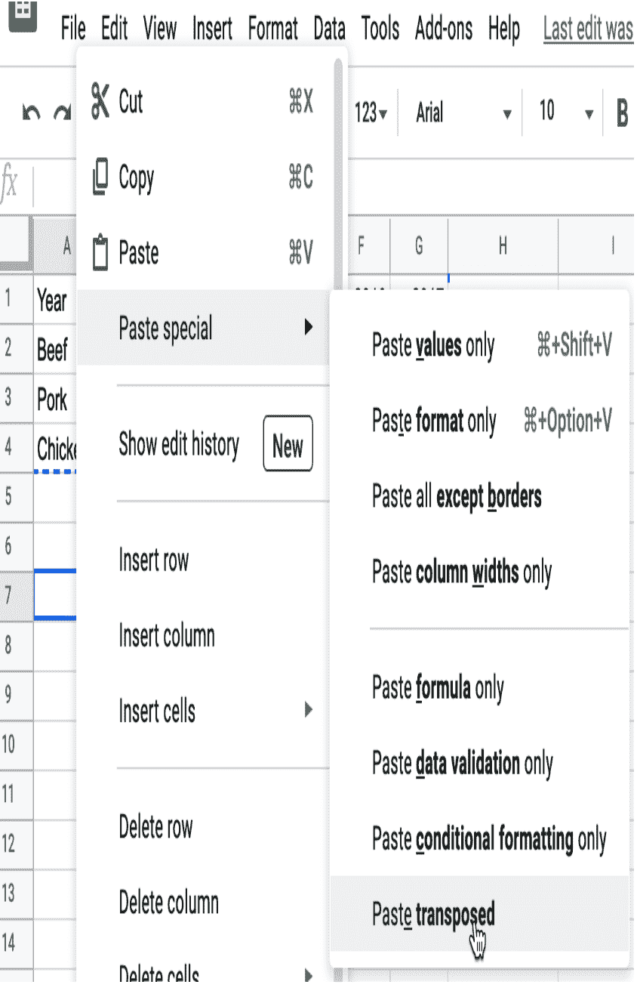
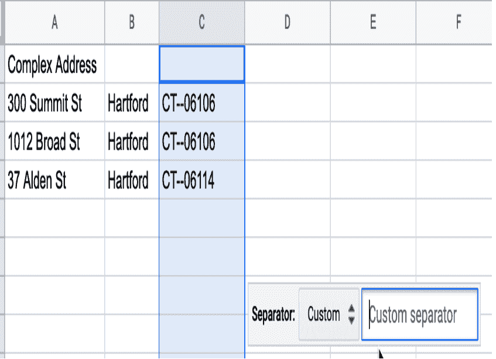
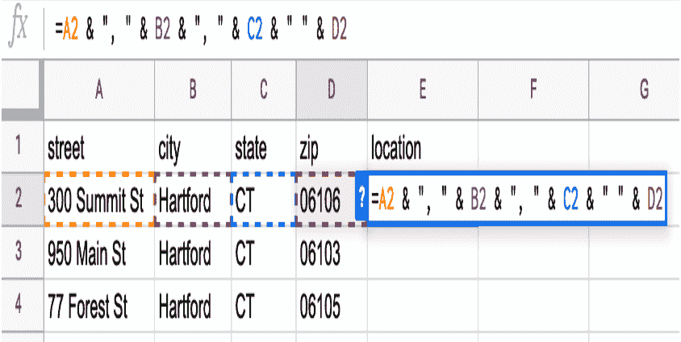
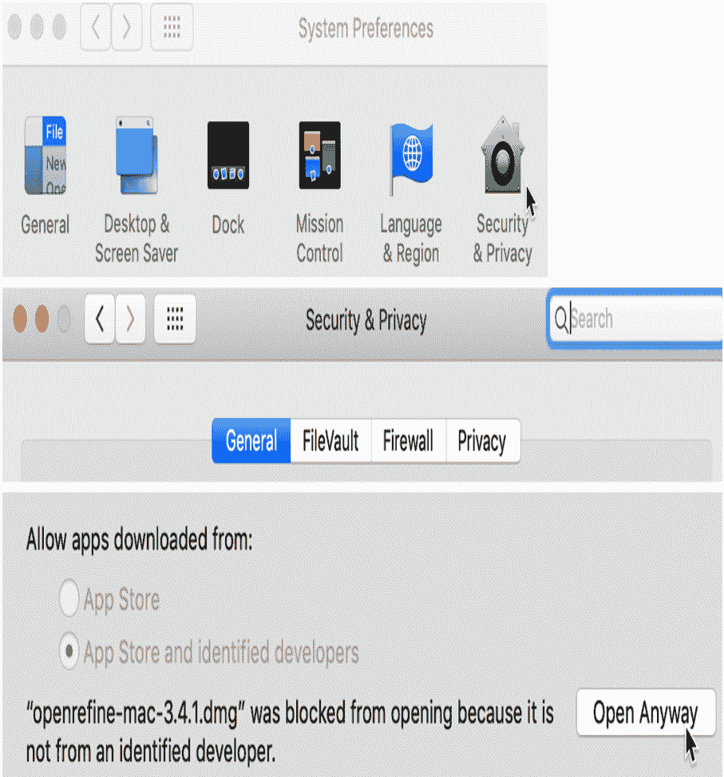
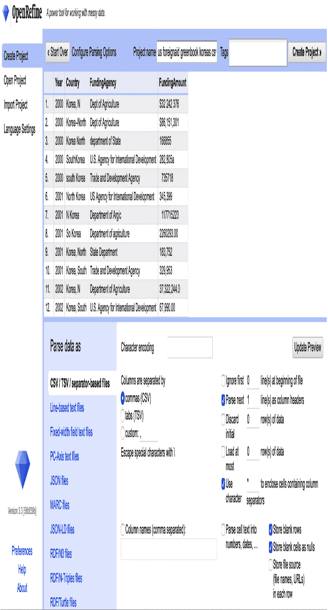
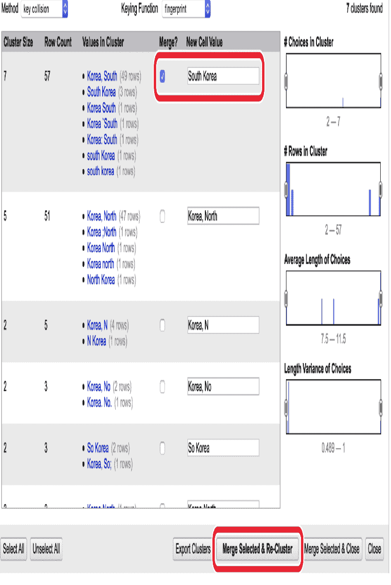

# Chapter 4. Clean Up Messy Data

More often than not, datasets will be messy and hard to visualize right away. They will have missing values, dates in different formats, text in numeric-only columns, multiple items in the same columns, various spellings of the same name, and other unexpected things. See Figure 4-1 for inspiration. Don’t be surprised if you find yourself spending more time cleaning up data than you do analyzing and visualizing it.

| Year | City | Amount |
|---|---|---|
| 1990 | New York City | $1,123,456.00 |
| 1995-96 |  | 2.2 mil |
| 2000’s | NYC | No data |
| 2020 | New_York | 5000000+ |

*Figure 4-1. More often than not, raw data looks messy.*

In this chapter, you’ll learn about different tools to help you make decisions about which one to use to clean up your data efficiently. We’ll start with basic cleanup methods using Google Sheets in “Smart Cleanup with Google Sheets”, “Find and Replace with Blank”, “Transpose Rows and Columns”, “Split Data into Separate Columns”, and “Combine Data into One Column”. While we feature Google Sheets in our examples, many of these principles (and in some cases, the same formulas) apply to Microsoft Excel, LibreOffice Calc, Mac’s Numbers, or other spreadsheet packages. Next, you’ll learn how to extract table data from text-based PDF documents with Tabula, a free tool used by data journalists and researchers worldwide to analyze spending data, health reports, and all sorts of other datasets that get trapped in PDFs (see “Extract Tables from PDFs with Tabula”). Finally, we will introduce OpenRefine in “Clean Data with OpenRefine”, a powerful and versatile tool to clean up the messiest spreadsheets, such as those containing dozens of different spellings of the same name.

### Smart Cleanup with Google Sheets

One of the newest reasons to work with your data in Google Sheets is to use its Smart Cleanup feature, which helps identify and suggest corrections for inaccurate data. The tool opens a sidebar menu that spots potential problems, and you decide whether to accept its suggestion.

Learn what types of issues Smart Cleanup catches, and which ones it misses, using our sample data on the 10 most populated nations in the world, which contains some problems that we intentionally added:

1. Open the Smart Cleanup sample data file in Google Sheets, sign in with your account, and go to File > “Make a copy” to create a version you can edit in your Google Drive.
2. Go to Data > “Cleanup suggestions” and view items that appear in the sidebar.

The Smart Cleanup feature successfully caught a duplicate entry (row 12), and white spaces in cells A4 and A5. Click the green Remove and “Trim all” buttons to confirm that Google Sheets should clean them up.

Can you spot these other errors that Smart Cleanup missed?

- In cell A10, Russsia is misspelled with an extra s.
- In cell C6, Pakistan’s share of the world population appears in decimal form, not percentage.
- In cell D4, the US date appears in a format unlike the other entries. If you’re familiar with different international date formats, you’ll also wonder if 12/10/2020 is meant to be MM/DD/YYYY format that’s commonly used in the US, or the DD/MM/YYYY format that’s commonly used elsewhere. Smart Cleanup cannot answer this for you.

The Google Sheets Smart Cleanup feature is a good place to start. If your data is really messy, you may need to turn to more sophisticated tools described later in this chapter, such as “Clean Data with OpenRefine”. In the next section, you’ll learn another cleanup method that works in any spreadsheet: find and replace with a blank entry.

### Find and Replace with Blank

One of the simplest and most powerful cleanup tools inside every spreadsheet is the “Find and Replace” command. You can also use it to bulk-change different spellings of the same name, such as shortening a country’s name (from Republic of India to India), expanding a name (from US to United States), or translating names (from Italy to Italia). Also, you can use find and replace with a blank entry to remove units of measurement that sometimes reside in the same cells as the numbers (such as changing 321 kg to 321).

Let’s look at “Find and Replace” in practice. A common problem with US Census data is that geographic names contain unnecessary words. For example, when you download data on the population of Connecticut towns, the location column will contain the word “town” after every name:

```
Hartford town
New Haven town
Stamford town
```

Usually you want a clean list of towns, either to display in a chart or to merge with another dataset, like this:

```
Hartford
New Haven
Stamford
```

Let’s use “Find and Replace” on a sample US Census file we downloaded with 169 Connecticut town names and their populations to remove the unwanted “town” label after each place-name:

1. Open the CT Town Geonames file in Google Sheets, sign in with your account, and go to File > “Make a copy” to create a version you can edit in your Google Drive.
2. Select the column you want to modify by clicking its header. If you don’t select a column, you will be searching and replacing in the entire spreadsheet.
3. In the Edit menu, choose “Find and replace.” You’ll see the following.

```
Find and replace

Make sure it begins with a space character

Find
 town

Replace with

Search
This sheet

Match case
Match entire cell contents
Search using regular expressions Help
Also search within formulas

Find
Replace
Replace all
Done
```

| Geo_NAME | Pop2010 |
|---|---|
| Andover town | 3303 |
| Ansonia town | 19249 |
| Ashford town | 4317 |
| Avon town | 18098 |
| Barkhamsted town | 3799 |
| Beacon Falls town | 6049 |
| Berlin town | 19866 |
| Bethany town | 5563 |
| Bethel town | 18584 |
| Bethlehem town | 3607 |
| Bloomfield town | 20486 |
| Bolton town | 4980 |
| Bozrah town | 2627 |
| Branford town | 28026 |
| Bridgeport town | 144229 |
| Bridgewater town | 1727 |
| Bristol town | 60477 |
| Brookfield town | 16452 |
| Brooklyn town | 8210 |
| Burlington town | 9301 |
| Canaan town | 1234 |
| Canterbury town | 5132 |
| Canton town | 10292 |

4. In the Find field, type *town*, and be sure to *insert a blank space* before the word. If you do not insert a space, you’ll accidentally remove *town* from places such as *Middletown*. Also, you’ll accidentally create trailing spaces, or whitespace at the end of a line without any other characters following it, which can cause trouble in the future.
5. Leave the “Replace with” field blank. Don’t insert a space. Just leave it empty.
6. The Search field should be set to the range you selected in step 2, or “All sheets” if you didn’t select anything.
7. You have the option to “Match case.” If checked, *town* and *Town* and *tOwN* will be treated differently. For our purpose, you can leave “Match case” unchecked.
8. Press “Replace all.” Because this sample file contains 169 towns, the window will state that 169 instances of “town” have been replaced.
9. Inspect the resulting sheet. Make sure that places that include *town* in their name, such as *Middletown*, remained untouched.

### Transpose Rows and Columns

Sometimes you download good data, but your visualization tool requires you to transpose, or swap, the rows and the columns to create the chart or map you desire. This problem often arises when working with time-series or historical data because they are treated in opposite ways in tables and charts. When designing a table, the proper method is to place dates horizontally as column headers, so that we read them from left to right, like this:

| Year | 2000 | 2010 | 2020 |
|---|---|---|---|
| Series1 | 333 | 444 | 555 |
| Series2 | 777 | 888 | 999 |

When designing a line chart in Google Sheets and similar tools, which you’ll learn about in **Chapter 6**, we need to transpose the data so that dates run vertically down the first column, so the software reads them as labels for a data series, like this:

| Year | Series1 | Series2 |
|---|---|---|
| 2000 | 333 | 777 |
| 2010 | 444 | 888 |
| 2020 | 555 | 999 |

Learn how to transpose rows and columns in our sample data:

1. Open the *Transpose sample data file* in Google Sheets, sign in with your account, and go to File > “Make a copy” to create a version you can edit in your Google Drive.
2. Select all of the rows and columns you wish to transpose, and go to Edit > Copy.
3. Scroll farther down the spreadsheet and click on a cell, or open a new spreadsheet tab, and go to Edit > “Paste special” > “Paste transposed.”




现在你已经学会了如何通过转置行和列来清理数据，在下一节中你将学习如何将数据拆分为单独的列。

## Split Data into Separate Columns

有时多个数据片段会出现在同一个单元格中，例如名字和姓氏（John Doe）、地理坐标（40.12,−72.12）或地址（300 Summit St, Hartford, CT, 06106）。对于你的分析，你可能希望将它们拆分为单独的实体，这样你的 *FullName* 列（其中包含 John Doe）就会变成 *FirstName*（John）和 *LastName*（Doe）列，坐标会变成 *Latitude* 和 *Longitude* 列，而你的 *FullAddress* 列会变成四列：*Street*、*City*、*State* 和 *Zip*（邮政编码）。

## Example 1: Simple Splitting

让我们从一个简单的例子开始，将用逗号分隔的地理坐标对拆分为单独的列：

- 1. 打开 [Split Coordinate Pairs](#) 示例数据在 Google Sheets 中，使用你的账号登录，然后进入 File > “Make a copy” 在你的 Google Drive 中创建一个可编辑的版本。
- 2. 选择你想要拆分的数据，可以是整列或仅几行。注意，你一次只能从一列中拆分数据。
- 3. 确保你要拆分的列右侧没有数据，因为那里的数据将被覆盖。
- 4. 进入 Data 并选择 “Split text to columns”。

### File   Edit   View   Insert   Format   Data   Tools   Add-ons   Help

| A |
|---|
| coordinate pairs |
| -72.68414,41.752377 |
| -72.6743,41.74627 |
| -72.684685,41.745457 |
| -72.6754,41.748585 |
| -72.682976,41.74496 |
| -72.68555,41.739155 |
| -72.67143,41.746723 |
| -72.683495,41.744053 |
| -72.67445,41.751823 |
| -72.681046,41.74126 |

- Sort sheet by column A, A → Z
- Sort sheet by column A, Z → A
- Sort range by column A, A → Z
- Sort range by column A, Z → A
- Sort range
- Create a filter
- Filter views
- Slicer
- Data validation
- Pivot table
- Randomize range
- Named ranges
- Protected sheets and ranges
- Cleanup suggestions
- Column stats
- Split text to columns

- 5. Google Sheets 会自动尝试猜测你的分隔符。你会看到你的坐标现在已用逗号拆分，并且 Separator 在下拉菜单中设置为 *Detect automatically*。你可以手动将其更改为逗号（`,`）、分号（`;`）、句点（`.`）、空格字符或任何其他自定义字符（甚至是一串字符，我们将在本节的示例 2 中讨论）。
- 6. 你可以将新列重命名为 *Longitude*（第一个数字）和 *Latitude*（第二个数字）。

## Example 2: Complex Splitting

现在，让我们看一个稍微复杂一点的例子。每个单元格都包含一个完整地址，你希望将其拆分为四列：街道、城市、州和邮政编码。但请注意分隔符的不同：街道和城市之间用逗号，城市和州之间用空格，州和邮政编码之间用两个破折号。在这种情况下，你需要手动添加一些说明才能正确地将文本拆分为四列：

```
Location
------------------------------
300 Summit St, Hartford CT--06106
1012 Broad St, Hartford CT--06106
37 Alden St, Hartford CT--06114
```

- 1. 打开 Split Complex Address 示例文件在 Google Sheets 中，登录你的账号，然后进入 File > “Make a copy” 在你的 Google Drive 中保存一个可编辑的版本。
- 2. 选择该列并进入 Data > “Split text to columns” 开始从左到右拆分。
- 3. Google Sheets 会自动将你的单元格拆分为两个部分，`300 Summit St` 和 `Hartford CT--06106`，使用逗号作为分隔符。（如果没有，请从出现的下拉菜单中选择 *Comma*。）
- 4. 现在仅选择第二列并再次执行 “Split text to columns”。Google Sheets 会自动将城市与州和邮政编码分开，因为它自动选择了空格作为分隔符。（如果没有，请从下拉菜单中选择 *Space*。）
- 5. 最后，仅选择第三列并再次执行 “Split text to columns”。Google Sheets 不会识别两个破折号作为分隔符，因此你需要手动选择 *Custom*，在 *Custom separator* 字段中输入这两个破折号（`--`），然后按 Enter。现在你已成功将完整地址拆分为四列。



> **TIP**
> 
> Google Sheets 会将邮政编码视为数字并删除前导零（因此 06106 会变成 6106）。要修复这个问题，请选择该列，然后进入 Format > Number > “Plain text”。现在你可以手动重新添加零。如果你的数据集很大，请考虑使用下一节中介绍的公式来添加零。

## Combine Data into One Column

让我们通过使用电子表格公式，也称为连接，使用与号符号（&）将数据合并到一列中来执行相反的操作。假设你收到的地址数据分布在四列中：街道地址、城市、州和邮政编码：

| Street | City | State | Zip |
|---|---|---|---|
| 300 Summit St | Hartford | CT | 06106 |

但假设你需要使用我们在“Geocode Addresses in Google Sheets”中介绍的工具等工具对地址进行地理编码，该工具要求所有数据合并到一列中，如下所示：

| Location |
|---|
| 300 Summit St, Hartford, CT 06106 |

使用任何电子表格，你都可以编写一个简单的公式来使用与号（&）符号合并（或连接）项。此外，你还可以向公式中添加分隔符，例如带引号的空格（" "），或带逗号的空格（", "），或任何字符组合。让我们用一些示例数据试试：

- 1. 打开 **Combine Separate Columns** 示例数据在 Google Sheets 中，使用你的账号登录，然后进入 File > “Make a copy” 在你的 Google Drive 中创建一个可编辑的版本。该表格包含地址，这些地址分为四列：街道、城市、州和邮政编码。
- 2. 在 E 列中，输入一个名为 *location* 的新标题。
- 3. 在 E2 单元格中，输入 `=A2 & ", " & B2 & ", " & C2 & " " & D2`。此公式使用与号合并四个项目，并用带引号的逗号和空格分隔它们。然后按 Enter。
- 4. 单击 E2 单元格并拖动右下角的十字准线向下，以填充整列。



现在你已成功将各项合并到一个位置列中，你可以使用我们在“Geocode Addresses in Google Sheets”中描述的 Geocoding by SmartMonkey Google Sheets 插件来查找纬度和经度坐标以便绘制你的数据，正如我们在第 7 章中将讨论的那样。

为了进一步阅读，我们推荐 Lisa Charlotte Rost 的精彩 Datawrapper 博客文章，关于清理和准备电子表格数据以进行分析和可视化。²

电子表格是查找和替换数据、将数据拆分为单独列或将数据合并到一列中的好工具。但如果你的数据表被困在 PDF 中怎么办？在下一节中，我们将介绍 Tabula 并向你展示如何将基于文本的 PDF 文档中的表格转换为可在电子表格中分析的表格。

## Extract Tables from PDFs with Tabula

有时你感兴趣的数据集仅以 PDF 文档的形式提供。不要绝望——你很可能可以使用 Tabula 提取表格并将它们保存为 CSV 文件。请记住，PDF 通常有两种类型：基于文本的和基于图像的。如果你可以使用光标在 PDF 中选择、复制和粘贴文本，那么它是基于文本的，这很好，因为你可以用 Tabula 处理它；如果不能，那么它就是基于图像的，这意味着它可能是在原始文档扫描后创建的。你需要使用光学字符识别（OCR）软件，例如 Adobe Acrobat Pro


或使用其他 OCR 工具，将基于图像的 PDF 转换为基于文本的 PDF。此外，Tabula 只能从表格中提取数据，不能提取图表或其他类型的可视化内容。

Tabula 是一个免费工具，使用 Java 在浏览器中运行，可用于 Mac、Windows 和 Linux 电脑。它在本地机器上运行，不会将您的数据发送到云端，因此您也可以将其用于敏感文档。

开始使用时，请下载最新版本的 Tabula。您可以使用左侧的下载按钮，或滚动到“Download & Install Tabula”部分为您的平台下载副本。与大多数其他程序不同，Tabula 不需要安装。只需解压下载的压缩包，然后双击图标即可。


## WARNING

在 Mac 上，首次启动 Tabula 时可能会看到此警告：“Tabula is an app downloaded from the internet. Are you sure you want to open it?” 如果是这样，请点击 Open。

启动 Tabula 时，它会以类似 `http://127.0.0.1/` 的 URL 打开您的默认浏览器，URL 可能带或不带额外的端口号，例如 `:8080`，如图 4-2 所示。Tabula 在您的本地计算机上运行，而不是在互联网上。如果您的默认浏览器（如 Safari 或 Edge）与 Tabula 不兼容，您可以将 URL 复制并粘贴到其他浏览器（如 Firefox 或 Chrome）中。

## Import one or more PDFs

## First time using Tabula? Welcome!

## How to Use Tabula

- 1. 上传包含数据表格的 PDF 文件。
- 2. 通过单击表格左上角并拖动鼠标到右下角来选择表格，直到所有数据都被包含在阴影选择区域中。
- 3. 然后会出现一个包含您数据的窗口。检查数据是否看起来正确。如果数据缺失，您可能需要稍微扩大选择范围。
- 4. 点击下载按钮。
- 5. 现在您可以用文本文件或电子表格的形式处理您的数据，而不再是 PDF！（您可以在 Microsoft Excel 或免费的 LibreOffice Calc 中打开下载的文件）

注意：Tabula 仅适用于基于文本的 PDF，不适用于扫描文档。

## Having trouble with Tabula?

Figure 4-2. The Tabula welcome page.

现在让我们上传一个示例基于文本的 PDF 并检测我们希望提取的任何表格。在 COVID-19 大流行的初期，康涅狄格州公共卫生部仅以 PDF 文档格式发布了病例和死亡数据。对于本次演示，您可以使用我们提供的 2020 年 5 月 31 日的示例基于文本的 PDF，或提供您自己的：

- 1. 通过单击蓝色的 Browse… 按钮选择您要提取数据的 PDF。
- 2. 点击 Import。Tabula 将开始分析文件。
- 3. Tabula 完成加载 PDF 后，您将看到一个包含各个页面的 PDF 查看器。界面非常简洁，页眉中只有四个按钮。
- 4. 点击 Autodetect Tables 让 Tabula 查找相关数据。工具会以红色突出显示检测到的每个表格。

## APPENDIX A. Towns with Confirmed and Probable Cases of COVID-19

Table does not include 234 cases pending address validation.

| Town | Cases | Town | Cases | Town | Cases |
|---|---|---:|---|---:|---|---:|
| Andover | 15 | Danvers | 11 | Amesbury | 23 |
| Arlington | 38 | Dover | 24 | Bedford | 27 |
| Ashland | 43 | Duxbury | 15 | Belmont | 27 |
| Avon | 11 | Easton | 16 | Beverly | 104 |
| Barnstable | 96 | Edgartown | 44 | Billerica | 105 |
| Beverly | 104 | Everett | 44 | Boston | 327 |
| Braintree | 38 | Falmouth | 5 | Burlington | 11 |
| Brookline | 53 | Gloucester | 22 | Cambridge | 8 |
| Canton | 34 | Hingham | 14 | Chelsea | 78 |
| Carlisle | 10 | Holbrook | 4 | Cohasset | 6 |
| Carver | 12 | Hull | 14 | Concord | 29 |
| Charlton | 3 | Ipswich | 12 | Danvers | 27 |
| Chatham | 35 | Kingston | 5 | Dedham | 44 |
| Chelmsford | 24 | Lancaster | 10 | Dighton | 2 |
| Chelsea | 327 | Lawrence | 63 | Douglas | 2 |
| Chicopee | 95 | Lee | 4 | Dover | 4 |
| Clinton | 44 | Lexington | 20 | East Bridgewater | 12 |
| Cohasset | 6 | Lowell | 181 | East Longmeadow | 16 |
| Colrain | 1 | Lynn | 249 | Eastham | 3 |
| Conway | 3 | Lynnfield | 17 | Easthampton | 7 |
| Dedham | 44 | Malden | 101 | Edgartown | 4 |
| Dennis | 35 | Marblehead | 38 | Essex | 2 |
| Dighton | 2 | Marion | 4 | Everett | 327 |
| Douglas | 2 | Marlborough | 37 | Fairhaven | 5 |
| Dover | 4 | Medfield | 10 | Falmouth | 43 |
| Dracut | 64 | Medford | 119 | Foxborough | 8 |
| Dudley | 13 | Medway | 7 | Framingham | 153 |
| Duxbury | 15 | Melrose | 22 | Franklin | 42 |
| East Bridgewater | 12 | Methuen | 114 | Freetown | 2 |
| East Longmeadow | 16 | Milton | 25 | Gardner | 11 |
| Eastham | 3 | Natick | 68 | Georgetown | 5 |
| Easthampton | 7 | Needham | 56 | Gill | 1 |
| Essex | 2 | New Bedford | 164 | Gloucester | 26 |
| Everett | 327 | Newton | 125 | Goshen | 1 |
| Fairhaven | 5 | North Andover | 38 | Granby | 4 |
| Fall River | 143 | North Attleborough | 15 | Great Barrington | 2 |
| Falmouth | 43 | North Reading | 16 | Greenfield | 12 |
| Foxborough | 8 | Northborough | 32 | Groton | 4 |
| Framingham | 153 | Northbridge | 28 | Hadley | 2 |
| Franklin | 42 | Northampton | 35 | Halifax | 4 |
| Freetown | 2 | Norwood | 62 | Hamilton | 5 |
| Gardner | 11 | Oak Bluffs | 13 | Hanover | 15 |
| Georgetown | 5 | Orange | 3 | Hanson | 5 |
| Gill | 1 | Orleans | 4 | Haverhill | 85 |
| Gloucester | 26 | Oxford | 17 | Hingham | 14 |
| Goshen | 1 | Palmer | 13 | Holbrook | 18 |
| Granby | 4 | Peabody | 78 | Holden | 10 |
| Great Barrington | 2 | Pembroke | 12 | Holliston | 16 |
| Greenfield | 12 | Pittsfield | 72 | Holyoke | 116 |
| Groton | 4 | Plymouth | 93 | Hopkinton | 15 |
| Hadley | 2 | Quincy | 76 | Hubbardston | 1 |
| Halifax | 4 | Randolph | 55 | Hudson | 8 |
| Hamilton | 5 | Raynham | 14 | Hull | 14 |
| Hanover | 15 | Reading | 42 | Ipswich | 12 |
| Hanson | 5 | Revere | 108 | Kingston | 5 |
| Haverhill | 85 | Rockland | 40 | Lakeville | 8 |
| Hingham | 14 | Rockport | 10 | Lancaster | 10 |
| Holbrook | 18 | Rowley | 4 | Lawrence | 63 |
| Holden | 10 | Salem | 75 | Lee | 4 |
| Holliston | 16 | Salisbury | 7 | Leicester | 11 |
| Holyoke | 116 | Sandwich | 16 | Lexington | 20 |
| Hopkinton | 15 | Saugus | 57 | Leyden | 1 |
| Hubbardston | 1 | Scituate | 17 | Lincoln | 3 |
| Hudson | 8 | Seekonk | 11 | Littleton | 5 |
| Hull | 14 | Sharon | 14 | Longmeadow | 16 |
| Ipswich | 12 | Sherborn | 6 | Lowell | 181 |
| Kingston | 5 | Shirley | 4 | Lunenburg | 8 |
| Lakeville | 8 | Shrewsbury | 26 | Lynn | 249 |
| Lancaster | 10 | Somerville | 50 | Lynnfield | 17 |
| Lawrence | 63 | South Hadley | 18 | Malden | 101 |
| Lee | 4 | Stoneham | 30 | Manchester-by-the-Sea | 5 |
| Leicester | 11 | Stoughton | 20 | Mansfield | 17 |
| Lexington | 20 | Sudbury | 12 | Marblehead | 38 |
| Leyden | 1 | Sunderland | 7 | Marion | 4 |
| Lincoln | 3 | Swansea | 9 | Marlborough | 37 |
| Littleton | 5 | Taunton | 40 | Marshfield | 30 |
| Longmeadow | 16 | Tewksbury | 31 | Medfield | 10 |
| Lowell | 181 | Townsend | 8 | Medford | 119 |
| Lunenburg | 8 | Tyngsborough | 6 | Medway | 7 |
| Lynn | 249 | Upton | 8 | Melrose | 22 |
| Lynnfield | 17 | Wakefield | 25 | Mendon | 4 |
| Malden | 101 | Walpole | 29 | Merrimac | 2 |
| Manchester-by-the-Sea | 5 | Waltham | 85 | Methuen | 114 |
| Mansfield | 17 | Watertown | 56 | Middleborough | 14 |
| Marblehead | 38 | Wayland | 13 | Middleton | 5 |
| Marion | 4 | Webster | 20 | Milford | 32 |
| Marlborough | 37 | Wellesley | 43 | Millbury | 5 |
| Marshfield | 30 | Wellfleet | 4 | Millis | 4 |
| Medfield | 10 | West Boylston | 4 | Millville | 2 |
| Medford | 119 | West Bridgewater | 12 | Milton | 25 |
| Medway | 7 | West Newbury | 2 | Monson | 4 |
| Melrose | 22 | West Springfield | 79 | Montague | 7 |
| Mendon | 4 | Westborough | 14 | Monterey | 1 |
| Merrimac | 2 | Westfield | 59 | Montgomery | 1 |
| Methuen | 114 | Westford | 15 | Mount Greylock | 1 |
| Middleborough | 14 | Westhampton | 1 | Nahant | 5 |
| Middleton | 5 | Westminster | 2 | Nantucket | 10 |
| Milford | 32 | Weston | 15 | Natick | 68 |
| Millbury | 5 | Westport | 10 | Needham | 56 |
| Millis | 4 | Westwood | 15 | New Bedford | 164 |
| Millville | 2 | Weymouth | 76 | Newton | 125 |
| Milton | 25 | Whately | 1 | Norfolk | 5 |
| Monson | 4 | Williamsburg | 2 | North Adams | 7 |
| Montague | 7 | Wilmington | 23 | North Andover | 38 |
| Monterey | 1 | Winchendon | 4 | North Attleborough | 15 |
| Montgomery | 1 | Winchester | 26 | North Brookfield | 2 |
| Mount Greylock | 1 | Winthrop | 10 | North Reading | 16 |
| Nahant | 5 | Woburn | 49 | Northborough | 32 |
| Nantucket | 10 | Worcester | 288 | Northbridge | 28 |
| Natick | 68 | Worthington | 1 | Northampton | 35 |
| Needham | 56 | Wrentham | 10 | Norwell | 5 |
| New Bedford | 164 | Yarmouth | 32 | Norwood | 62 |
| Newton | 125 | — | — | — | — |


现在让我们手动调整所选的表格并导出数据：

5. 点击绿色的“Preview & Export Extracted Data”按钮，查看 Tabula 认为数据应该如何导出。
6. 如果预览表格中没有你想要的数据，请尝试在左侧边栏中切换 Stream 和 Lattice 提取方法。
7. 如果表格仍然不正确，或者你想要删除 Tabula 自动检测到的某些表格，请点击“Revise selection.”。这会带你回到 PDF 查看器。
8. 现在你可以清除所有选择，并手动选择感兴趣的表格。使用拖拽操作来选择感兴趣的表格（或表格的一部分）。
9. 如果要将选择“复制”到某些或所有页面，可以使用选择区域右下角出现的“Repeat this Selection”下拉菜单来传播更改。如果你的 PDF 由许多格式相似的页面组成，这会非常有用。
10. 一旦对结果满意，就可以导出。如果只有一个表格，我们建议使用 CSV 作为导出格式。如果有多个表格，请考虑将下拉菜单中的导出格式切换为“zip of CSVs”。这样，每个表格将保存为单独的文件，而不是所有表格都放在一个 CSV 文件中。

将数据导出到计算机后，导航到该文件并使用电子表格工具打开它，以进行分析和可视化。

现在你已经从 PDF 文档中提取了表格，结果可能会有些混乱。在下一节中，我们将使用一个非常强大的工具 OpenRefine 来清理混乱的数据集。

## 使用 OpenRefine 清理数据

打开 Google Sheets 格式的美国对外援助示例数据集，如图 4-3 所示。你能发现它有什么问题吗？这个数据摘录自美国海外贷款与赠款（Greenbook）数据集，显示了美国对各个国家的经济和军事援助。我们特意只选择包含 2000 年至 2018 年间对韩国和朝鲜的援助。我们故意加入了一些拼写错误和格式问题以作演示，但没有修改数值。

注意 Country 列中的 North 和 South Korea 有各种拼写。还要注意 FundingAmount 列没有标准化。有些金额用逗号分隔千位，有些用空格。有些金额以美元符号开头，有些不带。这样的数据集分析起来简直是一场噩梦。幸运的是，OpenRefine 提供了强大的工具来清理和标准化数据。



图 4-4. 如果你的 Mac 显示有关启动 OpenRefine 的警告，请调整你的“安全性与隐私”设置以打开该程序。

当你启动 OpenRefine 时，它会在你的默认浏览器中打开 localhost 127.0.0.1 地址，可能带也可能不带附加端口号 :3333，如图 4-5 所示。如果你的常规浏览器（例如 Safari）与 OpenRefine 配合不佳，请将 localhost 地址复制并粘贴到其他浏览器（例如 Firefox 或 Chrome）中。

OpenRefine 一个用于处理混乱数据的强大工具。

通过导入数据创建项目。我可以导入哪些类型的数据文件？

支持 TSV、CSV、*SV、Excel（.xls 和 .xlsx）、JSON、XML、RDF 作为 XML 以及 Google Data 文档。其他格式的支持可以通过 OpenRefine 扩展来添加。

从何处获取数据

在计算机上定位一个或多个要上传的文件：

此计算机

选择文件 未选择文件

下一步 »

- 创建项目
- 打开项目
- 导入项目
- 语言设置

- 网页地址（URL）
- 剪贴板
- 数据库
- Google Data

图 4-5. OpenRefine 欢迎页面。

## 加载数据并启动新项目

要开始清理混乱的数据集，我们需要将其加载到新项目中。OpenRefine 允许你从本地计算机或远程网页地址（例如 Google Sheets）上传数据集。OpenRefine 还可以直接从 SQL 数据库提取数据，但这超出了本书的范围：

1. 打开 Google Sheets 中的美国对外援助示例数据集，使用你的账户登录，然后转到 文件 > 下载，将 CSV 格式的版本保存到你的计算机。
2. 在 OpenRefine 中，在“从何处获取数据：此计算机”下，点击 浏览... 并选择你下载的 CSV 文件。点击 下一步。
3. 在你可以开始清理数据之前，OpenRefine 允许你确保数据被正确解析。在我们的例子中，解析意味着数据被拆分为列的方式。确保 OpenRefine 将值分配到正确的列，或者更改页面底部“Parse data as”块中的设置，直到它看起来有意义。然后点击右上角的 创建项目。



OpenRefine

一个用于处理混乱数据的强大工具。

- 创建项目
- 打开项目
- 导入项目
- 语言设置

创建项目

项目名称： us foreign aid greenbook korea set

| # | 年份 | 国家 | 资助机构 | 资助金额 |
|---:|---:|---|---|---:|
| 1 | 2000 | Korea, N | Dept of Agriculture | $32,242,376 |
| 2 | 2000 | Korea-North | Dept of Agriculture | $86,151,301 |
| 3 | 2000 | Korea North | Department of State | 168,555 |
| 4 | 2000 | SouthKorea | U.S. Agency for International Development | 282,865 |
| 5 | 2000 | South Korea | Trade and Development Agency | 735,710 |
| 6 | 2001 | North Korea | US Agency for International Development | 345,399 |
| 7 | 2001 | N Korea | Department of Agric | 117,715,223 |
| 8 | 2001 | So Korea | Department of agriculture | 226,023.00 |
| 9 | 2001 | Korea, North | State Department | 183,752 |
| 10 | 2001 | Korea, South | Trade and Development Agency | 329,953 |
| 11 | 2002 | Korea, N | Department of Agriculture | 37,322,244.00 |
| 12 | 2002 | Korea, South | U.S. Agency for International Development | 67,939.00 |

解析数据方式

- 基于分隔符的 CSV/TSV 文件
- 基于行的文本文件
- 固定宽度字段文本文件
- Patches 文本文件
- JSON 文件
- MARC 文件
- JSON-LD 文件
- RDF/XML 文件
- RDF/Turtle 文件

字符编码

列由以下方式分隔
- 逗号（CSV）
- 制表符（TSV）
- 自定义： ;

使用 \ 转义特殊字符

列名（逗号分隔）：

忽略文件开头的 0 行
将接下来的 1 行解析为列标题
丢弃开头的 0 行数据
最多加载 0 行数据
使用 ' 括起包含列分隔符的单元格
将单元格文本解析为数字、日期等
存储空白行
将空白单元格存储为 null
在每行中存储文件来源（文件名、URL）

更新预览

- 首选项
- 帮助
- 关于

### 对 FundingAmount 列执行自定义文本变换

表达式

语言 通用 Refine 表达式语言（GREL）

```
value.replace(',', '')
```

无语法错误。

3. 现在，重复上一步，但将逗号替换为美元符号，输入不同的表达式：value.replace('$', '')，确认公式，然后点击 OK。

4. 在第 2 步和第 3 步中，我们将文本（或字符串）值替换为其他文本值，这使得 OpenRefine 认为此列不再是数字类型。结果，所有值再次左对齐并显示为黑色。再次执行第 1 步。这次，几乎所有单元格都会变成绿色，表示它们已成功转换为数字。然而，仍会留下一些非数字的黑色单元格。

5. 要修复剩余的非数字黑色单元格，我们需要移除空格以及一个数字末尾的 a 字符。将鼠标悬停在单元格上，点击 Edit，在新的弹出窗口中，将“Data type”更改为“number”，然后点击 Apply，手动修复。

127 行

显示为：行 记录 显示：5 10 25 50 行 « 首页 ‹ 上一页

| 全部 | 年份 | 国家 | 资助机构 | 资助金额 |
|---|---|---|---|---|
|  |  |  |  | 32 242 376 编辑 |
|  |  |  |  | 861513 |
|  |  |  |  | 16685 |
|  |  |  |  | 282805a |
|  |  |  |  | 735718 |
| 6. | 2001 | North Korea | US Agency for International Development | 345399 |
| 7. | 2001 | N Korea | Department of Argic | 117715223 |
| 8. | 2001 | So Korea | Department of agriculture | 2260293 |
| 9. | 2001 | Korea, North | State Department | 183752 |
| 10. | 2001 | Korea, South | Trade and Development Agency | 329953 |

数据类型：文本 数字 布尔值 日期 应用 应用到所有相同单元格 取消 输入 Ctrl-Enter Esc 编辑此单元格

此时，所有资助金额都应是干净的数字，右对齐，并显示为绿色。我们准备好继续处理 Country 列，修复 Koreas 的不同拼写。

### 聚类相似拼写

当你组合不同的数据源或处理调查数据（受访者写下答案而不是从下拉菜单中选择）时，你可能会遇到同一个单词的多种拼写（城镇名称、教育水平——应有尽有！）。OpenRefine 最强大的功能之一是能够对相似的回答进行聚类。

如果你使用我们原始的示例文件，请查看 Country 列以及 North 和 South Korea 的所有拼写变体。从 Country 列的下拉菜单中，转到 筛选项 > “文本筛选项”。这将在左侧打开一个窗口，显示列值的所有拼写（及计数）——对于应该只有两个不同值（North Korea 和 South Korea）的列，却有 26 个选项！

1. 要开始标准化拼写，点击 Country 列表头的向下箭头按钮，选择“编辑单元格” > “聚类和编辑…”。你会看到这样一个窗口。


## 聚类与编辑列 "Country"

此功能可帮助您找到不同单元格值中可能属于同一事物的不同表示形式所组成的组。例如，两个字符串 "New York" 和 "new york" 很可能指的是同一个概念，只是大小写不同，而 "Gödel" 和 "Godel" 很可能指的是同一个人。了解更多...



您将有两个聚类方法可供选择，*key collision* 或 *nearest neighbor*。Key collision 聚类是一种速度更快的技术，适用于更大规模的数据集，但灵活性较差。Nearest neighbor 是一种计算成本更高的方法，在更大数据集上会更慢，但允许进行更大的微调和精确度。两种方法都可由不同的函数驱动，您可以在 [项目的 Wiki 页面](#) 上阅读相关内容。为本次练习的目的，让我们保留默认的 *key collision* 方法与 *fingerprint* 函数。

OpenRefine 将计算出一份聚类列表。*Values in Cluster* 列包含 OpenRefine 认为相同的分组拼写。
