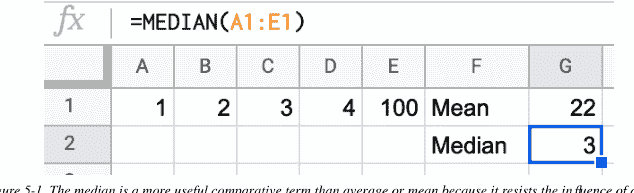
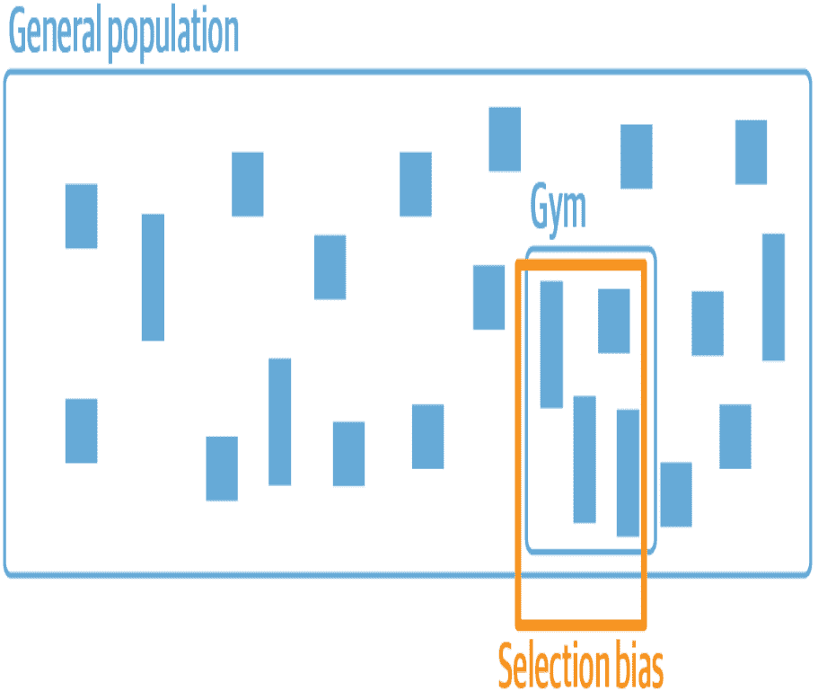
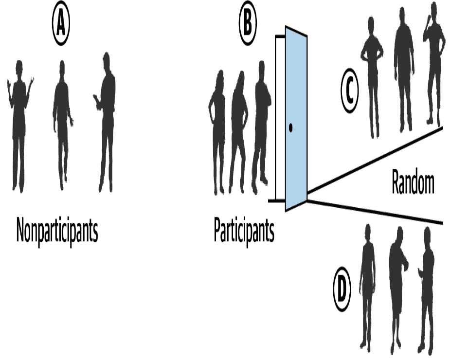

# 第5章 做出有意义的比较

现在您已经在第 1、2、3 和 4 章中完善了数据故事、提升了电子表格技能、查找并质疑了您的数据，并清理了任何混乱的部分，本章聚焦于分析证据时需要提出的关键问题：“Compared to what?” 这就是统计学家 Edward Tufte 所定义的“定量推理的核心”。¹ 我们通过相互比较数据的显著性来寻找数据中的有见地发现，以识别真正脱颖而出的部分。有时我们需要调整刻度以确保公平地衡量数据，或者用俗话说，比较苹果与苹果，而不是苹果与橘子。在任何格式中传达您的发现之前——文本、表格、图表或地图——请确保您做出了有意义的比较，否则您的工作可能变得毫无意义。

本书无意涵盖统计数据分析，因为已有许多优秀资源涉及这一庞大的研究领域。² 相反，本章提供了一些常识性策略，以便在分析数据时做出有意义的比较，帮助您设计真实且富有洞察力的可视化，以在“Precisely Describe Comparisons”、“Normalize Your Data” 和 “Beware of Biased Comparisons” 中讲述您的故事。

### Precisely Describe Comparisons

有时我们做出错误的比较，是因为我们未能澄清常用词的含义，而这些词可能有不同的定义。三个棘手词汇是 average、percent 和 causes。我们在日常对话中松散地使用它们，但在处理数据时，其定义需要更精确。

想象一个数字序列：1, 2, 3, 4, 5。在手工计算或使用“Calculate with Formulas”中描述的内置电子表格公式时，我们将总和相加并除以数字的个数。更精确的术语是均值 mean，在本例中等于 3。另一个术语是中位数 median，指有序序列中中间的数字，也称为第 50 百分位，在本例中也为 3。

在处理数据时，使用中位数 median 和百分位 percentile 术语来做比较是有用的，因为它们能抵抗序列两端极端值的影响。例如，想象与之前相同的数字，但将 5 替换为 100 作为异常值。突然间均值跃升至 22，但中位数仍保持在 3，如图 5-1 所示。有句老笑话说，当亿万富翁走进房间时，每个人在平均意义上都成了百万富翁——但中位数几乎没有变化。由于我们普通人并不会因我们中间存在亿万富翁异常值而变得更富有，因此中位数是关于整体数据分布做出有意义比较的更好术语。

Percentage 也是一个常见术语，几乎每个人都直观地将其理解为每百的比率。例如，1970 年代 Trident 泡泡糖的广告声称“4 out of 5 dentists surveyed recommend sugarless gum for their patients who chew gum.”³ 即使您太年轻记不住那个口号，或好奇该调查是如何进行的，或在思考第五位牙医如何抵制如此强烈的同侪压力，我们都理解四分之五的牙医相当于 4/5 = 0.8 = 80%。

有时人们匆忙比较百分比时会产生混淆，因此我们需要仔细选择用词。一个术语是 percent change（也称为 relative change），在比较旧值与新值时效果最佳。Percent change 的计算方法是新旧值之差除以旧值的绝对值，或 (New value − Old value) / |Old value|。例如，如果 1970 年有四位牙医推荐无糖口香糖，但同侪压力最终占上风，2020 年有五位牙医推荐它，我们计算 percent change 为 (5 − 4)/4 = 1/4 = 0.25 = 25%。

另一个术语是 percentage point difference（有时缩写为 p.p. difference），在比较旧百分比与新百分比时效果最佳，计算方法为两者相减。例如，如果 1970 年有 80% 的牙医推荐无糖口香糖，但 2020 年有 100% 的牙医推荐，我们可以计算差异为 New percentage − Old percentage = 100% − 80% = 20 percentage point difference。

当我们精确使用每个术语时，比较这些数据有两种正确方法。一种说法是，“推荐无糖口香糖的牙医人数随时间增加了 25%。” 另一种说法是，“推荐无糖口香糖的牙医百分比随时间增加了 20 个百分点。” 两种说法都准确。即使有人混淆这两个术语，在这个特定例子中，“25% 变化”与“20% 点增长”之间的差距也不大。

考虑另一个有人故意用不精确的百分比措辞误导你的例子。想象一位政治家提议将您购买的产品和服务销售税从 5% 提高到 6%。如果那位政治家说，“它只增加了 1%”，他们是错的。相反，有两种真实的方式来描述这种变化。一种说法是税“将增加 20%”，因为 (6 − 5)/5 = 0.20。另一种说法是税“将增加 1 个百分点”，因为 6% − 5% = 1 percentage point difference。看到政治家为何更愿意用他们误导性的方式说，而不是两种正确的方式之一吗？不要让任何人用非常宽松的措辞描述百分比的变化而欺骗你，并在自己的工作中精确说明其含义，以免混淆他人。

关于使用更精确语言的最后一条建议是，在数据中暗示 *cause-and-effect relationship* 的词语要谨慎。在日常对话中，我们有许多松散地暗示因果关系的方式，其中一个行动直接导致另一个反应。例如，当我们说一件事“leads to”另一件事、“promotes growth”或“sparks”变化时，这些词暗示因果。虽然在日常对话中没问题，但在讨论数据时我们需要更谨慎地选择用词，使用三个步骤。第一步是描述两个变量之间的 *correlation*，即展示它们如何相互关联或相互依存。但统计学家总是警告我们相关不等于因果。两个事物相关并不一定意味着一个导致另一个发生。要证明因果，我们必须采取第二步，即证明相关并展示一个 *persuasive theory*，说明一个因素（有时称为自变量）如何导致另一个因素（称为因变量）发生变化。第三，我们需要识别并隔离任何我们尚未考虑的 *confounding variables*，这些变量也可能影响因果关系。虽然细节超出了本书范围，但在处理数据时请注意这些步骤——并谨慎选择用词。

另请参阅第 8 章中关于“Table Design Principles”以展示数据相关性和可能因果关系。

现在您对如何使用关键词更精确地描述数据关系有了更清晰的理解，在下一节中，您将在此知识基础上构建并调整数据以创建更有意义的比较。

### Normalize Your Data

当我们处理以 *counts* 表示的数据时，例如 2018 年佛罗里达州 3,133 起机动车碰撞死亡人数，通常在我们 *normalize* 它们之前比较这些数字是没有意义的。这意味着将使用不同尺度收集的数据调整为共同的参考尺度，或者换句话说，将 *raw data* 转换为 *rates* 以便做出更有意义的比较。即使您从未听说过这个术语，也许您已经在不知不觉中对数据进行了归一化。

这里有一个关于机动车安全的例子，灵感来自可视化专家 Alberto Cairo，并使用保险公路安全研究所 IIHS 和美国交通部更新的 2018 年数据。⁴ 2018 年有超过 36,000 人死于机动车碰撞，包括汽车和卡车司机及乘客、摩托车手、行人和骑自行车的人。虽然只有很小一部分数据出现在下面的表格中，但您可以在 Google Sheets 格式中查看所有数据，并保存一份可编辑的副本到您的 Google Drive 以跟随本次练习。

让我们从一个看似简单的问题开始，看看我们对更有意义比较的探索会把我们带到哪里：

- 1. *Which US states had the lowest number of motor vehicle crash deaths?*

当我们按死亡人数排序数据时，哥伦比亚特区 *appears* 是最安全的州，仅有 31 人死亡，如表 5-1 所示，尽管华盛顿特区在法律上不被承认为州。

*Table 5-1. US states with lowest number of motor vehicle crash deaths, 2018*

| State | Deaths |
|---|---:|
| District of Columbia | 31 |
| Rhode Island | 59 |
| Vermont | 68 |
| Alaska | 80 |
| North Dakota | 105 |

但等等——这不是公平的比较。再看一下列出的五个州，您可能会注意到它们的人口都比加州和德州等大州小，而这些州出现在完整数据集的最后。 为了更准确地描绘情况，让我们重新表述问题以调整人口差异。

- 2. *Which US states had the lowest number of motor vehicle crash deaths when adjusted for population?*

现在让我们通过考虑每个州的总人口来 *normalize* 死亡数据。在我们的电子表格中，我们将其计算为 `Deaths / Population × 100,000`。虽然将死亡人数除以人口来找到 *per capita* 率也是准确的，但那些非常小的十进制数对于大多数人来说比较起来会很困难，所以我们乘以 100,000 以更清晰地呈现结果。当我们对数据进行排序时，华盛顿特区 *appears* 再次是最安全的，每 100,000 名居民仅有 4.4 起机动车碰撞死亡，如表 5-2 所示。

**表 5-2：2018 年人均机动车碰撞死亡人数最少的美国各州**

| 州 | 死亡人数 | 人口 | 每 10 万人口死亡人数 |
|---|---|---|---|
| 哥伦比亚特区 | 31 | 702,455 | 4.4 |
| 纽约州 | 943 | 19,542,209 | 4.8 |
| 马萨诸塞州 | 360 | 6,902,149 | 5.2 |
| 罗德岛州 | 59 | 1,057,315 | 5.6 |
| 新泽西州 | 564 | 8,908,520 | 6.3 |

但等等——这还不是一个公平的比较。看一下名单上的五个州，你会发现它们都位于美国东北部走廊地带，那里集中了公共交通工具，如火车和地铁。如果纽约和波士顿等城市地区的人比那些居住在房屋分布更分散的农村州的人更少驾驶机动车，或者行程更短，那可能会影响我们的数据。让我们努力进行更好的比较，再次重新表述问题，这次是根据行驶里程的差异进行调整，而不是人口。

### 3. 按车辆行驶里程调整后，美国哪些州的机动车碰撞死亡人数最少？

我们再次通过调整不同的因素来归一化死亡数据：车辆行驶里程（VMT），即2018年该州所有道路和高速公路上行驶的汽车、面包车、卡车和摩托车（以百万英里计）的估计总里程。在电子表格中，我们将其计算为“死亡人数 / 车辆行驶里程 × 100”，乘数是为了更清晰地呈现结果。这一次，马萨诸塞州似乎是最安全的州，每行驶1亿英里仅发生0.54起机动车碰撞死亡事故，如表5-3所示。另请注意，哥伦比亚特区已进一步下滑，被明尼苏达州取代。

**表 5-3：2018 年每英里行驶里程机动车碰撞死亡人数最少的美国各州**

| 州 | 死亡人数 | 车辆行驶里程（百万） | 每 1 亿车辆行驶里程死亡人数 |
|---|---|---|---|
| 马萨诸塞州 | 360 | 66,772 | 0.54 |
| 明尼苏达州 | 381 | 60,438 | 0.63 |
| 新泽西州 | 564 | 77,539 | 0.73 |
| 罗德岛州 | 59 | 8,009 | 0.74 |
| 纽约州 | 943 | 123,510 | 0.76 |

我们是否终于找到了以机动车碰撞死亡人数评判的最安全州？未必。虽然我们根据人口和驾驶量对原始数据进行了归一化，但 IIHS 提醒我们，其他几个因素也可能影响这些数字，例如车辆类型、平均速度、交通法规、天气等等。正如阿尔贝托·凯罗提醒我们的那样，每次我们优化计算以进行更有意义的比较时，我们的解读就离真相更近了一步。“认为我们可以创造一个完美的模型是不现实的，”凯罗说。“但我们肯定可以想出一个足够好的模型。”5

正如我们所展示的，最常见的归一化数据方法是将原始计数调整为相对比率，例如百分比或人均值。但还有许多其他归一化数据的方法，因此在查找和质疑数据时，请务必熟悉不同的方法，如第 3 章所述。

在处理历史数据（也称为时间序列或纵向数据）时，您可能需要进行随时间变化的调整。例如，将 1970 年的家庭收入中位数与 2020 年的直接比较是不公平的，因为由于通货膨胀和相关因素，10,000 美元在半个世纪前的购买力远高于今天。同样，经济学家区分名义数据（未调整）和实际数据（随时间调整），通常通过将数字转换为特定年份的“不变美元”，以便通过考虑购买力来进行更好的比较。5 此外，经济数据通常经过季节性调整，以改进对全年定期变化的数据的比较，例如夏季旅游旺季与冬季假日购物季的就业或收入。另一种归一化方法是创建一个指数，用以衡量相对于特定参考点随时间推移的值上升或下降情况。此外，统计学家通常通过计算标准分数（也称为 z 分数）来对使用不同尺度收集的数据进行归一化，以便进行更好的比较。虽然这些方法超出了本书的范围，但熟悉更广泛的概念很重要：每个人都同意，将苹果与苹果进行比较，而不是苹果与橘子，是更好的做法。

最后，你并不总是需要对数据进行归一化，因为有时其格式已经为你完成了这项工作。与原始数字或简单计数不同，大多数测量变量不需要归一化，因为它们已经出现在一个共同尺度上。测量变量的一个例子是中位年龄，即按从最年轻到最年长排序时人口中“中间”人的年龄。由于我们知道人类的寿命大约在 0 到 120 岁之间，我们可以直接比较不同人口的中位年龄。类似地，如果以同种货币并在同一时间段内衡量，中位收入也是测量变量，因为它提供了一个共同尺度，允许直接比较不同人群。

现在你对何时以及如何归一化数据有了更好的了解，下一节将提醒你警惕数据采样方法中有偏的比较。

## 警惕有偏比较

你可能听说过不要*摘樱桃式挑选*数据，这意味着只选择支持预定结论的证据，而忽略其余部分。当我们承诺讲述真实而有意义的数据故事时，我们同意保持开放的心态，检查所有相关证据，并权衡相互竞争的解释的价值。如果你同意这些原则，那么还要警惕有偏的数据比较，特别是*抽样偏差*，它指的是表面上看似正当，但实际上包含部分隐藏因素从而扭曲结果的数据收集程序。虽然我们可能相信自己是以开放的心态运作，但我们可能会忽略那些在不知不觉中有效地*摘樱桃式挑选*我们证据的方法。

首先，注意*选择偏差*，这意味着你研究中选择的样本系统性地不同于更大的总体。“你看到什么取决于你在哪里看，”教授卡尔·伯格斯特罗姆和杰文·韦斯特警告说，他们是一本有着令人难忘书名《扯淡》的作者。⁷ 如果你随机测量那些碰巧在篮球训练后离开体育馆的人的身高，选择偏差会导致人为地更高的结果，这将归因于选择偏差，如图 5-2 所示。

*图 5-2.* 如果你随机测量那些碰巧在篮球训练后离开体育馆的人的身高，你会因选择偏差而得到人为偏高的结果。

其次，警惕*无回应偏差*。如果你向一个广泛的群体发送调查问卷，但并非每个人都回应，你需要意识到那些选择参与的人可能具有某些特质，使他们不太能代表整个群体。例如，美国人口普查局的研究人员发现，在 2020 年当前人口调查样本中，低收入人群的无回应率明显高于往常，这是他们通过将个人调查结果与前几年进行比较确定的。因为较富有的人更有可能回应，这人为地抬高了报告的收入中位数，研究人员需要对此进行修正。⁸ 另请参阅美国人口普查局“2020 年难以统计地图”，该地图按州、县和人口普查区可视化了自我回应率。如果你进行的调查没有修正无回应偏差，你可能会得到有偏差的结果。

第三，警惕*自我选择偏差*，这种偏差通常出现在试图评估某特定项目或治疗效果时，而此时人们是申请或自愿参与的，如图 5-3 所示。如果你的工作是判断某个减肥计划是否真的有效，这需要深入了解数据样本是如何选择的，因为自我选择偏差可以秘密地影响两个组的构成，并导致无意义的比较。例如，将非参与者（A 组）与报名参加该计划的人（B 组）的进展进行比较是错误的，因为这两组*并非*随机选择。参与者之所以不同，是因为他们主动加入了一个

减重计划，并且很可能比非参与者更有动力更频繁地改善饮食和锻炼。我们经常自欺欺人，忘记考虑自愿参与如何扭曲项目效果，无论主题是减重诊所、社会服务还是学校选择项目。⁹

**图 5-3。** 评估项目效果时，不要将项目非参与者（A）与申请或自愿参与者（B）进行比较。相反，将所有参与者随机分成两个子组（C 和 D）。

我们如何减少项目评估数据中的自我选择偏差？正如你在“质疑你的数据”中所学到的，深入了解术语的定义方式以及数据的收集和记录方式非常重要。相比之下，设计良好的项目评估会通过随机将所有志愿参与者（B 组）分为两个子组来减少自我选择偏差：一半人将被分配参加一种减重计划（C 组），另一半人将被分配参加另一种减重计划（D 组），如图 5-3 所示。由于子组 C 和 D 是通过随机抽样从同一批志愿者中选出的，我们在比较他们的进展时可以更有信心，因为没有理由怀疑他们在动机或其他难以察觉的因素方面存在差异。当然，还有许多超出本书范围的研究设计细节，例如确保样本量足够大、比较减重活动前后期间的参与者情况等等。但避免选择偏差的逻辑很简单：将申请或自愿参与的人随机分为子组，以便在动机和其他难以察觉的特征相似的人群中更好地比较项目效果。

偏差警告出现在本书的多个章节中，因为我们需要在数据可视化过程的各个阶段不断意识到不同类型的偏差，这些偏差会负面影响我们的工作。在“识别和减少数据偏差”中，你将学习如何在处理数据时识别和减少其他类型的偏差，例如认知偏差、算法偏差、群体间偏差和制图偏差。

## 摘要

虽然我们并不声称在本书中教你统计数据分析，但在本章中我们讨论了在分析数据时进行有意义比较的几种常识性策略。你学习了如何更精确地使用两个词来比较数据，为什么以及如何规范化数据，并我们给你提供了注意有偏比较的建议。在第一部分，你建立了完善数据故事、使用电子表格、查找和质疑数据以及清理混乱数据的技能。现在你可以将所有这些知识结合起来，开始在第二部分创建交互式图表和地图。

> 1  Edward R. Tufte, *Envisioning Information* (Cheshire, CT: Graphics Press, 1990), p. 67.
> 
> 2  For a reader-friendly introduction to statistical logic and its limits, see Charles Wheelan, *Naked Statistics: Stripping the Dread from the Data* (W.W. Norton & Company, 2013); David Spiegelhalter, *The Art of Statistics: How to Learn from Data* (Basic Books, 2019).
> 
> 3  Andrew Adam Newman, “Selling Gum with Health Claims,” *The New York Times: Business*, July 27, 2009, https://oreil.ly/BN9HT.
> 
> 4  Alberto Cairo, *The Truthful Art: Data, Charts, and Maps for Communication* (Pearson Education, 2016), pp. 71–74.

5 Cairo, p. 95

6 “What’s Real About Wages?” Federal Reserve Bank of St. Louis (The FRED Blog, February 8, 2018), https://oreil.ly/yljrl.

7 Carl T. Bergstrom and Jevin D. West, Calling Bullshit: The Art of Skepticism in a Data-Driven World (Random House, 2020), https://oreil.ly/kpD_S, pp. 79, 104–133.

8 Jonathan Rothbaum and Adam Bee, “Coronavirus Infects Surveys, Too: Nonresponse Bias During the Pandemic in the CPS ASEC” (US Census Bureau), accessed December 8, 2020, https://oreil.ly/auhUm.

9 If you’re interested in more on self-selection bias in school choice programs, Richard D. Kahlenberg and Halley Potter’s A Smarter Charter (Teachers College Press), 54 is a good place to start.
