## 第 6 章。绘制你的数据

图表能让读者更深入地了解你的故事。诸如折线图的斜率或散点图上点的聚类等图像，可以比文本或表格更有效地将证据传达给读者的眼睛。但创建能吸引我们注意数据中关键见解的有意义图表，需要对设计选择进行清晰思考。

在本章中，我们将在“图表设计原则”中学习如何识别好图表与坏图表。你将回顾适用于所有图表的重要规则，以及在自定义自己的设计时应遵循的一些美学指南。虽然许多工具允许你将图表下载为 *静态* 图像，但我们的书还演示了如何构建 *交互式* 图表，邀请读者在网页浏览器中探索数据。稍后你将在第 9 章学习如何在你的网站上嵌入交互式图表。

在表 6-1 中了解你可以在本书中创建的不同类型的图表。图表类型的选择基于两个主要因素：数据的格式和你希望讲述的故事类型。例如，折线图最适合显示一系列连续数据点（例如随时间的变化），而范围图更适合强调数据类别之间的距离（例如不平等差距）。选择图表类型后，请遵循我们的工具推荐和逐步教程。本章介绍了“Google Sheets 图表”、“Datawrapper 图表”和“Tableau Public 图表”中的 *易用工具*，它们具有拖放菜单。但该表也指向 *强力工具*，它们能让你更好地控制自定义和托管可视化，例如第 11 章中的 Chart.js 和 Highcharts 代码模板。这些高级工具需要事先了解如何使用 GitHub 编辑和托管代码模板的知识，这在第 10 章中介绍。

> **注意**
> 
> 我们共同将 *条形图和柱形图* 称为同一类，因为它们本质上相同，只是条形图水平定向而柱形图垂直定向。主要区别在于数据标签的长度。使用条形图来显示较长的标签（例如“摩卡冰沙 24 盎司”和“双层四分之一磅牛肉汉堡配奶酪”），因为它们需要更多的水平阅读空间。你也可以对不需要太多空间的较短标签使用条形图或柱形图（例如“星巴克”和“麦当劳”）。你还会注意到，本章中的所有示例都集中在食物上（因为我们写它时真的很饿）和健康饮食上（因为我们也需要减肥）。

## 表 6-1。基本图表类型、最佳用途和教程ᵃ

| 图表 | 本书中的最佳用途和教程 |
|---|---|
| 分组条形图或柱形图 | |
| 分裂条形图或柱形图 | |

分组条形图或柱形图

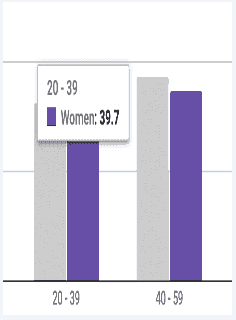

最好并排比较类别。如果标签较长，请使用水平条形而不是垂直柱形。

- 易用工具："Bar and Column Charts" 或 "Datawrapper Charts"
- 强力工具：第 11 章中的 Chart.js 和 Highcharts 模板

分裂条形图或柱形图

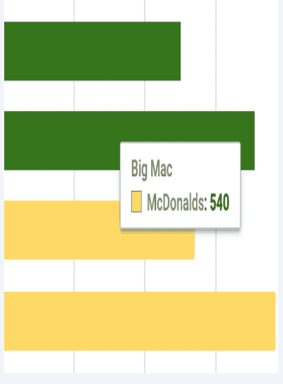

最好将类别在单独的集群中进行比较。如果标签较长，请使用水平条形而不是垂直柱形。

- 易用工具："Bar and Column Charts" 或 "Datawrapper Charts"
- 强力工具：第 11 章中的 Chart.js 和 Highcharts 模板

## 图表

### 堆叠条形图或柱形图

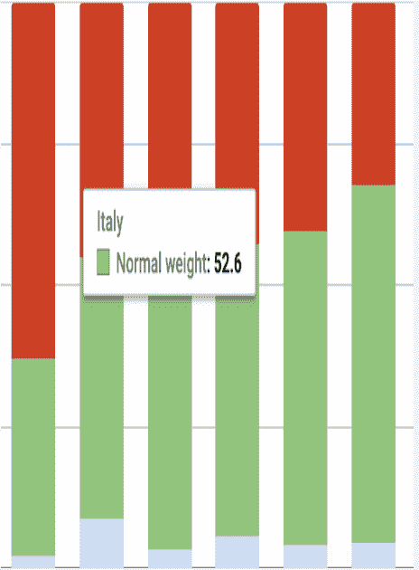

最好比较子类别，或整体的各部分。如果标签较长，请使用水平条形而不是垂直柱形。

- 易用工具：“Bar and Column Charts” 或 “Datawrapper Charts”
- 强力工具：第 11 章中的 Chart.js 和 Highcharts 模板

### 条形图或柱形图中的误差线

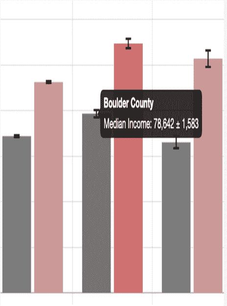

最好在并排比较类别时显示误差线。如果标签较长，请使用水平条形而不是垂直柱形。

- 易用工具：Google Sheets Charts 对误差线支持有限（“Bar and Column Charts”）
- 强力工具：第 11 章中的 Chart.js 和 Highcharts 模板

### 直方图

## 图表
## 本书中的最佳用途与教程
最适合展示原始数据的分布，并显示每个区间中的数值数量。

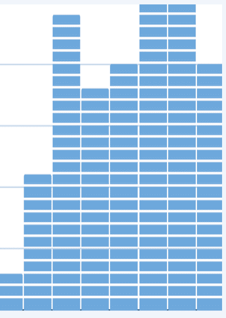

- 简易工具：“直方图”
- 高级工具：第11章的Chart.js和Highcharts模板

## 饼图
最适合展示整体中各部分的占比，但难以估计扇区的大小。

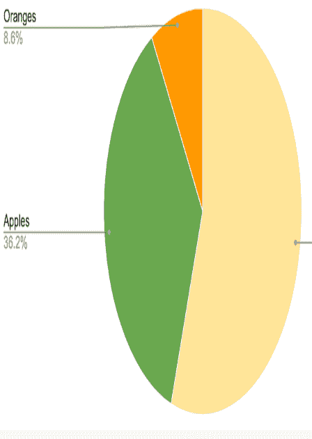

橙子
8.6%

苹果
36.2%

- 简易工具：“饼图、折线图和面积图”或“Datawrapper Charts”
- 高级工具：第11章的Chart.js和Highcharts模板

## 折线图
最适合展示连续数据，例如随时间的变化。

- 简易工具：折线图（参见“饼图、折线图和面积图”）或“Datawrapper Charts”
- 高级工具：第11章的Chart.js和Highcharts模板

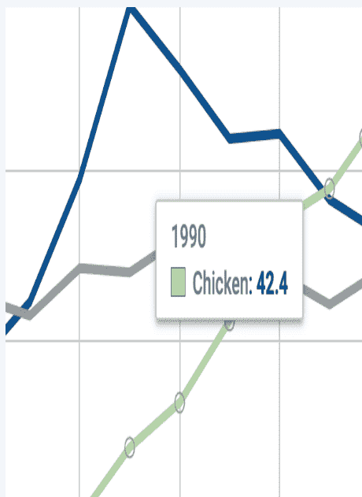

## 带标注的折线图
最适合在图表中添加注释或突出显示数据，例如在折线图中补充历史背景。

- 简易工具：“带标注的图表”
- 高级工具：第11章的Chart.js和Highcharts模板

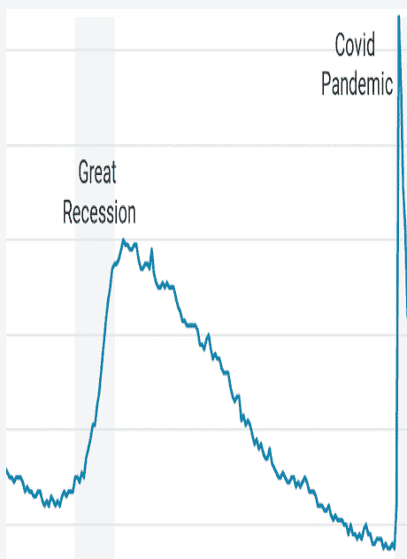

## 可筛选的折线图
最适合展示多条连续数据线，用户可打开或关闭。

- 简易工具：“可筛选的折线图”

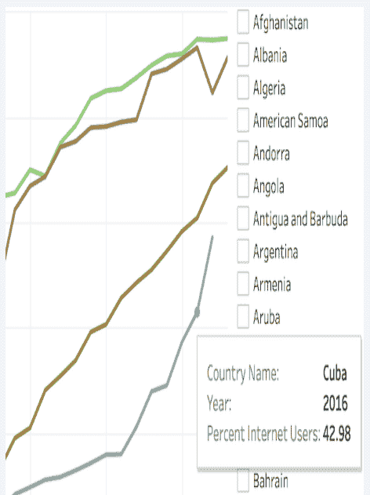

## 堆叠面积图
最适合展示整体中各部分占比，并结合连续数据，例如随时间的变化。

- 简易工具：堆叠面积图（参见“饼图、折线图和面积图”）或“Datawrapper Charts”
- 高级工具：第11章的Chart.js和Highcharts模板

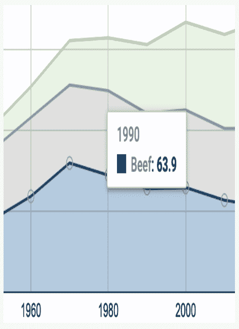

## 范围图
## 图表
最适合展示数据点之间的差距，例如不平等性。

- 简易工具和高级工具：“范围图”

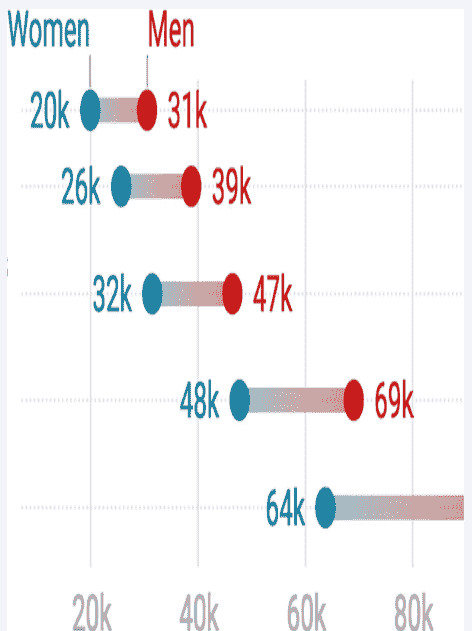

## 散点图
最适合展示两个变量之间的关系，每个点代表其x和y坐标。

- 简易工具：“散点图和气泡图”或“使用Tableau Public绘制散点图”
- 高级工具：第11章的Chart.js和Highcharts模板

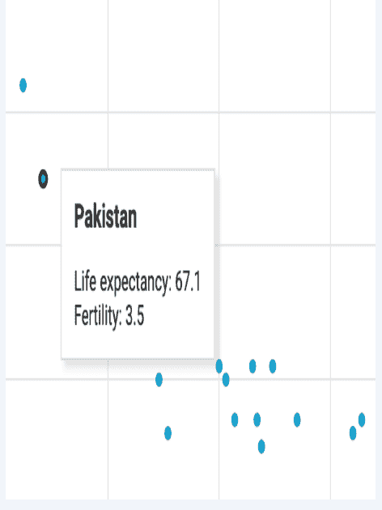

## 气泡图
## 图表
## 本书中的最佳用途与教程

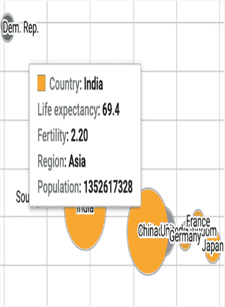

最适合展示三到四组数据之间的关系，通过x和y坐标、气泡大小和颜色来体现。

- 简易工具：“散点图和气泡图”
- 高级工具：第11章的Chart.js和Highcharts模板

## 迷你图

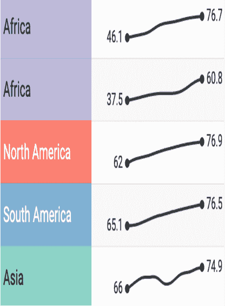

最适合通过排列在表格列中的微型折线图或条形图来比较数据趋势。

- 简易工具：“带迷你图的Datawrapper表格”

> 如需更全面的图表类型和用例，请参阅英国《金融时报》的视觉词汇表。

## 图表设计原则

图表的类型*如此*之多。然而，仅仅因为数据*可以*制成图表，并不一定意味着它*应该*被制成图表。在创建图表之前，请停下来问一问：*可视化数据模式真的对你的故事重要吗？* 有时，一个简单的表格，甚至仅有文字，反而能更有效地向受众传达信息。创建设计良好的图表需要时间和精力，所以请确保它能增强你的数据故事。

虽然数据可视化并非精确科学，但它具有一套原则和最佳实践，可作为创建真实且有说服力的图表的基础。在本节中，我们将介绍一些关于图表设计的重要规则。你可能会惊讶地发现，有些规则并不像其他规则那样严格，只要你能诚实地解读数据，必要时为了强调某个观点也可以“打破”它们。

为了更好地理解数据可视化中遵循规则与打破规则之间的张力，请参阅丽莎·夏洛特·罗斯特（Lisa Charlotte Rost）关于“考虑数据可视化规则时该考虑什么”的深刻反思。通过阐明优秀图表设计背后的潜规则，罗斯特认为，将这些规则公开出来，让我们能公开讨论并改进它们，对所有人都大有裨益——正如她在许多 Datawrapper Academy 文章中所做的那样，这些文章也以精美的可视化呈现了每条规则。但罗斯特提醒我们，规则也有其弊端。首先，过于严格地遵循规则会阻碍创造力和创新，尤其是在我们寻求克服设计工作挑战的方法时。其次，由于规则源自不同的“数据可视化理论”，它们有时会互相矛盾。规则冲突的一个例子是，在创造易于掌握的数据故事和揭示数据复杂性的故事之间存在张力，因为往往感觉无法兼顾两者。罗斯特总结说，我们遵循的规则反映了我们的价值观，我们每个人都需要问自己：“你希望你的数据可视化作品因什么而受到评判？”——是因为设计看起来有多好、有多真实，还是因为它们能唤起情感、提供信息并改变观念？¹

为了进一步深入图表设计，让我们先建立一套通用的图表术语。

## 拆解图表

让我们来看图6-1。它展示了大多数图表类型共有的基本组件。

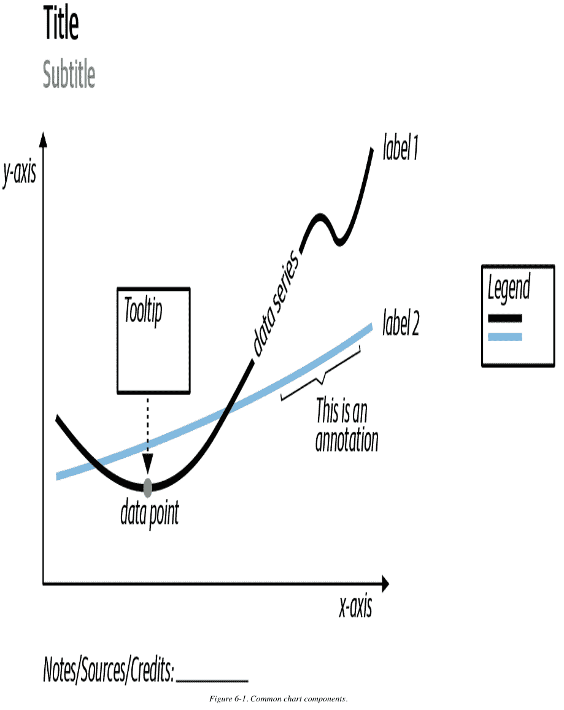

*图6-1：常见图表组件。*

*标题*或许是任何图表中最重要的元素。一个好的标题应简短、清晰，并能独立讲述一个故事。例如，“疫情对黑人和拉丁裔人口打击最严重”或“每年有数百万吨塑料进入海洋”都是清晰的标题，能迅速传达一个更宏大的故事。

有时你的编辑或受众会希望你为图表使用更偏技术性的标题。如果是这样，上面两个标题可以分别改为“纽约市按种族分列的COVID-19死亡人数，2020年春季”和“1950–2020年进入海洋的塑料吨数”。

一种混合策略是将偏故事的标题与更偏技术的副标题相结合，例如：“疫情对黑人和拉丁裔人口打击最严重：纽约市按种族分列的COVID-19死亡人数，2020年春季”。如果采用这种模式，请通过减小副标题的字号、更改字体样式或颜色（或两者都改）来使其不如标题显眼。

水平（x）轴和垂直（y）*轴*定义了刻度和计量单位。

*数据系列*是观测值的集合，通常是数据集中的一行或一列数字，即*数据点*。

*标签和注释*常用于图表各处，以提供更多背景。例如，一张显示1900年至2020年美国失业率水平的折线图，可以在1930年代附近添加“大萧条”注释，并为2020年添加“COVID-19影响”注释，两者都代表了失业率的急剧上升。你也可以选择直接标注项目而不依赖坐标轴，这在条形图中很常见。在这种情况下，可以隐藏相应坐标轴，使图表看起来不那么杂乱。

*图例*显示符号系统，例如图表中使用的颜色和形状及其含义（通常代表的值）。

你应在图表下方添加*注释*、*数据来源*和*署名*，以提供更多背景信息，说明数据来自何处、如何处理和分析，以及谁创建了该可视化。请记住，坦诚公开这些信息有助于建立可信度和责任感。

如果你的数据存在不确定性（或误差范围），请尽可能使用*误差线*来显示。如果没有，请在图表旁附上说明，例如“数据的不确定性最高可达数值的20%”，或“对于地理区域X和Y，误差范围超过10%”。这将帮助读者评估数据来源的可靠性。

在交互式图表中，当用户点击或悬停在某个数据点或数据系列上时，通常会出现*工具提示*，以提供更多数据或背景。工具提示非常适合数据多层的复杂可视化，因为它们能减少图表的杂乱。由于在手机和平板等较小屏幕上的工具提示较难交互，而且在图表打印时不可见，因此你应仅将它们用于传达额外的、锦上添花的信息。请确保所有关键信息无需任何用户交互即可看见。

## 有些规则比其他规则更重要

尽管数据可视化中的大多数规则都可以灵活解读，只要你能诚实地解读数据，但这里有两条规则不容变通：条形图和柱状图必须使用零基线，饼图必须使用100%基线。

## 条形图和柱状图必须从零开始

条形图和柱状图使用*长度*和*高度*来表示数值，因此它们的数值轴*必须从零基线开始*。这可以确保一条长度是另一条两倍的条形图代表两倍的数值。图6-2对比了好坏两个示例。同样的规则也适用于面积图，面积图通过折线下方填充的区域来表示数值。将基线设为非零数值是一种常用技巧，用来夸大民调和选举结果中的差异，我们将在第14章中对此进行说明。

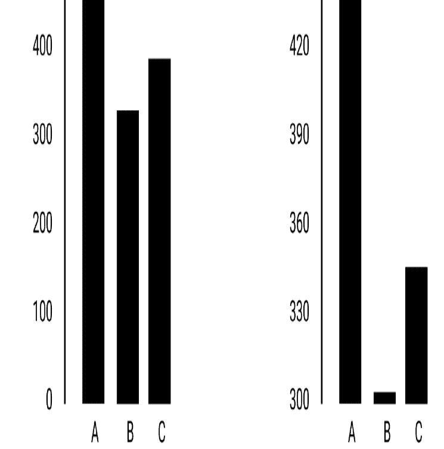

✓ 好的。Y轴从 0 开始且增量自然

✗ 不好。Y轴从 300 开始夸大了各列之间的差异。间隔也很别扭。

Figure 6-2. 柱状图从零开始。

零基线规则不适用于折线图。根据数据可视化专家 Alberto Cairo 的说法，折线图是通过线的位移和角度来表示数值，而不是其高度或长度。由于我们的眼睛依靠其形状来确定其含义，而不是其与基线的接近程度，因此将折线图从零以外的数字开始并不一定会扭曲其编码的信息。² 例如，比较图 6-3 的左右两侧，两者都是正确的。

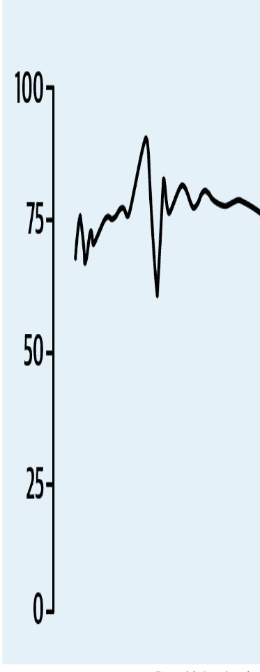

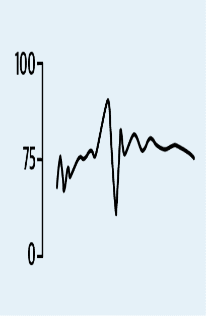

Figure 6-3. 由于折线图不需要零基线，因此两侧都是正确的。

此外，虽然强制折线图从零基线开始是可以接受的，但它可能无法为你的数据故事产生最佳可视化。在图 6-4 中，左侧显示的折线图将垂直轴从零开始，但结果是线条在图表顶部显得非常平坦，并隐藏了数值的变化。右侧显示的折线图将垂直轴缩小以匹配数值范围，从而更清晰地描绘了变化。两侧在技术上都是正确的，在这种情况下，右侧更适合数据故事。尽管如此，你仍需谨慎，因为正如你将在“如何用图表撒谎”中了解到的那样，人们可以通过修改垂直轴来误导我们，而折线图的垂直轴应放在何处并没有统一规则。

可接受，但将垂直轴从零开始会掩盖数值的变化

更好：通过将垂直轴缩小以匹配数值，我们能更清晰地看到变化

Figure 6-4. 虽然具有零基线的折线图是可以接受的，但具有修改后基线的折线图能更清晰地讲述关于变化的数据故事。

## Pie charts represent 100%

饼图是数据可视化中最具争议的问题之一。大多数数据可视化从业者会建议完全避免使用它们，称人们很难准确估计不同扇区的大小。只要你遵守下一节中给出的建议，我们采取的立场就没有那么极端。

数据可视化中唯一所有专业人士都会同意的事情就是，饼图代表数量的 100%。如果扇区加起来不是 100%，那就是犯罪。如果你设计了一项题为“你是猫派还是狗派？”的调查，并允许同时选择“猫”和“狗”复选框，就不要把结果放到饼图里。

## Chart Aesthetics

记住，你制作图表是为了帮助读者理解故事，而不是让他们困惑。决定你想要展示原始计数、百分比还是百分比变化，并为读者做数学计算。

## Avoid chart junk

从白色背景开始，并在认为适当时添加元素。你应该能够为你添加的每个元素提供理由。为此，请问自己：这个元素是否改善了图表，或者我可以去掉它而不会降低可读性？这样你就不会出现所谓的“图表垃圾”，如图 6-5 所示，其中包括 3D 透视、阴影和不必要的元素。它们可能在早期版本的 Microsoft Office 中看起来很酷，但让我们今天远离它们。图表垃圾会分散观众的注意力，降低图表的可读性和理解度。它看起来也不专业，也不会增加你作为讲故事者的可信度。

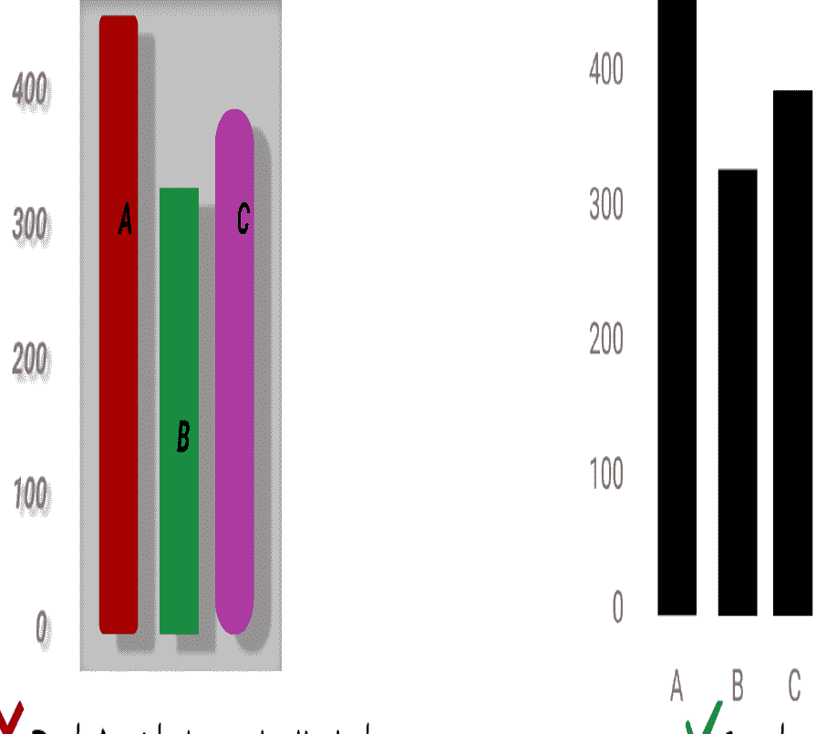

X 不好。避免不承载信息的元素。

Figure 6-5. 图表垃圾会分散观众的注意力，因此请远离阴影、3D 透视、不必要的颜色和其他花哨的元素。

不要在柱状图中使用阴影或粗轮廓，因为读者可能会认为装饰元素是图表的一部分，从而误读柱条代表的数值。

使用三维的唯一理由是绘制三维数据，后者具有 x、y 和 z 值。例如，你可以构建人口密度的三维地图，其中 x 和 y 值代表纬度和经度。然而，在大多数情况下，三维最好以气泡图或具有不同形状和/或颜色的散点图表示。

## Beware of pie charts

记住饼图只显示部分与整体的关系，因此所有扇区必须加起来为 100%。通常，扇区越少越好。按从大到小的顺序排列扇区，按顺时针方向排列，并将最大扇区放在 12 点钟位置，如图 6-6 所示。

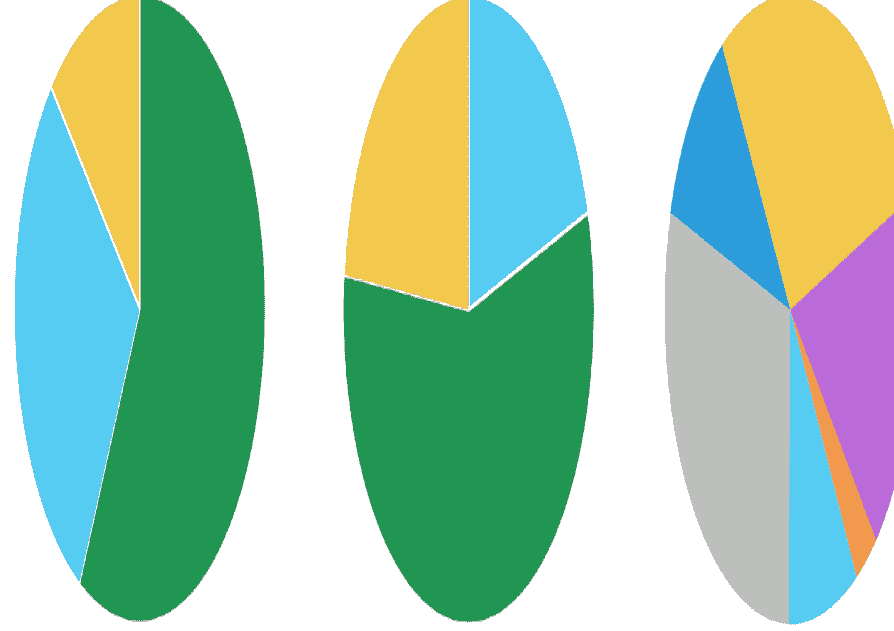

✓ 可以

X 不好。最大份额应从 12 点钟开始并顺时针排列。

X 一切都错了

Figure 6-6. 按从大到小的顺序对饼图中的扇区进行排序，并从 12 点钟开始。

如果你的饼图有超过五个扇区，请考虑以条形图显示你的数据，如图 6-7 所示，可以是堆叠或拆分的。

考虑使用
条形图
代替饼图

更好

更好

Figure 6-7. 考虑使用条形图代替饼图。

## Don’t make people turn their heads to read labels

当你的柱状图有很长的 x 轴标签需要旋转（通常为 90 度）才能容纳时，请考虑将图表旋转 90 度，使其成为水平条形图。看看图 6-8，就能看出水平方向标签读起来容易多少。

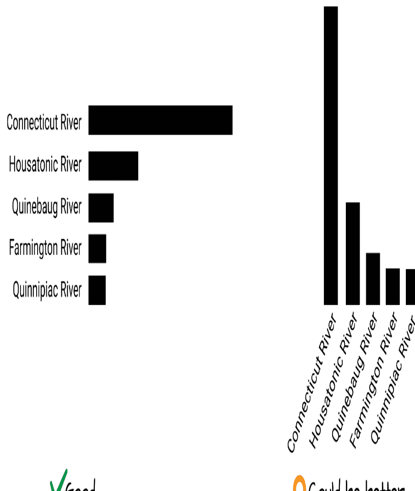

Figure 6-8. 对于长标签，请使用水平条形图。

## Arrange elements logically

如果你的条形图显示不同的类别，请考虑对其进行排序，如图 6-9 所示。你可能希望按字母顺序排序，如果你希望读者能够快速查找某个项目，例如他们的城镇，这会很有用。按数值排序类别是另一种常见技术，可以使比较成为可能。如果你的列代表特定时间点的某个值，当然必须按顺序排列。

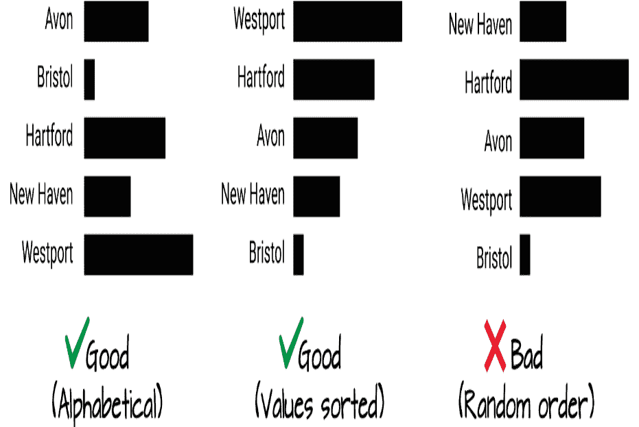

*Figure 6-9. For long labels, use horizontal bar charts.*

## Do not overload your chart

在标记轴时，选择自然且等距的增量，例如 [0, 20, 40, 60, 80, 100]，或对数刻度使用 [1, 10, 100, 1000]。不要过度加载你的刻度。保持排版简洁，并使用（但不要过度使用）**粗体**来突出主要见解。考虑使用逗号作为千位分隔符以提高可读性（1,000,000 比 1000000 更容易阅读）。

## Be careful with colors

在本节中，我们想简要介绍关于颜色的三个重要规则。首先，记住在大多数情况下，单色（单色调）图表就足够了，可能根本不需要引入颜色这一额外维度。

其次，在选择调色板时，请参考色轮和标准的 **和谐规则**。考虑互补色规则——色轮中的对立面——来寻找颜色配对，例如蓝色和橙色或黄色和紫色。类似色，即色轮中的邻居，也能构成良好的调色板，例如橙色、红色和粉色。

第三，远离纯饱和色，而选择它们的“更自然”版本，例如橄榄绿而不是亮绿色，或海军蓝而不是霓虹蓝。

一旦你为可视化选择了颜色调色板，请问自己：

- 颜色与它们所代表的现象之间是否存在意义冲突？我是否用红色代表利润或绿色代表死亡率？这个问题很复杂，因为颜色对不同社会群体和文化有不同的联想，但请尽力保持敏感。
- 色盲人士能否解读你的图表？包含红色和绿色或黄色和蓝色的调色板可能具有挑战性。考虑使用 Color Oracle 或其他模拟器来确保你的可视化是可访问的。
- 颜色在黑白中是否可区分？即使你不期望观众打印你的图表，他们也可能打印。你可以使用 Color Oracle 或其他模拟器来检查你的颜色具有不同的亮度级别，并在灰度中看起来可区分。图 6-10 显示了一些颜色使用的好坏示例。

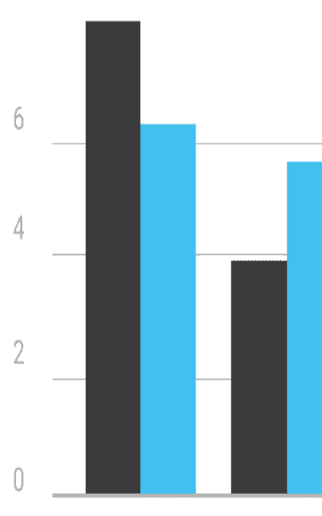

✓ 好。浅蓝色有助于区分不同的数据系列。

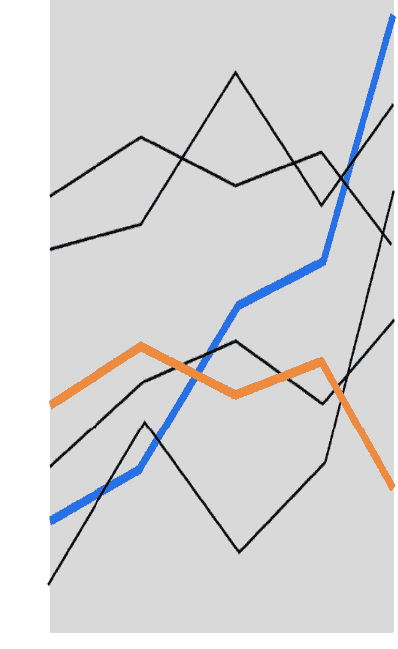

✓ 好。彩色粗线更容易辨认。

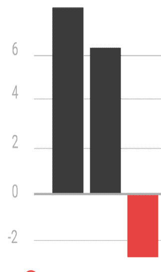

○ 还行。亮红色可以增加强调，但并非绝对必要。

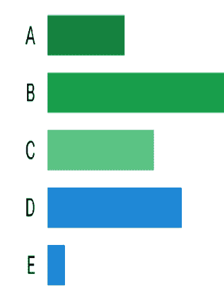

✗ 不好。对于分离的条形图，颜色过于相似，而且并非必需。

图 6-10。不要仅仅为了使用颜色而使用颜色。

色彩的使用是一个复杂的主题，有大量研究专门讨论它。若要获得出色的概述，请参阅 Lisa Charlotte Rost 的《数据可视化中的色彩友好指南》和《如何为你的数据可视化选择更美观的颜色》，两者都发表在 Datawrapper 博客上。³

如果你遵循我们的建议，你最终会得到一张简洁的图表，如图 6-11 所示。注意你的目光会被条形及其对应的数值所吸引，而不是被明亮的颜色或坐标轴线条等次要元素所吸引。

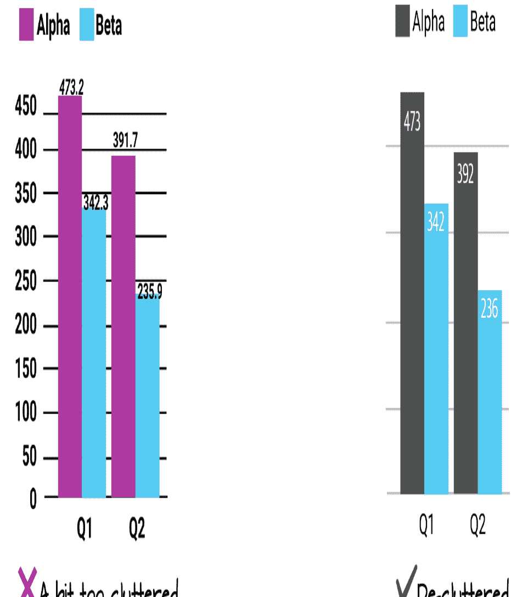

图 6-11。确保重要内容最先映入眼帘。

总之，优秀的图表设计需要训练你的眼睛和大脑，以便在讲述数据故事时理解什么有效、什么无效。通过查看大量不同类型、或好或坏的图表，来锻炼你的数据可视化能力。例如，浏览 Reddit 上的 Data Is Beautiful 和 Data Is Ugly 页面。阅读其他读者的评论，但也要形成自己的观点，这些观点不一定与他人表达的一致。而且，这也是一种有趣的学习方式！

## Google Sheets 图表

在本节中，你将了解使用 Google Sheets（我们在第 2 章中介绍过的强大电子表格工具）创建交互式图表的优缺点。对于数据可视化新手来说，Google Sheets 有许多优势。首先，Google Sheets 允许你在同一个平台中清理、分析、分享和发布图表。一个工具即可完成所有工作，将你的工作集中在一处，更易于整理。其次，Google Sheets 对许多用户来说熟悉且易于学习，因此它能帮助你*快速创建*美观的交互式图表。你可以查看使用 Google Sheets 创建的所有图表类型。虽然有些人会将图表导出为 *JPG* 或 *PNG* 格式的静态图像，但本章重点是在浏览器中悬停图表时，创建能显示更多数据信息的交互式图表。稍后，你将在第 9 章学习如何将交互式图表嵌入你的网站。

但 Google Sheets 也有局限性。首先，虽然你可以在图表副标题中输入文本形式的来源说明，但无法在 Google Sheets 图表中轻松放置指向源数据的可点击链接，因此你需要将来源详情或链接添加到包含嵌入式交互式图表的网页中。其次，你无法在图表内添加文本标注或突出显示特定项目。最后，你在自定义图表设计方面受到限制，尤其是数据可视化上的悬停提示框。（如果 Google Sheets 无法满足你的需求，请参阅表 6-1 了解“Datawrapper 图表”、“Tableau Public 图表”和第 11 章中的其他工具和教程。）

在接下来的两节中，我们将回顾使用条形图、柱状图、饼图、折线图和面积图的最合适场景。每节都包含动手示例和带有示例数据集的分步说明，以帮助你学习。

## 条形图和柱状图

在开始之前，请务必回顾上一节中使用 Google Sheets 设计图表的优缺点。在本节中，你将学习如何创建条形图和柱状图，这是跨类别比较值的最常见可视化方法。我们将重点介绍创建三种不同类型的原因和方法：分组、拆分和堆叠。对于所有这些类型，我们将条形图和柱状图的说明合并在一起，因为它们本质上相同，只是方向不同。如果你的数据包含较长的标签，请创建水平条形图，而不是垂直柱状图，以便为标签留出更多空间，让其更易读。

### 分组条形图和柱状图

分组条形图或柱状图最适合并排比较各类别。例如，如果你想强调不同年龄段的肥胖性别差异，那么请在 Google Sheets 中将男性和女性数据系列以垂直列形式排列在一起，如图 6-12 所示。现在，你可以轻松创建分组柱状图来并排显示这些数据系列，如图 6-13 所示。

| 年龄范围 | 男性 | 女性 |
|---|---:|---:|
| 20 - 39 | 40.3 | 39.7 |
| 40 - 59 | 46.4 | 43.3 |
| 60 岁及以上 | 42.2 | 43.3 |

*图 6-12。要在 Google Sheets 中创建分组条形图或柱状图，请将每个数据系列垂直排列。*

5. 在“图表编辑器”中，将默认选项更改为“柱状图”，并使用“堆叠：无”来显示分组柱状图。如果你的标签较长，也可以选择“水平条形图”。

6. 要在“图表编辑器”中自定义标题、标签等，请选择“自定义”。你也可以选择图表和坐标轴标题进行编辑。

7. 若要使数据公开，请转到工作表右上角的“共享”按钮，然后在下一个屏幕中点击“更改为知道链接的任何人”字样。这意味着你的工作表不再仅限于你本人，任何拥有链接的人都可以查看（参见“共享你的 Google Sheets”）。

8. 若要将图表的交互版本嵌入另一个网页，请点击图表右上角的垂直三点菜单，然后选择“发布图表”。在下一个屏幕中，选择“嵌入”，然后点击“发布”按钮。请参阅第 9 章了解如何处理 iframe 代码。

遗憾的是，Google Sheets 在显示误差线或不确定性方面的功能非常有限。你只能将常量数字或百分比值作为误差线值分配给单个系列，而不能分配给特定的数据点。如果你想在 Google Sheets 中显示误差线，请在“图表编辑器”中选择“自定义”选项卡，向下滚动到“系列”，然后从下拉菜单中选择一个系列。勾选“误差线”，并将其值自定义为百分比或常量值。此设置将应用于该系列中的所有数据点。

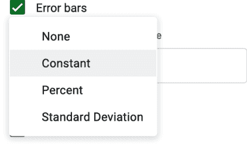

9. 最后，请记住，提供数据来源可以增加工作的可信度。你可以在 Google Sheets 的图表副标题中简要描述来源。但要插入可点击的链接到图表中并不容易，因此你需要将更多详情或链接添加到包含嵌入式交互式图表的单独网页中。

### 拆分条形图和柱状图

拆分柱状图（或条形图）最适合在独立分组中比较各类别。例如，假设你想强调两家不同餐厅（星巴克和麦当劳）提供的特定食品的卡路里含量。请在 Google Sheets 中将餐厅数据以垂直列形式排列，如图 6-14 所示。

|   | A | B | C |
|---|---|---|---|
| 1 | 快餐食品 | 星巴克 | 麦当劳 |
| 2 | 摩卡星冰乐（24 盎司，2% 牛奶，鲜奶油） | 500 |  |
| 3 | 白巧克力热饮（20 盎司，2% 牛奶，鲜奶油） | 710 |  |
| 4 | 巨无霸 |  | 540 |
| 5 | 双层芝士牛肉汉堡 |  | 770 |

图 6-14。要创建拆分条形图（或柱状图），请将每个数据系列垂直排列，并在适当位置留空单元格。

由于食品项目是每家餐厅独有的，因此只将卡路里数据输入相应的列，并让其他单元格保持空白。现在，你可以轻松创建拆分条形图（或柱状图），以不同分组显示餐厅数据，如图 6-15 所示。与图 6-13 中之前显示的分组柱状图不同，这里的条形彼此分离，因为我们不想在不同餐厅独有的食品项目之间进行比较。此外，我们的图表显示的是水平条形（而不是柱状），因为某些数据标签较长。

## 2017 年星巴克和麦当劳的高热量食品精选

数据：星巴克（Explore Our Menu），麦当劳（Nutrition Calculator）

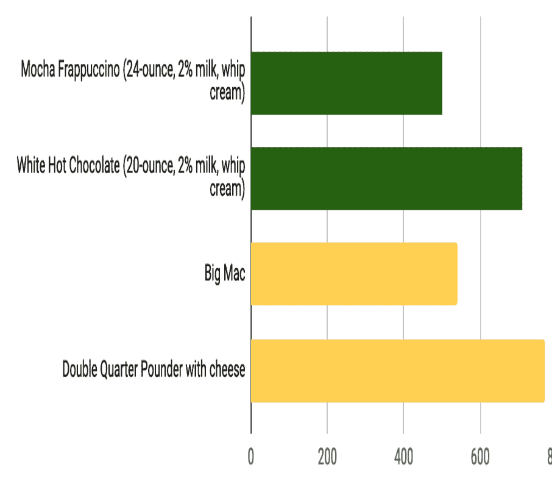

图 6-15。分列条形图：探索全屏交互版本。数据来自星巴克和麦当劳。

使用我们的 Google Sheets 模板中的分列条形图，使用星巴克和麦当劳数据创建自己的版本。将每个数据系列垂直组织，使其在图表中成为自己的颜色。当没有直接比较合适时，留空单元格。其余步骤与分组柱状图教程类似。

## 堆叠条形图和柱形图

堆叠柱形图（或条形图）最适合比较子类别，或整体的各部分。例如，如果你想比较各国超重居民的比例，请在 Google Sheet 中将每个体重水平数据系列格式化为垂直列，如图 6-16 所示。现在你可以轻松创建堆叠柱形图（或条形图），显示各国体重水平子类别的比较，如图 6-17 所示。通常使用堆叠图比使用多个饼图更好，因为人们可以在矩形堆叠中比在圆形饼片中更精确地看到差异。

|   | A | B | C | D |
|---|---|---|---|---|
| 1 | Nation | Underweight | Normal weight | Overweight |
| 2 | United States | 2 | 35.2 | 62.8 |
| 3 | South Africa | 8.6 | 46.2 | 45.1 |
| 4 | Italy | 3.4 | 52.6 | 44 |
| 5 | Iran | 5.7 | 51.5 | 42.8 |
| 6 | Brazil | 4 | 55.4 | 40.6 |
| 7 | South Korea | 4.7 | 63.2 | 32.1 |
| 8 | India | 32.9 | 62.5 | 4.5 |

图 6-16。要创建堆叠柱形图（或条形图），请在 Google Sheets 中将每个数据系列垂直格式化。

## 各国最新年份按体重水平划分的人口百分比

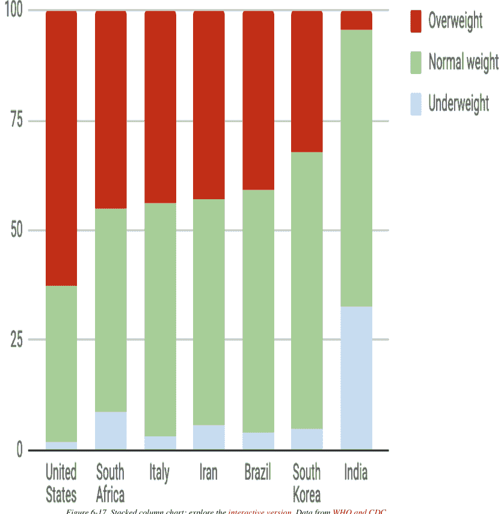

*图 6-17。堆叠柱形图：探索交互版本。数据来自 WHO 和 CDC。*

使用我们的 **Google Sheets 中的堆叠柱形图** 模板，使用国际体重水平数据创建自己的版本。将每个数据系列垂直组织，使其在图表中成为自己的颜色。在“图表编辑器”窗口中，选择图表类型 >“堆叠柱形图” （如果数据标签较长，选择“堆叠条形图”）。其余步骤与之前的步骤类似。

要更改数据系列的颜色（例如，将超重类别显示为红色），单击图表右上角的三点菜单，然后转到“编辑图表” > 自定义 > 系列。从下拉菜单中选择适当系列，并在下拉菜单中设置其颜色，如 **图 6-18** 所示。

### Chart editor
### Setup
### Customize
Chart style
Chart & axis titles
### Series
Overweight
### Format
Color
Edit chart
Delete chart
Download
Publish chart
Copy chart
Move to own sheet
Alt text
India

图 6-18。要编辑列颜色，请选择“编辑图表” > 自定义 > 系列。

## 直方图

直方图最适合通过显示落在定义范围内的值的数量，通常称为桶或箱，来显示原始数据的分布。创建直方图可以很好地了解数据看起来是什么样，以便在设计更高级的可视化时为决策提供信息，例如在“设计 Choropleth 颜色和间隔”中学习到的 Choropleth 地图。尽管直方图可能看起来与柱形图相似，但两者是不同的。首先，直方图显示 *连续* 数据，通常你可以调整桶范围来探索频率模式。例如，你可以将直方图桶从 0–1、1–2、2–3 等更改为 0–2、2–4 等。相比之下，柱形图显示 *分类* 数据，例如苹果、香蕉、胡萝卜等的数量。其次，直方图通常不显示桶之间的空格，因为这些是连续值，而柱形图显示空格以分隔每个类别。

在本节中，你将在 Google Sheets 中创建两种类型的直方图：使用“列统计”菜单的快速直方图和使用图表菜单的常规直方图，并学习每种方法的优点。对于两个教程，我们将使用相同的数据：联合国粮食及农业组织通过 Our World In Data 编译的 2017 年 174 个国家的人均平均卡路里供应量。请注意，衡量粮食供应的方法在各国和随时间变化，并且估计粮食供应量，而非实际消费量。

### 使用 Google Sheets 列统计的快速直方图

在 Google Sheets 中查看列中数据的分布最快的方法是使用内置的“列统计”工具。按照以下步骤尝试：

- 1. 打开 Google Sheets 上的 2017 年人均每日卡路里供应量按国家平均值 的示例数据，使用你的帐户登录，然后转到文件 >“另存为副本”以创建可在 Google 云端硬盘中编辑的版本。
- 2. 要在 Google Sheets 中创建快速直方图，请选择任意列，然后转到数据 >“列统计”，并在侧边栏中单击分布按钮以查看该列的直方图。优点是这种方法非常快，你可以使用侧边栏顶部附近的箭头（< >）快速为同一工作表中的其他列创建直方图。但是，你无法手动调整这些快速直方图的桶范围或进行其他编辑，并且你无法像使用 Google Sheets 中的常规图表那样将其嵌入到网络上。

### Column stats

Average Daily Calorie Suppl...

Ignore rows

0

Count

Distribution

Frequency

- Sort sheet by column B, A → Z
- Sort sheet by column B, Z → A
- Sort range by column B, A → Z
- Sort range by column B, Z → A
- Sort range
- Create a filter
- Filter views
- Slicer
- Data validation
- Pivot table
- Randomize range
- Named ranges
- Protected sheets and ranges
- Cleanup suggestions
- Column stats

B

Average Daily C

2000
3400
3349
2270
2430
3239
3078
3311
3692
3103
2043
2596
2896
3289
3768
2698
2756
2354
3269
2340
3248

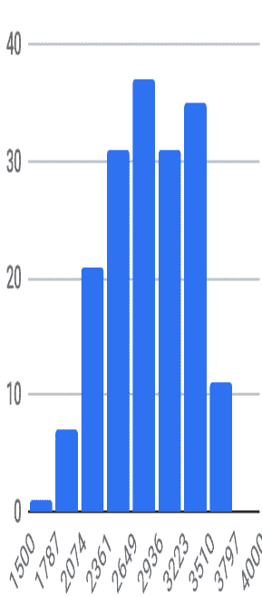

直方图旨在显示数据分布的总体模式，而不是单个值。前面的直方图显示，虽然大多数国家的人均平均日供应量约为 2,800 卡路里，但 8 个国家少于 2,000 卡路里，11 个国家超过 3,500 卡路里。在没有注释的情况下，直方图不会告诉我们这些特定国家的名称。但它们确实能更好地了解数据分布的形状。

### 使用 Google Sheets 图表的常规直方图

将“使用 Google Sheets 列统计的快速直方图”中的直方图与图 6-19 中使用图表创建的常规直方图进行比较。你会注意到，在常规直方图中，你可以定义桶范围、显示分隔线，并添加标题和标签为读者提供更多上下文。此外，常规直方图的交互版本允许用户将光标悬停以查看每列计数的底层数据。

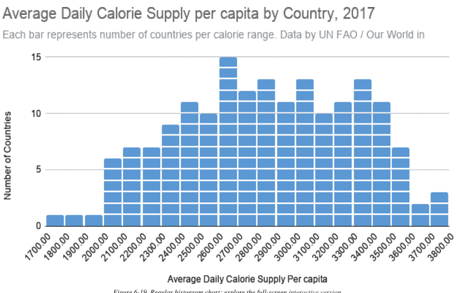

*图 6-19。常规直方图图表：探索全屏交互版本。*

要在 Google Sheets 中创建常规直方图：

- 1. 选择包含值的列并转到插入 > 图表。如果 Google Sheets 未自动将“图表类型”在“图表编辑器”中选择为“直方图图表”，请使用下拉菜单手动选择它，在“其他”类别列表底部附近。

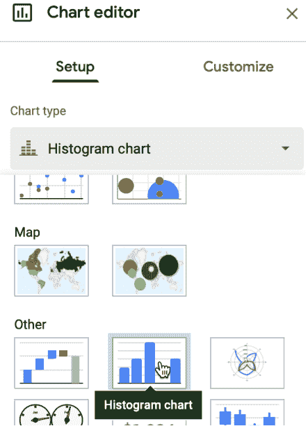

- 2. 你可以手动设置每个桶的范围并将断点四舍五入为整数（例如 1、5 或 100 的倍数），如果这对你的数据分布有意义。在“图表编辑器”中，转到自定义 > 直方图 >“桶大小”。较大的间隔将包含更多数据点并看起来更宽，而较小的间隔将包含更少点并看起来更窄。

> NOTE
> 目前，Google Sheets 不允许用户在直方图的 x 轴标签中删除小数点，即使所有断点都是整数。

- 3. 可选地，你可以将列分解为单个项目（在我们的例子中，国家），它们将作为带有白色边界的块出现。要执行此操作，请转到自定义 > 直方图 >“显示项目分隔线”。

- 4. 在图表编辑器中，进一步自定义以添加图表标题、描述来源的副标题，以及垂直和水平轴标题以帮助读者解释图表。

由于常规直方图是使用图表功能创建的，你可以选择发布它并复制交互版本的嵌入代码，如第 9 章中所述。

现在你已经学会了如何创建直方图来显示原始数据的分布，在下一节中我们将继续介绍其他类型的 Google Sheets 图表类型，例如饼图、线图和面积图。

## 饼图、线图和面积图

开始本节之前，请务必回顾“Google Sheets 图表”中设计图表的利弊，以及“条形图和柱形图”中的初学者分步说明。在本节中，你将学习为什么以及如何使用 Google Sheets 构建三种交互式可视化：饼图（显示整体的各部分）、线图（显示随时间的变化）和堆叠面积图（结合显示整体的各部分和随时间的变化）。如果 Google Sheets 或这些图表类型不符合你的需求，请参考表 6-1 中的其他工具和教程。

### 饼图

有些人使用饼图来显示整体的各部分，但我们建议谨慎使用这种图表类型。例如，如果你想显示商店一天内销售的不同水果的数量，作为总水果销售的比例，那么在 Google Sheet 中将标签和值格式化为垂直列，如图 6-20 所示。值可以表示为原始数字或百分比。现在你可以轻松创建饼图，将这些值显示为圆形的彩色切片，如图 6-21 所示。查看者可以看到香蕉占水果销售的略多于一半，其次是苹果和橙子。

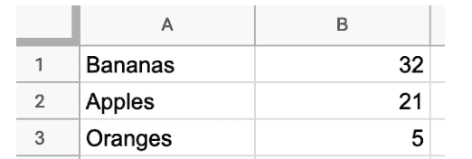

图 6-20。要创建饼图，请在 Google Sheets 中将数据值垂直格式化。

# 昨日售出的水果大多是香蕉

此饼图中显示的数据为虚构数据

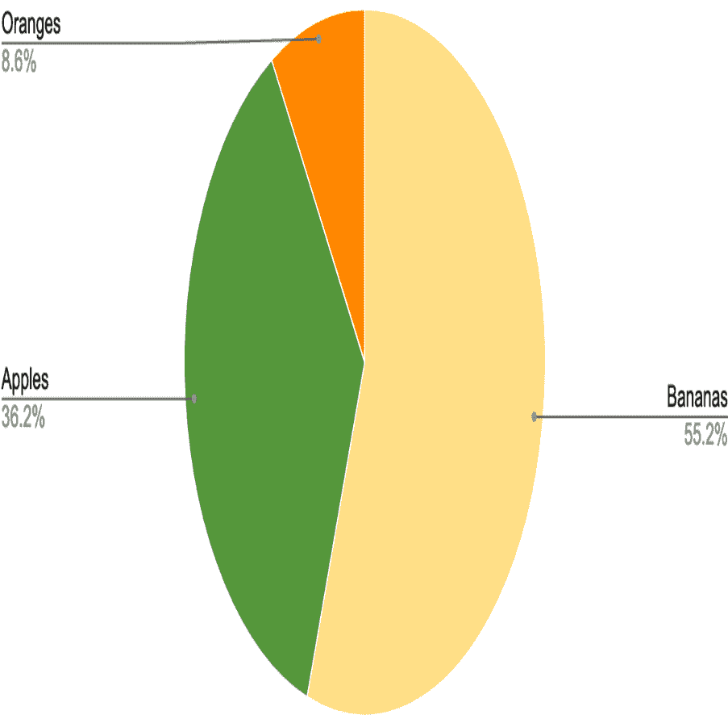

*图6-21 饼图：探索交互式版本。数据为虚构数据。*

但在使用饼图时你需要小心，正如我们在“图表设计原则”中所述。首先，确保你的数据加起来等于100%。如果你创建的饼图显示了*部分而非全部*售出的水果，那就不合理了。其次，避免创建过多扇区，因为人们难以区分较小的扇区。理想情况下，饼图中的扇区不要超过五个。最后，从圆圈的顶部（12点钟方向）开始，按顺时针方向从大到小排列扇区。

使用我们的 Google Sheets 饼图模板创建你自己的版本。步骤与本章前面 Google Sheets 图表教程中的步骤类似。转到文件 > “创建副本”以创建可在你的 Google Drive 中编辑的版本。选择所有单元格，然后转到 插入 > 图表。如果 Google Sheets 没有正确猜测你想创建饼图，则在“图表编辑器”窗口的“设置”选项卡中，从“图表类型”下拉列表中选择“饼图”。

请注意，扇区的排序方式与它们在电子表格中的显示方式相同。选择整个工作表，并按从大到小或从 Z 到 A 的顺序对值列进行*排序*。在“图表编辑器”的*自定义*选项卡中，你可以更改颜色并为扇区添加边框。然后根据需要添加有意义的标题和标签。

# 折线图

折线图是表示连续数据（例如随时间变化）的最佳方式。例如，假设你想比较美国过去一个世纪中不同肉类的人均供应量。在 Google Sheets 中，将时间单位（例如年份）组织到第一列，因为这些将出现在水平 x 轴上。同时，将每个数据系列（例如牛肉、猪肉、鸡肉）放在垂直的时间单位列旁边，每个系列将变成一条独立的线，如图6-22所示。现在你可以轻松创建折线图，突出显示每个数据系列随时间的变化，如图6-23所示。在美国，人均鸡肉量稳步上升，并在2000年左右超过了猪肉和牛肉。

| 年份 | 牛肉 | 猪肉 | 鸡肉 |
|---|---:|---:|---:|
| 1910 | 48.5 | 38.2 | 11 |
| 1920 | 40.7 | 39 | 9.7 |
| 1930 | 33.7 | 41.1 | 11.1 |
| 1940 | 37.8 | 45.1 | 10 |
| 1950 | 44.6 | 43 | 14.3 |
| 1960 | 59.1 | 48.6 | 19.1 |
| 1970 | 79.6 | 48.1 | 27.4 |
| 1980 | 72.1 | 52.1 | 32.7 |
| 1990 | 63.9 | 46.4 | 42.4 |
| 2000 | 64.5 | 47.8 | 54.2 |
| 2010 | 56.7 | 44.3 | 58 |
| 2017 | 54 | 47 | 64 |

> 图6-22 要创建折线图，请将时间单位和每个数据系列排列在垂直列中。

# 美国人均牛肉、猪肉和鸡肉供应量，1910-2017年

数据来源：美国农业部（食品供应数据系统）

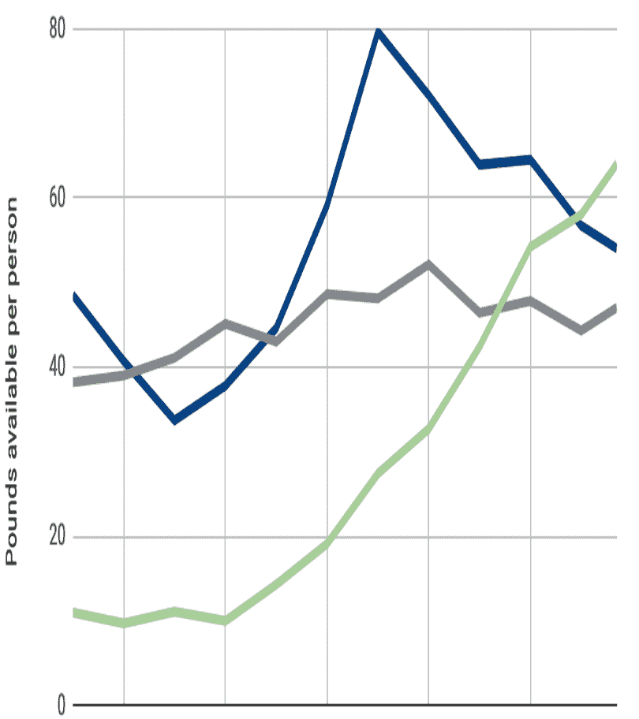

> 图6-23 折线图：探索交互式版本。数据来自美国农业部。

使用我们的 [Google Sheets 折线图模板](#) 创建你自己的版本。步骤与本章前面 Google Sheets 图表教程中的步骤类似。转到文件 > “创建副本”以创建可在你的 Google Drive 中编辑的版本。选择数据，然后选择 插入 > 图表。如果 Google Sheets 没有正确猜测你想创建折线图，则在“图表编辑器”的“设置”选项卡中，从图表类型下拉列表中选择“折线图”。

# 时间序列数据中的行与列

表格和图表从相反的方向处理时间序列数据。在设计图表时，正确的方法是将日期水平放置为列标题，以便我们从左到右阅读，如下所示：[^4]

| 年份 | 2000 | 2010 | 2020 |
|---|---|---|---|
| 系列1 | … | … | … |
| 系列2 | … | … | … |

在 Google Sheets 和其他一些工具中设计折线图时，我们将日期垂直放在第一列中，以便工具将它们读取为数据系列的标签，如下所示：

| 年份 | 系列1 | 系列2 |
|---|---|---|
| 2000 | … | … |
| 2010 | … | … |
| 2020 | … | … |

在“转置行和列”中了解如何将数据从表格转换为图表。

# 堆叠面积图

面积图类似于折线图，但在下方填充了空间。最有用的类型是堆叠面积图，它最适合结合前面提到的两个概念：显示整体的各个部分（如饼图）和随时间变化的连续数据（如折线图）。例如，折线图显示了三种不同肉类的供应量如何随时间变化。然而，如果你还想显示这些肉类合计的总供应量如何随时间上升或下降，在折线图中很难看到这一点。相反，使用堆叠面积图来可视化每种肉类的供应量以及人均总供应量随时间的变化。堆叠面积图同时显示数据的这两个方面。

要创建堆叠面积图，请按照与图6-22中折线图相同的方式组织数据。现在你可以轻松创建一个堆叠面积图，显示每种肉类的供应量及其合计总量随时间的变化，如图6-24所示。总体来看，我们可以看到人均肉类总供应量在1930年代大萧条后有所增加，并且从1970年代起，鸡肉在总量中所占的比例稳步上升。

# 美国人均牛肉、猪肉和鸡肉供应量，1910-2017年

数据来源：美国农业部（食品供应数据系统）

鸡肉 猪肉 牛肉

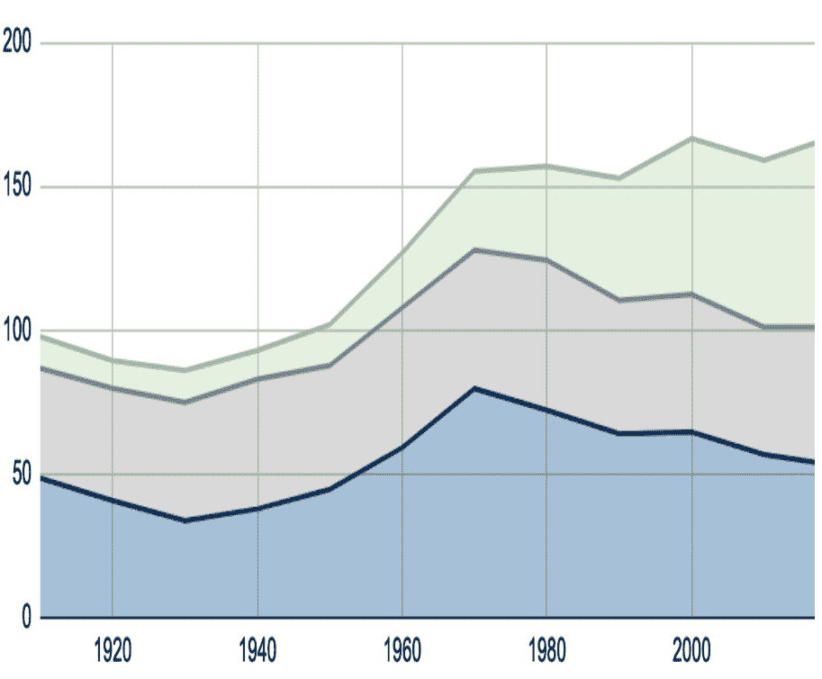

年份

> 图6-24 堆叠面积图：探索交互式版本。数据来自美国农业部。

使用我们的 Google Sheets 堆叠面积图模板创建你自己的版本。步骤与本章前面 Google Sheets 图表教程中的步骤类似。转到文件 > “创建副本”以创建可在你的 Google Drive 中编辑的版本。按照与折线图完全相同的方式设置数据，第一列用于 x 轴上的时间单位，并将每个数据系列放在自己的列中。选择数据，然后选择 插入 > 图表。在“图表编辑器”的“设置”选项卡中，从图表类型下拉列表中选择“堆叠面积图”。

既然你已经学会了在 Google Sheets 中制作几种基本图表，下一节我们将使用另一种工具 Datawrapper 来制作一些稍高级的图表。

# Datawrapper 图表

另一个用于创建交互式图表的免费协作工具是 Datawrapper，它相对于 Google Sheets 有几个优势。首先，你可以在浏览器中立即开始在 Datawrapper 中创建，甚至无需创建账户，其四步流程对许多新用户来说非常直观。其次，你可以添加署名、数据来源链接，甚至允许访问者通过你在线上发布的 Datawrapper 可视化中的按钮下载数据，这使你的工作更具可信度和可访问性。第三，Datawrapper 支持的交互式图表类型比 Google Sheets 更广泛，还支持地图（我们将在第7章讨论）和表格（将在第8章讨论）。使用 Datawrapper，你可以构建本章迄今为止构建的所有基本图表，以及我们将在“注释图表”、“范围图表”和“散点图和气泡图”中介绍的三种新类型。稍后，你将在第9章学习如何将交互式 Datawrapper 图表嵌入到你的网站中。

虽然没有一个工具能做所有事情，但我们建议你考虑同时使用 Google Sheets 和 Datawrapper，这将使这对易于使用的工具成为一个可视化强强组合。首先，使用 Google Sheets 作为电子表格来组织和分析数据（如第2章所述），记录详细的来源注释并保存原始数据文件（如第3章所述），并清理数据（如第4章所述）。虽然 Datawrapper 可以转置数据（交换行和列），但它不能像电子表格那样创建数据透视表或查找和合并数据。其次，将你的数据从 Google Sheets 导入 Datawrapper 以创建可视化，因为后一种工具让你对其外观、注释和其他功能有更多控制，我们将在后面描述。你会发现 Datawrapper 与 Google Sheets 配合得很好，它可以接受存储在其中的数据的直接链接。总而言之，Google Sheets 和 Datawrapper 是一个强大的组合。

此外，我们强烈推荐高质量的 Datawrapper Academy 支持页面、丰富的示例库和精心设计的培训材料。阅读这些内容不仅会教你按哪些按钮，更重要的是，如何设计更好的可视化，讲述关于数据的真实而有意义的故事。在撰写本书时，我们从 Datawrapper Academy 学到了很多，我们将在后续章节中注明来源并提供具体链接。最后，还有一个优点是 Datawrapper Core 是开源代码，尽管这不适用于该平台用于创建图表和地图的大多数插件。

现在你已经准备好使用 Datawrapper 来创建超越基础的新类型图表。但如果 Datawrapper 或本节中的图表类型不能满足你的需求，请参阅表6-1以了解其他工具和教程，或参阅前面关于电子表格、数据来源和清理数据的章节。

# 注释图表

注释图表最适合在可视化中突出显示特定数据或添加上下文注释。精心设计的注释可以通过简要说明图表中数据的意义来帮助回答“那又怎样？”的问题，并在后面的句子或段落中提供更多细节。使用注释时要谨慎，因为避免添加不必要的“图表垃圾”很重要，正如“图表设计原则”中所述。

你可以向使用 Datawrapper 创建的任何图表添加注释，我们将通过一个关于美国2000年至2020年失业数据的折线图来演示如何操作，因为添加一点历史背景通常有助于读者更好地理解关于随时间变化的数据故事。要在 Datawrapper 中创建折线图，请按照你在“饼图、折线图和面积图”中相同的方式组织数据。将时间单位（如月/年）放在第一列，将数值数据值（如失业率）放在第二列。现在你已经准备好创建一个带有注释的交互式折线图，如图6-25所示。自2000年以来，失业率出现了三次峰值，但最高的峰值出现在 COVID-19 疫情引发的2020年经济危机期间。

## 美国失业率，经季节性调整，2000-2020

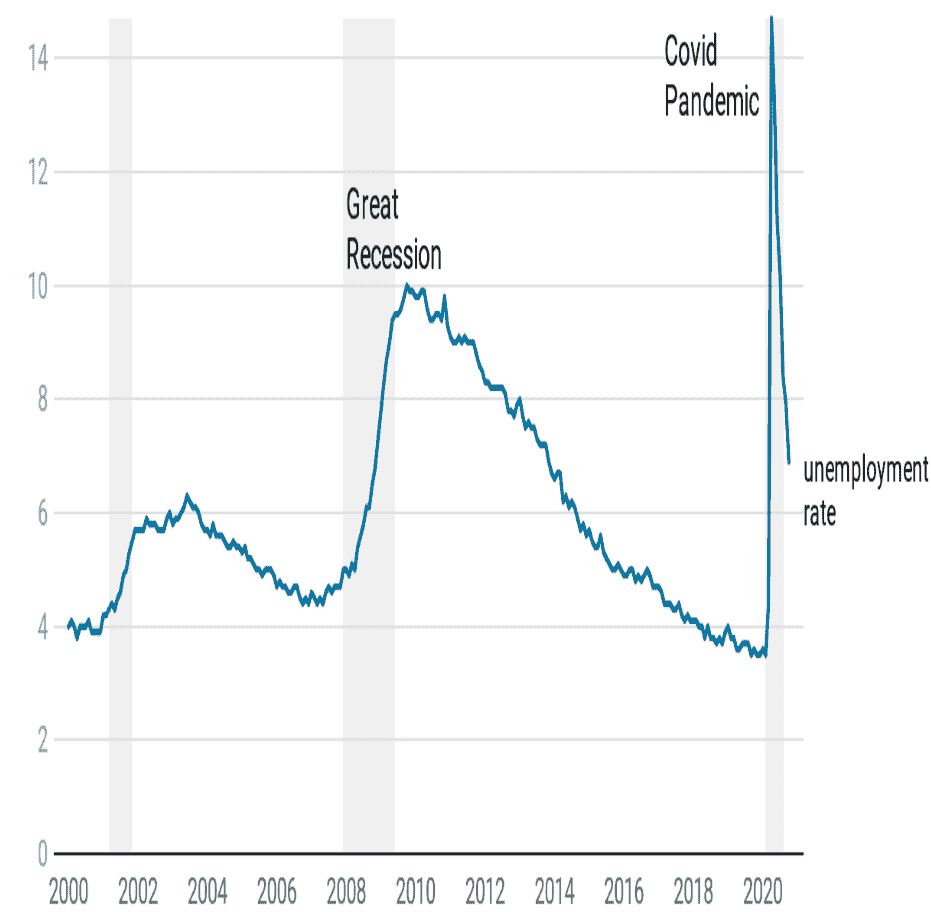

官方经济衰退以灰色显示

图表：by HandsOnDataViz • 来源：US Federal Reserve Open Data • 使用 Datawrapper 创建

图 6-25。带注释的折线图：探索交互式版本。数据来自 US Federal Reserve Open Data。

按照本教程在 Datawrapper 中创建你自己的带注释的折线图：

- 1. 在 Google Sheets 中打开 US Unemployment Seasonally Adjusted 2000-2020 示例数据，然后转到 File > "Make a copy" 在你的 Google Drive 中创建自己的版本。或者转到 File > Download 将 CSV 或 Excel 版本导出到你的电脑。

- 2. 在浏览器中打开 Datawrapper 并点击 Start Creating。我们建议你创建一个免费账户以更好地管理你的可视化，但这不是必需的。

- 3. 在 Upload Data 屏幕中，点击 Import Google Spreadsheet 并粘贴共享 Google Sheet 中数据的链接，然后点击 Proceed。要上传 Google Sheet，共享设置必须从默认的 Private 更改为至少为 "Anyone with the link can view"。此外，如果你在 Google Sheet 中更新单元格，它们将在链接的 Datawrapper 图表中自动更新，但在你的图表在线发布后则不会。或者，你可以通过复制粘贴到数据表窗口中上传数据，或上传 Excel 或 CSV 文件。

## Datawrapper

New Chart

New Map

New Table

River

此图表在 My Charts 中

### 1 Upload Data

### 2 Check & Describe

### 3 Visualize

你想如何上传数据？

Enter a URL to a Google Sheet:

Copy & paste data table

XLS/CSV upload

Import Google Spreadsheet

Link external dataset

fFP-miPiObi6vXzJUIMi1TSuoaT61FU

valid Spreadsheet URL

Sharing enabled

- 4. 在 "Check & Describe" 屏幕中，检查你的数据以确保数字显示为蓝色，日期显示为绿色，文本显示为黑色，然后点击 Proceed。

### TIP

如果需要，在 "Check & Describe" 屏幕底部有一个按钮可以转置你的数据（交换行和列），这在接收到的数据组织方向与 Datawrapper 预期相反时很有用。但我们的示例数据不需要转置，因为它已正确组织。

- 5. 在 Visualize 屏幕中，Datawrapper 将尝试根据数据格式猜测你想要的图表类型。如果你正确输入了我们的示例数据，它将正确显示折线图。如果没有，你可以选择其他图表类型。

- 6. 点击 Visualize 屏幕左上角附近的 Annotate 选项卡。输入一个有意义的标题，例如 "US Unemployment Rate, Seasonally Adjusted, 2000–2020。" 此外，添加数据来源，例如 "US Federal Reserve Open Data"，并添加指向来源的链接，例如共享的 Google Sheet 或 Federal Reserve Open Data 网页。最后，在署名行中添加你的姓名或组织以[content]

## 美国失业率，经季节性调整，2000-2020

官方经济衰退以灰色显示

图表：by HandsOnDataViz • 来源：US Federal Reserve Open Data • 使用 Datawrapper 创建

图 6-25。带注释的折线图：探索交互式版本。数据来自 US Federal Reserve Open Data。

按照本教程在 Datawrapper 中创建你自己的带注释的折线图：

- 1. 在 Google Sheets 中打开 US Unemployment Seasonally Adjusted 2000-2020 示例数据，然后转到 File > "Make a copy" 在你的 Google Drive 中创建自己的版本。或者转到 File > Download 将 CSV 或 Excel 版本导出到你的电脑。

- 2. 在浏览器中打开 Datawrapper 并点击 Start Creating。我们建议你创建一个免费账户以更好地管理你的可视化，但这不是必需的。

- 3. 在 Upload Data 屏幕中，点击 Import Google Spreadsheet 并粘贴共享 Google Sheet 中数据的链接，然后点击 Proceed。要上传 Google Sheet，共享设置必须从默认的 Private 更改为至少为 "Anyone with the link can view"。此外，如果你在 Google Sheet 中更新单元格，它们将在链接的 Datawrapper 图表中自动更新，但在你的图表在线发布后则不会。或者，你可以通过复制粘贴到数据表窗口中上传数据，或上传 Excel 或 CSV 文件。

## Datawrapper

New Chart

New Map

New Table

River

此图表在 My Charts 中

### 1 Upload Data

### 2 Check & Describe

### 3 Visualize

你想如何上传你的数据？

Enter a URL to a Google Sheet:

Copy & paste data table

XLS/CSV upload

Import Google Spreadsheet

Link external dataset

fFP-miPiObi6vXzJUIMi1TSuoaT61FU

valid Spreadsheet URL

Sharing enabled

- 4. 在 "Check & Describe" 屏幕中，检查你的数据以确保数字显示为蓝色，日期显示为绿色，文本显示为黑色，然后点击 Proceed。

### TIP

如果需要，在 "Check & Describe" 屏幕底部有一个按钮可以转置你的数据（交换行和列），这在接收到的数据组织方向与 Datawrapper 预期相反时很有用。但我们的示例数据不需要转置，因为它已正确组织。

- 5. 在 Visualize 屏幕中，Datawrapper 将尝试根据数据格式猜测你想要的图表类型。如果你正确输入了我们的示例数据，它将正确显示折线图。如果没有，你可以选择其他图表类型。

- 6. 点击 Visualize 屏幕左上角附近的 Annotate 选项卡。输入一个有意义的标题，例如 "US Unemployment Rate, Seasonally Adjusted, 2000–2020。" 此外，添加数据来源，例如 "US Federal Reserve Open Data"，并添加指向来源的链接，例如共享的 Google Sheet 或 Federal Reserve Open Data 网页。最后，在署名行中添加你的姓名或组织以署名你的作品。你将在图表底部自动看到这些详细信息和链接，以增加你的作品的可信度。

- 7. 在 Annotate 选项卡中进一步向下滚动到 "Text annotations" 部分，并点击按钮添加一个。绘制一个粉色矩形以在图表上放置你的注释，失业率从 2008 年到 2010 年急剧上升的位置，并将 Great Recession 输入到文本字段中。这有助于读者将大衰退置于历史背景中。再次点击按钮添加另一个文本注释，将其放置在 2020 年第二次失业率峰值周围，并将 **COVID-19 Pandemic** 输入到文本字段中以供读者比较。你可以使用屏幕下方额外的选项进一步微调注释的样式和位置。

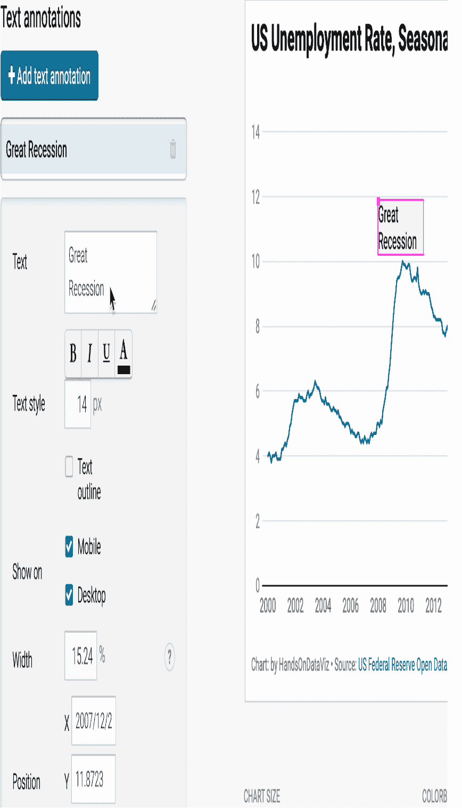

### Text annotations

Add text annotation

Great Recession

### US Unemployment Rate, Seasonal

Great Recession

Chart by: HandsOnDataViz · Source: US Federal Reserve Open Data

- 8. 在 Annotate 选项卡中进一步向下滚动到 "Highlight range" 部分，并点击按钮在图表上添加一个。点击图表内部从 2007 年 12 月绘制到 2009 年 6 月的粉色线条，这将以灰色突出显示图表的该部分。此期间代表经济学家眼中美国大衰退的官方开始和结束时间，尽管失业率对普通民众而言仍在继续增长。为了突出其他官方衰退期，绘制另外两个范围：2001 年 3 月至 11 月和 2020 年 2 月至 10 月（我们撰写本文时的最新数据）。同样，你可以使用屏幕下方额外的选项微调突出显示范围的样式和定位。

### Highlight range

+ Add range highlight

2007/12 - 2009/6

Orientation

Type

Range

Line

Start: 2007/12

Position

End: 2009/6

Color

Opacity

10 %

### US Unemployment Rate, Sea

Great Recession

Chart: by HandsOnDataViz • Source: US Federal Reserve Open Data

- 9. 点击 Proceed 或进入 Publish & Embed 屏幕与他人分享你的作品。如果你已登录你的免费 Datawrapper 账户，你的作品会自动在线保存到屏幕右上角的 My Charts 菜单中。此外，你可以点击蓝色的 Publish 按钮生成嵌入代码，将你的交互式图表嵌入到你的网站中，如你在第 9 章中将学到的。此外，你可以“将你的图表添加到 River”以更广泛地分享你的作品，允许其他 Datawrapper 用户改编和重用你的图表。此外，滚动到最底部并点击 Download PNG 以导出你的图表的静态图像。额外的导出和发布选项需要付费的 Datawrapper 账户。或者，如果你不想创建账户，可以输入你的电子邮件以接收嵌入代码。

| 教育程度 | 男性 | 女性 |
|---|---|---|
| 高中以下 | 30725 | 20046 |
| 高中毕业生 | 38906 | 25829 |
| 部分大学或副学士学位 | 46610 | 31644 |
| 学士学位 | 69201 | 47895 |
| 研究生或专业学位 | 93998 | 63912 |

图 6-27。将你的范围图表数据组织成三列：两个子组的标签和值。

到目前为止，你应该已经熟悉 Datawrapper，因此创建范围图表的步骤比上一节中关于带注释折线图的教程更少详细。如果迷路了，请参阅上一节中关于 Datawrapper 图表的更详细步骤。

- 1. 在 Google Sheets 中打开 US Earnings by Gender by Education Level 数据，然后转到 File > "Make a copy" 在你的 Google Drive 中创建自己的版本。
- 2. 在浏览器中打开 Datawrapper 并点击 Start Creating。我们建议你创建一个免费账户以更好地管理你的可视化，但这不是必需的。
- 3. 在 Upload Data 屏幕中，点击 Import Google Spreadsheet 并粘贴共享 Google Sheet 中数据的链接，然后点击 Proceed。或者，你可以通过复制粘贴到数据表窗口中上传数据，或上传 Excel 或 CSV 文件。
- 4. 在 "Check & Describe" 屏幕中，检查你的数据，然后点击 Proceed。
- 5. 在 Visualize 屏幕中，Datawrapper 将尝试根据数据格式猜测你想要的图表类型，但你需要选择 Range Plot。
- 6. 点击 Visualize 屏幕左上角附近的 Annotate 选项卡以添加有意义的标题、数据来源和署名。
- 7. 点击 Visualize 屏幕的 Refine 选项卡以修改范围图表的外观。你有几个选项，但在此情况下最重要的有以下几点。首先，在 Labels 部分，将值的可见性从 start 更改为 both，这将在每个范围的两端放置数字。其次，将滑块推到 Label first range，这将在第一个范围上方放置 Men 和 Women 的文字。第三，将 "Number format" 更改为 123k，这将把美元金额四舍五入到最接近的千位，并用 k 替换千位。

# Labels

Alignment
left
right
direct

Show values

Visibility
start
end
both
difference
% change

Number format
123k

Label first range

# 按性别和教育程度划分的收入

25岁以上人群的美国美元中位数收入。A about 1.5x higher than women's earnings.

Women
Men
Less than high school
High school graduate
Some college or associate's degree
Bachelor's degree
Graduate or professional degree
20k
31k
26k
32k
20k
30k
40k

Chart: by HandsOnDataViz • Source: American Community Survey 2

8. Still in the Refine tab, scroll down to the Appearance section to improve the colors. Select the “Range end” drop-down menu to select a better color, such as red. Change the “Range color” setting to “gradient” to emphasize the range.

# Appearance

Range start

Range end

Range color

fixed

gradient

low end

high end

Range ends

circles

lines

# 按性别和教育程度划分的收入

25岁以上人群的美国美元中位数收入。about 1.5x higher than women's earnings.

Women

Men

Less than high school

20k

31k

High school graduate

26k

Some college or associate's degree

32k

Bachelor's degree

Graduate or professional degree

20k 30k 40

TIP

The Refine tab includes options to re-sort or group data rows, change the chart size for different devices, and check visibility for colorblind readers.

9. After modifying your visualization, proceed to the “Publish & Embed” screen, and follow the prompts to share your work, or refer to the previous detailed Datawrapper tutorial.

Now that you’ve completed a range chart, let’s see how we can use Datawrapper to build scatter and bubble charts to show relationships between two or more variables.

# 散点图和气泡图

散点图（也称为散点图）最适合通过以点显示其 x 和 y 坐标来显示两个数据集之间的关系，从而揭示可能的关联。在即将进行的散点图示例中，每个点代表一个国家，其预期寿命位于水平 x 轴上，其生育率（每位女性的出生数）位于垂直 y 轴上。整体点模式说明了这两个数据集之间的相关性：预期寿命往往随着生育率的下降而增加。

气泡图通过添加两个更多视觉元素——点大小和颜色——来表示第三或第四数据集，从而超越了散点图。我们的气泡图示例以与散点图中之前看到的每个国家的预期寿命和生育率数据开始，但每个圆形点的大小代表第三个数据集（人口），其颜色表示第四个数据集（世界地区）。因此，气泡图是散点图的加强版，因为它们将更多信息打包到可视化中。

更高级的气泡图引入了一个额外的视觉元素——动画——来表示第五个数据集，例如随时间的变化。虽然创建动画气泡图超出了本书的范围，但请观看著名瑞典全球健康教授 Hans Rosling 的著名 TED 演讲，观看动画气泡图在行动中，并了解有关他在 Gapminder Foundation 的工作的更多信息。

在本节中，您将学习为什么以及如何在 Datawrapper 中创建散点图和气泡图。请务必阅读前一节（“Datawrapper Charts”）中关于使用 Datawrapper 设计图表的优缺点。

# 使用 Google Sheets 的散点图

散点图最适合以网格上的 x 和 y 坐标显示两组数据之间的关系。想象一下，您希望比较不同国家的预期寿命和生育率数据。将您的数据按图 6-28 所示组织成三列。第一列包含国家标签，第二列 Life Expectancy 将出现在水平 x 轴上，而第三列 Fertility 将出现在垂直 y 轴上。现在您可以轻松创建一个散点图来显示这些数据集之间的关系，如图 6-29 所示。一种总结图表的方法是生育率较低（或每位女性出生数较少）的国家往往预期寿命较高。另一种说法是预期寿命较高的国家生育率较低。请记住相关性不等于因果关系，因此您不能使用此图表来论证较少的出生会产生更长的寿命，或更长寿的女性会生育更少的孩子。

|   | A | B | C |
|---|---|---|---|
| 1 | Life Expectancy | Fertility | Country |
| 2 | 76.7 | 1.7 | China |
| 3 | 69.4 | 2.2 | India |
| 4 | 78.5 | 1.7 | United States |
| 5 | 71.5 | 2.3 | Indonesia |
| 6 | 75.7 | 1.7 | Brazil |
| 7 | 67.1 | 3.5 | Pakistan |
| 8 | 54.3 | 5.4 | Nigeria |
| 9 | 72.3 | 2 | Bangladesh |

Figure 6-28. To create a scatter chart in Datawrapper, format data in three columns: labels, x values, and y values.

# 2018年 selected 国家的生育率和预期寿命

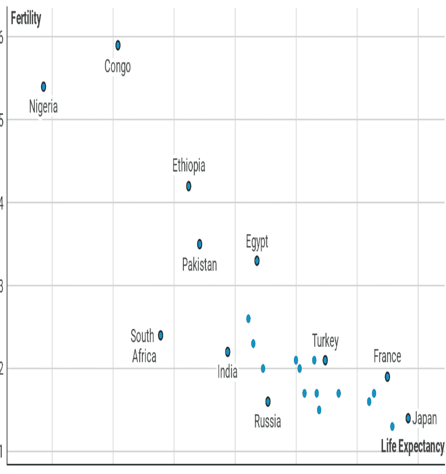

Chart: HandsOnDataViz.org • Source: World Bank • Created with Datawrapper

Figure 6-29. Scatter chart: explore the interactive version. Data from the World Bank.

Create your own interactive scatter chart in Datawrapper, and edit the tool tips to properly display your data:

- 1. Open our Scatter Chart sample data in Google Sheets, or use your own data in a similar format.
- 2. Open Datawrapper and click to start a new chart.
- 3. In the Datawrapper Upload Data screen, either copy and paste the link to the data tab of the Google Sheet, or copy and directly paste in the data. Click Proceed.
- 4. In the “Check & Describe” screen, inspect your data and make sure that the Life Expectancy and Fertility columns are blue, which indicates numeric data. Click Proceed.
- 5. In the Visualize screen, under the “Chart type” tab, select Scatter Plot. Float your cursor over the scatter chart that appears in the right-hand window, and you’ll notice that we still need to edit the tool tips to properly display data for each point.
- 6. In the Visualize screen, under the Annotate tab, scroll down to the “Customize tooltip” section, select “Show tooltips,” and click the “Customize tooltips” button to open its window. Click inside the first field, which represents the tool tip Title, then click further down on the blue Country button to add {{ Country }} there. This means

that the proper country name will appear in the tool tip title when you hover over each point. In addition, click inside the second field, which represents the tool tip Body, type Life expectancy: and click the blue button with the same name to add it, so that {{ Life_expectancy }} appears after it. Press Return twice on your keyboard, then type Fertility: and click on the blue button with the same name to add it, so that {{ Fertility }} appears right after it. Press Save to close the tool tip editor window.

# Customize tooltip

Show tooltips
Customize tooltips
{{ country }}
Life expectancy: {{ life_expectancy }}
Fertility: {{ fertility }}
You can use HTML and insert data columns. Using our formula syntax you can also perform calculations (see full syntax reference).
+ Country
+ Life Expectancy
+ Fertility
Clicking makes tooltip stick

7. Back in the Visualize screen, when you hover your cursor over a point, the tool tip will properly display its data according to your editor settings.

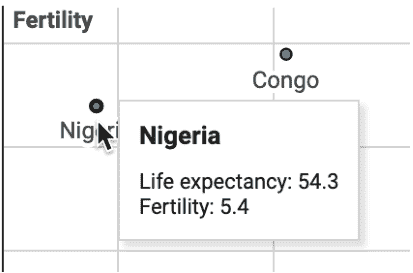

8. Finish the annotations to add your title and data source, then proceed to publish and embed your chart by following the prompts or reading the more detailed Datawrapper tutorial. Learn about your next steps in Chapter 9.

# 气泡图

在您的散点图中，您学习了如何可视化两个数据集之间的关系：预期寿命（x 轴坐标）和生育率（y 轴坐标）。现在让我们通过创建一个气泡图来扩展这一概念，该图添加了另外两个数据集：人口（由每个点或气泡的大小显示）和世界地区（由每个气泡的颜色显示）。我们将使用与之前类似的 World Bank 数据，但增加了两列，如图 6-30 所示。请注意，我们使用数值数据（人口）作为气泡大小，但使用分类数据（地区）作为颜色。现在您可以轻松创建一个气泡图来显示这四个数据集之间的关系，如图 6-31 所示。

|   | A | B | C | D | E |
|---|---|---|---|---|---|
| 1 | 国家 | 预期寿命 | 生育率 | 人口 | 地区 |
| 2 | United States | 78.5 | 1.70 | 326687501 | North America |
| 3 | United Kingdom | 81.4 | 1.70 | 66460344 | Europe |
| 4 | China | 76.7 | 1.70 | 1392730000 | Asia |
| 5 | India | 69.4 | 2.20 | 1352617328 | Asia |
| 6 | Japan | 84.2 | 1.40 | 126529100 | Asia |

Figure 6-30. 要在 Datawrapper 中创建气泡图，请将数据整理为五列：标签、x 轴、y 轴、气泡大小和气泡颜色。

## Fertility, Life Expectancy, and Population in nations, 2018

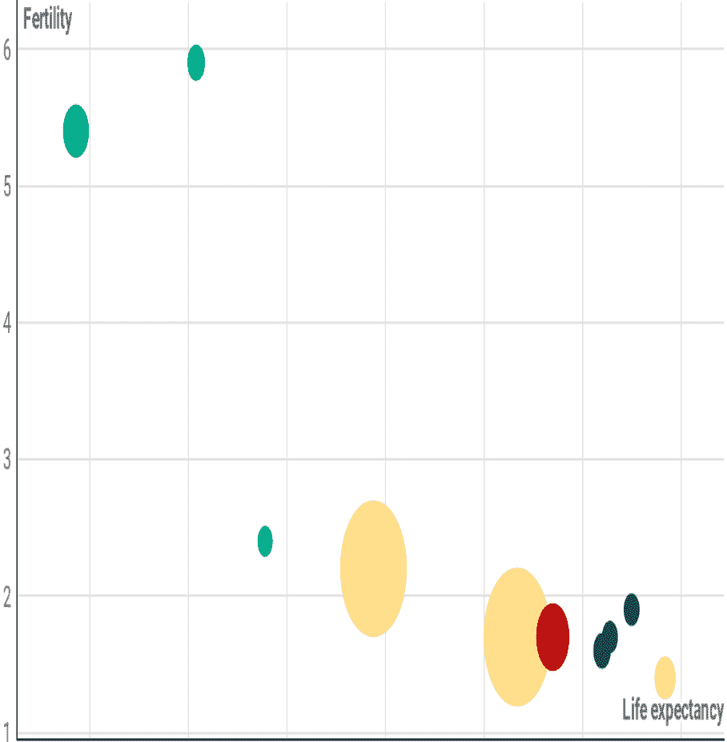

*Figure 6-31. Bubble chart: explore the [interactive version](#). Data from the World Bank.*

Create your own interactive bubble chart in Datawrapper, and edit the tool tips, bubble sizes, and colors to display your data:

- 1. Open our [Scatter Chart sample data](#) in [Google Sheets](#), or use your own data in a similar format.
- 2. Open Datawrapper and click to start a new chart.
- 3. Follow steps 3 through 5 from “Scatter Charts with Google Sheets” to upload, check, and visualize the data as a Scatter Plot chart type.
- 4. In the Visualize screen, under the Annotate tab, scroll down to “Customize tooltip,” and click “edit tooltip template.” In the “Customize tooltip HTML” window, type in the fields and click on the blue column names to customize your tool tips to display country, life expectancy, fertility, and population. Press Save to close the tool tip editor window.

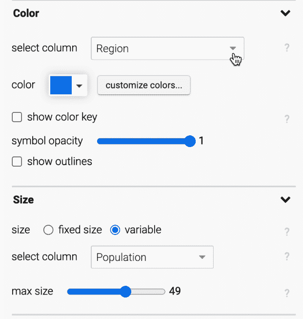

6. Test your visualization tool tips. Then finish the annotations to add your title and data source, and proceed to publish and embed your chart, by following the prompts or reading the more detailed Datawrapper tutorial. See your next steps in Chapter 9.

For more information about creating scatter and bubble charts, see the Datawrapper Academy support site.

Now that you’ve learned how to create a scatter chart in Datawrapper, in the next section you’ll learn how to create the same chart type with a different tool, Tableau Public, to build up your skills so that you can make more complex charts with this powerful tool.

## Tableau Public Charts

Tableau is a powerful data visualization tool used by many professionals and organizations to analyze and present data. Our book focuses on the free version, Tableau Public, a desktop application for Mac or Windows computers that you can download at no cost by providing an email address. The free Tableau Public tool is very similar to the pricier Tableau versions sold by the company, with one important difference. All data visualizations you publish become public, as the product name suggests, so do not use Tableau Public for any sensitive or confidential data that you do not wish to share with others.

Tableau Public has several features that make it stand out from other drag-and-drop tools in this book. First, you can prepare, pivot, and join data inside Tableau Public, similar to some of the spreadsheet skills in Chapter 2, data cleaning methods in Chapter 4, and tools to transform map data coming up in Chapter 13. Second, Tableau Public offers a wider array of chart types than other free tools. Finally, with Tableau Public you can combine multiple visualizations (including tables, charts, and maps) into interactive dashboards or stories, which you can publish and embed on your website. Learn more about all of these features in the Tableau Public resources page.

Tableau Public also has some drawbacks. First, it may take several minutes to install and start up the application the first time. Second, if you feel overwhelmed by its design interface, you’re not alone. Its drag-and-drop layout to build charts and maps initially can be confusing, and its internal vocabulary of data terms may seem unfamiliar. While Tableau Public is a powerful tool, perhaps it offers too many options.

In the next section we’ll keep things simple by starting with the basics of Tableau Public, with step-by-step tutorials to create two different types of charts. First, you’ll build on skills you already learned in the previous section by building a scatter chart in Tableau Public. Then in “Filtered Line Chart”, you’ll learn how to create a filtered line chart, which demonstrates more of the tool’s strengths in interactive visualization design.

## Scatter Charts with Tableau Public

Scatter charts are best to show the relationship between two datasets, placed on the x- and y-axis, to reveal possible correlations. With Tableau Public, you can create an interactive scatter chart, where you can hover your cursor over points to view more details about the data. Organize your data in three columns, the same way as in “Scatter Charts with Google

To create your own scatter chart using this sample data in Tableau Public, follow the tutorial that follows.

## Install Tableau Public and Connect Data

Follow these steps to install Tableau Public, launch it, and connect your data:

- 1. Download the [CT Districts-Income-Grades sample data in Excel format](#), or [view and download the Google Sheets version](#). The data file consists of three columns: district, median household income, and test-score levels.
- 2. Install and start up the free Tableau Public desktop application for Mac or Windows. It may require several minutes to complete this process. Tableau Public’s welcome page includes three sections: Connect, Open, and Discover.
- 3. Under Connect, you can choose to upload a Microsoft Excel file, choose “Text file” to upload a CSV file, or choose other options. To connect to a server, such as Google Sheets, click More… to connect to your account. After you successfully connect to your data source, you will see it under Connections in the Data Source tab. Under Sheets, you’ll see two tables: *data* and *notes*.
- 4. Drag the *data* sheet into “Drag tables here” area. You will see the preview of the table under the drag-and-drop area. You have successfully connected one data source to Tableau Public, and you are ready to build your first chart.

## Create Scatter Chart in the Worksheet

Now let’s create a scatter chart in the Tableau Public worksheet:

- 1. In the Data source screen, click on the orange Sheet 1 tab (in the lower-left corner) to go to your worksheet, where you will build the chart.
- Although it may feel overwhelming at first, the key is learning where to drag items from the Data pane (left) into the main worksheet. Tableau marks all data fields in blue (for discrete values, mostly text fields or numeric labels) or green (for continuous values, mostly numbers).
- 2. In your worksheet, drag the *Grade Levels* field into the *Rows* field above the charting area, which for now is just empty space. The following screenshot shows this dragging step and the following two steps. Tableau will apply a summation function to it, and you will see `SUM(Grade Levels)` appear in the *Rows* row, and a blue bar in the charting area. It makes little sense so far, so let’s plot another data field.

3. Drag Median Household Income to the Columns field, just above the Rows field. In general, choosing between Rows and Columns shelves can be challenging, but it is convenient to think of the Columns shelf as representing your x-axis and Rows as the y-axis. Once again, Tableau will apply the summation function, so you'll see SUM(Median Household Income) in the Columns shelf. The bar chart will automatically transform into a scatter chart with just one data point in the upper-right corner, because the data for both is aggregated (remember the SUM function).

4. We want to tell Tableau to disaggregate the household and grade levels variables. In other words, we want to introduce an extra level of granularity, or detail to our visualization. To do so, drag the District dimension into the Detail shelf of the Marks card. Now a real scatter chart will appear in the charting area. If you hover over points, you will see all three values associated with these points.

## Add Title and Caption, and Publish

Give your scatter chart a meaningful title by double-clicking on the default Sheet 1 title above the charting area. Add more information about the chart, such as source of the data, who built the visualization and when, and other details to add credibility to your work. You can do so inside a Caption, a text block that accompanies your Tableau chart. In the menu, go to Worksheet > Show Caption. Double-click the Caption block that appears, and edit the text. As a result, your final worksheet will look like the one shown in Figure 6-33.

# Tableau Public - 第一张散点图

# 数据

# 分析

ct-districts-income-grad...

搜索

# 表

学区

度量名称

年级水平

家庭收入中位数

数据（计数）

度量值

# 页面

# 列

SUM(家庭收入中位数)

# 行

SUM(年级水平)

# 筛选器

# 标记

自动

颜色

大小

标签

详细信息

工具提示

形状

学区

适合宽度

智能显示

# 我的第一张散点图

年级水平

家庭收入中位数

0K 20K 40K 60K 80K 100K 120K 140K 160K 180K 200K

3 2 1 0 -1 -2

# 说明

家庭收入中位数总和与年级水平总和的对比。详细信息按学区显示。

数据源

# 工作表 1

151 个标记，1 行 × 1 列，家庭收入中位数总和 12,702,814

Ilya

图6-33. 这张散点图已准备好发布。

## 提示

在*列*功能区上方的下拉菜单中，将“标准”更改为“适合宽度”，以确保图表占据可用水平空间的100%。

- 1. 要在公共网络上发布你的交互式图表，请转到“文件”>“保存到 Tableau Public 为...”。将出现一个登录账户的窗口。如果你没有账户，请点击底部的“立即免费创建一个”，并将登录详细信息保存在密码管理器中。
- 2. 登录后，将出现一个设置工作簿标题的窗口。将默认的*Book1*标题改为更有意义的名称，因为此名称将出现在所发布作品的公共网址中。点击“保存”。
- 3. 将工作簿保存到公共网络后，Tableau Public 会在你的默认浏览器中打开一个显示该可视化的窗口。在图表上方的绿色横幅中，点击“编辑详细信息”以编辑标题或说明。在“工具栏设置”下，找到“允许其他人下载或浏览并复制此工作簿及其数据”复选框，然后选择你想要的设置。如果你在网络上发布可视化，我们还建议你保持勾选此框，以便他人可以下载你的数据并查看你是如何构建的，从而提高所有人的数据可访问性。

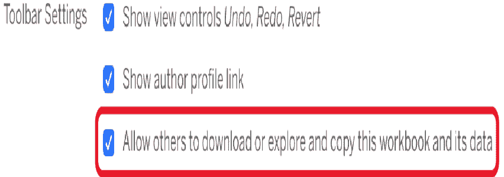

## 提示

你的 Tableau Public 可视化作品集全部在线，可在 https://public.tableau.com/profile/USERNAME 上查看，其中你的唯一用户名是 *USERNAME*。

参见“获取嵌入代码或 iframe 标签”，将图表的交互版本插入到你控制的网页中。

# 筛选折线图

现在你已经学会如何在 Tableau Public 中创建散点图，让我们继续学习一种能突出该工具优势的新图表类型。本书不采用印刷品或 PDF 中常见的*静态*图表，而是使用*交互式*图表，因为它们能够显示更多数据。你还可以将交互式图表设计为仅显示所需数量的数据。换句话说，你的交互式可视化可以成为一种数据探索工具，让用户能够“深挖”并找到特定的数据点和模式，而不会一下子用过多信息让他们不堪重负。

在本教程中，我们将使用 Tableau Public 构建一个交互式筛选折线图，以可视化不同国家互联网接入随时间的变化情况。如下方*图6-34*所示，将数据组织为三列。第一列*国家名称*包含成为彩色线条的数据标签。第二列*年份*将出现在水平x轴上。第三列*互联网用户百分比*包含出现在垂直y轴上的数值。现在，你可以创建一个带复选框的筛选折线图，在启动时仅显示选定的线条，以免让用户不堪重负，同时允许他们切换显示其他线条，并悬停在每条线上以查看更多细节，如下方*图6-35*所示。

| 国家名称 | 年份 | 互联网用户百分比 |
|---|---:|---:|
| 喀麦隆 | 2016 | 23.20297197 |
| 喀麦隆 | 2017 | 23.20297197 |
| 喀麦隆 | 2018 |  |
| 加拿大 | 1995 | 4.163525253 |
| 加拿大 | 1996 | 6.760239065 |
| 加拿大 | 1997 | 15.07235736 |
| 加拿大 | 1998 | 24.8974003 |

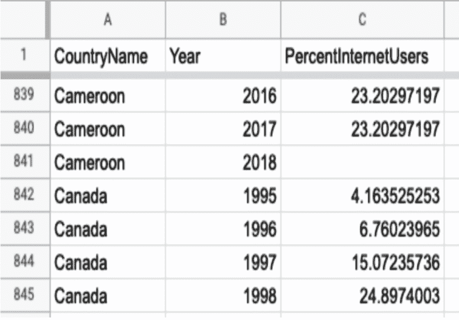

> 图6-34. 在筛选折线图中，将数据组织为三列：数据标签、年份和数值。

要使用 Tableau Public 中的此示例数据创建自己的筛选折线图，请按照本教程操作。我们假设你已经安装了适用于 Mac 或 Windows 的免费 Tableau Public 桌面应用，并通过完成“使用 Tableau Public 创建散点图”教程熟悉了该工具，因此以下步骤会有所简化。

# 各国互联网接入情况，1995-2018

互联网用户百分比

年份

资料来源：世界银行。

国家名称：日本
年份：2004
互联网用户百分比：62.39

- 国家名称
- （全部）
- 阿富汗
- 阿尔巴尼亚
- 阿尔及利亚
- 美属萨摩亚
- 安道尔
- 安哥拉
- 安提瓜和巴布...
- 阿根廷
- 亚美尼亚
- 阿鲁巴
- 澳大利亚
- 奥地利
- 阿塞拜疆
- 巴哈马
- 巴林
- 孟加拉国
- 巴巴多斯
- 白俄罗斯
- 比利时
- 伯利兹
- 贝宁
- 百慕大
- 不丹
- 玻利维亚

- 国家名称
- 巴西
- 古巴
- 日本
- 英国

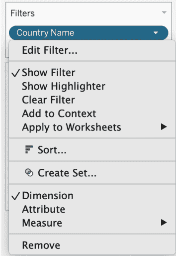

6. 图表右侧会显示一个包含所有复选框的选项列表。单击（全部）可添加/移除所有选项，并选择几个国家以查看交互式筛选的工作原理。在此阶段选择的复选框将在已发布的视图中显示为“开启”状态。你可能会注意到，在“开启”选择中，一些国家被分配了相同的颜色值。好消息是，Tableau 允许你更改单个数据点（本例中为国家/地区）的颜色。在“标记”卡中，单击“颜色”功能区，然后选择“编辑颜色..”。在“选择数据项”列表中双击某个国家/地区，打开颜色选择器窗口，选择你喜欢的颜色，然后点击“确定”。虽然你可以确保预选国家以独特颜色绘制，但其他国家之间会出现重复颜色，因为调色板仅限于20种颜色。遗憾的是，你几乎无法绕过这一限制。

7. 双击“工作表 1”标题（图表上方），将其替换为更有意义的标题，例如“各国互联网接入情况，1995–2018”。在菜单中，转到“工作表”>“显示说明”，在图表下方添加说明块。利用此空间添加数据来源（世界银行），或许还可以署上你自己作为此可视化的作者。

8. 在“列”功能区上方的下拉菜单中，将“标准”更改为“适合宽度”。

9. 你可能会注意到，x轴（年份）从1994年开始，到2020年结束，而我们的数据是1995年至2018年。双击x轴，将“范围”从“自动”更改为“固定”，将“固定开始”设为1995，将“固定结束”设为2018。关闭窗口，即可看到边缘的空白区域消失了。

10. 一旦你的筛选折线图看起来像这样，你就可以发布了。转到“文件”>“保存到 Tableau Public 为...”，登录你的账户；如果尚未创建账户，请创建一个。按照提示将图表发布到公共网络上，或参阅“使用 Tableau Public 创建散点图”了解更多详细信息。

# 各国互联网接入情况，1995-2018

资料来源：世界银行。

参见“获取嵌入代码或 iframe 标签”，将图表的交互版本插入到你控制的网页中。

# 总结

恭喜你创建了交互式图表，它们能吸引读者更深入地了解你的故事，并鼓励他们探索底层数据！随着你继续创作更多图表，务必让图表类型与你的数据格式以及你想强调的故事相匹配。此外，请根据本章开头概述的原则和美学指南来设计图表。

如今，任何人都可以点击几下按钮就能快速创建图表，但精心设计的图表能够深思熟虑地将受众的注意力引向数据中有意义的模式，他们会对此非常欣赏。

在本章中，你学习了如何使用 Google Sheets、Datawrapper 和 Tableau Public 创建不同类型的交互式图表。如需使用开源代码进行更高级的图表设计，请参阅第11章，该章让你能够更自如地控制设计和显示数据的方式，但还需要在第10章中学习如何编辑和托管 GitHub 上的代码模板。

第7章采用类似格式，介绍不同类型的地图、设计原则以及使用空间数据创建交互式可视化的动手教程。在第9章中，你将学习如何在你的网站上嵌入交互式图表。

1 Lisa Charlotte Rost，“考虑数据可视化规则时应该考虑什么”（Lisa Charlotte Rost，2020年11月27日），https://oreil.ly/e4uBM。

2 Cairo，《图表如何说谎》，2019年，第61页。

3 Lisa Charlotte Rost，“数据可视化中的颜色友好指南”，Datawrapper（博客），2018年7月31日，https://oreil.ly/ndITD；Lisa Charlotte Rost，“如何为数据可视化挑选更美观的颜色”，Datawrapper（博客），访问于2020年10月21日，https://oreil.ly/dRCBy。

4 Few，《用数字说话》，第166页。

