# 第7章. 绘制你的数据

地图将读者的注意力吸引到包含空间维度的信息上，同时增强了对地点的感知。看到地图上各点之间的相对距离，或在 *choropleth* 地图（彩色多边形代表数据值）中识别地理模式，比文本、表格或图表更有效地将信息传递给读者的眼睛。但要创建能够吸引我们关注数据关键见解的有意义地图，需要对设计选择进行清晰思考。

在本章中，我们将研究地图设计的原则，并在“地图设计原则”中区分好地图和坏地图。你将了解适用于所有地图的规则，以及创建 choropleth 地图的特定指南。虽然许多工具允许你将地图下载为 *static* 图像，但我们的书还演示了如何构建 *interactive* 图表，邀请读者在网页浏览器中放大并探索数据。在第9章中，你将学习如何在网站上嵌入交互式图表。

地图类型的决策基于两个主要因素：数据的格式，以及你希望讲述的故事类型。了解本书中可以创建的不同地图类型，请参阅表7-1。例如，点地图最适合用彩色标记显示特定位置以代表类别（例如医院），而 choropleth 地图最适合显示区域的相对值（例如美国各州的出生率）。选择地图类型后，请遵循我们在以下各节中出现的工具推荐和逐步教程。本章包含易于使用的拖放菜单工具，你可以在“使用 Google My Maps 的点地图”、“使用 Datawrapper 的符号点地图”、“使用 Tableau Public 的 Choropleth 地图”以及“使用 Socrata 开放数据 的当前地图”中找到。表格还指向 *power tools*，它们能让你更好地控制自定义和托管可视化，例如第12章中的 Leaflet 代码模板。这些高级工具需要事先了解如何在第10章中使用 GitHub 编辑和托管代码模板。

## 表7-1. 基本地图类型、最佳用途和教程

| Map | Best use and tutorials in this book |
|---|---|

### 点地图 自定义图标

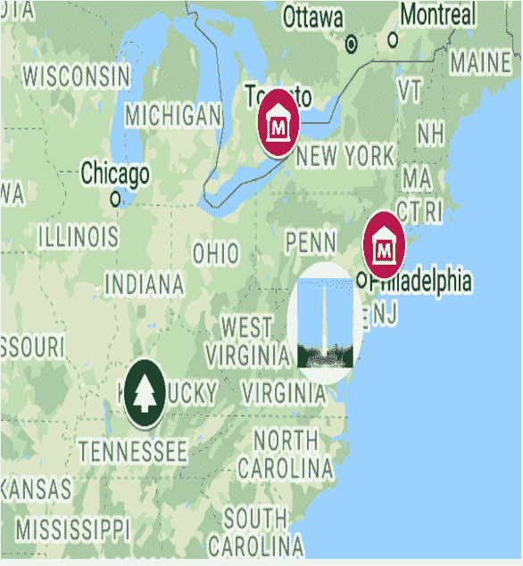

最适合显示特定位置（例如地址），使用自定义彩色标记表示类别，并在弹出窗口中显示文本和图像。

- Easy tool: “Point Map with Google My Maps”
- Power tool: “Leaflet Maps with Google Sheets”

### 符号点地图

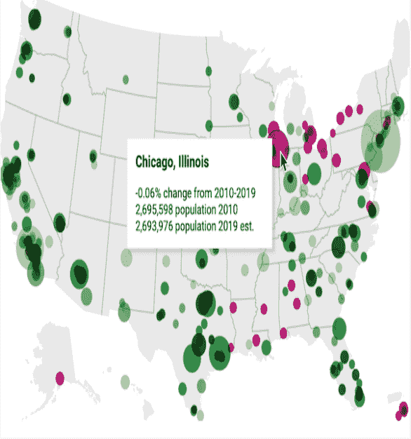

Chicago, Illinois

-0.06% change from 2010-2019
2,695,598 population 2010
2,693,976 population 2019 est.

最适合显示特定位置（例如城市），使用大小或颜色可变的形状表示数据值（例如人口增长）。

- Easy tool: “Symbol Point Map with Datawrapper”

### Choropleth（彩色多边形）地图

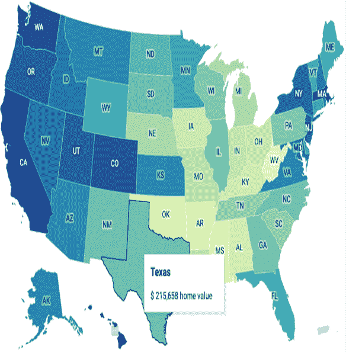

最适合通过为多边形着色来显示地理区域（例如社区或国家）的模式，以表示数据值。

- Easy tool: "Choropleth Map with Datawrapper" or "Choropleth Map with Tableau Public"
- Power tools: "Leaflet Maps with Google Sheets"

### 热力点地图

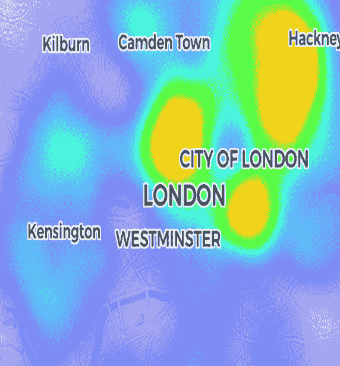

最适合将点群显示为彩色热点，以强调案例的高频率或密度。

- Power tool: "Leaflet Heatmap Points with CSV Data"

### 故事地图


# US National Mall, Washington DC

由于故事地图最适合与串联各位置的叙述一起使用，我们将用一个关于华盛顿特区美国国家广场非常简短的故事来演示此工具的功能。让我们拉远以获得我们故事的鸟瞰图。

从华盛顿纪念碑顶部俯瞰国家广场，向东望向建于1829年的美国国会大厦。

最适合显示逐点引导游览，通过滚动叙述显示文本、图像、音频、视频和扫描地图背景。

- Power tool: "Leaflet Storymaps with Google Sheets"

### 折线地图

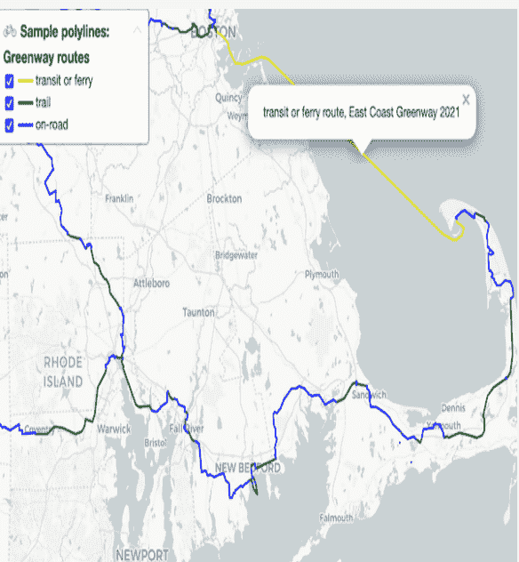

最适合显示路线（例如小径或交通），使用颜色区分不同类别。

- Easy tool: "Point Map with Google My Maps"
- Power tool: "Leaflet Maps with Google Sheets"

### 自定义点-折线-多边形地图

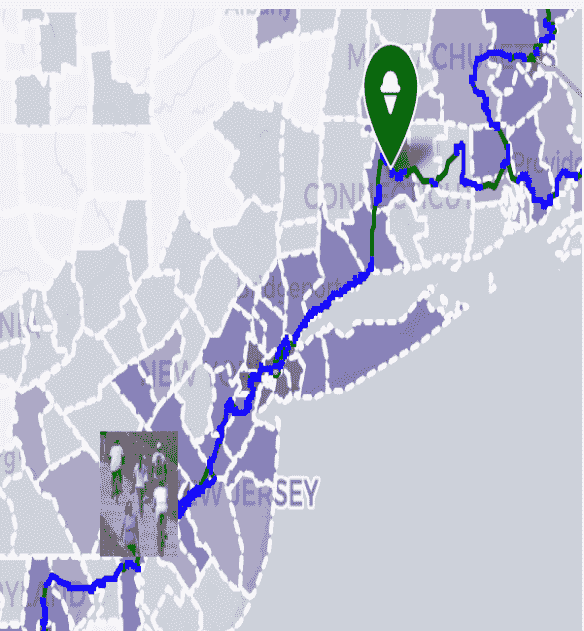

最适合显示点的任意组合、折线或多边形，使用自定义图标表示类别，并使用彩色区域表示数据值。

- Power tool: "Leaflet Maps with Google Sheets"

### 可搜索点地图

你希望将数据放在可搜索、可筛选的地图上。提供一个逗号分隔文件（CSV），这个免费的开源模板将完成其余工作。

Read more »

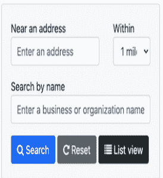

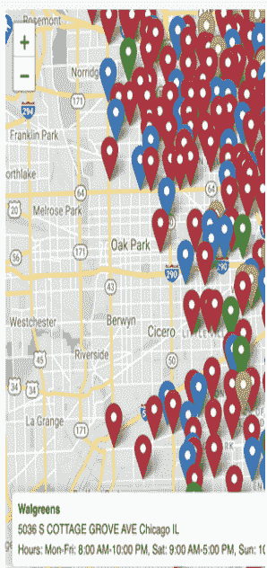

最适合显示特定位置供用户按名称或邻近度搜索，或按类别筛选，并可选择列表视图。

- Power tool: "Leaflet Searchable Point Map"

### 来自开放数据存储库的当前地图

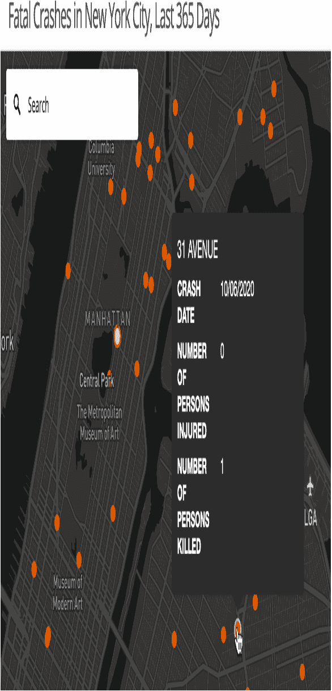

最适合直接从 Socrata 等开放数据存储库中提取最新信息。

- Easy tool: “Current Map with Socrata Open Data”
- Power tool: “Leaflet Maps with Open Data APIs”

## 地图设计原则

今天收集的大量数据都包含可映射的空间成分。无论你查找城市地址还是在森林中拍摄树木的照片，两者都可被地理编码为地图上的点。我们还可以绘制线条和形状来说明社区或国家等地理边界，并为其着色以表示不同的值，例如人口和收入。

然而，仅因数据可以被映射并不总是意味着应该被映射。在创建地图之前，请停下来问自己：位置对你的故事真的很重要吗？即使你的数据包含地理信息，有时图表比地图更能讲述你的故事。例如，你可以在条形图中清楚地显示地理区域之间的差异，用折线图追踪它们在不同时间段内不同速率的升降，或在散点图中比较每个区域的两个变量。有时简单的表格，甚至仅文本，就能更有效地向你的受众传达你的观点。由于创建设计良好的地图需要时间和精力，请确保它确实增强了你的数据故事。

正如你在第6章中学到的那样，数据可视化不是一门科学，而是有一套原则和最佳实践作为创建真实且有意义地图的基础。在本节中，我们将确定一些关于地图设计的规则，但你可能会惊讶地发现有些规则不如其他规则严格，在必要时可以“打破”以强调某一点，只要你能诚实地解释数据。为了开始理解其中的区别，让我们先通过将其分解为元素来建立关于地图的共同词汇。

### 解构地图

我们的书重点介绍如何创建 *interactive* 网页地图，也称为 *tiled maps* 或 *slippy maps*，因为用户可以放大和平移以探索叠加在无缝底图瓦片上的地图数据层。显示航空照片图像的底图被称为 *raster* 瓦片，而显示街道和建筑物图示图像的底图则是由 *vector* 数据构建的瓦片。栅格地图数据的分辨率受原始图像限制，越靠近越模糊。相比之下，你可以非常接近地放大矢量地图数据而不会降低其视觉质量，如图7-1所示。你将在“地理空间数据和 GeoJSON”中了解更多关于这些概念的信息。


> 图 7-1。左侧来自 Esri World Imagery 的栅格地图数据和右侧来自 OpenStreetMap 的矢量地图数据，都显示了伊利亚在白俄罗斯莫吉廖夫的童年社区。放大栅格地图数据会使其变得模糊，而矢量地图数据则保持清晰。

请查看 **图 7-2** 了解本章中你将创建的交互式地图中的基本元素。顶层通常显示 *点、折线* 和 *多边形* 的某种组合。点显示特定位置，例如家庭或企业的街道地址，有时带有位置标记，每个点都由一对纬度和经度坐标表示。例如，`40.69, −74.04` 标记了纽约市自由女神像的位置。折线是点连接而成的线串，例如道路或交通网络，我们在“lines”前加上“poly-”前缀是为了提醒我们它们可能包含多个分支。多边形是由线组成的集合，形成封闭形状，例如建筑物轮廓、人口普查区或州或国家边界。由于点、折线和多边形从根本上由纬度和经度坐标组成，因此它们都是矢量数据。

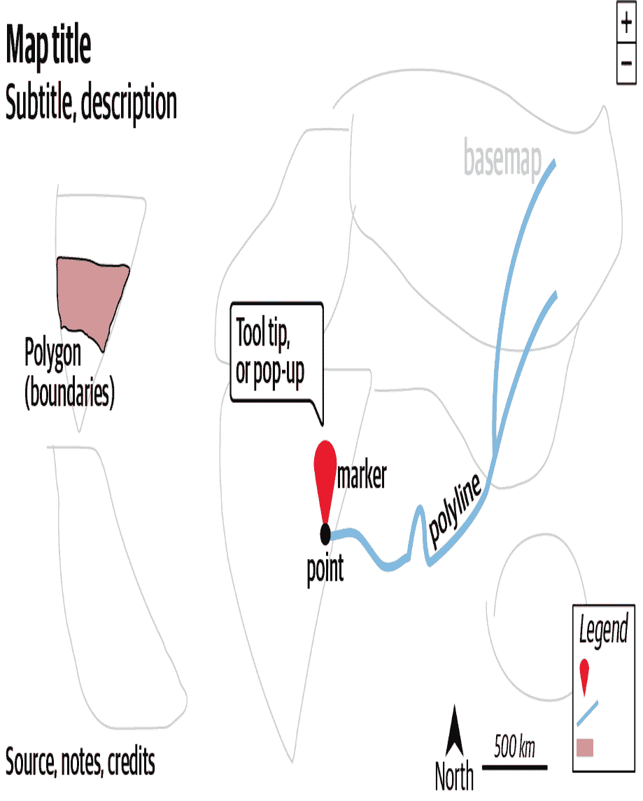

> 图 7-2。交互式地图的关键元素。

交互式地图通常包括 *缩放控件*（+ 和 − 按钮）来更改底图瓦片的显示，并营造出从不同距离观看表面的效果。顶层地图数据在将光标悬停在其上时可能会显示隐藏的 *工具提示*，或在点击时显示 *弹出窗口*，以揭示其属性的附加信息。与传统静态地图一样，*图例* 标识符号、形状和颜色的含义。地图还可能包括 *指北针* 或比例尺，以帮助读者确定方向和相对距离。与图表类似，一幅好的地图应包含标题和简要说明，以提供其所显示内容的背景信息，以及数据源、澄清说明，以及对帮助创建该地图的个人或组织的致谢。

## 澄清点与多边形数据

在开始创建地图之前，请确保你了解数据格式及其所代表的内容。通过暂停并提出以下问题来避免新手错误。首先，你的数据可以被映射吗？有时我们收集的信息没有地理成分，或没有一致的地理成分，这使得将其放置在地图上变得困难或不可能。如果答案是肯定的，那么继续第二个问题：数据可以作为点或多边形进行映射吗？这两种情况是最可能的（有时会被混淆），与较少见的第三种选择折线相对，折线代表路径和路线。

为了帮助你理解差异，让我们看一些例子。你在这里看到的数据类型是点还是多边形？

- 1. 36.48, −118.56（加州约书亚树国家公园的纬度和经度）
- 2. 2800 E Observatory Rd, Los Angeles, CA
- 3. Haight and Ashbury Street, San Francisco, CA
- 4. Balboa Park, San Diego, CA
- 5. Census tract 4087, Alameda County, CA
- 6. City of Los Angeles, CA
- 7. San Diego County, CA
- 8. State of California

在大多数情况下，列表中的第 1 至 4 项代表点数据，因为它们指的是可以在地图上以点标记显示的特定位置。相比之下，第 5 至 8 项通常代表多边形数据，因为它们指的是可以在地图上以封闭形状显示的地理边界。参见前文表 7-1 中点和多边形地图的示例。

这种点与多边形的区分在大多数情况下适用，但并非总是如此，例外情况取决于你的数据故事。首先，虽然不常见，但可以将第 1 至 8 项全部作为点数据在地图上表示。例如，为了讲述加州城市人口增长的数据故事，创建一个符号点地图，用不同大小的圆圈代表每个城市的数据是有意义的。为此，你的地图工具需要找到洛杉矶市多边形边界的中心点，以便在其地图上的特定点放置人口圆圈。第二种点与多边形区分变得模糊的原因是，我们通常认为的某些特定点也具有多边形形状的边界。例如，如果你在 Google 地图上输入 Balboa Park, San Diego CA，它会将结果显示为地图标记，这表明它是点数据。但 Balboa Park 也有覆盖 1.8 平方英里（4.8 平方公里）的地理边界。如果你想讲述关于圣地亚哥有多少土地用于公共空间的数据故事，那么创建一个将 Balboa Park 显示为多边形而非点的分级色图会更有意义。第三，你也可以通过数据透视表将点转换为多边形数据，这是我们在“使用数据透视表汇总数据”中介绍过的话题。例如，为了讲述每个加州县医院床位数量的数据故事，你可以获取每个医院床位的点级数据，然后将其透视以汇总每个县的医院床位总数，并在分级色图中显示这些多边形级结果。参见“将点透视为多边形数据”中的更详细示例。

总之，明确你的空间数据应表示点还是多边形，因为这两个类别有时会被混淆。如果你将它们视为点，则创建点样式地图；如果是多边形，则创建分级色图。这些是制图者最常用的方法，但根据你的数据故事，例外情况很多。你将在“使用 Google 我的地图创建点地图”中学习如何制作基本的点地图，并在“使用 Datawrapper 创建符号点地图”中制作符号点地图，然后我们将演示如何在“使用 Datawrapper 创建分级色图”和“使用 Tableau Public 创建分级色图”中可视化多边形级数据。

## 只映射一个变量，而不是两个

数据可视化新手有时会因为成功将一个变量放置在地图上而感到自豪，以为两个变量一定是两倍的好。这通常是不正确的。导致这种错误结论的思维过程如下。假设你想比较你所在州八个县的收入与教育之间的关系。首先，你选择创建一个收入的分级色图，其中西北角较深的蓝色区域代表较高水平，如图 7-3（a）所示。其次，你决定创建一个符号点地图，其中较大的圆圈代表拥有大学学位的人口比例较高，如地图（b）所示。这两幅地图都不错，但它们仍然没有突出收入与教育之间的关系。

一个常见的错误是将符号点图层放置在分级色图图层之上，如地图（c）所示。这就是你的地图变得过度负载的地方。我们通常不建议在同一张地图上使用不同符号系统显示两个变量，因为这会使可视化过度负载，让大多数读者很难识别有助于理解你的数据故事的模式。

相反，如果两个变量之间的关系是你数据故事中最重要的方面，请创建如图 7-3（d）所示的散点图。或者，如果一个变量的地理模式很重要，你可以将该变量的分级色图与两个变量的散点图并排放置，通过组合（a）和（d）。总的来说，请记住，只是数据可以被映射并不意味着它应该被映射。暂停反思位置是否重要，因为有时图表比地图更能讲述你的数据故事。

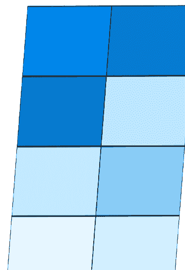

✓(a) 好。显示一个变量的分级色图

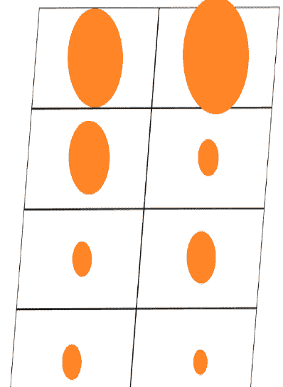

✓(b) 好。显示一个变量的符号地图

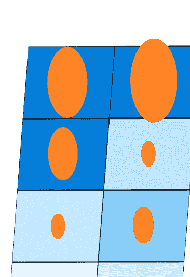

X(c) 差。在分级色图上叠加符号地图以显示两个变量

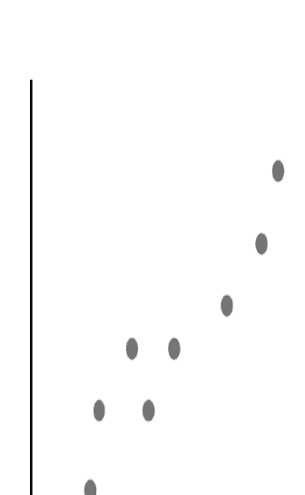

✓(d) 好。显示两个变量之间关系的散点图


## 为等值区域图选择更小的地理区域

等值区域图通过为多边形着色来表示数据值，最适合展示跨区域的地理模式。因此，我们通常建议选择*更小*的地理区域，以展示更*精细*的模式，因为较大的地理区域展示的是聚合数据，可能掩盖较低层面上发生的情况。地理学家将这一概念称为可塑性面积单元问题，也就是说，你切分数据的方式会影响我们分析其在地图上的呈现方式。将许多小切片堆叠在一起，比一个大切片能揭示更多细节。

例如，根据 Zillow 2020 年 9 月的研究数据，比较美国东北部典型房价的两幅等值区域图。Zillow 将典型值定义为一种平滑且经过季节性调整的衡量指标，涵盖所有位于第 35 到第 65 百分位区间的单户住宅、共管公寓和合作公寓；它类似于第 50 百分位的中位值，但还包含一些价格更低和更高的住宅。这两幅等值区域图使用相同的色阶。关键区别在于地理单元的大小。在图 7-4 中，左侧地图显示较大州一级的房价，右侧地图显示较小县一级的房价。

- 20万以下
- 20万-40万
- 40万-60万
- 60万-80万
- 80万以上

缅因州  
佛蒙特州  
新罕布什尔州  
纽约州  
马萨诸塞州  
康涅狄格州  
罗德岛州  
宾夕法尼亚州  
新泽西州  

波士顿  
玛莎葡萄园岛与楠塔基特  
纽约市与长岛  

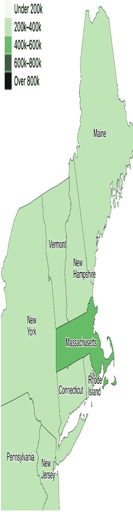

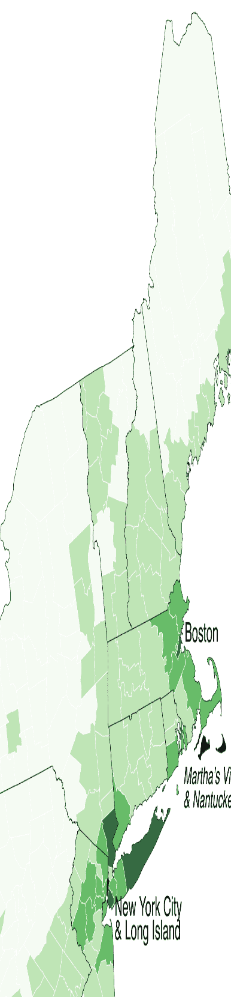

哪幅地图最好？由于两幅图都如实描绘了数据，答案取决于你想讲述的故事。如果你想强调州与州之间的差异，选择第一幅地图，因为它清楚显示马萨诸塞州的典型房价高于周边东北部各州。如果你想强调州内差异，选择第二幅地图，它显示纽约市和波士顿都会区的价格水平高于这两个州中更偏乡村的县。如果你不确定，通常最好绘制更小的地理区域，因为如果设计包含合适的标签和地理轮廓，就可以同时看到州级和州内变化。但不要把*越小越好*变成一条死板规则，因为随着尺度进一步缩小，它就不适用了。例如，如果我们创建第三幅地图来显示美国东北部每一笔住宅销售，它会*过于详细*，难以看出有意义的模式。要找到恰到好处的地理层级，以便清晰讲述你的数据故事。

## 设计等值区域图的颜色与区间

本节将更深入地探讨等值区域图的地图设计原则。你用颜色表示数据的方式会极大地影响地图的外观，因此学习关键概念非常重要，以确保你的地图讲述真实而有意义的故事。好的等值区域图能让读者清楚看到真实且有见地的地理模式，无论它们是以黑白打印在纸上，还是以彩色显示在电脑屏幕上。此外，最好的等值区域图在设计上应能让色盲人士正确解读。关于可视化颜色的出色总体概述，请参阅 Lisa Charlotte Rost 的《数据可视化中的色彩友好指南》和《如何为数据可视化挑选更漂亮的颜色》，两篇文章均发布在 Datawrapper 博客上。¹

说明颜色选择如何影响等值区域图设计的最佳方法是使用一个名为 ColorBrewer 的出色在线设计助手，它由 Cynthia Brewer 和 Mark Harrower 创建。² 与本书中的其他工具不同，你不会直接将数据上传到 ColorBrewer 来生成可视化。相反，你选择希望在等值区域图中显示的数据类型，ColorBrewer 会推荐最适合你数据故事的颜色调色板。然后，你可以将这些颜色代码导出到你偏好的等值区域图制作工具中，如“使用 Datawrapper 制作等值区域图”和“使用 Tableau Public 制作等值区域图”所示。参见图 7-5 中的 ColorBrewer 界面。

图 7-5. ColorBrewer 设计助手界面：数据分级、配色方案类型和推荐的颜色代码。

在本节中，我们将重点讨论 ColorBrewer 在设计等值区域图时可以协助你的两个重要决策：选择调色板类型（顺序、发散或定性），以及将颜色相似的数据点分组到一起的区间。

打开 ColorBrewer 时，顶行会要求你选择等值区域图颜色范围中的数据分级数（也称为区间或步长）。ColorBrewer 最多可以为 12 个数据分级推荐不同颜色，具体取决于你选择的方案类型。但目前，先使用默认设置 3，我们稍后更详细地讨论区间时会回到这个话题。

## 选择与数据匹配的等值区域图调色板

设计等值区域图时最重要的决策之一是选择调色板类型。你并非仅仅选择一种颜色，而是选择*颜色的排列方式*，以帮助读者正确解读信息。规则很简单：选择与你的数据格式和你想讲述的故事相匹配的合适调色板。

ColorBrewer 将调色板分为三种类型——顺序、发散和定性——如 **图 7-6** 所示。

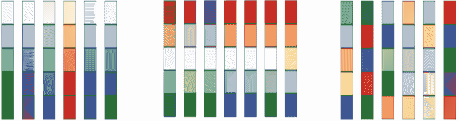

**（a）顺序**　　　　　**（b）发散**　　　　　**（c）定性**

> *图 7-6. 来自 ColorBrewer 的顺序、发散和定性调色板。*

### 顺序调色板

最适合显示从低到高的数值。示例包括任何可以按刻度顺序排列的数据，如收入中位数、降雨量或上次选举中投票人口的百分比。顺序调色板可以是单色相（如不同深浅的蓝色），也可以是多色相（如黄-橙-红）。较深的颜色*通常*代表较高的值，但并不总是如此。

### 发散调色板

最适合显示高于和低于标准水平（如零、平均值或中位数）的数值。它们通常具有两种不同的色相来表示正负方向，极端处用较深颜色，中间用中性色。示例包括高于或低于中位数水平的收入、高于或低于季节平均值的降雨量，或高于或低于常态的选民百分比。

### 定性调色板

最适合显示分类数据，而非数值刻度。它们通常采用彼此区分明显的独特颜色，以强调差异。示例包括不同类型的土地利用（住宅、商业、开放空间和水域）或诸如红绿灯式预警系统（绿色、黄色和红色）等类别。

为了说明*顺序*与*发散*数值之间的差异，请比较 **图 7-7** 中显示 2018 年美国大陆各州人均收入相同数据的两幅地图。顺序调色板使用五种深浅不同的蓝色来表示从低到高的收入水平范围，最适合强调最高收入水平的数据故事，即从马里兰州到马萨诸塞州沿东北海岸的深蓝色区域。相比之下，发散调色板用深橙色表示低于平均水平的州，用深紫色表示高于平均水平的州，中间用中性色；它最适合强调低收入南部州与高收入东海岸和西海岸州之间经济分化的数据故事。

### （a）顺序调色板

- 25,000 以下
- 25,000 到 30,000
- 30,000 到 35,000
- 35,000 到 40,000
- 40,000 以上

### （b）发散调色板

- -5,000 及以下
- -5,000 到 -2,500
- -2,500 到 2,500
- 2,500 到 5,000
- 超过 5,000


Figure 7-7. 顺序与发散色板用于说明美国本土各州人均收入（美元），数据来源为美国社区调查，2018 年。请注意，发散色板在黑白模式下效果不佳，因为远离中间的色调变得难以区分。

在您选择数据分级和色板后，ColorBrewer 会显示字母数字代码，网页浏览器会将其翻译成颜色。您可以选择十六进制代码（#ffffff 为白色）、RGB 代码（255,255,255 为白色）或 CMYK 代码（0,0,0,0 为白色），并以不同格式导出，如 Figure 7-8 所示，前提是您偏好的地图工具允许导入色板。

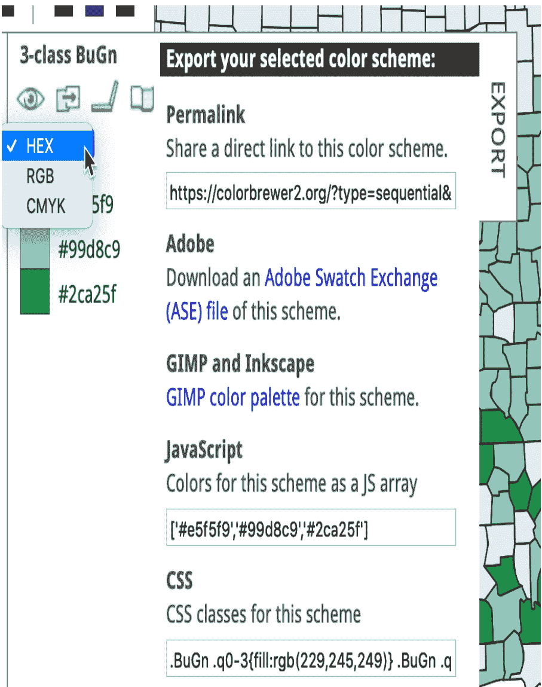

Figure 7-8. 点击打开 Export 选项卡以以各种格式显示您的色板代码。

## 选择颜色区间对分层设色地图数据进行分组

另一个重要的设计选择是颜色区间，它决定了您如何对分层设色地图上的数据进行分组和显示。这组强大的决策将极大地塑造读者眼中地图的外观，以及您的数据故事所传达的信息。在这个多步骤的决策过程中，您需要考虑多个选项，虽然没有统一的设计规则，但我们会提供指导和建议。由于不同制图工具在选择区间的选项各不相同，我们将在本节中解释广泛的概念，并偶尔配上 Datawrapper 和 Tableau Public 的截图，但会将具体细节留到本章后面的专门教程中。

一些制图工具允许您在两种不同类型的颜色区间之间进行选择，以显示数据尺度上的上升或下降，如 Figure 7-9 所示。Steps 是清晰标记的颜色分隔符，像楼梯一样，而 continuous 是颜色的逐渐变化，像斜坡一样。两者都会向上，但方式不同。

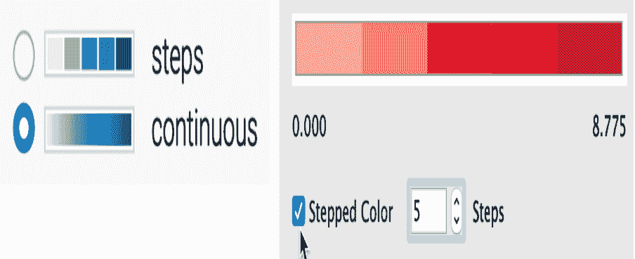

Figure 7-9. Datawrapper（左）和 Tableau Public（右）中的 Steps 与 continuous 颜色区间。

如果两种选项都存在，哪种颜色区间最好：steps 还是 continuous？关于此没有统一的地图设计规则，但请考虑以下因素。一方面，steps 最适合展示低于或高于特定线或阈值的区域的数据故事，例如如果海平面上升 1 米将发生洪水的区域。此外，由于人眼并不总是能很好地区分色调，steps 可以帮助读者快速将地图图例中的颜色与数据匹配。另一方面，continuous 最适合强调相邻区域之间细微差异的数据故事，例如收入尺度上的广泛数值范围。请阅读这篇 Datawrapper Academy 文章，了解创建分层设色地图时应考虑的内容。总的来说，我们建议您做出既诚实又有洞察力的设计选择：如实讲述数据，同时突出您的数据故事中重要的内容。

如果您选择 steps，应该使用多少个分隔符来划分数据？同样，没有统一的规则，但请反思这些选项和结果。较少的 steps 会创建粗糙的地图，突出广泛差异，而较多的 steps 会创建精细的地图，强调区域之间的地理多样性。然而，仅仅增加 steps 并不一定能使地图更好，因为 steps 之间的差异对人眼来说变得不那么明显。由于 ColorBrewer 设计助手是专门为 steps 创建的（并且不显示 continuous 选项），我们建议您通过提高或降低数据类别数（也称为 steps）来尝试不同设计选择的外观，如 Figure 7-10 所示。以读者的最大利益为出发点做出决策，以诚实而富有洞察力的方式呈现您的数据。

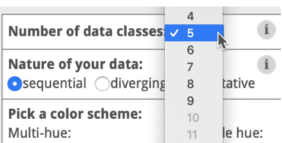

Figure 7-10. 如果您选择 steps，请尝试 ColorBrewer 数据类别和色板。

一些分层设色制图工具还允许您选择如何插值您的数据，即您用于对数字进行分组以在地图上表示相似颜色的方法。例如，Datawrapper 会根据您选择 steps 还是 continuous 显示两组不同的插值选项下拉菜单，如 Figure 7-11 所示。

哪种插值方法最好？没有统一的设计规则，除了我们建议*不要*使用 *Custom* 设置手动放置颜色区间，因为它们更可能创建误导性地图，正如您将在第 14 章中学到的那样。我们的最佳建议是尝试不同的插值方法，尤其是在处理偏态数据时，以更好地了解这些选项如何塑造分层设色地图的外观以及您用它们讲述的数据故事。

总的来说，Datawrapper Academy 建议您做出颜色区间选择，帮助读者“看到数据中的所有差异”，充分使用您范围内的所有颜色，如 Figure 7-13 所示。换句话说，如果您的地图只显示最浅和最深的颜色，您就没有充分利用颜色范围的中间部分来突出数据中的地理模式和多样性。为此，您需要探索默认地图设置之外的内容，并测试哪些选项最能讲述一个诚实而富有洞察力的数据故事。

## NOT IDEAL

## BETTER

NOT ENOUGH STOPS

TOO MANY STOPS

BRIGHT COLORS COVER TOO MANY DIFFERENT LOW VALUES

DARK COLORS COVER TOO MANY DIFFERENT HIGH VALUES

Figure 7-13. 使用完整的颜色范围来显示数据中的所有差异。图片由 Datawrapper Academy 提供，经许可转载。

设计真实且有意义的分层设色地图是一项具有挑战性的工作。您将通过广泛阅读、查看不同地图以及测试各种数据可视化方式来提高技能，就像我们一样。更加意识到您对颜色区间的决策如何极大地改变读者对数据的看法。最重要的是，创建专注于讲述您的故事并真实呈现数据的地图。

## 规范化分层设色地图数据

我们在“Normalize Your Data”中介绍了规范化数据的概念。规范化意味着调整使用不同尺度收集的数据，使其转换为通用尺度，以便进行更合适的比较。例如，将 COVID 病例总数在人口差异很大的国家之间进行比较意义不大，例如截至 2020 年 11 月 6 日，美国 961 万例（估计人口 3.282 亿）和比利时 49 万例（估计人口 1150 万）。更好的策略是通过比较人均病例数（例如美国每 10 万人 2,928 例，而比利时每 10 万人 4,260 例）来规范化数据，以调整人口差异。

如果您忘记为分层设色地图规范化数据，而显示原始计数而不是相对值（例如百分比或人均比率），您通常会最终重现一个无意义的人口中心地图，而不是您试图衡量的现象。例如，比较 Figure 7-14 所示的两张地图。它们都关于截至 2020 年 6 月 26 日美国本土的 COVID-19 病例。左侧（a）显示每个州记录的病例总数，然后（b）显示按州人口调整的 COVID-19 病例。颜色越深表示值越高。您注意到空间模式有任何差异吗？

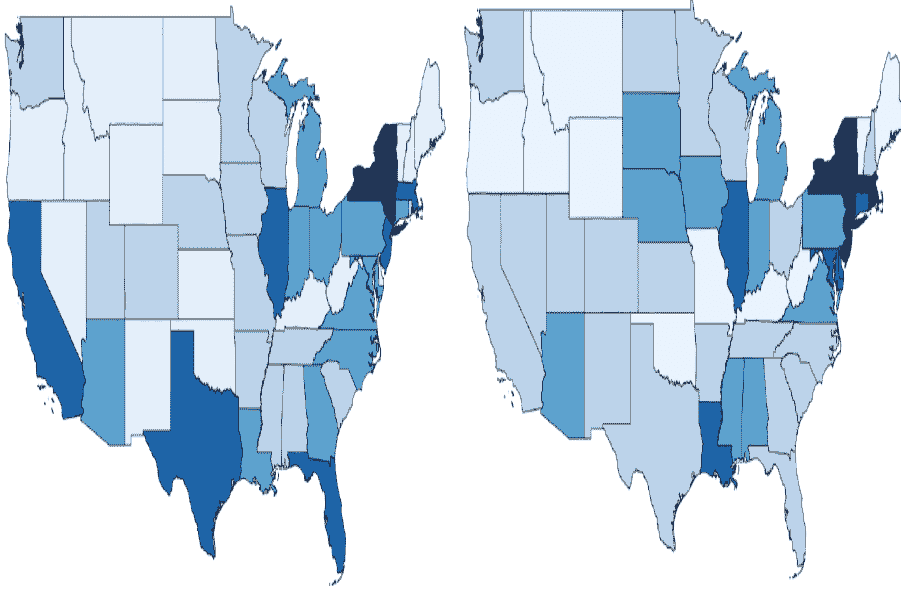

(a) COVID-19 总病例数

(b) COVID-19 人均病例数

Figure 7-14. 分层设色地图最适合使用规范化值。

两张地图都显示了由 *The New York Times* 收集并发布在 GitHub 上的 COVID-19 数据。在（b）地图中，我们通过将每个州的病例总数除以该州的人口来规范化值，人口数据来自 2018 年美国人口普查美国社区调查，这是撰写当天可获得的最新数据。我们没有添加图例或其他重要的制图元素，以便您更好地专注于解释空间模式。在这两种情况下，我们都使用了 Jenks 自然断点进行分类。

根据显示 COVID-19 总计数的地图，Figure 7-14（a），最受打击的州有哪些？如果您熟悉美国地理，您可以很快看出这些是纽约、新泽西、马萨诸塞、佛罗里达、伊利诺伊、德克萨斯和加利福尼亚。但其中五个恰好是美国人口最多的州之一，因此它们也会有更多 COVID-19 病例也就说得通了。

那么 Figure 7-14（b）中的地图呢？您可以看到纽约及其邻近地区，包括新泽西和马萨诸塞，每人的人均比率最高，这在第一张地图中我们也看到了。但您也可以看到，加利福尼亚、德克萨斯和佛罗里达受到的影响程度比左侧地图显示的要小。因此，人均值的地图是说明纽约是美国 COVID-19 危机的*首个*震中这一故事的更佳图示。


此时，你应该对地图设计的[content]
此时，你应该对地图设计的关键原则和最佳实践有了更好的认识。现在我们已经介绍了交互式地图的一般关键概念，以及特别是等值分区地图的概念，接下来我们将转向一系列使用推荐工具的动手教程。在“使用 Google My Maps 的点地图”中，我们将使用 Google My Maps 创建带有自定义图标的点地图，以弹出窗口显示特定位置的信息。在“使用 Datawrapper 的符号点地图”中，我们将在 Datawrapper 中构建符号点地图，使用不同大小的有色圆圈来表示特定城市的人口变化。本章的最后两个教程将回到等值分区地图设计的主题，分别是“使用 Datawrapper 的等值分区地图”和“使用 Tableau Public 的等值分区地图”，以比较这两种工具。

## 使用 Google My Maps 的点地图

大多数人已经熟悉 Google Maps，这项网络地图服务允许用户查找世界各地的地点和路线。在本节中，你将了解 Google My Maps，这是一款相关工具，允许你在 Google Maps 平台上显示一组点，用户可以点击这些点以显示更多数据，包括照片、网站或路线。你可以自定义点标记的颜色和图标，你创建的所有地图图层内容都将保存在你的 Google Drive 中，在那里你可以编辑并与其他人协作。尽管 Google My Maps 功能有限，但它是一款易于学习的工具，可用于构建基本的交互式点地图，如果需要，还可包含简单的折线和多边形。最后，你可以分享地图的公共链接或将其嵌入到你的网站中，相关步骤将在第 9 章中详细介绍。

在本节中，我们将构建北美博物馆和公园的点地图，其中包含两种不同样式的标记组和一个自定义照片图标。当用户点击标记时，弹出窗口中会出现额外的文本、链接和图像，如图 7-15 所示。

## 示例博物馆和 ...

北美热门景点

17 次浏览

分享

## 博物馆和公园

- Museum
- Park
- Custom icon demo

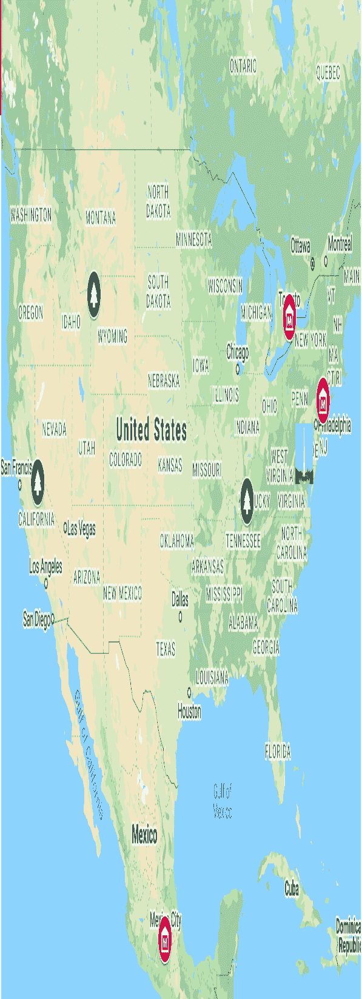

图 7-15. 使用 Google My Maps 创建的公园和博物馆点地图：探索交互式版本。

要创建自己的带自定义图标的交互式点地图，请按照本教程操作：

- 1. 打开 Google Sheets 中的 Parks and Museums 数据，其中包含北美六个热门地点。每行包含 Group、Name、Address 和 URL。登录你的 Google 账户并前往 File > "Make a copy"，以创建可在你的 Google Drive 中编辑的版本。
- 2. 导航到 Google My Maps。在左上角，点击 "Create a New Map" 按钮。这将创建一个具有熟悉 Google Maps 样式的空白地图。
- 3. 通过点击当前标题 Untitled map 并输入新的 Map title 和 Description 来添加相关标题和描述。
- 4. 要向地图添加数据，请点击 "Untitled layer" 项目下的 Import。

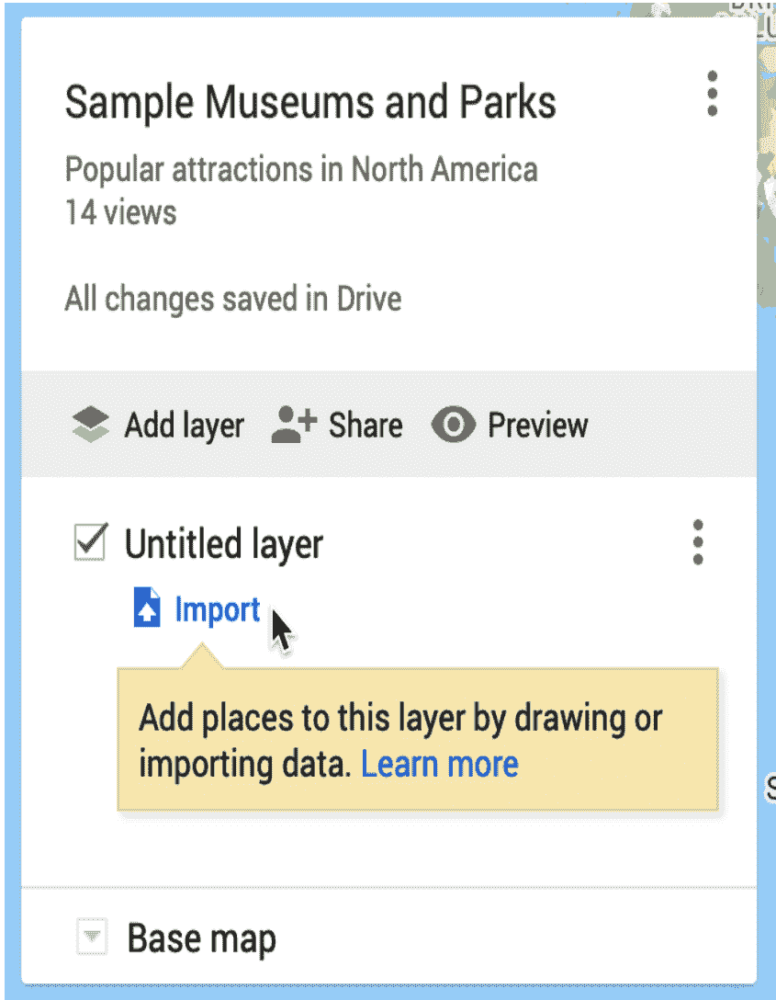

5. 在 "Choose a file to import" 屏幕中，有几种上传数据的方式。选择 Google Drive，因为我们的示例数据已采用该格式，并选择 Recent 选项卡以找到你保存到 Google Drive 的 Museums and Parks 文件。按下 Select。

## 选择要导入的文件

我的云端硬盘
与我共享
最近

| 名称 | 所有者 | 最后修改时间 |
|---|---|---|
| Museums and Parks (go to File > Make a Copy) | 我 | 上午 11:09 |

6. 在 “Choose columns to position your placemarks” 屏幕中，选择 Address 列以将点数据放置在地图上。点击 Continue。

## 示例博物馆和公园

北美热门景点

15 次浏览

所有更改已保存在云端硬盘

添加图层

统一样式

数字序列

单独样式

按数据列样式化：

Group

Name

Address

URL

10. 在 “Styled by Group” 下，将光标悬停在 Museum 标签上以显示桶样式符号，然后点击它。

## 添加图层

## 分享

## 预览

## 博物馆和公园

## 按组样式化

Museum (3)

Park (3)

11. 为 Museums 分配新的颜色，并点击 “More icons” 以找到更合适的点标记符号。

## 添加图层

## 分享

## 预览

## 博物馆和公园

## 类别：Museum (3 项)

Museum

## 颜色

## 热门图标

## 更多图标

基础

12. 在 “Choose an icon” 屏幕中，使用右上角的 Filter 字段按名称搜索图标类型，例如 “museum”。对 “parks” 重复此过程。

## 选择图标

形状 体育和休闲 地点 交通 危机 天气 动物 自定义图标 Filter: museum

## 形状

## 体育和休闲

## 地点

13. 在 “Choose an icon” 屏幕中，你可以点击左下角的 “Custom icon” 按钮上传图像，该图像将被转换为缩略图图像图标。此自定义图标由华盛顿纪念碑的 Wikimedia 图像创建。

## 自定义图标

自定义图标 OK

14. 点击任意地图标记以编辑其数据，将照片插入其弹出窗口，或添加 Google 地图路线。此照片来自大都会艺术博物馆的 Wikimedia 图像。然而，你必须手动添加照片或路线，因为这些链接无法预先加载到数据电子表格中。

## 大都会艺术博物馆

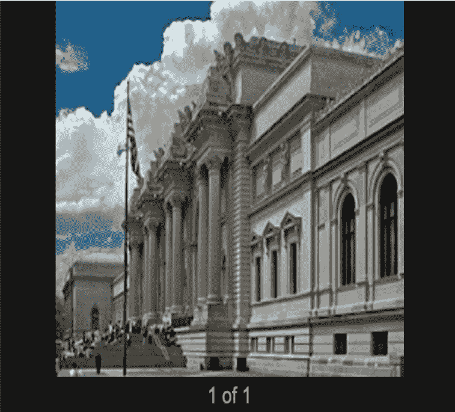

1 of 1

Group
Museum

Address
1000 Fifth Avenue, New York, NY, USA

URL
https://www.metmuseum.org

40.77916, -73.96292

添加图像或视频

15. 你可以将底图样式更改为 Google 提供的九种不同版本之一。为底图背景和标记图标选择高对比度颜色。

## 底图

更改底图的样式

16. 在地图顶部，可看到手动添加更多点标记、绘制线条、添加路线或测量距离的按钮。然而，Google My Maps 对折线和多边形的支持有限，且无法轻松创建用代表数据值的彩色边界表示的等值分区地图。

绘制线条

17. 点击 Preview 查看地图对其他人的显示效果。当你完成地图编辑后，点击地图标题和描述下方的 Share，并在下一屏幕中确保 “Enable link sharing” 已激活，并复制生成的链接。你可以与任何人分享该链接，无论是否拥有 Google 账户。你还有选择让地图在网络搜索结果中公开显示。

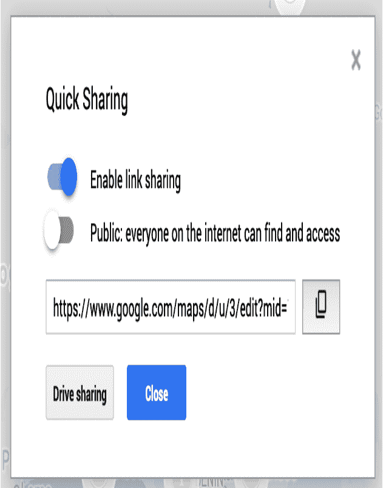

18. 如果你希望将地图作为 iframe 嵌入到网页中，点击地图标题右侧的三按钮 kebab 菜单并选择 “Embed on my site”。这将生成 HTML 嵌入代码，我们将在第 9 章中解释。

19. 如果你希望在未来编辑地图，登录你的 Google 账户后有两种访问方式。一种是打开 Google My Maps 平台以查看所有地图。另一种是前往你的 Google Drive 并按关键字搜索你的 Google My Maps。当你从 Google Sheet 中的数据创建 Google My Map 时，我们建议将 My Map 和 Sheet 文件保存在 Google Drive 的同一文件夹中，以便将来更轻松地进行编辑。

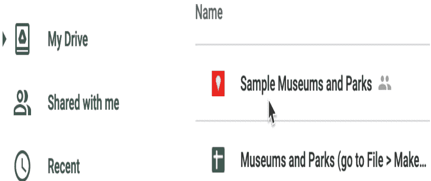

Google My Maps 是学习制作交互式地图，尤其是带自定义图标的点地图的良好入门工具。你可以设计包含多层点、折线和基本多边形的地图（如果需要）。但整体地图设计和功能仅限于 Google My Maps 平台提供的功能。了解更多信息，请访问 Google My Maps 支持页面。

在下一节中，我们将探讨如何使用 Datawrapper 创建符号点地图，其中每个圆圈（或其他形状）的大小和颜色代表该特定点的数值。

## 使用 Datawrapper 的符号点地图


我们首次在“Datawrapper 图表”中向您介绍了免费且易于学习的 Datawrapper 工具。它还提供强大的功能来创建不同类型的地图，并具有专业外观的设计元素。使用 Datawrapper，您可以在浏览器中立即开始工作，无需注册账户，除非您希望在线保存和分享您的工作。

在本节中，您将学习如何创建符号点地图。与“使用 Google 我的地图的点地图”中的基础点地图不同，符号点地图通过大小或颜色不同的形状显示特定位置的数据。在图 7-16 中，一个示例符号地图以点位置显示了三百个美国主要城市的人口变化，包含两个变量：圆圈大小（2019 年人口规模）和圆圈颜色（自 2010 年以来的百分比变化）。请记住，我们使用点数据来创建符号地图，但使用多边形数据来创建分级色图，您将在以下章节学习如何创建。在第 9 章中，我们将解释如何在网页上嵌入交互式 Datawrapper 地图。

## 2010 年至 2019 年美国城市人口变化

圆圈颜色 = 人口变化。大小 = 2019 年估计人口。包含超过 100,000 人的城市

- 下降
- 增加不足 5%
- 5-10%
- 10-20%
- 超过 20%

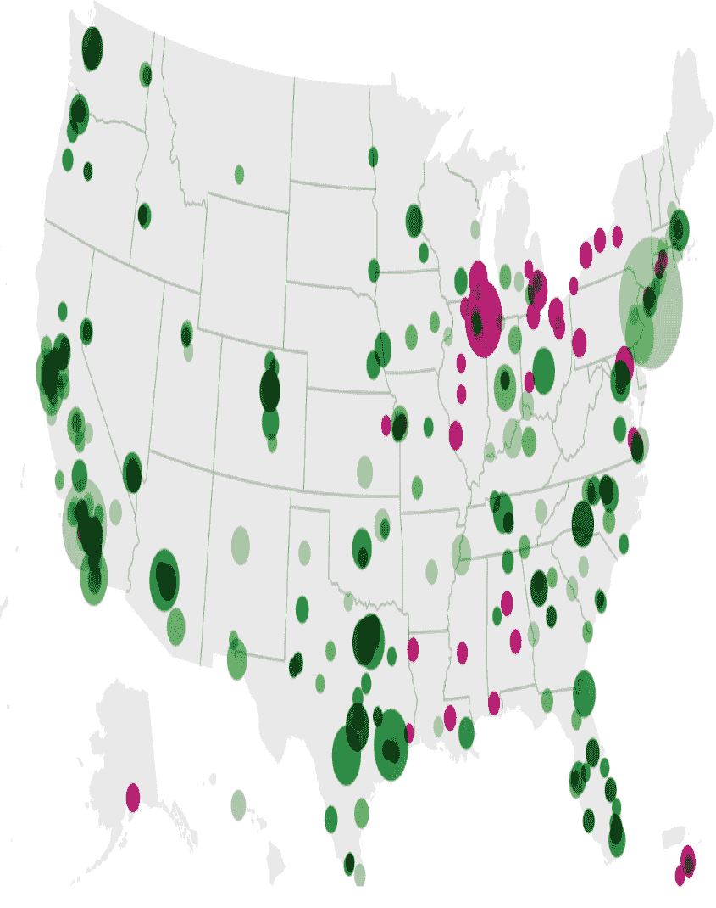

地图：by HandsOnDataViz • 来源：US Census • 使用 Datawrapper 创建

图 7-16. 使用 Datawrapper 的美国城市人口增长符号点地图：探索交互式版本。

Datawrapper 将创建地图的过程分为四个步骤：选择地图、添加数据、可视化、发布和嵌入。要创建自己的符号点地图，请按照本教程操作：

- 1. 在 Google Sheets 中打开美国城市人口变化 2010-2019 数据。阅读说明以了解其来源和一些数据问题。我们从美国人口普查下载了 2010-2019 年城市人口数据。但在此期间，一些城市新成立或与外围地区合并，这会扭曲其随时间的人口数据。还请注意，我们包含了华盛顿特区（一个位于美国州以外的主要城市）的数据，以及波多黎各的五个主要城市（不是州，而是美国领土，居民为美国公民）的数据，因此我们将在下面选择合适的地图以包含它们。

好的地图通常需要清理混乱的数据，如第 4 章所述。在我们的电子表格中，我们将原始列表缩小到约 300 个在 2010 年或 2019 年拥有超过 100,000 居民的城市。此外，由于我们依赖 Datawrapper 正确识别地名，我们将城市和州合并到一列以提高地理编码准确性。有关地名地理编码的更多信息，请访问 Datawrapper Academy。此外，我们创建了一个名为百分比变化的新列，我们是这样计算的：（2019 − 2010）/ 2010 × 100。

- 2. 在 Google Sheet 中，转到文件 > 下载并选择 CSV 格式，将数据保存到本地计算机。

- 3. 打开 Datawrapper，点击开始创建，然后新建地图，并选择“符号地图”。

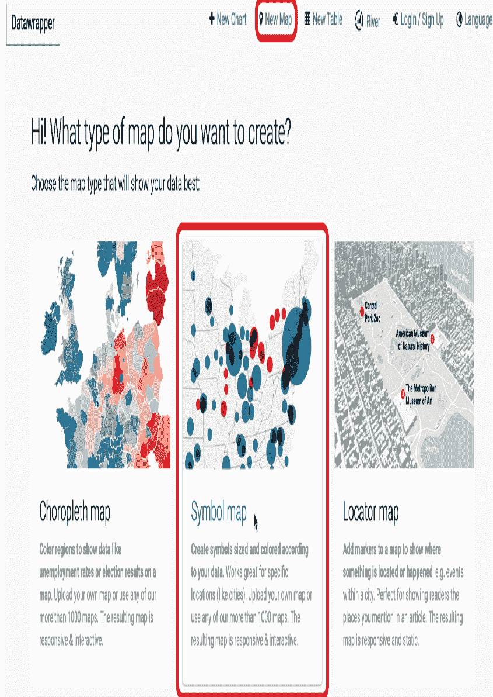

- 4. 在“选择您的地图”屏幕中，搜索 USA > “States and Territories”以包含波多黎各，而不是列表顶部附近出现的 USA > States 选项。继续到下一屏幕。

- 5. 在“添加您的数据”屏幕中，点击“导入您的数据集”。在下一个窗口中，点击“地址和地名”按钮以告知 Datawrapper 我们的数据就是这样组织的。在导入窗口中，点击“上传 CSV 文件”，并选择您之前下载的文件。

- 6. 在“匹配您的列”屏幕中，选择 *City-State* 列作为“匹配为地址”，然后向下滚动点击下一步。在下一屏幕中，点击转到以查看您的地理编码数据在以下屏幕中以地图形式显示。

## 匹配您的列

请选择您的数据集中包含“地址”的列。

MATCHED AS
ADDRESS

MATCH AS
ADDRESS

MATCH AS
ADDRESS

MATCH AS
ADDRESS

| City-State | Population2010 | PopEstimate2019 | PctChange2010-19 |
|---|---|---|---|
| New York, New York | 8175133 | 8336817 | 1.98 |
| Los Angeles, California | 3792621 | 3979576 | 4.93 |
| Chicago, Illinois | 2695598 | 2693976 | -0.06 |
| Houston, Texas | 2099451 | 2320268 | 10.52 |
| Phoenix, Arizona | 1445632 | 1680992 | 16.28 |
| Philadelphia, Pennsylvania | 1526006 | 1584064 | 3.80 |
| San Antonio, Texas | 1327407 | 1547253 | 16.56 |
| San Diego, California | 1307402 | 1423851 | 8.91 |

☑ 第一行作为标题

NEXT

7. 点击可视化以完善您的地图。我们的目标是显示两个变量：2019 年人口作为圆圈大小，百分比变化作为圆圈颜色。在“符号形状和大小”下，选择圆形符号，按 Pop Estimate 2019 调整大小，最大符号大小为 25 像素。在符号颜色下，选择百分比变化 2010–2019 列。

## 符号形状和大小

符号形状

按大小

PopEstimate2019

您可以从数据集中选择一列来控制符号的大小。如果未选择列，将使用固定大小。

最大符号大小

25 px

分组附近符号

## 符号颜色

选择列

PctChange2010-19

您可以从数据集中选择一列来控制符号的颜色。如果未选择列，将使用单一颜色。

选择调色板

# [ 在此处插入标题 ]

-20.71 71.38

获取数据 · 使用 Datawrapper 创建

8. 可选地，为了使颜色调色板和间隔与我们的示例相匹配，点击调色板旁边的扳手符号。点击“导入颜色”，您可以从 ColorBrewer 粘贴此处列出的五个十六进制代码，如我们

类型

◉ 分段
○ 连续

步骤  5  自定义

上下类限

min - 0
0 - 5
5 - 10
10 - 20
20 - max

更少选项

填充不透明度  90 %

显示符号轮廓

相乘重叠符号的颜色

## 图例

显示地图图例

标题    您的标题在此

标签    ○ 标尺    ○ 范围
          ◉ 自定义

编辑标签
点击标签进行编辑

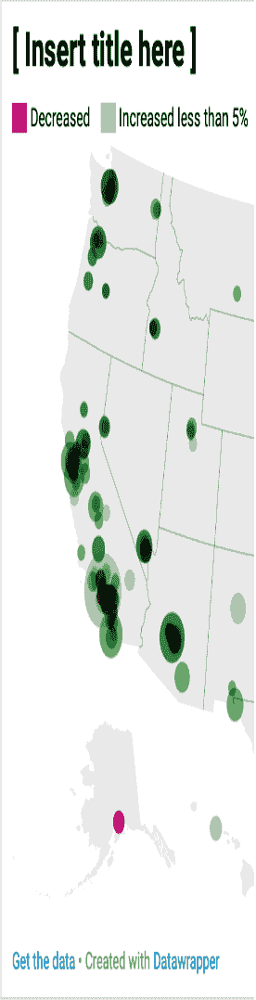

[ 在此处插入标题 ]

下降   增加不足 5%

获取数据 · 使用 Datawrapper 创建

图表大小：
600 × 442

10. 在 *可视化* 屏幕下，点击注释选项卡以插入标题、来源注释、鸣谢，并根据 Datawrapper Academy 的描述自定义工具提示。

11. 点击继续或进入发布和嵌入屏幕以与他人分享您的工作。如果您登录了免费的 Datawrapper 账户，您的工作会自动在线保存到屏幕右上角菜单中的我的图表中。此外，您可以点击蓝色发布按钮生成嵌入交互式地图到您网站的代码，如您将在第 9 章中学到的。此外，您可以“将图表添加到 River”，如果您希望更广泛地分享您的工作，允许其他 Datawrapper 用户改编和重用它。此外，滚动到底部并点击下载 PNG 以导出地图的静态图像。额外的导出和发布选项需要付费 Datawrapper 账户。或者，如果您不希望创建账户，您可以输入您的电子邮件以接收嵌入代码。

如需帮助和更多选项，请参阅 Datawrapper Academy 关于符号地图的支持页面。

现在您已经学会了如何使用 Datawrapper 创建符号点地图，在下一节中我们将在此工具的基础上构建您的技能以创建分级色图。

## 使用 Datawrapper 的分级色图

让我们从点地图转向多边形地图。由于您已经学会了如何使用 Datawrapper 设计图表（参见“Datawrapper 图表”）和符号地图（参见图 7-16），让我们使用此工具创建分级色图，它看起来像彩色多边形。分级色图最适合通过为多边形着色来显示地理区域中的模式以表示数据值。Datawrapper 提供广泛的常见地理边界，包括世界区域、州和省，以及美国的六边形（卡托图）、县、国会选区和人口普查区。

在本节中，您将创建美国各州 2020 年 8 月典型房屋价值的分级色图，根据 Zillow 房屋价值指数，如图 7-17 所示。该指数反映了单户住宅、公寓和合作公寓的典型房屋价值（指第 35 到 65 百分位范围，约为中位数），并且经过平滑和季节性调整。


## 2020年8月美国各州典型房屋价值

根据Zillow的数据，夏威夷、加利福尼亚和马萨诸塞州的州级房屋价值最高

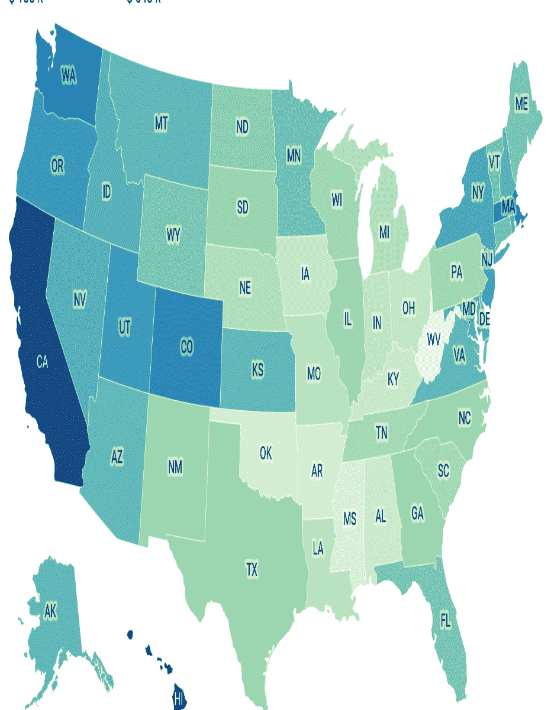

地图：由HandsOnDataViz制作 • 来源：Zillow • 使用Datawrapper创建

图7-17. 使用Datawrapper创建的2020年美国各州房屋价值等值区域图：探索交互版本。

Datawrapper将创建地图的过程分为四个步骤：选择地图、添加数据、可视化以及发布和嵌入。要创建自己的等值区域图，请遵循本教程：

- 1. 打开我们从Zillow研究网站下载的Google Sheets中的房屋价值指数数据。阅读说明以了解其来源和定义。

如第4章所述，好的地图通常需要清理杂乱的数据。在我们的电子表格中，我们删除了除两列之外的所有列，即2019年8月和2020年8月，还插入了一个百分比变化列，我们按以下方式计算：(2020 − 2019) / 2019 × 100。此外，幸运的是，Datawrapper可以轻松识别美国州名和缩写。

- 2. 在Google Sheets中，转到文件 > 下载，选择CSV格式将数据保存到本地计算机。

- 3. 打开Datawrapper，点击开始创建，然后点击新地图，选择“等值区域图”。创建地图无需登录，但您应该注册一个免费帐户以保存您的工作并在线发布地图。

## 你好！您想创建哪种类型的地图？

选择最能展示您数据的地图类型：

## 等值区域图

在地图上对区域着色以显示数据，例如失业率或选举结果。上传您自己的地图或使用我们超过1000张地图中的任意一张。生成的地图具有响应式且交互式。

## 符号地图

根据您的数据创建大小和颜色各异的符号。特别适用于特定位置（如城市）。上传您自己的地图或使用我们超过1000张地图中的任意一张。生成的地图具有响应式且交互式。

## 定位地图

在地图上添加标记以显示某物的位置或发生地点，例如城市内的事件。非常适合向读者展示您在文章中提及的地点。生成的地图具有响应式且静态。

4. 在“选择地图”屏幕上，选择您的地理边界。在这种情况下，搜索并选择美国 > “州和领地”，以包括华盛顿特区的数据，该特区不是州，然后点击继续。

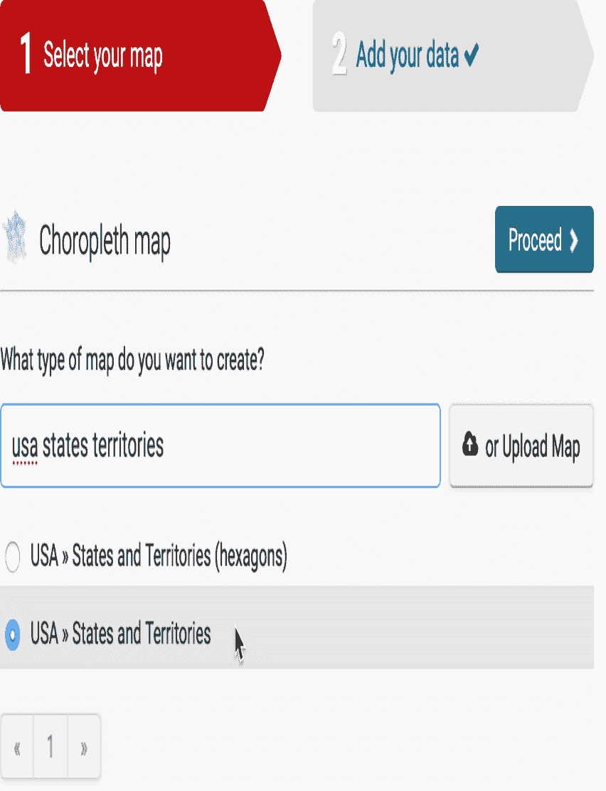

5. 在“添加数据”屏幕上，您可以手动输入每个区域的数据，这对于少量区域没问题，但对50个州来说就不行了。相反，向下滚动到“添加数据”表格下方，点击“导入您的数据集”。

Datawrapper会解释说，当上传数据到美国 > “州和领地地图”时，您的数据必须包含以下列之一：

- 名称，例如加利福尼亚。
- FIPS代码，即美国各州和较小地理区域的联邦信息处理标准数字代码，其中加利福尼亚为06。
- ANSI代码，即美国国家标准协会为美国各州和较小地理区域提供的字母或数字代码，其中加利福尼亚为CA。

代码因地图类型而异。例如，世界地图可能接受国家名称（拼写可能不同）或ISO三字母代码。要查看所选地理区域的所有代码，请在Datawrapper中返回上一屏幕，选择“地理代码”下拉菜单。如有必要，您可以将名称及其对应代码复制并粘贴到电子表格中，以准备数据。在Datawrapper学院了解更多关于地名地理编码的信息。

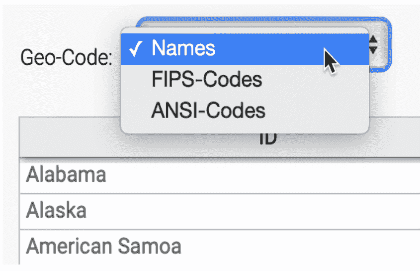

6. 因为我们的数据包含名称和ANSI代码两列，请直接点击开始导入。

7. 在“导入您的数据集”屏幕上，我们建议您不要粘贴数据，而是点击“上传CSV文件”，然后选择您在步骤2中下载的文件。

8. 在“匹配您的列”屏幕上，点击与ANSI代码匹配的列。您可能需要向下滚动一点，点击下一步，然后继续。

## 匹配您的列

请选择您的数据集中包含“ANSI代码”的列。


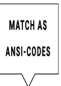

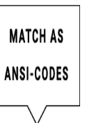

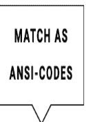


| 代码 | 名称 | 2019年8月房屋价值 | 2020年8月房屋价值 | 19-20年百分比变化 |
|------|------|--------------|--------------|------------------|
| CA | 加利福尼亚 | 556814 | 587412 | 5.50 |
| TX | 得克萨斯 | 208048 | 215658 | 3.66 |
| NY | 纽约 | 325168 | 335502 | 3.18 |
| FL | 佛罗里达 | 246057 | 258257 | 4.96 |
| IL | 伊利诺伊 | 205652 | 209335 | 1.79 |
| PA | 宾夕法尼亚 | 195056 | 204876 | 5.03 |
| OH | 俄亥俄 | 150429 | 160093 | 6.42 |
| MI | 密歇根 | 173521 | 182327 | 5.07 |
| GA | 佐治亚 | 202179 | 213026 | 5.37 |
| NC | 北卡罗来纳 | 202455 | 214726 | 6.06 |
| NJ | 新泽西 | 340740 | 353518 | 3.75 |

☑ 将第一行作为标题


9. 进入下一个屏幕，选择您最初希望映射的数据值列，然后点击“匹配为值”。在本教程中，选择*2020年8月房屋价值*，向下滚动点击下一步，然后开始，然后继续。您可以在后续步骤中映射其他数据值。

## 匹配您的列

请选择您的数据集中包含**“值”**的列。

ANSI代码

| 代码 | 名称 | 2019年8月房屋价值 | 2020年8月房屋价值 | 19-20年百分比变化 |
|---|---|---:|---:|---:|
| CA | 加利福尼亚 | 556814 | 587412 | 5.50 |
| TX | 得克萨斯 | 208048 | 215658 | 3.66 |
| NY | 纽约 | 325168 | 335502 | 3.18 |
| FL | 佛罗里达 | 246057 | 258257 | 4.96 |
| IL | 伊利诺伊 | 205652 | 209335 | 1.79 |
| PA | 宾夕法尼亚 | 195056 | 204876 | 5.03 |
| OH | 俄亥俄 | 150429 | 160093 | 6.42 |
| MI | 密歇根 | 173521 | 182327 | 5.07 |
| GA | 佐治亚 | 202179 | 213026 | 5.37 |
| NC | 北卡罗来纳 | 202455 | 214726 | 6.06 |
| NJ | 新泽西 | 340740 | 353518 | 3.75 |

☑ 将第一行作为标题

下一步

10. 在可视化屏幕中，在“优化”选项卡下，点击调色板旁边的扳手符号以查看默认地图设置。不要盲目接受默认地图，但它是开始探索各种因素如何影响其外观的好地方。

## 优化

## 注释

## 设计

## 颜色

选择列

2020年8月房屋价值

选择调色板

# [ 在此处插入标题 ]

107762

648194

类型

分级

连续

插值

线性

自定义范围

10776

最小值

25825

中间值

64819

最大值

让我们回顾一下我们在“设计等值区域图颜色和间隔”中首次介绍的关键概念。默认地图显示连续的绿色到蓝色调色板，采用线性插值，这意味着房屋价值在刻度上呈直线分布。这些颜色和间隔更适合强调低端和高端极端情况的数据故事。

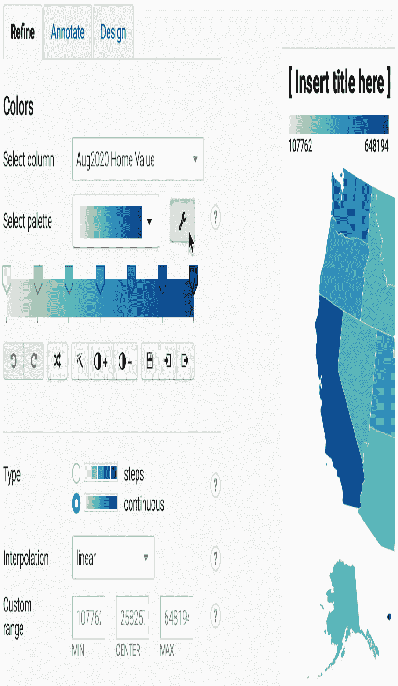

11. 在“优化”选项卡中，尝试不同类型的插值，以改变值分配给颜色的方式。例如，从*线性*改为*四分位数*，将数据分成四个大小相等的组。这种地图更适合强调地理多样性的数据故事，因为我们在中间范围内看到各州之间更多的对比。

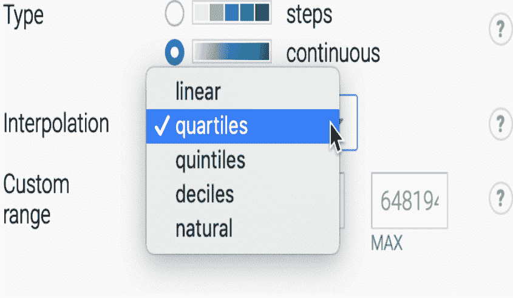

12. 尝试其他颜色、间隔和数据列。将调色板从*顺序*改为*发散*颜色，后者在中间范围显示中性色，在两端显示两种深色。从*连续*渐变改为*分级*，并选择不同数量的分隔线。将数据列改为*2019-20年百分比变化*，以规范化等值区域图数据，如“规范化等值区域图数据”中所讨论的，因为全国各地的房屋价值差异很大。例如，查看从2019年到2020年房屋价值百分比变化的地图，使用发散的红蓝调色板、五级渐变和四舍五入的值。


## 2019年8月至2020年8月房屋价值百分比变化

-5% 0% 5% 10%

### 精简

**选择列**

- Code
- Aug2020 Home Value
- Name
- Aug2019 Home Value
- Pct Change 2019-20

**选择调色板**

**类型**

- steps
- continuous

**步数**

5 Rounded values

**自定义范围**

-6.66 MIN

10.74 MAX

### 标注

### 设计

### 颜色

### 图例

Show map legend

Caption: Your title here

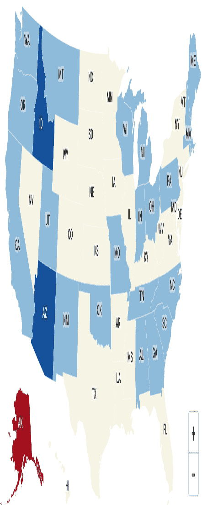

Which data columns, colors, and intervals make the best map? There’s no easy answer, since there’s more than one way to make a true and meaningful map. But keep two principles in mind. First, make sure that you honestly show the data, rather than hide or disguise it. Second, reflect on what kind of data story you believe is important to tell, since design choices emphasize different interpretations of the data. Review our guidance in “Design Choropleth Colors and Intervals”.

### 工具提示

Show tooltips

Customize tooltips

```
{{ name }}
```

```
$ {{ FORMAT(aug2019_home_value, "0,0") }}
home value
```

You can use HTML and insert data columns. Using our formula syntax you can also perform calculations (see full syntax reference).

- Code
- Aug2020 Home Value
- Name
- Aug2019 Home Value
- Pct Change 2019-20
- 1,000.00
- 0
- 0.0
- 0.00
- 0.000
- 0.0

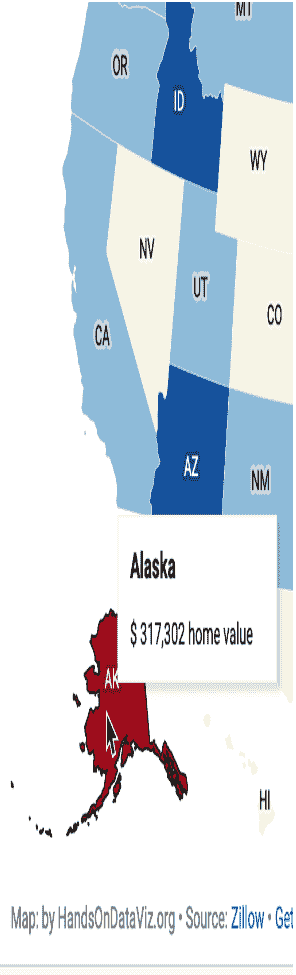

**CHART SIZE**

600 × 456

15. Finally, click Proceed or advance to the Publish & Embed screen to share your work with others. Follow the prompts, or the more detailed Datawrapper tutorial, to obtain an embed code to your interactive map, and learn more about your next steps in Chapter 9.

> **TIP**
> Learn more about choropleth map design in this excellent series of posts by the Datawrapper Academy.

Now that you’ve learned how to create a choropleth map using one tool, Datawrapper, let’s compare the process using a different tool, Tableau Public.

## 使用 Tableau Public 创建 Choropleth 地图

We first introduced you to the free Tableau Public desktop application (for Mac or Windows) when building scattercharts and filtered line charts in Chapter 6. Now let’s use the same tool to create an interactive choropleth map, and compare the process with the Datawrapper tool we described in the prior section. We’re showing you how to create the same type of map with both tools to show you the difference. On one hand, Datawrapper gives you more control over interpolating data and shaping the appearance of color intervals in your choropleth map. On the other hand, some people prefer Tableau Public because they’re already familiar with its interface.

Tableau Public can create many different types of maps for geographical place names or ISO codes it already recognizes, such as nations, states, counties, and airports. But Tableau Public cannot geocode street addresses by itself, so you’ll need to obtain their latitude and longitude with another tool, such as those described in the geocode section of “Geocode Addresses in Google Sheets”. Furthermore, if you want to upload customized map boundaries, learn how to Create Tableau Maps from Spatial Files on the support page.

In this section, we’ll create a choropleth map of healthcare spending per country as a percentage of their gross domestic product (GDP), as shown in Figure 7-18. Remember that choropleth maps work best when we normalize the data to show relative, rather than absolute, numbers (see “Normalize Choropleth Map Data”). Creating a map of total health spending per country wouldn’t be very meaningful, as larger nations tend to have larger economies, so we’ll base our map on the percentage of their economy that is spent on healthcare.

Before we start, you should obtain and install the free Tableau Public desktop application if you don’t have it yet. It is available for Mac or Windows. You’ll need to enter an email address to download the application.

Let’s look at the steps involved to create a choropleth from Figure 7-18 in detail:

1. Open the Healthcare Spending by Nation as Percent of GDP data in Google Sheets, which we downloaded from the World Bank. Examine the data and the notes.

   Good maps often require the cleaning up of messy data, as described in Chapter 4. In our spreadsheet, we removed rows for nations that did not report any data. Tableau Public recognizes many different types of geographic names (such as cities and nations), so we’ll rely on the tool to deal with any spelling issues and properly place all of them on the map.

2. In the Google Sheet, go to File > Download and select CSV format to save the data to your local computer.

3. Launch Tableau Public. When you first open it, you’ll see the Connect menu on the left-hand side that displays file formats you can upload. Choose the “Text file” format and upload the healthcare spending CSV data file you’ve just downloaded in the previous step.

> **NOTE**
> Tableau lets you access data directly from Google Sheets that live in your Drive using Connect > “To a Server” option. So instead of downloading a CSV file in step 2, you could have made a copy of the sheet, and connected to it directly.

4. In the Data Source screen, inspect the dataset, which contains three columns: Country Name, Country Code, and Health Spending As % of GDP. Notice that a small globe appears at the top of the Country Name and Country Code columns, which shows that Tableau Public successfully recognized these as geographic data, rather than string or text data. Sometimes Tableau doesn’t recognize location data automatically, so you need to manually change the data type. To do so, click the data type icon (e.g., globe or a green # for numeric values), and then choose Geographic Role > Country/Region.

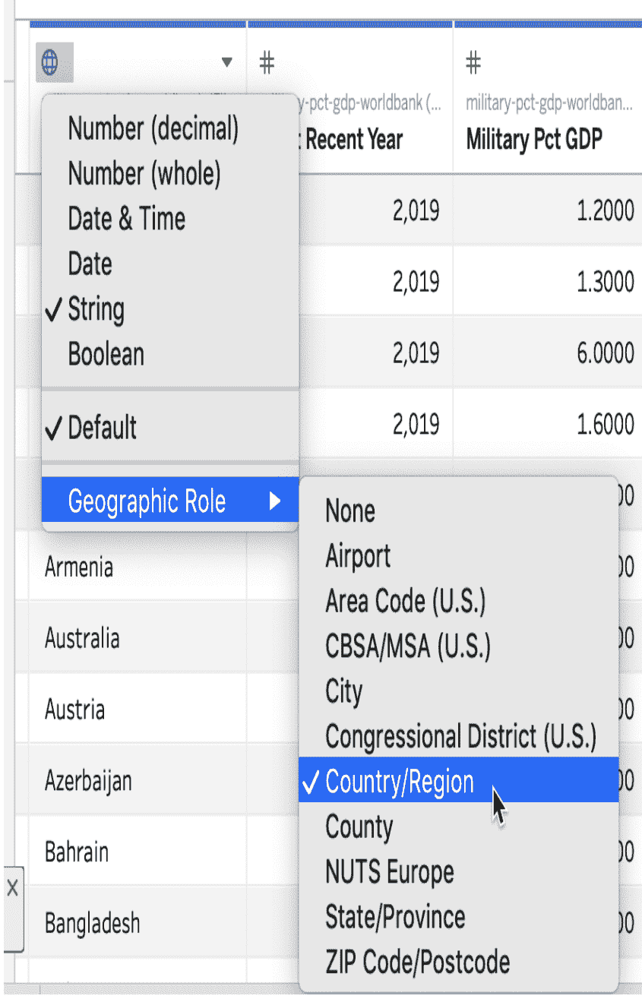

5. In the bottom-left corner, click the orange Sheet 1 button to create a worksheet with your first visualization.

6. In Sheet 1, create your choropleth map using a two-step process. First, drag and drop the Country Name field into the middle of the worksheet (alternatively, to the Detail box of the Marks card) to create the map. The default view is the symbol map, which we need to replace with a polygon map. To add colored polygons, drag and drop the Health Spending As % of GDP field into the Color box of the Marks card to transform it into a choropleth map.

**Data / Analytics**: health-pct-gdp-worldbank

**Pages**

**Columns**: Longitude (generated)

**Rows**: Latitude (generated)

Search

**Tables**

- Country Code
- Country Name
- Measure Names
- Health Spending As % of ...
- health-pct-gdp-worldbank...
- Latitude (generated)
- Longitude (generated)
- Measure Values

**Filters**

**Sheet 1**

**Marks**

- Automatic
- Colour
- Size
- Label
- Detail
- Tooltip
- Colour: SUM(Health Sp...)
- Detail: Country Name

7. Tableau Public may hide the map legend behind the Show Me menu in the upper-right corner, so click the menu to shrink it and display your legend.

8. You can change the color palette by clicking the Color box of the Marks card, and then “Edit colors.” Change the palette to Green, and change it from continuous to steps.

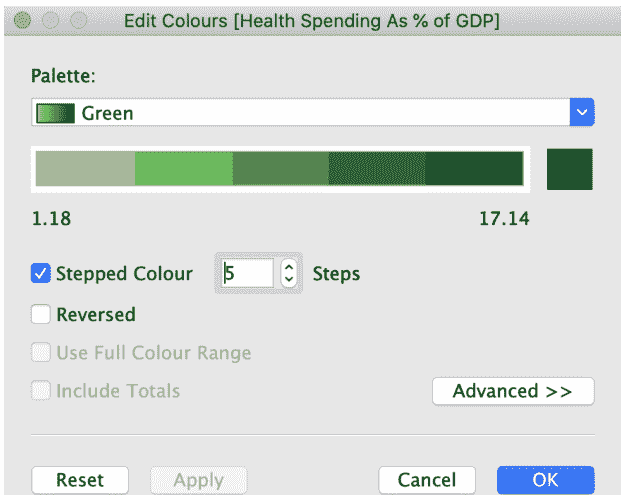

9. When you hover over countries, you’ll notice a tool tip that tells you the name of the country and gives you the percent value. It’s generally well-formatted as our initial data table had proper column headers. But we can make the tool tip even better. Click the Tooltip box of the Marks card and change the first instance of Country Name to just Country (don’t change the grayed-out text inside < and > because these are variable names). Add a % sign at the end of the second row.

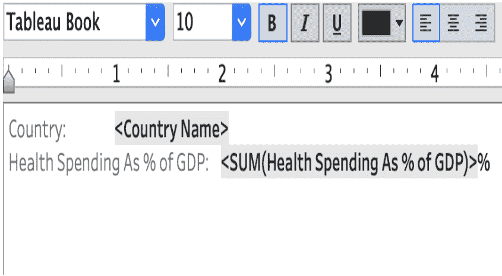

10. Let’s make our map title more meaningful. Double-click the default Sheet 1 name just above the map to bring up the Edit Title window, and change the name of your chart to 2017 Healthcare Spending by Country as % of GDP.

11. At this point, the data is loaded and should be displayed correctly, so we’re going to create the final layout that includes the map’s title and credits, the legend, and is appropriate for sharing. At the bottom-left of the program, create a New Dashboard. Dashboards in Tableau are layouts that can contain visualizations from multiple sheets, as well as text boxes, images, and other elements, creating rich exploratory interfaces. In this tutorial, we’ll stick to just a single sheet that contains our choropleth map.


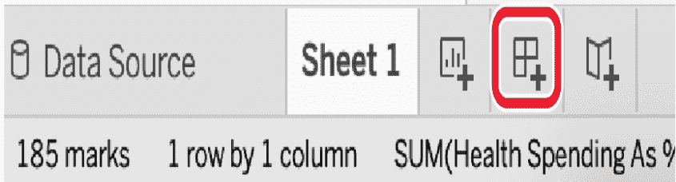

12. 在你的 Dashboard 1 选项卡中，将仪表板的尺寸更改为 Automatic，以便地图具有响应性并在所有设备上占据 100% 的宽度。将 Sheet 1 拖放到“Drop sheets here”区域。这将复制 Sheet 1 中的地图、标题和图例。

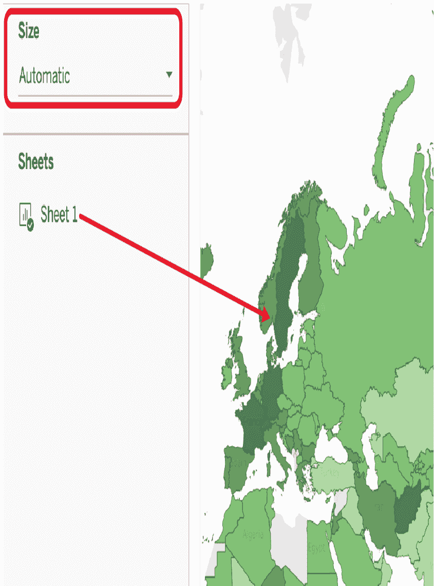

13. 右键单击地图图例的上部，并选择 Floating。现在你可以将图例直接放置在地图上方以节省空间。将其拖放到地图的其中一个角落。

Edit Colours...

Format Legends...

Show Title

Edit Title...

Layout

Floating

Fix Height

Edit Height...

Select Container: Vertical

Deselect

Remove from Dashboard

Rename Dashboard Item...

14. 最后，让我们在地图下方添加一个带有数据源的文本块。从左侧的 Objects 菜单中，将 Text 拖放到地图的下半部分。在出现的 Edit Text 窗口中，输入 Data by the World Bank, 2017，然后单击 OK。最初，文本区域将占据屏幕高度的一半，因此像调整计算机上的任何窗口一样调整其大小。

我们完成了！确保你定位好地图的中心和缩放级别，因为你希望其他人可以看到它。在这种情况下，最好有一个世界视图，因为我们显示的是大多数国家的数据，尽管你可能想放大到某个特定大洲。一旦准备好发布和分享地图，请前往 File > “Save to Tableau Public”。在弹出窗口中，如果需要请登录你的账户。为地图命名，例如 Healthcare Spending，然后单击 Save。有关如何将地图作为 iframe 嵌入，请参阅“Get the Embed Code or iframe Tag”。

## WARNING

Tableau 可能不是创建需要完全控制颜色分段的 choropleth 地图的最佳工具。默认情况下，Tableau 使用线性配色方案，正如你在本章前面学到的那样，容易突出异常值，并且没有简单的方法将区间更改为非线性方法，例如分位数。如果你对线性比例表示数据的效果不满意，可以通过过滤数据从地图中移除异常值，参考 Andy Kriebel 的 VizWiz 教程使用表格计算将项目分组为分位数，或重新查看“Choropleth Map with Datawrapper”，它能让你更好地控制颜色区间和插值。

在之前的所有教程中，你使用静态数据创建了交互式地图，即数据来自电子表格。在下一个教程中，你将学习如何使用来自 Socrata 开放数据存储库的持续更新的数据构建地图，该地图将始终显示最新信息。

## Current Map with Socrata Open Data

基于 Socrata 平台构建的地图显示的是当前数据，因为它会持续从开放数据存储库中提取最新信息，你在“Open Data Repositories”中了解过这一点。直接在开放数据平台上创建可视化的优势在于，你的图表或地图直接链接到数据源。一些政府机构会频繁更新选定的开放数据存储库，其中当前信息很重要，例如火灾或警察呼叫、房产数据或公共财政。每当管理员修改开放数据存储库的内容时，你的图表或地图将自动显示最新信息。然而，如果政府机构停止更新存储库或切换到不同的平台，你的可视化将不再显示当前信息或可能完全失效。

Socrata 是一家提供开放数据存储库服务的公司，许多政府机构使用它来向公众提供开放数据。它提供用户友好的方式来查看、过滤和导出数据。此外，Socrata 平台还内置支持创建交互式图表和地图，可嵌入到其他网站（包括你自己的网站）。你可以在 Socrata 的 Open Data Network 上搜索公开可用的数据集。

在本节中，我们将构建纽约市涉及汽车的致命事故的交互式点地图，该地图会持续更新，显示过去 365 天的点，如图 7-19 所示。我们的交互式地图从纽约市 OpenData Portal 上基于 Socrata 平台的 Motor Vehicle Collisions—Crashes 公共存储库中提取数据。只要政府管理员继续在此平台上更新该数据集，你的地图应始终显示过去 12 个月的最新数据。

## Fatal Crashes in New York City, Last 365 Days

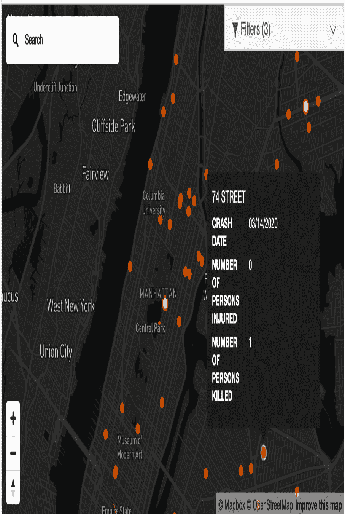

图 7-19. 过去一年纽约市致命事故地图，数据持续从 Socrata 开放数据存储库更新。查看交互式版本。

## NOTE

任何人都可以利用 Socrata 托管的公共数据创建地图，但你需要注册为 Socrata 用户才能保存和分享地图。只有具有特殊位置列的数据集才能被映射，这与数据集中常见的传统位置列（例如地址或城市）不同。如果想要映射的数据集缺少地理编码位置，请考虑联系数据集管理员。

要使用此 Socrata 开放数据存储库构建自己的持续更新的点地图，请按照本教程操作：

- 1. 通过点击右上角的 Sign In 按钮注册 NYC OpenData 门户的账户。在“Don’t have an account yet? Sign Up”处，继续注册。按照说明操作，包括确认你不是机器人，并接受 License Agreement 以创建免费账户。此账户，包括你的用户名和密码，仅适用于 NYC OpenData 门户，而不适用于使用 Socrata 的其他网站。
- 2. 导航到 Motor Vehicle Collisions—Crashes 数据集。在右侧菜单中，选择 Visualize > Launch New Visualization。这将打开一个 Configure Visualization 工作室，你可以在其中创建地图。

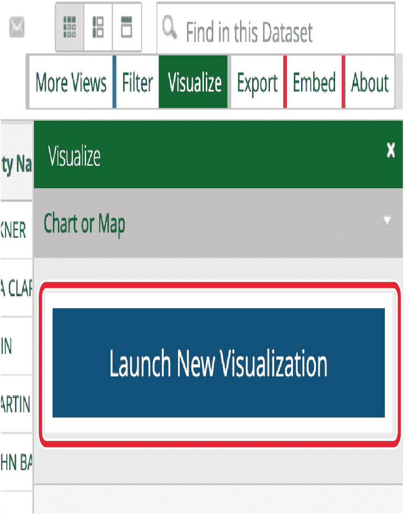

3. 在顶部菜单中，选择 Map（散点图图标和日历图标之间的地球图标）作为可视化类型。几秒钟后，底图会出现，左侧边栏菜单中会出现 Map Layers 和 Map Settings 项目。

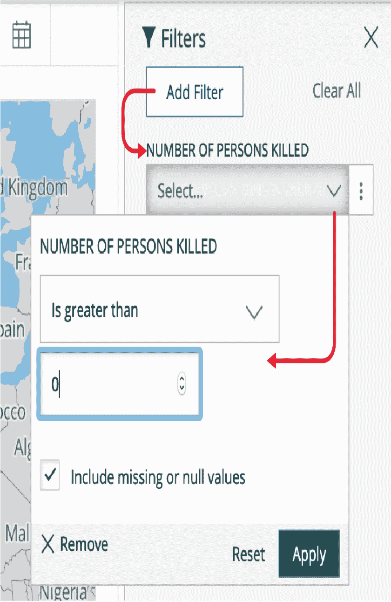

5. 我们需要清理数据。放大后你会注意到并非所有事故都被正确地理编码。一些事故出现在大西洋上的虚构 Null Island，纬度和经度都为 0。你在“Recognize Bad Data”中学习了如何识别和处理不良数据。为了移除这些地理编码错误的事故，让我们在 LATITUDE 列上添加另一个过滤器，设置为“Is greater than”，值为 0。这样我们只显示位于北半球、Null Island 以北的事故，而纽约市就位于那里。正确设置两个过滤器后，地图将飞入并聚焦于纽约市。如果你愿意，可以继续通过添加更多过滤器来清理数据。

6. 而不是显示自 2012 年以来记录的所有事故，让我们显示过去一年发生的事故，并持续更新。为 CRASH DATE 列添加第三个过滤器，设置为 Relative Date > Custom > “Last 365 day(s)”。你会看到地图上很多点消失，因为它们不在所选日期范围内。你现在可以关闭 Filters 窗口以释放屏幕空间。

7. 让我们确保事故位置显示为单独的点，并且永远不会聚类。进入 Map Settings > Clusters，并将“Stop Clustering at Zoom Level”滑块调到 1。你现在应该在所有缩放级别下看到单独的事故位置。

## Zoom Level

## Search Boundary

## Clusters

Clusters and stacks help to display dense point data.

Learn more.

Stop Clustering at Zoom Level

8. 在同一个手风琴菜单中，将 Basemap > Type 从默认的 Basic 改为 Dark，以使点最大程度可见并使地图更具时尚感。在 General 中，将 Title 设置为 Fatal Crashes in New York City, Last 365 Days，并通过取消选中“Show data table below visualization box”来隐藏地图下方的數據表。在 Map Controls 下，取消选中 Show Locate Button，因为它仅与从 NYC 访问地图的人相关。在 Legend Options 下，取消选中 Show Legend。欢迎尝试其他设置。

9. 最后，让我们为点创建有意义的工具提示。返回到 Map Layers 菜单并选择我们的 Motor Vehicle Collisions—Crashes 点图层。要更改悬停或点击点时显示的内容，请导航到 Flyout Details，并将 Flyout Title 设置为“ON STREET NAME”，并将“CRASH DATE”、“NUMBER OF PERSONS INJURED”和“NUMBER OF PERSONS KILLED”添加为额外的 flyout 值。


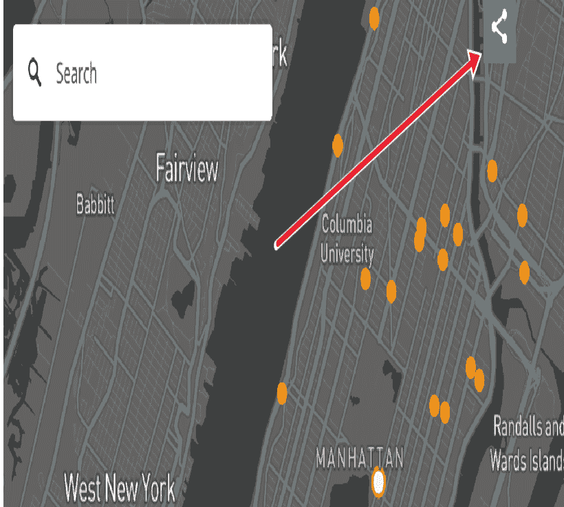

## 纽约市过去 365 天的致命车祸

## iFrame 嵌入

## JS 嵌入

## 嵌入代码

```
<iframe src="https://data.cityofnewyork.us/dataset/Fatal-NYC-Crashes/nx4u-jy9t/embed?width=800&height=600" width="800" height="600" style="border:0; padding: 0; margin: 0;"></iframe>
```

## 大小

大号 (800x600)

在开放数据存储库平台上创建图表或地图存在局限性。首先，如果机构停止使用该平台或更改底层数据的结构，你的在线地图（或图表）可能停止运行。事实上，我们不得不重写本教程，因为它曾引用了管理员已停止支持的另一个 Socrata 平台。其次，你只能使用该平台上存在的 数据集和地理边界。如果这些限制让你担心，一个简单的替代方案是从开放存储库导出数据（这意味着任何“实时”数据将变为“静态”），并将其导入你偏好的数据可视化工具，如 Datawrapper、Google Sheets 或 Tableau。第二个更高级的替代方案是学习如何使用 API 从 Socrata 拉取实时数据，如“Leaflet Maps with Open Data APIs”中所述。

## 摘要

在本章中，我们回顾了地图设计原则，并探索了讲述不同类型数据故事的推荐工具和教程。创建地图时，仔细考虑你是在处理点数据还是多边形数据，这两种是最常见的选项。如果是后者，请记住，设计良好的分级色图需要规范化的数据和对颜色区间的仔细考虑。

我们只是触及了表面，并展示了简单的示例，帮助你快速创建一些示例地图。有关使用 Leaflet 地图代码模板的更高级设计，请参阅第 12 章，并学习如何在第 13 章中查找和转换地理空间数据。

1 Rost，“Your Friendly Guide to Colors in Data Visualization”，https://oreil.ly/ndITD; Rost，“How to Pick More Beautiful Colors for Your Data Visualizations”，https://oreil.ly/dRCBy。
2 另见 Cynthia A. Brewer，《Designing Better Maps: A Guide for GIS Users》(Esri Press, 2016)。
3 了解更多关于 ANSI 和 FIPS 代码的信息，请访问美国人口普查局。
