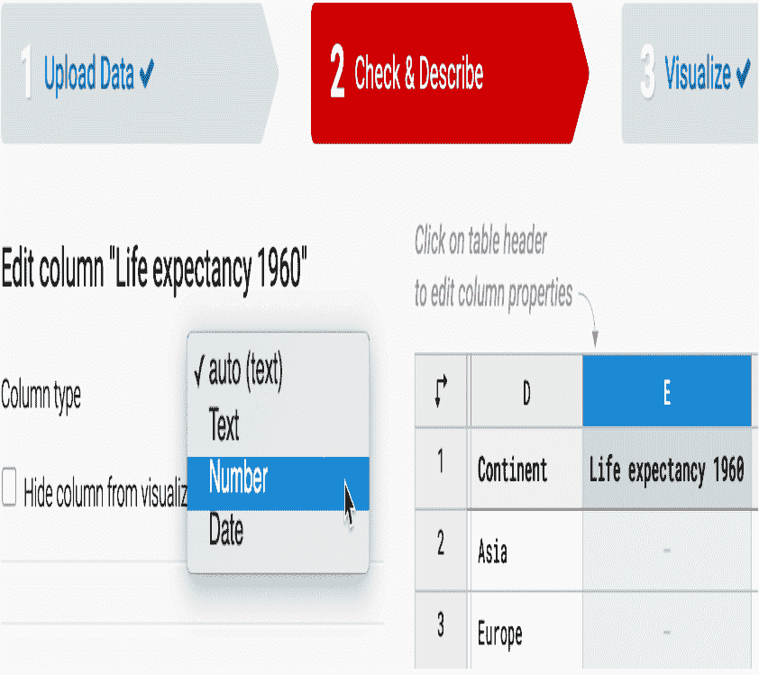

## 第 8 章. 表格化你的数据

你可能会惊讶，一本强调图表和地图的数据可视化书籍也包含一章关于创建表格的内容。我们通常不会将数据表格视为一种可视化类型。但根据你的数据和你希望讲述的故事，有时表格是呈现信息的最佳方式，尤其是在网络上的交互式表格。表格在读者想要查找对他们高度相关特定行数据时很有意义，例如他们当地社区或他们所属的组织，这在大型图表或地图中很难识别。此外，表格在读者希望精确比较彼此之间的单个值，但不一定与整个数据集进行比较时效果最佳。最后，当没有需要强调的广泛视觉模式时，表格比图表更好；当没有特定的空间模式时，表格比地图更好。在开始设计图表或地图之前，考虑一下是否更有意义地创建表格。有时最好的可视化只是一个好的表格。

在本章中，你将学习表格设计原则以及如何使用 Datawrapper 创建交互式表格，该工具我们在第 6 章和第 7 章中介绍过，用于创建带有迷你图的交互式表格。当然，如果你需要快速制作简短表格，那么静态版本通常更有意义，你可以用电子表格创建，如“Other Table-Making Tools”所述。本章重点介绍交互式表格，因为它们相对于静态表格有许多优势，尤其是在需要在网上而非仅在印刷品中发布大量表格内容时。首先，交互式表格允许读者通过关键词搜索感兴趣的具体细节，这在呈现长表格和大量行时至关重要。其次，读者可以按升序或降序对交互式表格的任何列进行排序，这使他们能够快速浏览长列表的顶部或底部。最后，你还将学习如何插入迷你图，或小型图表，可在每一行中直观总结数据趋势，并自动放置在你的交互式表格中。迷你图结合了表格和图表的最佳品质，使读者在浏览数据表格的列时更容易直观地扫描趋势。在第 9 章中，你将学习如何将交互式表格集成到你的网站中。

## 表格设计原则

让我们从一些良好的表格设计原则开始，类似于“Chart Design Principles”和“Map Design Principles”。专攻创建政策相关数据可视化的经济学家 Jonathan Schwabish 提供了关于创建清晰传达给多位受众的表格的建议。¹ 以下是他几个关键点的总结，其示例出现在图 8-1 中：

- 使列标题在数据上方突出。
- 使用浅色阴影分隔行或列。
- 为便于阅读，将文本左对齐，数字右对齐。
- 通过仅在第一行放置标签来避免重复。
- 对数据进行分组和排序以突出有意义的模式。

| 类别 | 食物 | 颜色 | 每份卡路里 |
|---|---|---:|
| 水果 | 香蕉 | 黄色 | 105 |
|  | 苹果 | 红色 | 95 |
|  | 蓝莓 | 蓝色 | 42 |
| 蔬菜 | 羽衣甘蓝 | 绿色 | 34 |
|  | 胡萝卜 | 橙色 | 26 |
|  | 茄子 | 紫色 | 10 |

*图 8-1. 一个说明所选设计原则的示例表格。*

此外，Schwabish 和其他人建议使用颜色突出显示数据中的关键项目或异常值，我们将在第 15 章讨论该主题。

在创建交叉制表以说明数据相关性和可能的因果关系时，统计学家 Joel Best 提出了另外两个设计建议：²

- 将自变量（疑似原因）放在顶部列标题中，将因变量（可能的效果）放在每一行的侧边。
- 从原始数字垂直向下计算百分比，以便自变量（疑似原因）的每个值总计为 100%。

让我们通过构建两个不同的表格来应用这些设计原则，这两个表格计算百分比，坏的方法与更好的方法，使用 2020 年 11 月报告的辉瑞冠状病毒疫苗试验研究结果的数据。在这项盲测中，43,661 名志愿者被随机分为两组，每组约 21,830 人。一组接种疫苗，另一组接种安慰剂，这些是自变量（疑似因果因素）。研究人员密切观察并观察到这些因变量（可能的效果）：安慰剂组有 162 人感染病毒，而疫苗组有 8 人感染。³

### 表 8-1. 因水平计算百分比而糟糕

|  | 疫苗 | 安慰剂 | 总计 |
|---|---:|---:|---:|
| 感染 | 4.7% (8) | 95.3% (162) | 100% (170) |
| 未感染 | 50.2% (21,822) | 49.8% (21,668) | 100% (43,490) |

### 表 8-2. 因垂直计算百分比而更好

|  | 疫苗 | 安慰剂 |
|---|---|
| 感染 | 0.04% (8) | 0.74% (162) |
| 未感染 | 99.96% (21,822) | 99.26% (21,668) |
| 总计 | 100% (21,830) | 100% (21,830) |

总体而言，表格设计的核心理念反映了我们之前在图表和地图设计中讨论过的类似概念。用读者的眼睛组织数据的呈现，以关注解释中最重要的元素，帮助他们带走要点。为他们做可视化工作，这样你就不必依赖他们在自己的头脑中建立相同的心理联系？他们是否移除了任何阻碍这些目标的杂乱或不必要的重复？最重要的是，他们是否讲述了关于数据的真实而有意义的故事？

现在你了解了几个表格设计的关键原则，请参阅下一节中介绍的 Datawrapper 工具中如何直接内置了其中几个原则。

## Datawrapper 带有迷你图的表格

在本节中，你将学习如何使用 Datawrapper 创建交互式表格，Datawrapper 是我们之前介绍的免费在线拖放可视化工具，用于在“Chart Design Principles”中创建图表，在“Map Design Principles”中创建地图。你可以在浏览器中立即开始在 Datawrapper 中创建，甚至无需账户，但注册一个免费账户将有助于你组织可视化。记住，你可能仍然需要电子表格工具，如 Google Sheets，来编译和清理大型表格的数据，但 Datawrapper 是创建和发布交互式表格在线的最佳工具。

你还将学习如何创建迷你图，或小型折线图，可快速总结数据趋势。该图表类型由耶鲁大学教授和数据可视化先驱 Edward Tufte 精炼，他将迷你图描述为“datawords…intense, simple, word-sized graphics。”⁴ 虽然 Tufte 设想迷你图在静态纸张或 PDF 文档上，但你将在交互式表格中创建它们，如图 8-2 所示。读者可以通过关键词搜索，按升序或降序对列进行排序，并滚动浏览迷你图页面，以快速识别在传统仅数字表格中难以察觉的数据趋势。

## 各国出生时预期寿命，1960-2018

| 国家 | 大洲 | 1960–2018年预期寿命 | 差异 |
|---|---:|---:|---:|
| 阿富汗 | 亚洲 | 32.4 → 64.5 | 32 |
| 阿尔巴尼亚 | 欧洲 | 62.3 → 78.5 | 16 |
| 阿尔及利亚 | 非洲 | 46.1 → 76.7 | 31 |
| 安哥拉 | 非洲 | 37.5 → 60.8 | 23 |
| 安提瓜和巴布达 | 北美洲 | 62.0 → 76.9 | 15 |
| 阿根廷 | 南美洲 | 65.1 → 76.5 | 12 |
| 亚美尼亚 | 亚洲 | 66.0 → 74.9 | 9 |

*图8-2. 带迷你趋势图的表格：探索交互式版本。*

在本教程中，你将创建一个带迷你趋势图的交互式表格，以可视化全球超过195个国家在1960年至2018年出生时预期寿命的差异。总体而言，大多数国家的预期寿命逐渐上升，但少数国家在微型折线图中出现了明显的“下降”。例如，柬埔寨和越南的预期寿命都经历了显著下降，这与两国在1960年代末至1970年代中期发生的致命战争和难民危机相对应。迷你趋势图帮助我们直观地发现此类模式，任何人都可以通过交互式表格底部的链接下载原始数据进一步调查。

虽然可以使用如“筛选折线图”中所示的筛选折线图来呈现相同的数据，但同时显示超过180条线时，读者很难发现差异。同样，也可以使用如“使用Datawrapper的分级统计图”中所示的分级统计图来呈现这些数据，但与地理面积较大的国家相比，读者很难识别地理面积较小的国家的数据。在这种特定情况下，当我们希望读者能够搜索、排序或滚动浏览所有国家的迷你趋势图时，最好的可视化方式就是一张好表格。

为了简化本教程，我们从世界银行（我们在第3章中列出的开放数据存储库之一）下载了按国家划分的1960年至2018年出生时预期寿命数据，格式为CSV。在电子表格中，我们清理了数据，例如删除了半个世纪内报告数据年份不超过五年的国家，如Google Sheets中的Notes标签页所述。使用“使用VLOOKUP匹配列”中的VLOOKUP电子表格方法，我们合并了来自Datawrapper的两字母国家代码和大洲列。我们还创建了两个新列：一列名为“1960年预期寿命”（故意留空，以便稍后放置迷你趋势图），另一列名为“差异”（计算最早可用数据年份与最近可用数据年份之间的差值，大多数情况下为1960年至2018年）。更多详情请参阅Google Sheets中的Notes标签页。

要创建你自己的带迷你趋势图的交互式表格，请按照本教程操作，本教程改编自Datawrapper的培训资料及其示例画廊：

1. 在Google Sheets中打开我们清理过的世界银行出生时预期寿命数据（1960年至2018年）。
2. 前往Datawrapper，点击“开始创建”，然后在顶部导航中选择“新建表格”。你无需登录，但如果你想保存工作，我们建议你创建一个免费账户。
3. 在第一个“上传数据”标签页中，选择“导入Google电子表格”，粘贴我们清理过的Google Sheets的网址，然后点击“继续”。你的Google Sheets必须设置为共享，以便其他人可以查看。
4. 在“检查与描述”标签页中检查数据。确保勾选“将首行作为标签”复选框，然后点击“继续”。
5. 在“可视化”屏幕的“自定义表格”下，勾选两个额外的复选框：“可搜索”（以便用户按关键词搜索国家）和“条纹表格”（使行更易读）。
6. 让我们使用一个特殊的Datawrapper代码在每个国家名称前显示小国旗。在“国家”列中，每个条目以两个字母的国家代码开头，代码两侧带有冒号，后面跟着国家名称，例如`:af: Afghanistan`。我们根据“将数据合并到一列”创建了“国家”列。
7. 在“可视化”屏幕的“自定义列”下，选择名为“国家”的第三行。然后向下滚动并推动滑块到“用国旗替换国家代码”。
8. 让我们隐藏前两列，因为它们不再需要显示。在“可视化”屏幕的“自定义列”下，选择*名称*列，然后向下滚动并取消勾选“在桌面端和移动端显示”复选框。对*代码*列重复此步骤。每个自定义列旁边会出现一个“不可见”符号（一条斜线穿过眼睛），提醒我们已将其隐藏。
9. 现在让我们为*大洲*列添加颜色编码，以便读者在交互式表格中更容易按类别排序。在“可视化”屏幕的“自定义列”下，选择*大洲*列，然后向下滚动并推动滑块选择“根据类别为单元格着色”。在下拉菜单中选择*大洲*列，然后点击背景 > “自定义背景”按钮。选择每个大洲并为它们分配不同的颜色。

**各国出生时预期寿命**

在表格中搜索

| 国家 | 大洲 |
|---|---|
| 阿富汗 | 亚洲 |
| 阿尔巴尼亚 | 欧洲 |
| 阿尔及利亚 | 非洲 |
| 安哥拉 | 非洲 |
| 安提瓜和巴布达 | 北美洲 |
| 阿根廷 | 南美洲 |
| 亚美尼亚 | 亚洲 |
| 阿鲁巴 | 南美洲 |
| 澳大利亚 | 大洋洲 |
| 奥地利 | 欧洲 |
| 阿塞拜疆 | 亚洲 |
| 巴哈马 | 北美洲 |

**大洲**

1960 – 2018年预期寿命

差异

全选 | 无 | 反选

显示于
桌面端 移动端

样式  B I A  100%

边框  无

对齐  自动

根据类别为单元格着色

选择列  大洲

文本  自定义颜色...

背景  自定义颜色...

- 亚洲
- 欧洲
- 非洲
- 北美洲
- 南美洲
- 大洋洲
- null

选择：全选 无 反选

显示为热力图

### 提示

为了选择六大洲的颜色，我们使用了ColorBrewer设计工具，如“设计分级统计图颜色和间隔”中所述，并选择了一个六类定性方案。虽然该工具主要面向分级统计图设计，但你也可以用它来选择表格和图表的颜色。

10. 现在让我们准备数据以添加迷你趋势图（即微型折线图），以直观地表示*1960年预期寿命*列的变化，我们特意将该列留空以供此步骤使用。开始之前，你必须将此列从文本数据（在“自定义列”窗口中由A符号表示）更改为数值数据（由#符号表示）。在屏幕顶部，点击“检查与描述”箭头返回上一步。（Datawrapper会保存你的工作。）现在点击表头以编辑E列：*1960年预期寿命*的属性。在左侧，使用下拉菜单将其属性从*自动（文本）*更改为*数字*。点击“继续”返回“可视化”窗口。

11. 要创建迷你趋势图，请在“可视化”屏幕的“自定义列”下，选择从*1960年预期寿命*到2018年的所有列。要一次全部选中，请点击一列，然后向下滚动并按住Shift键点击倒数第二列。然后向下滚动页面，点击“将所选列显示为迷你图”按钮。这些步骤将在该列中创建迷你趋势图，并自动将其重命名为*1960–2018年预期寿命*。

### 提示

按照设计，我们最初将此列命名为*1960年预期寿命*，因为当我们选择多个列来创建迷你趋势图时，工具会在新列名的末尾添加*–2018*。

12. 让我们再添加一个视觉元素：一个条形图，以直观地表示表格中的*差异*列。在“可视化”屏幕的“自定义列”下，选择“差异”。然后向下滚动并推动滑块选择“显示为条形图”。另外，选择一种不同的条形颜色，例如黑色，以区别于各大洲的颜色。

按国家划分的出生时预期寿命，1960-2018

预期寿命 1960 – 2018

差值

全选 无 反选

| 国家 | 大洲 | 预期寿命 1960 – 2018 | 差值 |
|---|---|---|---|
| 阿富汗 | 亚洲 | 32.4 → 64.5 | 32 |
| 阿尔巴尼亚 | 欧洲 | 62.3 → 78.5 | 16 |
| 阿尔及利亚 | 非洲 | 46.1 → 76.7 | 31 |
| 安哥拉 | 非洲 | 37.5 → 60.8 | 23 |
| 安提瓜和巴布达 | 北美洲 | 62 → 76.9 | 15 |
| 阿根廷 | 南美洲 | 65.1 → 76.5 | 12 |
| 亚美尼亚 | 亚洲 | 66 → 74.9 | 9 |
| 阿鲁巴 | 南美洲 | 65.7 → 76.2 | 11 |
| 澳大利亚 | 大洋洲 | 70.8 → 82.7 | 12 |
| 奥地利 | 欧洲 | 68.6 → 81.7 | 13 |

- 在桌面/移动端显示
- 格式 10,000
- 样式 B I A 100%
- 边框 无
- 对齐 自动
- 根据类别为单元格着色
- 显示为热力图
- 固定列宽
- 显示为条形图 条形样式 正常 细
- 无背景
- 根据类别为条形着色
- 条形颜色
- 范围 最小 最大

13. 在“可视化”界面中，单击“标注”选项卡以添加标题、数据来源和署名行。

14. 在“可视化”界面中，单击“发布并嵌入”以分享交互式表格的链接，如前面的图8-2所示。如果你登录了免费的Datawrapper账户，你的作品会自动在线保存到屏幕右上角的“我的图表”菜单中。另外，你可以单击蓝色的“发布”按钮生成代码，将交互式图表嵌入到你的网站中，这将在第9章中介绍。此外，如果你希望更广泛地分享你的作品，允许其他Datawrapper用户改编和重用你的图表，你可以“将图表添加到River”。进一步向下滚动并单击“下载PNG”可导出图表的静态图像。其他导出和发布选项需要付费的Datawrapper账户。如果你不想创建账户，可以输入邮箱以接收嵌入代码。

如需了解更多，我们强烈推荐Datawrapper Academy支持页面、丰富的示例图库以及设计良好的培训材料。

### 其他制表工具

虽然Datawrapper是创建包含长内容和迷你趋势图的交互式表格的不错选择，但还有许多其他工具可以制作较简单的表格，用于印刷或在线发布。

要快速制作一个简短的静态表格，可以使用你喜欢的电子表格工具。例如，在Google Sheets中，你可以排列表格数据并将其下载为PDF文档。然后使用任何图像编辑器将PDF转换为PNG或JPG文件，裁剪到合适尺寸，再将最终版本插入静态文档或网页中。此外，还记得你在“使用数据透视表汇总数据”中学到的电子表格数据透视表功能，可以创建更复杂的交叉表，并将其导出为图像以插入文档或网站。

在Datawrapper中，你还可以创建一种简单的静态表作为图表类型，并发布它以下载PNG版本。

在Google Sheets中，你也可以在线发布任意表格并将其嵌入网页，我们将在第9章讨论这一点。这样，每当你更新Google Sheet时，当前数据都会自动显示在网页上。

在Tableau Public中（我们之前在“Tableau Public图表”和“使用Tableau Public绘制等值区域图”中介绍过该工具），你还可以创建突出显示表，它会自动为单元格背景着色，以吸引你注意高值与低值的对比。

最后，如果你主要为网页设计表格，可以考虑使用在线Tables Generator工具，它可以将表格内容转换为HTML和其他格式。

### 小结

在本章中，我们回顾了表格设计的原则，以及如何使用Datawrapper和其他工具创建带有迷你趋势图的交互式表格。在下一章中，你将学习如何在网站上嵌入交互式图表、地图和表格，以便读者探索你的数据并参与你的故事。

1 乔恩·施瓦比什，“总结‘更好表格的十条准则’的推文”（Twitter，2020年8月3日），https://oreil.ly/JCjpG；乔纳森·A·施瓦比什，“更好表格的十条准则”，《成本效益分析杂志》11卷，第2期：151–78，访问于2020年8月25日，https://doi.org/10.1017/bca.2020.11；乔纳森·施瓦比什，《更好的数据可视化：学者、研究人员和专家指南》（哥伦比亚大学出版社，2021年）。

2 乔尔·贝斯特，《更多该死的谎言和统计：数字如何混淆公共问题》（伯克利，加利福尼亚州：加州大学出版社，2004年），第31–35页。

3 卡尔·齐默，“两家公司称其疫苗有效性达95%。这意味着什么？”《纽约时报》：健康版，2020年11月20日，https://oreil.ly/iuhtwf；达希尔·扬-萨弗，“95%有效意味着什么？教授疫苗效力的数学”（《纽约时报》学习网络，2020年12月14日），https://oreil.ly/3bLMP。

4 爱德华·R·塔夫特，《美丽的证据》（Graphics Press，2006年），第46–63页。
