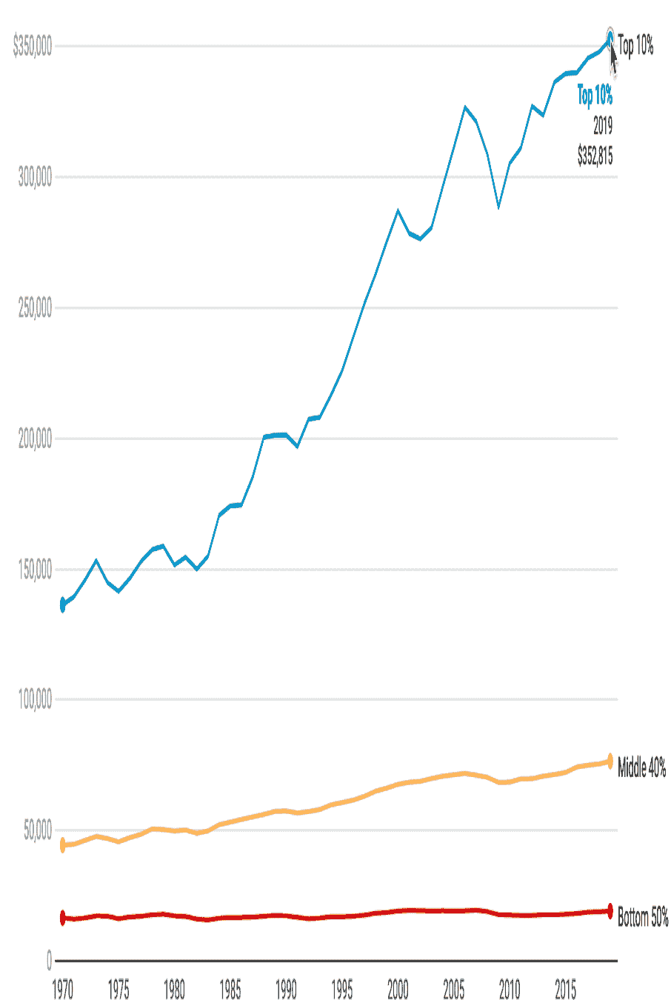
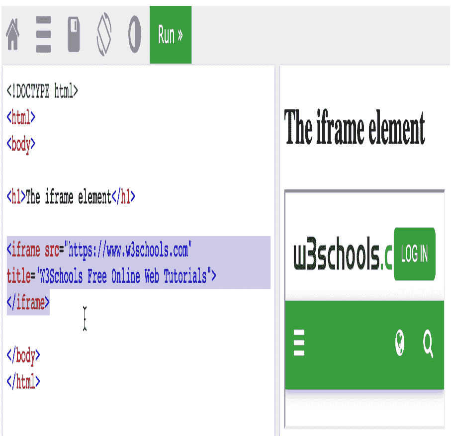
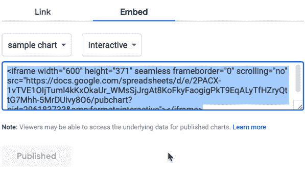
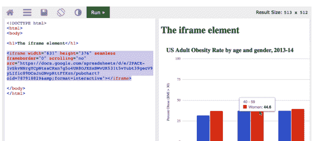
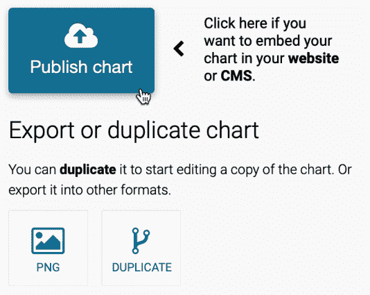
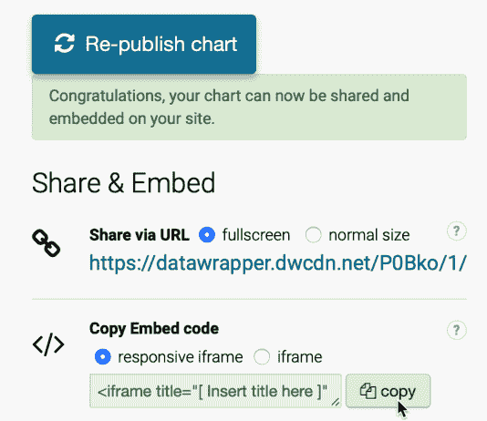
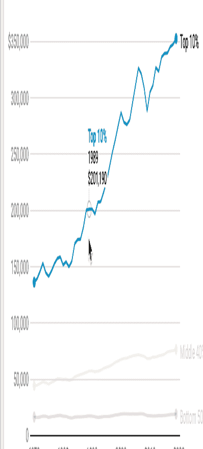
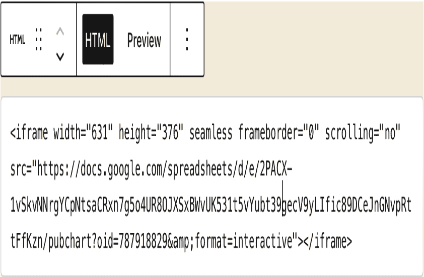
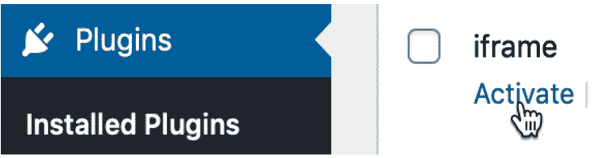

## 第9章 嵌入网页

到目前为止，你已经学习了如何在第6章中创建图表、在第7章中创建地图、在第8章中创建表格。本书强调设计交互式可视化的好处，这些可视化通过邀请受众与你的数据互动、探索新模式、按需下载文件并轻松在社交媒体上分享你的作品，来吸引互联网上的广泛受众。在本章中，你将了解一种称为iframe的计算机代码标签，它允许读者在不同页面上积极探索你的数据。iframe就像一个相框，会在你控制的第二个网页（例如你的个人或组织网站）中显示一个实时网页（例如你的交互式数据可视化），如图9-1所示。如果操作正确，iframe会让你的数据可视化无缝地显示在你的网页上，受众无需知道它来自不同的主机即可探索内容。

目前你已经学过的几种可视化工具，如Google Sheets、Datawrapper和Tableau Public，都会生成一段嵌入代码，其中包含一个指向你在其平台上创建的在线图表或地图的iframe。我们将演示如何从可视化工具网站获取嵌入代码或链接，并将代码粘贴到第二个网站中，以无缝显示你的交互式内容（参见“获取嵌入代码或iframe标签”和“将代码或iframe粘贴到网站”）。这本入门书籍不需要编码技能，但对代码感到好奇当然会有所帮助。

你的网页

包含文本和图片

<iframe> 显示另一个网页，例如托管在另一个网站上的数据可视化


你的网页的其余部分

### 静态图像与交互式iframe对比

首先，让我们澄清静态可视化与交互式可视化之间的区别。图表或地图的静态图片是冻结的图像。许多可视化工具允许你以JPG、PNG或PDF格式下载图表或地图的静态图像。当你只想在文档、演示文稿幻灯片甚至网页中插入静态图像时，静态图像非常有用。另一种做法是粘贴静态图像，并添加指向交互式图表或地图的链接或自定义短链接，邀请受众在线探索（参见“共享你的Google Sheets”）。

如果你需要在计算机上捕获任何网页的静态图像，请使用以下内置命令进行截图：

- Chromebook：Shift+Ctrl+F5（“显示窗口”按钮），然后单击并拖动十字光标
- Mac：Shift-Command-4，然后单击并拖动十字光标以截取屏幕截图
- Windows：Windows徽标键+Shift+S调出截图和草图工具

一种相关的策略是使用动画GIF，它是一系列静态图像，捕捉屏幕上的动态。你可以在网页中插入动画GIF文件来说明使用交互式可视化时的一小段操作步骤，但受众无法与之交互，只能反复播放动画循环。付费软件工具（如Snagit）允许你创建包含下拉菜单、光标、动画GIF等内容的屏幕截图。

相比之下，交互式可视化允许受众通过网络浏览器直接与你的数据故事互动。访问者通常可以将光标悬停在图表上查看工具提示或底层信息，缩放地图并平移，或在交互式表格中搜索术语或排序列。交互式可视化通常托管在线上，例如图表或地图工具平台，主要设计为在线查看，尽管在某些情况下你也可以在本地计算机上下载并与它们交互。

现在让我们回到核心问题：如何让一个托管在其在线主机（主站点）上的交互式可视化，无缝地出现在我们控制的另一个网站（次站点）上？虽然我们可以在次站点上插入指向主站点图表或地图的链接，但这对于受众来说不方便，因为这要求他们离开正在阅读的网页。更好的解决方案是插入一段嵌入代码，其中通常包含一个用HTML编写的iframe标签，也就是在网页浏览器中显示内容的代码。虽然你不需要任何编码经验，但长期来看，学习如何识别嵌入代码的核心特征及其工作原理会让你受益。

iframe最简单的形式是让次站点显示来自主站点的网页地址（称为源），就像房间里墙上一个无缝的相框。下面的示例iframe代码以开始标签<iframe ...>开头，其中包含源src='https://...'，主站点URL两侧使用单引号或双引号，最后以结束标签</iframe>结尾：

```
<iframe src='https://datawrapper.dwcdn.net/LtRbJ/'></iframe>
```

此示例iframe引用的是Datawrapper平台上的一个交互式美国收入不平等图表，该图表首次出现在引言中，如图9-2所示。


**1970-2019 年美国成年人收入按百分位划分**



*注：* 以 2019 年不变美元计。个人年收入为 20 岁及以上，在扣除税费和转移支付前，但包括养老金缴款和分配。

*图表：* HandsOnDataViz.org 制作 • 来源：世界不平等数据库 2020 • 获取数据 • 使用 Datawrapper 创建

图 9-2。探索此图表的交互式版本。在美国，自 1970 年代以来，前 10% 收入者的收入有所增长，但后 50% 的收入保持停滞。

当你从本书中介绍的可视化工具复制嵌入代码时，其 iframe 标签可能比提供的简单示例长得多。例如，iframe 标签可能包含其他属性，例如以像素（px）或二级站点尺寸百分比衡量的宽度或高度。此外，你可能会看到其他 iframe 标签属性，例如 `frameborder="0"` 或 `scrolling="no"`，它们使 iframe 内容与其周围环境之间呈现无缝外观。最后，你可能会看到包含十几行甚至我们也不完全理解的代码的非常长的嵌入代码。这是可以的，因为所有这些都是可选的附加组件，用于改善 iframe 在二级站点上的外观。嵌入代码中最重要的部分是 iframe 及其三个核心部分：iframe 开始标签、源网络地址和结束标签。如有疑问，请寻找这些关键要素。

现在你对交互式可视化、嵌入代码和 iframe 标签有了更清晰的定义，在下一节中，我们将学习如何从不同的可视化平台复制嵌入代码。

## 获取嵌入代码或 iframe 标签

在本节中，你将学习如何复制在不同可视化平台上发布图表或地图时自动生成的嵌入代码或 iframe 标签。本书中介绍了这些平台。请记住，嵌入代码包含基本的 iframe 标签，以及在主站点上显示图表或地图并使其在二级站点上无缝显示的其他代码片段。

我们将为每个可视化平台将其分解为三个步骤。首先，我们将演示如何从 Google Sheets、Datawrapper、Tableau Public 以及其他列出的平台复制你的嵌入代码或 iframe 标签。其次，我们将向你展示如何在名为 W3Schools TryIt iframe 页面的出色助手上测试嵌入代码或 iframe 标签，如图 9-3 所示。这是一种在将嵌入代码放入网页之前查看是否需要修剪嵌入代码的某些部分的好方法，并测试它是否仍然有效。第三，我们将引导你进入下一节，了解如何将嵌入代码正确粘贴到你喜欢的网站中，包括 WordPress、Squarespace、Wix 和 Weebly 等常见平台。



```html
<!DOCTYPE html>
<html>
<body>
<h1>The iframe element</h1>
<iframe src="https://www.w3schools.com" title="W3Schools Free Online Web Tutorials">
</iframe>
</body>
</html>
```

图 9-3。 对于以下各节中的每个嵌入代码，将其粘贴到 W3Schools TryIt iframe 页面所选文本的位置，以测试其工作原理。

### 来自 Google Sheets

在你按照“Google Sheets Charts”创建 Google Sheets 图表后：

1. 点击图表右上角的三点 kebab 菜单将其发布。
2. 在下一个屏幕中，选择 Embed 选项卡和 Interactive chart，然后点击 Publish 以在线共享。选择并复制嵌入代码。

**发布到网络**

此文档已发布到网络。

通过将其发布到网络，使你的内容对任何人可见。你可以链接或嵌入你的文档。了解更多



3. 为了更好地了解嵌入代码的工作原理，请打开 W3Schools TryIt iframe 页面。选择当前 iframe 标签，将你的嵌入代码粘贴进去以替换它，然后按下绿色的 Run 按钮。结果应类似于以下内容，但会显示你的嵌入代码和交互式可视化。



乍一看，Google Sheets 嵌入代码可能看起来很长，但实际上它是一个简单的 iframe 标签，只是源链接很长。仔细观察，你会看到 iframe 设置，例如宽度和高度（此处以像素为单位测量），以及无缝的 `frameborder='0'` 和 `scrolling='no'` 以改善其外观。

4. 现在跳转到“Paste Code or iframe to a Website”部分，了解如何将嵌入代码正确插入到你喜欢的平台中。

### 来自 Datawrapper

在你按照“Datawrapper Charts”创建 Datawrapper 图表、按照第 7 章创建地图以及按照第 8 章创建交互式表格后：

1. 进入最终屏幕并点击 Publish。这会将你的图表或地图的交互式版本在线发布。在同一屏幕的下方，你也可以导出静态图像（如果需要）。



2. 在下一个屏幕中，点击“copy”获取 Datawrapper 嵌入代码。默认的“responsive iframe”版本的嵌入代码包含额外的说明，以改善其在小屏幕和大屏幕设备上的外观。



3. 为了更好地了解嵌入代码的工作原理，请打开 W3Schools TryIt iframe 页面。选择当前 iframe 标签，将你的嵌入代码粘贴进去以替换它，然后按下绿色的 Run 按钮。结果应类似于以下内容，但会显示你的唯一嵌入代码和交互式可视化。

**The iframe element**

**1970-2019 年美国成年人收入按百分位划分**

```html
<!DOCTYPE html>
<html>
<body>
<h1>The iframe element</h1>
<iframe title="Average US Adult Income, by Percentile, 1970-2019" aria-label="Interactive line chart" id="datawrapper-chart-ltRbJ" src="https://datawrapper.dwcdn.net/ltRbJ/5/" scrolling="no" frameborder="0" style="width: 0; min-width: 100% !important; border: none;" height="400">
</iframe><script type="text/javascript">!function(){"use strict";window.addEventListener("message",function(a){if(void 0!==a.data["datawrapper-height"]){for(var e in a.data["datawrapper-height"]){var t=document.getElementById("datawrapper-chart-"+e)||document.querySelector("iframe[src*='"+e+"']");t&&(t.style.height=a.data["datawrapper-height"][e]+"px")}}})}();</script>
</body>
</html>
```



Datawrapper 嵌入代码很长，但如果仔细观察，第一半部分包含一个相对简单的 iframe 标签，其中包含熟悉的看起来像 src、scrolling 和 frameborder 的属性，以及 style 标签内的宽度和高度。第二半部分的嵌入代码包含 JavaScript 指令，使 iframe 根据设备屏幕大小而响应。

4. 始终尝试将完整的嵌入代码粘贴到你想要的网络平台中。跳转到“Paste Code or iframe to a Website”以了解如何将嵌入代码正确插入到常见网站中。

如果这样做不起作用，请返回步骤 3 并进行实验。尝试将嵌入代码编辑为 *简单* 的 iframe，然后再次运行以查看其外观。有时简单的 iframe 比复杂的嵌入代码更适合你的网站。

```html
<!DOCTYPE html>
<html>
<body>

<h1>The iframe element</h1>

<iframe src="https://datawrapper.dwcdn.net/r2bJ/" scrolling="no" frameborder="0" width="100%" height="400"></iframe>

</body>
</html>
```


**提示**

Datawrapper iframe 标签源遵循以下通用格式：`https://datawrapper.dwcdn.net/abcdef/1/`，其中 1 指的是你发布的图表或地图的第一个版本。如果你进行编辑并重新发布可视化，Datawrapper 将增加最后一位数字（到 2 等等），并自动将旧链接重定向到当前版本，从而使你的受众保持最新。

### 来自 Tableau Public

在你按照“Tableau Public Charts”创建 Tableau Public 图表或按照“Choropleth Map with Tableau Public”创建地图后：

1. 通过在桌面应用程序菜单中选择 File > “Save to Tableau Public”在线发布你的工作表、仪表板或故事。
2. 在你的在线 Tableau Public 账户个人资料页面中，点击 View 查看任何已发布可视化的详细信息。


## 精选

## 查看

## 散点图：2009-13 年康涅狄格州学区按收入和年级划分

75832 次浏览 ☆ 2

## 提示

您发布的所有可视化内容都会出现在 Tableau Public 服务器上您用户名账户资料下。如果您不记得用户名，请在 Tableau Public 服务器上搜索您创建在线账户时输入的姓名和姓氏。

3. 在 Tableau Public 在线账户中查看已发布可视化的详细信息时，向下滚动并点击右下角的分享符号。选择并复制其嵌入代码。

## 分享

嵌入代码

```
<div class='tableauPlaceholder' id='viz1
```

链接

https://public.tableau.com/views/samp

年份

1998 2000 2002 2004 2006 2008 2010 2012 2014 2016

分享按钮

4. 要更好地理解嵌入代码的工作原理，请打开 W3Schools TryIt iframe 页面。选择当前 iframe 标签，将您的嵌入代码粘贴进去替换它，然后按下绿色的运行按钮。结果应与以下类似，但会显示您的嵌入代码和交互式可视化。请注意 Tableau Public 嵌入代码太长，无法完全显示在此图像中。

如果您的网络平台不接受 Tableau Public 的完整嵌入代码，下一种策略是尝试复制 Tableau Public 可视化的链接并将其转换为更简单的 iframe 标签，看看它在您的网站上效果如何。操作方法如下：

- 1. 在 Tableau Public 在线账户中的已发布可视化中，向下滚动并点击右下角的分享符号。但这次，选择并复制其链接，而不是嵌入代码。一个典型的链接看起来与此类似：
  
  `https://public.tableau.com/views/CTSchoolDistrictsbyIncomeandGradeLevels2009-13/Sheet1?:language=en&:display_count=y&:origin=viz_share_link`
  
- 2. 将链接粘贴到 W3Schools TryIt iframe 页面中，并删除问号 (?) 之后出现的所有代码，使其看起来像这样：
  
  `https://public.tableau.com/views/CTSchoolDistrictsbyIncomeandGradeLevels2009-13/Sheet1?`
  
- 3. 在问号之后，附加此代码片段以替换您之前删除的内容：
  
  `:showVizHome=no&:embed=true`
  
- 4. 现在您编辑后的链接应如下所示：
  
  `https://public.tableau.com/views/CTSchoolDistrictsbyIncomeandGradeLevels2009-13/Sheet1?:showVizHome=no&:embed=true`
  
- 5. 将您编辑后的链接用 iframe 源标签 src= 加上引号括起来，使其看起来与此类似：
  
  `src="https://public.tableau.com/views/CTSchoolDistrictsbyIncomeandGradeLevels2009-13/Sheet1?:showVizHome=no&:embed=true"`
  
- 6. 添加 iframe 开始和结束标签，以及 width、height、frameborder="0" 和 scrolling="no" 属性，使其看起来与此类似：

```
<iframe
    src="https://public.tableau.com/views/CTSchoolDistricts\
byIncomeandGradeLevels2009-13/Sheet1?:showVizHome=no&:embed=true"
    width="90%" height="500" frameborder="0" scrolling="no"></iframe>
```

提示
插入 width="90%" 而不是 100% 以帮助读者更轻松地向下滚动您的网页，通过为其提供边距。

- 7. 按下运行以查看其在 W3Schools TryIt iframe 页面中的显示效果。有时简单的 iframe 在您的网站上比复杂的嵌入代码效果更好。

## 针对自托管 WordPress 站点

请确保您了解 WordPress.com 站点与自托管 WordPress 站点之间的区别。后者有时称为 WordPress.org 站点，因为任何人都可以从该地址免费下载软件并 *将其托管在自己的网络服务器上*，或者更常见的是，通过学校或工作获得对自托管 WordPress 服务器的访问权限，或通过租用供应商网络服务器的空间获得访问权限。但自托管 WordPress 站点的网络地址不一定以 .org 结尾。它也可能是 .com 或 .edu 或其他任何结尾，因此不要让这一点困扰您。

在自托管 WordPress 站点中插入嵌入代码或 iframe 有两种方法，但您的成功可能取决于您的 WP 版本、访问级别和代码的复杂性。我们将向您展示方法 A（更简单，但并非总是可靠）和方法 B（需要多几个步骤，但更可靠）。看看哪种方法最适合您的自托管 WordPress 站点。

## 方法 A：简单，但并非总是可靠

假设您使用的是自托管 WordPress 5.0 或更高版本的新版块编辑器，并且您拥有站点编辑或管理员访问权限。 （此方法在作者级别或以下访问权限下不可靠。）

- 1. 在您的块编辑器中，选择一个 *自定义 HTML* 块，并直接插入嵌入代码或 iframe。



```
```html
<iframe width="631" height="376" seamless frameborder="0" scrolling="no"
src="https://docs.google.com/spreadsheets/d/e/2PACX-
1VskwNryYcPN†saCRxn7g5o4UIR8OJXSxBwWlK531±5vYubt39hecV9yL1fic89DeEJgNGvRpT
tFFkZn/pubchart?oid=787918829&amp;format=interactive"></iframe>
```
```

- 2. 预览您的 WordPress 页面或帖子，如果您的 iframe 出现，请发布并在另一个浏览器中查看，以测试它对读者的显示效果。

## 方法 B：步骤更多，但更可靠

假设您使用的是自托管 WordPress，任何版本，使用经典或块编辑器，并且您拥有作者级别或以上对站点的访问权限。

- 1. 首先，站点管理员必须安装并激活 iframe 插件。此插件允许作者以修改后的“短代码”格式嵌入 iframe 代码，该格式用方括号包围，格式如下：`[iframe...]`。



- 2. 在 WordPress 块编辑器中，点击添加一个 *自定义 HTML* 块（或在经典编辑器中，点击“文本”选项卡以查看 HTML 代码）。粘贴嵌入代码或 iframe，最初应与“方法 A：简单，但并非总是可靠”步骤 1 屏幕类似。

- 3. 最初，您粘贴的代码可能在开头包含 HTML iframe 标签（`<iframe...>`）并在结尾包含结束标签（`...</iframe>`）。修改开始标签，将小于号 (`<`) 替换为方括号开括号 (`[`)。修改后端，删除大于号和整个结束标签 (> </iframe>)，并用一个方括号闭括号 (]) 替换两者。仔细比较两幅图，看看这些小的代码编辑是什么样子的。


```
[iframe width="631" height="399" seamless frameborder="0" scrolling="no" src="https://docs.google.com/spreadsheets/d/e/2PACX-1vSkvNNrgYCpNtsaCRxn7g5o4UR8OJXSxBWvUK531t5vYubt39gecV9yLIfic89DCeJnGNvpRttFfKzn/pubchart?oid=787918829&amp;format=interactive"]
```


> 提示
> 对于来自 Datawrapper 和 Tableau Public 的长嵌入代码，您可能需要使用前面部分所述的 W3Schools TryIt iframe 页面对其进行实验，精简到 iframe 的最相关部分，然后将其粘贴到 WordPress 编辑器中，并使用方括号修改前端和后端。

4. 预览您的 WordPress 页面或帖子，如果您的 iframe 出现，请发布并在另一个浏览器中查看，以测试它对读者的显示效果。

## 适用于 Squarespace、Wix、Weebly 或其他网站构建站点

在其他网站构建站点中，粘贴数据可视化 iframe 或嵌入代码的过程与 WordPress 站点类似，但具体细节会有所不同，具体取决于免费增值与付费订阅级别以及作者-管理员状态。以下是三个最受欢迎的网站构建服务的详细信息：

- - 请参阅这些 Squarespace 支持页面，了解嵌入块和向您的站点添加自定义代码。
- - 请参阅此 Wix 支持页面，了解如何使用 iframe 在您的站点上显示内容。
- - 请参阅此 Weebly 支持页面，了解如何使用嵌入代码添加外部内容和部件。


