## 第10章 使用GitHub编辑和托管代码

在第一部分和第二部分中，你在Google和Tableau等公司创建的免费拖放工具平台上制作了交互式图表和地图。这些平台非常适合初学者，但其预设工具限制了你在设计和自定义可视化方面的选择，并且它们还要求你依赖其Web服务器和服务条款来托管你的数据和工作成果。如果这些公司改变了他们的工具或条款，你几乎别无选择，只能删除账户并更换服务，这意味着你的在线图表和地图在观众眼中将变成死链接。

在第三部分和第四部分中，准备好迈出一大步——我们将一步步帮助你——学习如何复制、编辑和托管代码模板。这些模板是预先编写好的软件指令，允许你上传数据、自定义其外观，并在由你控制的网站上展示交互式图表和地图。不需要任何编程经验，但如果你对代码充满好奇并愿意在计算机上尝试，那会大有帮助。

代码模板类似于食谱。想象你在厨房里，看着我们公开分享的制作布朗尼（好吃！）的珍藏食谱，它从这三个步骤开始：融化黄油、加入糖、拌入可可粉。食谱就是模板，意味着你可以精确地遵循它们，也可以根据自己的口味进行修改。想象你复制了我们的食谱（或者按程序员的话说，“fork”它），并插入一个新步骤：加入核桃。如果你也公开分享你的食谱，那么现在会有两个版本的说明，分别满足那些强烈喜欢或不喜欢布朗尼里加坚果的人。（在这个严重对立的争议中，我们不偏袒任何一方。）

目前，程序员中最受欢迎的食谱书是GitHub，拥有超过4000万用户和超过1亿个食谱（或称“代码仓库”或“repo”）。你可以注册一个免费账户，并选择将仓库设为私有（就像奶奶的秘方）或公开（就像我们接下来要分享的那些）。由于GitHub的设计初衷是公开的，在上传任何不应与他人共享的机密或敏感信息之前请三思。GitHub鼓励分享开源代码，即创建者根据其所选许可证类型的条款，授予他人自由分发和修改代码的权限。

当你创建一个全新的仓库时，GitHub会邀请你“选择许可证”。两种最流行的开源软件许可证是MIT许可证（非常宽松）和GNU通用公共许可证第3版（要求任何修改都必须在同一许可证下共享）。后者通常被描述为“著佐权”（copyleft）许可证，要求原始代码的任何衍生作品保持公开可访问，这与偏向私有所有的传统版权形成对比。当你在GitHub上fork他人的开源代码副本时，请查看他们选择的许可证类型（如果有），将其保留在你的版本中，并遵守其条款。

需要说明的是，GitHub平台也由一家大公司所有（微软于2018年收购了它），当使用它来分享或托管代码时，你同样依赖其工具和条款。代码模板的神奇之处在于，你可以在网络上的任何地方迁移和托管你的工作。你可以迁移到竞争对手的仓库托管服务，如GitLab，或者通过众多网站托管服务之一购买自己的域名和服务器空间。你也可以选择混合方案，例如将代码托管在GitHub上，并选择其自定义域名选项，通过你从互联网服务提供商处购买的域名来展示它。

在“复制、编辑和托管一个简单的Leaflet地图模板”中，我们将介绍在GitHub上复制、编辑和托管一个简单Leaflet地图代码模板的基本步骤。当你通过GitHub Pages托管任何图表或地图代码模板来发布它时，你可以轻松地将其在线链接转换为iframe，并嵌入到二级网站上，我们在“将GitHub Pages链接转换为iframe”中讨论过这一点。在“在GitHub上创建新仓库并上传文件”中，你将学习如何创建新的GitHub仓库并上传代码文件。

本章通过GitHub的网页浏览器界面来介绍它，这对初学者最友好。在“使用GitHub Desktop和Atom文本编辑器高效编码”中，你将了解中级工具，如GitHub Desktop和Atom文本编辑器，以便在个人电脑上更高效地处理代码仓库。

如果出现问题，请查阅附录：常见问题修复。我们所有人都会犯错，时不时意外地“弄坏代码”，而这正是了解事物运作方式——以及当它不工作时该怎么办——的好方法！

### 复制、编辑和托管一个简单的Leaflet地图模板

既然你已经理解了GitHub代码仓库如何像一个任何人都可以复制和修改的公开食谱书，那就让我们走进厨房，开始烘焙吧！在本节中，我们将向你介绍一个基于Leaflet的非常简单的代码模板。Leaflet是一个用于创建交互式地图的开源代码库，在新闻、商业、政府和高等教育领域广受欢迎。

许多人选择Leaflet是因为其代码对所有人免费开放、相对易于使用，并且拥有一个活跃的支持者社区定期更新它。与我们之前在第7章中介绍的拖放工具不同，使用我们的Leaflet模板需要你先复制和编辑几行代码，然后将其托管到网上。虽然不需要任何编程经验，但了解这些代码模板基于三种与浏览器通信的核心语言会有所帮助：HTML、层叠样式表（CSS）和JavaScript。此外，我们可以使用GitHub网页界面来编辑这些代码模板，这意味着你可以在任何类型的计算机（Mac、Windows、Chromebook等）上使用任何现代Web浏览器来完成这项操作。

以下是你将在本节中了解的GitHub关键步骤概述：

- 复制我们的简单Leaflet地图代码模板
- 编辑地图标题、起始位置、背景图层和标记
- 在公共网络上托管修改后的地图代码的实时在线版本

你的目标是创建这个简单交互式地图的自己的版本，并带有你的编辑，如图10-1所示。

### 提示

选择一个相对简短的GitHub用户名，并且是你乐于在要在线发布的图表和地图的网址中看到的名称。如果DrBrownieChef也可用，那么DrunkBrownieChef6789可能不是最明智的用户名选择。

- 2. 在浏览器中登录你的GitHub账户后，前往我们的简单 [Leaflet地图模板](...)。

- 3. 点击绿色的“使用此模板”按钮，以制作我们仓库的副本：

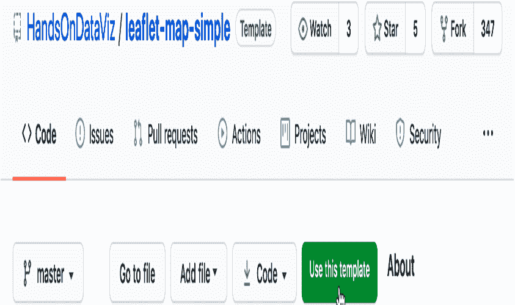

- 4. 在下一个屏幕上，你的账户将显示为所有者。将你的仓库副本命名为 *leaflet-map-simple*，与我们的一样。点击绿色的“从模板创建仓库”按钮。

下一个屏幕的左上角会显示 *USERNAME/leaflet-map-simple* 生成自 *HandsOnDataViz/leaflet-map-simple*，其中 *USERNAME* 指的是你的GitHub账户用户名。这确认了你已将我们的模板复制到你的GitHub账户中，并且它只包含三个文件：

- *LICENSE* — 表示我们选择了MIT许可证，它允许任何人随意复制和修改代码

- *README.md* — 提供简单的说明和实际演示的链接，我们稍后会回到这里

- *index.html* — 这个特定模板中的关键文件，因为它包含地图代码

从 leaflet-map-simple 创建新仓库

新仓库将包含与 HandsOnDataViz/leaflet-map-simple 相同的文件和文件夹。

优秀的仓库名称简短且令人难忘。需要灵感吗？不妨试试 ubiquitous-disco？

| 界面元素 | 内容 |
|----------|------|
| 所有者 * | HandsOnDemo |
| 仓库名称 * | leaflet-map-simple |
| 描述（可选） | |
| 公开 | 互联网上的任何人都可以看到此仓库。你可以选择谁能提交。 |
| 私有 | 你可以选择谁能查看并向此仓库提交。 |
| 包含所有分支 | 复制 HandsOnDataViz/leaflet-map-simple 的所有分支，而不仅仅是 master。 |
| 从模板创建仓库 | |


# 注意事项

我们使用 GitHub 的模板功能来设置仓库，以便用户更容易创建自己的副本。如果你想复制别人的 GitHub 仓库却看不到模板按钮，请点击 Fork 按钮，这会以另一种方式创建副本。区别在于：模板允许你通过赋予不同名称来创建同一仓库的多个副本，而 Fork 只允许你创建一份副本，因为它使用与原仓库相同的名称，而 GitHub 阻止你创建两个同名仓库。如果你需要为 GitHub 仓库创建第二个 Fork，请前往“在 GitHub 上创建新仓库并上传文件”。

5. 点击 *index.html* 文件查看代码。如果这是你第一次查看计算机代码，可能会觉得 overwhelming，但放松！我们插入了几个“代码注释”来解释正在发生的事情。第一个代码块告诉 Web 浏览器对代码页的其余部分应用哪些格式。第二个代码块指示浏览器加载 **Leaflet** 代码库，即构建交互式地图的开源软件。第三个代码块描述地图和标题应如何定位在屏幕上。好消息是，你不需要触碰这些代码块，所以保持原样即可。但你需要修改几行。

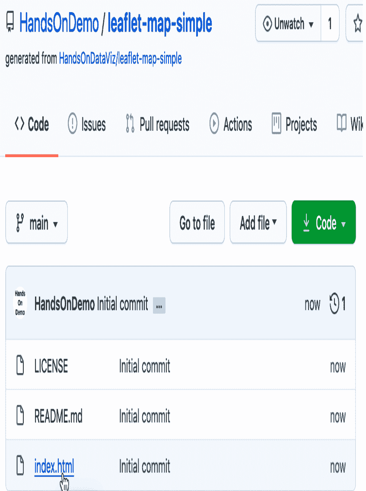

6. 要编辑代码，请点击右上角的铅笔符号（✎）。

让我们先做一个简单的更改来证明你现在正在编辑地图，通过修改地图标题，该标题出现在大约第 21 到 23 行的 HTML division 标签块中。

+   7. 在行 <div id="map-title">EDIT your map title</div> 中，将新地图标题输入到 EDIT your map title 的位置。请注意不要删除 < > 符号内两端的 HTML 标签。

+   8. 要保存你的编辑，请滚动到页面底部并点击绿色的“Commit changes”按钮。

# Commit changes

Update index.html

Add an optional extended description...

Commit directly to the master branch.

Create a new branch for this commit and start a pull request.

Commit changes
Cancel

在程序员的语言中，我们“提交”更改，就像大多数人“保存”文档一样，以后你会看到 GitHub 如何跟踪每次代码提交，以便在需要时回滚。默认情况下，GitHub 将提交的简短描述插入为“Update index.html”，当你开始大量提交以跟踪工作时，你可以选择自定义该描述。此外，GitHub 将你的更改直接提交到代码的默认分支，我们稍后会解释。

# 提示

如果你希望将代码存储在 GitHub 上，但需要扩展到更大规模的商业级 Web 主机，请查看诸如 Netlify 之类的 freemium 服务。Netlify 会自动检测你推送到 GitHub 仓库的任何更改并将其部署到你的在线站点。

现在让我们将你编辑的地图发布到公共网络上，看看它在 Web 浏览器中的显示效果。GitHub 不仅存储开源代码，其内置的 GitHub Pages 功能还允许你托管 HTML 为基础代码的实时在线版本，任何拥有 Web 地址的人都可以在其浏览器中查看。虽然 GitHub Pages 免费使用，但对其使用、文件大小和内容有一些限制，并且不适用于运营在线业务或商业交易。但代码模板的一个优势是，你可以将其托管在你控制的任何 Web 服务器上。由于我们已经使用 GitHub 来存储和编辑代码模板，因此打开 GitHub Pages 在线托管它非常容易。

1. 要访问 GitHub Pages，请滚动到仓库页面的顶部并点击 Settings。

2. 在 Settings 屏幕中，向下滚动到 GitHub Pages 区域。在下拉菜单中，将 Source 从 None 改为 Main，保持中间默认的 /(root) 选项不变，然后按 Save。此步骤告诉 GitHub 在公共网络上发布你地图的实时版本，任何拥有 Web 地址的人都可以在其浏览器中访问。

# GitHub Pages

GitHub Pages 旨在托管你的个人、组织

# Source

GitHub Pages 目前已禁用。请在下方选择源

Branch: main

/ (root)

Save

# Select branch

Select branch

main

None

# 提示

作为对 2020 年 Black Lives Matter 运动的回应，GitHub 将其默认分支从 master 重命名为 main，以消除其 master-slave 隐喻。

3. 向下滚动到 Settings > GitHub Pages 以查看你的实时地图已在线发布的 Web 地址，并右键单击它以在新浏览器标签页中打开。

# GitHub Pages

GitHub Pages 旨在从 GitHub 仓库托管你的个人、组织或项目页面。

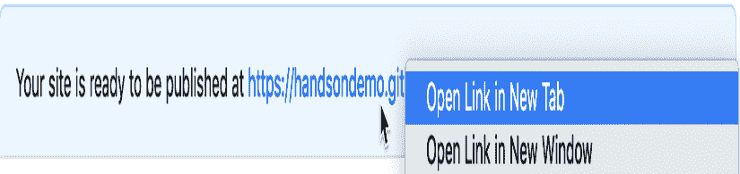

现在你应该在浏览器中至少打开了两个标签页。第一个标签页包含你的 GitHub 仓库，你在其中编辑代码，其 Web 地址格式如下。 将 USERNAME 和 REPOSITORY 替换为你自己的：

```
https://github.com/USERNAME/REPOSITORY
```

第二个标签页包含你的 GitHub Pages 实时网站，你的编辑代码在线显示。GitHub Pages 自动生成以下格式的公共 Web 地址：

```
https://USERNAME.github.io/REPOSITORY
```

# 注意事项

你的代码的实时版本默认指向 index.html 页面，因此在 Web 地址中包含它是不必要的。

还记得我们建议你不要使用像 DrunkBrownieChef6789 这样的用户名创建账户吗？GitHub 会自动将你的用户名放在公共 Web 地址中。

保持两个标签页打开，以便你可以在编辑代码和查看在线实时结果之间轻松切换。

# 提示

GitHub Pages 通常在 30 秒内显示你的实时地图，但在某些情况下可能需要几分钟。如果一分钟后仍未看到更改，请给浏览器做一次“硬刷新”以绕过缓存中保存的内容并重新从服务器下载整个网页，使用以下其中一种键组合：

+   - Ctrl+F5（适用于 Windows 或 Linux 的大多数浏览器）
+   - Command-Shift-R（适用于 Mac 的 Chrome 或 Firefox）
+   - Shift-Reload 按钮工具栏（适用于 Mac 的 Safari）
+   - Ctrl+Shift+Backspace（适用于 Chromebook）

现在让我们编辑 GitHub 仓库，以便链接指向 *你的* 实时地图，而不是 *我们的* 实时地图：

+   1. 从第二个浏览器标签页复制你的实时地图 Web 地址。
+   2. 返回到包含你 GitHub 仓库的第一个浏览器标签页，并点击仓库标题返回其主页。
+   3. 在你的仓库页面上，点击打开 README.md 文件，再次点击铅笔编辑它。将你的实时 Web 链接粘贴在标签 (*replace with link to your site*) 下方，然后向下滚动以提交更改。

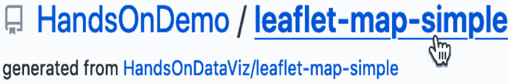

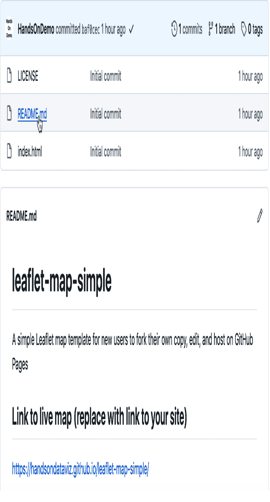

# # leaflet-map-simple

一个简单的 leaflet 地图模板，供新用户 Fork 自己的副本、编辑并托管在 GitHub Pages 上

# ## Link to live map (replace with link to your site)

[https://handsondataviz.github.io/leaflet-map-simple/](https://handsondataviz.github.io/leaflet-map-simple/)

现在你已成功进行简单编辑并发布了实时地图，让我们进行更多编辑来让它更精彩，并帮助你了解更多关于 Leaflet 代码的工作原理。

+   4. 在你的仓库主页上，点击打开 `index.html` 文件，并点击铅笔符号编辑更多代码。

每当你看到 EDIT 代码注释时，这就指出了你可以轻松修改的一行。例如，查找下面设置地图初始中心点及其缩放级别的代码块。插入新的纬度和经度坐标以设置新的中心点。要查找坐标，请在 Google 地图上右键单击任意点并选择“What's here?”，如“在 Google 表格中地理编码地址”所述。

```
var map = L.map('map', {
    center: [41.77, -72.69], // EDIT coordinates to recenter map
    zoom: 12,  // EDIT from 1 (zoomed out) to 18 (zoomed in)
    scrollWheelZoom: false,
    tap: false
});
```

下一个代码块显示用作地图背景的基础地图图块层。我们的模板使用带有所有标签的浅色地图，由 CARTO 公开提供，并归功于 OpenStreetMap。一个简单的编辑是将 `light_all` 更改为 `dark_all`，这将替换为具有反转配色的不同 CARTO 底图。或者预览几个其他 Leaflet 底图代码选项供你复制粘贴。确保注明来源，并保留此代码块末尾的 `}) .addTo(map);`，以显示底图：

```
L.tileLayer(
    'https://{s}.basemaps.cartocdn.com/light_all/{z}/{x}/{y}{r}.png', {
    attribution: '&copy; <a href="https://osm.org/copyright">\
OpenStreetMap</a> contributors, &copy;\
<a href="https://carto.com/attribution">CARTO</a>'
    }).addTo(map);
```

最后一个代码块在地图上显示一个单点标记，默认在 Leaflet 中为蓝色，并在用户点击时弹出消息。你可以编辑标记坐标、插入弹出文本，或复制粘贴代码块以创建第二个标记：

```
L.marker([41.77, -72.69]).addTo(map) // EDIT marker coordinates
    .bindPopup("Insert pop-up text here"); // EDIT pop-up text message
```

> **警告**
> 
> 编辑代码时要小心。意外删除或添加额外的标点符号（如引号、逗号或分号）可能会导致你的地图无法工作。但破坏代码并修复它也可以成为学习的好方法。

+   5. 进行编辑后，记得向下滚动并按 Commit 保存更改。然后转到浏览器中包含实时地图的标签页，并执行硬刷新以查看更改。对地图的编辑通常会在 30 秒内出现，但请记住 GitHub Pages 有时需要更长时间来处理代码提交。如果出现问题，请参阅附录。

恭喜！如果这是你第一次编辑计算机代码并将其托管在线，你现在可以称自己为“程序员”。这个过程类似于遵循和修改食谱，就像你也可以在烤出第一批布朗尼后称自己为“厨师”一样！虽然在这个早期阶段不太可能有人会聘请你作为全职付费程序员（或厨师），但你现在已经了解了复制、编辑和在线托管代码所需的基本技能之一，你已准备好深入研究更高级的版本，例如第 11 章中的 Chart.js 和 Highcharts 模板以及第 12 章中的 Leaflet 地图模板。

# 将 GitHub Pages 链接转换为 Iframe

在第 9 章中，我们讨论了从主站点显示交互式内容并使其无缝出现在次要站点的好处。你还学习了如何将非常长的 Datawrapper 和 Tableau Public 嵌入代码转换为较短的 iframe 标签，以便在需要时更轻松地将其嵌入到次要网站。

同样的概念也适用于 GitHub Pages。当你在 GitHub Pages 上发布图表或地图（或任何内容）的代码模板时，它会生成一个在线链接，你可以使用与上述相同的原则将其转换为 iframe 标签，以便将其嵌入到次要网站。按照以下步骤操作：

+   1. 对于你已在线发布的任何 GitHub 仓库，请转到其 *Settings* 页面并向下滚动以复制其 GitHub Pages Web 地址，该地址将以以下通用格式出现：

```
https://USERNAME.github.io/REPOSITORY
```


+   2. 将链接用引号括起来作为源，并添加开始和结束标签，将其转换为 iframe，格式如下：

```
<iframe src="https://USERNAME.github.io/REPOSITORY"></iframe>
```

+   3. 如需改善 iframe 在二级站点上的外观，可添加以下任一可选属性，例如 `width` 或 `height`（默认以像素为单位，或百分比），或 `frameborder="0"` 或 `scrolling="no"`，格式如下：

```
<iframe src="https://USERNAME.github.io/REPOSITORY" width="100%"
height="400" frameborder="0" scrolling="no"></iframe>
```

> **TIP**
> 
> 在你的 iframe 代码中，使用单引号 (`'`) 或双引号 (`"`) 均可，但请保持一致，并避免意外粘贴花体引号 (`“”`)。

现在你已准备好将 iframe 粘贴到你喜欢的网站（“Paste Code or iframe to a Website”），使用第 9 章中描述的方法，从使用 GitHub Pages 发布 的仓库中显示你的交互式图表或地图模板。

你应该对如何在 GitHub 上编辑和托管代码仓库有了更好的了解。下一节将介绍如何通过创建新仓库并上传文件来提升你的 GitHub 技能。这些是创建代码模板的第二个副本或在接下来的两章中使用更高级模板所必不可少的步骤。

## Create a New Repo and Upload Files on GitHub

现在你已经复制了我们的 GitHub 模板，下一步是学习如何创建全新的仓库并上传文件。这些技能在多种场景下都很有帮助。首先，如果你需要 fork 一个仓库，而 GitHub 只允许你 fork 一次，这种方法将允许你创建额外的副本。其次，在第 11 章使用 Chart.js 和 Highcharts 模板创建数据可视化，以及第 12 章使用 Leaflet 地图模板时，你需要上传一些自己的文件。同样，我们将演示如何在 GitHub 的初学者级浏览器界面中完成所有这些步骤，但请参阅“GitHub Desktop and Atom Text Editor to Code Efficiently”，以了解更高效地处理代码模板的中级界面。

在上一节中，你使用“Use this template”按钮创建了我们 GitHub 仓库的副本，我们有意使用此较新的功能设置我们的仓库，因为它允许用户创建 *多个* 副本并为每个副本指定不同的名称。许多其他 GitHub 仓库不包含模板按钮，因此要复制这些仓库，你需要点击 Fork 按钮，它会自动生成一个与原始仓库名称相同的副本的副本。但如果你想第二次 fork 某人的仓库怎么办？GitHub 阻止你创建第二个 fork，以避免违反其重要规则之一：你账户中的每个仓库必须具有唯一名称，以避免覆盖和擦除你的工作。

如果没有“Use this template”按钮，如何对 GitHub 仓库进行第二次 fork？请遵循我们在以下三个步骤中总结的推荐变通方法：

+   1. 将现有的 GitHub 仓库下载到你的本地计算机。
+   2. 使用新名称创建全新的 GitHub 仓库。
+   3. 将现有的代码仓库文件上传到你的全新仓库。

现在让我们更详细地了解这个三步变通方法：

+   1. 点击任意仓库上的 Code > Download ZIP 下拉菜单按钮。你的浏览器将下载一个包含仓库内容的压缩文件夹到你的本地计算机，并可能询问你希望将其保存到何处。选择一个位置并点击 OK。

## Clone with HTTPS

Use SSH

Use Git or checkout with SVN using the web URL.

```
https://github.com/HandsOnDemo/leaf
```

## Open with GitHub Desktop

## Download ZIP

2. 导航到你计算机上保存文件夹的位置。其文件名应以 .zip 结尾，这意味着你需要双击“解压”或解压缩文件夹（或对于 Windows 用户，右键单击并选择 Extract All）。解压后，将出现一个新文件夹，其名称格式为 REPOSITORY-BRANCH，其中指的是仓库名称（例如 leaf-let-map-simple）和分支名称（例如 main），其中包含仓库文件。其中一个文件名为 index.html，你将在几步后使用它。

3. 返回浏览器中的 GitHub 账户，点击账户右上角的加号 (+) 符号，然后选择“New repository。”

### Create a new repository

A repository contains all project files, including the revision history. Already have a repository elsewhere? [Import a repository](#).

#### Repository template

Start your repository with a template repository's contents.

**No template**

#### Owner *

HandsOnDemo

#### Repository name *

practice

Great repository names are short and memorable. Need inspiration?

#### Description (optional)

+   - **Public**  
+     Anyone on the internet can see this repository. You choose who can contribute.
+   - **Private**  
+     You choose who can see and commit to this repository.

Skip this step if you’re importing an existing repository.

+   - [x] **Initialize this repository with a README**  
+     This will let you immediately clone the repository to your computer.

**Add .gitignore: None**

**Add a license: MIT License**

**Create repository**

4. 在下一屏幕上，GitHub 会要求你输入新的仓库名称。选择一个简短的名称，最好全部小写，如果需要，用连字符分隔单词。让我们将其命名为 practice，因为我们将在本教程结束时删除它。

选中“Initialize this repository with a README”复选框以简化下一步。

此外，选择“Add a license”以匹配你计划上传的代码，在本例中为 MIT License。其他字段为可选。完成后点击底部的绿色“Create repository”按钮。

## Are you absolutely sure?

Unexpected bad things will happen if you don't read this!

This action **cannot** be undone. This will permanently delete the **HandsOnDemo/practice** repository, wiki, issues, comments, packages, secrets, workflow runs, and remove all collaborator associations.

Please type **HandsOnDemo/practice** to confirm.

I understand the consequences, delete this repository

到目前为止，你已经学会了如何使用 GitHub 网页界面复制、编辑和托管代码，这对于初学者来说是一个很好的入门。你已准备好升级到将允许你更高效地使用 GitHub 的工具，例如 GitHub Desktop 和 Atom 文本编辑器，以快速将整个仓库移动到你的本地计算机，编辑代码，然后将其移回在线。

## GitHub Desktop and Atom Text Editor to Code Efficiently

通过 GitHub 网页界面编辑代码是开始的好方法，特别是如果你只需要进行少量编辑或向仓库上传几份文件。但如果在仓库中编辑或上传多个文件，网页界面会感觉非常慢。为了加快工作，我们建议你下载两个免费工具——GitHub Desktop 和 Atom 文本编辑器——它们可在 Mac 或 Windows 计算机上运行。当你将 GitHub 网页账户连接到 GitHub Desktop 时，它允许你“pull”代码的最新版本到你的本地计算机硬盘上，进行编辑和测试，然后“push”你的提交回 GitHub 网页账户。Atom 文本编辑器也是 GitHub 的制造商创建的，它允许你在本地计算机上更轻松地查看和编辑代码仓库，而不是 GitHub 网页界面。虽然有许多供编码者使用的文本编辑器，但 Atom 旨在与 GitHub Desktop 良好配合。

> TIP
> 目前，GitHub Desktop 和 Atom 文本编辑器均不支持 Chromebook，但 Chrome 的网上应用店提供了一些文本编辑器，例如 Text 和 Caret，它们提供下面描述的一些功能。

让我们使用 GitHub Desktop 将你的 leafet-map-simple 模板的副本拉取到你的本地计算机，在 Atom 文本编辑器中进行一些编辑，然后将提交推送回 GitHub：

+   1. 转到你希望复制到本地计算机的 GitHub 网页仓库。在浏览器中，导航到 https://github.com/USERNAME/leaflet-map-simple，使用你的 GitHub 用户名，以访问你在“Copy, Edit, and Host a Simple Leaflet Map Template”中创建的仓库。点击屏幕中间附近的 Code > “Open with GitHub Desktop”下拉菜单按钮。下一个屏幕将显示 GitHub Desktop 网页的链接，你应该下载并安装该应用程序。

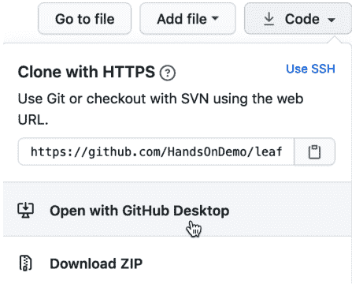

+   2. 当你第一次打开 GitHub Desktop 时，你需要将其连接到你在本章中之前创建的 GitHub 网页账户。在欢迎屏幕上，点击蓝色的“Sign in to GitHub.com”按钮，并使用你的 GitHub 用户名和密码登录。在下一个屏幕上，GitHub 会要求你点击绿色的“Authorize desktop”按钮以确认你希望连接到你的账户。


# 欢迎使用
GitHub Desktop

GitHub Desktop 是一种无缝方式，可让您参与 GitHub 和 GitHub Enterprise Server 上的项目。请在下方登录以开始使用您现有的项目。

GitHub 新用户？创建免费账户。

登录 GitHub.com

3. 在下一个设置界面中，GitHub Desktop 会要求您配置 Git——运行 GitHub 的底层软件。确认它显示您的用户名，然后点击“继续”。

# 配置 Git

此信息用于标识您创建的提交。如果您发布了提交，任何人都可以看到此信息。

姓名

HandsOnDemo

邮箱

66479711+HandsOnDemo@users.noreply.github.com

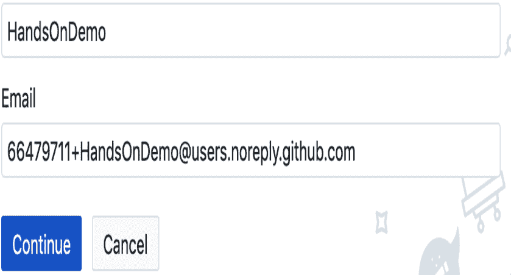

4. 在“开始使用 GitHub Desktop”界面中，点击右侧的“您的仓库”以选择您的 `leaflet-map-sample`，再往下，点击蓝色按钮将其*克隆*到您的本地计算机。

# 让我们开始吧！

添加一个仓库到 GitHub Desktop 以开始协作

创建教程仓库...

从互联网克隆仓库...

在硬盘上创建新仓库...

从硬盘添加现有仓库...

筛选您的仓库

# 您的仓库

HandsOnDemo/leaflet-map-simple

克隆 HandsOnDemo/leaflet-map-simple

> 专业提示！您可以拖放现有仓库文件夹到此处以添加到 Desktop

5. 当您克隆仓库时，GitHub Desktop 会要求您选择“本地路径”，即您希望将 GitHub 仓库副本存储在本地计算机上的位置。在点击“克隆”按钮之前，请记住此位置的路径，因为稍后您需要找到它。

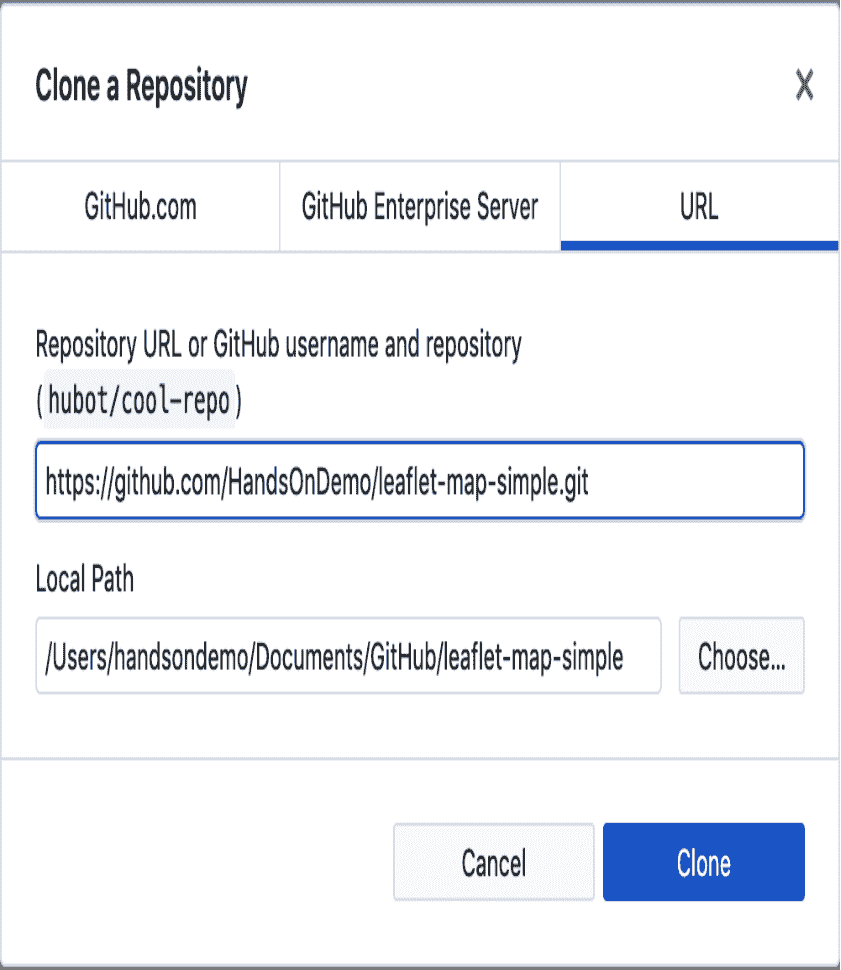

6. 在下一个界面中，GitHub Desktop 可能会询问：“您打算如何使用此分叉？”选择默认选项“为父项目做贡献”，这意味着您打算将编辑内容发送回您的 GitHub 网页账户，然后点击“继续”。

# HandsOnDemo / leaflet-map-simple 模板

分叉自 HandsOnDataViz/leaflet-map-simple

+   代码
+   拉取请求
+   操作
+   项目
+   维基
+   安全
+   洞察
+   设置

分支：master

+   转到文件
+   添加文件
+   代码
+   使用此模板
+   关于

此分支与

JackDougherty

+   LICENSE
+   README.md
+   index.html

leaflet-map-simple

+   收藏
+   隔空投送
+   最近使用
+   应用程序
+   桌面
+   文稿
+   下载

+   GitHub
+   leaflet-map-simple
+   index.html
+   LICENSE
+   README.md

8. 在编辑本地计算机上的代码之前，请下载并安装 Atom 文本编辑器应用程序。然后转到您的 GitHub Desktop 界面，确认当前仓库为 leaflet-map-simple，并点击“在 Atom 中打开”。

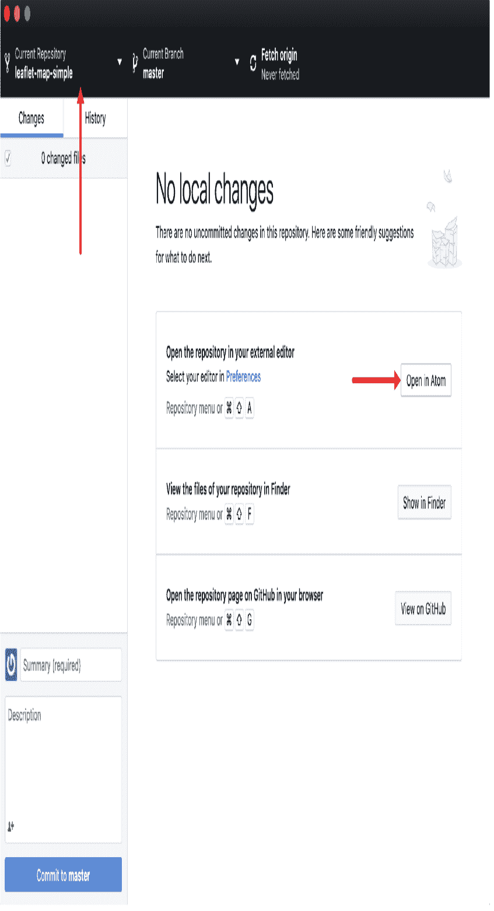

9. 由于 Atom 文本编辑器与 GitHub Desktop 集成，它会将您的整个仓库作为“项目”打开，您可以在左侧窗口中点击文件，以新标签页的形式打开以查看和编辑代码。打开您的 *index.html* 文件，在第 22 行附近编辑地图标题，然后保存您的工作。

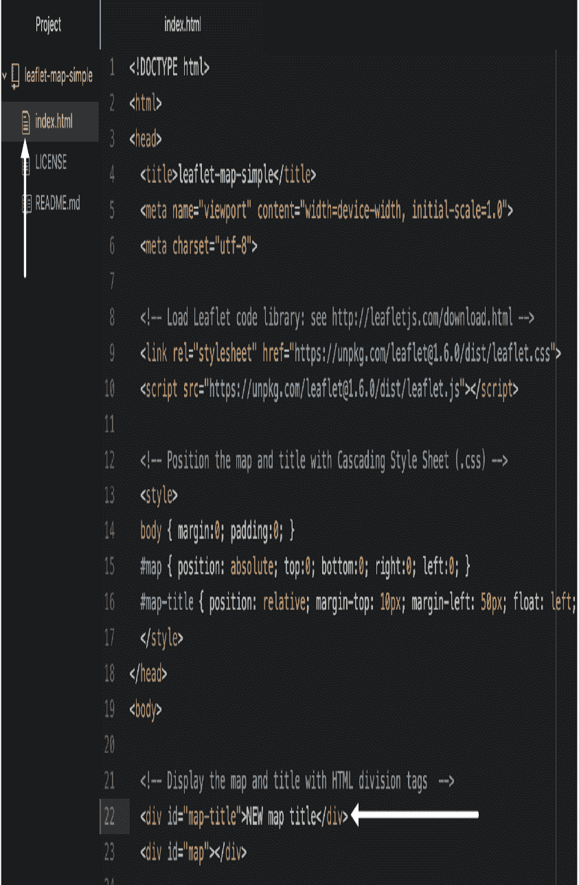

```html
<!DOCTYPE html>
<html>
<head>
  <title>Leaflet-map-simple</title>
  <meta name="viewport" content="width=device-width, initial-scale=1.0">
  <meta charset="utf-8">

  <!-- Load Leaflet code library see http://leafletjs.com/download.html -->
  <link rel="stylesheet" href="https://unpkg.com/leaflet@1.6.0/dist/leaflet.css">
  <script src="https://unpkg.com/leaflet@1.6.0/dist/leaflet.js"></script>

  <!-- Position the map and title with Cascading Style Sheet (.css) -->
  <style>
    body { margin:0; padding:0; }
    #map { position:absolute; top:0; bottom:0; right:0; left:0; }
    #map-title { position: relative; margin-top: 10px; margin-left: 50px; float: left; }
  </style>
</head>
<body>

  <!-- Display the map and title with HTML division tags -->
  <div id="map-title">New Map title</div>
  <div id="map"></div>
</body>
</html>
```

10. 保存代码编辑后，一个好习惯是清理您的 Atom 文本编辑器工作区。右键单击当前的“项目”，在菜单中选择“移除项目文件夹”。下次打开 Atom 时，您可以右键单击以“添加项目文件夹”，并选择您已复制到本地计算机的任何 GitHub 仓库。

+   新建文件  A
+   新建文件夹  ⇧A
+   重命名  F2
+   复制副本  D
+   删除  ⌫
+   拷贝  ⌘C
+   剪切  ⌘X
+   粘贴  ⌘V
+   添加项目文件夹  ⇧⌘O
+   移除项目文件夹
+   折叠所有项目文件夹

# 项目

leaflet-ma

.git

index.h

LICENS

READM

# README.m

# 演示：使用 Google Sheets 的 Leaflet 地图 v. 1

探索东海岸绿道

# 示例点

+   - 参观
+   - 美食

# 示例折线：
绿道路线

# 示例多边形：
按县的人口密度

图 10-2. 要使用 Safari 在本地计算机上查看更复杂的代码模板，请临时禁用跨源限制。

还有一些方法可以在各种计算机上运行没有同源限制的 Chrome 浏览器，如图 10-3 所示，也在这个热门的 Stack Overflow 页面上讨论过。如果您在浏览器中临时禁用此安全机制，请务必在浏览公共网站之前重新启用它。

您正在使用不受支持的命令行标志：--disable-web-security...

# 演示：使用 Google Sheets 的 Leaflet 地图 v. 1.2.0

探索东海岸绿道

# 示例点

+   - 参观
+   - 美食

# 示例折线：
绿道路线

# 示例多边形：
按县的人口密度

数据由添加您的名字提供 | 代码由 HandsOnDataViz 使用 Leaflet 提供 | © OpenStreetMap 贡献者 © CARTO

上次登录：Sat Jan  9 10:42:24 于 ttys000

```
(base) JackMBP2016:~ jdoughe2$ open -n -a /Applications/Google\ Chrome.app /Contents/MacOS/Google\ Chrome --args --user-data-dir="/tmp/chrome_dev_test" --disable-web-security
```

图 10-3. 要使用 Chrome 在本地计算机上查看更复杂的代码模板，请使用终端应用程序的命令行（底部窗口）运行一个没有同源安全限制的版本。

既然您已经在本地计算机上编辑了地图代码，让我们在上传到 GitHub 之前测试一下它的外观：

+   11. 转到您在本地计算机上保存仓库的位置，右键单击 index.html 文件，选择“打开方式”，然后选择您喜欢的网页浏览器。

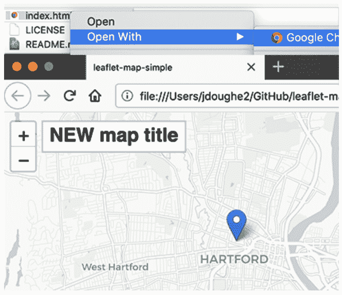

注意

由于您的浏览器只显示代码的本地计算机版本，网址将以 file:///… 开头，而不是像 GitHub Pages 在线地图中那样以 https://… 开头。此外，如果您的代码依赖在线元素，这些功能在本地查看时可能无法正常工作。对于这个简单的 Leaflet 地图模板，您更新的地图标题应该会出现，让您可以在将编辑内容推送到网页之前检查其外观。

现在，让我们将您的编辑内容从本地计算机传输到您的 GitHub 网页账户，您之前在设置 GitHub Desktop 时已连接了该账户。

+   12. 转到 GitHub Desktop，确认当前仓库是 leaflet-map-simple，您会看到屏幕上有您代码编辑的摘要。在这个两步过程中，首先点击页面底部的蓝色“提交”按钮，将您的编辑保存到仓库的本地副本中。（如果您编辑了多个文件，GitHub Desktop 会要求您编写编辑摘要，以帮助您跟踪工作。）其次，点击蓝色的“推送到源”按钮，将这些编辑传输到您 GitHub 网页账户上的仓库父副本。这两个步骤都在此处显示。

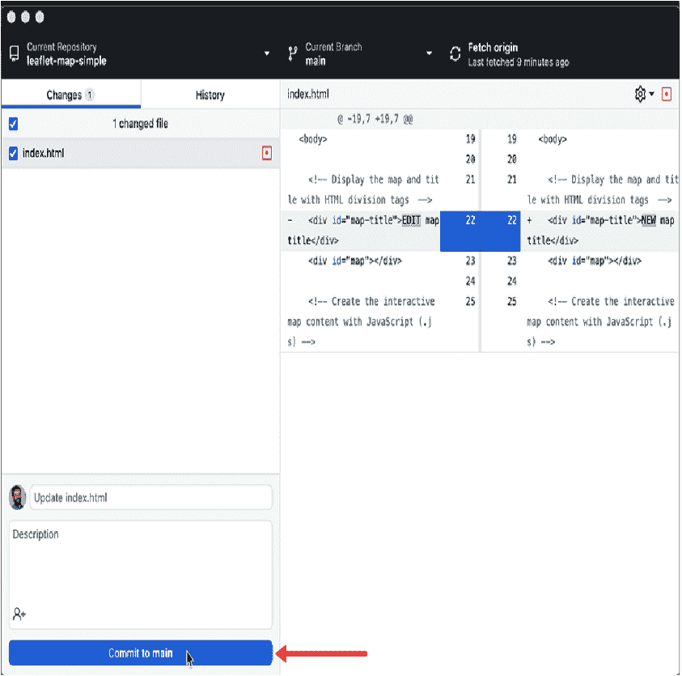

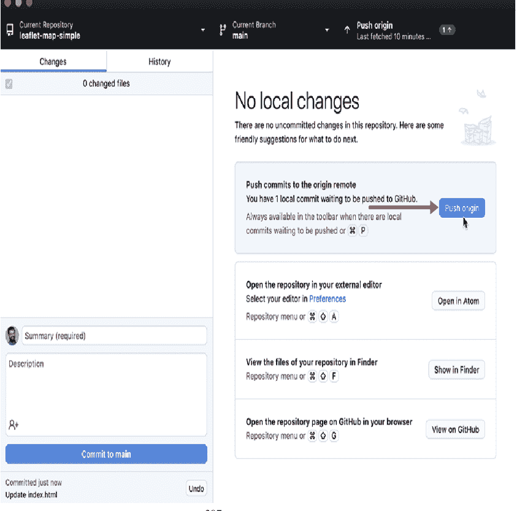

做得好！您已经成功地完成了一次代码往返之旅：从您的 GitHub 账户到本地计算机，然后又回到 GitHub。既然您之前使用了 GitHub Pages 设置来创建代码的在线版本，请去看看您编辑的地图标题现在是否出现在公共网页上。您之前设置的网址遵循此格式 https://USERNAME.github.io/REPOSITORY，请将 USERNAME 和 REPOSITORY 替换为您的 GitHub 用户名和仓库名。

虽然您可以在 GitHub 网页界面中进行上述微小的代码编辑，但希望您已经看到使用 GitHub Desktop 和 Atom 文本编辑器在本地计算机上编辑代码并推送提交的许多优势。首先，您可以使用 Atom 进行更复杂的代码修改，Atom 包含搜索、查找和替换以及其他功能，可提高工作效率。其次，当您将仓库复制到本地计算机时，您可以快速拖放多个文件和子文件夹，以创建复杂的可视化内容，例如数据、地理和图像。第三，根据代码类型，您可以在将提交上传到公共网页之前，使用浏览器在本地测试其运行情况。

> 提示
> 
> Atom 有许多内置命令可帮助您编辑代码。一个是“视图 > 切换软换行”，它会调整右边距，使较长的代码字符串可见。另一个是“编辑 > 切换注释”，它会自动检测编码语言，并将选中的文本从可执行代码转换为非执行的代码注释。第三个命令是“编辑 > 行 > 自动缩进”，它会清理代码缩进，使其更易读。您可以从“偏好设置”菜单中安装更多 Atom 包。

GitHub 还提供了一个强大的协作项目平台。当两个人处理同一个仓库时，一位同事可以使用 GitHub Desktop 将代码的最新版本拉取到他们的本地计算机，然后将他们的编辑（也称为提交）推送回在线 GitHub 仓库。另一位同事可以同时从同一仓库拉取和推送，不过如果他们处理不同的文件或代码部分，会更简单。两人都可以通过选择 GitHub 仓库的“代码”选项卡并选择特定的提交来查看对方所做的更改，这些更改可以逐行查看，绿色表示添加，红色表示删除，如图 10-4 所示。

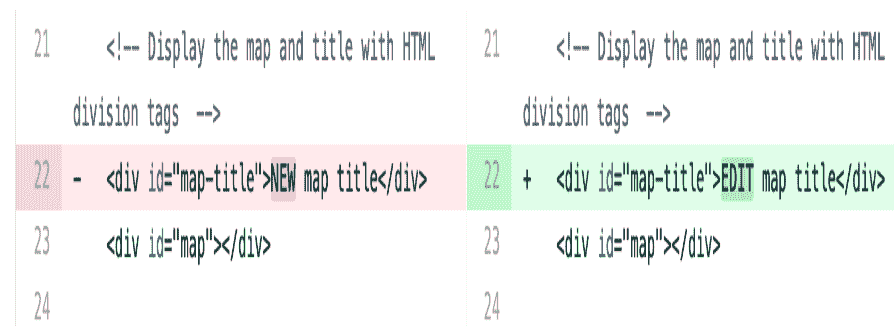

图 10-4. 查看同事在共享 GitHub 仓库上所做的提交。

尽管 GitHub 不像 Google Docs 那样显示实时编辑，但该平台在协作处理代码时具有多项优势。首先，由于 GitHub 会跟踪每次提交，您可以返回并视需要恢复代码的特定历史版本。其次，当 GitHub 仓库是公共仓库时，任何人都可以查看您的代码并提交问题（issue），以向所有者通知想法或问题，或者发送建议代码编辑的拉取请求，所有者可以接受或拒绝。第三，GitHub 允许您创建仓库的不同分支进行编辑，然后在需要时将分支合并回一起。偶尔，如果两个协作者尝试向同一仓库推送不兼容的提交，GitHub 会发出合并冲突警告，并要求您解决冲突，以保留每个人的工作。

许多编码者更喜欢使用 GitHub 的命令行界面（CLI）在 GitHub 上工作，这意味着在 Mac 或 Windows 上的终端应用程序中直接记忆和输入特定命令，但这超出了这本入门书的范围。

# 摘要

如果这是您第一次在公共网页上分叉、编辑和托管实时代码，欢迎加入编程大家庭！我们希望您也认为 GitHub 是一个强大的平台，可以用来参与这项工作并与他人分享。初学者会喜欢网页界面，您会发现 GitHub Desktop 和 Atom 工具使第 11 章中的 Chart.js 和 Highcharts 代码模板以及第 12 章中的 Leaflet 地图代码模板更容易使用。让我们在这些全新的编码技能基础上，在接下来的两章中创建更多定制化的图表和地图。


