# 第11章 Chart.js 和 Highcharts 模板

在第6章中，我们研究了强大的拖放工具，例如 Google Sheets、Datawrapper 和 Tableau Public 来构建交互式图表。

在本章中，我们将研究使用两个流行的 JavaScript 库 Chart.js 和 Highcharts 创建交互式图表。由于我们不期望读者精通 JavaScript 或任何其他编程语言，因此我们设计了模板，您可以将其复制到自己的 GitHub 账户，替换数据文件，并在不编写一行代码的情况下将其发布到网络。对于那些对代码好奇的人，我们将展示如何自定义这些模板中的 JavaScript 代码。

为什么有人会更喜欢 JavaScript 而不是易于使用的 Datawrapper 或 Tableau，你可能会想知道？好吧，有几个原因。虽然 JavaScript 代码乍一看可能令人不知所措和令人生畏，但它允许在颜色、填充、交互性和数据处理方面进行更大的定制，而大多数第三方工具无法提供。此外，您永远无法确定第三方应用程序是否会永远保持免费，或者至少有免费层，而开源工具只要有人维护代码，就会永久免费存在。

> NOTE
> 
> 尽管两个库都是开源的，但 Highcharts 采用了更严格的许可证，仅允许将其免费用于非商业项目，例如个人、学校或非营利组织网站。考虑到这一点，我们主要关注 Chart.js，它采用 MIT 许可证分发，让您也可以将该库用于商业项目。

表 11-1 列出了本章中我们将要研究的各种图表类型。两个库都包含许多更多默认图表类型，您可以在 Chart.js Samples 和 Highcharts Demos 中探索。然而，我们强烈建议不要使用某些图表类型，例如三维图表，原因我们在第7章的图表设计原则部分讨论过。

## 表 11-1. 图表代码模板、最佳用途和教程

| Chart | Best use and tutorials in this book |
|---|---|
| Bar or column chart | Best to compare categories side-by-side. If labels are long, use horizontal bars instead of vertical columns. |
| Error bars in a bar/column chart | Best to show margin of error bars when comparing categories side-by-side. If labels are long, use horizontal bars instead of vertical columns. |

Bar or column chart

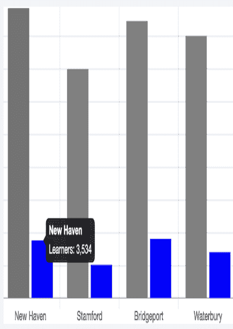

Best to compare categories side-by-side. If labels are long, use horizontal bars instead of vertical columns.

Power tool: “Bar or Column Chart with Chart.js”

Error bars in a bar/column chart

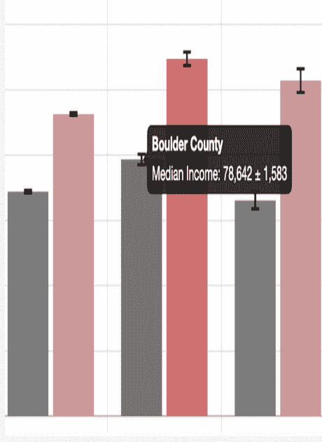

Best to show margin of error bars when comparing categories side-by-side. If labels are long, use horizontal bars instead of vertical columns.

Power tool: “Error Bars with Chart.js”

### Chart

#### Line chart

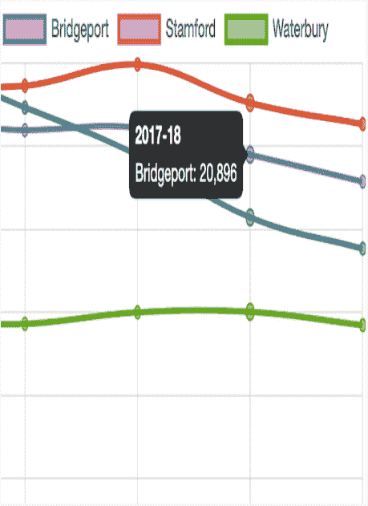

Best to show continuous data, such as change over time.

Power tool: “Line Chart with Chart.js” (see tutorial note to modify line chart into stacked area chart)

#### Annotated line chart

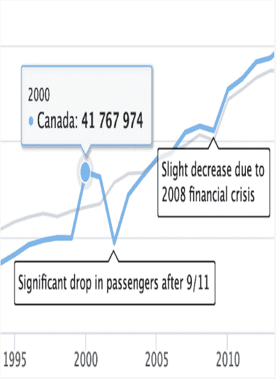

Best to add contextual notes inside chart of continuous data, such as change over time.

Power tool: “Annotated Line Chart with Highcharts”

#### Scatter chart

### Chart

Best use and tutorials in this book

Best to show the relationship between two datasets as x and y coordinates to reveal possible correlations.

Power tool: “Scatter Chart with Chart.js”

West Haven
Median Household Income, USD: $52,353
Grade, Relative to Average: -0.6

#### Bubble chart

Best to show the relationship between three or four sets of data, with x and y coordinates, bubble size, and color.

Power tool: “Bubble Chart with Chart.js”

East Hartford
Median Household Income, USD: $50,400
Grade, Relative to Average: -1.4
Enrollment: 7,053 students

## Bar or Column Chart with Chart.js

在本节中，我们将向您展示如何使用 Chart.js 创建条形图或柱形图。我们将使用一个 Chart.js 代码模板，该模板从 CSV 文件中提取数据，如图 11-1 所示。该柱形图显示了康涅狄格州五个学区在 2018-2019 学年中是英语学习者的学生人数。

### English Learners by Select School Districts in Connecticut, 2018-19

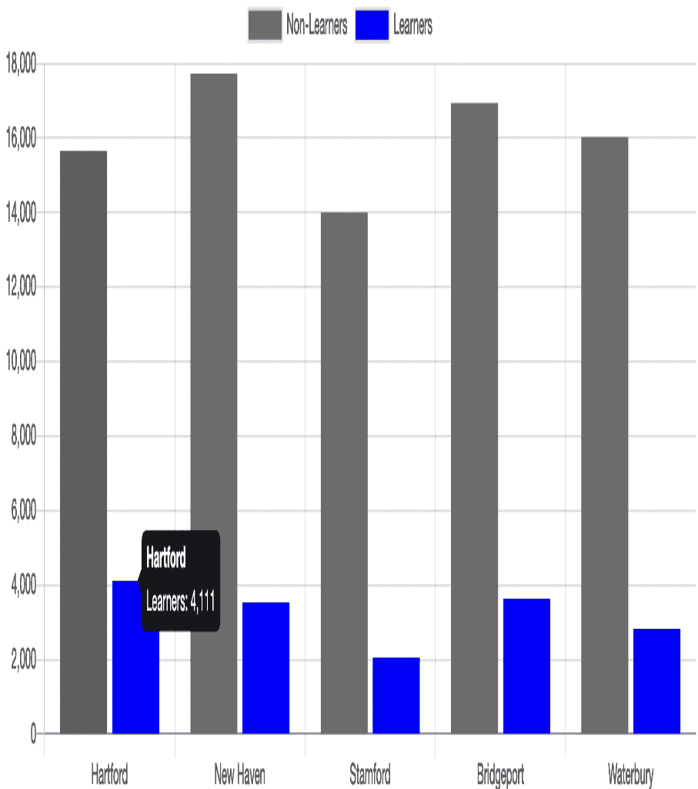

Source: CT Department of Education
Download data powering this visualization.

Figure 11-1. Bar chart with Chart.js: explore the interactive version.

要使用我们的 Chart.js 模板使用 CSV 数据创建自己的条形图或柱形图：

- 1. 前往包含图 11-1 中图表代码的 GitHub 仓库，登录您的 GitHub 账户，点击“Use this template”创建一个可编辑的副本。

## TEMPLATE FILE STRUCTURE

如果您不记得如何使用 GitHub，我们建议您重温 **Chapter 10**。该仓库包含三个与图表直接相关的文件：

*index.html*

包含 HTML（markdown）和 CSS（样式表），告诉浏览器如何设置包含图表的文档的样式以及加载哪些库。

*script.js*

包含从 CSV 文件读取数据并构建交互式图表的 JavaScript 代码。

*data.csv*

是存储图表中所有数据的逗号分隔文件，可以在文本编辑器或 Google Sheets/Excel 等中编辑。

其余两个文件是描述仓库内容的 *README.md* 和可在 README 中看到的图像 *bar.png*。本章中的所有其他 GitHub 模板结构都将类似。

- 2. 以 CSV 格式准备您的数据并上传到 *data.csv* 文件。将将沿轴显示的标签放在第一列中，每个数据系列放在自己的列中。您的 CSV 必须至少包含两列（标签和一个数据系列）。您可以添加任意数量的数据系列列。

| district | nonlearner | learner |
|---|---:|---:|
| Hartford | 15656 | 4111 |
| New Haven | 17730 | 3534 |

- 3. 在 *script.js* 中自定义变量的值。由于您可能不熟悉 JavaScript，让我们看一下文件中描述单个变量的代码片段：

```
// `false` for vertical column chart, `true` for horizontal bar chart
var HORIZONTAL = false;
```

第一行以 `//` 开头，是注释，帮助您理解下一行中变量的职责。它不影响代码。如您所见，如果变量 HORIZONTAL 设置为 *false*，图表将具有垂直条形（也称为柱形）。如果设置为 *true*，图表将包含水平条形。第二行包含变量声明本身。等号 (=) 将您在右侧看到的值（*false*）分配给左侧称为 HORIZONTAL 的变量（var）。该行以分号（;）结束。

以下是您可以在 *script.js* 中自定义的一些变量：

```
// `false` for vertical column chart, `true` for horizontal bar chart
var HORIZONTAL = false;

// `false` for individual bars, `true` for stacked bars
var STACKED = false;

// Which column defines 'bucket' names?
var LABELS = 'district';

// For each column representing a data series, define its name and color
var SERIES = [
  {
    column: 'nonlearner',
    name: 'Non-learners',
    color: 'gray'
  },
  {
    column: 'learner',
    name: 'Learners',
    color: 'blue'
  }
];

// x-axis label and label in tool tip
var X_AXIS = 'School Districts';

// y-axis label, label in tool tip
var Y_AXIS = 'Number of Enrolled Students';

// `true` to show the grid, `false` to hide
var SHOW_GRID = true;
```

```
// `true` to show the legend, `false` to hide
var SHOW_LEGEND = true;
```

这些基本变量应该足以让您入门。自然地，您会想要移动图例、编辑工具提示的外观或更改网格线的颜色。我们建议您查看官方 Chart.js 文档以获得帮助。

## Error Bars with Chart.js

如果您的数据带有不确定性（误差范围），我们建议您在可视化中使用误差线来显示。图 11-2 中显示的条形图模板显示了不同规模地理区域的中位数和平均（平均）收入：美国科罗拉多州、博尔德县、博尔德市以及该市的一个人口普查区。


## 2018年美国部分州的家庭收入

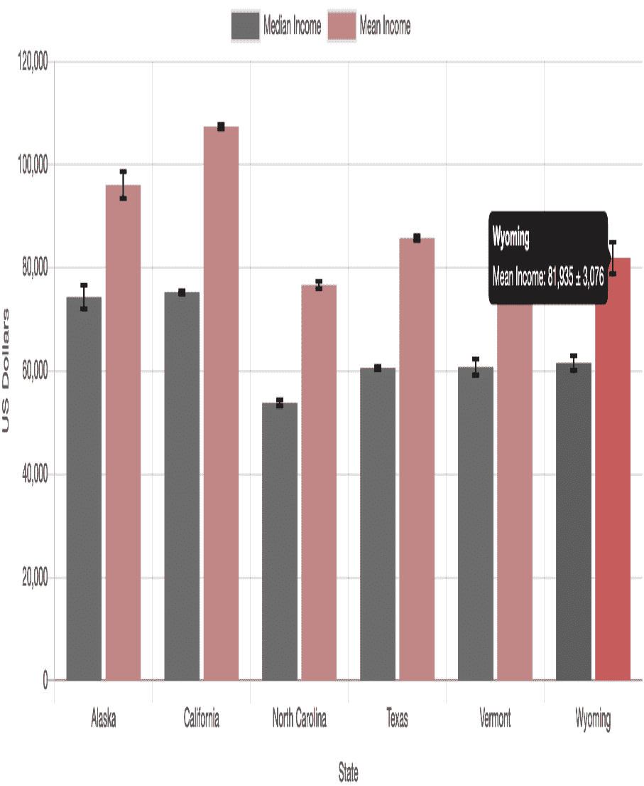

来源：美国人口普查，美国社区调查 2018 年（1 年估计）

下载驱动此可视化的数据。

图 11-2。Chart.js 中的交互式带误差条的条形图：探索交互式版本。

要创建自己的带误差条的条形图或柱状图，并从 CSV 文件加载数据，请使用我们的 Chart.js 模板并按照以下步骤操作：

- 1. 前往此 Chart.js 模板的 GitHub 仓库，该模板包含图 11-2 中图表的代码，登录你的 GitHub 账号，然后点击“Use this template”创建一个可编辑的副本。
- 2. 以 CSV 格式准备你的数据并上传到 data.csv 文件中。将沿轴显示的标签放在第一列中，每个数据系列放在其自己的列中（附带不确定性值列）。你的 CSV 必须至少包含三列（标签和一个带关联不确定性值的数据系列）。你可以添加任意数量的数据系列列。

| geo | median | median_moe | mean | mean_moe |
| --- | ---: | ---: | ---: | ---: |
| Colorado | 68811 | 364 | 92520 | 416 |
| Boulder County | 78642 | 1583 | 109466 | 2061 |
| Boulder city | 66117 | 2590 | 102803 | 3614 |
| Tract 121.02 | 73396 | 10696 | 120588 | 19322 |

- 3. 在 script.js 中，自定义以下代码片段中显示的变量值：

```
var TITLE = 'Household Income for Select US Geographies, 2018';

// `false` for vertical (column) chart, `true` for horizontal bar
var HORIZONTAL = false;

// `false` for individual bars, `true` for stacked bars
var STACKED = false;

// Which column defines "bucket" names?
var LABELS = 'geo';

// For each column representing a series, define its name and color
var SERIES = [
  {
    column: 'median',
    name: 'Median Income',
    color: 'gray',
    errorColumn: 'median_moe'
  },
  {
    column: 'mean',
    name: 'Mean Income',
    color: '#cc9999',
    errorColumn: 'mean_moe'
  }
];

// x-axis label and label in tool tip
var X_AXIS = 'Geography';

// y-axis label and label in tool tip
var Y_AXIS = 'US Dollars';

// `true` to show the grid, `false` to hide
var SHOW_GRID = true;

// `true` to show the legend, `false` to hide
var SHOW_LEGEND = true;
```

如需更多自定义，请参阅 Chart.js 文档。

## 使用 Chart.js 的折线图

折线图通常用于显示时间序列数据，或值随时间的变化。x 轴表示时间间隔，y 轴表示观测值。请注意，与柱状图或条形图不同，折线图的 y 轴不必从零开始，因为我们依靠线的相对位置和斜率来解读其含义。图 11-3 中的折线图显示了 2012–2013 至 2018–2019 学年间康涅狄格州部分学区学生的数量。每条线都有不同的颜色，图例有助于建立颜色与学区的对应关系。

## 哈特福德学区不再是康涅狄格州最大

Hartford New Haven Bridgeport Stamford Waterbury

Number of students

Academic Year

2013-14 2014-15 2015-16 2016-17 2017-18 2018-19

15,000 16,000 17,000 18,000 19,000 20,000 21,000 22,000

2018-19
Hartford: 19,767

来源：CT Department of Education

下载驱动此可视化的数据。

图 11-3。Chart.js 中的交互式折线图：探索交互式版本。

要使用 Chart.js 创建自己的折线图，并从 CSV 文件加载数据，可以：

- 1. 前往包含图 11-3 所示折线图代码的 Chart.js 模板的 GitHub 仓库，登录你的 GitHub 账号，然后点击“Use this template”创建一个可编辑的副本。
- 2. 以 CSV 格式准备你的数据并上传到 data.csv 文件中。将沿轴显示的标签放在第一列中，每个数据系列放在其自己的列中。你的 CSV 必须至少包含两列（标签和一个数据系列）。

| Academic Year | Hartford | New Haven | Bridgeport | Stamford | Waterbury |
| --- | ---: | ---: | ---: | ---: | ---: |
| 2013-14 | 21820 | 21420 | 20929 | 15927 | 18706 |
| 2014–15 | 21953 | 21711 | 21244 | 16085 | 18878 |
| 2015–16 | 21463 | 21725 | 21191 | 15946 | 18862 |
| 2016–17 | 20891 | 21981 | 21222 | 16100 | 19001 |
| 2017–18 | 20142 | 21518 | 20896 | 15931 | 19007 |
| 2018–19 | 19767 | 21264 | 20572 | 16053 | 18847 |

> **TIP**
>
> 你可以添加任意数量的数据系列列，但请选择合理的线条数量，因为人类只能区分有限数量的颜色。如果你需要显示多条线，请考虑仅使用一种颜色突出显示数据故事中最重要的线条，其余线条用灰色显示，就像你将在“Draw Attention to Meaning”中学习的那样。

- 3. 在 `script.js` 中，自定义以下代码片段中显示的变量值：

```
var TITLE = 'Hartford School District is No Longer Largest in CT';

// x-axis label and label in tool tip
var X_AXIS = 'Academic Year';

// y-axis label and label in tool tip
var Y_AXIS = 'Number of Students';

// Should y-axis start from 0? 'true' or 'false'
var BEGIN_AT_ZERO = false;

// 'true' to show the grid, 'false' to hide
var SHOW_GRID = true;

// 'true' to show the legend, 'false' to hide
var SHOW_LEGEND = true;
```

> **NOTE**
>
> 要将 Chart.js 折线图更改为堆叠面积图，请参阅 [Chart.js Stacked Area](https://www.chartjs.org/docs/latest/charts/area.html) 文档。确保每个数据集都带有 `fill: true` 属性，并且 yAxes 的 stacked 属性也设置为 true。
>
> 如果你想添加更多功能，请记得查看官方 [Chart.js documentation](https://www.chartjs.org/docs/)。如果某些功能无法按预期工作，请访问 [Stack Overflow](https://stackoverflow.com/) 查看是否有人已解决你的问题。

## 使用 Highcharts 的带注释的折线图

尽管注释是各种类型图表的常见元素，但在折线图中尤其重要。注释有助于为线条提供历史背景并解释值突然下降或上升的原因。图 11-4 显示了 1970 年至 2018 年间澳大利亚和加拿大的航空旅客运输变化（根据世界银行数据）。你可以看到两个国家在 2009 年都出现了下降，这一年是 2008 年金融危机之后，正如注释所建议的那样。

## 航空运输，旅客运输量（1970-2018）

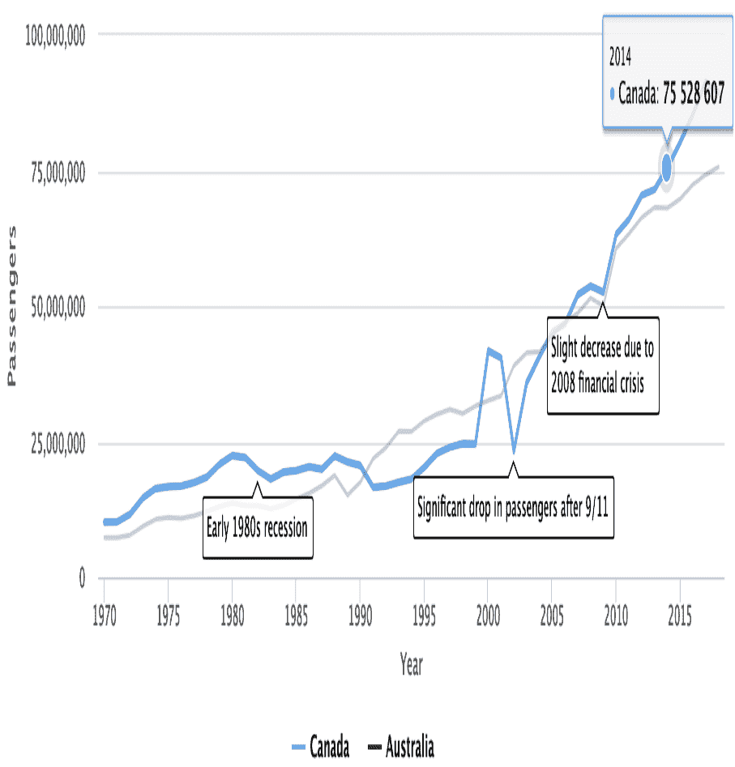

来源：世界银行

下载驱动此可视化的数据集

图 11-4。使用 Highcharts 的交互式带注释图表：探索交互式版本。

不幸的是，Chart.js 在显示注释方面并不出色。这就是为什么我们为这个特定示例切换到 Highcharts。但不用担心——你会发现过程与之前的 Chart.js 示例几乎没有区别。

要使用 Highcharts 创建自己的带注释的折线图，并从 CSV 文件加载数据，请执行以下操作：

- 1. 前往包含图 11-4 所示图表代码的 GitHub 仓库，登录你的 GitHub 账号，然后点击“Use this template”创建一个可编辑的副本。
- 2. 以 CSV 格式准备你的数据并上传到 data.csv 文件中。将沿轴显示的标签放在第一列中，每个数据系列放在其自己的列中。你的 CSV 必须至少包含三列（标签、一个数据系列和注释）。你可以添加任意数量的数据系列列，但每行只能有一个注释（最后一列）。

| Year | Canada | Australia | Note |
| --- | ---: | ---: | --- |
| 1980 | 22453000 | 13648800 | |
| 1981 | 22097100 | 13219500 | |
| 1982 | 19653800 | 13187900 | Early 1980s recession |

- 3. 在 script.js 中，自定义此代码片段中显示的变量值：

```
var TITLE = 'Air Transport, Passengers Carried (1970–2018)';

// Caption underneath the chart
var CAPTION = 'Source: The World Bank';

// x-axis label and label in tool tip
var X_AXIS = 'Year';

// y-axis label and label in tool tip
var Y_AXIS = 'Passengers';

// Should y-axis start from 0? `true` or `false`
var BEGIN_AT_ZERO = true;

// `true` to show the legend, `false` to hide
var SHOW_LEGEND = true;
```

如果你希望进一步自定义图表，请使用列出所有可用功能的 Highcharts API 参考。

## 使用 Chart.js 的散点图

现在你已经看到了 Highcharts 的实际应用，让我们回到 Chart.js，看看如何构建交互式散点图。请记住，散点图（也称散点图）用于显示两个或多个维度的数据。图 11-5 显示了康涅狄格州学区家庭收入与考试成绩之间的关系。利用 x 轴和 y 轴显示两个维度，很容易看出考试成绩随着家庭收入的增加而提高。


## 2009-13 年康涅狄格州学区收入与成绩

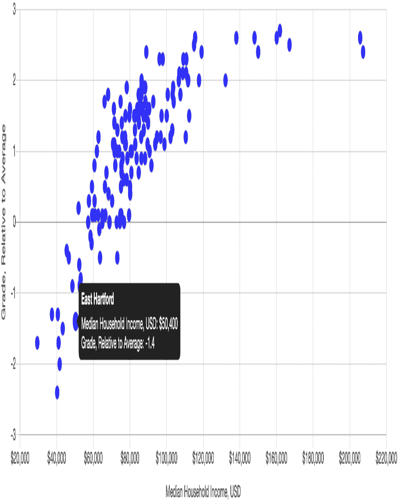

Grade, Relative to Average

Median Household Income, USD

East Hartford
Median Household Income, USD: $50,400
Grade, Relative to Average: -1.4

Sources: TrendCT, NY Times, Stanford Ed Data Archive, American Community Survey

Download data powering this visualization.

Figure 11-5. Interactive scatter chart with Chart.js: explore the interactive version.

To create your own scatter plot with Chart.js, with data loaded from a CSV file, you can:

- 1. Go to our GitHub repo that contains the code for the chart shown in Figure 11-5, log into your GitHub account, and click “Use this template” to create a copy that you can edit.
- 2. Prepare your data in CSV format and upload into a data.csv file. The first two columns should contain x and y values, respectively, and the third column should contain the point name that will appear on mouse hover.

| income | grades | district |
| 88438 | 1.7 | Andover |
| 45505 | -0.4 | Ansonia |

| 75127 | 0.5 | Ashford |
| 115571 | 2.6 | Avon |

3. In script.js, customize the values of variables shown in the following code snippet:

```
var TITLE = 'Income and Test Scores in CT School Districts, 2009-13';

var POINT_X = 'income'; // column name for x values in data.csv
var POINT_X_PREFIX = '$'; // prefix for x values, e.g., '$'
var POINT_X_POSTFIX = ''; // postfix for x values, e.g., '%'

var POINT_Y = 'grades'; // column name for y values in data.csv
var POINT_Y_PREFIX = ''; // prefix for x values, e.g., 'USD '
var POINT_Y_POSTFIX = ''; // postfix for x values, e.g., ' kg'

var POINT_NAME = 'district'; // point names that appear in tool tip
var POINT_COLOR = 'rgba(0,0,255,0.7)'; // e.g., `black` or `#0A642C`
var POINT_RADIUS = 5; // radius of each data point

var X_AXIS = 'Median Household Income, USD'; // x-axis & tool tip label
var Y_AXIS = 'Grade, Relative to Average'; // y-axis & tool tip label

var SHOW_GRID = true; // `true` to show the grid, `false` to hide
```

A similarly good-looking interactive chart can be constructed in Highcharts, although it’s up to you to undertake that challenge. In the meantime, remember to refer to the official Chart.js documentation if you want to further tweak your chart.

You may want to show an additional third variable, such as enrollment in each school district, in the same scatter chart. You can do so by resizing each dot so that larger school districts are marked with a larger circle, and smaller districts are shown using a smaller dot. Such use of size will result in a bubble chart, which we’ll look at next.

## Bubble Chart with Chart.js

Bubble charts are similar to scatter plots, but add one more variable (also known as dimension). The size of each point (marker) also represents a value.

The bubble chart in Figure 11-6 shows how median household income (x-axis) and test performance (y-axis) in six school districts in Connecticut are related. The size of the data point corresponds to the number of students enrolled in the school district: bigger circles represent larger school districts.

## 2009-13 年康涅狄格州部分学区的收入、成绩与入学人数

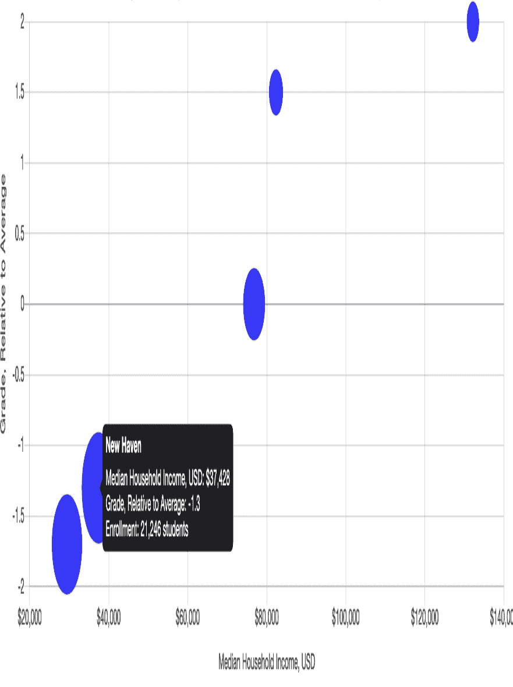

> New Haven
> 
> Median Household Income, USD: $37,428
> Grade, Relative to Average: -1.3
> Enrollment: 21,246 students

Sources: TrendCT, NY Times, Stanford Ed Data Archive, American Community Survey, CT State Department of Education

[Download data](#) powering this visualization.

*Figure 11-6. Interactive bubble chart with Chart.js; explore the interactive version.*

To create your own bubble chart with Chart.js, with data loaded from a CSV file, you can:

- 1. Go to our GitHub repo for this template, log into your GitHub account, and click “Use this template” to create a copy that you can edit.
- 2. Prepare your data in CSV format and upload into a *data.csv* file. The first two columns should contain *x* and *y* values, respectively. The third column should contain bubble names that will appear on mouse hover. The final, fourth
column, represents the size of your bubble:

| income | grades | district | enrollment |
| 29430 | -1.7 | Hartford | 21965 |
| 82322 | 1.5 | West Hartford | 10078 |
| 50400 | -1.4 | East Hartford | 7053 |

3. In script.js, customize the values of variables shown in this code snippet:

```
var TITLE = 'Income, Test Scores, and Enrollment in Select \
    Connecticut School Districts, 2009-13';

var POINT_X = 'income'; // column name for x values in data.csv
var POINT_X_PREFIX = '$'; // prefix for x values, e.g., '$'
var POINT_X_POSTFIX = ''; // postfix for x values, e.g., '%'

var POINT_Y = 'grades'; // column name for y values in data.csv
var POINT_Y_PREFIX = ''; // prefix for x values, e.g., 'USD '
var POINT_Y_POSTFIX = ''; // postfix for x values, e.g., ' kg'

var POINT_R = 'enrollment'; // column name for radius in data.csv
var POINT_R_DESCRIPTION = 'Enrollment'; // description of radius value
var POINT_R_PREFIX = ''; // prefix for radius values, e.g., 'USD '
var POINT_R_POSTFIX = ' students'; // postfix for radius values
var R_DENOMINATOR = 800; // use this to scale the dot sizes, or set to 1
    // if your dataset contains precise radius values

var POINT_NAME = 'district'; // point names that appear in tool tip
var POINT_COLOR = 'rgba(0,0,255,0.7)'; // e.g., `black` or `#0A642C`

var X_AXIS = 'Median Household Income, USD'; // x-axis & tool tip label
var Y_AXIS = 'Grade, Relative to Average'; // y-axis & tool tip label

var SHOW_GRID = true; // `true` to show the grid, `false` to hide
```

> TIP
> 
> To display smaller data points that may be hidden behind larger neighbors, use semitransparent circles with RGBa color codes. The first three characters represent red, green, and blue, while the a stands for alpha and represents the level of transparency on a scale from 0.0 (fully transparent) to 1.0 (fully opaque). For example, rgba(160, 0, 0, 0.5) creates a red color that is semitransparent. Learn more by playing with RGBa color values at W3Schools.

If you have more than three variables that you would like to show in your bubble chart, you can use color and glyphs (instead of simple dots) to represent two extra dimensions. For example, you may want to use blue to show only school districts in Fairfield County (generally a richer part of CT) and gray to represent all other districts. You may want to use circles, squares, and triangles to represent results for males, females, and nonbinary students. We won’t be showing you how to achieve this, but we can assure you that it can be done in 5 to 10 extra lines of code.

Chart.js is pretty limitless when it comes to customization, but remember not to overwhelm the viewer and communicate only the data that is necessary to prove or illustrate your idea.

## Summary

In this chapter, we introduced Chart.js and Highcharts templates that can be used to construct rich and interactive charts that you can host in your own GitHub account, and showed you how to embed them anywhere on the web. You can use these templates as a base to kickstart your interactive visualizations. You can refer to Chart.js Samples and Chart.js documentation for more information on Chart.js customization and troubleshooting. Highcharts Demos gallery shows plenty of charts along with the code that you can copy, and Highcharts API Reference lists all features available to refine your visualizations. Remember that you need to obtain a license to use Highcharts in commercial projects.

In the next chapter, we’ll introduce Leaflet.js map templates that were designed in a similar fashion to the chart templates we have just looked at. Leaflet is a leading open source JavaScript library for web mapping, and will let you create stunning interactive maps that live in your GitHub account and can be shared across the web.


### 表 12-1. 地图代码模板、最佳用途与教程

| 地图模板 | 本书中的最佳用途与教程 |
| --- | --- |
| Leaflet Maps with Google Sheets | 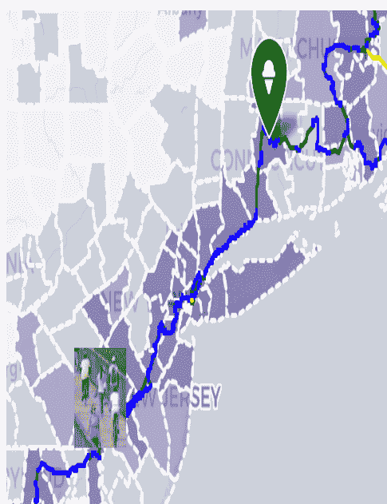<br>最适合展示交互式点、多边形或折线，可根据链接的 Google 表格（或 CSV 文件）及 GitHub 仓库中加载的数据，自由选择颜色、样式和图标。还可在地图旁显示点标记表格。<br>配套教程模板：“Leaflet Maps with Google Sheets” |
| Leaflet Storymaps with Google Sheets | 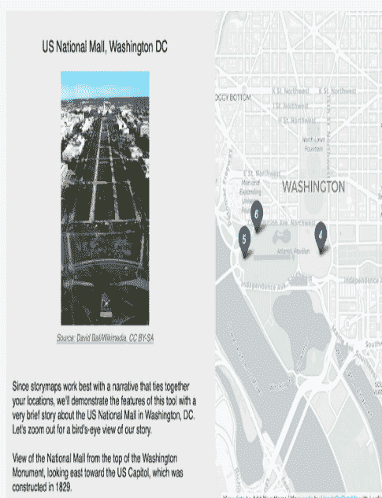<br>最适合展示逐点导览，通过滚动叙事展示链接的 Google 表格（或 CSV 文件）及 GitHub 仓库中加载的文本、图片、音频、视频和扫描地图背景。<br>配套教程模板：“Leaflet Storymaps with Google Sheets” |
| Leaflet Searchable Point Map — 您想把数据放到可搜索、可筛选的地图上。提供一个逗号分隔文件（CSV），这个免费开源模板将完成其余工作。了解更多 » | 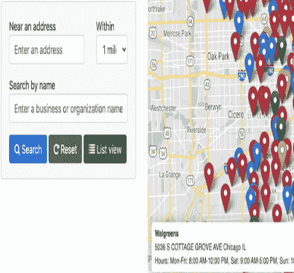<br>最适合展示多个地点，供用户按名称或距离搜索，或按类别筛选，并可选列表视图。由 DataMade 的 Derek Eder 开发。<br>配套教程模板：“Leaflet Searchable Point Map” |
| Leaflet Maps with Open Data APIs | 学习如何用 API 编写自己的 Leaflet 地图，该 API 会持续从开放数据仓库（如 Socrata 等）直接拉取最新信息。<br>配套教程模板：“Leaflet Maps with Open Data APIs” |

如果你已经阅读了本书前面的章节，这个模板对新手用户来说是一个很好的起点，因为你可以像图 12-2 所示那样，在链接的 Google 表格中输入地图数据和设置，并将图片或地理文件上传到 GitHub 仓库的文件夹中。正如我们在第 1 章讨论的，随着可视化技术未来的不断发展，你输入的所有数据都可以轻松导出并迁移到其他平台。此外，该地图设计是响应式的，意味着它能够自动调整大小，在小屏幕或大屏幕上都能呈现良好效果。最后，Leaflet Maps 模板基于灵活的开放源码软件构建，主要使用 JavaScript（一种非常常见的 Web 编程语言）编写，因此如果你具备开发技能或能得到开发人员的支持，还可以进一步自定义。

图 12-1. 探索带 Google 表格的交互式 Leaflet 地图，其中展示了东海岸绿道（East Coast Greenway）——一条连接缅因州至佛罗里达州各城市的步行与骑行路线。截至 2021 年，这条 3000 英里的路线有超过三分之一位于无机动车通行的专用道路上。欲了解更多，请参阅官方绿道地图。

## GitHub Pages

GitHub Pages 设计用于托管你的个人、组织或项目网站。

来源：GitHub Pages 当前已禁用。请在下方选择来源。

5. 再次向下滚动到 GitHub Pages 部分，并复制你已发布网站的链接，其格式如下：

```
https://USERNAME.github.io/leaflet-maps-with-google-sheets
```

6. 向上滚动到顶部，点击你的仓库名称，返回其主页。

7. 在仓库主页的顶层，点击 README.md，然后点击铅笔图标编辑此文件。

8. 删除我们直播网站的链接，粘贴你已发布网站的链接。向下滚动到“Commit your changes”（提交更改）。

```
leaflet-maps-with-google-sheets / README.md Cancel
<> Edit file Preview changes Spaces 2
```

```
## Live links (replace with your own)
- Leaflet Map https://handsondataviz.github.io/leaflet-maps-with-google-sheets/
- Google Sheets template https://docs.google.com/spreadsheets/d/1ZxvU8eGyuM9R6Xtu9ackKVJv70iC3px_m3EVFs0HN9g/edit#gid=0
```

9. 在仓库主页上，右键单击链接，在新标签页中打开你的实时地图。请耐心等待。GitHub Pages 通常会在 30 秒内显示你的实时地图，但有时可能需要几分钟才会出现。

### B. 文件 > 制作 Google 表格模板副本，共享并发布

1. 在新标签页中打开 Google 表格模板。

2. 登录你的 Google 帐户，选择“文件”>“制作副本”，将此 Google 表格的副本保存到你的 Google 云端硬盘。

3. 点击蓝色“共享”按钮，点击“更改为任何拥有链接的人”，然后点击“完成”。这样会公开共享你的地图数据，这是让此模板正常运作所必需的。

4. 转到“文件”>“发布到网页”，点击绿色“发布”按钮，发布整个文档，以便 Leaflet 代码能够读取它。然后点击右上角的 X 符号关闭此窗口。

5. 在浏览器顶部，复制你的 Google 表格地址或 URL（通常以 ...XYZ/edit#gid=0 结尾）。请*不要*复制“已发布到网页”的地址（通常以 ...XYZ/pubhtml 结尾），因为该链接略有不同，在此模板中将无法使用。

> 复制浏览器地址
> 不要复制已发布地址
> https://docs.google.com/spreadsheets/d/1QA7TcMxjv8xshx5p_1BbZzJrJENQ7p0jkfCLve5ReJA/ed

> **发布到网页**
> 此文档已发布到网页。
> 通过发布到网页，让任何人都能看到你的内容。你可以链接或嵌入你的文档。了解更多。
> 链接
> 嵌入
> 整个文档
> 网页
> https://docs.google.com/spreadsheets/d/.../X-1vOoSfWTU17redHRKfAJ
> 或使用此链接分享：
> 注意：查看者可能可以访问已发布图表的底层数据。了解更多。
> 已发布

### D. 更新你的 Google 表格选项并刷新实时地图

现在，你已发布的 Google 表格已链接到你的实时地图，请转到“选项”选项卡更新以下任一项目：

- 地图标题
- 地图副标题
- 作者姓名
- 作者电子邮件或网站
- 作者代码仓库

打开显示实时地图的浏览器标签页并刷新页面，即可查看更改。如果更改在几秒钟内未显示，请参阅附录。

### E. 对位置进行地理编码并在“Points”选项卡中自定义新标记

现在我们可以开始向地图添加新内容。在 Google 表格的“Points”选项卡中，你会看到用于整理和在地图上显示交互式标记的列标题。用你自己的数据替换演示数据，但不要删除或重命名列标题，因为 Leaflet 代码会查找这些特定名称：

- **组（Group）**：创建任意标签，用于在图例中对标记组进行分类。
- **标记图标（Marker icon）**：插入一个 Font Awesome 免费且实心的图标名称（如 `fa-ice-cream` 或 `fa-coffee`），或任何 Material Design 图标名称（如 `rowing` 或 `where_to_vote`）。也可以留空，这样标记内不显示图标。请注意，Font Awesome Pro 或品牌图标不适用于此模板。若要创建你自己的自定义图标，请参阅下文。

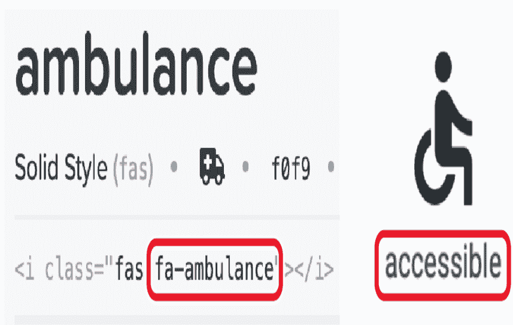

- **标记颜色（Marker color）**：插入任何标准 Web 颜色名称（如 `blue` 或 `darkblue`），或插入 Web 颜色代码（如 `#775307` 或 `rgba(200,100,0,0.5)`）。参见 W3Schools 颜色名称选项。
- **图标颜色（Icon color）**：设置标记内图标的颜色。默认是白色，在深色标记内效果良好。
- **自定义尺寸（Custom size）**：留空，除非你正在创建自己的自定义图标。

下一组列包括用户点击点标记时显示的项目：

- **名称（Name）**：添加一个标题，显示在标记弹出窗口中。
- **描述（Description）**：添加文本以显示在标记弹出窗口中。你可以插入 HTML 标签来添加换行（如 `<br>`）或在新标签页中打开外部链接，例如：²

```
<a href='https://www.w3schools.com/' target='_blank'>Visit W3Schools</a>
```

- **图片（Image）**：你有两种显示图片的选项。你可以插入由在线服务（如 Flickr）托管的图片的外部链接，前提是链接以 https（安全）开头，并以 .jpg 或 .png 结尾。或者，你可以将图片上传到 GitHub 仓库的 media 子文件夹中，并在 Google 表格中以如下格式输入路径名：`media/image.jpg` 或 `media/image.png`。

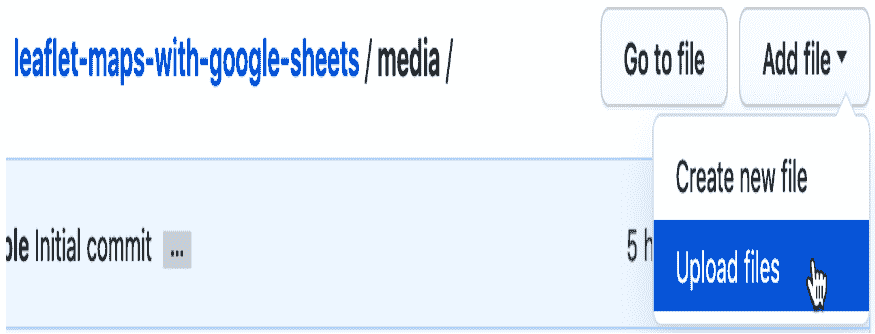

> 警告
> 媒体文件路径名区分大小写，我们建议全部使用小写字符，包括后缀结尾。此外，由于代码模板会自动调整图片大小以适应显示，我们建议在上传前将任何图片的尺寸缩小到 600 × 400 像素或更小，以确保你的地图运行顺畅。

- **位置、纬度、经度（Location, latitude, longitude）**：这些将你的标记放置在地图上的点。虽然代码模板只需要纬度和经度，但明智的做法是在“位置（Location）”列中粘贴地址或地名，以便与数字坐标对应。使用“在 Google 表格中对地址进行地理编码”中的“Geocoding by SmartMonkey”插件，选择“扩展程序”>“Geocoding by SmartMonkey”>“Geocode details”，即可创建一个包含示例数据的新工作表，并显示三个新列的结果：纬度、经度和找到的地址。粘贴你自己的地址数据，重复上一步进行地理编码，然后将结果复制并粘贴到你的 Points 工作表中。


## AI 法案：欧盟立法者批准监管人工智能

欧洲议会于周三批准了《人工智能法案》，这是一项具有里程碑意义的法规，将规范欧洲的人工智能使用。该法律采取基于风险的方法，对高风险人工智能系统施加更严格的规则。

- 禁止用途：公共场所的实时远程人脸识别
- 高风险类别：关键基础设施、教育、就业、基本服务
- 义务：风险管理、数据治理、透明度、人工监督

该法规将逐步生效，大多数条款将于 2026 年前适用。

## 可选自定义标记

要创建自己的自定义标记，例如缩略照片图标，请使用任何图像编辑工具将照片缩小为 64 × 64 像素的正方形。以 PNG 格式保存，并使用全小写字符且无空格的文件名进行命名。将图像上传到 GitHub 仓库中的媒体文件夹，如前所述。在 Marker Icon 列中，以此格式输入文件路径：media/imagename-small.png。在 Custom Size 列中，将尺寸设置为 64x64 或类似，例如 40x40 即可。

| Group | Marker Icon | Marker Color | Icon Color | Custom |
|---|---|---|---|---|
| Visit | media/calais-64.jpg |  |  | 40x40 |
| Food | fa-ice-cream | green | white |  |
| Visit | media/delaware-64.jpg |  |  | 40x40 |
| Visit | media/ecg-logo-64.png |  |  | 40x40 |
| Food | fa-coffee | green | white |  |
| Visit | media/keywest-64.jpg |  |  | 40x40 |

打开显示实时地图的浏览器标签页并刷新页面以查看更改。如果更改在几秒钟内未出现，请参阅附录。

## F. 移除或显示点、多边形或折线数据及图例

默认情况下，演示地图显示三种类型的数据——点、多边形和折线——及其图例。您可以通过修改链接的 Google Sheet 来从地图中移除其中任何一种。

### 移除点：

- 1. 在 Options 选项卡中，将 Point Legend Position（单元格 B27）设置为 Off 以隐藏它。
- 2. 在 Points 选项卡中，删除所有点数据的行。

### 移除折线：

- 1. 在 Options 选项卡中，将 Polyline Legend Position（单元格 B36）设置为 Off 以隐藏它。
- 2. 在 Polylines 选项卡中，删除所有折线数据的行。

### 移除多边形：

- 1. 在 Polygons 选项卡中，将 Polygon Legend Position（单元格 B4）设置为 Off 以隐藏它。
- 2. 同样在 Polygons 选项卡中，将 Polygon GeoJSON URL（单元格 B6）设置为空以从地图中移除该数据。
- 3. 在下一个选项卡 Polygons1 中，使用选项卡下拉菜单选择 Delete 以移除整个工作表。

您已经学会了如何在 Points 选项卡中添加更多标记。如果您希望添加新的多边形或折线数据，您需要使用“Draw and Edit with GeoJSON.io”或“Edit and Join with Mapshaper”以 GeoJSON 格式准备这些文件。

准备好 GeoJSON 数据后，使用全小写字符且无空格的名称命名文件，并将它们上传到 GitHub 仓库的 geojson 子文件夹中。然后在链接的 Google Sheet 中更新这些设置。

### 显示折线：

- 1. 在 Options 选项卡中，确保 Polyline Legend Position（单元格 B36）可见，选择“topleft”或类似位置。
- 2. 在 Polylines 选项卡中，输入上传到 GitHub 仓库的文件的 GeoJSON URL 路径，例如 geodata/polylines.geojson。然后插入 Display Name、Description 和 Color。

### 显示多边形：

- 1. 在 Polygons 选项卡中，确保 *Polygon Legend Position*（单元格 B4）可见，选择“topleft”或类似位置。
- 2. 在 *Polygon GeoJSON URL*（单元格 B6）中，输入上传到 GitHub 仓库的文件的路径，例如 *geodata/polygons.geojson*。
- 3. 您可以更改 *Polygon Legend Title*（单元格 B3）并添加可选的 *Polygon Legend Icon*（单元格 B5）。
- 4. 编辑 Polygon Data and Color Settings 部分以修改标签和范围，使其与 GeoJSON 文件的属性保持一致。在 *Property Range Color Palette* 中，您可以从我们在“Map Design Principles”中描述的 ColorBrewer 工具中自动选择配色方案，或在下方单元格中手动插入您选择的颜色。
- 5. 阅读 *Polygons* 工作表中的 *Hints* 列，了解如何输入数据的提示。
- 6. 如果您希望显示多个多边形图层，请使用 *Polygons* 选项卡下拉菜单复制工作表，并以此格式命名附加工作表：*Polygons1*、*Polygons2* 等。

现在您可以完成地图的制作。如果您希望与公众分享地图链接，请阅读此处的选项并选择步骤 G 或步骤 H。

> **WARNING**
>
> 我们保留随时更改 *our* Google Sheets API key 的权利，尤其是在其他人过度使用或滥用时。这意味着您 *必须* 在分享之前使用步骤 G 或 H 完成地图的制作，因为如果我们更改密钥，地图将 *停止工作*。

## G. 将每个 Google Sheets 选项卡保存为 CSV 文件并上传到 GitHub

如果您已在 Google Sheets 中输入了大部分数据，将其下载为单独的 CSV 文件并上传到 GitHub 仓库是 *最佳* 的长期保存策略。这种方法将您的地图和数据保存在同一个 GitHub 仓库中，并消除了因 Google 服务中断而导致地图损坏的风险。此外，您仍然可以编辑地图数据。如果这种方法合理，请按照以下步骤操作：

- 1. 在您的 Google Sheets 中，进入每个选项卡并选择 File > Download into CSV format，以为每个选项卡创建单独的文件。

File Edit View Insert Format Data Tools Add-ons Help

- Share
- New
- Open ⌘O
- Import
- Make a copy
- Email
- Download
- Version history
- Rename
- Move
- Add shortcut to Drive
- Move to trash
- Publish to the web
- Document details
- Spreadsheet settings
- Print ⌘P

- Microsoft Excel (.xlsx)
- OpenDocument format (.ods)
- PDF document (.pdf)
- Web page (.html, zipped)
- Comma-separated values (.csv, current sheet)
- Tab-separated values (.tsv, current sheet)

Customize Options Points Polylines Polygons

Figure 12-3. Explore the interactive Leaflet storymaps with Google Sheets. This demo version illustrates features of the code template while telling a brief story about the US National Mall in Washington, DC.

| Chapter | Media Link | Media Credit | Media Credit Link | Description |
|---|---|---|---|---|
| US National Mall, Washington DC | https://upload.wikimedia.org/wikipedia/commons/thumb/a/a4/Mall-002.JPG/400px-Mall-002.JPG | Source: David Ball/Wikimedia, CC BY-SA | https://commons.wikimedia.org/wiki/File:Mall-002.JPG | 由于故事地图最适合以介绍您位置的叙述开头，我们将使用关于华盛顿特区美国国家广场的一段简短故事来演示该功能。让我们拉远一点，鸟瞰故事。<br><br>从华盛顿纪念碑俯瞰国家广场，朝东望向国会大厦，国会大厦建于 1829 年。 |
|  | media/google-sheet-screenshot.png | Screenshot of linked Google Sheet. |  | 右键单击地图上微小的“View data”链接，在新标签页中打开链接的 Google Sheet 的内容。每行都是一个章节，其中包含故事、媒体链接以及每个位置的数据。Google Sheet 还包括一个“Customize”选项卡，用于设置整体地图外观。 |
| Washington Monument | media/washington-monument-nps.png | Source: US National Park Service, public domain | https://www.nps.gov/hama/learn/photosmultimedia/photo-gallery.htm | 您可以将 JPG 或 PNG 图像上传到 GitHub 仓库的媒体文件夹，并将其文件路径输入链接的 Google Sheet。模板会将图像大小调整为适合滚动叙述，但 |
| Lincoln Memorial | https://live.staticflickr.com/3747/9114059928_b514d56ce6_z.jpg | Source: Anthony Citrano/Flickr; CC BY 2.0 | https://flic.kr/p/tWuh | 此外，您可以直接链接到 Flickr 和 Wikimedia 等服务中的照片。要添加 Flickr 照片，请单击 Share 按钮，选择一个小到中等的嵌入代码，并仅粘贴以“https://live.staticflickr.com/...”开头并以 JPG 或 PNG 结尾的地址部分。要添加 Wikimedia 图像，请选择一个小到中等的尺寸并复制其以 JPG 或 PNG 结尾的直接 URL。务必为您的图像署名。林肯纪念堂建于 1922 年，位于国家广场的西端。 |
|  |  |  |  | 您可以通过在 Google Sheet 中使用一系列行来为一个位置显示多张图像。位置信息应仅出现在第一行；对其他行将这些字段留空。 |


图 12-4. 查看向上面 Leaflet Storymaps 演示提供数据的在线 Google Sheet 模板。

我们用 Google Sheets 创建了 Leaflet Storymaps，以填补其他工具未能解决的空白。需要说明的是，其他故事地图平台更适合初学者立即上手，例如免费开源的 Knight Lab StoryMap 平台，以及仅限订阅用户的专有 ArcGIS StoryMaps 平台（它是旧版 Esri Story Maps 平台的继任者）。我们不推荐其中任何一个，因为它们都缺乏数据可移植性，这意味着你无法轻松导出所输入的任何数据或图像；我们在第 1 章讨论如何明智地选择工具时曾提醒过你注意这一点。相比之下，你输入到与 Leaflet Storymaps 相关联的 Google Sheet 和 GitHub 仓库中的所有数据，都可以在可视化技术未来演进时轻松迁移到其他平台。

浏览表 12-2 中基于 Google Sheets 的 Leaflet Storymaps 示例画廊，看看其他人用这个模板创建了什么。

犹太会堂地图：过去与现在，作者 Elizabeth Rose，大哈特福德犹太历史学会
上密苏里河测绘，作者 Jen Andrella

## C. 将你的 Google Sheet 浏览器地址粘贴到 GitHub 仓库中的两个位置

我们的下一个任务是将你已发布的 Google Sheet 链接到 GitHub 中的 Leaflet 代码，以便它可以从 Sheet 中提取数据并在地图上显示：

- 1. 在 GitHub 仓库顶部，点击打开名为 `google-doc-url.js` 的文件，然后点击铅笔图标进行编辑。
- 2. 粘贴你的 Google Sheet 地址或 URL（通常以 `...XYZ/edit#gid=0` 结尾），替换我们现有的 URL。注意不要删除末尾的单引号或分号。向下滚动以提交你的更改。有关 Google API 密钥的单独说明，请参阅下文。

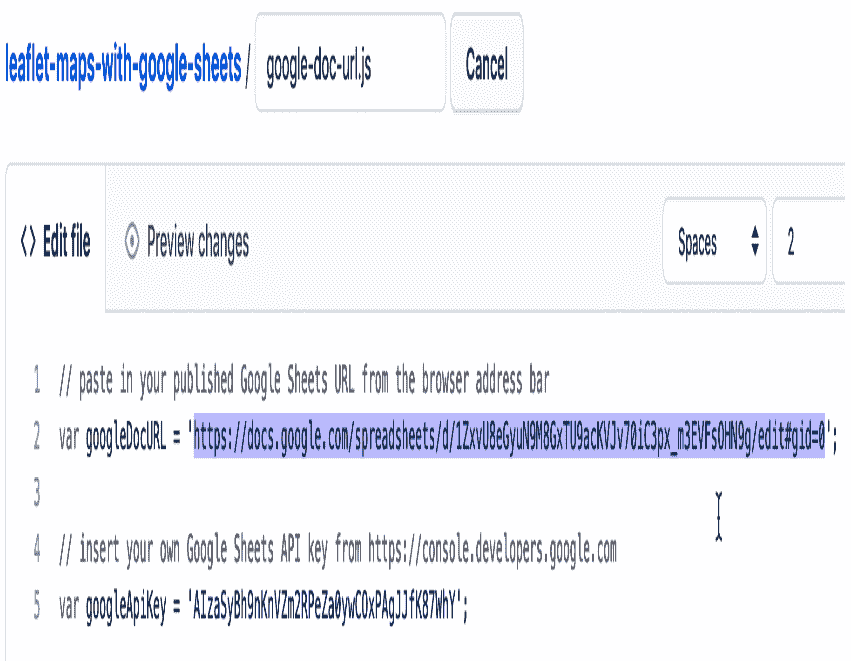

- 3. 另外，我们把你的 Google Sheet URL 粘贴到第二个位置，方便你记录它。在你的 GitHub 仓库中，点击 `README.md` 文件将其打开，点击铅笔图标进行编辑，然后粘贴你的 Google Sheet URL 替换我们现有的 URL。向下滚动以提交你的更改。

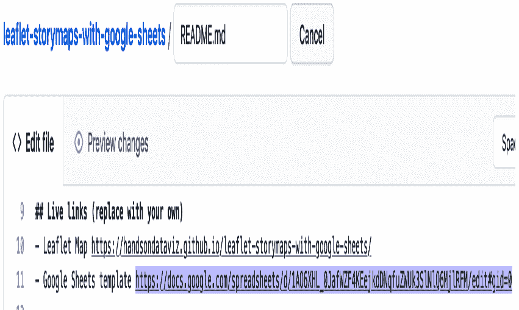

你可以随意删除 README 中任何你不想保留的其他内容。

## D. 更新你的 Google Sheet 选项并刷新你的实时地图

既然你已发布的 Google Sheet 已链接到实时地图，请转到“选项”选项卡更新以下任意项目：

- 故事地图标题
- 带有向下箭头代码的故事地图副标题：
  ```
  <br><small>Scroll down <i class='fa fa-chevron-down'></i></small>
  ```
- 作者姓名
- 作者电子邮件或网站
- 作者 GitHub 仓库链接

打开显示实时地图的浏览器标签页并刷新页面以查看更改。如果你的更改在几秒钟内未出现，请参阅附录。

## E. 在“章节”选项卡中添加文本、媒体、标记和地理编码位置

我们现在可以开始向地图添加新内容了。在 Google Sheet 的“章节”选项卡中，你会看到用于组织并在地图上显示交互式标记的列标题。请用你自己的数据替换演示数据，但*不要*删除或重命名列标题，因为 Leaflet 代码会查找这些特定名称：

*章节*

出现在滚动叙述中每个部分顶部的标题。

*媒体链接*

在每个章节中，你有多种选项来显示图像、音频或视频。对于图像，你可以插入指向在线服务（如 Flickr）的外部链接，只要它以 *https*（安全）开头，并以 *.jpg* 或 *.png* 结尾即可。你也可以插入 YouTube 视频链接。或者，你可以将图像文件上传到 GitHub 仓库中的 *media* 子文件夹，然后在 Google Sheet 中以如下格式输入路径名：*media/your-file-name.jpg* 或 *...png*。类似地，你可以上传 *.mp3*（推荐）、*.ogg* 或 *.wav* 格式的音频文件。

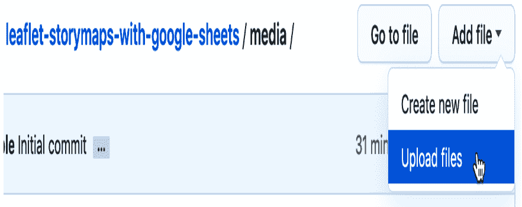

> **警告**
> 媒体文件路径名区分大小写，我们建议使用*全小写字符*，包括后缀结尾。另外，由于代码模板会自动调整图像大小以适合页面，我们建议你在上传前*缩小*任何图像的尺寸至 600 × 400 像素或更小，以确保你的故事地图加载更快。

*媒体来源*

用于显示关于媒体来源的文本，例如“来源……”

*媒体来源链接*

在上述“媒体来源”文本中添加指向来源信息的直接链接。

*描述*

设计用于显示该章节大约一段或更少的文本。你可以插入 HTML 标签来添加换行（例如 <br>）或在新标签页中打开外部链接，例如：

```
<a href='https://www.w3schools.com/' target='_blank'>Visit W3Schools</a>
```

### 缩放

Leaflet 的默认缩放级别在 0（世界视图）到 18（单个建筑物）之间，大多数免费底图瓦片（例如 Stamen 或 CartoDB 提供的瓦片）都可用于此范围内的每个级别。还有更详细的底图允许你使用更高的值。请试验缩放级别，为你的故事获得最佳视图，并记住，在相同的缩放级别下，与较小的屏幕（如智能手机）相比，较大的屏幕会显示更大的区域。

### 标记

选择编号（默认）、普通或隐藏。当将多个章节分配给一个位置时（避免标记相互堆叠），或者缩放到更广视野时（不突出显示某个特定位置），后者效果最佳。

### 标记颜色

插入任何标准 Web 颜色名称，例如 `blue` 或 `darkblue`，或插入 Web 颜色代码，例如 `#775307` 或 `rgba(200,100,0,0.5)`。请参阅 W3Schools 颜色名称中的选项。

### 位置、纬度、经度

这些操作会将你的标记放置在地图上的各个点。虽然代码模板只需要纬度和经度，但明智的做法是将地址或地名粘贴到 *位置* 列中，作为与数值坐标对应的提醒。使用“在 Google Sheets 中对地址进行地理编码”中的 Geocoding by SmartMonkey 插件，然后选择“附加组件” > “Geocoding by SmartMonkey” > “地理编码详细信息”，以创建一个包含示例数据的新工作表，并为三个新列显示结果：*纬度*、*经度* 和 *找到的地址*。粘贴你自己的地址数据并重复上一步进行地理编码，然后将结果复制并粘贴到你的 *点* 工作表中。

### 提示

你可以通过创建一系列行来为一个位置显示多张图像，但只在该系列的第一行列出章节和位置信息，其他行留空。

打开显示实时地图的浏览器标签页并刷新页面以查看更改。如果你的更改在几秒钟内未出现，请参阅附录。

## F. 可选：添加历史地图图像或 GeoJSON 叠加层

代码模板允许你通过在背景地图上叠加两种不同类型的图层来丰富你的故事：地理参考地图图像（例如历史地图）和 GeoJSON 地理数据（例如路径、边界线或颜色编码的等值区域图）。你可以将这两种类型的图层添加到特定章节或整个故事中。此外，你还可以调整透明度级别以显示或隐藏当前背景地图。要准备这两种类型的图层，你需要跳到第 13 章，但这里我们将解释在故事地图模板中插入它们的步骤。

| 地址 | 国家/地区 | 纬度 | 经度 | 找到的地址 |
|---|---|---|---|---|
| Calle de la Electricidad, 49, 28918 Leganés, Madrid | es | 40.3529951 | -3.7976303 | Calle de la Electricidad, 49, 28918 Leganés, Madr |
| Av México 95-51 Del Carmen, Coyoacán, 04100 Ciudad de Mexico | mx | 19.3551609 | -99.1679037 | Av México 95, Del Carmen, Coyoacán, 04100 Ciu |
| Av. Díaz Vélez 4900, Buenos Aires, Argentina | ar | -34.6087952 | -58.4360388 | Av. Díaz Vélez 4900, Buenos Aires, Argentina |

文件 编辑 查看 插入 格式 数据 工具 附加组件 帮助 上次编辑是在几秒前

文档附加组件
Geocoding by SmartMonkey
获取附加组件
管理附加组件

创建模板
地理编码
地理编码详细信息
帮助

Sheet1
Geocoding Details


要为故事地图的一个或多个章节添加历史地图叠加层，该地图必须经过地理配准（也称为地理校正），这意味着要将静态地图图像与更精确的现代交互式地图进行数字对齐。如果你有一张高质量的历史地图静态图像，可以使用 Map Warper 工具，如“使用 Map Warper 进行地理配准”中所述，将几个已知点与现代交互式地图上的点对齐。Map Warper 将静态地图图像转换为交互式地图瓦片，并以 Google/OpenStreetMap 格式的链接在线公开托管，类似于 https://mapwarper.net/maps/tile/14781/{z}/{x}/{y}.png。或者，你也可以在 Map Warper 和纽约公共图书馆 Map Warper 等平台上搜索已经过地理配准并转换为瓦片的历史地图（并参与众包项目以对齐地图）。虽然地图瓦片链接无法在普通浏览器中查看，但 Leaflet Storymaps 代码可以显示它们。在 Google Sheets 模板的 Chapters 选项卡的 Overlay 列中输入瓦片链接和所需的透明度级别，如图 12-5 所示：

- **Overlay**：输入 Google/OpenStreetMap 格式的地图瓦片链接，类似于前面的示例。
- **Overlay transparency**：输入 0（透明）到 1（不透明）之间的数字。默认值为 0.7。

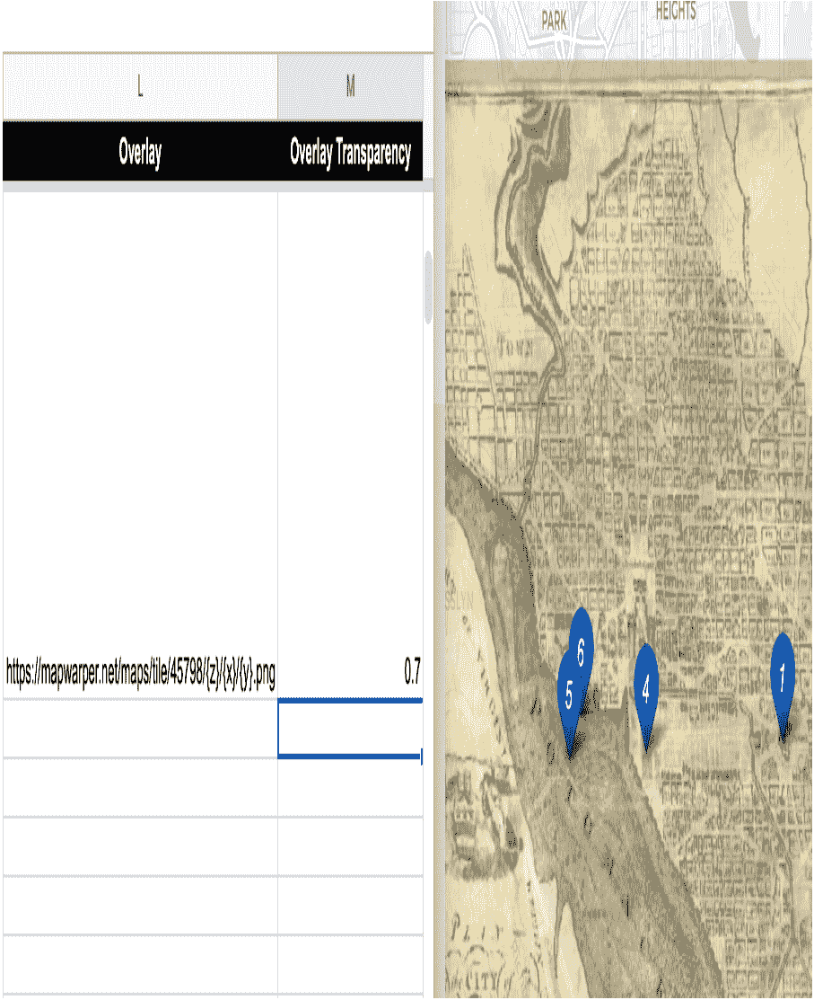

图 12-5. 在 Google Sheets 模板（左侧）中输入地图瓦片链接和透明度级别，以将其显示在一个或多个故事地图章节（右侧）中。

要为你的故事添加可见路径、地理边界或填充色分级统计图，可考虑在一个或多个章节中添加 GeoJSON 数据图层。在“地理空间数据与 GeoJSON”中了解 GeoJSON 和地理空间数据格式，还可以学习如何查找现有的 GeoJSON 边界文件（参见“查找 GeoJSON 边界文件”），使用 GeoJson.io 工具（参见“使用 GeoJson.io 绘制和编辑”）或 Mapshaper 工具（参见“使用 Mapshaper 编辑和连接”）绘制或编辑自己的地理数据。我们建议你将 GeoJSON 文件命名为小写字符且不带空格。打开 geojson 文件夹，选择“Add file”>“Upload files”，将文件上传到 GitHub 仓库。在 Google Sheets 模板中，在 GeoJSON Overlay 列中以以下格式输入路径名：geojson/your-file-name.geojson，如图 12-6 所示。

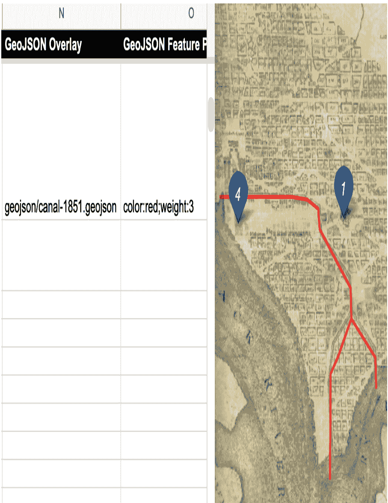

图 12-6. 在 GeoJSON Overlay 列（左侧）中输入路径名，以将其显示在一个或多个故事地图章节（右侧）中。

当你使用 GeoJson.io 等工具创建或编辑 GeoJSON 数据时（参见“使用 GeoJson.io 绘制和编辑”），可以直接编辑其要素属性。如果希望在故事地图中显示你为 GeoJSON 文件指定的相同属性，建议按如下方式命名：

- weight（线或多边形边框的宽度；故事地图模板默认值为 1px）
- color（线或多边形边框的颜色；默认值为灰色）
- opacity（线或多边形边框的不透明度；默认值为 0.5）
- fillColor（多边形的填充颜色；默认值为白色）
- fillOpacity（多边形的填充不透明度；默认值为 0.7）

或者，你也可以在 GeoJSON Feature Properties 模板列中输入属性和 CSS 代码，格式如下，用分号分隔，无需引号：weight:3; color:red; opacity:1; fillColor:orange; fillOpacity:0.9。你可以使用标准名称、十六进制代码或 RGBa 值来指定颜色，如 W3Schools 颜色选择器中所述。

在模板中，你会发现更多自定义故事地图的方法，例如：

- 插入徽标（参见 Google Sheets 中的 Options 选项卡）
- 插入 Google Analytics 跟踪 ID（参见 Google Sheets 中的 Options 选项卡）
- 调整标题大小和字体（转到 GitHub 中的 css/styles.css 文件）
- 在章节文本中插入水平分隔线（将此文本复制粘贴到 Google Sheets 的 Description 字段中，并避免将单引号改为弯引号）：

```
<span style='display:block;width:100%;height:1px;background-color:silver; margin: 20px 0;'></span>
```

现在你可以最终确定你的地图了。如果你想与公众分享你的地图链接，请阅读此处的选项，并选择步骤 G 或步骤 H。

> **警告**
> 我们保留随时更改 Google Sheets API 密钥的权利，尤其是在其他人过度使用或滥用它的情况下。这意味着你必须先使用步骤 G 或 H 完成地图的制作，然后再公开分享，因为如果我们更改密钥，地图将停止工作。

## G. 将每个 Google Sheets 选项卡保存为 CSV 文件并上传到 GitHub

如果你已经完成将大部分数据输入到 Google Sheets 中，那么将其下载为单独的 CSV 文件并上传到你的 GitHub 仓库是最好的长期保存策略。这种方法将你的地图和数据保存在同一个 GitHub 仓库中，并消除了因 Google 服务中断而导致地图失效的风险。此外，你仍然可以编辑地图数据。如果这种方法可行，请按照以下步骤操作：

1. 在 Google Sheets 中，进入每个选项卡，选择“文件”>“下载为 CSV 格式”，为每个选项卡创建一个单独的文件。

2. 按所示缩短每个文件名。名称必须准确。前两个文件是必需的，其他文件是可选的：

    - Chapters.csv
    - Options.csv
    - Notes.csv（或 .txt）建议将任何注释与数据保存在一起，但不是必需的。

3. 在你的 GitHub 仓库中，点击 csv 子文件夹将其打开，选择“Add file”>“Upload files”，并将列出的所有 CSV 文件上传到此子文件夹中。Leaflet 模板代码会首先在这里查找数据，如果找到具有这些名称的 CSV 文件，它将直接从中提取地图数据，而不是从你的 Google Sheets 中提取。请记住，从现在开始，你在 Google Sheet 中的任何编辑都不再自动显示在地图中。

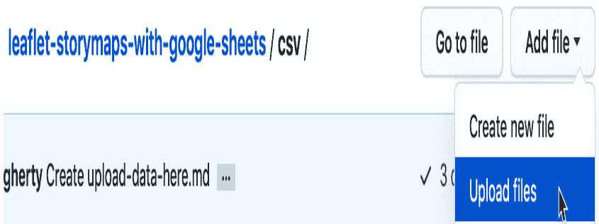

4. 如果在上传 CSV 文件后希望编辑地图，你有两个选择。你可以通过 GitHub Web 界面打开 CSV 文件直接进行小幅编辑，也可以在 Google Sheet 中进行较大幅度的编辑，然后重复之前的步骤以 CSV 格式下载并上传以替换 GitHub 上现有文件。

## H. 获取你自己的 Google Sheets API 密钥并插入到代码中

作为步骤 G 的替代方案，如果你希望继续将地图数据存储在已在线发布的 Google Sheets 中，请前往“获取你的 Google Sheets API 密钥”，并按说明将其插入 Leaflet 地图代码，以避免过度使用我们的密钥。Google Sheets 要求使用 API 密钥来维持其服务的合理使用限制。如果你拥有个人 Google 账户，则可以免费获得 Google Sheets API 密钥，但使用学校或企业提供的 Google Suite 账户则无法获得。如果出现问题，请参阅附录。

### 获取你的 Google Sheets API 密钥

在你创建了自己的“Leaflet Maps with Google Sheets”或“Leaflet Storymaps with Google Sheets”版本后（参见“Leaflet Maps with Google Sheets”和“Leaflet Storymaps with Google Sheets”），如前所述，有两种方法可以最终确定地图：要么将 Google Sheet 选项卡保存为 CSV 格式，要么获取你自己的 Google Sheets API 密钥并将其粘贴到 GitHub 上的 Leaflet 代码中。你将在本节中学习后一种方法。

自 2021 年 1 月起，Google Sheets 版本 4 要求使用 API 密钥才能让代码读取你的数据，以维持其服务的合理使用限制。对于 Google Sheets，限制是每个项目每 100 秒 500 个请求，每个用户每 100 秒 100 个请求。没有每日使用限制。

开始之前：

- 你需要一个个人 Google 账户，而不是学校或企业签发的 Google Suite 账户。
- 本教程假定你已经完成了“Leaflet Maps with Google Sheets”或“Leaflet Storymaps with Google Sheets”，并希望最终确定你的地图。
- 如果你已经为一个模板创建了 Google Sheets API 密钥，也可以将该密钥用于另一个模板。

> **警告**
> 你的屏幕说明可能与以下说明有所不同。

你可以按照以下步骤获取自己的免费 Google Sheets API 密钥。总体而言，你将在 Google Cloud 中创建并命名项目，启用 Google Sheets API 以允许计算机从你的 Google Sheet 中读取数据，复制新的 API 密钥，并将其粘贴到 Leaflet 代码中以替换我们的密钥：

1. 前往 Google Developers Console 并使用你的 Google 账户登录。Google 可能会要求你确认国家/地区并同意其服务条款。

2. 在打开屏幕上点击“Create a Project”（创建项目）。或者，转到左上角的下拉菜单，选择“Select a project”（选择一个项目）>“New project”（新建项目）。

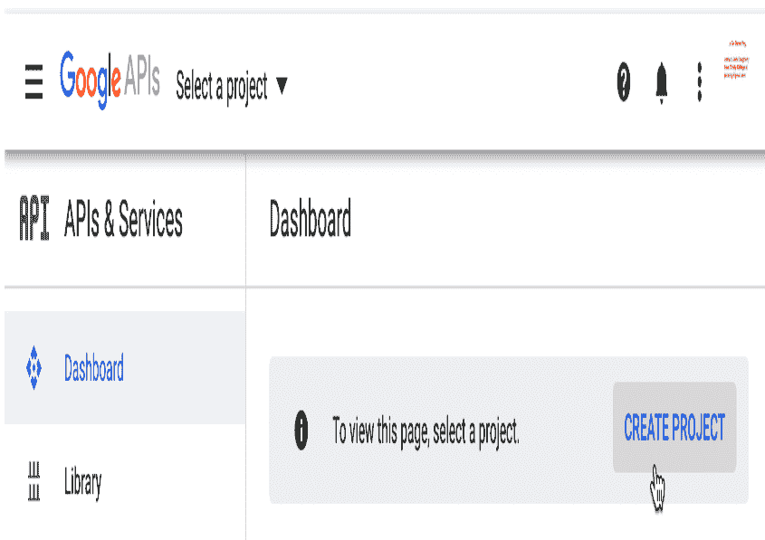


5. 在下一个界面中，在搜索栏中输入 `Google Sheets`，然后选择该结果。

```
Google APIs
handsondataviz
Search for APIs and Services
APIs & Services
+ ENABLE APIS AND SERVICES

Google APIs
handsondataviz
Search for APIs and Services

Search
google sheets
Filter by
1 result
CATEGORY
CRM (1)
G Suite (1)
Google Sheets API
Google
The Sheets API gives you full control over the content and appearance of your spreadsheet data.
```

6. 在下一个界面中，选择 **启用** 来为你的项目开启 Google Sheets API。

### 限制并重命名 API 密钥

### 密钥限制

此密钥不受限制。限制措施有助于防止未经授权的使用和配额盗用。了解更多

### 应用限制

应用限制用于控制哪些网站、IP 地址或应用可以使用你的 API 密钥。每个密钥只能设置一项应用限制。

- 无
- HTTP 引用来源（网站）
- IP 地址（网络服务器、定时任务等）
- Android 应用
- iOS 应用

### API 限制

API 限制用于指定此密钥可以调用哪些已启用的 API。

- 不限制密钥
  - 此密钥可调用任何 API
- 限制密钥

输入以筛选：Google Sheets API

注意：设置生效可能需要最多 5 分钟。

### API 与服务

- 控制台
- 库
- 凭据
- OAuth 同意屏幕
- 域名验证
- 页面使用协议

10. 在你在 GitHub 仓库中的 Leaflet 地图代码中，打开 `google-doc-url.js` 文件，点击铅笔图标进行编辑，然后将你的 Google Sheets API 密钥粘贴进来，以替换我们的密钥。注意不要删除单引号或分号。向下滚动并提交你的更改。

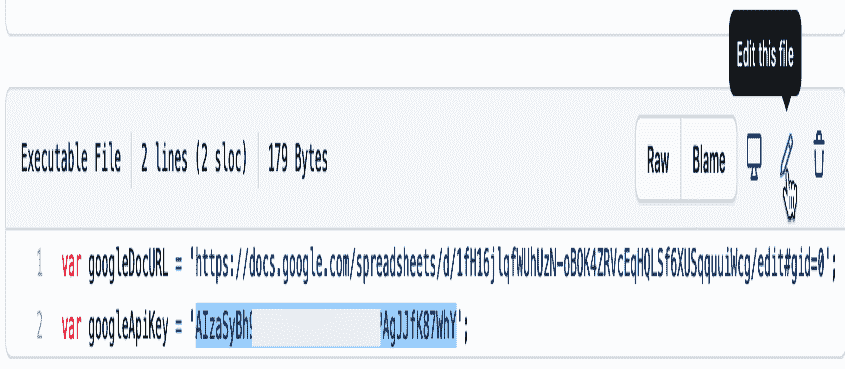

你可能会收到 GitHub 的通知，提示你有一个暴露的 API 密钥，但无需担心。此密钥只能用于 Google Sheets，而且是免费获取的，你也没有关联任何账单信息，因此 Google 无法就使用此密钥向你收费。

既然你已经学会了如何创建与 Leaflet Maps with Google Sheets 或 Leaflet Storymaps with Google Sheets 配合使用的 Google Sheets API 密钥，在接下来的部分中，你将了解更多关于其他类型的 Leaflet 地图模板。

## 使用 CSV 数据的 Leaflet 地图

这个开源模板旨在通过演示如何创建一张从 GitHub 仓库中的 CSV 文件提取数据的 Leaflet 点地图来提高你的编码技能。虽然你可以在其他平台上制作相同类型的地图，例如“使用 Google 我的地图制作点地图”一章中描述的那样，但亲自动手操作会让你更深入地了解 Leaflet 代码库的工作方式。

图 12-7 显示了康涅狄格州一些学院和大学的简单点地图。点数据并非使用 JavaScript 中的 `L.marker()` 函数逐个创建标记，而是存储在本地 CSV 文件（`data.csv`）中，该文件易于在任何文本编辑器或电子表格中修改。每次浏览器加载地图时，都会读取 CSV 文件中的点数据，并“动态”生成标记。

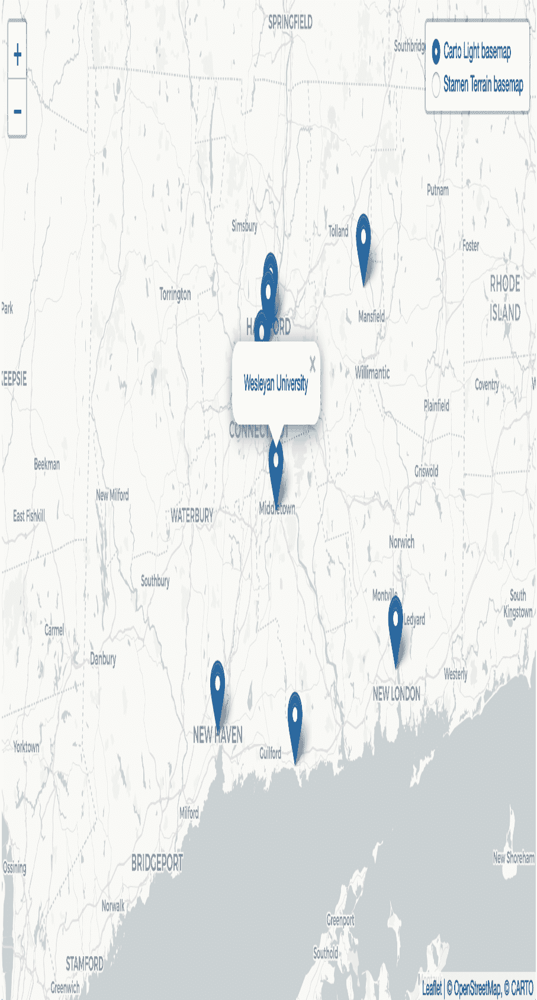

图 12-7. 浏览使用 CSV 数据的交互式 Leaflet 点地图。

你可以按照以下说明调整此模板来创建你自己的点地图：

1. 访问存储此模板代码的 GitHub 仓库。确保你已登录，然后按下“使用此模板”按钮，在你自己的 GitHub 账户中创建此仓库的副本。
2. 将你的点数据放入 `data.csv` 中。模板唯一会读取的相关列是 Latitude、Longitude 和 Title。前两个决定标记的位置，最后一个在弹出窗口中显示。列的顺序无关紧要。数据集中可以包含其他列，但这些列将被忽略。
3. 根据你的点的地理位置，你可能需要更改地图首次加载时的默认位置。在 `index.html` 中，找到 `<script>` 标签，并编辑以下代码块：

你的数据可以如下所示：

```csv
Title,Latitude,Longitude
Trinity College,41.745167,-72.69263
Wesleyan University,41.55709,-72.65691
```

```javascript
var map = L.map('map', {
  center: [41.57, -72.69], // 启动时的默认纬度和经度
  zoom: 9, // 介于 1 和 18 之间；减小以缩小，增大以放大
  scrollWheelZoom: false
});
```

为了代码简洁，我们使用了默认的 Leaflet 标记，但你可能希望改用自定义图标。下面的代码片段可以让你了解如何在你的 GitHub 仓库中进行设置，在示例位置插入你的图标的唯一路径名。

```javascript
var marker = L.marker([row.Latitude, row.Longitude], {
  opacity: 1,
  // 自定义你的图标
  icon: L.icon({
    iconUrl: 'path/to/your/icon.png',
    iconSize: [40, 60]
  })
}).bindPopup(row.Title);
```

要了解更多信息，请参阅这个关于自定义图标的有用 Leaflet 文档示例。

## 使用 CSV 数据的 Leaflet 热力图点数据

热力图将单个点转换为热点区域或聚类，使查看者能够探索事件的空间分布，例如人口密度高或低的区域，或犯罪事件的发生地。图 12-8 显示了 2020 年 1 月至 7 月伦敦自行车盗窃地点的交互式热力图。底层数据是每次报告的自行车盗窃事件的坐标位置，`Leaflet.heat` 插件将其转换为不同密度的区域。红色表示密度最高的区域，也就是自行车盗窃最频繁发生的区域。当你放大时，区域会被重新计算为更清晰的聚类。

### 伦敦自行车盗窃

该热力图根据伦敦警察厅的数据，显示了 2020 年 1 月至 7 月伦敦自行车盗窃的热点区域。

图 12-8. 浏览交互式 Leaflet 热力图。

你可以调整我们用于制作这张伦敦热力图的代码来创建你自己的热力图：

1. 访问包含我们代码的 GitHub 仓库，确保你已登录，然后点击“使用此模板”按钮，制作此仓库的个人副本。
2. 修改 `index.html` 中地图的标题和描述。
3. 将你的点坐标数据放入 `data.csv`。不要插入任何列标题。不要使用传统的顺序，你必须按照纬度，经度（或 y，x）的顺序书写，每行一对，不要有空格，如下所示：
4. 根据你的数据密度，你可能需要调整 `index.html` 的 `<script>` 标签中的 `radius` 和 `blur` 参数：
5. 编辑以下代码块，以设置你的地图的默认位置和缩放级别：

```csv
51.506585,-0.139387
51.505467,-0.14655
51.507758,-0.141284
```

```javascript
var heat = L.heatLayer(data, {
  radius: 25,
  blur: 15,
})
```

```javascript
var map = L.map('map', {
  center: [51.5, -0.1], // 初始地图中心
  zoom: 10, // 初始缩放级别
})
```

如果由于某种原因你无法看到聚类，请确保你的点数据是按照纬度、经度的顺序表示的，而不是相反的顺序。如果你的点很少，请尝试增大 `L.heatLayer` 的 `radius` 属性的值。

## Leaflet 可搜索点地图

可搜索点地图最适合显示多个位置，用户可以按名称或与位置的距离进行搜索，或按类别进行筛选，并可选配列表视图。图 12-9 展示了一个功能强大的 Leaflet 模板，它创建了一个可搜索和筛选的点地图，该地图的数据来源于芝加哥 DataMade 的 Derek Eder 开发的 CSV 数据文件。此地图允许你显示兴趣点，通过“按名称搜索”功能对其进行筛选，并以列表形式而非地图上的点的形式显示它们。此外，“关于”页面为你提供了充足的空间来描述地图的目的和内容。

### 可搜索地图模板 - CSV

你想要将数据放在一张可搜索、可筛选的地图上。提供一个逗号分隔的文件（CSV），这个免费的开源模板会帮你完成其余工作。

了解更多 »

查找地址附近

范围内

输入地址

1英里

按名称搜索

输入企业或组织名称

搜索

重置

列表视图

地图 关于

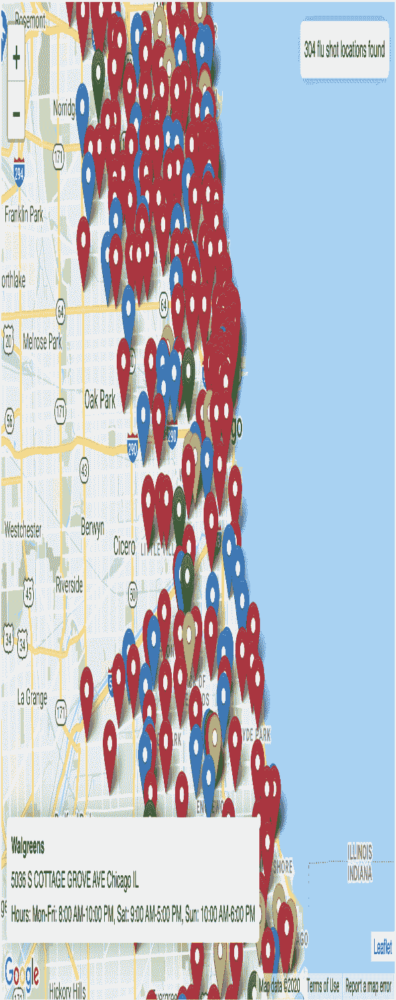

找到 304 个流感疫苗接种点

Walgreens
5036 S COTTAGE GROVE AVE Chicago IL
营业时间：周一至周五：上午 8：00 - 晚上 10：00，周六：上午 9：00 - 下午 5：00，周日：上午 10：00 - 下午 6：00

基于 Derek Eder 和 DataMade 的可搜索地图模板 - CSV


Figure 12-9. Explore the interactive Searchable Map template.

This template uses Leaflet.js in combination with Google Maps API to perform address search.

To begin using the template for your own project, visit the template’s GitHub page, and fork it so that you get your own copy (Chapter 10 to remind yourself about forks).

## Step 1: Prepare Your Data

This template will work with data in CSV (see “Download to CSV or ODS Format”) and GeoJSON (see “Geospatial Data and GeoJSON”) formats. If you have an Excel file, save it in CSV format with any spreadsheet tool. The CSV file must have a latitude column and longitude column and all rows must be geocoded. If you have only street-address or location data, learn how to geocode it in “Geocode Addresses in Google Sheets”.

## Step 2: Download and Edit This Template

- 1. Download or clone this project and fire up your text editor of choice. Open up /js/map.js and set your map options in the SearchableMapLib.initialize function:
  
      map_centroid
      
      The latitude/longitude (lat/long) you want your map to center on.
  
      filePath
  
      Path to your map data file. This file needs to be in CSV or GeoJSON format and placed in the data folder. This file’s first line must be the header, and it must have a latitude column and longitude column.
  
      fileType
  
      Set if you are loading in a csv or geojson file.
  
- 2. Edit the templates in the templates folder for how you want your data displayed. These templates use embedded JavaScript templating (EJS), which allows the display of your variables with HTML, as well as conditional logic. Read more in the EJS documentation.
  
      /templates/hover.ejs
  
      Template for when you hover over a dot on the map.
  
      /templates/popup.ejs
  
      Template for when a dot on the map is clicked.
  
      /templates/table-row.ejs
  
      Template for each row in the list view.
  
- 3. Remove the custom filters and add your own.
  
      index.html
  
      Custom HTML for filters starts around line 112.
  
      /js/searchable_map_lib.js
  
      Logic for custom filters starts around line 265.

## Step 3: Publish Your Map

- 1. Before you publish, you’ll need to get a free Google Maps API key, which is similar but different from “Get Your Google Sheets API Key”. Replace the Google Maps API key on this line of index.html with yours:
  
  ```
  <script type="text/javascript"
  src="https://maps.google.com/maps/api/js?libraries=places&
  key=[YOUR KEY HERE]"></script>
  ```
  
- 2. Upload this map and all the supporting files and folders to your site. This map requires no backend code, so any host will work, such as GitHub Pages, as described in Chapter 10, Netlify, or your own web server.

## Leaflet Maps with Open Data APIs

Learn how to code your own Leaflet map with an API that continuously pulls the most current information directly from an open data repository, similar to the Socrata Open Data map you learned about in “Current Map with Socrata Open Data”. Leaflet maps can pull and display data from various open data repositories using APIs. Figure 12-10 shows an interactive map of North Dakota counties, colored by population density, with hospitals and emergency medical service (EMS) locations.

This map template pulls data from three different open repository sources:

- Hospital information is pulled directly from the Medicare.org Socrata database.
- County boundaries and population density are pulled from the North Dakota GIS ArcGIS server.
- EMS stations are fetched from the Homeland Infrastructure Foundation-Level Data ArcGIS server.

- Population density
- EMS Stations
- Hospitals

ST ALOISIUS MEDICAL CENTER
HARVEY
58341

50 km
50 mi

Figure 12-10. Explore the interactive Leaflet Map with Open Data.

You can enable Leaflet to pull data from ArcGIS servers using a free esri-leaflet plug-in. Data from Socrata can be pulled using jQuery’s $.getJSON() function, and then passed to Leaflet directly using L.geoJSON() function.

To adapt this template for your own project:

- 1. Visit the GitHub repository that contains the code for the map in Figure 12-10, and press the “Use this template” button to copy the repo to your own GitHub account.
- 2. All data is pulled from the code inside the <script> tag of index.html. To pull data from Socrata or another JSON/GeoJSON endpoint, modify the following code snippet with the appropriate URL and icon:

```
/*
From Medicare’s Socrata database, add general hospitals in North Dakota
using simple filtering on the ‘state’ column, and a GeoJSON endpoint.
Each point is a custom .png icon with a tool tip containing hospital’s name,
city, and zip code.
*/
$.getJSON("https://data.medicare.gov/resource/xubh-q36u.geojson?state=ND",
function(data) {
var hospitals = L.geoJSON(data, {
pointToLayer: function(feature, latlng) {
return L.marker(latlng, {
icon: L.icon({
iconUrl: 'images/hospital.png',
iconSize: [24, 24],
iconAnchor: [12, 12],
opacity: 0.5
})
}).bindTooltip(
feature.properties.hospital_name
+ '<br>' + feature.properties.city
+ '<br>' + feature.properties.zip_code
)
}
}).addTo(map)
}
)
```

The following code snippet uses the esri-leaflet plug-in to pull polygon data from an ArcGIS server, and creates a choropleth layer based on population density (stored in POP10_SQMI variable of each feature, or polygon):

```
var counties = L.esri.featureLayer({
url: 'https://ndgishub.nd.gov/arcgis/rest/services/All GovtBoundaries/MapServer/20',
style: function(feature) {
return {
fillOpacity: 0.5,
weight: 0.5,
color: 'silver',
fillColor: getDensityColor(feature.properties.POP10_SQMI)
}
}
}).addTo(map)
```

Here, the getDensityColor() function returns a color for a given value based on predefined thresholds. In the North Dakota example, population density of more than one hundred people per square mile is assigned the darkest shade of red, while the density of five and fewer is shown with the lightest:

```
var getDensityColor = function(d) {
return d > 100 ? '#7a0177' :
d > 50 ? '#c51b8a' :
d > 20 ? '#E768A1' :
d > 5 ? '#fbb4b9' :
'#feebe2'
}
```

While it’s convenient to pull data directly from the source databases, remember that those resources are out of your control (unless you administer them, of course). Data changes often come unannounced. For example, if the dataset owner decides to rename the population density field from POP10_SQMI to Pop10_sqmi, your map will stop showing values correctly. Datasets may get moved to a different domain name or get deleted entirely, so it’s wise to have a backup file saved locally.

If you’re more concerned about the long-term functioning of your map as opposed to displaying the most up-to-date version of the dataset, you may consider serving your data from local GeoJSON files instead (but ensure first that the data license permits it).

## Summary

In this chapter, we introduced Leaflet map templates for common map problems, such as telling stories about places using scrollable interface, showing point data from databases like Socrata, and creating heatmaps to visualize areas of high-event density.

You can use these templates as a base to kickstart your own mapping projects. Leaflet.js is well-documented, and we recommend looking at their tutorials for more inspiration.

In the next chapter, we’ll talk about geospatial data and introduce several tools that can convert, create, and edit geospatial files.

1 Marijn Haverbeke, *Eloquent JavaScript: A Modern Introduction to Programming*, 3rd Edition, 2018, https://eloquentjavascript.net.

2 Learn about HTML syntax at W3Schools.

3 Learn about HTML syntax at W3Schools.

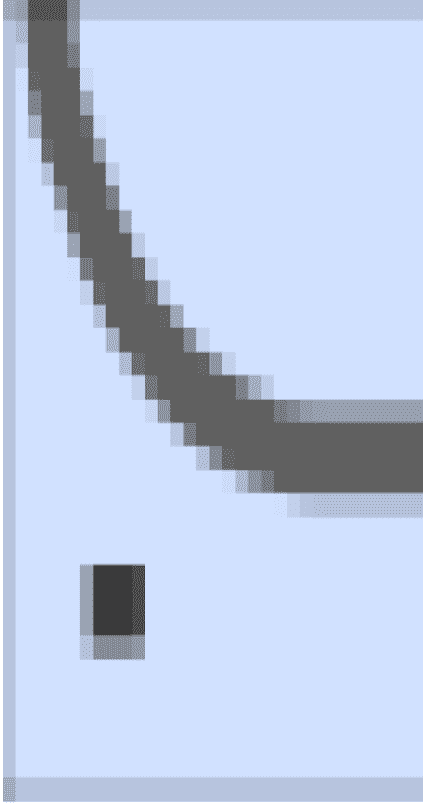

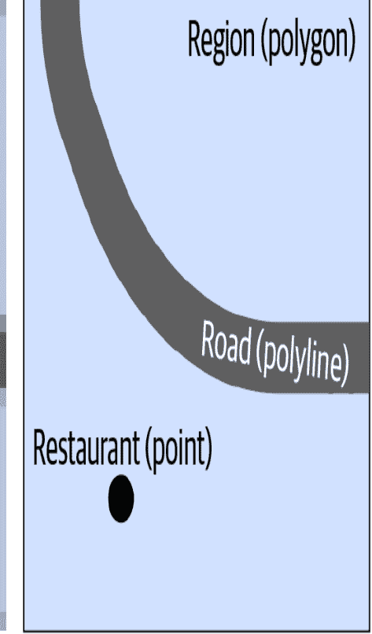

Figure 13-1. Geospatial data can be a raster grid of cells (on the left) or a vector collection of points, polylines, and polygons (on the right).

Because we focus on vector data in several sections of this chapter, let’s take a look at some of its most common file formats, starting with GeoJSON, the format that works best with our recommended tools.

## GeoJSON

GeoJSON is a popular map data format, based on an open standard created in 2016, with file extensions .geo.json or .json. The following code snippet represents a single point in GeoJSON format, with latitude of 41.76 and longitude of −72.67, and a name attribute (also known as a property) whose value is Hartford:

```
{
  "type": "Feature",
  "geometry": {
    "type": "Point",
    "coordinates": [-72.67, 41.76]
  },
  "properties": {
    "name": "Hartford"
  }
}
```

In addition to Point feature type shown above, other GeoJSON types can be LineString (also known as lines or polylines) or Polygon, both of which are represented as arrays of points. The simplicity and readability of GeoJSON allows you to edit it even in the most simple text editor, such as the Atom text editor described in “GitHub Desktop and Atom Text Editor to Code Efficiently”.

We strongly recommend that you create and edit map data in GeoJSON format, which is supported by the map tools we recommend in this book (such as Datawrapper and Leaflet) and dozens of others. Storing and sharing your geospatial data in GeoJSON ensures that others will be able to use the file without installing bulky or expensive geographical information systems (GIS) desktop applications. Another benefit is that your GitHub repository will automatically display a map preview of any GeoJSON file, as shown in Figure 13-2.


point that have been uploaded into OpenStreetMap, which you can select and download in GeoJSON format. For example, when you search and click on Toronto Centre, the tool displays several neighborhood-level boundaries, the Old Toronto city boundary, the present-day Toronto city boundary, and regional and provincial boundaries, as shown in Figure 13-3. Read more details about each layer to evaluate their accuracy, then select any layer to download in GeoJSON format. The tool also includes an editor (the scissors symbol) to remove water areas from the boundary file (such as deleting Lake Ontario from Toronto). When using any type of data that you downloaded from OpenStreetMap, always credit the source in your final product like this: © OpenStreetMap contributors.¹

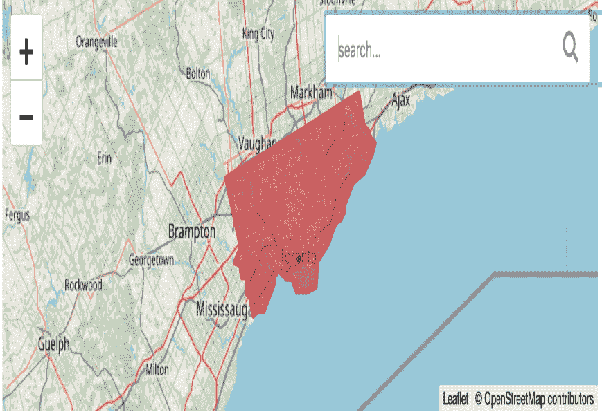

## SPADINA—FORT YORK

tags: boundary administrative more ▼

## OLD TORONTO

tags: boundary administrative more ▼

## TORONTO

tags: boundary administrative more ▼

download

## GOLDEN HORSESHOE

tags: boundary administrative more ▼

## ONTARIO

You know how to find geodata now, so let’s look at free online tools to create, convert, edit, and join GeoJSON files with other types of data.

## Draw and Edit with GeoJson.io

GeoJson.io is a popular open source web tool to convert, edit, and create GeoJSON files. The tool was originally developed by Tom MacWright in 2013 and quickly became a go-to tool for geospatial practitioners.

In this tutorial, we’ll show you how to convert existing KML, GPX, TopoJSON, and even CSV files with latitude/longitude data into GeoJSON files. We’ll also explore how to edit attribute data, add new features to GeoJSON files, and create new geodata from scratch by tracing satellite imagery.

### Convert KML, GPX, and Other Formats into GeoJSON

Navigate to the GeoJson.io tool. You will see a map on the left, and a Table/JSON attribute view area on the right. At the start, it represents an empty feature collection. Remember that features are points, polylines, and polygons.

Drag and drop your geospatial data file into the map area on the left. Alternatively, you can also import a file from Open > File menu. If you don’t have a geospatial file, download the Toronto neighborhoods sample file in KML format to your computer, and upload it to the GeoJson.io tool. This simplified sample KML file was created from the Toronto Open Data portal.

If GeoJson.io can recognize and import your geodata file, you’ll see a green pop-up message in the upper-left corner indicating how many features were imported. For example, Figure 13-4 shows us that 140 features were imported from the sample Toronto neighborhoods KML file, and these polygons appear in the top of the map view.

> **NOTE**
> 
> If GeoJson.io cannot import your file, you’ll see a red pop-up saying it “Could not detect file type.” Instead, try to convert your file into GeoJSON format using the Mapshaper tool, as described in “Edit and Join with Mapshaper”.

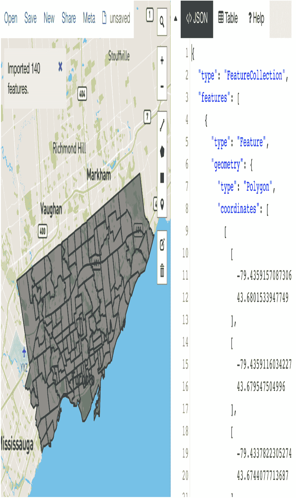

To download a converted GeoJSON file to your computer, go to Save > GeoJSON.

> **WARNING**
> 
> The GeoJson.io tool will automatically name your downloaded file as *map.geojson*, so rename it to avoid confusion.

### Create GeoJSON from a CSV File

GeoJson.io can transform a CSV spreadsheet with *latitude* (or *lat*) and *longitude* (or *lon*) columns into a GeoJSON file of point features. Each row in the spreadsheet becomes its own point, and all columns other than *lat* and *lon* become *attributes* (or *properties*) of point features. For this exercise, you can download the Toronto locations sample CSV file to your computer, which contains three rows of data as shown in Figure 13-5.

| name | lat | lon | link |
|---|---|---:|---:|
| CN Tower | 43.6425956 | -79.38712307 | http://www.cntower.ca/ |
| Toronto Pearson International Airport | 43.6777176 | -79.6270137 | http://www.torontopearson.com/ |
| Royal Ontario Museum | 43.667679 | -79.394809 | http://www.rom.on.ca/en |

*Figure 13-5. A CSV spreadsheet with lat/lon columns can be transformed into a GeoJSON with point features.*

- 1. Select New to clear data from the prior exercise in the GeoJson.io tool, then drag-and-drop the Toronto locations CSV file you downloaded into the map area of the tool. A green pop-up will notify you that three features were successfully imported.

> **NOTE**
> 
> If you add new data to existing data in GeoJson.io, it will combine them into one file, which can be useful for certain tasks.

- 2. Click on a marker to see a pop-up with point properties. If you used the Toronto locations sample file, you’ll see *name* and *link* features, in addition to the tool’s default *marker-color*, *marker-size*, and *marker-symbol* fields. Note that you can edit and delete properties in the Map view.

- 3. Click the Table tab to the right of the map to view all of the data at once, rather than individual marker pop-ups. You can edit and delete properties in the Table view, as well as the JSON code view.

- 4. If you edited your map data, go to Save > GeoJSON to download the file to your computer, which will automatically be named *map.geojson*, so rename it to avoid confusion. You can also log into GeoJson.io with your GitHub account and save it directly to your repository.

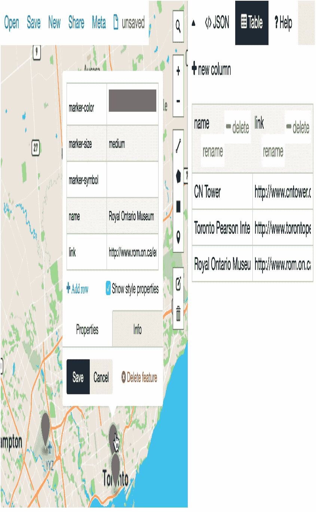

### Create New GeoJSON Data with Drawing Tools

GeoJson.io lets you create geospatial files from scratch by using simple drawing tools to place points, polylines, or polygons on the map. These are useful when you have no original file to work with. Let’s create some new data:

- 1. Click New to clear data from the prior exercise in the GeoJson.io tool.
- 2. In the lower-left corner, switch from Mapbox (vector tiles) to Satellite (raster data).
- 3. In the upper-right corner of the map, use the Search tool to find an area of interest. For this exercise, we’ll trace the geography around an athletic field in Toronto.

4. In the toolbar, you have a choice of four drawing tools: a polyline (which is a series of points connected by lines, but not closed like a polygon), a polygon, a rectangle (which is just an instance of a polygon), and a point marker.

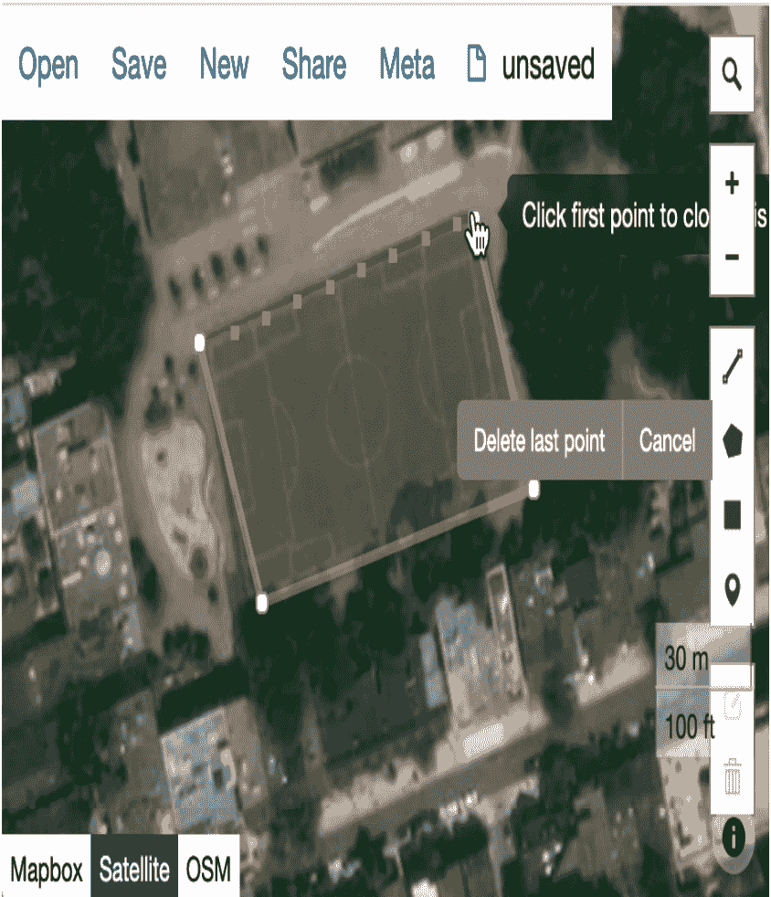

5. Select the “Draw a marker” button, and click anywhere on the map to place it. You’ll see a gray marker that is now part of your map. You can modify its properties or delete it in the interactive pop-up.

6. Select the “Draw a polyline” button and click on multiple locations in the map to see connected lines appearing. Polylines are generally used for roads and paths. To finish and create a feature, click again on the final point.

7. Select the “Draw a polygon” button, which is similar to drawing a polyline, except that you need to complete the feature by making your final point at the same location as your initial point. Polygons are used to define boundaries, including small and large geographical areas.

8. Use the “Edit layers” tool (above Delete) to move a marker to a better position or adjust the shapes of your features.

9. After you have created features and their physical boundaries, add meaningful attribution data. Use the interactive pop-ups or the Table view to give objects names and other properties. When finished, save the GeoJSON file to your computer.

You can also use drawing tools to edit existing GeoJSON files. For example, if you created a GeoJSON from a CSV file, you might decide to move some markers with “Edit layers” instead of modifying their latitude and longitude values. Or you might decide to make polygons more precise by tracing around satellite imagery.

In the next section, we will introduce Mapshaper, another free online tool to convert and modify geospatial files.

## Edit and Join with Mapshaper

Like GeoJson.io, Mapshaper is a free, open source editor that can convert geospatial files, edit attribute data, filter and dissolve features, simplify boundaries to make files smaller, and much more. Mapshaper’s edit and join commands are much more powerful than the GeoJson.io tool. Unlike GeoJson.io, Mapshaper doesn’t have drawing tools, so you won’t be able to create geospatial files from scratch.

Mapshaper is developed and maintained by Matthew Bloch on GitHub. This easy-to-learn web tool has replaced many of our map preparation tasks that previously required expensive and hard-to-learn ArcGIS software, or its free but still-challenging-to-learn cousin QGIS. Even advanced GIS users may discover that Mapshaper can be a quick alternative for some common but time-consuming tasks.

### Import, Convert, and Export Map Boundary Files

You can use Mapshaper to convert between geospatial file formats. Unlike GeoJson.io, Mapshaper also allows you to upload Esri Shapefiles, so you can easily convert them into the web-friendly GeoJSON format. In the following steps, we’ll convert a geospatial file by importing it to Mapshaper, and then exporting it as a different file type:

- 1. Navigate to Mapshaper.org. The start page has two large drag-and-drop zones that you can use to import your file. The smaller area at the bottom, “Quick import,” uses default import settings and is a good way to begin.
- 2. Drag and drop your geospatial file to the “Quick import” area. For this exercise, you can download our US states Shapefiles in .zip format, which is a compressed archive that contains four Shapefiles.

> **NOTE**
> 
> If you want to import a folder of Shapefiles, you need to either select all files inside that folder and drop them all together to the import area, or upload all of them inside a compressed .zip archive.

- 3. Each imported file becomes a layer and is accessible from the drop-down menu in the top-middle of the browser window. There, you can see how many features each layer has, toggle their visibility, or delete them.
- 4. To export, go to Export in the upper-right corner, and select a desired file format. The choice of export formats is shown here. Currently, available formats are Shapefile, GeoJSON, TopoJSON (similar to GeoJSON, but with topological data), JSON records, CSV, or SVG (Scalable Vector Graphics, for web and print). If you export more than one layer at a time, Mapshaper will archive them first, and you will download an output.zip that contains all exported layers.


## 导出菜单

文件格式

- Shapefile
- GeoJSON
- TopoJSON
- JSON 记录
- CSV
- SVG

导出选项

取消    导出

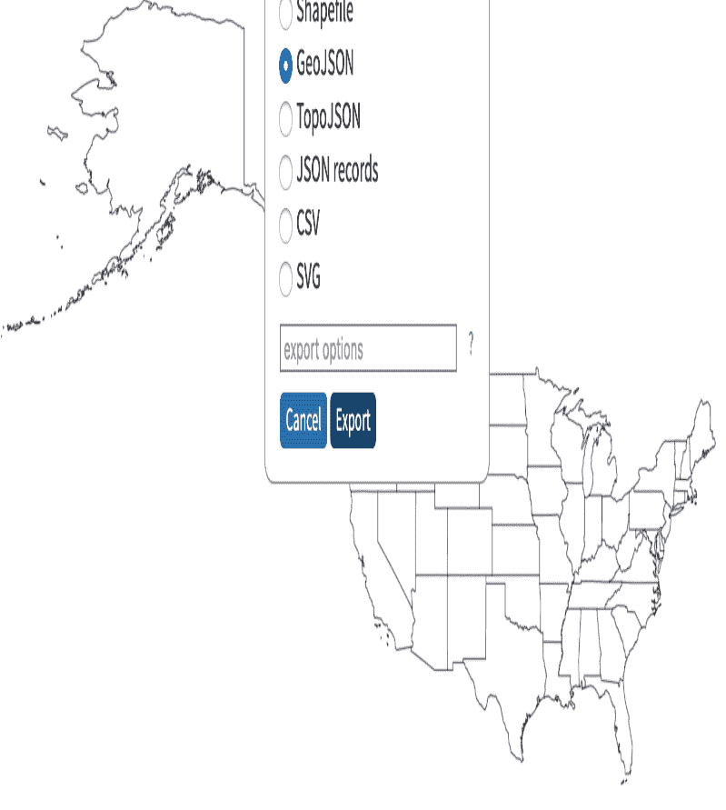

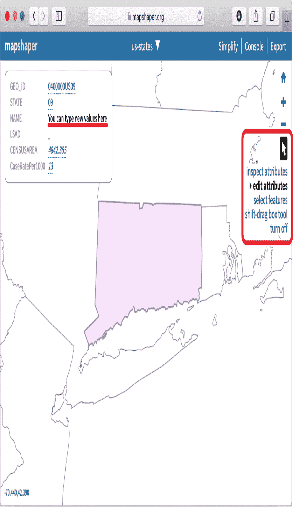

# 重命名数据字段

Mapshaper 最强大的工具可通过顶部的 Console 按钮使用，该按钮会打开一个窗口，您可以在其中输入命令以执行常见的地图编辑任务。

有时地图要素（例如点、折线和多边形）包含 *属性*（数据字段或列），其名称过长或令人困惑。在 Mapshaper *Console* 中，您可以通过输入以下通用格式的 rename 命令轻松更改字段名称：

> **警告**
> 
> 如果你在逗号后留有空格，你将收到 *Command expects a single value* 错误。

# 简化地图边界以减小文件大小

当你在网上找到 GeoJSON 地图时，它们可能包含详细的边界（尤其是在海岸线周围），这会增加文件大小，从而可能减慢你的在线网络地图的性能。由于你在具有放大的地理范围的数据可视化项目中并不总是需要高度详细的边界，因此请考虑使用 Mapshaper 来简化你的地图边界。结果会不那么精确，但在用户浏览器中加载会更快。

要了解如何简化地图边界，请考虑两张美国本土州的地图（也称为 *lower 48*，我于 2018 年在阿拉斯加旅行时学到的术语），如图 13-7 所示。地图 (a) 更详细，约为 230 千字节，但地图 (b) 只有 37 千字节，小了六倍！然而，要小心不要过度简化边界以至于删除了重要特征。

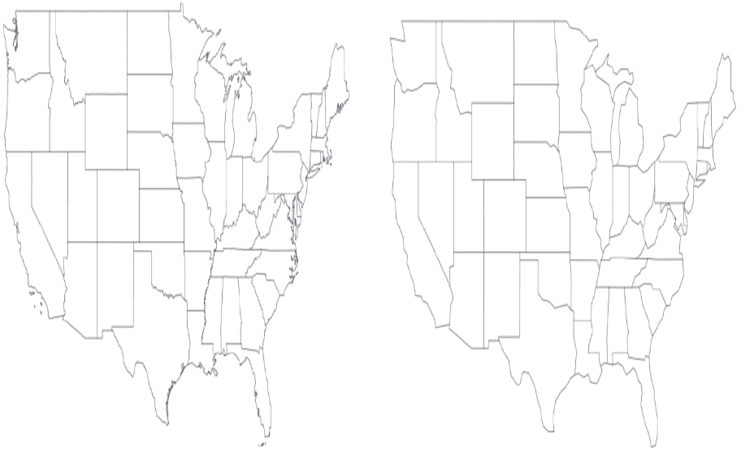

*(a) 原始文件，230 KB*                                 *(b) 简化边界，37 KB*

*图 13-7.* 考虑使用 Mapshaper 简化几何图形以使你的网络地图更快。

> **提示**
> 
> 当你将地理文件上传到 Mapshaper 时，你可能需要更改其投影以与你的可视化工具或相关地理数据对齐。打开控制台并输入 `-proj webmercator`（或 `-proj EPSG:3857`）以将投影更改为 Web Mercator，这是 Google Maps 和其他网络制图工具常用的格式。

要在 Mapshaper 中简化地图边界，请按照以下步骤操作：

- 1. 将你的地理数据文件导入 Mapshaper。你可以使用 [GeoJSON 格式的示例美国本土州](#)。
- 2. 点击右上角的 Simplify 按钮。简化菜单将出现，你可以在其中选择三种方法之一。我们建议勾选“prevent shape removal”，并保留默认的“Visvalingam / weighted area”。点击 Apply。
- 3. 你会看到一个滑块以 100% 出现在顶部，替换图层选择下拉菜单。向右移动滑块，地图形状会随着你的移动而简化。停止在你认为地图看起来合适时（形状仍然可识别）。

# mapshaper

设置

37.3%

简化

控制台

导出

2 条线相交

修复

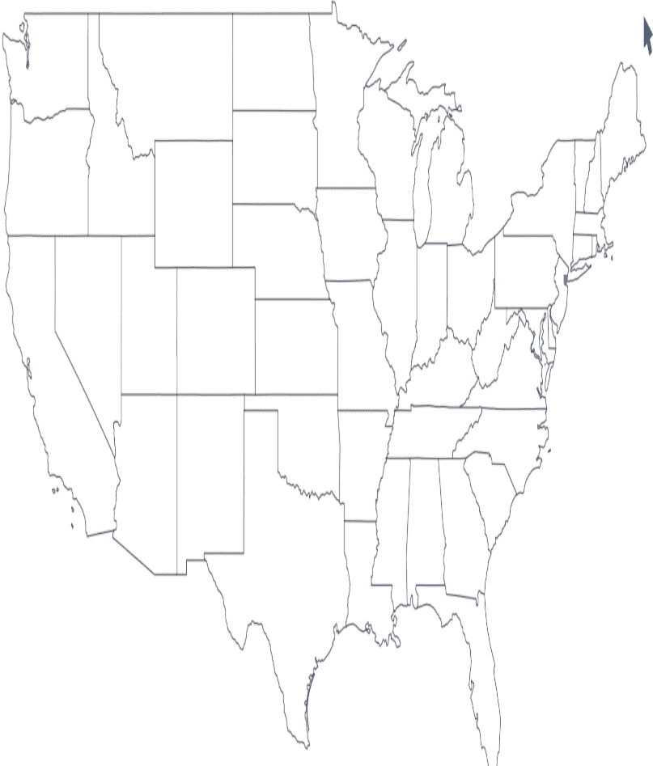

-103.40,52.63

- 4. 在左上角，Mapshaper 可能会建议修复线相交。点击 Repair。
- 5. 你现在可以使用 Export 功能导出文件。

# 溶解内部多边形以创建轮廓地图

常见的地图编辑任务之一是通过删除内部边界来创建轮廓地图。例如，你可以溶解上一练习中美国地图的州边界以获得国家的轮廓，如图 13-8 所示。

点击 Console，打开一个窗口输入命令。输入 `dissolve` 命令，如图所示，然后按 Return 或 Enter：

```
-dissolve
```

你会看到内部边界变得颜色更浅，这是 Mapshaper 表示它们不再存在的方式。你现在可以导出你的轮廓形状。

# mapshaper

lower-48

简化

控制台

导出

```
$ -dissolve
```

[dissolve] Dissolved 49 features into 1 feature

```
$
```

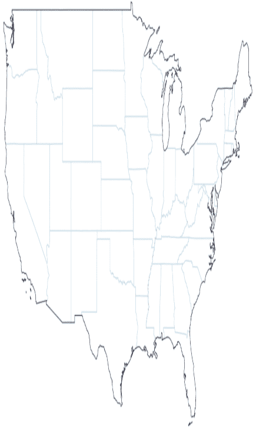

-1215526,7036895

# 裁剪地图以匹配轮廓图层

另一个常见的地图编辑任务是“裁剪”较大地图的较小部分以仅获得你需要的区域。例如，康涅狄格州由八个县组成，这些县又分为总共 169 个镇。想象一下，你被提供了全部 169 个镇的边界文件和哈特福德县的轮廓。你需要裁剪原始的城镇地图以仅包含康涅狄格州特定部分内的城镇：哈特福德县。

Mapshaper 允许你使用一个简单的 -clip 命令做到这一点：

- 1. 将两个边界文件导入 Mapshaper。一个是被裁剪的较大文件（如果你使用示例文件，则为 ct-towns），另一个是期望的最终形状（hartfordcounty-outline）。后者是 ArcGIS 所称的裁剪要素。
- 2. 确保你的活动图层设置为你要裁剪的地图（ct-towns）。
- 3. 在 Console 中，输入 -clip 后跟你的裁剪图层的名称，如下所示：
- 4. 你应该会看到你的活动图层被裁剪了。有时你会在边界旁留下被裁剪的微小碎片。如果是这种情况，请使用相关命令将其删除，如下所示：
- 5. 你的 Mapshaper 状态应如下图所示。你现在可以使用 Export 按钮将文件保存到你的计算机上。

```
-clip hartfordcounty-outline
```

```
-clip hartfordcounty-outline -filter-slivers
```

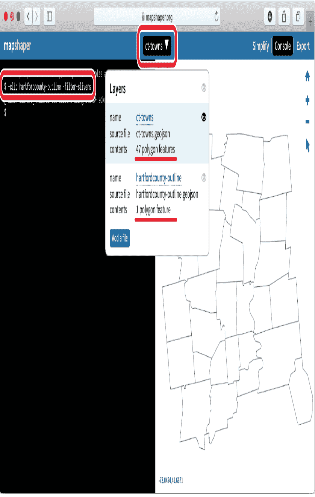

# 将电子表格数据与多边形地图连接

将电子表格数据与地理边界结合是数据可视化中的常见任务。在本练习中，你将下载此 [GeoJSON 格式的康涅狄格州城镇边界地图](#)，以及此 [CSV 格式的康涅狄格州城镇人口数据](#)，并将它们连接起来构建一个色带地图。

Mapshaper 提供了一个强大的 `-join` 命令来连接这些文件。请记住，你需要在两个数据集中都有一些共同的键（例如 *城镇名称*、*州* 或 *国家*）来连接这两个文件。如果没有共同字段，Mapshaper 就无法知道哪些数字属于哪些多边形。

- 1. 使用其快速导入框将你之前下载的 GeoJSON 文件和 CSV 文件都导入 Mapshaper。
- 2. 确保两个文件都出现在图层下拉列表中。你的 CSV 数据将看起来像一个表格。使用光标 > “inspect features” 工具确保数据已正确导入。如果你使用示例康涅狄格州数据，请注意 *ct-towns* 图层具有包含城镇名称的 *name* 属性，而 *ct-towns-popdensity* 在 *town* 列中有城镇名称。
- 3. 将你的地理空间图层（*ct-towns*）设为活动图层。
- 4. 打开控制台并输入 `-join` 命令，如下所示：

```
-join ct-towns-popdensity keys=name,town
```

在此命令中，*ct-towns-popdensity* 是你要合并的 CSV 图层，而 *keys* 是包含用于连接的值的属性。对于我们的示例数据，这些将是城镇名称，它们存储在地图文件的 *name* 属性中和 CSV 文件的 *town* 列中。

- 5. 你将在控制台中看到一条消息，通知你 `join` 命令是否成功执行或 Mapshaper 是否遇到任何错误。
- 6. 使用光标 > “inspect features” 工具确保你可以看到 CSV 列作为你的多边形的字段。

# mapshaper

# ct-towns

简化

控制台

导出

Enter mapshaper commands or type "help" for examples and console help

```
$ -join ct-towns-popdensity keys=name,town
```

Join: joined data from 162 source records to 169 target records

$

| name | New Haven |
| pop2010 | 129779 |
| land-sq-miles-2010 | 18.678634 |
| density2010 | 6947.992 |

7. 你现在可以通过点击 Export 将文件保存到你的计算机上。


## 使用 Mapshaper 统计多边形中的点

Mapshaper 允许你统计多边形内的点，并使用 `-join` 命令将该数量记录到多边形属性中：

- 1. 下载两个示例 GeoJSON 文件到你的电脑：一个是你想要聚合的点，例如美国的医院点；另一个是多边形边界，例如美国各州的边界。将两者都导入 Mapshaper。
- 2. 确保在下拉菜单中选择“polygons”（而非 points）作为活动图层。
- 3. 在控制台中，使用 `count()` 函数执行 `-join` 命令，如下所示：

```
-join hospitals~points calc='hospitals = count()' fields=
```

该命令告诉 Mapshaper 统计 *hospitals~points* 图层内的点，并将其记录为多边形的 *hospitals* 属性。*fields=* 部分告诉 Mapshaper 不要从点中复制任何字段，因为在本例中我们执行的是多对一匹配，即每个州对应多家医院。

- 4. 使用 Cursor > “inspect features” 工具，确保多边形获得了一个包含点计数的新字段。

## mapshaper

us-states

简化

控制台

导出

输入 mapshaper 命令，或输入 "tips" 查看示例和控制台帮助

```
$ -join hospitals-points calc='hospitals = count()' fields=
```

[join] 已将 4,919 条源记录连接到 52 条目标记录

[join] 407/5326 条源记录无法连接

[join] 51/52 条目标记录被多条源记录匹配

```
$
```

| 名称 | 伊利诺伊 |
| 缩写 | IL |
| 陆地面积（平方英里） | 55519 |
| 医院数量 | 182 |

-85.951,39.127

5. 使用“导出”按钮保存新文件，并选择所需的输出格式。在下一节中，我们将讨论未连接的对象会发生什么。

## 关于连接的更多信息

在上一节中，你不需要指定 *键* 来连接两个地理图层（点和多边形）之间的位置。但如果你要连接的文件之一是 CSV 数据集，则需要 *键*。

如果你没有与边界地图数据中的列相匹配的 CSV 数据集，你可以轻松创建一个。将边界地图上传到 Mapshaper，并以 CSV 格式导出。在任何电子表格工具中打开下载的 CSV 文件。要匹配 CSV 电子表格中的数据列，请使用 VLOOKUP 函数（参见“使用 VLOOKUP 匹配列”）。

在现实生活中，你很少会拥有完美的一对一匹配文件，因此你可能希望了解更多关于哪些要素未匹配的信息，以便修复数据。Mapshaper 可以帮助你跟踪未正确连接或匹配的数据。例如，如果多边形地图包含 169 个要素（康涅狄格州每个城镇一个），但 CSV 表只包含 168 行数据，Mapshaper 将连接所有具有匹配键的记录，然后显示以下消息：

```
[join] 已将 168 条源记录连接到 168 条目标记录
[join] 1/169 条目标记录未收到数据
[join] 1/169 条源记录无法连接
```

要了解哪些值未连接，请在连接命令中添加 `unjoined unmatched -info` 标志，如下所示：

```
-join ct-towns-popdensity keys=name,town unjoined unmatched -info
```

*unjoined* 标志会将源表中每条未连接的记录保存到名为 *unjoined* 的另一个图层中。*unmatched* 标志会将目标表中每条未匹配的记录保存到名为 *unmatched* 的新图层中。最后，*-info* 标志会在控制台中输出有关连接过程的一些附加信息。

## 使用 Join 和 Dissolve 命令合并选定的多边形

在 Mapshaper 中，你可以使用 `-join` 和 `-dissolve` 命令将选定的多边形合并为更大的集群。假设你受雇于康涅狄格州公共卫生部，你的任务是将 169 个城镇划分为 20 个公共卫生区，并生成一个新的地理空间文件。

你应该首先创建一个城镇及其卫生区的 *交叉对照表*，这意味着某种匹配两组数据的方法，例如邮政编码及其所在的城镇。在我们的例子中，交叉对照表可以简单到只是一个两列的 CSV 列表，每行包含一个城镇及其所属区域。由于你的老板没有给你电子表格格式的城镇列表，而是给了一个包含城镇边界的 GeoJSON 文件，让我们从中提取城镇列表：

- 1. 使用快速导入框将 *ct-towns.geojson* 导入 Mapshaper。
- 2. 使用 Cursor > “inspect features” 工具查看每个多边形是否都有一个包含城镇名称的 *name* 属性。
- 3. 使用“导出”按钮将属性数据保存为 CSV 文件。在任何电子表格工具中打开该文件。你会看到数据是一个单列文件，其中 *name* 列列出了 169 个城镇。
- 4. 在电子表格中，创建第二个名为 *merged* 的列，并从第一个 *name* 列复制粘贴值。此时，你的电子表格包含两列相同值的列。
- 5. 选择几个城镇，例如 West Hartford 和 Bloomfield，并将 *Bloomfield-West Hartford* 分配给它们的 *merged* 列。你可以在此处停止并进入下一步，或者继续为其他几个邻近城镇分配区域名称。

|  | A | B | C |
|---|---|---|---|
| 1 | 名称 | 合并 |  |
| 2 | Bloomfield | Bloomfield-West Hartford |  |
| 3 | West Hartford | Bloomfield-West Hartford |  |
| 4 | Bethel | Bethel |  |
| 5 | Bridgeport | Bridgeport |  |
| 6 | Brookfield | Brookfield |  |
| 7 | Danbury | Danbury |  |
| 8 | Darien | Darien |  |
| 9 | Easton | Easton |  |
| 10 | Fairfield | Fairfield |  |
| 11 | Greenwich | Greenwich |  |

6. 将此新电子表格文件保存为 ct-towns-merged.csv，并将其拖放到 Mapshaper 中你的 ct-towns 图层上。点击“导入”。

7. 在 Mapshaper 中，这个名为 ct-towns-merged 的新 CSV 图层将显示为一系列表格单元格。从下拉菜单中选择 ct-towns 以返回你的地图。

8. 现在你可以根据上传的 CSV 文件将某些城镇合并为区域。打开控制台，输入 `-join ct-towns-merged keys=name,name` 将 CSV 图层与屏幕上看到的边界图层连接。然后输入 `-dissolve merged`，根据 CSV 文件的 merged 列溶解城镇的多边形。

在我们的示例中，只有 Bloomfield 和 West Hartford 被溶解为一个合并的 Bloomfield-West Hartford 区域卫生区，这些城镇之间的共享边界线变为灰色。所有其他多边形保持不变。以下是最终结果。

```
输入 mapshaper 命令，或输入 'tips' 查看示例和控制台帮助
$ -join ct-towns merged key=name,name
[join] 已将 169 条源记录连接到 169 条目标记录
$ -dissolve merged
[dissolve] 已将 169 个要素溶解为 168 个要素
$
```

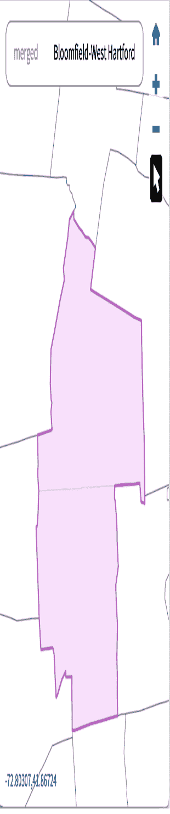

你可以使用 Cursor > “inspect features” 工具检查多边形的属性数据，并使用“导出”按钮保存结果文件。

总的来说，Mapshaper 是一个强大的地理数据编辑工具，还有更多值得探索的命令。其中一些包括更改投影、使用 JavaScript 表达式过滤要素、根据值将颜色分配给多边形等等。探索 GitHub 上的 Mapshaper Wiki，了解更多命令和示例。

## 将压缩的 KMZ 转换为 KML

在前两节中，我们演示了如何使用 GeoJson.io 工具和 Mapshaper 工具将地理空间文件从一种格式转换为另一种格式。但是，并非所有文件类型都可以使用这些工具转换。本节展示了一个常见的 .kmz 和 .kml 格式转换的具体示例，使用免费的 Google Earth Pro 桌面应用程序。KMZ 是 KML 文件（Google Earth 的原生格式）的压缩版本：

- 1. 下载并安装适用于 Mac、Windows 或 Linux 的 Google Earth Pro 桌面应用程序。
- 2. 双击任意 .kmz 文件以在 Google Earth Pro 中打开它。或者，先打开 Google Earth Pro，然后转到“文件”>“打开”并选择你的 KMZ 文件。
- 3. 右键单击（或按住 Control 单击）“地点”菜单下的 KMZ 图层，然后选择“将地点另存为...”


## Google Earth Pro

## Search

ex: Hotels near JFK

Get Directions

History

## Places

My Places

Sightseeing Tour

Make sure 3D Buildings

Temporary Places

Plate Boundaries

Right-click on KMZ layer

## Plate Boundaries

Divergent

Transform

Convergent

Other

## Plate Motion

*Plate motion vectors rotated based on the direction of plate movement

- Add
- Cut
- Copy
- Delete
- Delete Contents
- Rename
- Revert
- Save to My Places
- Save Place As...
- Email...
- Snapshot View
- Sort A-Z
- Get Info

## Layers

Imagery Date: 12/14/2015 37°27'02

Data SIO, NOAA US Dept © 2020

4. In the drop-down menu of “Save file…” window, choose KML format.

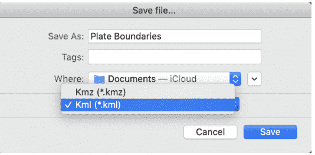

Alternatively, you can use any zip utility to extract a KML file from KMZ, because KMZ is simply a zipped version of a KML file.

## Georeference with Map Warper

Map Warper, an open source tool created and hosted by Tim Waters, allows users to upload and georeference (also called georectify) a scanned map image. This means to precisely align the static map image on top of a present-day interactive map. As a result of this process, older map images often appear warped when updated for the digital age. After your map image is georeferenced and hosted on this site, a special link allows you to place this raster data as an overlay on an interactive map, such as in “Leaflet Storymaps with Google Sheets”. Anyone can create a free account to upload and georeference a map on the developer’s public Map Warper site. See also how the tool is used by organizations such as the New York Public Library’s digital maps collection.

> WARNING
> While Map Warper is a wonderful open source platform, the service may be unstable. A July 2020 update states: “Ran out of disk space. Maps older than two years will need re-warping to work. Downtime will happen again.” We recommend that users be mindful of the platform’s limitations, but also consider donating funds to the developer to continue this open source project.

Follow this abbreviated tutorial to create a georeferenced overlay map, based on a more detailed version by digital librarians Erica Hayes and Mia Partlow.²

- 1. Create a free account on Map Warper.
- 2. Upload a high-quality image or scan of a map that has not yet been georeferenced, such as an image of a paper historical map, and enter metadata for others to find it. Follow guidelines about fair-use copyright or works in the public domain.
- 3. After you upload the image, click on the Rectify tab in the Map Warper interface, and practice moving the map around.
- 4. Click to add a control point in the historic map window, then click to add a matching control point in the modern map window to align the two images. Good control points are stable locations or landmarks that haven’t changed during the time period between the two maps. For example, major cities, railroad tracks, or road intersections might be a good way to align maps from the early 1900s to today, depending on the map scale and historical context.

Double-click on both maps, then click Add Control Point. Do this for at least three points.

Control Panel

Control Points

Advanced options

WARP IMAGE! →

- 5. Add at least four or five control points to match the two maps and spread them out. When you are satisfied, click the Warp Image button at the bottom of the page. Map Warper transforms the static map image into a set of georeferenced map tiles, which now appear as a layer on top of the modern map.
- 
- 6. Click the Export tab, and under Map Services, copy the Tiles URL that appears in Google/OpenStreetMap format, similar to this:

```
https://mapwarper.net/maps/tile/14781/{z}/{x}/{y}.png
```

- 7. You can copy and paste this special Tiles URL into the Leaflet Storymaps with Google Sheets template as described in “Leaflet Storymaps with Google Sheets” or other web map tools or code templates that display overlay maps in this format. But it won’t work if you paste it into a regular web browser.

You can search for historical maps that have already been georeferenced and transformed into tiles, or contribute to crowdsourcing efforts to align maps, on platforms such as Map Warper and the New York Public Library Map Warper.

## Bulk Geocode with US Census

In “Geocode Addresses in Google Sheets”, you learned how to geocode addresses with a Google Sheets add-on called Geocoding by SmartMonkey. Geocoding converts street addresses to latitude–longitude coordinates (such as 300 Summit St, Hartford CT, USA to 41.75,−72.69) that can be placed on maps. While the Geocoding by SmartMonkey add-on for Google Sheets works well for medium-sized batches of addresses, sometimes you need a faster geocoding service for larger jobs.

One of the fastest ways to geocode up to 10,000 US addresses at a time is to use the US Census Geocoder. First, create a CSV file with five columns. Your file must not contain a header row, and needs to be formatted in the following way:

```
| 1 | 300 Summit St | Hartford | CT | 06106 |
| 2 | 1012 Broad St | Hartford | CT | 06106 |
```

- - Column 1: Unique IDs for each address, such as 1, 2, 3, etc. While it does not necessarily have to start at 1 or be in consecutive order, this is easiest. To quickly create a column of consecutive numbers in most spreadsheets, enter 1, select the bottom-right corner of the cell, hold down the Option or Control key, and drag your mouse downward.
- - Column 2: Street address.
- - Column 3: City.
- - Column 4: State.
- - Column 5: Zip Code.

Although some of your data, such as zip codes or states, may be missing and the geocoder may still be able to recognize and geocode the location, unique IDs are absolutely necessary to include for each row (address).

> **TIP**
> 
> If your original data combines address, city, state, and zip into one cell, then see “Split Data into Separate Columns”. If your street addresses contain apartment numbers, you can leave them in.

Second, upload your CSV file to the US Census Geocoder address batch form. Select “Find Locations Using...” > Address Batch, then choose your file to upload. Select Public_AR_Current as the benchmark, and click Get Results.

> **NOTE**
> 
> In left-side menu, you can switch from Find Locations to Find Geographies if you wish to obtain additional information, such as the GeoID for each address. The US Census assigns a unique 15-digit GeoID to every place, and a sample (such as 090035245022001) consists of the state (09), followed by the county (003), the census tract (524502, or more conventional 5245.02), the census block group (2), and finally, the census block (001).

After a few moments, the tool will return a file named GeocodeResults.csv with geocoded results. It usually takes longer for larger files. Save it, and inspect it in your favorite spreadsheet tool. The resulting file is an eight-column CSV file with the original ID and address, match type (exact, nonexact, tie, or no match), and latitude-longitude coordinates. A tie means there

are multiple possible results for your address. To see all possible matches of an address that received a tie, use One Line or Address tools in the left-side menu and search for that address.

> TIP
> 
> If you see some unmatched addresses, use the filtering functionality of your spreadsheet to filter for unmatched addresses, then manually correct them, save as a separate CSV file, and re-upload. You can use the US Census Geocoder as many times as you want, as long as a single file doesn’t exceed 10,000 records.

To learn more about this service, read the Overview and Documentation section of the US Census Geocoder.

If for some reason you cannot geocode address-level data and you need to produce some mapping output, you can use pivot tables to get counts of points for specific areas, such as towns or states. In the next section, we will look at hospital addresses in the US and how we can count them by state using pivot tables.

## Pivot Points into Polygon Data

If you deal with geographical data, you may find yourself in a situation where you have a list of addresses that need to be counted (aggregated) by area and displayed as a polygon map. In this case, a simple pivot table in a spreadsheet can solve the problem.

> NOTE
> 
> A special case of a polygon map is a choropleth map, which represents polygons that are colored in a particular way to represent underlying values. A lot of polygon maps end up being choropleth maps.

Let’s take a look at a list of all hospitals that are registered with the Medicare program in the US, made available by The Centers for Medicare and Medicaid Services. The dataset has information on each hospital’s name, location (nicely divided into address, city, state, and zip code columns), a phone number, and some other indicators, such as mortality and patient experience.

Imagine you’re asked to create a choropleth map of total number of hospitals by US state. Instead of showing individual hospitals as points, you want darker shades of blue to represent states with more hospitals (see Figure 13-9).


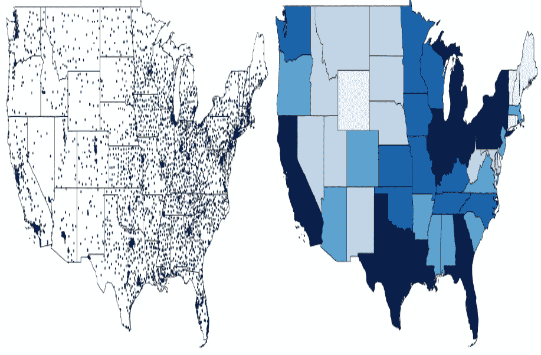

**(a)** 美国医院点位图

**(b)** 同一组数据，但按州聚合为多边形（分级色）地图

*图 13-9.* 你可以通过按州（或其他区域）统计地址来生成多边形或分级色地图，而非点位图。

首先，通过点击表格右侧的“Download this dataset”按钮将数据库保存到本地机器上（见图 13-10）。

通过将它们地理配准到现代地图上来历史栅格地图图像。最后，你获得了批量地理编码大量美国地址的额外策略，以及将点级数据转换为多边形以用于分级色地图的策略。

在下一章中，我们将讨论如何检测谎言并减少图表和地图中的偏见，以便你成为更具批判性的可视化消费者，以及更好的数据讲述者。

1. 了解更多关于 OpenStreetMap 版权和许可政策的信息。
2. Erica Hayes and Mia Partlow，“Tutorial: Georeferencing and Displaying Historical Maps Using Map Warper and StoryMapJS”（开放科学框架；OSF，2020 年 11 月 20 日），https://doi.org/10.17605/OSF.IO/7QD56。
