### 第 14 章. 检测谎言并减少偏见

数据可视化的目标是将信息编码成能够捕捉真实且富有洞见的故事的图像。但我们已警告你要提防那些用可视化说谎的人。回顾引言中关于收入不平等的例子，我们故意在图 1-1 和图 1-2 的图表以及图 1-3 和图 1-4 的地图中操纵了图表，以演示相同的数据如何被重新排列来描绘现实的截然不同图景。这是否意味着所有数据可视化都同样有效？绝对不是。仔细检查后，我们宣布关于美国收入不平等的两个图表中的第二个具有误导性，因为它故意使用了不合适的比例来掩盖真相。我们也透露了两张世界地图同样真实，即使美国在地图上显示的颜色更深（表示不平等水平更高），而其他国家则不是。

两个不同的可视化如何能同样正确？我们的回应可能与那些更喜欢称其工作为数据科学的人相冲突，这一标签暗示了一个客观的世界只有一个正确答案。相反，我们认为数据可视化最好被理解为一种解释性技能，它仍然依赖证据，但现实可能有不止一种有效表现。正如你所回忆的，我们的领域只有少数关于如何不要可视化数据的确定性规则，我们在“Chart Design Principles”和“Map Design Principles”中介绍了这些规则。与二元世界不同，我们认为可视化分为三个类别：错误、误导和真实。

如果可视化歪曲了证据或违反了这些严格的设计规则，则为错误。例如，后者，如果柱状图或条形图不从零开始，则是错误的，因为这类图表通过长度或高度表示数值，如果基线被截断，读者就无法确定。同样，如果饼图的切片加起来超过 100%，则为错误，因为读者无法准确解读图表，图表也错误地呈现了数据。

如果可视化在技术上遵循设计规则，但不合理地隐藏或扭曲了相关数据的外观，则为误导。我们承认不合理可能具有主观性，但在本章中我们将回顾几个例子，例如使用不合适的比例，或扭曲纵横比。在错误和真实之间插入这一类别强调了图表和地图可以准确显示数据并遵守设计规则，却仍让我们偏离真相，就像魔术师在表演手法时知道如何转移观众注意力一样。

如果可视化显示准确的数据并遵循设计规则，则为真实。尽管如此，在这一类别内仍存在质量的广泛光谱。当查看两个同样有效可视化时，有时我们会说其中一个更好，因为它揭示了我们尚未认识到的有意义的数据模式。或者我们可能会说其中一个更好，因为它以更美观的方式，或以更少的墨水和更大的简洁性来呈现这些模式。与其说我们同意，目标是真实的可视化，并偏好质量光谱的更好一侧。

在本章中，你将学习如何区分这三个类别之间的差异。提高你的测谎技能的最佳方式是通过“如何用图表说谎”和“如何用地图说谎”这两个动手教程来学习数据欺骗的艺术。正如俗话所说，要抓小偷，就得先做小偷。学习如何说谎不仅使人们更难误导你，而且还能让你更深入地了解我们在设计讲述真相的可视化时所做出的伦理决策，同时认识到通往这一目标的道路不止一条。最后，我们将讨论如何识别并减少四类一般性数据偏见——抽样、认知、算法和群体偏见，以及更特定于地图工作的空间偏见（“Recognize and Reduce Data Bias”和“Recognize and Reduce Spatial Bias”）。虽然我们可能无法完全消除偏见，但你将学会如何在他人的作品中识别它，以及减少其在你自己的可视化中存在的策略。

### 如何用图表说谎

在本节中，你将学习如何避免被误导性图表欺骗，以及如何通过故意操纵相同数据来讲述对立的故事，从而使自己的图表更诚实。首先，你将夸大柱状图中的微小差异，使其看起来更大。其次，你将减小折线图中的增长率，使其看起来更渐进。这两个教程将教会你阅读他人图表时注意关键细节，例如垂直轴和纵横比。矛盾的是，通过演示如何说谎，我们的目标是教你如何说真话，并更仔细地思考设计数据故事的伦理。

### 夸大图表中的变化

首先我们将审视经济数据，这是一个政客经常扭曲以使其观点更有利的话题。国内生产总值（GDP）衡量一个国家生产的最终产品和服务的市场价值，许多经济学家认为它是经济健康的主要指标。我们从美国联邦储备开放数据存储库下载了美国 GDP 数据，以十亿美元计。每季度发布一次，并进行季节性调整，以便更好地在一年中不同行业的比较，例如夏季的农业和旅游业与冬季的假日购物。你的任务是创建一个具有欺骗性的柱状图，夸大微小差异，使其在读者眼中显得更大。

1. 在 Google Sheets 中打开美国 GDP 2019 年中数据，并转到 File > “Make a copy”以创建可在你自己的 Google Drive 中编辑的副本。我们将在 Google Sheets 中创建图表，但如果你愿意，也可将数据下载到其他图表工具中使用。

2. 检查数据并阅读注释。为了简化此示例，我们只显示两个数字：2019 年第二季度（4 月至 6 月）的美国 GDP 和第三季度（7 月至 9 月）的美国 GDP。第二季度约为 21.5 万亿美元，第三季度略高，为 21.7 万亿美元。换句话说，季度 GDP 上涨了不到 1%，我们是这样计算的：（21747 − 21540）/21540 = 0.0096 = 0.96%。

3. 在同一张表中创建 Google Sheets 柱状图，使用默认设置，尽管我们从不盲目接受它们作为真相的最佳表现。在数据表中选择两列，并转到 Insert > Chart，就像我们在“Google Sheets Charts”中介绍图表时所学的那样。工具应识别你的数据并自动生成柱状图，如此处左侧所示。

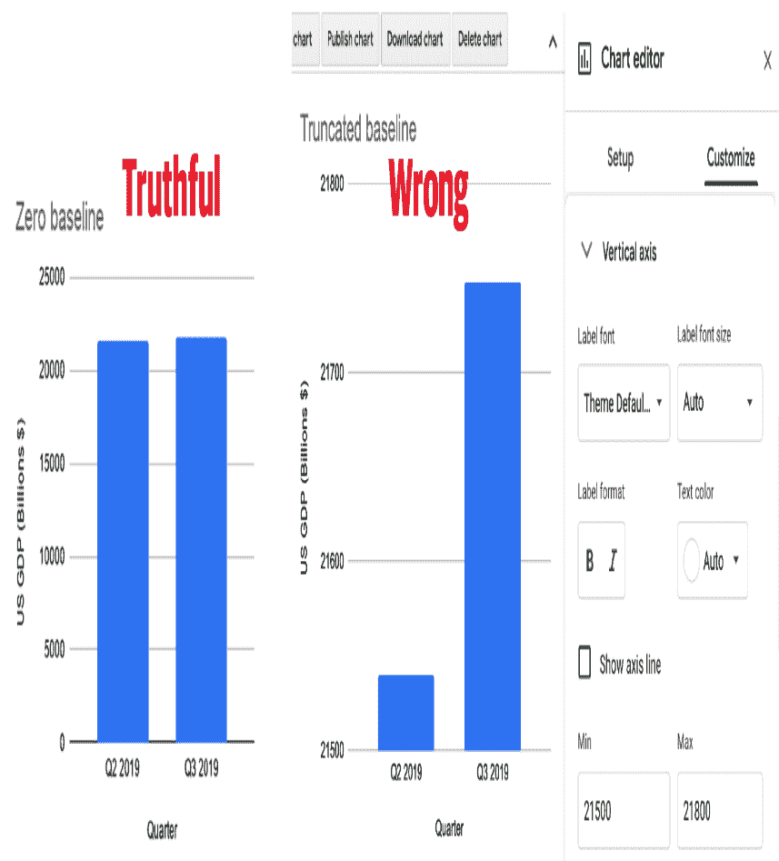

在此默认视图中，垂直轴的零基线下，21.5 万亿和 21.7 万亿之间的差异对读者来说看起来相对较小。

4. 截断垂直轴以夸大差异。不要使用零基线，让我们操纵比例使 GDP 的 1% 变化看起来更大。点击三点 kebab 菜单打开“Chart editor”并选择 Customize 选项卡。向下滚动到垂直轴设置，并通过将最小值从 0（零基线）减少到 21,500，并将最大值更改为 21,800 来缩小比例，如前一图像右侧所示。

尽管数据保持不变，但图表中两个柱子之间的微小差异现在在我们眼中显得大得多。只有仔细阅读图表的人才会注意到这一技巧。以经济增长为竞选纲领的政治候选人会感谢你！

正如你所见，截断基线图表是错误的，因为你违反了“Chart Design Principles”中关于图表设计的铁律之一。柱状图（和条形图）必须从零基线开始，因为它们使用高度（和长度）表示数值。读者无法确定一根柱子是否比另一根高两倍，除非两者都从零基线开始。相比之下，具有零基线的默认图表是真实的。让我们继续下一个规则不那么明确的例子。

### 减小图表中的变化

接下来，我们将研究关于气候变化的数据，这是我们在地球上面临的最紧迫问题之一，然而否认者继续抗拒现实，其中一些人甚至歪曲事实。在本教程中，我们将分析从1880年至今的全球温度数据，这些数据下载自美国国家航空航天局（NASA）。数据显示，在过去50年里，全球平均温度上升了约1摄氏度（或约2华氏度），而这种变暖已经开始导致冰川融化和海平面上升。你的任务是创建*具有误导性的*折线图，以在读者眼中*弱化*全球气温上升变化的表现。

- 1. 在Google Sheets中打开1880–2019年全球温度变化数据，然后转到文件 > “创建副本”，以在你自己的Google Drive中生成一个可编辑的版本。

- 2. 检查数据并阅读注释。温度变化是指全球陆地–海洋表面平均温度，单位为摄氏度，根据全球各地的众多样本估算，相对于1951–1980年的温度（约14°C或57°F）。换句话说，2019年的0.98值意味着当年全球温度比正常水平高出约1°C。科学家根据NASA和美国国家气象局的标准将1951–1980年期间定义为“正常”；在那个时期长大的成年人可以记住这种“正常”。虽然还有其他测量温度变化的方法，但来自NASA戈达德太空研究所（NASA/GISS）的这一数据与气候研究部门和美国国家海洋和大气管理局的其他科学家汇编的数据基本一致。

- 3. 通过选择数据表中的两列，然后插入 > 图表来创建Google Sheets折线图。该工具应能识别你的时间序列数据并生成一个*默认*折线图，尽管我们绝不会盲目接受它作为事实的最佳表示。点击三点垂直省略号菜单打开“图表编辑器”，并选择“自定义”选项卡。使用注释添加更好的标题和垂直轴标签，以说明数据来源以及温度变化的测量方式。

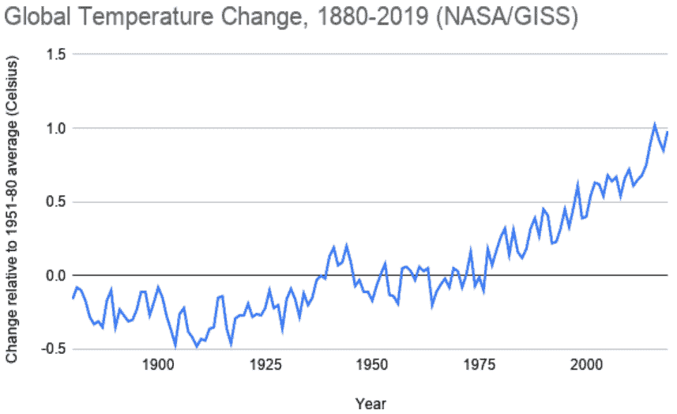

现在让我们使用相同的数据但不同的方法来创建另外三个图表，并讨论为什么它们从技术角度*并非错误*，但*极具误导性*。

## 延长垂直轴以压平曲线

我们将使用与前一部分相同的方法，但朝相反方向更改坐标轴。在Google Sheets图表编辑器中，通过将最小值更改为−5，最大值更改为5来自定义垂直轴，如图14-1所示。通过增加垂直比例尺的长度，你压平了我们对上升曲线的感知，并取消了我们的气候紧急状态——但并非真正取消。

是什么使这个压平的折线图*具有误导性*而非*错误*？在本教程的前半部分，当你缩小美国GDP图表的垂直轴时，你违反了零基线规则，因为柱状图和条形图*必须*从零开始，因为它们要求读者判断*高度*和*长度*，如“图表设计原则”中所述。你可能会惊讶地了解到，零基线规则*不*适用于折线图。可视化专家Alberto Cairo提醒我们，折线图以线的*位置*和*角度*来表示数值。读者通过其形状而非高度来解释折线图的含义，因此基线无关紧要。因此，压平温度变化的折线图可能会误导读者，但技术上并不错误，只要标签正确即可。

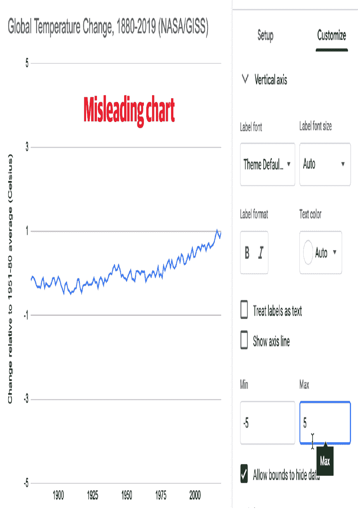

*图14-1. 具有延长垂直轴的误导性图表。*

## 加宽图表以扭曲其宽高比

在你的Google Sheets中，点击图表并拖动两侧使其变得非常矮宽，如图14-2所示。图像尺寸以宽度乘以高度列出，我们计算宽高比为宽度除以高度。由于默认图表为600 × 370像素，其宽高比约为1.6比1。但拉伸后的图表为1090 × 191像素，其比例约为5.7比1。通过增加宽高比，你压平了我们对上升曲线的感知，并再次取消了我们的气候危机——但并非真正取消。

是什么使这个扭曲的折线图*具有误导性*而非*错误*？再次强调，由于改变折线图的宽高比并不违反数据可视化的明确定义规则，只要准确标记，它在技术上就不算错误。但它的确具有误导性。Cairo指出，我们应该设计宽高比“既不夸大也不最小化变化”的图表。他具体提出了什么建议？Cairo建议——同时明确指出这“并非图表设计的普遍规则”——图表中表达的百分比变化应大致匹配其宽高比。例如，如果图表表示33%的增长，等于33/100或三分之一，他建议采用3:1的宽高比（因为通过将宽度置于高度之前来翻转分数），换句话说，即折线图是高度的三倍宽。⁵

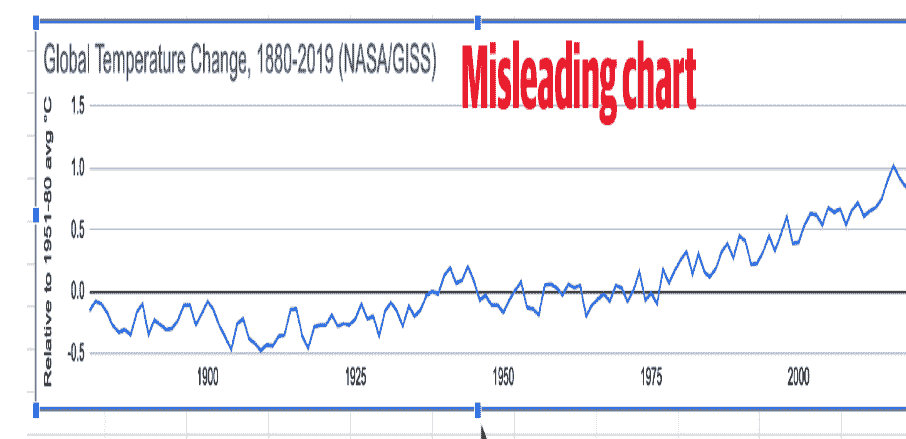

*图14-2. 具有拉伸宽高比的误导性图表。*

### 注意

一些专家建议，折线图的宽高比应遵循45度倾斜原则，即线段在上升或下降方向上的平均方向应等于45°角，以区分各个线段。但这需要统计软件来计算所有线的斜率，并且仍然不是适用于所有情况的规则。阅读Robert Kosara撰写的“宽高比与45度倾斜”一文，这是一个很好的概述。⁶

Cairo并未将他的宽高比建议作为普遍规则提出，因为他认识到该建议在面对极小或极大的值时是如何失效的。例如，如果我们将Cairo的建议应用于全球温度变化图表，最低值和最高值之间的差值（−0.5°至1°C）代表300%的增长。在这种情况下，我们使用最低值−0.5°C（而不是初始值0°C）来计算百分比变化，因为除以零是未定义的，所以(1°C − (−0.5°C)) / |−0.5°C| = 3 = 300%。按照Cairo的一般建议，300%的增长意味着1:3的宽高比，即折线图的高度是其宽度的三倍，如图14-3所示。虽然这个非常高的图表在技术上正确，但它具有误导性，因为它夸大了变化，这与Cairo的主要观点相悖。当我们除以接近零的数时，宽高比建议就变得荒谬了。

全球温度变化，1880–2019  
误导性图表  
相对于1951–80年平均的变化（摄氏度）  
年份

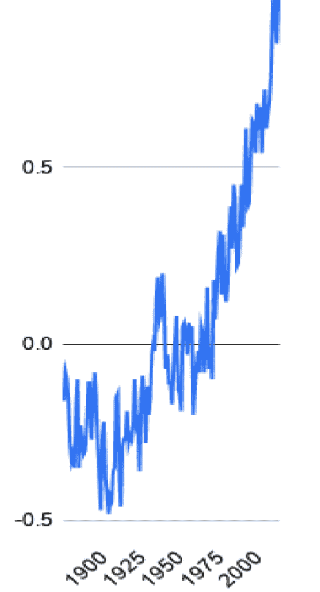

Cairo承认，他的宽高比建议可能会以相反的方式产生*误导性*图表：它们*弱化变化*。例如，代替从0°C上升到1°C的*全球温度变化*，想象一个显示*全球温度*的图表，它随时间从约13°C上升到14°C（或约55°F升至57°F）。尽管全球平均温度1°C的差异对我们的身体而言可能*感觉*不那么显著，但它对地球却有着巨大的影响。我们可以计算百分比变化为：(14°C − 13°C) / 13°C = 0.08 = 8%的增长，约为十二分之一。这转化为12:1的宽高比，即折线图的宽度是高度的12倍，如图14-4所示。Cairo警告说，这种显著的全球温度上升看起来“小得具有欺骗性”，因此他告诫不要在所有情况下都使用他的宽高比建议。

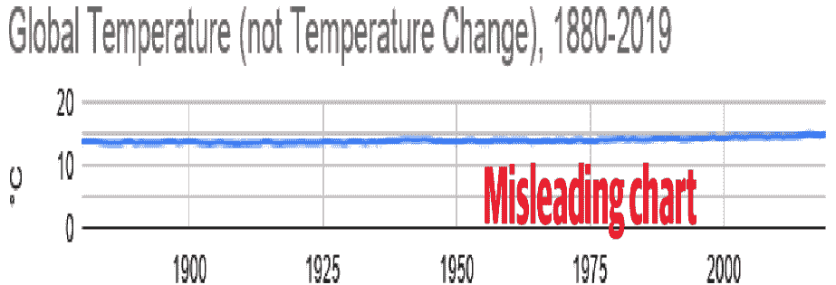

*图14-4.* 经验法则再次并非总奏效。Cairo对8%增长的推荐导致12:1的宽高比，在这个特定示例中产生了一个误导性图表。

这一切给我们留下了什么？如果你感到困惑，那是因为数据可视化关于宽高比*没有普遍规则*。你应该怎么做？首先，永远不要盲目接受默认图表。其次，探索不同的宽高比如何影响图表的外观。最后，即使是Cairo也认为你应该运用自己的判断力，而不是在每种情况下都遵循他的建议，因为没有适用于所有情况的宽高比单一规则。做出一个诚实解释数据并向读者清晰传达故事的选择。

## 添加更多数据和一个双垂直轴

另一种常见的误导方法是添加更多数据，例如在折线图右侧添加一个对应双垂直轴的第二个数据系列。虽然构建双轴图表在技术上是可能的，但我们强烈建议不要使用它们，因为它们很容易被操纵以误导读者。让我们通过一个结合两个先前数据集——全球温度变化和美国GDP——的双轴图表示例来说明这一点。在Google Sheets中，转到*temp+GDP*工作表，你会看到温度变化加上一个新列：1929年至2019年的美国GDP，以十亿美元为单位，下载自*美国联邦储备系统*。为简化此示例，我们删除了1929年之前的温度数据，以便更整齐地与可用的GDP数据匹配。

- 1. 选择所有三列，然后插入 > 图表以生成一个包含两个数据系列（温度，蓝色；美国GDP，红色）的默认折线图。

- 2. 在“图表编辑器”中，选择“自定义”并向下滚动到“系列”。将下拉菜单从“应用于所有系列”更改为美国GDP。就在其下方，在“格式”区域中，将“轴”菜单从“左轴”更改为“右轴”，这将在图表右侧创建另一个仅与美国GDP数据关联的垂直轴。

## 气温变化与美国GDP

| 年份 | 气温变化 | 美国GDP |
|------|----------|--------|
| 1929 | -0.36 | 104.556 |
| 1930 | -0.16 | 92.16 |
| 1931 | -0.09 | 77.391 |
| 1932 | -0.16 | 59.522 |
| 1933 | -0.28 | 57.154 |
| 1934 | -0.12 | 66.8 |
| 1935 | -0.2 | 74.241 |
| 1936 | -0.15 | 84.83 |
| 1937 | -0.03 | 93.003 |
| 1938 | 0 | 87.352 |
| 1939 | -0.02 | 93.437 |
| 1940 | 0.13 | 102.899 |
| 1941 | 0.19 | 129.309 |
| 1942 | 0.07 | 165.952 |
| 1943 | 0.09 | 203.084 |
| 1944 | 0.2 | 224.447 |
| 1945 | 0.09 | 228.007 |

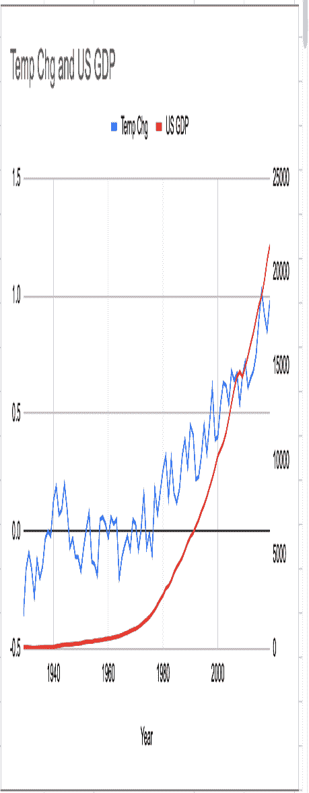

图表编辑器

自定义

系列

美国GDP

格式

颜色

线条虚线类型

坐标轴

右侧坐标轴

线条粗细

2px

点大小

点形状

3. 在“图表编辑器”>“自定义”选项卡中，向下滚动，你会看到“垂直轴”（仅在左侧，用于气温变化）的独立控件，以及一个全新的“右侧轴”（仅用于美国GDP）菜单。

因为它们会让大多数读者混淆，不能清晰地显示两个变量之间的关系，有时甚至会导致误导。尽管在步骤4中两个坐标轴都从零开始，但左侧的温度刻度上限为10°C，这是不合理的，因为温度曲线仅上升了1°C。因此，与稳步上升的GDP曲线相比，我们感知到的温度曲线变得更低，于是你在享受长期经济繁荣的同时，误导我们忽视了气候变化的后果！另外两个问题也让这张图表存在问题。GDP数据*没有*经过通胀调整，因此它将1929年的美元与2019年的美元进行比较，这会误导我们，我们在第5章中已就此话题提出过警告。此外，由于接受了Google表格分配的默认颜色，气候数据以“冷”蓝色显示，这向大脑传递了与气温上升和冰川融化相反的信息。总而言之，这张图表在三个方面存在误导：不合理的垂直轴、不可比较的数据，以及颜色选择。

那么，双轴折线图有没有更好的替代方案？如果你的目标是可视化两个变量（全球气温和美国GDP）之间的关系，那么可以使用我们之前在“散点图和气泡图”中介绍的散点图来呈现。通过绘制美国实际GDP（已调整为2012年不变价美元）并使其与全球气温变化一同出现在此Google表格中，我们可以进行更有意义的比较。我们按照Datawrapper Academy的教程创建了一个*连接散点图*，该图用一条线穿过所有数据点来表示时间，如图14-5所示。总体而言，从1929年至今，美国经济的增长与全球气温变化的上升密切相关。此外，用散点图更难误导读者，因为坐标轴的设计会显示数据的完整范围，而且我们对关系强弱的解读也不依赖于宽高比。

## 美国实际GDP与全球气温变化之间的关系，1929-2019

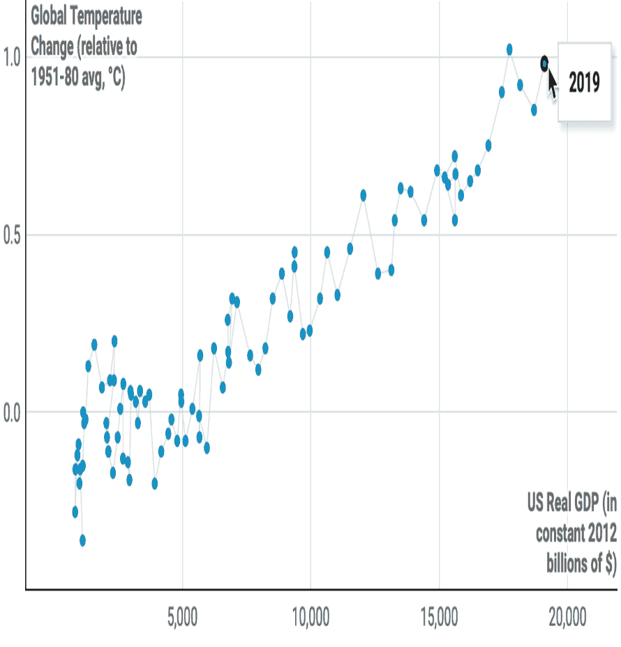

图表由HandsonDataViz制作 • 数据来源：美联储与NASA/GISS • 获取数据 • 使用Datawrapper创建

*图14-5. 1929年至2019年美国实际GDP与全球气温变化关系的连接散点图：探索交互式版本。*

总而言之，在本教程中，我们制作了多张关于全球气温变化的图表。其中没有一张在技术上出错，只有一些是真实的，而大多数都被人为操纵，通过隐藏或伪装数据中的重要模式来愚弄读者。我们展示了若干种可以将图表设计成具有欺骗性的方法，但并未穷尽所有可能。例如，可以参阅更多关于如何制作三维图表以及如何将读者视角倾斜至基线以下（这会让读者误判柱状图或折线图的相对高度）的阅读材料。

你可能会感到沮丧，因为数据可视化在许多情况下缺乏明确定义的设计规则，不像我们在数学、科学或语法课本中习惯看到的那样。相反，请记住，重要的可视化规则是一个*三步过程*：永远不要盲目接受默认设置，探索不同设计会如何影响你对解释的外观呈现，并用你最好的判断力去讲述真实而有意义的数据故事。

你已经学会了如何用图表说谎，在下一节中，你将在此基础上学会如何用地图说谎。

## 如何用地图说谎

学习如何识破谎言的最佳方法之一，就是故意操纵一张地图，用相同的数据讲述两个（或更多）相互对立的故事。你将学会在查看他人地图时需要注意什么，并在设计自己的地图时更加谨慎地思考伦理问题。我们将重点关注使用阴影或颜色来表示地理区域数值的等值区域图，因为它们可能成为大量误导的源头。此练习的灵感来自地理学家Mark Monmonier的同名经典著作《*如何用地图说谎*》，该书最初于1991年出版，现已发行第三版。

在开始之前，请回顾“地图设计原则”，以避免在设计等值区域图时出现常见错误。例如，在大多数情况下，你应该避免绘制原始计数（例如患病人数总量），而应显示相对比率（例如患病人口百分比），因为原始计数图通常只会显示大多数人居住在城市而非农村地区。此外，本节假定你已经熟悉“使用Datawrapper绘制等值区域图”中的步骤。

让我们回到引言中的两张地图，我们在那里展示了关于世界收入不平等的两种不同解读。特别是，图I-3将美国填充为中蓝色，暗示其不平等程度与其他国家相似；而图I-4则将美国以深蓝色突出显示在最不平等的层级中。我们认为两者都是*真实*的解读。按照这个动手教程重新创建这两张地图，再加上一张，你将更清楚地理解这些概念。

## 检查数据并上传到Datawrapper

首先，让我们检查数据并将其上传到Datawrapper，以开始制作等值区域图：

+   1. 在Google 表格中打开*世界收入前1%数据*，然后转到文件 >“制作副本”，创建一个可以在你自己的Google Drive中编辑的版本。
+   
+   2. 检查数据并阅读注释。总体而言，这些数据提供了一种进行国际收入分配比较的方式，显示每个国家最富有的1%人口“分到了多大一块蛋糕”。每一行列出一个国家及其三字母代码，以及最富有的1%人口所持有的税前国民收入百分比份额，还有世界不平等数据库收集这些数据的最近年份。例如，在巴西，最富有的1%人口在2015年持有该国国民收入的28.3%，而在美国，最富有的1%在2018年持有20.5%。

> **注意**
> 
> 需要说明的是，社会科学家还开发了许多其他方法来比较各国收入或财富的分配情况，但这一主题超出了本书的范围。在本教程中，我们通过一个易于理解的变量来呈现这一复杂概念：每个国家人口中最富有的1%所持有的税前国民收入百分比份额。

+   3. 由于我们无法将这份Google表格直接导入Datawrapper地图工具，请转到文件 > 下载，将第一个标签页以CSV格式导出到你的电脑。
+   
+   4. 在浏览器中打开Datawrapper可视化工具并上传你的CSV地图数据。选择“新地图”，选择“等值区域图”，并选择“世界”，然后点击“继续”。在“添加数据”屏幕中，向下滚动到表格下方，选择“导入数据集”按钮，然后点击“开始导入”按钮，再点击“点击此处上传CSV文件”，并上传你在上一步中创建的CSV文件。点击确认第一列已*匹配为ISO代码*，点击“继续”，点击确认*份额*列已*匹配为数值*，然后点击“开始”和“继续”以可视化你的地图。
+   
+   5. 在“可视化”屏幕中，在“细化”选项卡的“颜色”部分点击“选择调色板”，点击扳手符号以打开颜色设置。我们先跳过浅绿色到蓝色的调色板（你可以稍后修改），让我们专注于颜色范围的设置。

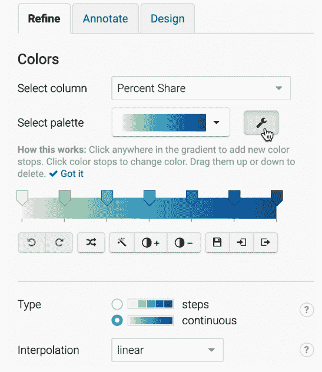

## 修改地图颜色范围

虽然我们从不盲目接受默认的可视化，但它是一个不错的起点。默认地图显示的是连续类型的范围，采用数据的线性插值。地图将所有值放在一条直线上，从最低的 5% 到最高的 31%，并沿着渐变将每个值分配给一种颜色，如图 14-6 所示。请注意，美国（20.5%）与中等蓝色融合在一起，略高于该范围的中点。

## 地图颜色范围：连续，线性插值

收入份额占前 1%

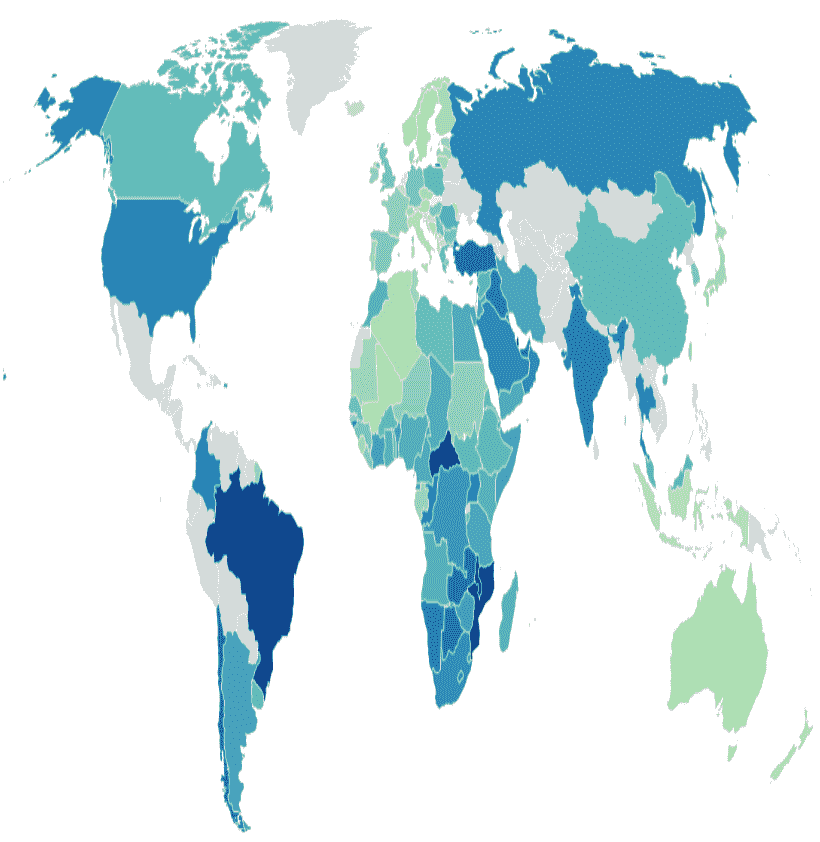

5%
31%

Map: by HandsOnDataViz • Source: World Inequality Database • Created with Datawrapper

图 14-6. 采用连续范围和线性插值的收入不平等地图：探索交互式版本。

使用相同数据但不同设置创建第二张地图。将 Type 设置更改为 steps，并调整为三个步骤，使用“自然断点 Jenks”插值，如图 14-7 所示。这意味着地图现在将所有值放在三个递增的组中。自然断点在利用颜色突出异常值和范围内的多样性之间提供了一种折中。请注意，美国（仍为 20.5%）现在在该范围的顶部三分之一（19% 或以上）中以深蓝色突出显示。

## 地图颜色范围：3 个步骤，自然断点

### 收入份额占前 1%

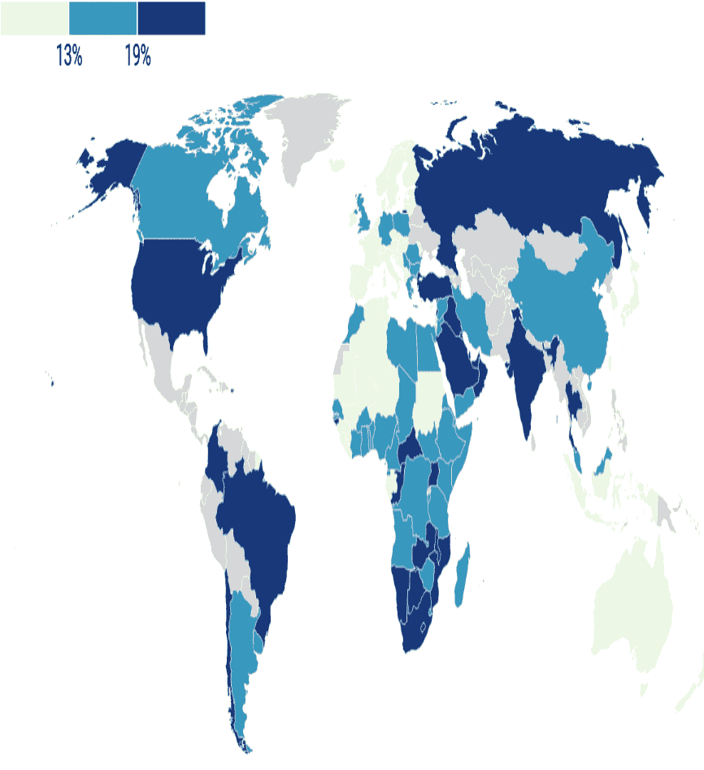

Map by HandsOnDataViz · Source: World Inequality Database · Created with Datawrapper

> *图 14-7. 采用三个步骤和自然断点插值的收入不平等地图：探索交互式版本。*

第一张地图将美国的收入不平等描绘成与大多数国家相似，而第二张地图则将美国置于颜色刻度的较高端。哪张地图具有误导性？哪一张是真实的？如果你偏好地图设计中清晰明确的规则，这个答案可能会让你感到沮丧。尽管两张地图产生的印象非常不同，但两张地图都呈现了准确的数据，标签清晰，基于对数据的合理且真实的解释。

为了了解 choropleth 地图背后发生的情况，可视化专家 Alberto Cairo 建议创建直方图以更好地了解数据分布。返回 Google 表格中的数据并创建直方图，如我们在“直方图”中所述，以查看按百分比份额排序为“桶”时国家的频率，如图 14-8 所示。虽然大多数国家集中在中位数附近，但这不是正态分布曲线，因为少数国家在 30% 附近是异常值。在第一张地图中，使用了连续类型和线性插值，美国似乎更接近中位数，并与中等蓝色融合。相比之下，第二张地图使用了三个步骤和自然断点，这意味着美国出现在最高范围内，并在深蓝色中脱颖而出。

## 直方图：按百分比份额排序的国家频率

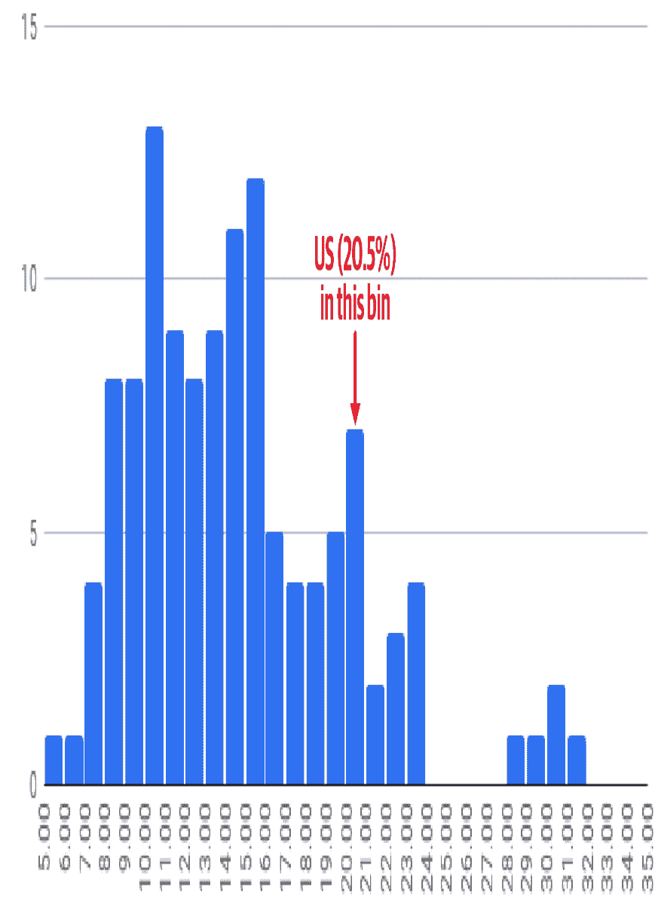

图 14-8. 收入不平等地图数据的直方图。

那么我们在设计 choropleth 地图时应如何做出决策？与图表部分类似，没有通用规则，但有几条明智的建议。首先，也是最重要的，始终寻找更好的方法来使用地图颜色范围，以显示数据中的真实且有意义的差异，而不是将其隐藏起来。Datawrapper Academy 建议在创建 choropleth 地图时在“诚实和有用”之间找到“折中”。

换句话说，在展示证据时说真话，并利用设计选择来强调一种解释，引起我们对数据故事中最重要的内容的关注。例如，线性插值最适合强调极低和极高值，而分位数或其他非线性分组则揭示了中间范围的更多地理多样性。Datawrapper Academy 还建议使用连续颜色调色板来显示数据中的细微差别，除非你的数据故事有令人信服的理由显示离散步骤以强调高于或低于某些阈值的区域。对于步骤，增加步骤数会使地图显示出更多的对比，但过多的步骤会给人一种错误印象，即浅色和深色区域非常不同，尽管它们的数字可能仅略有差异。不管你决定什么，都要避免手动调整地图设置以操纵其外观以适应预先设定的观点的诱惑。

简而言之，向我们展示一个故事并说真话。你可能需要创建具有不同设置的多个地图来决定哪一个是最好的折中。

现在你对如何用图表和地图撒谎有了更清晰的认识，让我们来探讨一个相关主题：识别和减少数据偏差。

## 识别和减少数据偏差

我们将偏差定义为不公平地偏爱一种观点而非另一种观点。在处理数据和设计可视化时，了解不同类型的偏差非常重要，以便你能够将其识别为可能影响你感知并减少其在你自己的工作中的存在的潜在因素。减少偏差的第一步是正确识别各种类型，这些类型乍一看可能隐藏起来，以便我们可以指出它们。在本节中，我们将讨论四类任何从事数据工作的人都需要识别的偏差：抽样偏差、认知偏差、算法偏差和群体间偏差。

*抽样偏差* 发生在我们认为数据已公平选择，但幕后过程影响了其构成并扭曲了结果时。我们之前在“谨防有偏比较”中警告过你几种类型。其中一种需要避免的类型是*选择偏差*，这意味着为研究选择的样本与总体相比存在系统性差异，例如当你随机测量恰好在篮球训练后离开健身房的人的身高时。第二种需要避免的类型是*无响应偏差*，这发生在人口的某些亚组不太可能对调查做出响应，从而导致结果代表性不足。我们还警告过你第三种类型，*自选择偏差*，参与者申请或自愿参加一个项目时，必须仔细评估以避免与非参与者进行比较，后者可能没有相同的动机。在尝试做出有意义的比较之前，请务必质疑你的数据，如“质疑你的数据”所述。如果你怀疑抽样问题可能已渗入数据收集过程，要么不要使用数据，要么在你的可视化注释和配套文本中清楚地描述你的担忧，以指出潜在的偏差。

*认知偏差* 指的是一类扭曲我们如何解释数据的行为。一种例子是*确认偏差*，它指的是只接受符合我们对世界运作方式的先入为主的观念的说法。可以通过积极寻找替代解释并以开放的眼光考虑矛盾的发现来抵消这一点。第二种例子是*模式偏差*，它描述了人们倾向于在数据中看到有意义的关系，即使数字是随机选择的。可以通过提醒读者（和你自己）数据是有噪声的，我们的大脑倾向于看到模式，即使不存在模式来对抗这一点。参见 *第 5 章* 中提到的统计分析的额外资源，了解适当的测试以确定数据中明显的模式是否以大于偶然的机会存在。第三个例子是*框架偏差*，它指的是负面或积极的标签或概念类别影响我们如何解释信息。关于标签的力量，英国统计学家 David Spiegelhalter 指出，美国医院倾向于报告*死亡率*，而英国医院报告*生存率*。在权衡手术程序对你家人成员的风险时，5% 的死亡率似乎比 95% 的生存率更糟，即使它们是相同的。此外，Spiegelhalter 观察到，当我们用原始计数补充比率时，它进一步增强了我们对风险的印象。例如，如果我们告诉你一个手术程序的死亡率为 5%，并且 400 名患者中有 20 人死亡，那么结果似乎更糟，因为我们开始想象真实人们的生活，而不仅仅是抽象的百分比。通过意识到其对我们思想的潜在影响并指出这一点来抵消框架偏差。

*算法偏差* 发生在计算机系统常规地偏爱某些结果而不是其他结果时，通常通过强化占主导地位的社会群体所持有的特权。最近有几个案例引起了公众的关注。例如，算法已导致美国司法系统中的种族偏见。Northpointe 软件公司（现名为 Equivant）开发了一种算法来预测被告的再犯风险，法官在决定监禁或缓刑时使用它。但 ProPublica 调查记者发现，该算法错误地预测黑人被告再次犯罪的可能性几乎是白人被告的两倍，即使控制了他们所犯的先前罪行的类型。算法还增加了金融服务行业中的性别偏见。当苹果和高盛合作提供一种新型信用卡时，一些客户注意到用于评估申请的软件公式有时会向男性提供比女性多 10 到 20 倍的信用额度，即使他们已婚、拥有相同的资产并且信用评分相似。在这两种情况下，公司否认算法偏见的指控，但拒绝透露其软件公式内的决策过程，他们认为这是专有的。因此，我们需要警惕数据的滥用。

*群体间偏差* 指的是人们通过社会类别如种族、性别、阶级和性取向来偏爱或歧视的多种方式。显然，群体间偏差有着悠久的历史，早于数字时代。但在黑人的命也是命运动之后，一些作者呼吁关注群体间偏差如何渗透到数据可视化领域，并倡导方法来抵消其影响。例如，Jonathan Schwabish 和 Alice Feng 描述了他们如何应用种族公平视角来修改 Urban Institute 的数据可视化风格指南。Schwabish 和 Feng 建议按数据故事的顺序排列组标签，而不是默认将白人和男性列在顶部。他们还呼吁我们主动承认数据中缺失的群体，通过引起人们对那些经常被遗漏的人的关注，例如在美国联邦数据集中经常被忽略的非二元和跨性别者，而不是忽略其缺失。此外，在选择颜色调色板来代表图表和地图中的人群时，作者提醒我们避免刻板印象的颜色，并避免将黑人、拉丁裔和亚裔人与白人作为极端对立的颜色分组。

Schwabish 和 Feng 提供了几项改善数据可视化中种族公平的优秀建议，尽管他们其中一些更具挑衅性的提案可能会引发更多的讨论和辩论。例如，他们对比了描绘 COVID-19 大流行数据的不同方式，并建议我们停止将分解的种族和民族数据放在同一张图表上，因为它促进了“缺陷为基础的视角”，即以表现较好的群体的标准来评判表现较差的群体，如 *图 14-9* 所示。

亚裔（单一种族，非西班牙裔或拉丁裔）  黑人（单一种族，非西班牙裔或拉丁裔）  西班牙裔或拉丁裔（可能属于任何种族）

两个或以上种族 + 其他种族（非西班牙裔或拉丁裔）  白人（单一种族，非西班牙裔或拉丁裔）

百分比

60% 40% 20% 0%

第1周  第2周  第3周

图14-9. 为了避免基于缺陷的视角，Schwabish 和 Feng 反对将种族和族裔数据放在同一张图表中。图片来源：Urban Institute，经许可转载。

相反，Schwabish 和 Feng 建议我们将种族和族裔数据绘制在相互独立但相邻的图表中，每张图表都各自参照州或全国平均值及置信区间，如图14-10所示。

自3月13日以来，至少有一人失去就业收入的家庭中成年人所占比例

● 全国平均值　● 州或都会区平均值　● 种族/族裔平均值

具有统计学显著差异　　不具有统计学显著差异

全部

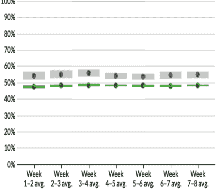

亚裔

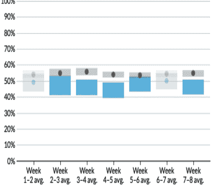

黑人

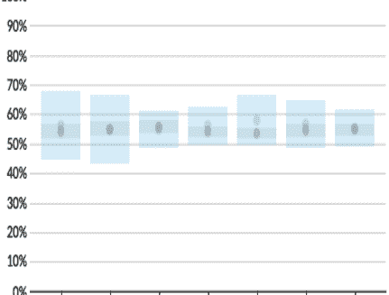

西班牙裔或拉丁裔

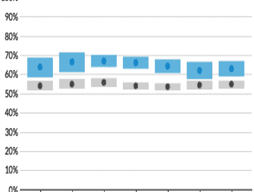

两个或以上/其他

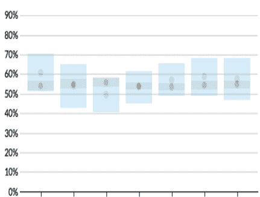

白人

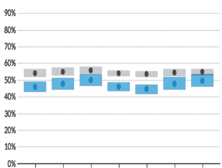

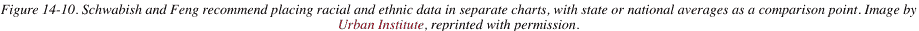

比较这两组图表，我们会思考一个更广泛的问题：数据可视化究竟最符合谁的利益？一方面，如果主流群体利用图表中的种族差异来*指责受害者*，那么停止助长对群体行为的种族主义刻板印象，并停止在同一张图表中比较不同群体，就是合理的。另一方面，如果种族差异是由优质就业、住房和医疗方面的*结构性障碍*造成的，那么分开的六面板可视化是否会让读者更难识别和挑战系统性种族主义的根源？Schwabish 和 Feng 提出了一个重要的观点，但并没有让我们相信，将种族和族裔数据分开就必然能促进公平与正义。不过，我们同意有必要持续反思并减少数据可视化中的偏差，同时还要考虑更广泛的背景——在这个不公正的世界里，人们会如何解读我们的图表和地图——从而加强我们不断寻求更好方式来讲述真实而有意义的数据故事。

所有创建数据可视化的人都应努力识别并减少以下几类常见的数据偏差：抽样偏差、认知偏差、算法偏差和群体间偏差。在下一节中，我们将重点讨论处理地图数据时特有的不同类型的空间偏差。

## 识别并减少空间偏差

除了识别和减少一般性的数据偏差外，我们还需要警惕会对地图创建和解读产生负面影响的空间偏差。在本节中，我们将介绍四种空间偏差：地图区域偏差、投影偏差、争议领土偏差和排除偏差。我们还会在创建可视化时提出一些应对这些偏差的具体方法。

*地图区域偏差*指的是我们的眼睛往往会优先关注地图上较大的区域，而较少关注较小区域。一个典型的例子是每四年一次的美国总统选举分级统计图，它让我们把注意力放在美国各州的地理面积上，而不是其人口或选举人票数，如**图14-11**所示。常规地图夸大了地理面积较大的乡村州的政治影响力（例如人口稀少、不到60万的怀俄明州），同时削弱了面积较小的城市化州的作用（例如面积很小、人口却超过100万的罗得岛州）。尽管怀俄明州的面积是罗得岛州的80倍，但在美国总统选举中它只有3张选举人票，而罗得岛州有4张。然而，在看常规地图时，大多数读者很难看出这一区别，因为我们的眼睛会被地理面积较大的州吸引，而不是人口。

*投影偏差*是一个相关问题，涉及地图如何呈现地理区域。随着时间的推移，制图员开发出不同的投影系统，以便在二维平面上显示三维地球。墨卡托（Mercator）是最常见的投影系统之一，它放大了许多欧洲和北美国家的面积，同时缩小了更靠近赤道的中非和中美洲国家的相对面积及其重要性。关于墨卡托投影地图偏差及其与其他系统比较的交互式可视化，请参见 **Engaging Data** 网站和 Maps Mania 的 **地图投影如何撒谎**。在过去15年中，随着谷歌地图和类似的在线服务越来越受欢迎，它们的默认投影系统——即 **Web 墨卡托**——在网络上无处不在，进一步加深了我们脑海中被扭曲的地理认知。（2018年，谷歌地图允许缩小视图的桌面用户启用其3D地球视图，而不是 Web 墨卡托，但这可能不是默认设置，可能需要在设置中开启。）

要解决国家或全球地图中的地图区域偏差和投影偏差，一种方法是用*变形地图*替换常规地图轮廓；在某些平台上，变形地图也被称为六边形地图或人口方块。变形地图按地理区域的相对重要性来显示其大小，在本例中即人口，但也可以基于经济规模或其他因素，具体取决于数据故事。一个优点是，变形地图可以让我们的注意力更均匀地集中在数据故事中最相关的方面，例如选举人票，如**图14-11**所示。一个缺点是，变形地图要求读者用抽象形状代替熟悉的边界，因为这些基于人口的可视化无法与基于墨卡托投影的常规地理陆地地图完全吻合。另请参阅 Lisa Charlotte Rost 在 Datawrapper Academy 上发表的关于**如何可视化美国选举结果**的文章。

2020年美国总统选举结果常规地图

2020年美国总统选举结果变形地图

缅因州和内布拉斯加州允许部分选举人票按选区拆分

每个六边形代表一张选举人票

拜登  拜登 + 特朗普  特朗普  特朗普 + 拜登

拜登  特朗普

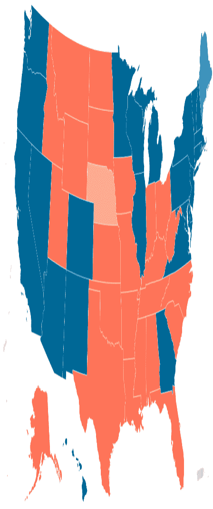

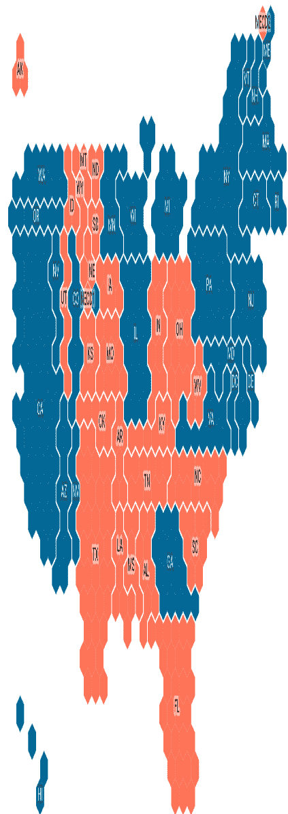

使用 Datawrapper 创建

图14-11. 2020年美国总统选举人票在常规美国地图（左）与变形地图（右）中的显示，两者均使用 Datawrapper 创建。

### 注意

要在 Datawrapper 中重新创建图14-11中的变形地图，请选择名为 USA > “Electoral College (hexagon)” 的文件，因为它允许用户按选区拆分缅因州和内布拉斯加州的选举人票。

在“如何用地图撒谎”中，我们使用 Datawrapper 创建了世界不平等数据的分级统计图。要将其中一张从常规世界地图转换为人口方块地图，请前往“我的图表”（My Charts），选择该地图并右键点击以创建副本。（你也可以选择新建地图，此时请按照上一节的步骤操作。）然后进入“选择地图”（Select your map）界面，输入 **squares** 以查看所有可用类型（包括世界人口方块）。同样，输入 **hexagons** 可查看所有可用的变形地图（包括美国各州）。选择你偏好的地图，然后按照其他 Datawrapper 分级统计图的方式显示数据，如图14-12所示。

世界人口方块地图

收入最高的1%人群所占收入份额

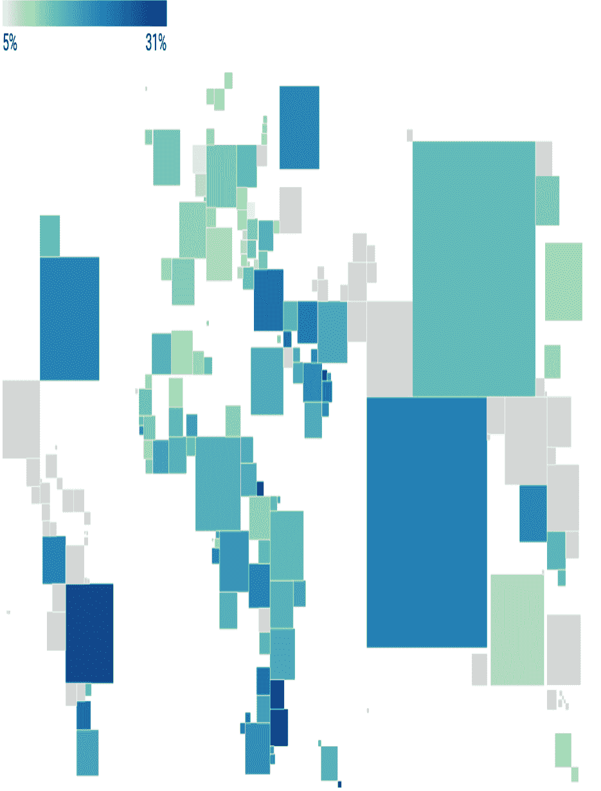

地图：HandOnDataViz 制作 · 数据来源：世界不平等数据库（World Inequality Database） · 使用 Datawrapper 创建

*图14-12. 带有收入不平等数据的世界人口方块地图：探索交互式版本。*

争议领土偏差指的是网络地图服务商有时会根据你访问它们时所在的位置，显示不同的世界视图。例如，2014年俄罗斯从乌克兰强行夺取克里米亚半岛，引发了一场地缘政治争端。由于谷歌希望继续在俄罗斯盈利，它在谷歌地图平台上创建了两个版本的乌克兰边界线。当从俄罗斯 IP 地址查看时，谷歌地图会显示一条实线边界，表示该领土由俄罗斯控制。当从世界其他地方查看时，谷歌地图

显示出虚线边框代表有争议的领土。尽管 Google 声称要“在地缘政治争端上保持中立”，但据《华盛顿邮报》报道，该公司通过向俄罗斯观众显示实线边框，明显站队了。14 Google 和其他几家网络地图提供商已就印度和巴基斯坦之间有争议的边界、伊朗和沙特阿拉伯之间的水道，以及日本和韩国之间的海域采取了类似的行动。

普通人可以在 Google 地图和其他专有服务中识别出有争议领土的偏见，但我们很难直接挑战他们的决定或施压要求他们修改底图。但我们可以借鉴其他策略来减少这些偏见。例如，OpenStreetMap 的贡献者——这个众包全球地图——已积极讨论在平台上承认有争议领土的不同方法。此外，我们还可以使用数据可视化工具在专有地图图层之上绘制不同的边界。作为一个例子，由加拿大一家非营利组织创建的 Native Land 地图，在现今地图上显示原住民领土和语言的轮廓，以公开提醒我们殖民政策和强制流离失所。挑战单一的 Google 地图平台的一种方式是创建并宣传替代方案。

地图排除偏见是指我们通过遗漏行为未能代表人们或土地的方式。有时这些行为是由 Google 和其他专有地图提供商采取的，有时我们也是在创建地图的日常决策中做出的。仔细看看你最近制作的地图，问问自己它们是否真正代表了标题声称要展示的内容。例如，如果你制作了一张美国州级数据的地图，你是如何处理哥伦比亚特区的？美国首都并不算作一个州，也没有在美国国会拥有投票代表。但 DC 有超过 700,000 名居民（超过怀俄明州或佛蒙特州），并且美国宪法第二十三修正案授予其选举人票，就像它是一个州一样（尽管它永远不能超过人口最少的州）。同样，你的美国地图是如何代表波多黎各的，这个拥有超过三百万居民的领土，其居民是美国公民，但没有国会投票权或总统选举权？其他美国领土又如何，例如美属萨摩亚、关岛、北马里亚纳群岛和美属维尔京群岛，其居民也是美国公民？当这些地方存在数据时，你的地图是否让它们可见——还是它们消失了？如果是后者，那么你需要考虑你的遗漏行为是否也是一种族群偏见，因为 DC 和这些领土的大多数居民是黑人、拉丁裔和太平洋岛民。

要明确的是，一些数据可视化工具使得包含传统上被排除在地图之外的人和地方变得非常困难。但有时问题出在我们自己，或我们工具的默认设置以及我们是否要尝试改变它们的决定。再仔细看看你最喜欢的地图工具，并在你选择为“美国”绘制数据时，仔细检查出现的地理轮廓。如果你输入包含 DC 和美国领土的数据——但地图只显示 50 个公认的州——那么这种遗漏将从你的地图中抹去四百万美国公民的存在。超越默认设置，确定你的工具是否提供更具包容性的选项。例如，Datawrapper 最近改进了其 USA > States and Territories 地图选项如何显示符号点和等值区制图数据，如图 14-13 所示。对于 Datawrapper 选项中尚未出现的其他地区，你可以创建并上传自己的 GeoJSON 格式的地图边界文件，如“Geospatial Data and GeoJSON”所述。或者，如果你的工具迫使你省略你数据故事的一部分，那么通过在地图注释或配套文本中描述其缺失来指出这种偏见。我们在数据可视化中的使命是讲述真实而有意义的故事，因此请包含属于地图上的人和地方，而不是忽视他们的存在。

## 1 Select your map

Symbol map

What type of map do you want to create?

USA territories

USA » States and Territories (hexagons)

USA » States and Territories

+ Add column

| Lat | Lon | Title |
|---|---|---|
| 64.4459613 | -149.680909 | Alaska |
| -14.293304 | -170.692511 | American Samoa |
| 38.8937936 | -76.9879976 | District of Columbia |
| 13.4501257 | 144.757551 | Guam |
| 19.5872677 | -155.4268897 | Hawaii |
| 14.1490205 | 145.2134525 | Northern Mariana Islands |
| 18.2214149 | -66.4132818 | Puerto Rico |
| 17.7289564 | -64.759016 | US Virgin Islands |

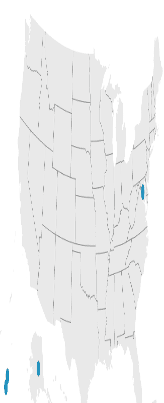

Figure 14-13. Datawrapper recently improved how it displays DC and noncontiguous places in its USA > States and Territories option for both symbol and choropleth maps.

## Summary

In this chapter, you learned how to distinguish between wrong, misleading, and truthful visualizations, and strengthened your lie-detector skills to understand the importance of being honest when telling your own data stories. You also learned how to recognize ways to reduce four categories of data bias in general, and spatial bias in particular.

The next chapter will bring together all of the concepts from different parts of the book to emphasize the importance of storytelling in our data visualizations.

1 The “how to lie” tutorials were inspired by several excellent works in data visualization: Cairo, The Truthful Art, 2016; Cairo, How Charts Lie, 2019; Darrell Huff, How to Lie with Statistics (W.W. Norton & Company, 1954); Mark Monmonier, How to Lie with Maps, 3rd edition (University of Chicago Press, 2018); Nathan Yau, “How to Spot Visualization Lies” (FlowingData, February 9, 2017), https://oreil.ly/o9PLq; NASA Jet Propulsion Laboratory (JPL), “Educator Guide: Graphing Global Temperature Trends,” 2017, https://oreil.ly/Gw-6z.

2 Note that not everyone agrees because GDP doesn’t count unpaid household labor such as caring for one’s children, nor does it consider the distribution of wealth across a nation’s population.

3 The tutorial on misleading climate change data was inspired by a high school classroom activity created by the NASA Jet Propulsion Laboratory (JPL), as well as Alberto Cairo’s analysis of charts by climate change deniers. NASA JPL; Cairo, How Charts Lie, 2019, pp. 65–67, 135–141.

4 Cairo, How Charts Lie, 2019, p. 61.

5 Cairo, *How Charts Lie*, 2019, p. 69.

6 Robert Kosara, “Aspect Ratio and Banking to 45 Degrees” (Eagereyes, June 3, 2013), https://oreil.ly/0KNUb.

7 Cairo, *How Charts Lie*, 2019, p. 70.

8 Cairo, *How Charts Lie*, 2019, p. 58.

9 Monmonier, *How to Lie with Maps*, 3rd edition, 2018.

10 David Spiegelhalter, *The Art of Statistics: Learning from Data* (Penguin UK, 2019), pp. 22–5

11 Julia Angwin et al., “Machine Bias” (ProPublica, May 23, 2016), https://oreil.ly/3Q6Em.

12 Neil Vigdor, “Apple Card Investigated After Gender Discrimination Complaints” (Published 2019), *The New York Times: Business*, November 10, 2019, https://oreil.ly/gs5lb.

13 Jonathan Schwabish and Alice Feng, “Applying Racial Equity Awareness in Data Visualization,” preprint (Open Science Framework, August 27, 2020), https://doi.org/10.31219/osf.io/x8tbw. See also this web post summary of the paper, Jonathan Schwabish and Alice Feng, “Applying Racial Equity Awareness in Data Visualization” (Medium), accessed October 16, 2020, https://oreil.ly/uMaI6, and Urban Institute, “Urban Institute Data Visualization Style Guide,” 2020, https://oreil.ly/_GRS2.

14 Greg Bensinger, “Google Redraws the Borders on Maps Depending on Who’s Looking,” Washington Post, February 14, 2020, https://oreil.ly/agLUY.
