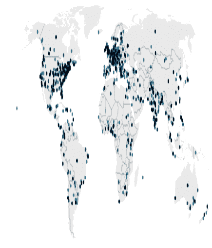
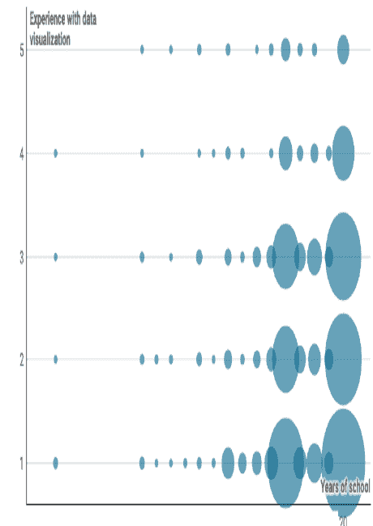
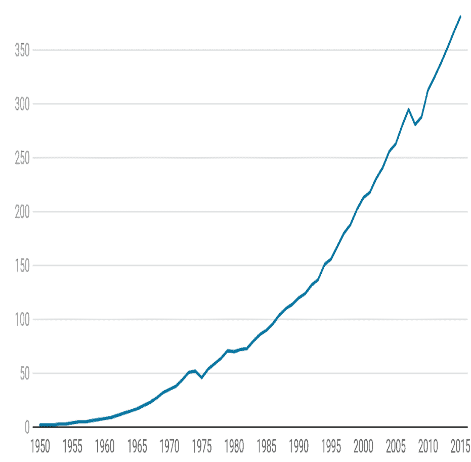
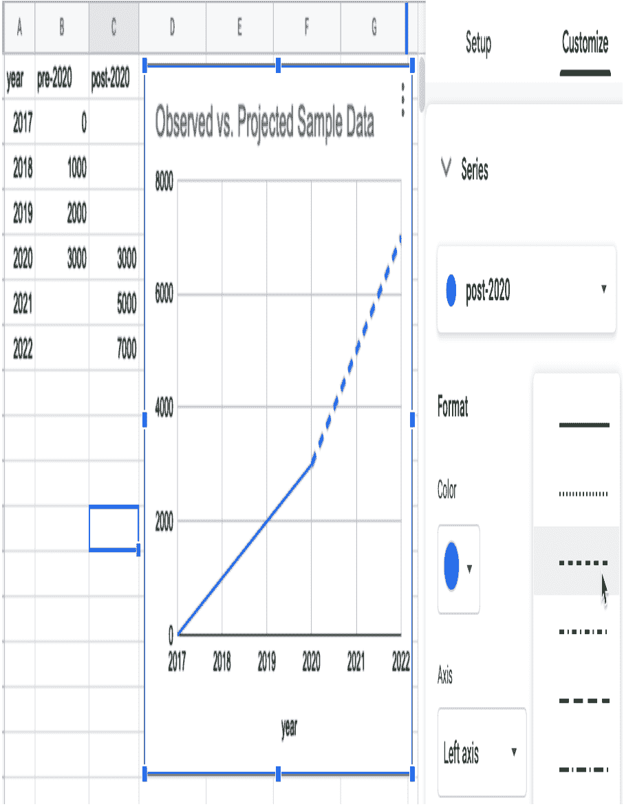
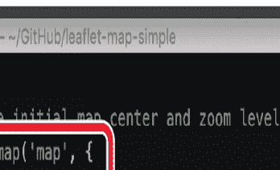
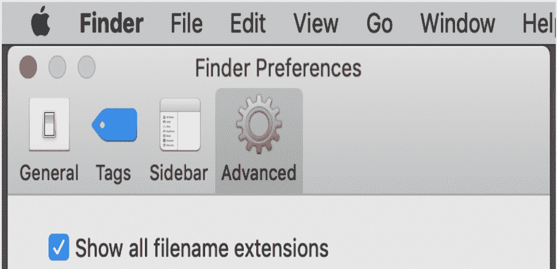
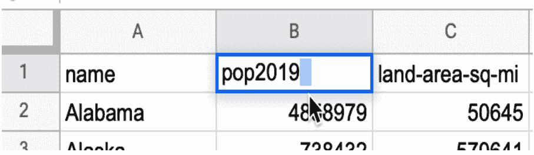
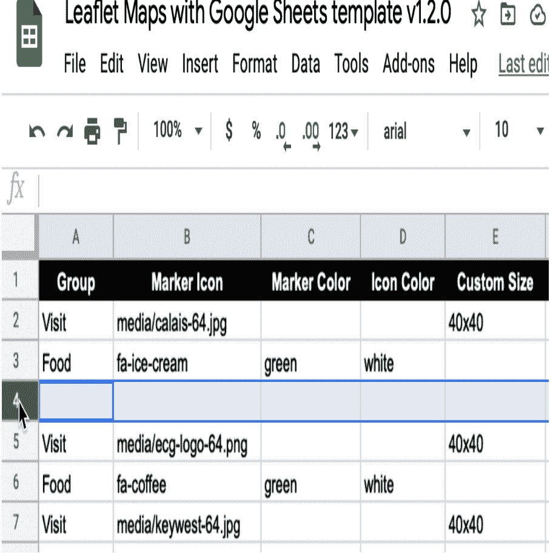
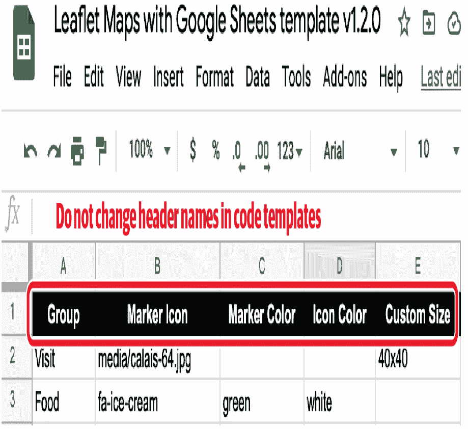

## Chapter 15. Tell and Show Your Data Story

For our concluding chapter, we’ll draw on knowledge and skills you’ve developed while reading this book and offer some final recommendations for creating true and meaningful data stories. Here we emphasize storytelling. The goal of data visualization is not simply to make pictures about numbers, but also to craft a truthful narrative that convinces readers how and why your interpretation matters.

Writers have a saying—“show, don’t tell”—which means to let readers experience a story through the actions and feelings of its characters, rather than narration by the author. We take a different stance, as shown in our chapter title: tell and show your data story. Make a regular habit of these three steps: tell your audience what you found that’s interesting in the data, show them the visual evidence to support your argument, and remind us why it matters. In three words: tell, show, why. Whatever you do, avoid the bad habit of showing lots of pictures and leaving it up to the audience to guess what it all means. We rely on you, the storyteller, to guide us on a journey through the data and highlight what aspects deserve our attention. Describe the forest, not every tree, but point out a few special trees as examples to help us understand how different parts of the forest stand out.

In this chapter, you’ll learn how to build visualizations into the narrative of the storyboard that we started in Part I. You’ll try out ways to draw attention to what’s most meaningful in your data through text and color in “Draw Attention to Meaning”. You will also learn how to acknowledge sources and uncertainty in “Acknowledge Sources and Uncertainty”. Finally, we’ll discuss decisions you’ll need to make about the format of your data story, with continual emphasis on sharing interactive visualizations rather than static images in “Decide on Your Data Story Format”.¹

## Build a Narrative on a Storyboard

Let’s return to the exercise from “Start Sketching Your Data Story”. We encouraged you to scribble words and sketch pictures on sheets of paper to lay out at least four initial elements of your story:

+   1. Identify the problem that motivates your project.
+   2. Reframe the problem into a researchable question.
+   3. Describe your plan to find data to answer the question.
+   4. Dream up one or more visualizations you might create using imaginary data.

Spread out these sheets like a storyboard to define the sequence of your narrative, as shown in Figure 15-1. Imagine them as preliminary slides for your presentation, or paragraphs and pictures for your written report or web page, for how you will explain the process to your audience. If you prefer to construct your storyboard digitally, another option is to convert blocks of text and images from your sheets into a Google Slides presentation or a draft Google Doc, or your preferred tools for telling the data story. Of course, it’s perfectly normal to update the sheets you created at the beginning of your project to reflect changes in your thinking. For example, you may have refined your research question, found new sources during your search, and of course, turned your imagined visualizations into actual tables, charts, or maps with real data.


例如，我们在“开始绘制你的数据故事”中着手绘制自己的数据故事板，以定义我们的问题陈述：我们需要了解读者关于数据可视化的背景和兴趣，以便撰写一本更能满足他们需求的入门指南。我们收集了这本书早期草稿的三千多名读者的数据，他们回应了我们的在线调查，并同意我们公开分享调查结果，正如我们在第2章中讨论的那样。我们按照第4章所述清理了数据，因为有些回复部分为空，或者包含无法精确地理编码的位置。然后，我们按照第5章所述寻找有意义的比较，并以两种方式将最有趣的结果可视化。我们在第6章中创建了一个散点图，在第7章中创建了一个点地图。

现在，我们将遵循自己的建议，在每个可视化的顶部写出简短摘要，并在底部解释其重要性。

我们从关于这本书早期草稿的读者调查中发现了什么？我们对关键数据发现是如何回应的？首先，超过70%的受访读者居住在北美洲以外。最值得注意的是，35%居住在亚洲，20%在欧洲，非洲和南美洲各6%，大洋洲3%，如图15-2左侧所示。这本书的初稿主要包含我们两人曾工作过的康涅狄格州哈特福德的示例。虽然我们知道这本书有全球读者，但我们惊讶地发现，在受访者中，有多少人居住在美国以外。为了更具包容性并扩大我们的国际读者群，我们修订了这本书，增加了来自世界其他地区的示例图表和地图。

其次，我们了解到，回应我们调查的读者受教育程度相对较高，但数据可视化经验有限。具体而言，89%的人报告完成了相当于大学学位的教育（16年或以上的学校教育），其中64%的人自评为数据可视化初学者（在5分经验量表上评为1或2分），如图15-2右侧所示。在这本书的早期草稿中，我们的主要受众是大学本科生，我们对其他读者的阅读水平和背景不确定。根据调查回复，我们修订了手稿，增加了关于数据可视化的更深层概念，因为我们相信大多数读者能够掌握这些概念，但我们仍然以入门水平写作，假设读者只需具备中学或大学早期教育的基础知识，而无需任何先验知识。现在我们可以将这些新页面添加到故事板中。

### 69%的调查受访者居住在北美洲以外

截至2020年10月，超过3000名《动手学数据可视化》读者参与了调查。在我们能够进行地理编码的读者中，只有31%居住在北美洲，而34%居住在亚洲，20%在欧洲，非洲和南美洲各6%，大洋洲3%。



来源：HandsOnDataViz • 使用 Datawrapper 创建

### 受教育程度高但数据可视化经验有限的读者

截至2020年10月，超过3000名《动手学数据可视化》读者参与了调查。89%的人完成了相当于大学学位的教育（16年或以上学校教育），但其中64%的读者自评为数据可视化初学者（在1-5分量表上评为1或2分）。



修订这本书，增加来自读者所在地区的数据练习，使其更具包容性

修订这本书，增加更深层的概念，而不假设读者具备先验的数据可视化知识或经验

图15-2. 在每个可视化的顶部用语言表达有意义的见解，并在底部说明其重要性，然后将它们插入到你的故事板中。

让我们回到你的故事板。将你新的数据可视化页面（或幻灯片，或文本和图像块）插入到你已经组装好的页面中。当你完成工作时，你的布局可能看起来像这样：

- 问题陈述
- 研究问题
- 你如何找到数据
- 讲述第一个数据见解 —— 展示证据 —— 为什么重要
- 讲述第二个数据见解 —— 展示证据 —— 为什么重要

……以此类推，直到你的总结结论。

作为讲述者，你的工作是以对观众有意义的方式组织你的数据叙事，而观众很可能都是第一次看到所有这些内容。虽然没有固定的讲故事方式，但请考虑以下建议，以避免犯初级错误：

- 在给出答案之前先告诉我们问题和疑问，因为我们的大脑期望按这个顺序听到它们。
- 在向我们展示支持证据之前，先总结每个见解，因为同样，颠倒正常顺序会让我们更难理解你的论证。
- 确保你的研究问题和关键见解相互一致，因为如果你提出一个问题却回答另一个问题，你的观众会感到困惑。在对数据深入研究之后，调整或完全修改你的研究问题的措辞是完全正常的，因为有时候你可能直到发现了目标才知道自己在寻找什么。

现在你应该更清楚地了解故事板如何帮助你整合叙事和数据。在下一节中，你将学习如何通过使用文本和颜色来完善你的可视化，以吸引人们对最重要内容的关注。

## 吸引对意义的关注

在完成可视化时，添加最后的润色，以吸引人们对数据中最有意义的方面的关注。除了为图表和地图撰写文字外，你还可以添加注释，并在某些类型的可视化*内部*使用颜色，以指出数据故事中最重要之处。让我们演示如何使用这些功能，在 Datawrapper 中转换你的可视化，这是一个我们在“Datawrapper 图表”中首次介绍的工具。

我们今天面临的环境挑战之一是塑料制品的不断增长。虽然这些廉价且轻质的材料带来了许多生活质量上的好处，但我们经常将它们丢弃在管理不善的废物流中，导致它们进入河流和海洋。为了了解塑料的增长，我们参考了*Our World In Data*，你可以通过 Google Sheets 格式查看1950年至2015年的年度全球生产数据。[^2]

首先，让我们将单列格式的数据上传到 Datawrapper。默认情况下，该工具会将这些时间序列数据转换为折线图，如图15-3所示，该图显示了全球塑料生产如何随时间增长：

| 年份 | 塑料 |
|------|---------|
| 1950 | 2 |
| 1951 | 2 |
| ... | ... |

### 1950-2015年全球塑料年产量

单位：百万吨



图表：由 HandsOnDataViz 制作 • 来源：Our World In Data; Geyer 等人, 2017 • 使用 Datawrapper 创建

图15-3. Datawrapper 中历史塑料生产的默认折线图。

图15-3尚未聚焦于更大的故事：全球历史上制造的塑料总产量。根据我们对数据的分析，自2000年以来（即这张图表的最后15年），全球制造的所有塑料中有超过60%是在此期间生产的。让我们通过编辑图表并运用你在前几章学到的技能来突出这一更广泛的要点。首先，将数据分成两列，即2000年之前和2000年之后，这样可以分别为每个数据系列应用不同的颜色。在两年一栏中都插入相同的2000年数据，以使新图表看起来连续：

| 年份 | 2000年前 | 2000年后 |
|------|-------------|------------|
| 1999 | 202 | |
| 2000 | 213 | 213 |
| 2001 | | 218 |
| ... | | |

其次，将图表类型从默认的折线图改为面积图，以填充曲线下方的空间，从而吸引人们对随时间推移制造的塑料总量的关注。第三，在 Refine 选项卡中，由于你不需要堆叠面积图，请取消选中 stack areas 复选框。为2000年后的数据系列指定深蓝色以吸引更多注意，为2000年前的数据系列指定灰色以弱化其存在，如图15-4所示。


## 自定义区域

Base color

customize colors...

Select element(s):

Choose a color:

before 2000

since 2000

Select: all none invert

opacity

Interpolation

linear

Sort areas

keep order

largest first

Stack areas

## 超过一半的塑料曾被制造

has been made since 2000

Global plastic annual production in millions of metric tons

59% of all plastic ever manufactured

Figure 15-4. After dividing the data into two columns and switching to an area chart, uncheck the stacked areas box in the Refine tab.

Finally, hide the old title and replace it by adding annotations, as you learned in “Annotated Charts”. Place annotations inside the area chart, using colored text, to emphasize the new interpretation and place it where readers will look, as shown in Figure 15-5. Overall, redesigning your chart helps you communicate a more meaningful data story that global plastic production is increasing and our world has manufactured more than half of our historical total in just the past 15 years.

Third, save and show that your data works at different stages of the process. Save notes and copies of the data as you download, clean, or transform it; and document the important decisions you make along the way. One simple method is to save different versions of your data in separate spreadsheet tabs, as shown in Chapter 2. For more complex projects, consider sharing your data and documenting your methods in a public GitHub repository, as shown in Chapter 10. If someone questions your work, wants to replicate it, or if you need to refresh it with an updated dataset, you’ll be grateful to have notes that allow you to trace it backward.

Finally, acknowledge the limitations of your data and disclose any uncertainty. Your work becomes more credible when you admit what you do not know, or that you are willing to consider alternative interpretations. Some of our recommended chart tools in Chapter 6 and chart code templates in Chapter 11 allow you to insert error bars to show the confidence level in the data, so use those when appropriate. Furthermore, the two-column method shown in the prior section also works to visually distinguish between observed versus project data with solid versus dashed lines, as shown in the Google Sheets Chart editor in Figure 15-6.



Figure 15-6. Split one data column into two columns to contrast observed data (solid line) versus projected data (dashed line).

Now that we’ve reviewed ways to build credibility in your work, let’s move on to decisions you’ll need to make about telling your data story in different formats.

## Decide on Your Data Story Format

- Tabula PDF table extractor (how to)
- Tableau Public resources page

Of course, if you encounter a problem when using an online tool or web platform, always check your internet connection. On rare occasions, online tools and platforms may be offline for all users. To clarify if an online service is down for everyone, and not just you, check for outage reports on sites such as:

- Downdetector.com
- Down for Everyone or Just Me?

Also, some online services operate their own status pages:

- GitHub Status
- Google Workspace Status

Finally, note that rare outages by large providers, such as the problems Amazon Web Services faced in November 2020, can affect other online tool platforms.¹

## Try a Different Browser

Many problems we encounter with online tools and code templates turn out to be caused by our browser, not the tool or template itself. The *most important advice* we offer in this appendix is to *always try a different browser* to diagnose your problems. If you normally do all of your work in your favorite browser—such as Chrome, Firefox, Microsoft Edge, or Safari for Mac only—download a second browser for testing purposes. But please stop using the defunct Internet Explorer or Edge Legacy browsers, since Microsoft announced in 2020 that neither will be supported in the future.

In fact, you should *always* test your data visualization products in a second browser, where you are *not* logged in to an online account for the tool or service that created it, to check how it appears to regular users. On our computers, we installed a second browser, specifically for testing, and changed the settings to *Never Remember browsing history* so that it acts like a first-time user whenever we open it.

If you encounter any issues when using your favorite browser with digital tools or web services, give it a “hard refresh” to bypass any saved content in your cache and re-download the entire web page from the server, using one of these key combinations:

*Windows or Linux browsers*

Ctrl+F5

*Chromebook*

Shift+Ctrl+R

*Chrome or Firefox for Mac*

Command-Shift-R

*Safari for Mac*

Option-Command-R

## Diagnose with Developer Tools

We recommend learning how to use your browser to diagnose other types of issues, such as those discussed in “Common iframe Errors” and “Fix Your Code on GitHub”. Most browsers contain *developer tools* that allow you to view the source code of a web page and spot any errors that it flags. Even if you’re not a software developer, learning how to open your browser’s developer tools allows you to peek under the hood and make a more informed guess about what’s not working. To open developer tools in various browsers:

- In Chrome, go to View > Developer > Developer Tools.
- In Firefox, go to Tools > Web Developer > Toggle Tools.
- In Microsoft Edge, go to “Settings and more (...)” icon > More Tools > Developer Tools.
- In Safari for Mac, first go to Safari > Preferences > Advanced > “Show Develop menu in menu bar,” then go to Develop > Show JavaScript Console.

When you open the browser’s developer tools, it displays a *console* window that shows error messages that may help to diagnose problems, particularly with code templates. For example, in “Copy, Edit, and Host a Simple Leaflet Map Template”, you learned how to edit the simple Leaflet map template in GitHub. If you accidentally make a mistake, such as deleting the comma between the latitude and longitude coordinates for map center, your code will “break” and display an empty gray box in your screen. If you turn on the browser developer tools, as shown in Figure A-1, the console will display several errors, including one that points you to a problem beginning in the *index.html* file on line 29. While the error does not specifically state that a comma is missing in line 30, it’s still the best clue to alert you to a problem in that vicinity of the code. This is just one way to use the developer tools, so why not explore other features and how they differ across browsers?

## Loyalist College

Located in picturesque Prince Edward County, Loyalist College offers an outstanding education and a vibrant campus life. Our programs are designed to give students hands-on learning experiences that prepare them for successful careers.

- Business Administration
- Computer Programming
- Nursing
- Graphic Design
- Supply Chain Management

| Program | Duration | Co-op |
|---------|----------|-------|
| Business | 2 years | Yes |
| Nursing | 4 years | No |
| Computer Programming | 3 years | Yes |



## Mac or Chromebook Problems

If you are using a Mac, make sure your settings make visible the filename extensions, meaning the abbreviated file format that appears after the period at the end of a filename, such as data.csv or map.geo.json. The Mac operating system hides these extensions by default, and several tools in this book will not work properly if they’re not visible. Make them visible on a Mac by going to Finder > Preferences > Advanced, and check the box to “Show all filename extensions”:



If you’re using a Chromebook, beware that it may be difficult or impossible to install and run some of the recommended tools in this book. Tools that are not currently supported for Chromebook include most downloadable desktop applications, such as: Atom, GitHub Desktop, LibreOffice Calc, OpenRefine data cleaner, Tableau Public, and Tabula PDF table extractor. But Chromebooks can still operate most of the tools that run through the Chrome browser, such as: Google Sheets, Google My Maps, Datawrapper, the GitHub.com web interface, and several others. Also, if you wish to edit code templates on a Chromebook, see the open source Caret text editor for Chrome by Thomas Wilburn.

## Watch Out for Bad Data

Sometimes a problem with a data visualization tool or service is caused by bad data. Revisit “Recognize Bad Data” and different ways to clean data in Chapter 4. In addition, avoid common mistakes that will introduce errors into your data files, especially when working with Chart.js and Highcharts code templates in Chapter 11 and Leaflet map code templates in Chapter 12.

First, avoid typing blank spaces into spreadsheet entries—especially column headers. Although blank spaces may seem innocent, they may confuse digital tools and code templates that expect to find column headers spelled precisely as promised, without extra spaces:



Second, avoid blank rows in data files. For example, when using code templates such as Leaflet Maps with Google Sheets or Leaflet Storymaps with Google Sheets, your online map will break if you leave a blank row in the Google Sheets:




鉴于此，在前面描述的两个 Leaflet 代码模板中，媒体文件路径名是区分大小写的。换句话说，`media/filename.jpg` 与 `media/filename.JPG` 并不相同。因此，我们建议全部使用小写字符，包括扩展名。

最后，在使用调用 GeoJSON 数据文件的 Leaflet 代码模板时（如第 12 章所述），请注意地理数据中的 null（空）字段错误。在上一节所述的浏览器控制台诊断窗口中，这些错误可能会显示类似于以下的 NaN（意为“非数字”）错误消息：

```
Uncaught Error: Invalid LatLng object: (NaN, NaN)
```

要解决浏览器控制台中的 NaN 错误，请使用“使用 GeoJson.io 绘制和编辑”中的 GeoJson.io 工具来仔细检查你的地理数据中是否存在空字段。

## 常见的 iframe 错误

如果你按照第 9 章的步骤操作，但 iframe 的内容仍未出现在浏览器中，请检查以下常见问题：

- iframe 中列出的项目（如 URL、宽度或高度）应包含在直单引号（'）或直双引号（"）之内。选择其中一种，但要保持一致。
- 始终使用直引号，避免使用弯引号（也称为智能引号或斜引号）。从文字处理器粘贴代码时，有时会意外发生这种情况。避免使用弯引号，例如左单引号（‘）、右单引号（’）、左双引号（“）和右双引号（”）。
- 在 iframe 中始终使用 https（额外的“s”表示“安全”），而不是 http。如果混合使用 https 和 http 资源，某些 Web 浏览器会阻止内容。本书中的所有代码模板都需要 https。

使用 W3Schools 的 TryIt iframe 页面来测试你的 iframe 嵌入代码，尤其是在需要编辑它们的时候，因为这是检查标点错误的好方法。图 A-2 显示了一个简单 iframe 中的三个常见问题：弯双引号（在 src= 之后）、使用 http 而不是 https，以及双引号和单引号混用。所有这些问题都在图 A-3 中得到了修正，这使得 iframe 能够按预期显示。

```
<!DOCTYPE html>
<html>
<body>
<h1>The iframe element</h1>
<iframe src="http://handsondataviz.github.io/leaflet-map-simple" width='90%' height='350'>
</iframe>
</body>
</html>
```

### iframe 元素

图 A-2. 你能在这个错误的 iframe 代码中找出三个常见问题吗？

```
<!DOCTYPE html>
<html>
<body>
<h1>The iframe element</h1>
<iframe src='https://handsondataviz.github.io/leaflet-map-simple' width='90%' height='350'>
</iframe>
</body>
</html>
```

### iframe 元素

图 A-3. 这里修正了所有三个问题，使得 iframe 能够按预期显示。

## 在 GitHub 上修复代码

正如我们在第 10 章中讨论的，使用开源代码模板可以让你更好地控制数据可视化的外观及其在线托管位置。这也意味着，当你的代码出错时，你需要负责修复它，或者找一个有能力的人帮你修复，可能需要付费。如果你在修复代码或在免费的 GitHub 平台上托管代码时遇到问题，请回顾本书的相关章节，并注意以下常见问题：

- 编辑代码时要小心。一个单独的拼写错误——例如缺少逗号、分号、引号或括号——都可能导致你的可视化出错。我们理解这种情况发生时你可能会感到多么沮丧，因为我们也经历过，所以稍作休息，过一会儿再回到屏幕前，用全新的眼光来帮助你找到问题。
- 耐心一点。GitHub Pages 通常会在 30 秒内处理你对可视化的编辑，但有时可能需要几分钟。给浏览器做一次“硬刷新”，以绕过缓存中保存的任何内容，并从服务器重新下载整个网页，请使用以下按键组合之一：
  - Ctrl+F5（大多数 Windows 或 Linux 浏览器）
  - Shift+Ctrl+R（Chromebook）
  - Command-Shift-R（Mac 上的 Chrome 或 Firefox）
  - Option-Command-R（Mac 上的 Safari）
- 始终在不同的浏览器中测试已发布可视化的链接。有时问题实际上是由浏览器故障引起的，而不是代码本身。
- 偶尔，GitHub 平台可能会遇到中断，或报告从你的代码构建 GitHub Pages 时出现已知问题。请查看 GitHub 状态站点。

在第 11 章使用 Chart.js 和 Highcharts 代码模板以及在第 12 章使用 Leaflet 地图代码模板时，要谨慎编辑，尤其是数据文件的结构。例如，在“Leaflet Maps with Google Sheets”代码模板中，除非你清楚自己在做什么，否则不要更改每列顶部的名称，因为代码模板会通过这些确切名称来处理你的数据：



请记住，你可以更高效地在本地计算机上编辑和测试代码模板，而不是将每次更改都上传到 GitHub 在线查看。使用“使用 GitHub Desktop 和 Atom 文本编辑器高效编码”中所述的 GitHub Desktop 和 Atom 工具。要在本地计算机上完整查看更复杂的 Chart.js、Highcharts 或 Leaflet 代码模板，你可能需要按如图 10-2 和图 10-3 所示，临时管理浏览器中的 CORS 互联网安全设置。

随着时间的推移，代码模板需要维护，以确保它们随着技术的发展继续工作。例如，本书中介绍的代码模板都有代码依赖项，这意味着它们依赖其他代码或在线服务才能运行。这些依赖项包括创建图表和地图的在线代码库，例如 Chart.js、Highcharts、Leaflet 等。此外，地图代码模板依赖来自 CARTO、Stamen 和 OpenStreetMap 等提供商的在线地图瓦片。如果你的某个在线代码依赖项不再运行，你的代码模板很可能会停止工作。

要检查你的代码模板是否与其某个在线代码依赖项有关的问题，请返回你进行复制操作时所用的原始 GitHub 仓库。检查当前的在线演示图表或地图是否正常工作。如果是，那么检查原始 GitHub 仓库是否有最近可能解决你问题的代码更新。有些代码更新很简单，可以直接通过 GitHub 网页界面输入到你的仓库中。其他代码更新则更为复杂，因此请回顾如何使用诸如 GitHub Desktop 之类的工具将代码从仓库拉取到本地计算机，参见“使用 GitHub Desktop 和 Atom 文本编辑器高效编码”。

如果你复制代码模板的原始 GitHub 仓库的在线演示版本无法正常工作，请联系开源软件开发者；最好的方式是在他们的 GitHub 仓库上创建一个 Issue。无法保证开源软件开发者未来会继续维护他们的代码项目。但开源代码的一个优点是，任何人都可以创建新的 fork 副本，并自行维护，或与开源编码社区中的协作者一起维护。

最后，如果你没有在这里找到问题的答案，可以考虑在其他地方提问。我们推荐的一些工具支持页面包含指向社区帮助论坛的链接，用户可以在那里发布问题，有时会从其他用户那里获得有用的回答。此外，Stack Exchange 网络汇集了 170 多个在线社区，专家们可以就特定主题回答问题，例如面向 Google Sheets 等在线工具的 Web Applications Stack Exchange，以及面向软件编码的 Stack Overflow。在任何这些公共论坛上发帖时，请务必遵守它们的指南，清楚地描述你的问题，并提及你所使用的计算机操作系统类型和/或浏览器版本。

> 1 Jay Green，“Amazon Web Services 中断阻碍企业发展”，《华盛顿邮报》，商业版，2020 年 11 月 25 日。https://oreil.ly/PTmQ6。


-  choropleth map：**使用 Datawrapper 的分级色图**
-  强调意义：**突出意义**
-  不确定性在中承认：**承认来源和不确定性**
-  美国各州和地理区域的 ANSI 代码：**使用 Datawrapper 的分级色图**

## APIs

-  Google Maps API 用于可搜索点地图：**可搜索点地图 Leaflet**
-  Google Maps API 密钥：**步骤 3：发布您的地图**
-  Google Sheets API 密钥可能更改：**F. 删除或显示点、多边形或折线数据和图例**，**F. 可选：添加历史地图图像或 GeoJSON 叠加层**
-  Google Sheets API 个人密钥：**H. 获取您自己的 Google Sheets API 密钥以插入代码**，**获取您的 Google Sheets API 密钥**
-  用于开放数据 API 的 Leaflet 地图模板：**Leaflet 地图模板**，**使用开放数据 API 的 Leaflet 地图**
-  开放数据存储库：**开放数据存储库**
-  Apple 数据隐私：**公共和私人数据**
-  ArcGIS (Esri)
  -  关于：**使用 Mapshaper 编辑和连接**
  -  用于提取数据的 Leaflet 插件：**使用开放数据 API 的 Leaflet 地图**
  -  QGIS 开源工具：**转换您的地图数据**，**Shapefiles**
  -  Shapefiles：**Shapefiles**
  -  StoryMaps 平台：**使用 Google Sheets 的 Leaflet 故事地图**
-  《统计学的艺术》(Spiegelhalter)：**做出有意义的比较**，**识别和减少数据偏差**
-  图表纵横比被扭曲以误导：**拓宽图表以扭曲其纵横比**
-  Atom 文本编辑器：**使用 GitHub Desktop 和 Atom 文本编辑器高效编码**
-  Chromebook 不受支持：**Mac 或 Chromebook 问题**
-  支持页面链接：**工具或平台问题**
-  地理空间数据的属性：**地理空间数据和 GeoJSON**
-  来自 CSV 的 GeoJSON 数据：**从 CSV 文件创建 GeoJSON**
-  Mapshaper 编辑：**编辑特定多边形的数据**，**删除不需要的数据字段**
-  删除的数据字段：**删除不需要的数据字段**
-  重命名的数据字段：**重命名数据字段**，**将电子表格数据与多边形地图连接**
-  平均值作为令人困惑的词：**精确描述比较**
-  图表的坐标轴：**解构图表**
-  小数点：**使用 Google Sheets 图表的常规直方图**

## How to Lie with Charts

-  图表纵横比被扭曲：**拓宽图表以扭曲其纵横比**
-  递减变化：**在图表中淡化变化**
-  双纵轴：**添加更多数据和双纵轴**
-  夸大变化：**在图表中夸大变化**

## Labels

-  误导性使用：**有些图片更有说服力**
-  可读性：**不要让人转头阅读标签**
-  图表的零基线规则：**条形图和柱形图必须从零开始**
-  在图表中夸大变化：**在图表中夸大变化**
-  折线图：**条形图和柱形图必须从零开始**，**拉长垂直轴以压平线条**

-  数据备份：**引用您的数据**
-  不良数据：**识别不良数据**
  -  Quartz 不良数据指南：**识别不良数据**
  -  故障排除：**注意不良数据**

## Bar Charts

-  关于：**绘制您的数据，条形图和柱形图**
  -  （另见图表）
-  Chart.js：**Chart.js 和 Highcharts 模板**，**使用 Chart.js 的条形或柱形图**
  -  文件结构：**使用 Chart.js 的条形或柱形图**
-  误差线：**绘制您的数据，解构图表**
  -  Chart.js：**Chart.js 和 Highcharts 模板**，**使用 Chart.js 的误差线**
  -  可信度及：**承认来源和不确定性**
  -  Google Sheets：**分组条形图和柱形图**
-  Google Sheets：**条形图和柱形图**，**使用 Google Sheets 图表的常规直方图**
-  分组：**绘制您的数据，分组条形图和柱形图**
  -  Google Sheets：**分组条形图和柱形图**
  -  Google Sheets，交互式：**分组条形图和柱形图**
  -  Google Sheets，交互式嵌入：**分组条形图和柱形图**
-  标签：**绘制您的数据，条形图和柱形图**
-  堆叠：**绘制您的数据，堆叠条形图和柱形图**
  -  Google Sheets：**堆叠条形图和柱形图**
-  图表中的基线：**有些规则比其他规则更重要**，**饼图代表 100%**
-  夸大变化：**在图表中夸大变化**
-  折线图：**条形图和柱形图必须从零开始**，**拉长垂直轴以压平线条**

## Basemaps

-  有争议的领土偏差：**识别和减少空间偏差**
-  Leaflet 代码选项网站：**复制、编辑和托管简单的 Leaflet 地图模板**
-  光栅与矢量：**解构地图**
-  可缩放瓦片提供商链接：**Leaflet 地图模板**

## Beginner Tools, **Our Recommended Tools**

-  关于电子表格：**加强您的电子表格技能**
-  已识别的易用工具：**1. 易于学习**
  -  图表：**绘制您的数据**
  -  地图：**绘制您的地图**
-  HTML 标签和语法链接：**E. 在点选项卡中地理编码位置并自定义新标记**
-  Leaflet 地图模板：**Leaflet 地图模板**，**使用 Google Sheets 的 Leaflet 地图**
  -  初学者编码：**Leaflet 地图模板**，**使用 Google Sheets 的 Leaflet 地图**
-  Mapshaper：**使用 Mapshaper 编辑和连接**
-  故事地图平台：**使用 Google Sheets 的 Leaflet 故事地图**

## Tool Selection

-  数据格式：**下载为 CSV 或 ODS 格式**
-  需要考虑的因素：**选择工具时的十个因素**，**10. 对视障读者可访问**
-  来自 24 种不同工具的一个图表：**10. 对视障读者可访问**
-  密码管理器：**使用密码管理器**
-  推荐工具：**我们的推荐工具**
-  电子表格工具：**选择您的电子表格工具**

-  可信的视觉化（见可信度）
-  Bergstrom, Carl T.：**警惕有偏见的比较**
-  Best, Joel：**表格设计原则**
-  数据偏差：**警惕有偏见的比较**，**识别和减少数据偏差**，**识别和减少空间偏差**
  -  数据可视化中的种族公平：**识别和减少数据偏差**
  -  空间偏差：**识别和减少空间偏差**
  -  解决问题的卡图：**识别和减少空间偏差**
-  Bitwarden：**使用密码管理器**
-  Black Lives Matter 警察数据：**公共和私人数据**
-  空白空间作为不良数据：**注意不良数据**
-  Bloch, Matthew：**使用 Mapshaper 编辑和连接**
-  边界（见地理边界）
-  GitHub 上的分支
  -  提交更改：**复制、编辑和托管简单的 Leaflet 地图模板**
  -  编辑后合并不同：**使用 GitHub Desktop 和 Atom 文本编辑器高效编码**
  -  main 为默认：**复制、编辑和托管简单的 Leaflet 地图模板**
-  Brewer, Cynthia A.：**设计分级色图颜色和间隔**
-  Brown University 开放数据列表：**开放数据存储库**
-  浏览器
  -  Chromebook 不受支持：**Mac 或 Chromebook 问题**
  -  控制台窗口：**使用开发者工具诊断**
  -  开发者工具：**使用开发者工具诊断**
  -  GitHub Desktop 代码模板编辑：**使用 GitHub Desktop 和 Atom 文本编辑器高效编码**
  -  放宽同源策略：**使用 GitHub Desktop 和 Atom 文本编辑器高效编码**
  -  链接缩短服务：**分享您的 Google Sheets**
  -  地图边界细节及：**简化地图边界以减小文件大小**
  -  OpenRefine 数据清理器：**设置 OpenRefine**
  -  密码管理器：**使用密码管理器**
  -  推荐浏览器：**动手学习建议**
  -  旧版浏览器不受支持：**尝试不同的浏览器**
  -  故障排除时尝试不同：**尝试不同的浏览器**
  -  浏览器中的关系数据库：**电子表格与关系数据库**
  -  Tabula PDF 表格提取器：**使用 Tabula 从 PDF 提取表格**
  -  测试可视化：**尝试不同的浏览器**
  -  故障排除浏览器问题：**尝试不同的浏览器**
    -  硬刷新：**尝试不同的浏览器**
  -  使用浏览器故障排除：**使用开发者工具诊断**
  -  可视化工具安全和隐私：**6. 安全和私密**
  -  网络安全扩展：**我们的推荐工具**
-  气泡图
  -  关于：**绘制您的数据**，**散点图和气泡图**，**使用 Chart.js 的气泡图**
  -  动画：**散点图和气泡图**
  -  Chart.js：**Chart.js 和 Highcharts 模板**，**使用 Chart.js 的气泡图**
  -  Datawrapper：**气泡图**


# C

Cairo, Alberto

图表中的纵横比，拓宽图表以扭曲其纵横比

地理编码不良数据，识别不良数据

数据分布的直方图，修改地图颜色范围

数据的标准化，规范化您的数据

《真实的艺术》，规范化您的数据，检测谎言并减少偏差，讲述并展示您的数据故事

折线图中的零基线规则，柱状图和条形图必须从零开始，拉长垂直轴以压平线条

加州消费者隐私法案（2020），公共和私人数据

加拿大原住民土地地图，识别和减少空间偏差

Chromebook 的 Caret 文本编辑器，GitHub Desktop 和 Atom 文本编辑器以高效编码，Mac 或 Chromebook 问题

CARTO 用于代码模板，复制、编辑并托管简单的 Leaflet 地图模板

卡特图，识别和减少空间偏差

通过范围图对数据的类别，图表化您的数据

数据中的因果关系，精确描述比较

表格设计示例，表格设计原则

政府对互联网的审查，6. 安全和私密

响应政治中心，公共和私人数据

随时间的变化

调整数据，规范化您的数据，增加更多数据和双垂直轴

折线图，图表化您的数据，图表化您的数据，折线图

堆积面积图，图表化您的数据，堆积面积图

Chart.js

关于

注释，带 Highcharts 的注释折线图

文件结构，带 Chart.js 的柱状图或条形图

开源，Chart.js 和 Highcharts 模板

柱状图或条形图，Chart.js 和 Highcharts 模板，带 Chart.js 的柱状图或条形图-带 Chart.js 的柱状图或条形图

误差线，Chart.js 和 Highcharts 模板，带 Chart.js 的误差线-带 Chart.js 的误差线

气泡图，Chart.js 和 Highcharts 模板，带 Chart.js 的气泡图

文档链接，带 Chart.js 的折线图，摘要，工具或平台问题

折线图，Chart.js 和 Highcharts 模板，带 Chart.js 的折线图

堆积面积图转换，带 Chart.js 的折线图

推荐工具，我们推荐的工具

示例链接，摘要

散点图，Chart.js 和 Highcharts 模板，带 Chart.js 的散点图

编辑警告，修复 GitHub 上的代码

图表

关于，图表化您的数据

说服力，某些图片比其他图片更具说服力

纵横比，拓宽图表以扭曲其纵横比-拓宽图表以扭曲其纵横比

使用柱状图和条形图的书籍，图表化您的数据
Datawrapper，Datawrapper 图表
注释折线图，注释图表-注释图表
置信区间，注释图表
散点图和气泡图，散点图和气泡图
定义，为什么数据可视化？
设计原则，图表设计原则-请注意颜色
美学，图表美学-请注意颜色
基线，某些规则比其他规则更重要-饼图代表 100%
夸大基线变化，夸大图表中的变化
图表垃圾，避免图表垃圾
颜色，请注意颜色
图表组件，拆解图表
数据可视化规则博客文章，图表设计原则
标签可读性，不要让人们转头阅读标签
饼图，饼图代表 100%-饼图需谨慎，饼图
不可打破的规则，某些规则比其他规则更重要-饼图代表 100%
已识别的易用工具，图表化您的数据-图表化您的数据
Google Sheets
关于，Google Sheets 图表
柱状图和条形图，柱状图和条形图-使用 Google Sheets 图表的常规直方图
嵌入网页，分组柱状图和条形图
分组柱状图或条形图，分组柱状图和条形图
直方图，直方图-饼图、折线图和面积图
交互式柱状图和条形图，分组柱状图和条形图
Google Sheets 的局限性，Google Sheets 图表，分组柱状图和条形图，使用 Google Sheets 图表的常规直方图
散点图和气泡图，散点图和气泡图
拆分柱状图或条形图，拆分柱状图和条形图
堆积面积图，堆积面积图
堆积柱状图或条形图，堆积柱状图和条形图
如何用图表撒谎
关于，如何用图表撒谎
添加更多数据，添加更多数据和双垂直轴-添加更多数据和双垂直轴
调整随时间变化的数据，添加更多数据和双垂直轴
纵横比扭曲，拓宽图表以扭曲其纵横比-拓宽图表以扭曲其纵横比
颜色，添加更多数据和双垂直轴
缩小变化，图表中缩小变化
夸大变化，图表中夸大变化
教程来源，检测谎言并减少偏差
已识别的强大工具，图表化您的数据-图表化您的数据
推荐工具，我们推荐的工具
表格的行和列相反，转换行和列，折线图
迷你图，表格化您的数据
类型
关于，图表化您的数据
最佳用途和教程，图表化您的数据

使用 Google Sheets 的地图，Leaflet 地图模板，使用 Google Sheets 的 Leaflet 地图-H. 获取您自己的 Google Sheets API 密钥以插入代码
使用开放数据 API 的地图，Leaflet 地图模板，使用开放数据 API 的 Leaflet 地图
使用 CSV 数据的点地图，Leaflet 地图模板，使用 CSV 数据的 Leaflet 地图
使用 CSV 数据的可搜索点地图，Leaflet 地图模板，Leaflet 可搜索点地图
使用 Google Sheets 的 Storymaps，Leaflet 地图模板，使用 Google Sheets 的 Leaflet Storymaps-获取您的 Google Sheets API 密钥
使用 Google Sheets 的 Storymaps 画廊，使用 Google Sheets 的 Leaflet Storymaps
媒体文件路径名大小写敏感，E. 地理编码位置并在点选项卡中自定义新标记，E. 在章节选项卡中添加文本、媒体、标记并地理编码位置，注意不良数据
故障排除，使用开发者工具诊断，在 GitHub 上修复代码
编辑警告，修复 GitHub 上的代码
编码工具
  Leaflet 地图供初学者编码，Leaflet 地图模板，使用 Google Sheets 的 Leaflet 地图
  推荐工具，我们推荐的工具
认知偏差，识别和减少数据偏差
  空间偏差，识别和减少空间偏差-识别和减少空间偏差
    解决卡特图，识别和减少空间偏差
协作
  GitHub 平台，GitHub Desktop 和 Atom 文本编辑器以高效编码
  Google Sheets
    使用书籍，选择您的电子表格工具
    分享表格，分享您的 Google Sheets，上传并转换为 Google Sheets
  链接缩短服务，分享您的 Google Sheets
  工具选择因素，7. 协作
收集数据（参见数据，收集）
Color Oracle，请注意颜色
ColorBrewer 分级图工具，设计分级图颜色和间隔-选择颜色间隔以对分级地图数据进行分组
  颜色间隔，选择颜色间隔以对分级地图数据进行分组-选择颜色间隔以对分级地图数据进行分组
    仅步骤，无连续，选择颜色间隔以对分级地图数据进行分组
  颜色调色板，选择分级图调色板以匹配您的数据-选择分级图调色板以匹配您的数据
    发散调色板，选择分级图调色板以匹配您的数据
    质性调色板，选择分级图调色板以匹配您的数据
    顺序调色板，选择分级图调色板以匹配您的数据
  表格类别颜色，带迷你图的 Datawrapper 表格
颜色
  偏差避免，识别和减少数据偏差
  可视化颜色博客文章，设计分级图颜色和间隔
  气泡图
    超过三个变量，带 Chart.js 的气泡图
    半透明颜色，带 Chart.js 的气泡图
  图表，请注意颜色
    色盲和图表颜色，请注意颜色，范围图，设计分级图颜色和间隔
分级地图
  关于，绘制您的数据

颜色间隔，选择颜色间隔以对分级地图数据进行分组-选择颜色间隔以对分级地图数据进行分组
使用 Tableau Public 的颜色间隔，带 Tableau Public 的分级地图
颜色间隔，步骤与连续，选择颜色间隔以对分级地图数据进行分组，带 Datawrapper 的分级地图，修改地图颜色范围
颜色调色板，设计分级图颜色和间隔-选择分级图调色板以匹配您的数据
设计决策，修改地图颜色范围
如何用地图撒谎，如何用地图撒谎-修改地图颜色范围
在线设计助手，设计分级图颜色和间隔-选择颜色间隔以对分级地图数据进行分组
颜色间隔，选择颜色间隔以对分级地图数据进行分组-选择颜色间隔以对分级地图数据进行分组
分级地图，步骤与连续，选择颜色间隔以对分级地图数据进行分组，带 Datawrapper 的分级地图，修改地图颜色范围
Tableau Public，带 Tableau Public 的分级地图
色盲
图表颜色，请注意颜色
Datawrapper 的图表颜色检查，范围图
分级地图设计，设计分级图颜色和间隔
色盲可访问工具，10. 对视力受损读者可访问
ColorBrewer 工具（参见 ColorBrewer）
折线图，带 Chart.js 的折线图
误导，添加更多数据和双垂直轴
Google Sheets 中的饼图，饼图
半透明颜色，带 Chart.js 的气泡图
表格
Datawrapper 基于类别的颜色，带迷你图的 Datawrapper 表格
用颜色突出显示数据，表格设计原则
Tableau Public，其他制表工具
网页颜色代码和名称网站，E. 地理编码位置并在点选项卡中自定义新标记
柱状图
关于，图表化您的数据，柱状图和条形图
（另见图表）
Chart.js，Chart.js 和 Highcharts 模板，带 Chart.js 的柱状图或条形图-带 Chart.js 的柱状图或条形图
文件结构，带 Chart.js 的柱状图或条形图
误差线，图表化您的数据，拆解图表
Chart.js，Chart.js 和 Highcharts 模板，带 Chart.js 的误差线-带 Chart.js 的误差线
可信度与，承认来源和不确定性
Google Sheets，分组柱状图和条形图
Google Sheets，柱状图和条形图-使用 Google Sheets 图表的常规直方图
分组，图表化您的数据，分组柱状图和条形图
Google Sheets，分组柱状图和条形图-分组柱状图和条形图
Google Sheets，交互式，分组柱状图和条形图
Google Sheets，交互式嵌入，分组柱状图和条形图
直方图与，直方图
标签，图表化您的数据，柱状图和条形图
堆积，图表化您的数据，堆积柱状图和条形图


- Google Sheets、堆叠条形图和柱状图
- 表格与图表中的列和行，转置行与列，折线图
- 逗号分隔值（参见 CSV 格式）
- 比较可视化
  - 图表类型，用图表呈现数据-用图表呈现数据，条形图和柱状图
  - 与什么比较，进行有意义的比较
    - 数据中的偏差，警惕有偏见的比较-警惕有偏见的比较，识别并减少数据偏差-识别并减少空间偏差
    - 归一化数据，归一化你的数据-归一化你的数据
    - 精确描述比较，精确描述比较
  - 图表中的真相示例，真相的不同侧面
- 电脑推荐，动手学习建议
  - 跨平台工具，8. 跨平台
- GitHub Desktop 和 Atom 文本编辑器，使用 GitHub Desktop 和 Atom 文本编辑器高效编码
- 截屏按键，静态图像与交互式 iframe，修复常见问题
- 拼接以合并数据，将数据合并到一列
- Datawrapper 中的置信区间，带注释的图表
- 确认偏差，识别并减少数据偏差
- 混杂变量，精确描述比较
- 康涅狄格州竞选报告信息系统，公共与私有数据
- 浏览器的控制台窗口，使用开发者工具诊断
- 随时间调整的定值美元，归一化你的数据
- 连续色阶区间，选择色阶区间对分级统计地图数据进行分组，使用 Datawrapper 制作分级统计地图，修改地图颜色范围
- 作为 GNU 通用公共许可证的 Copyleft，使用 GitHub 编辑和托管代码
- 冠状病毒（参见 COVID-19）
- 企业收集私有数据，公共与私有数据
- 变量之间的相关性，精确描述比较
  - 图表类型，用图表呈现数据，映射一个变量，而非两个
  - 散点图和气泡图，散点图和气泡图，使用 Tableau Public 制作散点图，使用 Chart.js 制作散点图，添加更多数据和双垂直轴
  - 表格交叉制表设计，表格设计原则
- COVID-19
  - 美国人口普查中的无回应偏差，警惕有偏见的比较
  - 分级统计地图数据的归一化，归一化分级统计地图数据
  - 数据可视化中的种族公平，识别并减少数据偏差
  - 表格设计示例，表格设计原则
  - 从 PDF 中提取的表格，使用 Tabula 从 PDF 中提取表格
- 可视化的可信度
  - 糟糕的数据，识别糟糕的数据-识别糟糕的数据
    - Quartz 糟糕数据指南，识别糟糕的数据
  - 数据中的偏差，警惕有偏见的比较-警惕有偏见的比较，识别并减少数据偏差-识别并减少空间偏差
    - 数据可视化中的种族公平，识别并减少数据偏差-识别并减少数据偏差
    - 空间偏差，识别并减少空间偏差-识别并减少空间偏差
- 批判性审视数据，质疑你的数据
- 数据来源说明，解构图表，分组条形图和柱状图，注明来源与不确定性

- 归一化数据，归一化你的数据-归一化你的数据
- 用于误导的百分比，精确描述比较
- 该相信什么，你能相信什么？-真相的不同侧面
- 跨平台工具，8. 跨平台
- 匹配数据集的人行横道，使用连接和溶解命令合并所选多边形
- CSS（层叠样式表），复制、编辑并托管一个简单的 Leaflet 地图模板，Leaflet 地图模板
- CSV 格式
  - 关于 .csv 文件，选择你的电子表格工具
    - 跨平台的 CSV UTF-8，下载为 CSV 或 ODS 格式
    - 支持情况，下载为 CSV 或 ODS 格式
  - 代码模板中的 data.csv，使用 Chart.js 制作条形图或柱状图
  - 导出限制，下载为 CSV 或 ODS 格式，下载为 CSV 或 ODS 格式，使用 VLOOKUP 匹配列
  - 地理编码数据，在 Google Sheets 中地理编码地址-在 Google Sheets 中地理编码地址
    - 批量地理编码，使用美国人口普查进行批量地理编码
    - 将数据合并到一列，将数据合并到一列
  - 从 CSV 文件生成的 GeoJSON，从 CSV 文件创建 GeoJSON，导入、转换和导出地图边界文件
  - Google Sheets 到 CSV 再到 GitHub 仓库，G. 将每个 Google Sheets 选项卡保存为 CSV 文件并上传到 GitHub，G. 将每个 Google Sheets 选项卡保存为 CSV 文件并上传到 GitHub
  - Leaflet 代码模板
    - 带有 CSV 数据的热力点，带有 CSV 数据的 Leaflet 热力图点
    - 带有 CSV 数据的点地图，带有 CSV 数据的 Leaflet 地图
    - 可搜索点地图，Leaflet 可搜索点地图
  - 与多边形地图连接的地图多边形数据，将电子表格数据与多边形地图连接
    - 键，关于连接的更多信息
    - 匹配数据，关于连接的更多信息
  - Microsoft Excel 版本与，选择你的电子表格工具，下载为 CSV 或 ODS 格式
  - 提取为 CSV 的 PDF 表格，使用 Tabula 从 PDF 中提取表格，使用 Tabula 从 PDF 中提取表格
- 来自开放数据仓库的当前地图，用地图呈现你的数据
  - 使用 Socrata 开放数据的教程，使用 Socrata 开放数据制作当前地图-使用 Socrata 开放数据制作当前地图
- 自定义点-线-面地图，用地图呈现你的数据

## D

- Tableau Public 中的仪表板，使用 Tableau Public 制作分级统计地图
- 维基百科上列出的数据泄露事件，6. 安全与隐私
- 通过范围图展示距离的数据类别，用图表呈现数据
- 分级统计地图中的数据分布，选择色阶区间对分级统计地图数据进行分组，修改地图颜色范围
- 数据女权主义（D’Ignazio 和 Klein），查找并质疑你的数据
- 数据格式
  - CSV
    - 关于 .csv 文件，选择你的电子表格工具，下载为 CSV 或 ODS 格式
      - （另请参阅 CSV 格式）
    - 转换为 GeoJSON，从 CSV 文件创建 GeoJSON，导入、转换和导出地图边界文件
    - 与多边形地图连接的地图多边形数据，将电子表格数据与多边形地图连接，关于连接的更多信息
  - 导出数据格式，下载为 CSV 或 ODS 格式
  - 地理空间数据
    - 将 KMZ 转换为 KML，转换压缩的 KMZ 为 KML
    - 转换为 GeoJSON，将 KML、GPX 和其他格式转换为 GeoJSON，导入、转换和导出地图边界文件
    - GeoJSON，转换你的地图数据，MapInfo TAB
      - （另请参阅 GeoJSON）
    - GPS 交换格式，GPS 交换格式
    - Keyhole 标记语言，Keyhole 标记语言
    - 较少为人知的格式，MapInfo TAB
    - MapInfo TAB，MapInfo TAB
    - Shapefile，Shapefile
    - 栅格数据
      - 底图栅格瓦片，解构地图
      - 地理空间数据，地理空间数据与 GeoJSON
      - 电子表格工具，选择你的电子表格工具
    - 矢量数据
      - 底图，解构地图
      - GeoJSON 格式，GeoJSON
        - （另请参阅 GeoJSON）
      - GeoJSON 格式作为通用格式，MapInfo TAB
      - 地理空间数据，地理空间数据与 GeoJSON
      - OpenStreetMap 数据，地理空间数据与 GeoJSON
      - 点、折线、多边形，解构地图
- Data Is Beautiful 和 Data Is Ugly 网站，小心使用颜色
- 数据客观性，查找并质疑你的数据
- 数据可移植性
  - CSV UTF-8，下载为 CSV 或 ODS 格式
  - 数据格式，下载为 CSV 或 ODS 格式
  - 使用 Google Sheets 的 Leaflet 故事地图，使用 Google Sheets 的 Leaflet 故事地图
  - 工具选择因素，5. 可移植
- 数据仓库
  - 开放，开放数据仓库-开放数据仓库
  - （另请参阅数据集）
  - 来源说明信息（参见数据来源说明）
  - 基于订阅的，开放数据仓库
- 数据系列，解构图表
  - 折线图，折线图
- 数据来源（参见数据，收集）
- 数据故事（参见叙事）
- 数据可视化
  - 关于不会自我说明，在故事板上构建叙事
  - 糟糕的数据，识别糟糕的数据-识别糟糕的数据
    - Quartz 糟糕数据指南，识别糟糕的数据
  - 故障排查，警惕糟糕的数据
  - （另请参阅故障排查）
  - 定义，为什么数据可视化？
  - 将注意力引向意义，将注意力引向意义
  - 解读技能，识别谎言并减少偏见
  - 开放数据仓库工具，开放数据仓库
    - （另请参阅数据集）
  - 说服力，你能相信什么？-真相的不同侧面
  - 准备数据博客文章，将数据合并到一列
    - （另请参阅清洗数据）
  - 明确和隐含的目的，查找并质疑你的数据
  - 质疑是否需要可视化，图表设计原则
    - 质疑是否需要位置，地图设计原则，映射一个变量，而非两个
    - 质疑表格是否最佳，用表格呈现你的数据
  - 质疑数据，质疑你的数据，识别并减少数据偏差
  - 种族公平改进，识别并减少数据偏差-识别并减少数据偏差
    - （另请参阅数据中的偏差）
  - 通过可视化进行叙事，为什么数据可视化？，开始草拟你的数据故事，讲述并展示你的数据故事
    - （另请参阅叙事）
  - 读者可视化调查，在故事板上构建叙事
    - （另请参阅读者调查）
  - 在第二个浏览器中测试，尝试不同的浏览器
- 数据漫步交互式可视化，决定你的数据故事格式
- 数据收集
  - 备份数据，来源你的数据
  - 糟糕的数据，识别糟糕的数据-识别糟糕的数据
    - Quartz 糟糕数据指南，识别糟糕的数据
    - 故障排查，警惕糟糕的数据
  - 数据中的偏差，警惕有偏见的比较-警惕有偏见的比较，识别并减少数据偏差-识别并减少空间偏差
    - 空间偏差，识别并减少空间偏差-识别并减少空间偏差
    - 空间偏差与变形地图，识别并减少空间偏差
  - 样例数据书籍调查，加强你的电子表格技能
    - 复制 Google Sheets 工作表，复制 Google Sheet
    - Google Forms 用于，使用 Google Forms 收集数据
    - 可视化，在故事板上构建叙事
  - 清洗数据（参见清洗数据）
  - 批判性审视数据，质疑你的数据，识别并减少数据偏差
  - 数据故事草图，开始草拟你的数据故事
  - 查找数据
    - 数据集（参见数据集）
    - 从其他数据格式生成 GeoJSON，将 KML、GPX 和其他格式转换为 GeoJSON，导入、转换和导出地图边界文件
    - GeoJSON 地理边界文件，查找 GeoJSON 边界文件，简化地图边界以减小文件大小
    - 历史地图，地理配准，F. 可选：添加历史地图图像或 GeoJSON 叠加层，使用 Map Warper 进行地理配准
    - 指导搜索的问题，查找并质疑你的数据-如果没有人收集过你要找的数据怎么办？


- Google Forms 用于，**使用 Google 表单收集数据**
- 如何搜索数据
- Google 数据集搜索，**开放数据存储库**
- Google Scholar，**如果已有出版物使用了类似数据，我们如何追溯其来源？**
- 不存在相关数据集，**如果没有人收集到你想要的数据怎么办？**
- 规范化数据，**规范化你的数据-规范化你的数据**
- PDF 表格提取，**使用 Tabula 从 PDF 中提取表格-使用 Tabula 从 PDF 中提取表格**
- 基于文本与基于图像的 PDF，**使用 Tabula 从 PDF 中提取表格**
- 权力结构的影响，**如果没有人收集到你想要的数据怎么办？**
- 私有数据与公共数据，**公共数据与私有数据-公共数据与私有数据**
- 敏感数据，**掩蔽或聚合敏感数据**
- 质疑数据，**质疑你的数据，识别并减少数据偏见**
- 推荐工具，**我们推荐的工具**
- 来源注释信息（参见数据的来源注释）
- 代码模板的 data.csv，**使用 Chart.js 绘制条形图或柱状图**
- Data.gov，**开放数据存储库**
- 数据库
- 扁平文件，**电子表格与关系数据库**
- 政府
- 气候研究中心，**减弱图表中的变化**
- Data.gov，**开放数据存储库**
- 联邦选举委员会，**公共数据与私有数据**
- 查找，**哪些类型的组织可能收集或发布了你所寻找的数据？**
- IRS 990 表格，**公共数据与私有数据**
- NASA，**减弱图表中的变化**
- 国家海洋和大气管理局，**减弱图表中的变化**
- 私人数据收集，**公共数据与私有数据，公共数据与私有数据**
- 财产所有权，**公共数据与私有数据**
- Socrata 开放数据网络，**开放数据存储库，使用 Socrata 开放数据制作当前地图**
- Socrata 关于当前地图的教程，**使用 Socrata 开放数据制作当前地图-使用 Socrata 开放数据制作当前地图**
- 州和市级开放数据平台，**开放数据存储库**
- 美国联邦储备委员会，**夸大图表中的变化**
- 开放数据存储库，**开放数据存储库-开放数据存储库**
- （另见开放数据存储库）
- 警察数据，**公共数据与私有数据**
- 政治献金，**公共数据与私有数据**
- 关系型，**电子表格与关系数据库**
- 基于订阅的，**开放数据存储库**
- DataMade 公司，**Leaflet 可搜索点地图**
- 数据集
- 备份数据，**溯源你的数据**
- 坏数据，**识别坏数据-识别坏数据**
- Quartz 坏数据指南，**识别坏数据**
- 故障排除，**当心坏数据**
- 数据中的偏见，**当心有偏见的比较-当心有偏见的比较，识别并减少数据偏见-识别并减少空间偏见**
- 数据可视化中的种族公平，识别并减少数据偏见-识别并减少数据偏见
- 空间偏见，识别并减少空间偏见-识别并减少空间偏见
- 空间偏见与面积统计图，识别并减少空间偏见
- 清洗数据（参见清洗数据）
- 封闭数据存储库，开放数据存储库
- 批判性审视数据，质疑你的数据
- 匹配数据集的交叉对照，使用合并与溶解命令合并选定的多边形
- 与地图多边形数据连接的 CSV，关于连接的更多信息
- 数据库（参见数据库）
- 数字地图集合，使用 Map Warper 进行地理参照
- 查找数据
- 从其他数据格式转换的 GeoJSON，将 KML、GPX 和其他格式转换为 GeoJSON，导入、转换和导出地图边界文件
- GeoJSON 地理边界文件，查找 GeoJSON 边界文件，简化地图边界以减小文件大小
- 历史地图，已地理参照，F. 可选：添加历史地图图像或 GeoJSON 叠加层，使用 Map Warper 进行地理参照
- 指导搜索的问题，查找并质疑你的数据-如果没有人收集到你想要的数据怎么办？
- 如何搜索数据
- Google 数据集搜索，开放数据存储库
- Google Scholar，如果已有出版物使用了类似数据，我们如何追溯其来源？
- 不存在相关数据集，如果没有人收集到你想要的数据怎么办？
- 开放数据存储库，开放数据存储库-开放数据存储库
- 数据未经通知而变化，使用开放数据 API 的 Leaflet 地图
- 数字地图集合，使用 Map Warper 进行地理参照
- 用于开放数据 API 的 Leaflet 地图模板，Leaflet 地图模板，使用开放数据 API 的 Leaflet 地图
- Our World in Data，直方图，吸引对意义的关注
- 使用 Socrata 制作当前地图的教程，使用 Socrata 开放数据制作当前地图-使用 Socrata 开放数据制作当前地图
- 美国联邦储备委员会，夸大图表中的变化
- （另见政府数据库）
- 世界不平等数据库，开放数据存储库，检查数据并上传到 Datawrapper
- PDF 表格提取，使用 Tabula 从 PDF 中提取表格-使用 Tabula 从 PDF 中提取表格
- 基于文本与基于图像的 PDF，使用 Tabula 从 PDF 中提取表格
- 权力结构的影响，如果没有人收集到你想要的数据怎么办？
- 质疑数据，质疑你的数据，识别并减少数据偏见
- 来源注释信息，溯源你的数据
- 在叙事中承认来源，承认来源与不确定性
- 图表注释，解构图表
- 可信度与，解构图表，分组条形图和柱状图，承认来源与不确定性
- 如何撒谎的教程来源，检测谎言并减少偏见，如何用地图撒谎
- Leaflet 代码模板编辑，复制、编辑并托管一个简单的 Leaflet 地图模板
- 地图，解构地图，使用 Tableau Public 制作等值区域图
- Google Sheets 中没有可点击链接，Google Sheets 图表，分组条形图和柱状图
- OpenStreetMap 署名行，查找 GeoJSON 边界文件
- 叙事章节来源，讲述并展示你的数据故事
- 读者调查样本数据，加强你的电子表格技能
- 复制 Google Sheets 工作表，制作 Google Sheet 的副本
- Google Forms 用于，使用 Google 表单收集数据
- 可视化，在故事板上构建叙事

## Datawrapper

- 关于，Datawrapper 图表，使用 Tableau Public 制作等值区域图
- 核心开源，Datawrapper 图表
- 与 Google Sheets 配对，Datawrapper 图表
- 表格，其他表格制作工具
- 注释选项卡，使用 Datawrapper 制作等值区域图
- 图表
- 关于，Datawrapper 图表
- 注释折线图，注释图表-注释图表
- 置信区间，注释图表
- 范围图表，范围图表-范围图表
- 散点图和气泡图，散点图和气泡图
- 支持 Chromebook，Mac 或 Chromebook 问题
- Datawrapper Academy 链接，图表设计原则
- 等值区域图颜色区间，选择颜色区间以分组等值区域图数据
- 等值区域图注意事项，选择颜色区间以分组等值区域图数据
- 等值区域图设计，使用 Datawrapper 制作等值区域图
- 等值区域图的诚实性与实用性，修改地图颜色范围
- 清洗和准备数据，将数据合并到一列
- 数据可视化中的颜色，小心使用颜色，设计等值区域图颜色和区间
- 置信区间，注释图表
- 数据可视化规则，图表设计原则
- 旗帜图标，带迷你趋势图的 Datawrapper 表格
- 示例画廊，Datawrapper 图表，带迷你趋势图的 Datawrapper 表格，带迷你趋势图的 Datawrapper 表格
- 来自 24 种不同工具的一个图表，10. 对视障读者友好
- 地名地理编码，使用 Datawrapper 制作符号点地图，使用 Datawrapper 制作等值区域图
- 叙事灵感中的塑料，吸引对意义的关注
- 范围图教程，范围图表
- 支持页面，带迷你趋势图的 Datawrapper 表格，工具或平台问题
- 符号地图支持页面，使用 Datawrapper 制作符号点地图
- 工具提示自定义，使用 Datawrapper 制作符号点地图，使用 Datawrapper 制作等值区域图
- 培训材料，Datawrapper 图表，带迷你趋势图的 Datawrapper 表格，带迷你趋势图的 Datawrapper 表格
- 美国选举结果可视化，识别并减少空间偏见

## 地图

- 面积统计图，识别并减少空间偏见
- 颜色区间类型，选择颜色区间以分组等值区域图数据
- 如何用地图撒谎，如何用地图撒谎-修改地图颜色范围
- 等值区域图中的数据插值，选择颜色区间以分组等值区域图数据
- 将数据上传到美国各州和领地地图，使用 Datawrapper 制作等值区域图
- 美国各州和领地选项，识别并减少空间偏见
- 推荐工具，我们推荐的工具
- 精炼选项卡，范围图表，使用 Datawrapper 制作等值区域图，使用 Datawrapper 制作等值区域图
- 关于塑料的叙事示例，吸引对意义的关注


带迷你趋势图的表格，**Datawrapper 表格含迷你趋势图** - Datawrapper 表格含迷你趋势图

颜色，**Datawrapper 表格含迷你趋势图**

旗帜图标，**Datawrapper 表格含迷你趋势图**

可搜索，**Datawrapper 表格含迷你趋势图**

迷你趋势图，**Datawrapper 表格含迷你趋势图**

静态表格，**其他表格制作工具**

工具提示自定义，**符号点地图 (Datawrapper)**，**Datawrapper 分级统计图**

教程

分级统计图，**Datawrapper 分级统计图** - Datawrapper 分级统计图

符号点地图，**符号点地图 (Datawrapper)**

带迷你趋势图的表格，**Datawrapper 表格含迷你趋势图** - Datawrapper 表格含迷你趋势图

表格中的日期与图表中的日期，**转置行和列**，**折线图**

十年一次的人口普查，**开放数据存储库**

欺骗性（见可信度）

数据十分位插值，**选择颜色区间以对分级统计图数据进行分组**

因变量，**精确描述比较**

表格设计，**表格设计原则**

《设计更好的地图：GIS 用户指南》（Brewer 著），**设计分级统计图的颜色和区间**

浏览器中的开发者工具，**使用开发者工具进行诊断**

残障与数据可视化可访问性，**10. 对视障读者无障碍**

争议领土偏见，**识别并减少空间偏见**

哥伦比亚特区描绘，**识别并减少空间偏见**

Down for Everyone or Just Me? 网站，**工具或平台问题**

Downdetector.com，**工具或平台问题**

用于 GeoJSON 数据的绘图工具，**使用绘图工具创建新的 GeoJSON 数据**

D’Ignazio, Catherine，**查找并质疑你的数据**，**如果没有人收集过你要找的数据怎么办？**

## E

识别的易用工具，**1. 易于学习**

图表，**图表化你的数据** - 图表化你的数据

地图，**地图化你的数据** - 地图化你的数据

随时间变化调整的经济数据，**标准化你的数据**

Eder, Derek，**Leaflet 可搜索点地图**

Edge Legacy 浏览器，**尝试其他浏览器**

《Eloquent JavaScript》（Haverbeke 著），**Leaflet 地图模板**

嵌入网页

Datawrapper，**带注释的图表**，**符号点地图 (Datawrapper)**，**Datawrapper 表格含迷你趋势图**

嵌入代码，**来自 Datawrapper**

嵌入代码

关于，**嵌入网页**，**静态图像与交互式 iframe**

Datawrapper，**来自 Datawrapper**

Google Sheets，**来自 Google Sheets**

iframe，**嵌入网页**，**静态图像与交互式 iframe**

Tableau Public，**来自 Tableau Public**

GitHub Pages，**复制、编辑并托管简单的 Leaflet 地图模板**

将链接转换为 iframe，**将 GitHub Pages 链接转换为 iframe**

生成的公共网页地址，复制、编辑并托管简单的 Leaflet 地图模板

Google Sheets 图表，**分组条形图和柱状图**

嵌入代码，**来自 Google Sheets**

iframe，**嵌入网页**，**静态图像与交互式 iframe**

（另见 iframe）

Socrata，**使用 Socrata 开放数据制作当前地图**

Tableau Public 嵌入代码，**来自 Tableau Public**

关于 Google My Maps 点地图的教程，**使用 Google My Maps 制作点地图**

条形图或柱状图中的误差线

关于，**图表化你的数据**，**解析图表**

Chart.js，**Chart.js 和 Highcharts 模板**，**使用 Chart.js 制作误差线** - 使用 Chart.js 制作误差线

可信度与，**注明来源和不确定性**

Google Sheets，**分组条形图和柱状图**

错误（见故障排除）

Esri（见 ArcGIS (Esri)）

伦理，**公共和私人数据**

（另见真相）

私人数据，**公共和私人数据**

数据可视化中的种族公平，**识别并减少数据偏见** - 识别并减少数据偏见

敏感数据，**掩蔽或聚合敏感数据**

美国人口普查数据中的种族和民族变化，**数据在多大程度上是社会建构的？**

欧盟统计局，**开放数据存储库**

Excel（见 Microsoft Excel）

将人或土地排除在地图之外，**识别并减少空间偏见**

## F

Facebook 数据隐私，**公共和私人数据**

《家庭教育权利和隐私法案》（FERPA；1974 年），**公共和私人数据**

联邦选举委员会数据库，**公共和私人数据**

联邦信息处理标准（FIPS），**Datawrapper 分级统计图**

联邦储备经济研究，**开放数据存储库**

Feng, Alice，**识别并减少数据偏见**

第 50 百分位，**精确描述比较**

文件路径名大小写敏感性，**E. 在“点”选项卡中对位置进行地理编码并自定义新标记**，**E. 在“章节”选项卡中添加文本、媒体、标记并地理编码位置**，**警惕不良数据**

文件大小与地图边界细节，**简化地图边界以减小文件大小**

文件扩展名，**选择你的电子表格工具**

Mac 计算机与，**选择你的电子表格工具**，**Mac 或 Chromebook 问题**

带筛选的折线图，**图表化你的数据**

改用带迷你趋势图的表格，**Datawrapper 表格含迷你趋势图**

Tableau Public 交互式图表，**带筛选的折线图** - 构建并发布带筛选的折线图

筛选电子表格数据，**排序和筛选数据**

电子表格中的查找和替换，**用空白查找和替换**

美国各州和地理区域的 FIPS 代码，**Datawrapper 分级统计图**

修复常见问题（见故障排除）

Datawrapper 表格中的旗帜图标，**Datawrapper 表格含迷你趋势图**

作为电子表格的平面文件数据库，**电子表格与关系数据库**

Follow the Money（政治中的国家研究所），**公共和私人数据**

The Force Report 数据库，**公共和私人数据**

GitHub 上的 fork，**使用 GitHub 编辑和托管代码**

许可证，**使用 GitHub 编辑和托管代码**

Template 与 Fork 按钮，**复制、编辑并托管简单的 Leaflet 地图模板**，**在 GitHub 上创建新仓库并上传文件**

创建第二个 fork，**在 GitHub 上创建新仓库并上传文件**

电子表格中的公式，**使用公式计算**

连接以合并数据，**将数据合并到一列**

CSV 格式导出限制，**下载为 CSV 或 ODS 格式**，**下载为 CSV 或 ODS 格式**，**使用 VLOOKUP 匹配列**

Fowler, Geoffrey，**公共和私人数据**

框架偏见，**识别并减少数据偏见**

信息自由（FOI）法律，**公共和私人数据**

电子表格中的函数，**使用公式计算**

## G

Gapminder 基金会，**散点图和气泡图**

作为算法偏见的性别偏见，**识别并减少数据偏见**

地理编码工具

关于地理编码，**在 Google Sheets 中对地址进行地理编码**，**使用美国人口普查进行批量地理编码**

来自不良数据，**识别不良数据**

代码模板

带 Google Sheets 的 Leaflet 地图，**E. 在“点”选项卡中对位置进行地理编码并自定义新标记**

带 Google Sheets 的 Leaflet 故事地图，**E. 在“章节”选项卡中添加文本、媒体、标记并地理编码位置**

将数据合并到一列，**将数据合并到一列**

Geocoding (SmartMonkey)，**使用美国人口普查进行批量地理编码**

将数据合并到一列，**将数据合并到一列**

GeoJSON 叠加层，**在 Google Sheets 中对地址进行地理编码**

带 Google Sheets 的 Leaflet 地图模板，**E. 在“点”选项卡中对位置进行地理编码并自定义新标记**

带 Google Sheets 的 Leaflet 故事地图，**E. 在“章节”选项卡中添加文本、媒体、标记并地理编码位置**

来自其他格式的 GeoJSON 数据

CSV 文件，**从 CSV 文件创建 GeoJSON**，**导入、转换和导出地图边界文件**

绘图工具，**使用绘图工具创建新的 GeoJSON 数据**

地理空间数据，**将 KML、GPX 和其他格式转换为 GeoJSON**，**导入、转换和导出地图边界文件**

Google Maps，**在 Google Sheets 中对地址进行地理编码**

Google My Maps，**使用 Google My Maps 制作点地图**

Google Sheets 插件工具，**在 Google Sheets 中对地址进行地理编码** - 在 Google Sheets 中对地址进行地理编码

IP 地址地理编码问题，**识别不良数据**

Datawrapper Academy 中的地名地理编码，**符号点地图 (Datawrapper)**，**Datawrapper 分级统计图**

推荐工具，**我们的推荐工具**

美国人口普查地理编码器批量地理编码，**使用美国人口普查进行批量地理编码**

Geocoding (SmartMonkey)，**在 Google Sheets 中对地址进行地理编码**，**使用美国人口普查进行批量地理编码**

将数据合并到一列，**将数据合并到一列**

带 Google Sheets 的 Leaflet 地图模板，**E. 在“点”选项卡中对位置进行地理编码并自定义新标记**


Leaflet 故事地图与 Google Sheets，E. 在“章节”选项卡中添加文本、媒体、标记和地理编码位置

地理边界

将 GeoJSON 上传到 Datawrapper，识别并减少空间偏差

细节和性能，简化地图边界以减小文件大小

争议领土偏差，识别并减少空间偏差

溶解以生成轮廓地图，溶解内部多边形以创建轮廓地图

多边形数据，澄清点数据与多边形数据

美国本土的地理中心（堪萨斯州），识别不良数据

两个变量中的地理模式，映射一个变量，而不是两个

GeoJSON

关于 GeoJson.io，使用 GeoJson.io 绘制和编辑

（另见 GeoJson.io）

关于其矢量数据，GeoJSON

通用格式，MapInfo TAB

数据源

将数据转换为 GeoJSON，将 KML、GPX 和其他格式转换为 GeoJSON，导入、转换和导出地图边界文件

绘图工具，使用绘图工具创建新的 GeoJSON 数据

Gimme Geodata 工具，查找 GeoJSON 边界文件

地图边界细节，简化地图边界以减小文件大小

开放数据存储库，查找 GeoJSON 边界文件

GitHub 显示地图预览，GeoJSON

GPS 交换格式转换为，GPS 交换格式

Keyhole 标记语言转换为，Keyhole 标记语言

Leaflet 用于拉取数据的函数，使用开放数据 API 的 Leaflet 地图

经度-纬度格式，GeoJSON

地图边界细节，简化地图边界以减小文件大小

将地图边界上传到 Datawrapper，识别并减少空间偏差

空字段导致的 NaN 错误，警惕不良数据

Leaflet 故事地图模板中的叠加层，F. 可选：添加历史地图图像或 GeoJSON 叠加层，F. 可选：添加历史地图图像或 GeoJSON 叠加层

推荐工具，我们推荐的工具，GeoJSON，MapInfo TAB

可搜索的点地图模板，第 1 步：准备数据

Shapefiles 转换为，Shapefiles

GeoJson.io

关于，使用 GeoJson.io 绘制和编辑

开源，使用 Mapshaper 编辑和合并

来自其他格式的 GeoJSON 数据

CSV 文件，从 CSV 文件创建 GeoJSON

绘图工具，使用绘图工具创建新的 GeoJSON 数据

地理空间数据，将 KML、GPX 和其他格式转换为 GeoJSON

帮助菜单链接，工具或平台问题

将新数据添加到现有数据，从 CSV 文件创建 GeoJSON

地理配准

关于，F. 可选：添加历史地图图像或 GeoJSON 叠加层，使用 Map Warper 进行地理配准

Leaflet 故事地图模板中的地图图像，F. 可选：添加历史地图图像或 GeoJSON 叠加层

Map Warper 用于，使用 Map Warper 进行地理配准
教程，使用 Map Warper 进行地理配准

地理空间数据
属性，地理空间数据和 GeoJSON
来自 CSV 的 GeoJSON 数据，从 CSV 文件创建 GeoJSON
Mapshaper 编辑，编辑特定多边形的数据-移除不需要的数据字段，将电子表格数据与多边形地图联接
基础，地理空间数据和 GeoJSON
位置和属性，地理空间数据和 GeoJSON
栅格数据与矢量数据，地理空间数据和 GeoJSON
格式
转换为 GeoJSON，将 KML、GPX 和其他格式转换为 GeoJSON，导入、转换和导出地图边界文件
GeoJSON，转换地图数据，MapInfo TAB
（另见 GeoJSON）
GPS 交换格式，GPS 交换格式
Keyhole 标记语言，Keyhole 标记语言
不太知名的格式，MapInfo TAB
MapInfo TAB，MapInfo TAB
Shapefiles，Shapefiles
GeoJSON 数据源
将数据转换为 GeoJSON，将 KML、GPX 和其他格式转换为 GeoJSON，导入、转换和导出地图边界文件
绘图工具，使用绘图工具创建新的 GeoJSON 数据
Gimme Geodata 工具，查找 GeoJSON 边界文件
地图边界细节，简化地图边界以减小文件大小
开放数据存储库，查找 GeoJSON 边界文件
纬度-经度与经度-纬度，GeoJSON
Mapshaper，使用 Mapshaper 编辑和合并
（另见 Mapshaper）
GIF，动画，静态图像与交互式 iframe 对比
Gimme Geodata 工具，查找 GeoJSON 边界文件
GIS 制图
用于拉取数据的 ArcGIS Leaflet 插件，使用开放数据 API 的 Leaflet 地图
ArcGIS StoryMaps 平台，使用 Google Sheets 制作 Leaflet 故事地图
设计更好的地图：GIS 用户指南，设计分级统计图颜色和区间
MapInfo Pro GIS 软件，MapInfo TAB
Mapshaper 推荐，使用 Mapshaper 编辑和合并
QGIS 开源工具，转换地图数据，Shapefiles
Shapefiles，Shapefiles
GitHub
关于，使用 GitHub 编辑和托管代码
创建账户，复制、编辑和托管简单的 Leaflet 地图模板，复制、编辑和托管简单的 Leaflet 地图模板
连接 GitHub Desktop，使用 GitHub Desktop 和 Atom 文本编辑器高效编码
Atom 文本编辑器，使用 GitHub Desktop 和 Atom 文本编辑器高效编码-使用 GitHub Desktop 和 Atom 文本编辑器高效编码

不支持 Chromebook，Mac 或 Chromebook 问题

支持页面链接，工具或平台问题

分支

提交更改，复制、编辑和托管简单的 Leaflet 地图模板

编辑然后合并的差异，使用 GitHub Desktop 和 Atom 文本编辑器高效编码

默认使用 main 分支，复制、编辑和托管简单的 Leaflet 地图模板

协作平台，使用 GitHub Desktop 和 Atom 文本编辑器高效编码

提交时的合并冲突，使用 GitHub Desktop 和 Atom 文本编辑器高效编码

CSV 数据到点地图模板，Leaflet 地图模板，使用 CSV 数据的 Leaflet 地图

Datawrapper 国家代码和标志，带有迷你图的 Datawrapper 表格

删除仓库，在 GitHub 上创建新仓库并上传文件

文档链接，工具或平台问题

复刻，使用 GitHub 编辑和托管代码

许可证，使用 GitHub 编辑和托管代码

创建第二个复刻，在 GitHub 上创建新仓库并上传文件

模板按钮与 Fork 按钮，复制、编辑和托管简单的 Leaflet 地图模板，在 GitHub 上创建新仓库并上传文件

GeoJSON 地图预览显示，GeoJSON

GitHub Desktop，使用 GitHub Desktop 和 Atom 文本编辑器高效编码-使用 GitHub Desktop 和 Atom 文本编辑器高效编码

在浏览器中检查编辑，使用 GitHub Desktop 和 Atom 文本编辑器高效编码

浏览器同源策略限制，使用 GitHub Desktop 和 Atom 文本编辑器高效编码

不支持 Chromebook，Mac 或 Chromebook 问题

文档链接，工具或平台问题

Leaflet 代码模板托管

关于 Leaflet，复制、编辑和托管简单的 Leaflet 地图模板

提交更改，复制、编辑和托管简单的 Leaflet 地图模板，复制、编辑和托管简单的 Leaflet 地图模板

复制地图模板仓库，复制、编辑和托管简单的 Leaflet 地图模板

创建 GitHub 账户，复制、编辑和托管简单的 Leaflet 地图模板，复制、编辑和托管简单的 Leaflet 地图模板

编辑代码模板，复制、编辑和托管简单的 Leaflet 地图模板，复制、编辑和托管简单的 Leaflet 地图模板

发布，复制、编辑和托管简单的 Leaflet 地图模板

指向实时地图的仓库，复制、编辑和托管简单的 Leaflet 地图模板

故障排除，使用开发者工具诊断，在 GitHub 上修复代码

许可证选择，使用 GitHub 编辑和托管代码

新仓库，在 GitHub 上创建新仓库并上传文件

显示模板副本，复制、编辑和托管简单的 Leaflet 地图模板

Mapshaper 维基，使用 Join 和 Dissolve 命令合并所选多边形

新仓库，在 GitHub 上创建新仓库并上传文件

上传文件，在 GitHub 上创建新仓库并上传文件

所有权，使用 GitHub 编辑和托管代码

发布

将 GitHub Pages 链接转换为 iframe，将 GitHub Pages 链接转换为 iframe

GitHub Pages，复制、编辑和托管简单的 Leaflet 地图模板

GitHub Pages 公共网址，复制、编辑和托管简单的 Leaflet 地图模板

Netlify，复制、编辑和托管简单的 Leaflet 地图模板
推荐工具，我们推荐的工具
状态链接，工具或平台问题
GitLab，使用 GitHub 编辑和托管代码
全球开放数据指数（开放知识基金会），开放数据存储库
气泡图变量的字形，使用 Chart.js 绘制气泡图
（另见图标）
GNU 通用公共许可证，使用 GitHub 编辑和托管代码
作为著佐权（copyleft），使用 GitHub 编辑和托管代码
Google
工具使用账户，我们推荐的工具，选择您的电子表格工具
数据隐私，公共和私人数据
已被终止的工具，4. 受支持，Keyhole 标记语言
Google 数据集搜索，开放数据存储库
用于故事板的 Google Docs，在故事板上构建叙事
Google Drive
复制 Google Sheets 工作表，制作 Google 表格的副本
Google My Maps 内容，使用 Google My Maps 制作点地图，使用 Google My Maps 制作点地图
链接，教程要求和概述
整理文件，制作 Google 表格的副本
连接 Tableau Public，使用 Tableau Public 制作分级统计图
Google 地球和 Keyhole 标记语言，Keyhole 标记语言
用于数据收集的 Google Forms，使用 Google Forms 收集数据
“回复”选项卡，使用 Google Forms 收集数据
选项支持页面，使用 Google Forms 收集数据
Google 地图
关于 Google My Maps，使用 Google My Maps 制作点地图
API 密钥，第 3 步：发布地图
地理编码工具，在 Google Sheets 中对地址进行地理编码
以纬度和经度表示的位置，地理空间数据和 GeoJSON
纬度-经度格式，GeoJSON
使用 API 的可搜索点地图，Leaflet 可搜索点地图
乌克兰地图以两个版本提供，识别并减少空间偏差
Web Mercator 投影，简化地图边界以减小文件大小
投影偏差，识别并减少空间偏差
Google My Maps
关于，使用 Google My Maps 制作点地图
支持 Chromebook，Mac 或 Chromebook 问题
地理编码工具，使用 Google My Maps 制作点地图
推荐工具，我们推荐的工具
支持链接，工具或平台问题
关于使用自定义图标制作点地图的教程，使用 Google My Maps 制作点地图-使用 Google My Maps 制作点地图
Google Scholar 用于查找以前发布的数据，以前是否有基于类似数据的出版物，如果有，我们如何追溯其来源？
Google Sheets


about, **选择你的电子表格工具**

(see also spreadsheets)

API key may change, **F. 删除或显示点、多边形或折线数据及图例**, **F. 可选：添加历史地图图像或 GeoJSON 叠加层**

personal Google Sheets API key, **H. 获取自己的 Google Sheets API 密钥以插入代码**, **H. 获取自己的 Google Sheets API 密钥以插入代码-获取您的 Google Sheets API 密钥**

Sheets data to CSV to GitHub, **G. 将每个 Google Sheets 工作表保存为 CSV 文件并上传到 GitHub**, **G. 将每个 Google Sheets 工作表保存为 CSV 文件并上传到 GitHub**

blank spaces and rows as trouble, **注意不良数据**

book using, **选择你的电子表格工具**, **下载为 CSV 或 ODS 格式**

## charts

about, **Google Sheets 图表**

bar and column charts, **条形图和柱形图-使用 Google Sheets 图表的常规直方图**

Datawrapper and Google Sheets, **Datawrapper 图表**

error bars, **分组条形图和柱形图**

grouped bar or column charts, **分组条形图和柱形图-分组条形图和柱形图**

histograms, **直方图-饼图、折线图和面积图**

histograms for data distribution, **选择颜色区间以分组分级地图数据**, **修改地图颜色范围**

limitations of Google Sheets, **Google Sheets 图表**, **分组条形图和柱形图**, **使用 Google Sheets 图表的常规直方图**

line charts, **折线图**

pie charts, **饼图**

scatter and bubble charts, **散点图和气泡图**

split bar or column charts, **拆分条形图和柱形图**

stacked area charts, **堆叠面积图**

stacked bar or column charts, **堆叠条形图和柱形图**

Chromebook supported, **Mac 或 Chromebook 问题**

## cleaning data

combining data into one column, **将数据合并到一列中**

Find and Replace, **使用空白查找和替换**

Smart Cleanup, **使用 Google Sheets 进行智能清理**

splitting into separate columns, **将数据拆分为单独的列**

transposing rows and columns, **转置行和列**

zip codes as plain text, **示例 2：复杂拆分**

column headers, freezing, **排序和筛选数据**

data collection in Google Forms, **使用 Google 表单收集数据**

embed code, **来自 Google Sheets**

export data formats, **下载为 CSV 或 ODS 格式**

filtering data, **排序和筛选数据**

formulas, **使用公式计算**

concatenation to combine data, **将数据合并到一列中**

CSV format export limitations, **下载为 CSV 或 ODS 格式**, **下载为 CSV 或 ODS 格式**, **使用 VLOOKUP 匹配列**

freezing column headers, **排序和筛选数据**

functions, **使用公式计算**

geocoding data, **在 Google Sheets 中地理编码地址-在 Google Sheets 中地理编码地址**

bulk geocoding, **使用美国人口普查批量地理编码**

combining data into one column, **将数据合并到一列中**

GeoJSON data from, **从 CSV 文件创建 GeoJSON**

gsheet data format, **选择你的电子表格工具**

importing files into, **上传并转换为 Google Sheets**

Leaflet code templates

Maps with Google Sheets, **使用 Google Sheets 的 Leaflet 地图-H. 获取自己的 Google Sheets API 密钥以插入代码**

Leaflet map templates with Google Sheets, **Leaflet 地图模板**

looking up and pasting data between sheets, **使用 VLOOKUP 匹配列**

mailing list in spreadsheets, **使用 VLOOKUP 匹配列**

making a copy of a sheet, **复制一个 Google Sheet**

map polygon data joined with, **将电子表格数据与多边形地图连接**

keys, **关于连接的更多信息**

matching up data, **关于连接的更多信息**

Microsoft Excel files editable, **上传并转换为 Google Sheets**

pivot tables for summarizing, **使用数据透视表汇总数据**

recommended tool, **我们推荐的工具**, **下载为 CSV 或 ODS 格式**

relational databases versus, **电子表格与关系数据库**

security via dedicated account, **我们推荐的工具**, **选择你的电子表格工具**

sharing data online, **分享你的 Google Sheets**

converting to Google Sheets format, **上传并转换为 Google Sheets**

link-shortening service, **分享你的 Google Sheets**

Smart Cleanup, **使用 Google Sheets 进行智能清理**

sorting data, **排序和筛选数据**

support link, **工具或平台问题**

tables from, **其他制表工具**

Google Slides for storyboarding, **在故事板上构建叙述**

Google Workspace Marketplace for Geocoding (SmartMonkey), **在 Google Sheets 中地理编码地址**

Google Workspace status, **工具或平台问题**

government databases

Climatic Research Unit, **减少图表中的变化**

Data.gov, **开放数据存储库**

Federal Election Commission, **公共和私人数据**

finding, **哪些类型的组织可能收集或发布了您寻求的数据？**

IRS 990 forms, **公共和私人数据**

NASA, **减少图表中的变化**

National Oceanic and Atmospheric Administration, **减少图表中的变化**

private data collection, **公共和私人数据**, **公共和私人数据**

Open Government Guide, **公共和私人数据**

property ownership, **公共和私人数据**

Socrata Open Data Network, **开放数据存储库**, **使用 Socrata 开放数据的当前地图**

tutorial on current map, **使用 Socrata 开放数据的当前地图-使用 Socrata 开放数据的当前地图**

state and municipal open data platforms, **开放数据存储库**

tutorial on current map with Socrata, **使用 Socrata 开放数据的当前地图**

GPS Exchange Format (GPX), **GPS 交换格式**

converting into GeoJSON, GPS Exchange Format, Convert KML, GPX, and Other Formats into GeoJSON, Import, Convert, and Export Map Boundary Files

gross domestic product (GDP) exaggeration, Exaggerate Change in Charts

grouped bar or column charts

about, Chart Your Data, Grouped Bar and Column Charts

Google Sheets, Grouped Bar and Column Charts-Grouped Bar and Column Charts

interactive, Grouped Bar and Column Charts

interactive embedded in web page, Grouped Bar and Column Charts

gsheet data format, Select Your Spreadsheet Tools

## H

Hack, Hans, Find GeoJSON Boundary Files

hamburger menus, Collect Data with Google Forms

hard refresh of browsers, Try a Different Browser

Harrower, Mark, Design Choropleth Colors and Intervals

Harvard Dataverse, Open Data Repositories

Hayes, Erica, Georeference with Map Warper

Health Insurance Portability and Accountability Act (HIPAA; 1996), Public and Private Data

healthcare spending per country choropleth map, Choropleth Map with Tableau Public-Choropleth Map with Tableau Public

heatmaps, Map Your Data, Leaflet Heatmap Points with CSV Data

example, Leaflet Heatmap Points with CSV Data

Leaflet heatmap points with CSV data template, Leaflet Heatmap Points with CSV Data

Highcharts

about, Chart.js and Highcharts Templates

file structure, Bar or Column Chart with Chart.js

open source for noncommercial, Chart.js and Highcharts Templates, Summary

annotated line charts, Chart.js and Highcharts Templates, Annotated Line Chart with Highcharts

API reference link, Summary

demo gallery link, Summary

recommended tool, Our Recommended Tools

support link, Tool or Platform Problems

warnings about editing, Fix Your Code on GitHub

histograms

about, Chart Your Data, Histograms

column charts versus, Histograms

choropleth map data distribution, Choose Color Intervals to Group Choropleth Map Data, Modify the Map Color Ranges

Google Sheets, Histograms-Pie, Line, and Area Charts

quick via column stats, Quick Histograms with Google Sheets Column Stats

regular via Charts, Regular Histograms with Google Sheets Charts

historical data

credibility in charts examples, What Can You Believe?

normalizing, Normalize Your Data

tables versus charts, Transpose Rows and Columns, Line Charts

historical map overlay in Leaflet Storymap templates, F. Optional: Add historical map image or GeoJSON overlays

hospitals registered with Medicare, Pivot Points into Polygon Data

How Charts Lie (Cairo), Detect Lies and Reduce Bias


如何说谎（参见真相）

如何用地图说谎（Monmonier），识破谎言与减少偏见，如何用地图说谎

如何用统计说谎（Huff），识破谎言与减少偏见

如何识破可视化谎言（Yau），识破谎言与减少偏见

## HTML

代码模板语言，复制、编辑和托管一个简单的Leaflet地图模板，Leaflet地图模板

代码模板的index.html文件，复制、编辑和托管一个简单的Leaflet地图模板

浏览器中的开发者工具，使用开发者工具诊断

GitHub Pages发布，复制、编辑和托管一个简单的Leaflet地图模板

创建HTML表格的工具，其他表格制作工具

W3Schools标签和语法链接，E. 在“Points”选项卡中地理编码位置并自定义新标记

Huff, Darrell，识破谎言与减少偏见

Humanitarian Data Exchange，开放数据存储库

## 图标

气泡图变量作为，使用Chart.js制作气泡图

Leaflet关于自定义图标的文档，使用CSV数据的Leaflet地图

指向网站的链接，E. 在“Points”选项卡中地理编码位置并自定义新标记

在Google My Maps中使用自定义图标的教程，使用Google My Maps制作点地图—使用Google My Maps制作点地图

## iframes

关于，嵌入网页，静态图像与交互式iframe对比

将GitHub Pages链接转换为，将GitHub Pages链接转换为iframe

嵌入代码，嵌入网页，静态图像与交互式iframe对比

Datawrapper，来自Datawrapper

Google Sheets，来自Google Sheets

iframe标签，静态图像与交互式iframe对比

Tableau Public，来自Tableau Public

常见错误，常见的iframe错误

交互式iframe与静态图像对比，静态图像与交互式iframe对比

将代码或iframe粘贴到网站，将代码或iframe粘贴到网站

W3Schools TryIt iframe页面，获取嵌入代码或iframe标签，常见iframe错误

网站构建站点嵌入，适用于Squarespace、Wix、Weebly或其他网站构建站点

WordPress网站嵌入，适用于WordPress.com站点—方法B：步骤更多，但更可靠

网页上的图像，静态与交互式对比，静态图像与交互式iframe对比

将文件导入Google Sheets，上传并转换为Google Sheets

收入不平等可视化，你能相信什么？—真相的不同色调，如何用地图说谎—修改地图颜色范围

cartogram，识别并减少空间偏差

自变量，精确描述比较

表格设计，表格设计原则

代码模板的index.html文件，复制、编辑和托管一个简单的Leaflet地图模板，使用Chart.js制作条形图或柱状图

## 不平等可视化

cartogram，识别并减少空间偏差

收入不平等可视化，你能相信什么？—真相的不同色调，如何用地图说谎—修改地图颜色范围

范围图（用于），图表化你的数据，图表化你的数据

作为一次性作品的信息图，为什么进行数据可视化？
综合公共使用微观数据系列（IPUMS），开放数据存储库
交互式可视化
  关于，为什么进行数据可视化？静态图像与交互式iframe对比
Chart.js，Chart.js和Highcharts模板
  （另见Chart.js）
数据走查，决定你的数据故事格式
Datawrapper
  带注释的折线图教程，带注释的图表—带注释的图表
  嵌入代码，来自Datawrapper
  符号点地图教程，使用Datawrapper制作符号点地图—使用Datawrapper制作符号点地图
  带迷你图的表格教程，Datawrapper带迷你图的表格—Datawrapper带迷你图的表格
示例
  种族变化的历史地图，数据在多大程度上是社会构建的？
  Leaflet地图与Google Sheets，Leaflet地图与Google Sheets
  投影偏差，识别并减少空间偏差
  美国阿片类药物流行，你到底想通过数据回答什么问题？
分组条形图或柱状图
  嵌入网页，分组条形图和柱状图
分组条形图或柱状图，分组条形图和柱状图
Highcharts，Chart.js和Highcharts模板
  （另见Highcharts）
iframes，嵌入网页，静态图像与交互式iframe对比
  （另见iframes）
来自Map Warper的地图瓦片，F. 可选：添加历史地图图像或GeoJSON叠加层
地图
  关于，解构地图
  关于Leaflet，复制、编辑和托管一个简单的Leaflet地图模板
  Datawrapper符号点地图，使用Datawrapper制作符号点地图—使用Datawrapper制作符号点地图
  热力图，使用CSV数据的Leaflet热力点图
  Socrata开放数据当前地图教程，使用Socrata开放数据制作当前地图—使用Socrata开放数据制作当前地图
  Google My Maps点地图教程，使用Google My Maps制作点地图—使用Google My Maps制作点地图
  缩放控件，解构地图
开放数据存储库
  Socrata开放数据网络教程，使用Socrata开放数据制作当前地图—使用Socrata开放数据制作当前地图
开放数据存储库工具，开放数据存储库
  （另见数据集）
用于数据的电子表格，加强你的电子表格技能
通过……讲述故事，决定你的数据故事格式
Tableau Public
  筛选后的折线图，筛选后的折线图
  散点图，使用Tableau Public制作散点图—添加标题和图注，并发布
表格
  关于，将你的数据制成表格

Datawrapper带迷你图的表格教程，Datawrapper带迷你图的表格—Datawrapper带迷你图的表格

工具提示

图表，解构图表

自定义Datawrapper，使用Datawrapper制作符号点地图

地图，解构地图

Socrata，使用Socrata开放数据制作当前地图

Tableau Public，使用Tableau Public制作分级统计地图

群际偏差，识别并减少数据偏差

地图排除偏差，识别并减少空间偏差

美国国税局（IRS）990表格，公共和私人数据

政府对互联网的审查，6. 安全与隐私

Internet Explorer，实践学习的建议，尝试不同的浏览器

分级统计地图中的数据插值，选择颜色间隔对分级统计地图数据进行分组

设计决策，修改地图颜色范围

用于数据分布的直方图，选择颜色间隔对分级统计地图数据进行分组，修改地图颜色范围

线性，选择颜色间隔对分级统计地图数据进行分组，使用Datawrapper制作分级统计地图

自然间断点（Jenks），选择颜色间隔对分级统计地图数据进行分组，修改地图颜色范围

分位数，选择颜色间隔对分级统计地图数据进行分组

IP地址地理编码问题，识别不良数据

## J

JavaScript

Chart.js，Chart.js和Highcharts模板

  （另见Chart.js）

代码模板语言，复制、编辑和托管一个简单的Leaflet地图模板，Leaflet地图模板

初学者编码，Leaflet地图模板，使用Google Sheets的Leaflet地图

为什么使用，Chart.js和Highcharts模板

《Eloquent JavaScript》一书，Leaflet地图模板

Highcharts，Chart.js和Highcharts模板

  （另见Highcharts）

数据插值中的Jenks自然间断点，选择颜色间隔对分级统计地图数据进行分组，修改地图颜色范围

用于提取JSON数据的jQuery函数，使用开放数据API的Leaflet地图

## K

堪萨斯州作为美国本土的地理中心，识别不良数据

kebab菜单，使用Google Forms收集数据

键冲突聚类方法，聚类相似拼写

Keyhole标记语言（KML）

关于，Keyhole标记语言，将压缩的KMZ转换为KML

压缩的KMZ转换为，将压缩的KMZ转换为KML

转换为GeoJSON格式，Keyhole标记语言，将KML、GPX及其他格式转换为GeoJSON，导入、转换和导出地图边界文件

以压缩文件形式分发，Keyhole标记语言

Mapshaper无法导入，导入、转换和导出地图边界文件

压缩的Keyhole标记语言（KMZ）

谎言检测，识破谎言与减少偏见
（另见真相）

带迷你图的预期寿命表，Datawrapper带迷你图的表格—Datawrapper带迷你图的表格
折线图
关于，图表化你的数据，图表化你的数据，折线图
颜色，使用Chart.js制作折线图
说服力，有些图片更具说服力
带注释的折线图
关于，图表化你的数据，使用Highcharts制作带注释的折线图
Datawrapper，带注释的图表—带注释的图表
Highcharts，Chart.js和Highcharts模板，使用Highcharts制作带注释的折线图
Chart.js，Chart.js和Highcharts模板，使用Chart.js制作折线图
堆叠面积图转换，使用Chart.js制作折线图
筛选后的折线图，图表化你的数据
Google Sheets，折线图
零基线规则，条形图和柱状图必须从零开始，延长垂直轴以平缓线条
数据的线性插值，选择颜色间隔对分级统计地图数据进行分组，使用Datawrapper制作分级统计地图
设计决策，修改地图颜色范围，修改地图颜色范围
链接缩短服务，分享你的Google Sheets
地理空间数据的位置，地理空间数据与GeoJSON
对数尺度具有误导性，有些图片更具说服力
经度（另见地理编码工具）
CSV文件转GeoJSON，从CSV文件创建GeoJSON
地图数据的经度-纬度格式，GeoJSON
纵向（时间序列）数据标准化，标准化你的数据
M
Mac电脑文件扩展名，选择你的电子表格工具，Mac或Chromebook问题
机器偏差，识别并减少数据偏差
MacWright, Tom
GeoJson.io，使用GeoJson.io绘制和编辑
纬度-经度与经度-纬度，GeoJSON
邮件列表
关系数据库，电子表格与关系数据库对比
电子表格，使用VLOOKUP匹配列
地图面积偏差，识别并减少空间偏差
用示意图解决，识别并减少空间偏差
地图排除偏差，识别并减少空间偏差
地图模板（Leaflet）
关于，Leaflet地图模板
自定义图标文档，使用CSV数据的Leaflet地图
地理参考地图图像，F. 可选：添加历史地图图像或GeoJSON叠加层
带CSV数据的热力点图，Leaflet地图模板，使用CSV数据的Leaflet热力点图
图像大小，E. 在“Points”选项卡中地理编码位置并自定义新标记，E. 在“Chapters”选项卡中添加文本、媒体、标记并地理编码位置


- choropleth 颜色区间，选择颜色区间对分层设色地图数据进行分组
- choropleth 颜色调色板，设计分层设色颜色和区间-选择分层设色调色板以匹配您的数据
- choropleth 地图博客文章，使用 Datawrapper 的分层设色地图
- choropleth 地图数据标准化，标准化分层设色地图数据
- choropleth 更小的地理范围，为分层设色地图选择更小的地理范围
- 地图的组成部分，拆解地图
- 一个变量，而不是两个，绘制一个变量，而不是两个
- 点与多边形数据，澄清点与多边形数据
- 通过数据透视表将点转换为多边形，澄清点与多边形数据，将点数据透视到多边形数据
- 两个变量的解决方案，绘制一个变量，而不是两个
- 数字地图集合，使用 Map Warper 进行地理配准
- 已识别的易用工具，绘制您的数据
- 示例
  - 种族变化的交互式历史地图，数据在多大程度上是社会建构的？
  - 投影偏差，识别并减少空间偏差
  - 美国人口普查自报率，警惕有偏比较
  - 美国阿片类药物流行，数据所要回答的确切问题是什么？
- GeoJSON 边界细节，简化地图边界以减小文件大小
- 历史、地理配准，F. 可选：添加历史地图图像或 GeoJSON 叠加层
- 如何用地图撒谎
  - 关于，如何用地图撒谎
  - 颜色范围，修改地图颜色范围
  - 设计决策，修改地图颜色范围
  - 数据分布的直方图，修改地图颜色范围
  - 加载数据，如何用地图撒谎
  - 教程来源，如何用地图撒谎
- 交互式
  - 关于，拆解地图
    - （另见交互式可视化）
  - 关于 Leaflet，复制、编辑并托管简单的 Leaflet 地图模板
  - Map Warper 地理配准地图，F. 可选：添加历史地图图像或 GeoJSON 叠加层
  - 缩放控件，拆解地图
- Open Data Inception 全球目录，开放数据存储库
- Mapshaper 中的轮廓地图，将内部多边形溶解以创建轮廓地图
- 投影
  - Mapshaper，简化地图边界以减小文件大小
  - 投影偏差，识别并减少空间偏差
  - 投影偏差和卡通图，识别并减少空间偏差
  - 投影偏差交互式可视化，识别并减少空间偏差
- 推荐工具，我们推荐的工具
- 教程
  - 使用 Datawrapper 的分层设色地图，使用 Datawrapper 的分层设色地图
  - 使用 Tableau Public 的分层设色地图，使用 Tableau Public 的分层设色地图
  - 使用 Socrata 开放数据的当前地图，使用 Socrata 开放数据的当前地图
  - 使用 Google 我的地图的点地图，使用 Google 我的地图的点地图
  - 使用 Datawrapper 的符号点地图，使用 Datawrapper 的符号点地图
- 类型，绘制您的数据
  - 分层设色地图，绘制您的数据
    - （另见分层设色地图）
  - 来自开放数据存储库的当前地图，绘制您的数据
  - 定制的点-折线-多边形地图，绘制您的数据
  - 热力图，绘制您的数据，Leaflet 热力点与 CSV 数据
  - 点地图，绘制您的数据
    - （另见点地图）
  - 折线地图，绘制您的数据
  - 可搜索点地图，绘制您的数据，Leaflet 可搜索点地图
  - 故事地图，绘制您的数据
    - （另见故事地图）
  - 符号点地图，绘制您的数据，使用 Datawrapper 的符号点地图
- Mapshaper
  - 关于，使用 Mapshaper 编辑和连接
  - 文档 wiki，使用连接和溶解命令合并选定多边形，工具或平台问题
  - 开源，使用 Mapshaper 编辑和连接
  - 属性数据编辑，为特定多边形编辑数据-删除不需要的数据字段
  - 删除数据字段，删除不需要的数据字段
  - 重命名数据字段，重命名数据字段，将电子表格数据与多边形地图连接
  - 边界细节简化，简化地图边界以减小文件大小
  - 裁剪数据以匹配部分，裁剪地图以匹配轮廓图层
  - 多边形中的点计数，使用 Mapshaper 统计多边形中的点数
  - 错误 Command expects a single value，删除不需要的数据字段
  - 来自其他数据格式的 GeoJSON，导入、转换和导出地图边界文件
  - KML 和 KMZ 文件未导入，导入、转换和导出地图边界文件
  - Shapefiles 转换为 GeoJSON，Shapefiles，导入、转换和导出地图边界文件
  - 合并选定多边形，使用连接和溶解命令合并选定多边形
  - 无内部边界的轮廓地图，将内部多边形溶解以创建轮廓地图
  - 地图投影，简化地图边界以减小文件大小
  - 推荐工具，我们推荐的工具，Shapefiles，使用 Mapshaper 编辑和连接
  - 将电子表格数据与多边形地图连接，将电子表格数据与多边形地图连接
- 匹配数据，关于连接的更多信息
- 图表中指示的误差范围，拆解图表，Chart.js 的误差线
  - （另见误差线）
- 屏蔽或聚合敏感数据，屏蔽或聚合敏感数据
- 均值（统计），精确描述比较
- 指出数据的含义，引起对含义的关注
- 媒体文件路径大小写敏感，E. 在点选项卡中地理编码位置并自定义新标记，E. 在章节选项卡中添加文本、媒体、标记并地理编码位置，注意不良数据
- 中位数，精确描述比较
- 按教育、性别的中位收入，范围图表
- Medicare 注册医院，将点数据透视到多边形数据
- 菜单，kebab 与汉堡，收集数据与 Google 表单
- Mercator 投影偏差，识别并减少空间偏差
- Web 上的 Mercator 投影，简化地图边界以减小文件大小，识别并减少空间偏差
- Microsoft Excel
  - 关于，选择电子表格工具
  - 导出数据格式，选择电子表格工具，下载为 CSV 或 ODS 格式
  - 冻结列标题，排序和筛选数据
  - 上传为 Google 表格，上传并转换为 Google 表格
  - xlsx 数据格式，选择电子表格工具
- Microsoft 拥有 GitHub，使用 GitHub 编辑和托管代码
- MIT 许可证，使用 GitHub 编辑和托管代码
- 可修改空中单元问题，为分层设色地图选择更小的地理范围
- 政治资金数据，公共和私人数据
- Monmonier，Mark，检测谎言并减少偏差，如何用地图撒谎
- 死亡率与生存率，识别并减少数据偏差
- 机动车碰撞当前地图教程，使用 Socrata 开放数据的当前地图
- 机动车安全数据标准化，标准化您的数据
- Mullen，Lincoln，10. 视障读者可访问

## N

- Naked Statistics（Wheelan），做出有意义的比较
- 空 GeoJSON 字段导致的 NaN 错误，注意不良数据
- NASA（国家航空航天局）链接，减少图表变化
- 国家信息自由联盟，公共和私人数据
- 国家政治资金研究所，公共和私人数据
- 国家海洋和大气管理局链接，减少图表变化
- 原住民土地地图，识别并减少空间偏差
- 数据插值中的自然断点，选择颜色区间对分层设色地图数据进行分组，修改地图颜色范围
- 最近邻聚类方法，聚类相似拼写
- Netlify.com 网站托管，复制、编辑并托管简单的 Leaflet 地图模板
- 数据的中立性，找到并质疑您的数据
- 纽约公共图书馆 Map Warper，F. 可选：添加历史地图图像或 GeoJSON 叠加层，使用 Map Warper 进行地理配准
  - 数字地图集合，使用 Map Warper 进行地理配准
- 标称数据，标准化您的数据
- 非营利组织探索者（ProPublica），公共和私人数据
- 无响应偏差，警惕有偏比较，识别并减少数据偏差
- 数据标准化，标准化您的数据
  - 随时间变化的调整，标准化您的数据，添加更多数据和双垂直轴
  - 分层设色地图，标准化分层设色地图数据，使用 Tableau Public 的分层设色地图
  - 不需要标准化的數據，标准化您的数据
  - 随时间推移的参考点指数，标准化您的数据
  - 标准分数，标准化您的数据
- 地图上的指北针，拆解地图
- 空（空）GeoJSON 字段作为 NaN 错误，注意不良数据
- 空岛，识别不良数据
- NYC OpenData 门户用于 Socrata，使用 Socrata 开放数据的当前地图


## N

- 纽约公共图书馆地图扭曲器，F. 可选：添加历史地图图像或GeoJSON叠加层，使用Map Warper进行地理配准
  - 数字地图集，使用Map Warper进行地理配准
- NYPD档案数据库，公共和私人数据

## O

- OCR（光学字符识别）软件，使用Tabula从PDF中提取表格
- ODS数据格式，选择您的电子表格工具
  - 支持，下载为CSV或ODS格式
- 开放获取站点
  - 数据变更不另行通知，使用开放数据API的Leaflet地图
  - 可缩放底图瓦片，Leaflet地图模板
- Open Data Inception，开放数据存储库
- Open Data Network（Socrata），开放数据存储库，使用Socrata开放数据制作当前地图
  - 关于Socrata，使用Socrata开放数据制作当前地图
  - 在Medicare注册的医院，将点数据转换为多边形数据
  - 用于拉取数据的Leaflet函数，使用开放数据API的Leaflet地图
  - 当前地图教程，使用Socrata开放数据制作当前地图–使用Socrata开放数据制作当前地图
- 开放数据存储库，开放数据存储库–开放数据存储库
  - 数据变更不另行通知，使用开放数据API的Leaflet地图
  - 数字地图集，使用Map Warper进行地理配准
  - （另见数据集）
  - 用于开放数据API的Leaflet地图模板，Leaflet地图模板，使用开放数据API的Leaflet地图
  - 我们的数据世界，直方图，突出显示含义
  - 使用Socrata制作当前地图的教程，使用Socrata开放数据制作当前地图–使用Socrata开放数据制作当前地图
  - 美国联邦储备系统，在图表中夸大变化
  - （另见政府数据库）
  - 世界不平等数据库，开放数据存储库，检查数据并上传到Datawrapper
- 开放政府指南（记者争取新闻自由委员会），公共和私人数据
- 开放知识基金会全球开放数据指数，开放数据存储库
- Open Secrets（响应政治中心），公共和私人数据
- GitHub鼓励的开源代码，使用GitHub编辑和托管代码
- 开源工具
  - 适用于Chromebook的Caret文本编辑器，Mac或Chromebook问题
  - Chart.js，Chart.js和Highcharts模板
  - Datawrapper Core，Datawrapper图表
  - GeoJSON.io，使用Mapshaper编辑和合并
  - Google Sheets不属于，我们推荐的工具
  - Highcharts，Chart.js和Highcharts模板
  - Knight Lab StoryMap平台，使用Google Sheets制作Leaflet故事地图
  - Leaflet，复制、编辑和托管简单的Leaflet地图模板，Leaflet地图模板
  - LibreOffice，选择您的电子表格工具
    - 数据格式，选择您的电子表格工具
  - Map Warper，使用Map Warper进行地理配准，使用Map Warper进行地理配准
  - 密码管理器，使用密码管理器
  - QGIS，转换您的地图数据，Shapefile
  - 工具选择因素，9. 开源
  - 可缩放底图瓦片，Leaflet地图模板
- openAfrica（非洲代码组织），开放数据存储库
- OpenDocument电子表格（.ods），选择您的电子表格工具
  - 支持，下载为CSV或ODS格式
- OpenRefine数据清洗工具
  - 关于，清理杂乱数据
  - 不支持Chromebook，Mac或Chromebook问题
  - 文档链接，工具或平台问题
  - 处理流程，使用OpenRefine清洗数据–聚类相似拼写
  - 聚类相似拼写，聚类相似拼写
  - 将文本转换为数字，将美元金额从文本转换为数字
  - 推荐工具，我们推荐的工具
- OpenStreetMap
  - 争议领土偏见，识别并减少空间偏见
  - Gimme Geodata工具，查找GeoJSON边界文件
  - Leaflet代码模板index.html，复制、编辑和托管简单的Leaflet地图模板
  - 链接，地理空间数据和GeoJSON
  - Map Warper交互式地图瓦片，F. 可选：添加历史地图图像或GeoJSON叠加层
  - 来源署名文本，查找GeoJSON边界文件
  - 矢量数据，地理空间数据和GeoJSON
- 光学字符识别（OCR）软件，使用Tabula从PDF中提取表格
- 我们的数据世界链接，直方图，突出显示含义
- 异常值，准确描述比较
  - Tableau Public高亮，使用Tableau Public制作等值区域图
- 无内部边界的轮廓地图，溶解内部多边形以创建轮廓地图

## P

- Partlow, Mia，使用Map Warper进行地理配准
- 密码管理器，使用密码管理器
- 路径名大小写敏感性，E. 在“点”选项卡中地理编码位置并自定义新标记，E. 在“章节”选项卡中添加文本、媒体、标记并地理编码位置，注意不良数据
- 模式偏见，识别并减少数据偏见
- PDF表格提取，使用Tabula从PDF中提取表格–使用Tabula从PDF中提取表格
  - 基于文本与基于图像的PDF，使用Tabula从PDF中提取表格
- 百分比作为易混淆的词，准确描述比较
- 百分比变化，准确描述比较
- 百分点差异，准确描述比较
- 用于误导的百分比，准确描述比较
- 百分位数，准确描述比较
- 性能和地图边界细节，简化地图边界以减小文件大小
- 说服
  - 可视化的可信度，你能相信什么？–不同深浅的事实
  - 数据客观性，查找并质疑您的数据
  - 图表的说服力，有些图片更具说服力
  - 关于因果关系的说服理论，准确描述比较
- 饼图
  - 100%表示，饼图代表100%–警惕饼图，饼图
    - 关于，图表您的数据
  - 设计原则，饼图代表100%–警惕饼图，饼图
  - Google Sheets，饼图
- 电子表格中的透视表，使用透视表汇总数据
- 点转换为多边形数据，明确点与多边形数据，将点数据转换为多边形数据
- 塑料故事在Datawrapper中，突出显示含义
- 点地图
  - 关于，地图您的数据
  - 带CSV数据的代码模板，Leaflet地图模板，使用CSV数据的Leaflet地图
  - 自定义图标，地图您的数据
  - 教程，使用Google My Maps制作点地图–使用Google My Maps制作点地图
  - 符号点地图，地图您的数据
  - Datawrapper教程，使用Datawrapper制作符号点地图–使用Datawrapper制作符号点地图
  - 教程
    - 带CSV数据的代码模板，使用CSV数据的Leaflet地图
    - 使用Socrata开放数据制作当前地图，使用Socrata开放数据制作当前地图–使用Socrata开放数据制作当前地图
    - Datawrapper符号点地图，使用Datawrapper制作符号点地图–使用Datawrapper制作符号点地图
    - 带自定义图标的Google My Maps，使用Google My Maps制作点地图–使用Google My Maps制作点地图
- 点与多边形数据，明确点与多边形数据–明确点与多边形数据
- 点作为地图元素，解构地图
  - 绘图工具生成的GeoJSON数据，使用绘图工具创建新的GeoJSON数据
  - Mapshaper统计多边形中的点，使用Mapshaper统计多边形中的点
  - 透视表将点数据转换为多边形数据，明确点与多边形数据，将点数据转换为多边形数据
  - 点与多边形数据，明确点与多边形数据–明确点与多边形数据
- 警察呼叫中心数据，屏蔽或聚合敏感数据
- 关于暴力的警察数据，公共和私人数据
- Policy Map订阅数据库，开放数据存储库
- 政治捐款数据库，公共和私人数据
- 多边形地图（另见等值区域图）
- 多边形作为地图元素，解构地图
  - 绘图工具生成的GeoJSON数据，使用绘图工具创建新的GeoJSON数据
  - Mapshaper统计其中的点，使用Mapshaper统计多边形中的点
  - Mapshaper合并选定的多边形，使用连接和溶解命令合并选定的多边形
  - 透视表将点数据转换为多边形数据，明确点与多边形数据，将点数据转换为多边形数据
  - 点与多边形数据，明确点与多边形数据–明确点与多边形数据
- 折线地图，地图您的数据
- 折线作为地图元素，解构地图，明确点与多边形数据
  - 绘图工具生成的GeoJSON数据，使用绘图工具创建新的GeoJSON数据
- 弹出窗口
  - Leaflet代码模板，复制、编辑和托管简单的Leaflet地图模板
  - 地图，解构地图
- 人口数据库IPUMS，开放数据存储库
  - （另见美国人口普查数据）
- 数据可移植性（另见数据可移植性）
- 影响数据的权力结构，如果没有人收集您要找的数据怎么办？
- 确定的强力工具，1. 易于学习
  - 图表，图表您的数据–图表您的数据
  - 地图，地图您的数据–地图您的数据
- 隐私
  - 私人数据，公共和私人数据–公共和私人数据
  - 敏感数据，屏蔽或聚合敏感数据
  - 工具选择因素，6. 安全且私密
    - （另见安全与隐私）
- Privacy Badger，我们推荐的工具
- 问题解决（另见故障排除）
- 问题陈述
  - 数据故事草图，开始勾勒您的数据故事
    - 在故事板上构建叙事，在故事板上构建叙事
  - 搜索数据，您究竟想用数据回答什么问题？
- 生产力和工具选择，10. 对视障读者友好
- 地图投影
  - Mapshaper，简化地图边界以减小文件大小
  - 投影偏见，识别并减少空间偏见
    - 制图统计图解决，识别并减少空间偏见
    - 交互式可视化，识别并减少空间偏见
- 财产所有权记录，公共和私人数据
- ProPublica非营利组织浏览器，公共和私人数据
- 发布
  - Datawrapper发布与嵌入屏幕，带注释的图表，使用Datawrapper制作符号点地图，使用Datawrapper制作等值区域图，带迷你趋势图的Datawrapper表格
  - GitHub Pages，复制、编辑和托管简单的Leaflet地图模板
    - 将链接转换为iframe，将GitHub Pages链接转换为iframe
    - 生成的公共网址，复制、编辑和托管简单的Leaflet地图模板
  - Google Sheets，分享您的Google Sheets
    - 转换为Google Sheets格式，上传并转换为Google Sheets
  - 链接缩短服务，分享您的Google Sheets
  - Tableau Public，添加标题和说明并发布
  - Google My Maps点地图教程，使用Google My Maps制作点地图
- 波多黎各的表示，识别并减少空间偏见

## Q

- QGIS开源工具，转换您的地图数据，使用Mapshaper编辑和合并
  - Shapefile，Shapefile
- 数据的分位数插值，为等值区域图数据选择颜色区间
  - 设计决策，修改地图颜色范围
- 数据的四分位数插值，为等值区域图数据选择颜色区间，使用Datawrapper制作等值区域图
- 质疑数据，质疑您的数据，识别并减少数据偏见
- 所问的问题（另见问题陈述）
- 数据的五分位数插值，为等值区域图数据选择颜色区间


- 美国人口普查数据中的种族和民族转变，数据在多大程度上是社会建构的？
- 算法偏见中的种族偏见，识别并减少数据偏见
- 数据可视化中的种族公平，识别并减少数据偏见-识别并减少数据偏见
- 参与者的随机分配，注意有偏比较
- 范围图表
  - 关于，绘制您的数据，绘制您的数据，范围图表
  - Datawrapper，范围图表-范围图表
    - 范围图教程，范围图表
- 光栅数据
  - 基底地图光栅瓦片，解构地图
  - 地理空间数据，地理空间数据和 GeoJSON
- 实际数据与名义数据，规范化您的数据
- Reddit 数据之美和数据之丑，小心使用颜色
- 关系数据库与电子表格，电子表格与关系数据库
- 可视化关系
  - 图表类型，绘制您的数据，映射一个变量，而不是两个
  - 散点图和气泡图，散点图和气泡图，Tableau Public 散点图，Chart.js 散点图，添加更多数据和双垂直轴
  - 表格设计示例，表格设计原则
- 媒体自由新闻记者委员会，公共和私人数据
- 资源
  - 专题地图在线设计助手，设计专题图颜色和间隔-选择颜色间隔以分组专题地图数据
- 颜色
  - 数据可视化颜色的博客文章，小心使用颜色，设计专题图颜色和间隔
  - 色盲检查，小心使用颜色
  - Datawrapper 中的色盲检查，范围图表
- 数据之美和数据之丑网站，小心使用颜色
- 数据库（参见数据库）
- Datawrapper Academy 链接，图表设计原则
  - 示例画廊，Datawrapper 图表，Datawrapper 带有迷你图的表格
  - 支持页面，Datawrapper 带有迷你图的表格
  - 培训材料，Datawrapper 图表，Datawrapper 带有迷你图的表格
- 设计更好的地图：GIS 用户指南，设计专题图颜色和间隔
- 图标来源链接，E. 在点选项卡中地理编码位置并自定义新标记
- JavaScript 书籍，Leaflet 地图模板
- 纬度-经度与经度-纬度，GeoJSON
- Leaflet
  - 文档链接，摘要
  - 教程链接，摘要
- Mapshaper 文档 wiki，使用连接和溶解命令合并所选多边形，工具或平台问题
- OpenStreetMap 链接，地理空间数据和 GeoJSON
  - 来源署名文本，查找 GeoJSON 边界文件
- 统计数据分析介绍，有意义的比较
- 工具的支持页面链接，工具或平台问题
- Tableau Public 资源页面链接，Tableau Public 图表
- W3Schools
  - HTML 标签和语法，E. 在点选项卡中地理编码位置并自定义新标记
  - 半透明颜色，Chart.js 气泡图
  - TryIt iframe 页面，获取嵌入代码或 iframe 标签，常见 iframe 错误
  - 网页颜色代码和名称，E. 在点选项卡中地理编码位置并自定义新标记
  - 可缩放基底地图瓦片网站，Leaflet 地图模板
- 响应式可视化，8. 跨平台
- Rosling，Hans，散点图和气泡图
- Rost，Lisa Charlotte
  - 清理和准备数据，将数据合并到一列
  - 数据可视化中的颜色，小心使用颜色，设计专题图颜色和间隔
  - 数据可视化规则，图表设计原则
  - 从 24 种不同工具制作一张图表，10. 视障人士可访问
  - 美国选举结果可视化，识别并减少空间偏见
  - 表格中的行和列与图表中的行和列，转置行和列，折线图
  - 乌克兰地图的俄语版本，识别并减少空间偏见

### S
- 免税组织官员的薪资信息，公共和私人数据
- 抽样偏差，注意有偏比较，识别并减少数据偏见
- 地图上的比例尺，解构地图
- 散点图
  - 关于，绘制您的数据，散点图和气泡图，映射一个变量，而不是两个，Chart.js 散点图
  - 散点图的另一种名称，Chart.js 散点图
  - 用于第三变量的气泡图，Chart.js 散点图
  - （另见气泡图）
  - Chart.js，Chart.js 和 Highcharts 模板，Chart.js 散点图
  - Datawrapper，Google Sheets 散点图
  - Google Sheets，Google Sheets 散点图
  - 误导性图表已更正，添加更多数据和双垂直轴
  - Tableau Public 交互式，Tableau Public 散点图-添加标题和说明，并发布
- Schwabish，Jonathan，表格设计原则，识别并减少数据偏见
- 屏幕截图按键，静态图像与交互式 iframe，修复常见问题
- 代码模板的 script.js，分栏或分列图与 Chart.js
- 可搜索点地图
  - 关于，绘制您的数据，Leaflet 可搜索点地图
  - 示例，Leaflet 可搜索点地图
  - Leaflet 可搜索点地图模板，Leaflet 可搜索点地图
- 可搜索表格，Datawrapper 带有迷你图的表格
- 数据的季节性调整，规范化您的数据
- 安全和隐私
  - 浏览器扩展，推荐的工具
  - 数据隐私
    - 私人数据与公共数据，公共和私人数据-公共和私人数据
  - 电子表格选择，选择您的电子表格工具
  - Google Sheets 账户，推荐的工具
  - 工具选择因素，6. 安全和私密
- 选择偏差，注意有偏比较，识别并减少数据偏见
- 自我选择偏差，注意有偏比较，识别并减少数据偏见
- 半透明颜色，Chart.js 气泡图
- 敏感数据
  - 伦理问题，屏蔽或聚合敏感数据
  - Tableau Public 不适用于，Tableau Public 图表
- Shapefiles（Esri 数据格式），Shapefiles
  - 转换为 GeoJSON，Shapefiles，导入、转换和导出地图边界文件
- 在线分享
  - GitHub Pages，复制、编辑和托管简单的 Leaflet 地图模板
    - （另见发布）
  - Google Sheets，分享您的 Google Sheets
    - 转换为 Google Sheets 格式，上传并转换为 Google Sheets
  - 链接缩短服务，分享您的 Google Sheets
- 偏斜数据插值，选择颜色间隔以分组专题地图数据
- 滑块地图作为交互式，解构地图
- SmartMonkey 地理编码工具，Google Sheets 中地理编码地址，批量地理编码与美国人口普查
  - 将数据合并到一列，将数据合并到一列
  - Leaflet Maps with Google Sheets 模板，E. 在点选项卡中地理编码位置并自定义新标记
  - Leaflet Storymaps with Google Sheets，E. 在章节选项卡中添加文本、媒体、标记并地理编码位置
- Snagit 网页工具，静态图像与交互式 iframe
- Snowden，Edward，公共和私人数据
- Social Explorer 订阅数据库，开放数据存储库
- Socrata 开放数据网络，开放数据存储库，Socrata 开放数据的当前地图
  - 关于 Socrata，Socrata 开放数据的当前地图
  - 在 Medicare 注册的医院，枢轴点到多边形数据
  - 用于提取数据的 Leaflet 函数，Leaflet 使用开放数据 API 的地图
  - 当前地图教程，Socrata 开放数据的当前地图-Socrata 开放数据的当前地图
- 排序电子表格数据，排序和筛选数据
- 数据来源说明
  - 关于，来源您的数据
  - 在讲故事中致谢，致谢来源和不确定性
- 图表注释，解构图表
  - Google Sheets 中没有可点击链接，Google Sheets 图表，分组条形图和分列图
- 可信度，解构图表，分组条形图和分列图，致谢来源和不确定性
- 如何撒谎教程来源，检测谎言并减少偏见，如何用地图撒谎
- Leaflet 代码模板编辑，复制、编辑和托管简单的 Leaflet 地图模板
- 地图，解构地图
  - Tableau Public 专题地图，Tableau Public 专题地图
- OpenStreetMap 署名，查找 GeoJSON 边界文件
- 讲故事章节，讲述和展示您的数据故事
- 数据来源（参见数据，收集）
- 迷你图
  - 关于，绘制您的数据，表格您的数据，Datawrapper 带有迷你图的表格
  - Datawrapper 表格，Datawrapper 带有迷你图的表格
- 空间偏差，识别并减少空间偏见-识别并减少空间偏见
  - 解决空间偏差的卡托图，识别并减少空间偏见
- 事件的空间分布通过热力图，Leaflet CSV 数据热力图点
- Tableau Public 的空间文件，Tableau Public 专题地图
- 按相似度聚类的拼写，聚类相似拼写
- Spiegelhalter，David，有意义的比较，识别并减少数据偏见
- 分栏或分列图
  - 关于，绘制您的数据，分栏和分列图
  - Google Sheets，分栏和分列图
- 电子表格
  - 关于，加强您的电子表格技能
  - 空白和行作为麻烦，注意不良数据
  - 清理数据
    - 将数据合并到一列，将数据合并到一列
    - 查找和替换，查找和替换为空白
    - Google Sheets 中的智能清理，Google Sheets 中的智能清理
    - 分割到单独的列，拆分数据到单独的列
    - 转置行和列，转置行和列
  - 列标题标签
    - 批判性审视，缩写列标题的完整定义是什么？
    - 表格与电子表格中的日期，转置行和列，折线图
    - 冻结，排序和筛选数据
  - 数据格式，选择您的电子表格工具
  - 下载为 CSV 或 ODS 格式，下载为 CSV 或 ODS 格式
  - 筛选数据，排序和筛选数据
  - 公式，使用公式计算
    - 串联以合并数据，将数据合并到一列
    - CSV 格式导出限制，下载为 CSV 或 ODS 格式，下载为 CSV 或 ODS 格式，使用 VLOOKUP 匹配列
  - 冻结列标题，排序和筛选数据
  - 函数，使用公式计算
  - 地理编码数据，Google Sheets 中地理编码地址-Google Sheets 中地理编码地址
    - 批量地理编码，批量地理编码与美国人口普查
    - 将数据合并到一列，将数据合并到一列
- GeoJSON 数据来自，创建 CSV 文件的 GeoJSON
- Google Sheets 在书中使用，选择您的电子表格工具，下载为 CSV 或 ODS 格式
  - （另见 Google Sheets）
- LibreOffice（参见 LibreOffice）
- 在工作表之间查找和粘贴数据，使用 VLOOKUP 匹配列
- 电子表格中的邮件列表，使用 VLOOKUP 匹配列
- 与多边形地图连接的电子表格数据，使用连接将电子表格数据与多边形地图连接
  - 键，关于连接的更多信息


数据匹配, **关于连接的更多内容**

微软 Excel (参见微软 Excel)

用于汇总的数据透视表, **使用数据透视表汇总数据**

关系数据库对比, **电子表格与关系数据库**

选择工具, **选择你的电子表格工具**

制作表格, **其他表格制作工具**

转置行和列, **转置行和列**

Datawrapper 转置, **带注释的图表**

上传并转换为 Google 表格, **上传并转换为 Google 表格**

Squarespace 网站嵌入, **适用于 Squarespace、Wix、Weebly 或其他建站网站**

Stack Overflow 论坛

Chart.js, **使用 Chart.js 绘制折线图**

工具支持, **4. 支持**

堆叠面积图

关于, **用图表呈现你的数据, 堆叠面积图**

将 Chart.js 折线图转换为, **使用 Chart.js 绘制折线图**

Google 表格, **堆叠面积图**

堆叠条形图或柱状图

关于, **用图表呈现你的数据, 堆叠条形图和柱状图**

Google 表格, **堆叠条形图和柱状图**

标准分数, **标准化你的数据**

入门 (参见新手工具)

纽约州立大学开放数据列表, **开放数据仓库**

州级地图与被排除的人群, **识别并减少空间偏差**

静态图像与交互式 iframe, **静态图像与交互式 iframe**

统计数据分分析入门, **进行有意义的比较**

分级颜色间隔, **选择颜色间隔对等值区域图数据进行分组**, **修改地图颜色范围**

可视化叙事的故事情节板, **在故事板上构建叙事**

故事地图

关于, **用地图呈现你的数据**

Leaflet 故事地图的可移植性, **使用 Google 表格的 Leaflet 故事地图**

示例, **使用 Google 表格的 Leaflet 故事地图**

Knight Lab 故事地图平台, **使用 Google 表格的 Leaflet 故事地图**

故事地图 (Leaflet)

关于, **用地图呈现你的数据**, **使用 Google 表格的 Leaflet 故事地图**

Google 表格的代码模板, **Leaflet 地图模板**, **使用 Google 表格的 Leaflet 故事地图——获取你的 Google 表格 API 密钥**

Google 表格画廊的代码模板, **使用 Google 表格的 Leaflet 故事地图**

演示, **使用 Google 表格的 Leaflet 故事地图**

数据叙事

关于, **讲述并展示你的数据故事**

基于的图表类型, **用图表呈现你的数据**

数据客观性, **查找并质疑你的数据**

用于数据可视化, **为什么数据可视化?**, **开始草图化你的数据故事**

Datawrapper 关于塑料的示例, **吸引对意义的关注**

吸引对意义的关注, **吸引对意义的关注**

数据故事的格式, **决定你的数据故事格式**

交互式可视化叙事, **静态图像与交互式 iframe**

要避免的错误, **在故事板上构建叙事**

思考是否需要可视化, **图表设计原则**

思考是否需要地图位置, **地图设计原则, 一次只映射一个变量, 不要两个**

绘制草图, **开始草图化你的数据故事——开始草图化你的数据故事**

在故事板上构建叙事, **在故事板上构建叙事**

## 来源

致谢, **注明来源与不确定性**

书中关于叙事的章节, **讲述并展示你的数据故事**

## 数据可视化的步骤

+ 1. 故事板化叙事, **在故事板上构建叙事**
+ 2. 总结关键信息, **在故事板上构建叙事**
+ 3. 为什么它重要, **在故事板上构建叙事**

读者调查示例, **在故事板上构建叙事**

Tableau Public 交互式仪表板, **Tableau Public 图表**

图表标题, **解构图表**

用数据讲故事 (Knaflic), **讲述并展示你的数据故事**

通过数据透视表汇总电子表格数据, **使用数据透视表汇总数据**

## 工具支持

+ Airtable 支持页面, **电子表格与关系数据库**
+ Google 表单支持页面, **使用 Google 表单收集数据**
+ 支持页面链接, **工具或平台问题**
+ 工具选择因素, **4. 支持, 10. 对视力受损读者可访问**

对本书读者的调查, **加强你的电子表格技能**

+ 复制 Google 表格中的工作表, **制作 Google 表格的副本**
+ Google 表单用于, **使用 Google 表单收集数据**
+ 可视化, **在故事板上构建叙事**

调查工具与无回应偏差, **警惕有偏差的比较, 识别并减少数据偏差**

存活率与死亡率, **识别并减少数据偏差**

SVG (可缩放矢量图形), **导入、转换和导出地图边界文件**

符号点地图, **用地图呈现你的数据, 使用 Datawrapper 制作符号点地图**

Datawrapper 教程, **使用 Datawrapper 制作符号点地图——使用 Datawrapper 制作符号点地图**

## T

Tableau Public

+ 关于, **Tableau Public 图表, 使用 Tableau Public 制作等值区域地图**
+ 等值区域地图教程, **使用 Tableau Public 制作等值区域地图——使用 Tableau Public 制作等值区域地图**
+ 数据清理, **使用 Tableau Public 制作等值区域地图**

不支持 Chromebook, **Mac 或 Chromebook 问题**

颜色分段控制, **使用 Tableau Public 制作等值区域地图**

连接数据, **安装 Tableau Public 并连接数据, 将数据连接到 Tableau Public**

仪表板, **使用 Tableau Public 制作等值区域地图**

嵌入代码, **从 Tableau Public 嵌入**

不包括地理编码, **使用 Tableau Public 制作等值区域地图**

Google Drive 可访问性, **使用 Tableau Public 制作等值区域地图**

安装, 安装 Tableau Public 并连接数据

安装链接, 使用 Tableau Public 制作等值区域地图

交互式图表

过滤后的折线图, 过滤折线图——构建并发布过滤折线图

散点图, 使用 Tableau Public 制作散点图——添加标题和图注, 并发布

不适合敏感数据, Tableau Public 图表, 添加标题和图注, 并发布

公共可视化作品集, 添加标题和图注, 并发布

推荐工具, 我们推荐的工具

资源页面链接, Tableau Public 图表, 工具或平台问题

从空间文件创建 Tableau 地图, 使用 Tableau Public 制作等值区域地图

表格, 其他表格制作工具

表格

关于, 用表格呈现你的数据

数据可视化与, 为什么数据可视化?

Datawrapper 带迷你图的表格教程, 带迷你图的 Datawrapper 表格——带迷你图的 Datawrapper 表格

颜色, 带迷你图的 Datawrapper 表格

旗帜图标, 带迷你图的 Datawrapper 表格

可搜索的, 带迷你图的 Datawrapper 表格

迷你图, 带迷你图的 Datawrapper 表格

Datawrapper 静态表格, 其他表格制作工具

设计原则, 表格设计原则——表格设计原则

用于突出数据的颜色, 表格设计原则

使用 COVID-19 数据的示例, 表格设计原则

从 PDF 中提取, 使用 Tabula 从 PDF 中提取表格——使用 Tabula 从 PDF 中提取表格

基于文本与基于图像的 PDF, 使用 Tabula 从 PDF 中提取表格

Google 表格, 其他表格制作工具

可读性, 你能相信什么?

推荐工具, 我们推荐的工具

关系数据库与电子表格对比, 电子表格与关系数据库

行和列与图表相反, 转置行和列, 折线图

排序, 排序和筛选数据

(另见电子表格)

迷你图, 用表格呈现你的数据, 带迷你图的 Datawrapper 表格

Tableau Public, 其他表格制作工具

用于网页的 Tables Generator 工具, 其他表格制作工具

用于网页的 Tables Generator 工具, 其他表格制作工具

Tabula PDF 表格提取器

关于, 清理凌乱的数据

不支持 Chromebook, Mac 或 Chromebook 问题

操作方法的链接, 工具或平台问题

推荐工具, 我们推荐的工具

表格提取, 使用 Tabula 从 PDF 中提取表格——使用 Tabula 从 PDF 中提取表格

基于文本与基于图像的 PDF, 使用 Tabula 从 PDF 中提取表格

免税组织高管薪酬, 公共数据与私有数据

工具的技术支持 (参见工具支持)


templates (see code templates)

testing in different browser, Try a Different Browser

text editors

Atom, GitHub Desktop and Atom Text Editor to Code Efficiently-GitHub Desktop and Atom Text Editor to Code Efficiently

Chromebook not supported, Mac or Chromebook Problems

support page link, Tool or Platform Problems

Chromebooks

Caret, GitHub Desktop and Atom Text Editor to Code Efficiently, Mac or Chromebook Problems

Text, GitHub Desktop and Atom Text Editor to Code Efficiently

three-dimensional charts, Avoid chart junk

tiled maps as interactive, Deconstructing a Map

time-series data

line chart, Line Charts

normalizing, Normalize Your Data

stacked area charts, Stacked Area Charts

tables versus charts, Transpose Rows and Columns, Line Charts

titles

charts, Deconstruct a Chart

Datawrapper choropleth map, Symbol Point Map with Datawrapper, Choropleth Map with Datawrapper

Google My Maps, Point Map with Google My Maps

maps, Deconstructing a Map

editing code template, Copy, Edit, and Host a Simple Leaflet Map Template

point map custom icons, Point Map with Google My Maps

Tableau Public choropleth map, Choropleth Map with Tableau Public

tool selection

data format, Download to CSV or ODS Format

factors to consider, Ten Factors When Considering Tools-10. Accessible for Visually Impaired Readers

one chart from 24 different tools, 10. Accessible for Visually Impaired Readers

password manager, Use a Password Manager

recommended tools, Our Recommended Tools

spreadsheet tools, Select Your Spreadsheet Tools

tool tips

charts, Deconstruct a Chart

Datawrapper customizing, Symbol Point Map with Datawrapper, Choropleth Map with Datawrapper

maps, Deconstructing a Map

Socrata, Current Map with Socrata Open Data

Tableau Public, Choropleth Map with Tableau Public

TopoJSON, Import, Convert, and Export Map Boundary Files

transform tools

GeoJson.io, Draw and Edit with GeoJson.io

(see also GeoJson.io)

Map Warper, Georeference with Map Warper

(see also Map Warper)

Mapshaper, Edit and Join with Mapshaper

(see also Mapshaper)

Wiki on GitHub, Merge Selected Polygons with Join and Dissolve Commands
recommended tools, Our Recommended Tools
transposing spreadsheet rows and columns, Transpose Rows and Columns
Datawrapper transposing, Annotated Charts
troubleshooting
bad data, Watch Out for Bad Data
Quartz Guide to Bad Data, Recognize Bad Data
browser as trouble, Try a Different Browser
hard refresh, Try a Different Browser
browser as troubleshooting tool, Try a Different Browser, Diagnose with Developer Tools
Chromebook tools not supported, Mac or Chromebook Problems
code templates, Diagnose with Developer Tools
developer tools in browsers, Diagnose with Developer Tools
error messages in console window of browser, Diagnose with Developer Tools
GeoJson.io cannot import file, Convert KML, GPX, and Other Formats into GeoJSON
GitHub
status link, Tool or Platform Problems
warning Merge Conflict on commits, GitHub Desktop and Atom Text Editor to Code Efficiently
heatmap clusters not showing, Leaflet Heatmap Points with CSV Data
iframe common errors, Common iframe Errors
Mac computers and filename extensions, Select Your Spreadsheet Tools, Mac or Chromebook Problems
Mapshaper, Command expects a single value, Remove Unwanted Data Fields
NaN errors from empty GeoJSON fields, Watch Out for Bad Data
online tools or platforms, Tool or Platform Problems
browser causing trouble, Try a Different Browser
screenshot keystrokes, Fix Common Problems
support page links, Tool or Platform Problems
truth
bias in data, Beware of Biased Comparisons-Beware of Biased Comparisons, Recognize and Reduce Data Bias-Recognize and Reduce Spatial Bias
categories of visualizations
misleading, Detect Lies and Reduce Bias
truthful, Detect Lies and Reduce Bias
wrong, Detect Lies and Reduce Bias
detecting lies, Detect Lies and Reduce Bias
how to lie sources for tutorials, Detect Lies and Reduce Bias, How to Lie with Maps
how to lie with charts
about, How to Lie with Charts
add more data, Add more data and a dual vertical axis-Add more data and a dual vertical axis
adjusting data for change over time, Add more data and a dual vertical axis
aspect ratio warped, Widen the chart to warp its aspect ratio-Widen the chart to warp its aspect ratio
colors, Add more data and a dual vertical axis
diminishing change, Diminish Change in Charts
exaggerating change, Exaggerate Change in Charts
how to lie with maps

about, How to Lie with Maps
color ranges, Modify the Map Color Ranges
design decisions, Modify the Map Color Ranges
histograms for data distribution, Modify the Map Color Ranges
loading data, How to Lie with Maps

what to believe, What Can You Believe?-Different Shades of the Truth
(see also credibility)

The Truthful Art (Cairo), Normalize Your Data, Detect Lies and Reduce Bias, Tell and Show Your Data Story
Tufte, Edward, Make Meaningful Comparisons, Datawrapper Table with Sparklines
tutorials
choropleth maps
Datawrapper, Choropleth Map with Datawrapper-Choropleth Map with Datawrapper
Tableau Public, Choropleth Map with Tableau Public-Choropleth Map with Tableau Public
current map with Socrata Open Data, Current Map with Socrata Open Data-Current Map with Socrata Open Data
GeoJSON convert from other formats, Convert KML, GPX, and Other Formats into GeoJSON-Create New GeoJSON Data with Drawing Tools, Import, Convert, and Export Map Boundary Files
how to lie
charts, How to Lie with Charts-Add more data and a dual vertical axis
maps, How to Lie with Maps-Modify the Map Color Ranges
sources for tutorials, Detect Lies and Reduce Bias, How to Lie with Maps
interactive Leaflet Maps with Google Sheets, Leaflet Maps with Google Sheets-H. Get your own Google Sheets API Key to insert into the code
Leaflet code templates
heatmap points with CSV data, Leaflet Heatmap Points with CSV Data
Maps with Google Sheets, Leaflet Maps with Google Sheets-H. Get your own Google Sheets API Key to insert into the code
maps with open data APIs, Leaflet Maps with Open Data APIs
point maps with CSV data, Leaflet Maps with CSV Data
Storymaps with Google Sheets, Leaflet Storymaps with Google Sheets-Get Your Google Sheets API Key
Leaflet tutorials link, Summary
Map Warper georeferencing, Georeference with Map Warper
Mapshaper, Edit and Join with Mapshaper
point map with Google My Maps, Point Map with Google My Maps-Point Map with Google My Maps
symbol point map with Datawrapper, Symbol Point Map with Datawrapper-Symbol Point Map with Datawrapper
table in Datawrapper with sparklines, Datawrapper Table with Sparklines-Datawrapper Table with Sparklines
U
Ukraine map served in two versions, Recognize and Reduce Spatial Bias
uncertainty indicated in charts, Deconstruct a Chart, Error Bars with Chart.js
(see also error bars)
acknowledging, Acknowledge Sources and Uncertainty
Google Sheets, Grouped Bar and Column Charts
United Nations
Food and Agriculture Organization, Histograms
Humanitarian Data Exchange, Open Data Repositories
open data repository, Open Data Repositories
US Census data

American Community Survey, **Open Data Repositories**
margins of error, **How Exactly Was the Data Collected?**
median earnings by education, gender, **Range Charts**
normalizing COVID-19 data, **Normalize Choropleth Map Data**

ANSI codes, **Choropleth Map with Datawrapper**
Decennial Census, **Open Data Repositories**
FIPS codes, **Choropleth Map with Datawrapper**
Geocoder for bulk geocoding, **Bulk Geocode with US Census**
documentation link, **Bulk Geocode with US Census**

interactive historical map of racial change, **To What Extent Is the Data Socially Constructed?**
levels of data available, **What Level(s) of Data Are Available?**
nonresponse bias, **Beware of Biased Comparisons**
race and ethnicity category shifts, **To What Extent Is the Data Socially Constructed?**
removing town label after place names, **Find and Replace with Blank**
site for accessing data, **Open Data Repositories**
US Cities population change, **Symbol Point Map with Datawrapper**

US Census Geocoder for bulk geocoding, **Bulk Geocode with US Census**
documentation link, **Bulk Geocode with US Census**

US Federal Election Commission database, **Public and Private Data**
US Federal Reserve open data repository, **Exaggerate Change in Charts**
US government Data.gov, **Open Data Repositories**
US maps and excluded peoples, **Recognize and Reduce Spatial Bias**
US National Aeronautics and Space Administration (NASA) link, **Diminish Change in Charts**
US Overseas Loans and Grants dataset cleanup, **Clean Data with OpenRefine-Cluster Similar Spellings**
University of Rochester Open Data listings, **Open Data Repositories**
uploading files as Google Sheets files, **Upload and Convert to Google Sheets**
Urban Institute Data Visualization Guide, **Recognize and Reduce Data Bias**

# V

variables

bubble charts for three variables, **Bubble Chart with Chart.js**
more than three variables, **Bubble Chart with Chart.js**

confounding, **Precisely Describe Comparisons**
correlations between, **Precisely Describe Comparisons**
independent and dependent, **Precisely Describe Comparisons**
table design, **Table Design Principles**

maps

one variable, not two, **Map One Variable, Not Two**
two variable solutions, **Map One Variable, Not Two**

vector data

basemaps, **Deconstructing a Map**
GeoJSON format, **GeoJSON**, **MapInfo TAB**
(see also GeoJSON)

geospatial data, **Geospatial Data and GeoJSON**
OpenStreetMap data, **Geospatial Data and GeoJSON**
points, polylines, polygons, **Deconstructing a Map**


visualizations (see data visualizations)

truthfulness categories, **Detect Lies and Reduce Bias**

(see also truth)

visually impaired readers, **10. Accessible for Visually Impaired Readers**

VLOOKUP function in spreadsheets, **Match Columns with VLOOKUP**

CSV joined with map polygon data, **More About Joins**

## W

W3Schools site

HTML tags and syntax, **E. Geocode locations and customize new markers in the Points tab**

semitransparent colors, **Bubble Chart with Chart.js**

TryIt iframe page, **Get the Embed Code or iframe Tag**, **Common iframe Errors**

web color codes and names, **E. Geocode locations and customize new markers in the Points tab**

Waters, Tim, **Georeference with Map Warper**

web embedding (see embedding in web page)

web hosting, **Copy, Edit, and Host a Simple Leaflet Map Template**

(see also GitHub)

Web Mercator projection, **Simplify Map Boundaries to Reduce File Size**

projection bias, **Recognize and Reduce Spatial Bias**

web page–based tables, tool to create, **Other Table-Making Tools**

Weebly site embedding, **For Squarespace, Wix, Weebly, or Other Web-Building Sites**

West, Jevin D., **Beware of Biased Comparisons**

Wheelan, Charles, **Make Meaningful Comparisons**

Wilburn, Thomas, **Mac or Chromebook Problems**

Williams, Serena, **What if No One Has Collected the Data You’re Looking For?**

Wix site embedding, **For Squarespace, Wix, Weebly, or Other Web-Building Sites**

WordPress site embedding, **To WordPress.com Sites-Method B: more steps, but more reliable**

World Bank Open Data, **Open Data Repositories**

life expectancy table with sparklines, **Datawrapper Table with Sparklines-Datawrapper Table with Sparklines**

World Inequality Database, **Open Data Repositories**, **Examine Data and Upload to Datawrapper**

## X

xlsx data format, **Select Your Spreadsheet Tools**

## Y

Yau, Nathan, **Detect Lies and Reduce Bias**

## Z

z-scores, **Normalize Your Data**

zero-baseline rule for charts, **Bar and column charts must begin at zero**

exaggerating change in charts, **Exaggerate Change in Charts**

line charts, **Bar and column charts must begin at zero**, **Lengthen the vertical axis to flatten the line**

Zillow research data, **Choose Smaller Geographies for Choropleth Maps**

Zillow Home Value Index, **Choropleth Map with Datawrapper**

zip codes as plain text, **Example 2: Complex Splitting**

zoom controls on interactive maps, **Deconstructing a Map**

## Colophon

The bird on the cover of *Hands-On Data Visualization* is a hoatzin (*Ophisthocomus hoazin*), and if you thought it looked simultaneously chicken-, hawk-, and cuckoo-like, you’re in good company. Researchers have struggled to map the hoatzin’s taxonomy, recently giving it its own order, *Ophisthocomus*, acknowledging that it is fairly unique. These birds are found in the Amazon River basin, where they have probably been for more than 20 million years.

Hoatzins have bright blue faces, red eyes, stubby bills, and unkempt orange crests on their disproportionately small heads. These birds grow to about 25 inches long and weigh about 2 pounds. As chicks, hoatzins retain a vestige of the dinosaurs: clawed wings. The claws disappear by adulthood, when they no longer need to climb back up to a nest if they fall out. Hoatzins eat only leaves, which necessitates an unusual digestive tract for a bird. Like cows, hoatzins have multichambered stomachs and burp as their meals break down, earning them the nickname “stinkbird.”

Despite its other-worldly appearance, the hoatzin species is still with us today. The population is in decline, but not yet designated threatened. Many of the animals on O’Reilly’s covers are endangered; all of them are important to the world.

The cover illustration is by Karen Montgomery, based on a black and white engraving from *Cassell’s Natural History*. The cover fonts are Gilroy Semibold and Guardian Sans. The text font is Adobe Minion Pro; the heading font is Adobe Myriad Condensed; and the code font is Dalton Maag’s Ubuntu Mono.

- 1. Preface
    - a. Audience and Overview
        - i. Advice for Hands-On Learning
        - ii. Chapter Outline
    - b. Conventions Used in This Book
    - c. O’Reilly Online Learning
    - d. How to Contact Us
    - e. Acknowledgments
- 2. Introduction
    - a. Why Data Visualization?
    - b. What Can You Believe?
    - c. Some Pictures Are More Persuasive
    - d. Different Shades of the Truth
    - e. Organization of the Book
- 3. I. Foundational Skills
- 4. 1. Choose Tools to Tell Your Story
    - a. Start Sketching Your Data Story
    - b. Ten Factors When Considering Tools
        - i. 1. Easy to Learn
        - ii. 2. Free or Affordable
        - iii. 3. Powerful
        - iv. 4. Supported
        - v. 5. Portable
        - vi. 6. Secure and Private
        - vii. 7. Collaborative
        - viii. 8. Cross-Platform
        - ix. 9. Open Source
        - x. 10. Accessible for Visually Impaired Readers
    - c. Our Recommended Tools
    - d. Use a Password Manager
- 5. 2. Strengthen Your Spreadsheet Skills
    - a. Select Your Spreadsheet Tools
    - b. Download to CSV or ODS Format
    - c. Make a Copy of a Google Sheet
    - d. Share Your Google Sheets
    - e. Upload and Convert to Google Sheets
    - f. Geocode Addresses in Google Sheets
    - g. Collect Data with Google Forms
    - h. Sort and Filter Data
    - i. Calculate with Formulas
    - j. Summarize Data with Pivot Tables
    - k. Match Columns with VLOOKUP
    - l. Spreadsheet Versus Relational Database

## 6.3. Find and Question Your Data

- a. Guiding Questions for Your Search
- b. Public and Private Data
- c. Mask or Aggregate Sensitive Data
- d. Open Data Repositories
- e. Source Your Data
- f. Recognize Bad Data
- g. Question Your Data

## 7.4. Clean Up Messy Data

- a. Smart Cleanup with Google Sheets
- b. Find and Replace with Blank
- c. Transpose Rows and Columns
- d. Split Data into Separate Columns
    - i. Example 1: Simple Splitting
    - ii. Example 2: Complex Splitting
- e. Combine Data into One Column
- f. Extract Tables from PDFs with Tabula
- g. Clean Data with OpenRefine
    - i. Set Up OpenRefine
    - ii. Load Data and Start a New Project
    - iii. Convert Dollar Amounts from Text to Numbers
    - iv. Cluster Similar Spellings

## 8.5. Make Meaningful Comparisons

- a. Precisely Describe Comparisons
- b. Normalize Your Data
- c. Beware of Biased Comparisons

## 9. II. Building Visualizations

## 10. 6. Chart Your Data

- a. Chart Design Principles
    - i. Deconstruct a Chart
    - ii. Some Rules Are More Important Than Others
    - iii. Chart Aesthetics
- b. Google Sheets Charts
- c. Bar and Column Charts
    - i. Grouped Bar and Column Charts
    - ii. Split Bar and Column Charts
    - iii. Stacked Bar and Column Charts
- d. Histograms
    - i. Quick Histograms with Google Sheets Column Stats
    - ii. Regular Histograms with Google Sheets Charts
- e. Pie, Line, and Area Charts
    - i. Pie Charts
    - ii. Line Charts
    - iii. Stacked Area Charts
- f. Datawrapper Charts
- g. Annotated Charts
- h. Range Charts
- i. Scatter and Bubble Charts
    - i. Scatter Charts with Google Sheets
    - ii. Bubble Charts
- j. Tableau Public Charts
- k. Scatter Charts with Tableau Public
    - i. Install Tableau Public and Connect Data
    - ii. Create Scatter Chart in the Worksheet
    - iii. Add Title and Caption, and Publish
- l. Filtered Line Chart
    - i. Connect Data to Tableau Public
    - ii. Build and Publish a Filtered Line Chart

## 11. 7. Map Your Data

- a. Map Design Principles
    - i. Deconstructing a Map
    - ii. Clarify Point-Versus-Polygon Data
    - iii. Map One Variable, Not Two
    - iv. Choose Smaller Geographies for Choropleth Maps
- b. Design Choropleth Colors and Intervals
    - i. Choose Choropleth Palettes to Match Your Data
    - ii. Choose Color Intervals to Group Choropleth Map Data
- c. Normalize Choropleth Map Data
- d. Point Map with Google My Maps
- e. Symbol Point Map with Datawrapper
- f. Choropleth Map with Datawrapper
- g. Choropleth Map with Tableau Public
- h. Current Map with Socrata Open Data

## 12. 8. Table Your Data

- a. Table Design Principles
- b. Datawrapper Table with Sparklines
- c. Other Table-Making Tools

## 13. 9. Embed on the Web

- a. Static Image Versus Interactive iframe
- b. Get the Embed Code or iframe Tag
    - i. From Google Sheets
    - ii. From Datawrapper
    - iii. From Tableau Public
- c. Paste Code or iframe to a Website


i. 发布到 WordPress.com 网站

ii. 发布到自托管 WordPress 网站

iii. 适用于 Squarespace、Wix、Weebly 或其他建站网站

14. III. 代码模板与高级工具

15. 10. 使用 GitHub 编辑和托管代码

a. 复制、编辑和托管一个简单的 Leaflet 地图模板

b. 将 GitHub Pages 链接转换为 iframe

c. 在 GitHub 上创建新仓库并上传文件

d. 使用 GitHub Desktop 和 Atom 文本编辑器高效编码

16. 11. Chart.js 和 Highcharts 模板

a. 使用 Chart.js 的柱状图或条形图

b. 使用 Chart.js 的误差线

c. 使用 Chart.js 的折线图

d. 使用 Highcharts 的带注释折线图

e. 使用 Chart.js 的散点图

f. 使用 Chart.js 的气泡图

17. 12. Leaflet 地图模板

a. 使用 Google Sheets 的 Leaflet 地图

i. 教程要求和概述

b. 使用 Google Sheets 的 Leaflet 故事地图

i. 教程要求和概述

c. 获取您的 Google Sheets API 密钥

d. 使用 CSV 数据的 Leaflet 地图

e. 使用 CSV 数据的 Leaflet 热力点图

f. Leaflet 可搜索点地图

i. 第 1 步：准备您的数据

ii. 第 2 步：下载并编辑此模板

iii. 第 3 步：发布您的地图

g. 使用开放数据 API 的 Leaflet 地图

18. 13. 转换您的地图数据

a. 地理空间数据和 GeoJSON

i. GeoJSON

ii. Shapefiles

iii. GPS Exchange Format

iv. Keyhole Markup Language

v. MapInfo TAB

b. 查找 GeoJSON 边界文件

c. 使用 GeoJson.io 绘制和编辑

i. 将 KML、GPX 和其他格式转换为 GeoJSON

ii. 从 CSV 文件创建 GeoJSON

iii. 使用绘图工具创建新的 GeoJSON 数据

d. 使用 Mapshaper 编辑和连接

i. 导入、转换和导出地图边界文件

ii. 编辑特定多边形的数据

iii. 重命名数据字段

iv. 删除不需要的数据字段

v. 简化地图边界以减小文件大小

vi. 合并内部多边形以创建轮廓地图

vii. 裁剪地图以匹配轮廓图层

viii. 将电子表格数据与多边形地图连接

ix. 使用 Mapshaper 统计多边形内的点数

x. 关于连接的更多信息

xi. 使用连接和溶解命令合并选定多边形

e. 将压缩的 KMZ 转换为 KML

f. 使用 Map Warper 进行地理配准

g. 使用美国人口普查批量地理编码

h. 将点数据转换为多边形数据

19. IV. 讲述真实、有意义的故事

20. 14. 识别谎言并减少偏见

a. 如何用图表说谎

i. 放大图表中的变化

ii. 淡化图表中的变化

b. 如何用地图说谎

i. 检查数据并上传到 Datawrapper

ii. 修改地图颜色范围

c. 识别并减少数据偏见

d. 识别并减少空间偏见

21. 15. 讲述并展示您的数据故事

a. 在分镜板上构建叙事

b. 引起对意义的注意

c. 承认来源和不确定性

d. 确定您的数据故事格式

22. A. 修复常见问题

a. 工具或平台问题

b. 尝试不同的浏览器

c. 使用开发者工具进行诊断

d. Mac 或 Chromebook 问题

e. 注意不良数据

f. 常见的 iframe 错误

g. 在 GitHub 上修复您的代码

23. 索引

## 目录

- 前言 3
- 读者对象和概述 3
- 动手学习的建议 3
- 章节大纲 3
- 本书使用的约定 4
- O'Reilly 在线学习 5
- 如何联系我们 5
- 致谢 6
- 引言 7
- 为什么数据可视化？ 7
- 你能相信什么？ 7
- 有些图片更有说服力 8
- 真相的不同色调 10
- 本书的组织结构 13
- I. 基础技能 14
- 1. 选择讲述故事的工具 15
- 开始构思您的数据故事 15
- 选择工具时的十个因素 17
- 1. 易于学习 18
- 2. 免费或实惠 18
- 3. 功能强大 18
- 4. 有支持 18
- 5. 可移植 18
- 6. 安全和私密 18
- 7. 协作 19
- 8. 跨平台 19
- 9. 开源 19
- 10. 对视障读者可访问 19
- 我们推荐的工具 20
- 使用密码管理器 21
- 2. 加强您的电子表格技能 24
- 选择电子表格工具 25
- 下载为 CSV 或 ODS 格式 26
- 复制一份 Google 表格 28
- 分享您的 Google 表格 28
- 上传并转换为 Google 表格 30
- 在 Google 表格中对地址进行地理编码 32
- 使用 Google 表单收集数据 34
- 排序和筛选数据 37
- 使用公式计算 40
- 使用数据透视表汇总数据 42
- 使用 VLOOKUP 匹配列 50
- 电子表格与关系型数据库 54
- 3. 查找并质疑您的数据 57
- 搜索的指导性问题 57
- 公共和私有数据 61
- 屏蔽或聚合敏感数据 62
- 开放数据存储库 63
- 数据来源 65
- 识别不良数据 66
- 质疑您的数据 67
- 4. 清理混乱的数据 70
- 使用 Google 表格智能清理 70
- 使用查找和替换清除空白 72
- 转置行和列 74
- 将数据拆分为单独的列 75
- 示例 1：简单拆分 75
- 示例 2：复杂拆分 78
- 将数据合并到一列 79
- 使用 Tabula 从 PDF 中提取表格 79
- 使用 OpenRefine 清理数据 84
- 设置 OpenRefine 85
- 加载数据并开始新项目 87
- 将文本形式的金额转换为数字 89
- 聚类相似拼写 91
- 5. 进行有意义的比较 94
- 精确描述比较 94
- 规范化您的数据 95
- 警惕有偏见的比较 97
- II. 构建可视化 100
- 6. 绘制您的数据 101
- 图表设计原则 108
- 拆解一个图表 109
- 有些规则比其他规则更重要 111
- 图表美学 114
- Google 表格图表 121
- 柱状图和条形图 122
- 分组柱状图和条形图 122
- 分割柱状图和条形图 125
- 堆叠柱状图和条形图 126
- 直方图 129
- 使用 Google 表格列统计快速制作直方图 130
- 使用 Google 表格图表制作常规直方图 132
- 饼图、折线图和面积图 133
- 饼图 133
- 折线图 134
- 堆叠面积图 136
- Datawrapper 图表 137
- 带注释的图表 138
- 范围图表 143
- 散点图和气泡图 146
- 使用 Google 表格的散点图 146
- 气泡图 149
- Tableau Public 图表 153
- 使用 Tableau Public 的散点图 153
- 安装 Tableau Public 并连接数据 155
- 在工作表中创建散点图 156
- 添加标题和说明并发布 159
- 筛选折线图 161
- 连接数据到 Tableau Public 164
- 构建并发布筛选折线图 164
- 7. 绘制您的数据地图 168
- 地图设计原则 173
- 拆解地图 174
- 明确点数据与多边形数据 177
- 地图上一次只显示一个变量 177
- 为等值图选择较小的地理区域 179
- 设计等值图颜色和间隔 181
- 选择与数据匹配的等值图调色板 183
- 选择颜色间隔以分组等值图数据 185
- 规范化等值图数据 190
- 使用 Google 我的地图的点地图 191
- 使用 Datawrapper 的符号点地图 202
- 使用 Datawrapper 的等值图 211
- 使用 Tableau Public 的等值图 225
- 使用 Socrata 开放数据进行当前地图 233
- 8. 表格化您的数据 243
- 表格设计原则 243
- 使用迷你图的 Datawrapper 表格 245
- 其他制表工具 255
- 9. 在网络上嵌入 256
- 静态图像与交互式 iframe 258
- 获取嵌入代码或 iframe 标签 260
- 来自 Google 表格 260
- 来自 Datawrapper 261
- 来自 Tableau Public 264
- 将代码或 iframe 粘贴到网站 269
- 发布到 WordPress.com 网站 269
- 发布到自托管 WordPress 网站 270
- 适用于 Squarespace、Wix、Weebly 或其他建站网站 271
- III. 代码模板与高级工具 273
- 10. 使用 GitHub 编辑和托管代码 274
- 复制、编辑和托管一个简单的 Leaflet 地图模板 274
- 将 GitHub Pages 链接转换为 iframe 285
- 在 GitHub 上创建新仓库并上传文件 286
- 使用 GitHub Desktop 和 Atom 文本编辑器高效编码 292
- 11. Chart.js 和 Highcharts 模板 309
- 使用 Chart.js 的柱状图或条形图 312
- 使用 Chart.js 的误差线 315
- 使用 Chart.js 的折线图 317
- 使用 Highcharts 的带注释折线图 319
- 使用 Chart.js 的散点图 321
- 使用 Chart.js 的气泡图 323
- 12. Leaflet 地图模板 326
- 使用 Google Sheets 的 Leaflet 地图 330
- 教程要求和概述 335
- 使用 Google Sheets 的 Leaflet 故事地图 347
- 教程要求和概述 356
- 获取您的 Google Sheets API 密钥 367
- 使用 CSV 数据的 Leaflet 地图 373
- 使用 CSV 数据的 Leaflet 热力点图 375
- Leaflet 可搜索点地图 377
- 第 1 步：准备您的数据 379
- 第 2 步：下载并编辑此模板 379
- 第 3 步：发布您的地图 379
- 使用开放数据 API 的 Leaflet 地图 380
- 13. 转换您的地图数据 384
- 地理空间数据和 GeoJSON 384
- GeoJSON 385
- Shapefiles 387
- GPS Exchange Format 387
- Keyhole Markup Language 387
- MapInfo TAB 387
- 查找 GeoJSON 边界文件 387
- 使用 GeoJson.io 绘制和编辑 390
- 将 KML、GPX 和其他格式转换为 GeoJSON 390
- 从 CSV 文件创建 GeoJSON 392
- 使用绘图工具创建新的 GeoJSON 数据 393
- 使用 Mapshaper 编辑和连接 394
- 导入、转换和导出地图边界文件 395
- 编辑特定多边形的数据 397
- 重命名数据字段 398
- 删除不需要的数据字段 399
- 简化地图边界以减小文件大小 400


- 将内部多边形溶解以创建轮廓地图 402
- 裁剪地图以匹配轮廓图层 404
- 将电子表格数据与多边形地图连接 405
- 使用 Mapshaper 统计多边形中的点数 408
- 关于连接的更多内容 410
- 使用连接和溶解命令合并所选多边形 410
- 将压缩的 KMZ 转换为 KML 413
- 使用 Map Warper 进行地理配准 415
- 使用美国人口普查批量地理编码 417
- 将点数据透视为多边形数据 418
