# 第 1 章
## 引言
在本章中，我们将介绍敏捷及其在弥合传统上各自为政的开发团队和运营团队之间差距方面的相关性。本章将涵盖以下主题：
- 敏捷历史
- 演进中的软件团队
- 弥合 Dev 与 Ops 之间的差距
- 用 DevOps 补充敏捷
- 基础设施运营中的敏捷性
- 敏捷宣言

在 21 世纪，数字化企业不断创新，并在科学技术、经济、城市化、生物技术和医学等各个领域取得进步，还有许多其他领域。这些行业都根据客户需求不断发展，并在快速适应变化需求时取得成功。这些行业的企业也了解数据的重要性以及利用技术即时访问数据的重要性。快速访问数据有助于组织做出明智决策、制定组织路线图、为新颖创新项目预算并为未来做好准备。所有这一切都得益于技术平台的采用，这些平台使公司能够访问可复用组件、从故障中快速恢复并保持全球互联。技术平台的管理和维护由信息技术（IT）部门负责，它是为内部和外部客户的各种 IT 需求服务的支柱。这些 IT 团队也随着时间的推移而演进，成为支持数字化业务的敏捷团队。团队愿意快速转型，以便及时为客户提供服务。对他们而言，敏捷性不再是可选项，而是必需品。当今组织利用 IT 团队不仅处理基本运营任务，还快速构建合规且安全的全新系统。典型的瀑布式应用开发项目需要数月甚至数年时间；采用敏捷方法后，新更新每周或每月发布。有些组织每天甚至一天多次发布更新。随着技术和流程的演进，IT 团队正以新的敏捷工作方式扩展规模。

有大量成功案例表明，敏捷采用如何帮助组织快速扩展、快速失败、迭代交付，并通过根据客户反馈优先排序需求而脱颖而出。具有 12 项原则的《敏捷宣言》是使组织成功的关键驱动力。事实上，许多组织已识别并设计了最适合其人员、流程和技术生态系统的定制敏捷方法。从诞生到现在，敏捷改变了产品和解决方案交付给消费者的方式。这一概念并不局限于 IT 领域，也使许多非 IT 公司受益。

尽管敏捷概念在 IT 行业已有二十多年历史，但它仍将在未来许多年保持演进。计划采用敏捷或已采用敏捷的每家公司都有一个明确的愿景，即“快速交付”，且在安全和质量上不做妥协。为应对不断增长的市场需求和频繁变化的客户需求，通过践行敏捷原则的高效自主团队实现快速部署成为可能。多年来，已设计出各种方法和工具，以简化敏捷在多个行业中的采用。已引入新的运营框架，其中包含优化的流程和新的角色与职责，培养协作和问责文化。团队的位置现在不再是限制因素。拥有云和数字化路线图的公司正迅速转向敏捷。如 Nexus、Spotify 等敏捷模型正被大规模采用。随着敏捷运动的发展，站点可靠性工程师等新角色正在出现。这些新角色在大多数组织中需求不断增长，期望减少对人工操作的依赖，尽可能引入自动化。组织正在对团队进行跨技能培训和再培训，使其在敏捷开发和运营中工作。

一些组织从自下而上的方法开始，首先目标是“成为敏捷”，这意味着他们从较小的应用团队或基础设施运营团队开始，并将他们引入敏捷工作方式。然后他们通过“做敏捷”缓慢过渡到企业级采用，这意味着在所有层级都有可见性和问责制。利用各种敏捷工具和技术，确保组织转型成功，团队践行信任和透明的文化。关于敏捷及其在应用开发领域的采用，最佳实践、出版物和指导非常丰富；然而，在运营领域采用敏捷时，仍主要由 ITIL 等 ITSM 方法主导。本书将分享在基础设施、云和应用运营领域采用敏捷的经验和最佳实践。它还探讨了在基础设施领域保持敏捷的需求和原因，重点关注敏捷性、改进的可见性和沟通、团队问责、持续学习、提高生产力和客户体验。尽管敏捷在软件开发领域已被组织广泛使用，但在基础设施领域的采用和使用仍是一个灰色地带。Scrum、Kanban、XP 等实践已被充分记录，相关指导也非常丰富；然而，关于在基础设施运营领域“采用什么”和“如何采用”这些方法论，仍存在缺失环节。关于站点可靠性工程（SRE）、DevOps 和基础设施即代码（IaC），存在多种最佳实践、方法论和工作模型，其指导、流程和角色存在重叠。本书将所有这些概念联系起来，并提供丰富的指导，以成功运行端到端的开发和运营。它还比较了框架并通过不同场景，让团队为其组织选择最佳方法和运营模式。

关于在软件开发领域采用敏捷，已有大量现有文献和指导。本出版物旨在将这些内容带到基础设施和云运营领域，并解决以下问题：
- 从传统到现代敏捷工作方式的演进
- 基础设施和云运营中保持敏捷的需求
- 敏捷世界中的新兴角色
- 了解不同的敏捷方法及其实施方式
- 比较各种敏捷方法及其优势
- 采用敏捷的新技术平台

## 敏捷历史：起点

正式来说，敏捷的诞生始于 1990 年代初期，当时有一些组织实践极限编程（XP）、Scrum 方法论以及其他敏捷流程以加快其交付周期。在 2000 年代初期，敏捷原则被正式化为宣言并公开发布供更广泛使用。但其在 IT 领域的实际接受发生在 2010 年代初期。敏捷始终被开发团队广泛接受并推崇，并成为交付软件的事实标准。敏捷的四大核心指导原则拥抱了响应即时变化并专注于团队协作的新文化。其他部门如基础设施运维仍继续沿用其传统做法、详细文档、多个审批关卡以及繁琐的手工流程。在产品开发领域存在着两种世界；一种是敏捷驱动的，另一种是非敏捷的，遵循僵化的流程和审批工作流以及瀑布模型进行规划和交付。

有趣的是， benefiting from agile concepts 的不仅仅是 IT；还有其他领域利用了敏捷工具和实践，如国防、航空航天等。皇家海军一名名为 Paul Jackson 的后勤军官相信敏捷原则并在他在新船上的首次任务中受益匪浅。在这次首次任务中，他研究发现，利用敏捷原则可以将船只的维护计划从数周缩短至仅五天。在这五天里，他必须确保船员在海上航行 90 天期间拥有足够的补给。他开始每天运行每日站会以优先排序并与需求保持一致，而不是执行详细的计划。每天的会议帮助他和他的团队根据需要重新确定优先级。最终，在这五天迭代中投入的努力帮助 Paul 成功完成了工作。迭代方法帮助了 Paul 和他的团队，他们成为了敏捷的信徒。全球有数百个成功案例表明，短迭代周期加上敏捷思维有助于团队轻松实现目标。敏捷成功的背后是迭代交付，这比传统的瀑布方法更好，后者以顺序方式交付产品和服务，并在流程的最后阶段才进行集成测试。采用不仅仅是关于新的流程和工作方式，还引入了新的角色定义。Scrum master、产品经理等角色被引入，激励专业人士提升技能，团队也进行了结构性变革以适应新的交付模式。期望很明确，团队应在名为冲刺的小型迭代中交付，而这些交付物被称为最小可行产品（MVP）。MVP 可以被视为具有足够功能供客户验证的原型。客户对 MVP 的反馈为未来的产品开发和变更提供了改进。在每个冲刺结束时，重点是获取客户或利益相关者的反馈并迭代实施，以便每个开发的产品都能满足客户期望。这种方法帮助团队在交付周期中愉快地接受变更。这对开发团队来说很容易，但在基础设施领域应用这些原则仍然是一个挑战。见图 1-1。

### 你知道吗？

还有一种叫做 EVP 的东西！
而 MVP – 最小可行产品发布给公众时，另一方面 EVP 是卓越可行产品，仅发布给选定的客户/群体。

图 1-1. 你知道吗？

## 演进中的软件团队：向新的工作方式漂移

让我们退一步，看看产品生命周期中涉及的不同团队。传统的软件团队包含五个主要组：开发、测试/QA、安全、运维以及治理/PMO。虽然每个团队都致力于快速交付，但他们各自遵循一套规则，这导致延迟或问题。不同组之间的沟通也是一项挑战。随着时间的推移，敏捷原则开始流行并对软件交付产生积极影响，开发组迅速采用了敏捷原则。但其他团队由于其传统方法而落后，例如手工检查点、合规和安全检查的多个审批关卡、宽松的 SLA 等。

基础设施运维继续保持其僵化的工作方式。这并非没有原因，技术和流程限制规定了基础设施团队的运作方式。僵化的一个关键原因是其问责制，确保系统可靠、高可用、符合架构标准、安全且经过验证，并得到指定审批机构的批准。此外，本地基础设施必须在计划的瀑布模型中运行，需要详细的规划以确保每个组件都能与其他硬件组件协同工作。由于基础设施团队处理的是硬件而非软件，因此需要详细的规划、架构和文档。硬件组件的任何失误都会使项目推迟数月，因为需要采购、运输然后安装新组件。一些流程对于可靠和安全的软件开发也是必不可少的。为了确保可靠性和安全性，设立了包含多个步骤和多个利益相关者审批者的详细变更和发布管理流程。这些流程成为日常例行和文化的一部分，随着时间的推移，它们在人们的脑海中根深蒂固，任何偏离这些流程的行为都成为组织变革管理问题。因此，一方面开发团队定期交付并希望即时部署新变更。另一方面，基础设施运维有固定的时间表，频繁更改系统对他们来说是项艰巨任务。基础设施运维团队是任何组织的支柱，因为它管理服务器和平台，与安全集成，并与其他团队合作以确保系统符合定义的政策、程序和法规要求。

开发与基础设施运维团队之间的差距存在多年。但随着 IT 的不断演变和新平台的可用，组织认识到他们需要改变工作方式。他们需要让基础设施运维团队更接近开发团队，并在敏捷和持续交付方面实现自我赋能，这是使软件更快交付给客户的唯一途径。否则，它会被编码、测试和集成，但不会部署到生产系统，因此客户无法使用，从而完全违背了敏捷和迭代交付的目的。所有这一切之所以成为可能，是因为技术向云的转变，基础设施可以用代码创建和销毁，就像软件组件一样。这种深远的技术转变现在影响着团队的结构、技能和运作方式。见图 1-2。

### 你知道吗？

### 存在多少种编程语言？

据维基百科称，目前存在约 700 种编程语言。
此外，每 3 名开发者中就有 1 名在高中毕业前就开始编写代码。

图 1-2. 你知道吗？

## 弥合 Dev 与 Ops 的差距

因此，一方面开发团队始终希望将新代码推送到生产环境，另一方面运维团队则抵制变更。一个常见的场景是，开发团队需要一个环境，但他们必须遵循繁琐的流程来请求新基础设施，其中包括多个审批。此传统流程的周转时间很长，导致开发团队沮丧。许多组织中，此类请求由其运维团队以周为单位而非天为单位交付。虽然开发团队希望快速，运维却减缓了他们的速度。见图 1-3。

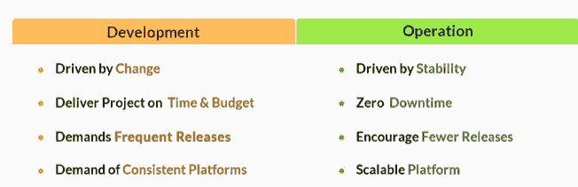

图 1-3. Dev 与 Ops 的愿望清单

随着业务环境的变化和最新技术的可用，组织已接受敏捷和 DevOps 是当务之急的事实，并且需要迅速找到弥合开发与运维团队之间裂痕的方法。因此，不仅仅是敏捷需要培育，还需要在组织的所有团队中拥抱 DevOps。大多数组织都在寻找快速部署和赋能团队的方式，以便他们能够访问即时基础设施并对产品生命周期进行端到端可见性。所有这一切都可以通过人员激励、技能提升、对新技术的投资以及简化流程以减少周转时间来实现。

## DevOps：补充敏捷

DevOps 一词由比利时 IT 顾问和敏捷实践者 Patrick Debois 于 2009 年提出。DevOps 的核心原则是提供开发与运维之间更好的集成，减少开发与运维之间的摩擦

和运营团队，并确保实现敏捷承诺的更快产品交付给客户。DevOps 涵盖从设计到运营的整个产品生命周期，并旨在实现持续部署。

DevOps 倡导以下关键原则：

- *不再有信息孤岛*：在整个产品生命周期以及开发团队和运营团队之间进行更大程度的协作将带来更高的生产率和更少的运营问题。
- *失败是正常的*：防止所有失败是不可能的，但 DevOps 专注于从失败中学习并将其视为改进的机会。
- *渐进式变更*：在更小的冲刺中对环境进行增量和渐进式变更，旨在提高吞吐量，将可工作的软件交到消费者手中，并通过转向持续部署模式来实现敏捷的目标。
- *自动化*：自动化是 DevOps 的关键重点；它旨在实现持续集成、测试、开发和部署，并消除手动步骤。
- *指标*：应衡量变更，并分析变更的影响以推动持续的服务改进。

## 基础设施运营中的敏捷性：当务之急

虽然自动化是可以实现的低垂果实，但最具挑战性的部分是将开发团队和运营团队聚集在一起并培养信任和问责的环境。虽然开发团队实践敏捷，但基础设施运营团队需要跟上步伐。他们需要在以敏捷方式进行运营的必要性方面得到指导，并提升自己在可简化工作并减少繁琐劳动的自动化平台方面的技能。在过去十年中，基础设施即代码的兴起势头强劲，导致基础设施层达到更高的抽象和自动化水平。此外，云平台的采用率不断增加，这加速了弥合开发团队与基础设施运营团队之间差距的过程，同时也为自动化和基础设施即代码提供了合适的[content]
和运营团队，并确保实现敏捷承诺的更快产品交付给客户。DevOps 涵盖从设计到运营的整个产品生命周期，并旨在实现持续部署。

DevOps 倡导以下关键原则：

- *不再有信息孤岛*：在整个产品生命周期以及开发团队和运营团队之间进行更大程度的协作将带来更高的生产率和更少的运营问题。
- *失败是正常的*：防止所有失败是不可能的，但 DevOps 专注于从失败中学习并将其视为改进的机会。
- *渐进式变更*：在更小的冲刺中对环境进行增量和渐进式变更，旨在提高吞吐量，将可工作的软件交到消费者手中，并通过转向持续部署模式来实现敏捷的目标。
- *自动化*：自动化是 DevOps 的关键重点；它旨在实现持续集成、测试、开发和部署，并消除手动步骤。
- *指标*：应衡量变更，并分析变更的影响以推动持续的服务改进。

## 基础设施运营中的敏捷性：当务之急

虽然自动化是可以实现的低垂果实，但最具挑战性的部分是将开发团队和运营团队聚集在一起并培养信任和问责的环境。虽然开发团队实践敏捷，但基础设施运营团队需要跟上步伐。他们需要在以敏捷方式进行运营的必要性方面得到指导，并提升自己在可简化工作并减少繁琐劳动的自动化平台方面的技能。在过去十年中，基础设施即代码的兴起势头强劲，导致基础设施层达到更高的抽象和自动化水平。此外，云平台的采用率不断增加，这加速了弥合开发团队与基础设施运营团队之间差距的过程，同时也为自动化和基础设施即代码提供了合适的[content]
和运营团队，并确保实现敏捷承诺的更快产品交付给客户。DevOps 涵盖从设计到运营的整个产品生命周期，并旨在实现持续部署。

DevOps 倡导以下关键原则：

- *不再有信息孤岛*：在整个产品生命周期以及开发团队和运营团队之间进行更大程度的协作将带来更高的生产率和更少的运营问题。
- *失败是正常的*：防止所有失败是不可能的，但 DevOps 专注于从失败中学习并将其视为改进的机会。
- *渐进式变更*：在更小的冲刺中对环境进行增量和渐进式变更，旨在提高吞吐量，将可工作的软件交到消费者手中，并通过转向持续部署模式来实现敏捷的目标。
- *自动化*：自动化是 DevOps 的关键重点；它旨在实现持续集成、测试、开发和部署，并消除手动步骤。
- *指标*：应衡量变更，并分析变更的影响以推动持续的服务改进。

## 基础设施运营中的敏捷性：当务之急

虽然自动化是可以实现的低垂果实，但最具挑战性的部分是将开发团队和运营团队聚集在一起并培养信任和问责的环境。虽然开发团队实践敏捷，但基础设施运营团队需要跟上步伐。他们需要在以敏捷方式进行运营的必要性方面得到指导，并提升自己在可简化工作并减少繁琐劳动的自动化平台方面的技能。在过去十年中，基础设施即代码的兴起势头强劲，导致基础设施层达到更高的抽象和自动化水平。此外，云平台的采用率不断增加，这加速了弥合开发团队与基础设施运营团队之间差距的过程，同时也为自动化和基础设施即代码提供了合适的[content]
和运营团队，并确保实现敏捷承诺的更快产品交付给客户。DevOps 涵盖从设计到运营的整个产品生命周期，并旨在实现持续部署。

DevOps 倡导以下关键原则：

- *不再有信息孤岛*：在整个产品生命周期以及开发团队和运营团队之间进行更大程度的协作将带来更高的生产率和更少的运营问题。
- *失败是正常的*：防止所有失败是不可能的，但 DevOps 专注于从失败中学习并将其视为改进的机会。
- *渐进式变更*：在更小的冲刺中对环境进行增量和渐进式变更，旨在提高吞吐量，将可工作的软件交到消费者手中，并通过转向持续部署模式来实现敏捷的目标。
- *自动化*：自动化是 DevOps 的关键重点；它旨在实现持续集成、测试、开发和部署，并消除手动步骤。
- *指标*：应衡量变更，并分析变更的影响以推动持续的服务改进。

## 基础设施运营中的敏捷性：当务之急

虽然自动化是可以实现的低垂果实，但最具挑战性的部分是将开发团队和运营团队聚集在一起并培养信任和问责的环境。虽然开发团队实践敏捷，但基础设施运营团队需要跟上步伐。他们需要在以敏捷方式进行运营的必要性方面得到指导，并提升自己在可简化工作并减少繁琐劳动的自动化平台方面的技能。在过去十年中，基础设施即代码的兴起势头强劲，导致基础设施层达到更高的抽象和自动化水平。此外，云平台的采用率不断增加，这加速了弥合开发团队与基础设施运营团队之间差距的过程，同时也为自动化和基础设施即代码提供了合适的[content]
和运营团队，并确保实现敏捷承诺的更快产品交付给客户。DevOps 涵盖从设计到运营的整个产品生命周期，并旨在实现持续部署。

DevOps 倡导以下关键原则：

- *不再有信息孤岛*：在整个产品生命周期以及开发团队和运营团队之间进行更大程度的协作将带来更高的生产率和更少的运营问题。
- *失败是正常的*：防止所有失败是不可能的，但 DevOps 专注于从失败中学习并将其视为改进的机会。
- *渐进式变更*：在更小的冲刺中对环境进行增量和渐进式变更，旨在提高吞吐量，将可工作的软件交到消费者手中，并通过转向持续部署模式来实现敏捷的目标。
- *自动化*：自动化是 DevOps 的关键重点；它旨在实现持续集成、测试、开发和部署，并消除手动步骤。
- *指标*：应衡量变更，并分析变更的影响以推动持续的服务改进。

## 基础设施运营中的敏捷性：当务之急

虽然自动化是可以实现的低垂果实，但最具挑战性的部分是将开发团队和运营团队聚集在一起并培养信任和问责的环境。虽然开发团队实践敏捷，但基础设施运营团队需要跟上步伐。他们需要在以敏捷方式进行运营的必要性方面得到指导，并提升自己在可简化工作并减少繁琐劳动的自动化平台方面的技能。在过去十年中，基础设施即代码的兴起势头强劲，导致基础设施层达到更高的抽象和自动化水平。此外，云平台的采用率不断增加，这加速了弥合开发团队与基础设施运营团队之间差距的过程，同时也为自动化和基础设施即代码提供了合适的[content]
和运营团队，并确保实现敏捷承诺的更快产品交付给客户。DevOps 涵盖从设计到运营的整个产品生命周期，并旨在实现持续部署。

DevOps 倡导以下关键原则：

- *不再有信息孤岛*：在整个产品生命周期以及开发团队和运营团队之间进行更大程度的协作将带来更高的生产率和更少的运营问题。
- *失败是正常的*：防止所有失败是不可能的，但 DevOps 专注于从失败中学习并将其视为改进的机会。
- *渐进式变更*：在更小的冲刺中对环境进行增量和渐进式变更，旨在提高吞吐量，将可工作的软件交到消费者手中，并通过转向持续部署模式来实现敏捷的目标。
- *自动化*：自动化是 DevOps 的关键重点；它旨在实现持续集成、测试、开发和部署，并消除手动步骤。
- *指标*：应衡量变更，并分析变更的影响以推动持续的服务改进。

## 基础设施运营中的敏捷性：当务之急

虽然自动化是可以实现的低垂果实，但最具挑战性的部分是将开发团队和运营团队聚集在一起并培养信任和问责的环境。虽然开发团队实践敏捷，但基础设施运营团队需要跟上步伐。他们需要在以敏捷方式进行运营的必要性方面得到指导，并提升自己在可简化工作并减少繁琐劳动的自动化平台方面的技能。在过去十年中，基础设施即代码的兴起势头强劲，导致基础设施层达到更高的抽象和自动化水平。此外，云平台的采用率不断增加，这加速了弥合开发团队与基础设施运营团队之间差距的过程，同时也为自动化和基础设施即代码提供了合适的[content]
和运营团队，并确保实现敏捷承诺的更快产品交付给客户。DevOps 涵盖从设计到运营的整个产品生命周期，并旨在实现持续部署。

DevOps 倡导以下关键原则：

- *不再有信息孤岛*：在整个产品生命周期以及开发团队和运营团队之间进行更大程度的协作将带来更高的生产率和更少的运营问题。
- *失败是正常的*：防止所有失败是不可能的，但 DevOps 专注于从失败中学习并将其视为改进的机会。
- *渐进式变更*：在更小的冲刺中对环境进行增量和渐进式变更，旨在提高吞吐量，将可工作的软件交到消费者手中，并通过转向持续部署模式来实现敏捷的目标。
- *自动化*：自动化是 DevOps 的关键重点；它旨在实现持续集成、测试、开发和部署，并消除手动步骤。
- *指标*：应衡量变更，并分析变更的影响以推动持续的服务改进。

## 基础设施运营中的敏捷性：当务之急

虽然自动化是可以实现的低垂果实，但最具挑战性的部分是将开发团队和运营团队聚集在一起并培养信任和问责的环境。虽然开发团队实践敏捷，但基础设施运营团队需要跟上步伐。他们需要在以敏捷方式进行运营的必要性方面得到指导，并提升自己在可简化工作并减少繁琐劳动的自动化平台方面的技能。在过去十年中，基础设施即代码的兴起势头强劲，导致基础设施层达到更高的抽象和自动化水平。此外，云平台的采用率不断增加，这加速了弥合开发团队与基础设施运营团队之间差距的过程，同时也为自动化和基础设施即代码提供了合适的[content]
和运营团队，并确保实现敏捷承诺的更快产品交付给客户。DevOps 涵盖从设计到运营的整个产品生命周期，并旨在实现持续部署。

DevOps 倡导以下关键原则：

- *不再有信息孤岛*：在整个产品生命周期以及开发团队和运营团队之间进行更大程度的协作将带来更高的生产率和更少的运营问题。
- *失败是正常的*：防止所有失败是不可能的，但 DevOps 专注于从失败中学习并将其视为改进的机会。
- *渐进式变更*：在更小的冲刺中对环境进行增量和渐进式变更，旨在提高吞吐量，将可工作的软件交到消费者手中，并通过转向持续部署模式来实现敏捷的目标。
- *自动化*：自动化是 DevOps 的关键重点；它旨在实现持续集成、测试、开发和部署，并消除手动步骤。
- *指标*：应衡量变更，并分析变更的影响以推动持续的服务改进。

## 基础设施运营中的敏捷性：当务之急

虽然自动化是可以实现的低垂果实，但最具挑战性的部分是将开发团队和运营团队聚集在一起并培养信任和问责的环境。虽然开发团队实践敏捷，但基础设施运营团队需要跟上步伐。他们需要在以敏捷方式进行运营的必要性方面得到指导，并提升自己在可简化工作并减少繁琐劳动的自动化平台方面的技能。在过去十年中，基础设施即代码的兴起势头强劲，导致基础设施层达到更高的抽象和自动化水平。此外，云平台的采用率不断增加，这加速了弥合开发团队与基础设施运营团队之间差距的过程，同时也为自动化和基础设施即代码提供了合适的[content]
和运营团队，并确保实现敏捷承诺的更快产品交付给客户。DevOps 涵盖从设计到运营的整个产品生命周期，并旨在实现持续部署。

DevOps 倡导以下关键原则：

- *不再有信息孤岛*：在整个产品生命周期以及开发团队和运营团队之间进行更大程度的协作将带来更高的生产率和更少的运营问题。
- *失败是正常的*：防止所有失败是不可能的，但 DevOps 专注于从失败中学习并将其视为改进的机会。
- *渐进式变更*：在更小的冲刺中对环境进行增量和渐进式变更，旨在提高吞吐量，将可工作的软件交到消费者手中，并通过转向持续部署模式来实现敏捷的目标。
- *自动化*：自动化是 DevOps 的关键重点；它旨在实现持续集成、测试、开发和部署，并消除手动步骤。
- *指标*：应衡量变更，并分析变更的影响以推动持续的服务改进。

## 基础设施运营中的敏捷性：当务之急

虽然自动化是可以实现的低垂果实，但最具挑战性的部分是将开发团队和运营团队聚集在一起并培养信任和问责的环境。虽然开发团队实践敏捷，但基础设施运营团队需要跟上步伐。他们需要在以敏捷方式进行运营的必要性方面得到指导，并提升自己在可简化工作并减少繁琐劳动的自动化平台方面的技能。在过去十年中，基础设施即代码的兴起势头强劲，导致基础设施层达到更高的抽象和自动化水平。此外，云平台的采用率不断增加，这加速了弥合开发团队与基础设施运营团队之间差距的过程，同时也为自动化和基础设施即代码提供了合适的[content]
和运营团队，并确保实现敏捷承诺的更快产品交付给客户。DevOps 涵盖从设计到运营的整个产品生命周期，并旨在实现持续部署。

DevOps 倡导以下关键原则：

- *不再有信息孤岛*：在整个产品生命周期以及开发团队和运营团队之间进行更大程度的协作将带来更高的生产率和更少的运营问题。
- *失败是正常的*：防止所有失败是不可能的，但 DevOps 专注于从失败中学习并将其视为改进的机会。
- *渐进式变更*：在更小的冲刺中对环境进行增量和渐进式变更，旨在提高吞吐量，将可工作的软件交到消费者手中，并通过转向持续部署模式来实现敏捷的目标。
- *自动化*：自动化是 DevOps 的关键重点；它旨在实现持续集成、测试、开发和部署，并消除手动步骤。
- *指标*：应衡量变更，并分析变更的影响以推动持续的服务改进。

## 基础设施运营中的敏捷性：当务之急

虽然自动化是可以实现的低垂果实，但最具挑战性的部分是将开发团队和运营团队聚集在一起并培养信任和问责的环境。虽然开发团队实践敏捷，但基础设施运营团队需要跟上步伐。他们需要在以敏捷方式进行运营的必要性方面得到指导，并提升自己在可简化工作并减少繁琐劳动的自动化平台方面的技能。在过去十年中，基础设施即代码的兴起势头强劲，导致基础设施层达到更高的抽象和自动化水平。此外，云平台的采用率不断增加，这加速了弥合开发团队与基础设施运营团队之间差距的过程，同时也为自动化和基础设施即代码提供了合适的[content]
和运营团队，并确保实现敏捷承诺的更快产品交付给客户。DevOps 涵盖从设计到运营的整个产品生命周期，并旨在实现持续部署。

DevOps 倡导以下关键原则：

- *不再有信息孤岛*：在整个产品生命周期以及开发团队和运营团队之间进行更大程度的协作将带来更高的生产率和更少的运营问题。
- *失败是正常的*：防止所有失败是不可能的，但 DevOps 专注于从失败中学习并将其视为改进的机会。
- *渐进式变更*：在更小的冲刺中对环境进行增量和渐进式变更，旨在提高吞吐量，将可工作的软件交到消费者手中，并通过转向持续部署模式来实现敏捷的目标。
- *自动化*：自动化是 DevOps 的关键重点；它旨在实现持续集成、测试、开发和部署，并消除手动步骤。
- *指标*：应衡量变更，并分析变更的影响以推动持续的服务改进。

## 你知道吗？

## 什么是 I&O 组织？

I&O 组织是一个基础设施和运维团队，采用典型的层级结构，负责计算、存储、备份、网络、数据库等服务。

Figure 2-1. 你知道吗？

## ITSM 方法

基础设施运维团队充当骨干服务。该团队为多个内部团队提供各种基础设施需求的服务，但通常在僵化的流程上运行。有趣的是，该团队长期以来一直很成功，这得益于 ITIL 等框架（ITIL 曾是信息技术基础设施库的缩写），该框架帮助团队遵循既定流程。团队拥有完善的支持课程，包括操作系统和内核支持、物理服务器和虚拟机维护、服务器配置、服务器补丁、备份、存储、数据库、用户身份管理、活动目录、高可用性/灾难恢复（HA/DR）、服务器监控等。重点是确保系统安全且合规，每个流程步骤都已定义，并且所有操作都通过服务级别目标和服务级别协议进行记录和衡量。部署新变更到生产环境的过程经过精心规划，并在经过相应业务技术部门多次批准后执行。这些部署通常安排在非工作时间或周末进行。还有备份和恢复的流程和程序，以及在变更失败时回滚到原始配置的情况。大型且复杂的机房变更需要基础设施、虚拟化、存储、网络、灾难恢复、业务连续性计划（BCP）、变更经理和应用团队等多个团队参与。申请配置新基础设施也遵循严格的流程。

开发和测试团队一直难以应对这种传统方法，因为由于基础设施领域缺乏敏捷性，他们快速交付的目标受到了影响。开发人员和测试人员必须等待环境配置完成，这会延迟他们的里程碑。参见图 2-2。

Figure 2-2. 传统运维的现实检验

嘿！我需要一台 QA 服务器来测试我的新应用。今天能拿到吗？

不！不可能。
你首先需要提交工单，它必须经过审核和批准，然后我们需要 5-10 天来配置它。

开发/测试团队

基础设施运维团队

大多数 InfraOps 团队 24/7 运行，应用开发团队通过 ServiceNow、Remedy、Jira 等信息技术服务管理（ITSM）工具与他们联系。InfraOps 团队在不同领域提供严格的 SLA 支持。现在让我们深入探讨 ITIL，它一直是 IT 服务管理流程的支柱。

ITIL 包含实施 IT 服务管理的详细实践和流程。它可以被视为一个目录，列出了完成服务所需的流程、任务和清单。换句话说，它是一套管理并改进 IT 服务和支持所需的最佳实践集合。服务生命周期侧重于跨各个部门、团队和流程的协调，这些流程对于管理 IT 服务的生命周期是必要的。IT 服务由 IT 服务提供商提供给客户，该提供商专注于客户的业务流程和需求。ITIL 4.0 的通用流程由 ITIL 在 https://www.axelos.com/best-practice-solutions/itil 上列出。

ITSM 有四个关键支柱，称为四大 P，如图 2-3 所示。

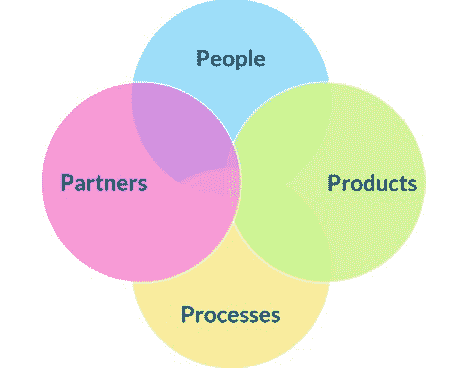

Figure 2-3. ITSM 的四大支柱

流程：流程应可衡量，具有可量化的具体结果，以客户为中心，并为其提供价值，满足其期望。

人员：人员是指组织内创建服务或消费服务的全部所需利益相关者。

产品：产品是指 IT 服务人员用于实施 ITIL 流程的工具。所需工具已集成并用于执行组织流程。

合作伙伴：组织有许多与之共同开展 IT 服务的合作伙伴。这需要将支持协议和要求传达给合作伙伴。

ITSM 中有各种角色，列举如下：

- 流程负责人：流程负责人拥有该流程，参与流程设计，设计策略，并定义流程关键绩效指标（KPI）。
- 流程经理：流程经理管理资源，将资源对齐到不同角色，跟踪流程绩效，并对流程提供改进。
- 流程从业者：流程从业者从事流程的多个任务并确保准确性。该人员还会在相应工具中更新任务状态以实现顺畅交接。
- 服务负责人：服务负责人对服务交付负责，是主要客户联系人。服务负责人还扮演业务分析师或服务需求的角色，并识别服务改进。

该框架包含五个基本阶段。

## 服务策略

服务策略侧重于服务生命周期，并描述如何设计、开发和实施服务管理（见图 2-4）。它定义了目标客户以及服务将提供的价值。它帮助服务提供商实现业务目标。此阶段涉及以下关键流程：

- 需求管理：这与理解客户需求有关。通过提供服务并附带商定的保修条款来满足客户期望是必要的。
- 财务管理：这有助于预算和服务成本，并执行财务审查。
- 服务组合管理：服务组合是由服务提供商管理的服务集合。这些服务是服务目录的一部分。它包含可供消费者消费的活跃服务。
- 业务关系管理：这完全是关于客户互动和沟通。客户就项目与业务关系经理互动。他们管理与利益相关者的业务关系。

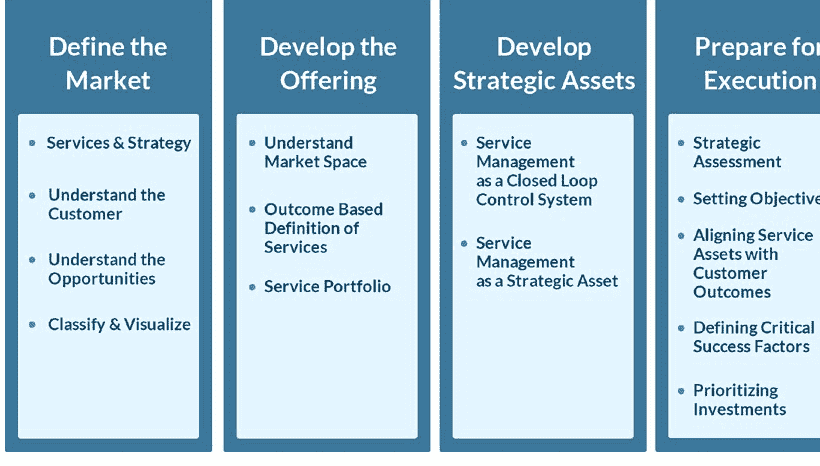

Figure 2-4. 服务策略

## 服务设计

服务设计包括基于业务需求和目标设计服务，以为客户提供价值（见图 2-5）。它侧重于提供与业务需求一致的有效 IT 解决方案。它描述了设计服务和流程的“如何”部分。它包括以下关键流程：

- 服务级别管理：这确保为所有 IT 服务开发具体且可衡量的目标。它与客户满意度直接相关，因为它与问题响应速度、其解决速度和质量有关。它包括服务级别要求、服务级别协议、运营级别协议、支撑合同和服务改进计划。

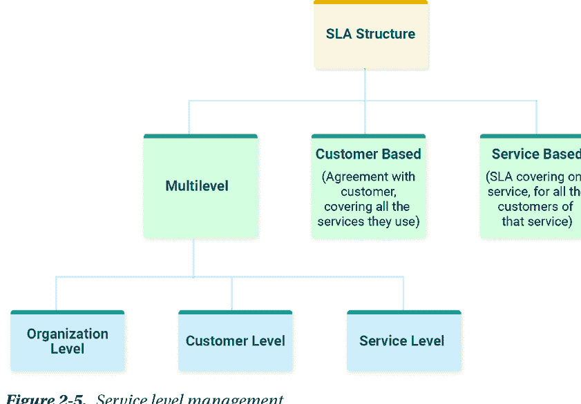

Figure 2-5. 服务级别管理

- 供应商管理：此阶段管理供应商及其向客户提供的服务。
- 服务目录管理：它包含所有运营和计划服务及其详细信息，包括状态、接口和依赖关系。服务目录中的详细信息应定期更新，包括自动实时更新。图 2-6 显示了示例目录及其创建过程。

用户和客户通过中央门户进入目录，可以查看他们可用的所有服务

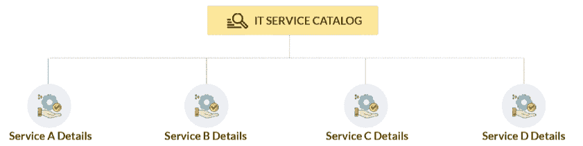

当选择一项服务时，他们将被带到一个详细页面，其中概述了与该服务相关的所有信息。

Figure 2-6. 服务目录管理

- 可用性管理：在当前时代，IT 基础设施和应用程序都必须始终可用。此阶段设计、实施、衡量、管理并改进 IT 服务和组件的可用性。可用性以百分比表示，如下所示：
  
  Availability = (Agreed Service Time - Downtime) * 100
  -----------------------------------------------
  Agreed Service Time
  
- 容量管理：目标是以经济有效的方式提供所需的基础设施并确保其有效利用。组织正在从本地基础设施向云迁移以获得更好的基础设施利用率。当组织从本地基础设施迁移到按需基础设施时，容量管理会发生巨大变化。FinOps 在云容量管理中发挥关键作用，需要作为一个职能纳入，以管理云资源及其消耗以及云计算环境中各种消耗模式的财务管理。

- 服务连续性管理：这确保在发生故障或灾难时所需服务能够恢复。它包括执行风险评估和风险管理的任务，以主动避免风险或灾难的发生（见图 2-7）。其目标是通过制定恢复计划来降低风险，以便在业务活动中断时恢复业务活动。

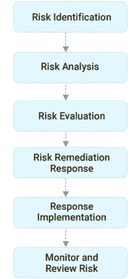

Figure 2-7. 风险框架

- 信息安全管理：它将 IT 安全与业务合规性保持一致。它在所有服务和服务管理活动的所有方面强制执行安全。它还处理风险分析和风险管理。
- 设计协调：这是所有活动和流程之间的单一协调点。它还确保服务设计阶段的目标得到实现并移交给服务转换阶段。

## 服务转换

服务转换解释了如何管理新服务或修改后服务的转换（见图 2-8）。它包括以下关键流程：

- *转换规划与支持*：这涉及针对供应商、服务团队等所有相关利益相关者的服务规划和协调。它还确保服务战略中的需求从设计阶段顺利过渡到开发的服务，再到服务运营。
- *服务资产和配置管理*：服务的各个组件和基础设施都必须进行管理。其配置详情（如当前和计划状态、历史信息等）需要维护。配置管理数据库（CMDB）被广泛用于维护基础设施的配置详情。它还通过为资产提供配置信息来支持服务管理流程。

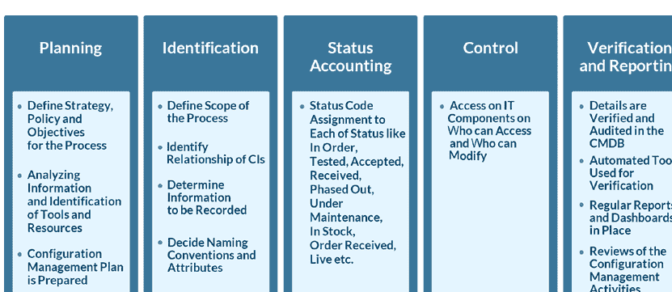

Figure 2-8. 服务转换

- *变更管理*：变更管理流程的目标是确保变更被记录或输入到相应的 ALM（应用程序生命周期管理）工具中，然后进行评估；在变更评审委员会或会议上讨论；然后进行优先级排序、计划，并在计划的日期和时间实施（见图 2-9）。变更管理需要标准化的方法和程序来有效高效地处理变更。所有对服务和配置项的变更都会在配置管理系统进行更新。

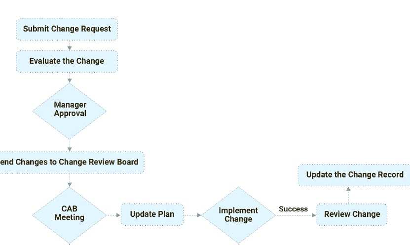

Figure 2-9. 变更管理流程

- *发布和部署管理*：目标是在目标环境中构建、安装、测试和部署应用程序或服务。此流程确保新的或更新的服务或配置能够满足正确的需求。有各种自动化工具可用于自动化发布和部署管理活动。

- *知识管理*：目标是利用和收集知识以供重复使用，而不是重新发明和重新发现知识。当服务知识管理系统被创建、维护并定期更新时，这是有益的。

## 服务运营

服务运营涉及协调和执行确保服务顺利运行所需的活动（见图 2-10）。它确保所需服务按照商定的服务水平交付。它包括以下关键流程：

- *事件管理*：目标是在所有层级检测事件并采取适当措施处理事件。自动化工具监控事件并根据为其设定的流程生成警报。它为主动监控和服务改进提供了基础。这现已演变为一个名为可观测性的新领域，重点是使用日志、指标、事件和跟踪进行端到端监控。这包括提供端到端视图并在基础设施和应用程序之间进行关联的高级功能，以便找出问题的根本原因。

- *事件管理*：目标是尽快将服务运营恢复正常，以避免对业务产生影响。它专注于提供高质量服务和更高的可用性，同时将停机时间降至最低。事件可能是由事件管理检测到的故障或由用户报告的。

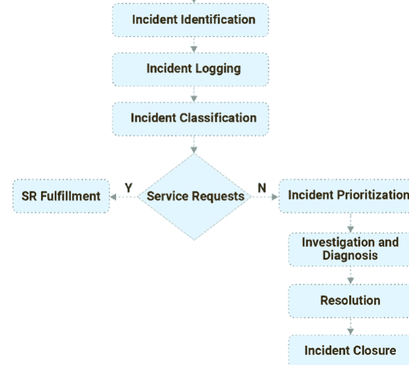

Figure 2-10. 事件管理流程

- **问题管理：** 目标是通过找出其发生的根本原因来防止事件（见图 2-11）。消除周期性发生的事件，并专注于最大程度地减少无法预防的事件的影响。

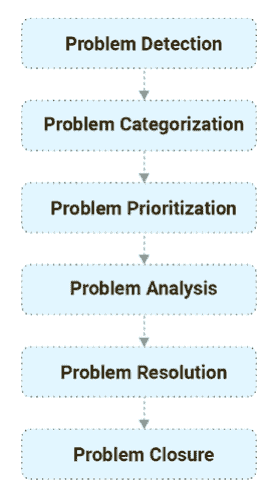

Figure 2-11. 问题管理生命周期

- *请求履行*：目标是满足用户提出的服务请求。服务请求分为不同的类别，例如有关服务状态的信息请求、访问请求、投诉等。
- *访问管理*：目标是为授权用户提供使用服务所需的访问权限。访问管理遵循安全和可用性管理中列出的策略。

## 持续服务改进

本阶段重点关注如何重新调整 IT 服务以匹配业务变化。它通过实施已识别的改进领域来使 IT 服务成熟。它遵循著名的戴明循环，该循环有四个阶段：计划、执行、检查和行动。它还遵循服务改进流程中的七个步骤（见图 2-12）。有关提示，请参阅图 2-13。

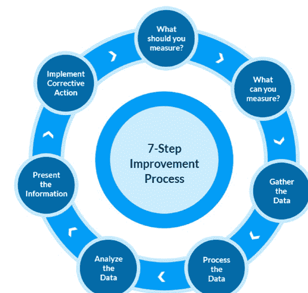

Figure 2-12. 七步改进流程

## 你知道吗？

## ITIL 是何时开发的？

ITIL – IT 基础设施库是在 1980 年代末由中央计算与电信局（CCTA）——英国的一个政府机构——开发的。这旨在标准化和提高提供 IT 服务的质量。

Figure 2-13. 你知道吗？

## 传统 InfraOps 团队的弊端

InfraOps 团队可以继续以多年来一直运营的方式运营，但时代已经改变，人们迫切希望转向一种更符合云、容器化和基础设施即代码等新技术的新运营模式。让我们来看看传统基础设施运营模式的一些弊端：

- *结构化但僵化的流程*：没有灵活性空间，重复性任务是手动执行的。多年来，InfraOps 团队一直信任手动工作方式并继续采用这种策略。
- *与其他团队的协作有限*：请求通过工单和电子邮件提交；存在依赖关系；并且预计会出现延迟。
- *孤立的专业化*：这种方法具有 I 型专业知识，导致交接增加并影响客户期望。
- *高度定制的本地环境*：设置新基础设施或对现有基础设施进行更改需要人工操作。手动清单用于跟踪更改。集成和架构都很复杂。
- *基于工单的沟通*：实施变更时需要多次审批和交接，从而增加等待时间。

## 改变的需求

传统方法在行业转向数字之前是好的。组织意识到，只有充分了解客户并能够响应并提供相关、所需的服务，才能取得成功。这个数字时代需要新的思维、战略和流程，以及对人员和新工具和技术进行投资，以帮助他们优化。例如，如果测试人员能够使用自助服务在同一天设置测试环境，而不是等待两周，这难道不会有助于提前完成任务吗？

It is not only the speed of delivery pressure that is driving infrastructure operations toward agility, but there are other factors too that are forcing organizations to modernize their infrastructure IT operations such as technology drift, customer interests, global presence, etc. See Figure 2-14.

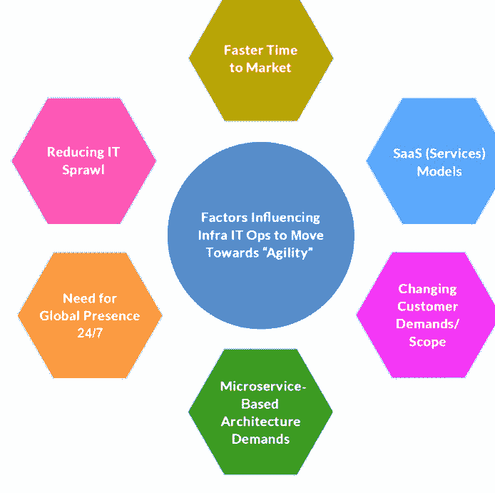

## 图 2-14. 需要采用敏捷 InfraOps

The drift from traditional to agile operations will benefit teams at various levels and foster a culture of collaboration. It also helps teams stay focused toward one goal: delivering quality services on time. While many organizations have already transformed themselves into agile and DevOps ecosystems, still there are organizations that need to initiate and adopt the new culture. Building cross-functional teams, fostering self-service, and standardizing on tools rationalization are all the immediate things to be considered by InfraOps teams. Even organizations that have implemented DevOps and agile have yet to integrate InfraOps and bring in holistic alignment in delivering IT services. Since agile InfraOps is relatively new, organizations have not been able to move forward due to a lack of available best practices and ready-to-use solutions and accelerators. This book aims to bridge the gap and provide insights from real-life projects for implementing agile in infrastructure operations.

## 摘要

IT infrastructure operations teams traditionally have been responsible for managing on-premises datacenters that offer services such as compute, storage, networks, security, backup, high availability, disaster recovery, monitoring, management, etc. Their focus has always been on integrating IT assets and ensuring security and compliance are not compromised. IT infrastructure organizations have also been practicing ITIL, which is a framework comprising best practices that guides organizations on how to serve IT services. These services are standardized and help teams to track and meet SLAs. But with changing times, the rigid processes need to be refreshed, and teams that earlier had limited collaboration with application development teams now have a need to collaborate and offer services in an agile way rather than running things in a traditional way. This change is possible through the principles of agile and DevOps.

In the next chapter, we will start covering agile and DevOps principles before embarking on best practices for implementing these methodologies in the infrastructure operations world.
