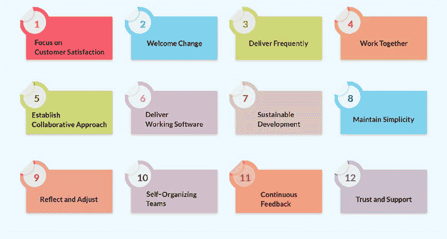
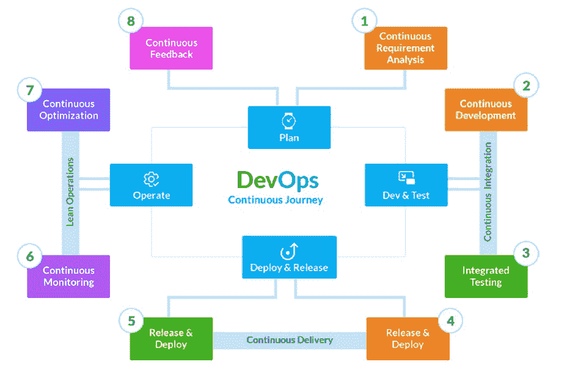
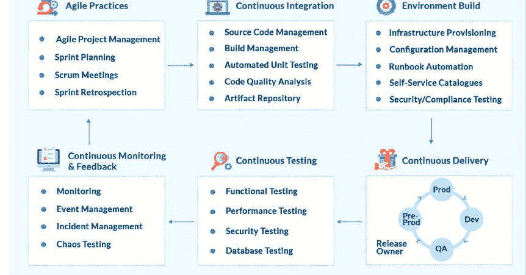

# 第 3 章

## 介绍敏捷和 DevOps

This chapter will introduce agile and DevOps, including its values, principles, and benefits when both work together. The topics that will be covered in this chapter are as follows:

- When should you adopt agile?
- Agile principles
- Agile benefits
- Scaling agile with DevOps
- When should you adopt DevOps?
- DevOps in the product lifecycle

We realize that agile and DevOps complement each other, and their adoption enables organizations to excel and deliver frequently. While agile focuses on continuous delivery, DevOps brings in best practices that can fast-track the integration of the development and operations teams and the adoption of the best practices for agile. So, can we just adopt agile or DevOps? What are the overlaps and integration points between agile and DevOps? How do we implement them together? Can we use agile and DevOps in infrastructure operations? To answer these questions, we need to understand agile and DevOps in more detail.

### 何时采用敏捷？

Agile is an approach that recommends, facilitates, and provides guidance around iterative delivery, which is possible with connected teams, open collaboration, end-to-end integration of product lifecycle phases, and continuous work on customer feedback. Adopting agile is helpful when teams need to deliver a minimum viable product (MVP) in short sprints where customer feedback is important to drive the next change or feature in the product. Thus, development teams gain more confidence and trust from the customers of their product. Rather than releasing once a month and pushing integration testing to the end, the focus is on releasing fast, getting feedback, and providing working software early on in the cycle.

### 敏捷原则

IT teams have been adopting agile methods that encompass the 12 principles shown in Figure 3-1.

### 12 项敏捷原则

图 3-1. 敏捷原则

### 原则 1：关注客户满意度

One of the key targets for any business is to increase the customer footprint that is complemented with an excellent satisfaction rate. To achieve a good customer satisfaction score, we need happy customers who are looking for products that have flexible service offerings that cater to their needs. This is achieved by staying close to the customer and getting their feedback frequently, which helps IT teams to plan and change course in a timely manner. Early feedback helps teams to avoid large changes later in the process as well. Numerous companies nowadays launch their products in small batches often termed as *alpha* and *beta* versions before the larger, final product launch. This helps them to understand the customer preferences and change the product roadmap as needed. Listening to customer feedback enables teams to build what is needed by the customer and not plan for something that has no votes. Hence, every customer is important, whether it is an internal product team that needs a new environment set up or an external customer that consumes the product or service. A good score is a clear indication that the customer likes the product. This also becomes a key performance indicator (KPI) for teams.

### 原则 2：拥抱变化

Change is inevitable, and teams should welcome change at every stage of the product lifecycle. This is possible by coaching teams and helping them understand the purpose of adopting a change. Teams should be ready for changes so that it can meet customer demands. If this does not happen, then the product lags behind the competition, which ultimately negatively impacts the organization. Another way to welcome change is in the initial stages of development where customer feedback helps to alter the course of action in a timely manner. Embracing frequent changes through a simplified process workflow helps teams to be agile. Of course, the end goal is to deliver value to the customer that is achievable when teams share and agree on the mission statement that is driven by the customer.

### 原则 3：频繁交付

Customer feedback plays a key role in the product development lifecycle. Requirements are prioritized and changed as per the customer expectations. Modern-day products are delivered in stages, which helps IT teams to understand the actual demand at every stage and course correct accordingly. Each stage needs to deliver working software that is shared with customers for their feedback. This minimum viable product (MVP) enables teams to regularly encapsulate customer feedback and ensure that the product is being built in the right direction. So, instead of delivering an application in months, it is good to reduce the cycle time to weeks or even days. Without frequent delivery of working software, the change required at the end will be massive, and all work accomplished may go to waste. It is also possible that by the time a product is delivered after months of work, the market demand and features required have changed drastically, so the product would work but would not be needed in its current shape and form anymore.

### 原则 4：协同工作

Traditionally you will find the business teams and the IT/technology teams running in silos with limited collaboration. The business teams define the requirements, and the IT team builds the product to address those demands. To ensure that the product delivers value, both these teams need to connect and define common goals that meet the customer needs. In fact, within an IT/technology team, there are numerous other teams that function at their own pace (such as the development team, infrastructure team, architecture team, security team, operations team, etc.). Irrespective of their function or hierarchy, all the teams within an IT organization need to collaborate to move toward a shared vision. This is achievable when teams share tools and platforms that follow optimized processes and provide transparency and collaboration. These teams also need to be coached on becoming agile.

### 原则 5：建立协作方法

Collaboration is all about teamwork, which is successful through transparent communication. A culture of sharing and collaboration needs to be nurtured in an IT organization, irrespective of a team’s location. Teams should be encouraged to share their point of view and practice the notion of accountability. Teams are empowered when they are mentored on agile and they understand the importance of trust and transparency. Teams need to embrace the culture of “pulling work” rather than “pushing work.” This is a core agile practice where teams become self-sufficient. There are excellent platforms available that teams can leverage for constant communication and collaboration to address every stage in the product lifecycle. Teams should cooperate with each other to identify hurdles and resolve them as one team rather than working in silos.

### 原则 6：交付可工作的软件

The concept of an MVP is essential and should be practiced on a regular basis. The MVP is a product capsule that delivers a specific functionality that can be tested and verified independently. This is successful when teams collaborate to verify the product from every perspective such as resiliency, quality, security, compliance, etc. A working solution is proof that the requirements have been understood and the team has made efforts to deliver it as per the needs. In the initial stages of agile development, teams find it difficult to deliver MVPs timely. There could be various reasons for this such as variance in requirements, incorrect effort estimation, etc. But over the course of time and as the team scales on the agile practices, they deliver MVPs, share them with customers, and look forward to their feedback. This working software should deliver value that was asked for by the customer and that gets incremented over time, which means new features get added as the product grows.

### 原则 7：可持续发展

敏捷开发专注于迭代交付解决方案，因此在长期内是可持续的。与产品生命周期相连的每个利益相关者都应能够以一致的节奏推进。为了实现可持续发展，需要一个健康的协作生态系统，激励每个人专注并发挥最佳水平。团队可以通过持续监控其技术卓越性来实践敏捷，从而交付良好的设计。这一原则通过检查团队的满意度杠杆并防止他们失去焦点来得到培育。团队应能够参与并吸收期望，而不过度负荷。事实上，他们应定期规划并交付持续的价值。

### 原则 8：保持简洁

这一原则专注于不使交付复杂化。想法很简单：从小处着手，及时交付，并在其基础上增量。通常，团队没有直接接触客户的渠道，他们从业务团队获取需求并据此开始构建。为了简化开发生命周期，如果团队理解他们为何构建某个功能，这会为他们提供更多细节并帮助他们更好地规划。在构建产品的过程中，这将帮助他们专注于为客户提供价值的核心交付物，并减少镀金和不需要的功能。使用有效的沟通和透明度工具有助于推动简洁性。简单但有效的产品交付是 IT 组织最终所需。

### 原则 9：反思与调整

虽然主要关注点是让客户满意，但 IT 组织需要反思改进领域。拥有采用敏捷的明确路径的组织应定期研究其工作方式并根据需要修改路径。例如，回顾会议帮助团队识别构建新架构所需的专业技术培训需求，或重审其估算技术，以确保 MVP 准时交付。团队需要吸收新的变化，并在需要时寻求帮助以快速重新调整。

### 原则 10：自组织团队

团队是敏捷组织的重要核心要素。成功的敏捷团队是随着时间推移变得自立的团队。组织中必须灌输责任感和问责制的文化。这将使团队能够共享共同愿景。

持续的指导和赋能将帮助团队提升和成长，这可通过采用作为推动创新的催化剂的正确技术和平台来实现。赋能的团队采用自下而上的方法，而非自上而下的方法。这将问责制放在一线工作的团队身上，并赋予他们做出按时交付价值所需正确决策的权力。如果产品负责人定义产品的“是什么”方面，那么自组织团队则专注于“如何”方面。

### 原则 11：持续反馈

产品的成功在于其被接受度。正面反馈表明产品正朝着正确的方向发展并满足客户期望。处理客户反馈有助于团队优先考虑需求并在推进过程中做出更改。毕竟，这是一段持续学习和改进的旅程。事实上，客户反馈应在产品开发的初始阶段收集，以便及时采纳反馈。应监控和跟踪这些反馈，以便记录客户的声音并重新审视产品路线图。

### 原则 12：信任与支持

信任和支持是敏捷中最重要的两个原则。敏捷模式只有在组织信任自组织团队在现场做出决策时才有效。能够独立决策并快速改变方向的小型自组织团队是敏捷成功的关键。成功的团队是那些定期接受新技能和最佳实践培养的团队。当团队受到激励、被赋予决策权并对计划贡献的价值负责时，他们就能构建成功的项目。信任团队并为他们提供所有必要的平台，以便他们交付价值。应践行仆人式领导的文化，以避免通过僵化流程运行的复杂层级结构。

## 敏捷优势

主要而言，敏捷原则已被开发团队有效使用，通过利用这些原则获得了巨大的收益。IT 领域及其他领域的大多数项目都采用敏捷方法交付。这些原则现在在 IT 运维领域也越来越受欢迎，团队正在实践这些原则并采用敏捷方法和价值观。有四个关键的敏捷价值观有助于实施敏捷原则，如表 3-1 所描述。

## 表 3-1. 敏捷价值观及其相关性

| 敏捷价值观 | 相关性 | 工具 |
|---|---|---|
| 以个人和互动优于流程和工具 | - 自主且被赋能的团队。 - 团队参与产品交付决策，如估算、范围、风险等。 | - 协作和沟通工具，如 Microsoft Teams、WebEx 等。 |
| 以可工作的软件优于详尽的文档 | - MVP 在小迭代中交付。 - 专注于交付价值。 | - 实物和虚拟敏捷看板 |
| 以客户协作优于合同谈判 | - 对合同要求灵活且适应性强。 - 在目标和“完成”的定义上与客户全程合作。 | - 如产品演示等仪式 |
| 以响应变化优于遵循计划 | - 持续刷新和优先排序积压工作。 - 随变化扩展和调整。 | - 如冲刺计划、回顾、每日站会等仪式 |

## 使用 DevOps 扩展敏捷

随着敏捷软件开发的持续扩展，需要将这些原则扩展到运维团队。这正是 DevOps 大显身手的地方。如前所述，敏捷不能在孤岛中运行；它需要扩展。应用程序需要基础设施运行，而这正是基础设施和团队也需要被鼓励采用和实践敏捷的地方。开发和运维团队共同可以加速价值创造和成本节约的路径，因为产品发布被频繁管理。

## 何时采用 DevOps？

DevOps 是使用文化理念、实践和工具的组合，以提高组织以高速交付应用程序和服务的能力。与敏捷相结合时，它能改善团队协作和生产力。近期导致许多组织重新审视其工作方式，并鼓励团队保持联系并充分利用自动化。产品团队在不仅打算连接开发和运维团队，还希望通过利用流程、工具和自动化来整合产品生命周期各阶段的流程时，就会采用 DevOps。

连续性之旅是使 DevOps 成功的重要需求。DevOps 原则弥合了孤岛团队之间的差距，并利用自动化优化连接产品整个生命周期的流程。生命周期中的每个阶段都由其自身的一套工具、流程和团队驱动。虽然 CI 和 CD 为应用程序世界的集成铺平了道路，但基础设施世界的元素仍在孤岛中运行。DevOps 模型整合每个阶段和每个工具，简化流程，并专注于共同愿景——“我们构建它，我们运行它”。采用新工具、迁移到云、利用 API 等，使团队能够快速连接并共享通用流程和工作流。核心原则在于相信这是一段持续改进的旅程。见图 3-2。

图 3-2. DevOps 持续之旅

## 产品生命周期中的 DevOps

图 3-3 显示了 DevOps 框架中的步骤。

图 3-3. DevOps 框架

1. 业务规划步骤中的敏捷实践建立业务目标并根据客户反馈进行调整，这有助于提高敏捷性和业务成果。这有助于在交付物中获得客户对所交付价值的信任和信心。产品生命周期中的这一首个阶段是正确构建产品之旅的基石。在正确采用工具和技术的情况下，该阶段变得至关重要并与其他阶段集成。开展合适的仪式、为更快交付进行估算和规划，以及在团队内部拥抱变革文化都发挥着至关重要的作用。该阶段通常通过 Atlassian Jira、Azure Boards、VersionOne、LeanKit 等工具进行管理。这些工具会扩展其他生命周期工具以实现端到端可追溯性。

2. *持续集成* 是一种实践，即软件开发人员会频繁地将自己的代码集成到代码库中，与应用程序的代码以及其他团队成员添加的代码合并。这有助于在构建代码时及早发现集成缺陷，如果在后期才发现，修复成本将非常昂贵。构建 CI 管道是当今许多组织中普遍采用的做法，也是事实上的标准。虽然该管道最初是在应用空间中实现的，但今天它也适用于构建基础架构管道。Jenkins、TravisCI、CircleCI、TeamCity 等工具都是众所周知的工具，它们编排从构建代码到交付可执行文件/二进制文件的关键步骤。完整的 CI 管道包括源代码管理、构建执行、单元测试、代码覆盖率以及工件/二进制部署。

3. *环境构建* 专注于通过采用运行手册自动化、配置管理工具和自助服务目录来实现即时基础设施配置。这一领域的自动化有助于减少 IT sprawl。构建环境包括各种活动，例如配置和配置基础设施、准备运行手册自动化、执行和自动化安全扫描，以及将基础架构管道与 ITSM 工具集成。在后续章节中，我们将介绍 CI 如何在应用和基础设施空间中实现以及它们如何集成。

4. *持续交付* 实践专注于在不同环境中发布产品。明确的发布和部署流程可确保高质量产品的及时交付。部署的每个阶段都经过一系列质量检查。成功后，它将被部署到目标环境中。例如，如果 CI 构建成功，CD 管道将从开发环境中获取二进制文件并将其部署到测试/QA 环境。如果 CI 管道不成功，部署将不会进行。同样，如果工件需要从测试/QA 环境转移到预生产环境，工件将需要更多质量门，例如已配置并接受的覆盖率百分比、安全评分等。Jenkins、Azure DevOps、GitHub Actions & Runners、Atlassian Bamboo 等工具都是执行持续部署操作的良好示例。

5. *持续测试* 是一种实践，意味着更早地进行测试并持续进行，以在生命周期早期检测缺陷，从而降低成本。这有助于建立对产品质量的持续反馈。持续测试可以通过将测试用例自动化并在每次代码集成和构建过程中执行来实现。今天的测试范围已经扩展，不再仅限于功能、性能和安全测试。随着应用程序向基于微服务的架构发展，以满足客户群不断增长的市场需求，对扩展测试的需求变得至关重要，包括 API 测试、可访问性测试、弹性测试等。这一领域的几个工具是 Selenium、Appium、JMeter、HCL One Test Suite 等。

6. *持续监控和反馈* 实践涉及在所有阶段监控应用程序和基础设施，并接受客户反馈。这将有助于制定优化和改进应用程序的措施，从而提升客户体验和价值。部署的应用程序的每个事件或问题都会被密切监控并以敏捷的方式解决。ServiceNow、Remedy 等 ITSM 工具在这一领域发挥作用。

所以，我们拥有敏捷原则和 DevOps 连接模型，使组织能够更紧密地协作并更快地行动。

## 摘要

敏捷和 DevOps 相互补充，但不应被视为彼此的替代品。一方面，如果敏捷专注于具有持续反馈原则的迭代开发，DevOps 则专注于将团队聚集在一起，使其相互协作并规划持续改进的旅程。

实践敏捷的组织可以轻松过渡并扩展到 DevOps 工作模式。实践敏捷和 DevOps 的 IT 团队可获得长期利益，例如以下内容：

- 协作且自主组织的团队
- 通过信任和透明度拥抱变化
- 借助自动化实现更快的上市时间
- 通过反馈循环持续改进
- 简化流程和集成工作流
- 成本更低
- 客户满意度评分更高
- 更好的业务对齐

让我们接下来看看加速基础设施运营向敏捷转型的关键因素。
