# 第 4 章

## 推动敏捷运营的因素

在本章中，我们将讨论向敏捷和微服务的转变、部署以及在各个层面上如何进行持续测试。本章中您将了解的主题如下：

- 向敏捷的转变
- 敏捷的好处
- 云计算
- 微服务架构
- 部署模式和自动化
- 左移测试
- 影响运营的架构变化

数字组织目前正在采用敏捷运营，因为这已成为必要。在麦肯锡 2021 年 5 月进行的一项调查中（https://www.mckinsey.com/business-functions/organization/our-insights/the-impact-of-agility-how-to-shape-your-organization-to-compete），观察到高度成功的敏捷转型带来了 30% 的运营绩效提升，这得益于持续改进和消除交接。该调查还衡量了敏捷运营成熟度模型（针对 2,190 名受访者）及其业务影响。约 10% 的整个样本正在推动成功的敏捷转型，其中敏捷在大规模驱动下创造价值。该调查还显示，敏捷转型现在正成为主流关注话题。

在不同地理区域和行业中也进行了类似的调查，它们表明运营模式正在发生转变。但这并非一夜之间发生的。云等新兴平台以及微服务等新型软件开发模式促成了对业务敏捷方法的需求。对敏捷性、弹性、凝聚力团队、安全环境、快速周转时间、数字化、智能自动化和端到端集成等的需求，促使基础设施运营团队采用敏捷。见图 4-1。

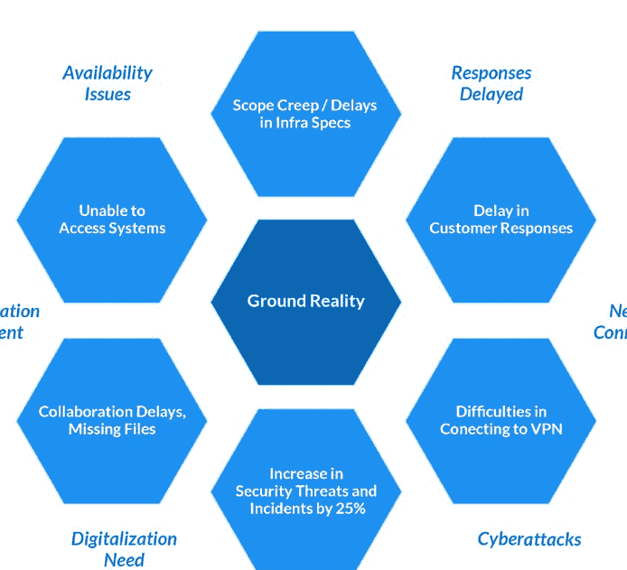

图 4-1. 传统运营面临的常见挑战

确实，运营团队的愿景是确保系统稳定。传统的工作方式到目前为止是好的，但这些规范现在正被设定为改变，以满足和维持数字业务的需求。因此，当务之急是从传统运营方式转向敏捷运营。虽然愿景保持不变，但底层的工作方式必须得到转变。这也对提升团队技能以及引入和采用敏捷性产生了需求

以及用于交付基础设施服务的自动化。基于里程碑的路线图将使组织能够从传统运营转型为敏捷运营。这些里程碑将包括现代技术（如云、Serverless 计算）或人员方面的要素，包括组建跨职能团队、创建站点可靠性工程（SRE）团队、引入可观测性和自动化，以及通过目录和 API 即可消费的自助服务目录，为团队赋能。这些变化将影响图 4-2 中所示的 IT 中的“运营业务”和“变革业务”两个部分。

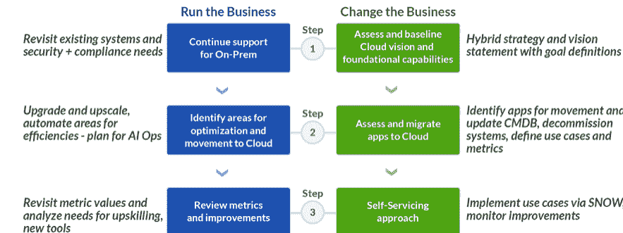

图 4-2. 迈向云采用的“运营业务”和“变革业务”示例计划

## 向敏捷转变

从传统 IT 运营向敏捷运营的转变需要周密规划，并应定期重新评估以衡量采用率。它还需要在人员、流程和自动化方面进行跟踪。让我们看看传统 IT 运营与敏捷 IT 运营之间的一些关键差异；请参阅表 4-1。

### 表 4-1. 传统 IT 运营与敏捷 IT 运营比较

| 领域 | 传统 IT 运营 | 敏捷 IT 运营 |
|---|---|---|
| 人员 | 按职能/技术划分的专用团队 | 跨职能/技术的跨技能团队 |
|  | 开发和运维团队独立工作并作为孤岛团队运作 | 开发和运维团队紧密协作并作为集成团队运作 |
| 流程 | 流程僵化，存在多次交接 | 流程精简，通过自动化实现有限的交接 |
|  | 依赖人工干预的事件/工单驱动方法 | 自助服务运营模式 |
| 工具与自动化 | 有限或孤立的自动化 | 标准化自动化框架以推动 IT 交付 |
|  | 交付定制化基础设施耗时 | 通过基础设施即代码加快配置 |
|  | 用于扫描应用和基础设施的孤立监控工具 | 集成且优化的工具集用于监控基础设施和应用 |
|  | 多个仪表板用于跟踪和管理基础设施服务和安全 | 具备自动修复能力的集成仪表板 |

当组织以计划且分阶段的方式进行时，从传统到敏捷的转型才会成功。在组织指导其运营团队掌握敏捷技术时，他们也在实施基础设施即代码和可观测性技术。这有助于团队标准化其基础设施设置并限制任何人工干预；现在大多数运营要么是完全自动化的，要么是借助自动化增强的。实施自动化系统有助于运营团队遵守安全和合规标准。

## 敏捷带来的益处

以敏捷模式工作带来一系列益处且无副作用。团队可能需要一些时间来采用和扩展，但从长远来看，组织将从采用敏捷中受益。请看通过实施四项敏捷原则（见图 4-3）可以获得的一些关键益处。

| 敏捷原则 | 益处 |
|---|---|
| 个人与互动 | 集成团队
协作改善 |
| 可工作的软件 | 自助服务
以 MVP 为中心 |
| 客户协作 | 持续反馈
责任感 |
| 响应变化 | 快速响应时间
精简流程 |

图 4-3. 敏捷 InfraOps 的益处

需要注意的重要一点是，向敏捷工作方式转变需要对团队进行指导和辅导。虽然自动化工具会带来自助服务和自动修复的即时益处，但重点是精简流程并赋能团队。因此，虽然敏捷性很有帮助，但组织需要着眼于构建强大的服务组合。这是为了应对容器、云等新兴技术。让我们看看一些推动组织在其生态系统（包括基础设施运营）中推动敏捷性的技术颠覆。

## 云计算

作为一个术语，云计算包括不同类型的服务，包括基础设施即服务（IaaS）、平台即服务（PaaS）、软件即服务（SaaS）、容器即服务（CaaS）和函数即服务（FaaS）。不同服务对监控、管理和管理的需求差异很大。随着从基础设施即服务向 SaaS 的推进，客户管理环境所承担的责任减少，因为底层层级随后由云提供商完全自动管理。如果您使用的是 Google 的 SaaS 产品 Gmail，您无需管理运行 Gmail 的基础设施或应用程序；您只需作为消费者使用它，因为所有底层基础设施和应用程序都由 Google 为您管理。如果您使用 Microsoft Exchange 自行托管电子邮件服务器，那么整个基础设施和 Microsoft Exchange 平台都需要由您管理。电子邮件领域的 SaaS 采用实际上使本地 Microsoft Exchange 类型的部署变得微不足道，因为组织已转向 SaaS。让我们更详细地看看图 4-4 所示的三种主要云计算模型。

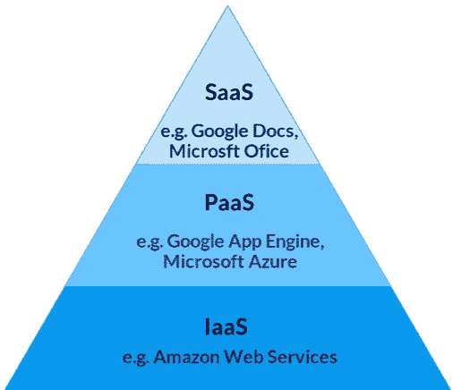

图 4-4. 云计算模型

### 基础设施即服务

在 IaaS 中，云提供商为用户提供对服务器、存储和网络等计算资源的访问。组织在其自身平台和应用程序之上使用此基础设施，并管理操作系统及其上层。

### IaaS 功能

- 客户无需租赁数据中心、购买网络、计算和存储硬件，或集成所有这些元素。云提供商按需付费为客户提供所有这些服务。客户可根据需求进行弹性伸缩。
- 客户免除了规划、采购、安装和运行基础设施的工作。
- 由于计算基础设施由云提供商自动管理，因此诸如现场支持、数据中心布线以及网络和硬件故障事件等活动不再需要由客户的支持团队处理。

### 平台即服务

在 PaaS 中，云提供商为用户提供云环境，使其无需担心基础设施和平台组件即可开发、部署和管理应用程序。除了 IaaS 提供的服务外，PaaS 还提供操作系统、平台抽象以及这些组件的自动管理，以便客户只需专注于应用程序代码。

### PaaS 功能

- PaaS 平台提供托管应用程序和数据库的平台；它还提供开发、测试和部署应用程序的工具。
- 云提供商管理作为服务提供的操作系统、数据库、中间件或其他平台，以及基础设施组件、安全、备份等。
- PaaS 平台释放了客户管理团队的资源，并通过简单直观的界面减少了配置和管理这些服务访问和安全性的工作，管理与监控开销非常小。
- 操作系统管理员、数据库管理员、中间件和平台管理员的管理活动大多已自动化并由云提供商提供。

### 软件即服务

在 SaaS 中，云提供商为用户提供对在云上运行的完整功能应用程序的访问。用户可以进行身份验证并开始在云平台上使用该应用程序。SaaS 可能是电子邮件或协作客户端等简单应用程序，也可能是 ERP 解决方案等复杂业务应用程序。

### SaaS 功能

-   整个应用程序以订阅按使用付费模式提供给用户。
-   由于基础设施和平台被抽象化，用户无需安装、配置或管理这些组件。此外，由于应用程序也由云服务提供商提供，客户无需开发、部署、升级或管理应用程序。
-   客户可以从不同位置使用应用程序，可以管理用户和访问权限，并可以为角色和用户提供映射，以便经过身份验证和授权的用户可以访问应用程序所需的特性。
-   SaaS 管理底层组件（如基础设施和平台）的扩展，以向用户提供基于 SLA 的可用性和响应。
-   该模型涉及的管理开销最小，因为从基础设施到平台再到应用程序开发和部署几乎所有内容都由云服务提供商交付。在该模型中，应用程序开发以及运维工作被消除，因为为业务和功能用户提供了一个完全可用的应用程序供其使用。

因此，从敏捷基础设施运维的角度来看，在规划运维团队和流程时，需要考虑云服务提供商提供的各种服务。管理环境所需的技能在不同的消费模式中会发生巨大变化。随着客户越来越多地使用 SaaS 和 PaaS 环境，基础设施运维的角色会减弱，因为这些层由云服务提供商自动交付。

早期，基础设施运维面临技术挑战，且基础设施云计算服务尚不可用。因此，需要一个漫长的采购、安装、配置和测试这些系统的过程。任何新的应用程序组合都被作为一个项目来处理，涉及 IT 基础设施、采购、安全、设施和应用团队。即使在 IT 基础设施内部，在设置数据中心时也需要考虑许多要素，例如选择托管数据中心的托管设施以及网络、存储、计算和虚拟化系统，以及连接和安全设备。还存在额外的复杂性，即确保来自不同厂商的这些系统彼此兼容，并且在基础设施可供应用团队使用之前，需要对集成进行测试。

所有这些技术限制需要详细的精细规划而不是迭代实施，因为之后更改任何内容都涉及选择产品、采购它并将其物理交付和安装的漫长过程，这需要数周时间。例如，如果设计变更需要反映更高可用性的组件，则需要两张 HBA 卡，如果你为计算设备订购了一张 HBA 卡，那么你必须订购一张物理卡，然后由硬件厂商采购并发货。同样，网络设备或存储设备的任何更改都意味着采购、运输和硬件的物理实施。为了避免此类问题，IT 基础设施团队演进出了需要稳健且精细规划的流程和系统，以确保项目中不会遗漏任何内容。部署后对 IT 基础设施的任何更改也将经过详细的规划和变更控制流程，因为有许多组件协同工作以提供 IT 基础设施，任何一个组件的配置更改都可能影响集成。因此，软件开发中迅速采用的敏捷流程在云之前时代是不可行的，因为 IT 基础设施处理的是物理基础设施元素，并且需要处理太多集成。

随着云计算的出现，一切都发生了变化。基础设施通过 API 变成了可编程的，并且组件的集成由云服务提供商保证可用，因为来自云厂商的控制平面和云管理软件的抽象层处理了所有这些方面。见图 4-5。

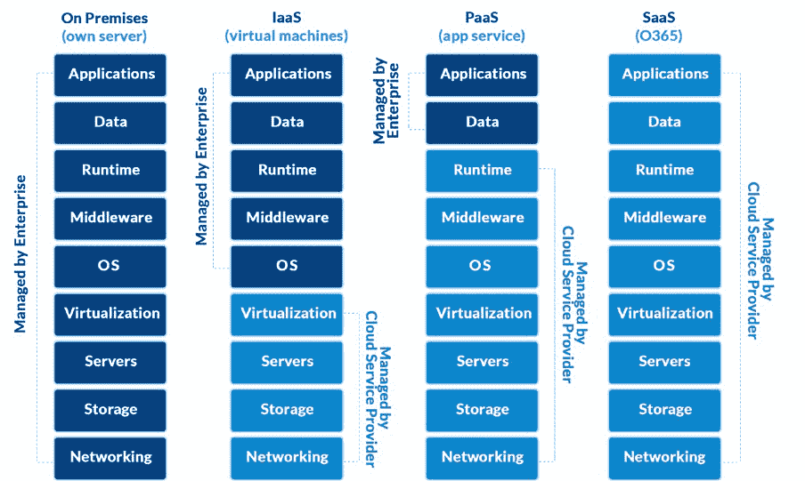

## 图 4-5. 本地部署与云计算类型

为环境计算容量而进行的广泛规划不再需要，因为任何额外的容量都可以在云环境中按需轻松启动。

云计算带来的技术格局变化从根本上改变了 IT 基础设施的设计、实施和消费方式。过去几十年为 IT 基础设施建立的流程和系统现在需要改变，因为云带来的技术颠覆改变了游戏规则。

云计算带来了环境、配置、集成和最佳实践的标准化。与过去每个人都必须自行摸索最佳实践、控制和标准不同，云服务提供商提供了可直接使用的最佳实践、用例和标准化架构。网络上最具挑战性的方面——设置硬件、虚拟化软件、边界安全和安全设备——现在都可以通过在云环境中单击按钮获得。即使设计中遗漏了某些内容，你也可以快速将更改纳入环境，这与过去不同。云计算带来的另一个根本性变化是基础设施变得可编程，这意味着应用程序开发团队可以通过代码使用基础设施元素，并通过其 CI/CD 工具启动和关闭环境，从而减少对基础设施运维团队的依赖。然而，这意味着很快每个应用团队都将拥有自己的云环境，使用他们选择的提供商和他们想要使用的技术，并且组织在基础设施和云环境方面将没有标准化。

由于你可以在云环境中使用任意多的资源，存在应用团队可以在没有预算和治理控制的情况下启动环境或使用基础设施，从而产生高昂云计算账单的情况。从云计算角度来看，需要安全、合规、治理和 FinOps 学科，以确保应用程序和基础设施团队的云使用是在受控和安全的方式下进行的，而不是应用团队可以为所欲为的自由竞争模式。

因此，基础设施团队的角色需要随着云基础设施带来的技术颠覆而改变。

## 微服务架构

新的数字和云应用程序采用微服务架构开发，并在 Kubernetes 等容器管理平台上运行。Kubernetes 已成为容器编排最受欢迎的开源平台。容器编排平台自动化容器的生命周期，从部署到退役。容器平台上的应用程序部署通过配置文件进行，可以使用部署工具进行自动化。

Kubernetes 基础设施构建在集群之上，集群是一组机器；这些可以是物理机或虚拟机，称为节点。工作负载/应用程序部署到集群上。主节点控制一组工作节点并提供管理平面功能。这包括 API 服务器和其他管理节点的组件。

在 Kubernetes 架构中，Pod 是一个或多个容器的逻辑集合，也可以分布在多个节点上。Pod 打包了运行容器所需的应用程序容器、存储、网络和其他配置。Pod 可以水平扩展，这意味着 Pod 内的应用程序组件也会扩展。这使得微服务应用程序更具可扩展性。见图 4-6。

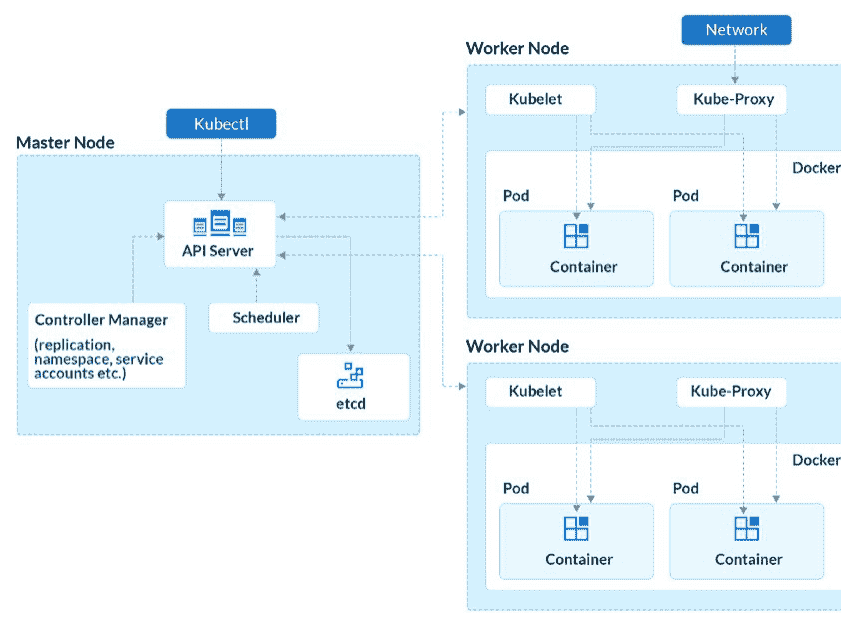

图 4-6. Kubernetes 示例架构

微服务架构和基于容器的基础设施的出现为敏捷运维和 DevOps 带来了新的挑战。在云计算和容器出现之前，基础设施开发和应用开发相互依赖。DevOps 作为一种学科出现，旨在弥合应用开发团队与运维团队之间的差距。尽管 DevOps 从人员和流程角度解决了问题，但技术方面仍然是一个挑战。部署到生产环境的应用可能会遇到问题，因为生产部署的配置与开发或测试部署不同，或者基础设施配置的微小更改导致应用可用性或性能问题。另一个挑战是基础设施和操作系统需要不时进行修补和更新。例如，Microsoft Windows 需要每月一次的补丁周期。当服务器和基础设施被修补时，可能会导致应用出现问题，需要开发团队和运维团队之间进行广泛的协作和测试。这导致了部署模式的发现，这些模式大多通过自动化支持。

## 部署模式与自动化

传统上，当应用准备好部署时，它会被交给应用运维和基础设施团队在生产系统中部署。会设定专门的时间表，并由确定的团队参与实施。随着组织转向云端并采用基于微服务的架构，开发人员获得了访问云原生工具的机会，使他们能够超越开发思考。现代工具允许开发人员使用多个描述性模板（大多数以 YAML 格式运行）来设计应用部署。此外，他们还可以访问用于设置核心基础设施元素（如 VM、负载均衡器、扩展组等）的模板。因此，开发人员之前仅使用 Jenkins 等工具专注于持续集成（CI），扩展了其 CI 流水线以执行持续交付，其中包括将构件从一个环境移动到另一个环境（如从开发环境获取二进制文件并部署到 QA 环境）。后来，随着 CI 和 CD 流程的成熟，这些开发人员能够自动化应用直至生产环境的部署。此过程称为持续交付（CD）。在某些情况下，新的生产环境也是通过自动化流水线设置的。参见图 4-7。

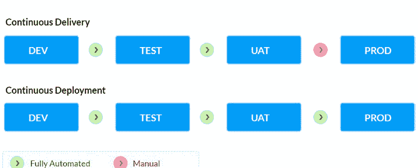

图 4-7. 持续交付与持续部署

随着自动化程度的提高，组织要求零或最小停机时间。这是通过使用 Jenkins X、Spinnaker 等工具构建的各种部署模式实现的。让我们看看一些常用的模式。

## 蓝绿部署

该部署策略有两个相互隔离的生产实例，称为 *蓝色* 和 *绿色*。接收流量的生产实例是蓝色生产实例。每当要进行新的应用发布时，首先将该新版本部署到绿色生产实例并进行测试。如果该实例通过测试标准，则只有在此时绿色实例才会被提升以接收流量并成为蓝色实例；然后之前的实例被重命名为绿色。参见图 4-8。

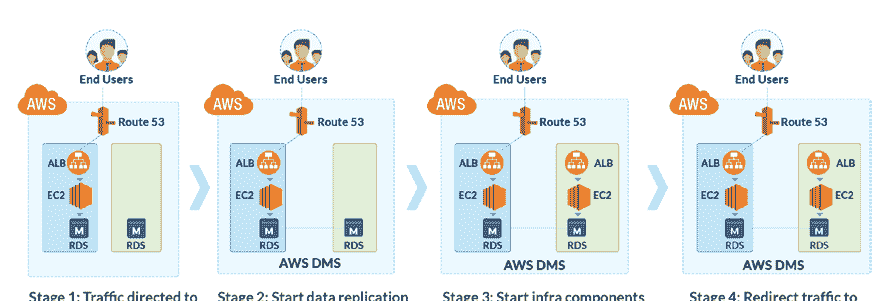

图 4-8. 蓝绿部署策略

## 滚动更新

滚动更新部署策略也称为 *渐进式* 部署策略。关键思想是通过替换旧版本来推出新的应用实例。这种方法在推出新版本时解决了与长时间运行事务相关的问题。旧实例以分阶段的方式被新实例替换。参见图 4-9。

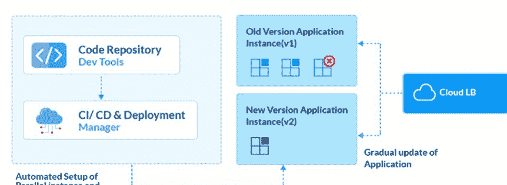

图 4-9. 滚动部署策略

## 金丝雀部署

金丝雀部署策略，也称为增量部署，与蓝绿部署类似，只是新应用版本的流量是缓慢引导而不是突然切换。这种方法在团队进行 A/B 测试时非常出色。参见图 4-10。

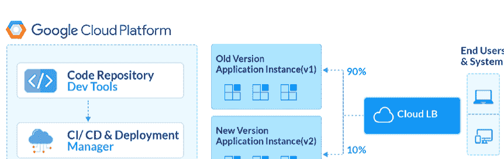

图 4-10. 金丝雀部署策略

所有这些部署模式都可以通过自动化工具和可重用模板轻松实现。每个模式都通过自动化测试框架以及测试工具进行了充分测试。让我们回顾一下通过交付流水线测试应用和基础设施的进步。参见图 4-11。

## 你知道吗？

### 为什么金丝雀发布/部署被称为‘金丝雀’？

金丝雀部署旨在在大规模发布之前将软件发布给一小部分用户。在收到积极反馈后，发布会推广到其他用户，否则会回滚。该技术被煤矿工人使用，他们使用金丝雀鸟来测试矿井是否对人类安全（因为矿井通常含有危险气体）。如果金丝雀生病，则表明矿井对人类不安全。

图 4-11. 你知道吗？

## 左移测试

与传统开发类似，测试通常在开发之后才开始。虽然开发人员执行某种形式的单元测试，但 QA 或测试人员执行功能和性能测试，但测试场景有限。随着对微服务需求的增长，需要支持数十个平台，以及快速部署应用的需求，测试必须现代化。测试必须持续进行，并在开发周期中向左推移。产品团队旨在主动预防错误，而不是被动发现。参见图 4-12。

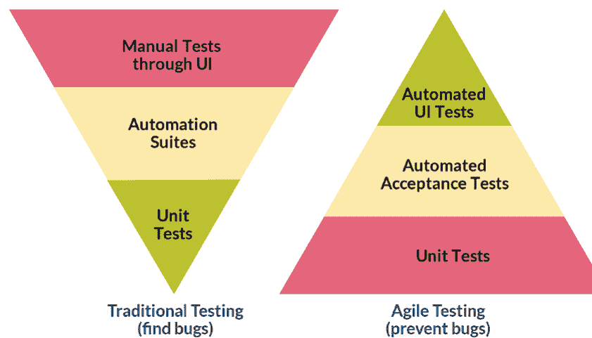

图 4-12. 传统与现代测试方法

为满足需求，出现了更多关注交付高质量代码的新工具。产品团队更关注技术债务、代码和测试覆盖率。这为敏捷测试铺平了道路，并引入了各种形式的测试。测试现在不再局限于 QA/测试人员。相反，业务分析师、开发人员和产品团队中的每个人都有责任确保产品质量高，没有错误或安全漏洞的空间。让我们看看在产品测试生命周期中正在实践的关键测试形式。参见图 4-13。

### 在迭代的每个阶段进行测试

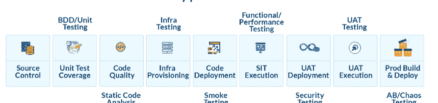

### 自动化以加速上市时间

图 4-13. 不同类型的测试

BDD 测试与单元测试：这是一种被称为 *行为驱动开发测试* 的测试策略。它是对测试驱动开发（TDD）的扩展，专注于创建或开发满足所述目标的功能。这种类型的测试通常与单元测试集成。测试以 Gherkin 格式（“给定、当时、然后”格式）编写，并与用户故事相关联，并在早期阶段编写。像 Cucumber 这样的工具支持 BDD，并使业务分析师能够编写有效的 BDD/验收测试，这些测试可读性强，并且可以轻松地针对预期行为进行测试。参见图 4-14。

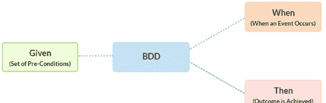

图 4-14. BDD 测试

单元测试，有时称为 *白盒测试*，是指开发人员测试他们编写的每个功能。一旦 BDD 测试定义完成，单元测试就很容易构建。开发人员利用 JUnit、Nunit、PyUnit 等多个框架来构建单元测试用例并识别需要重构的代码。

## 静态代码分析

此类测试用于根据预定义规则或标准分析编写代码的质量。常用的工具如 HCL AppScan、SonarQube、Coverity 等，使开发人员能够将静态代码分析与应用构建集成。这些工具生成反映代码复杂性、代码覆盖率、重复百分比、过度复杂的表达式和技术债务的仪表板。参见图 4-15。

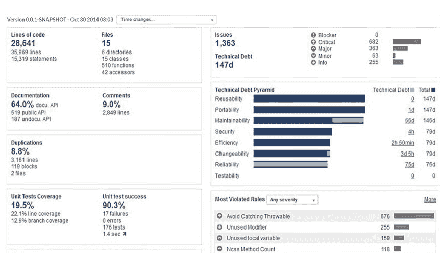

图 4-15. 使用 SonarQube 进行静态代码分析，仪表板视图

## 基础设施测试

基础设施测试验证应用程序是否能与预期硬件和网络协同工作。其目的是在新软件准备部署时测试不同环境之间的基础设施。这有助于在迁移和工作负载的生产移动过程中降低风险。当需要执行与基础设施相关的活动（如修补、添加新设备等）时，也会执行此类测试。有多种方法可供产品团队执行基础设施测试，例如客户端-服务器基础设施测试、网络级测试、云测试等。见图 4-16。

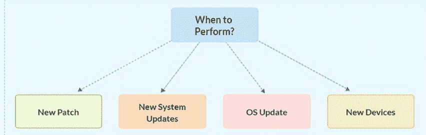

图 4-16. 基础设施测试示例

## 烟雾测试

烟雾测试通常用于集成、系统和验收测试中，在这些测试中主要产品功能会被随机测试，但不会深入覆盖。其意图是测试已部署的软件是否正在运行。因此，它也被称为 *置信测试* 或 *构建验证测试*。此测试由 QA 测试人员在应用程序发布到 QA/测试环境时执行，该过程可以是手动的，也可以是自动化的。如果这些烟雾测试通过，则 QA 测试人员可以继续进行功能和弹性测试；如果失败，则通知开发团队构建已失败。见图 4-17。

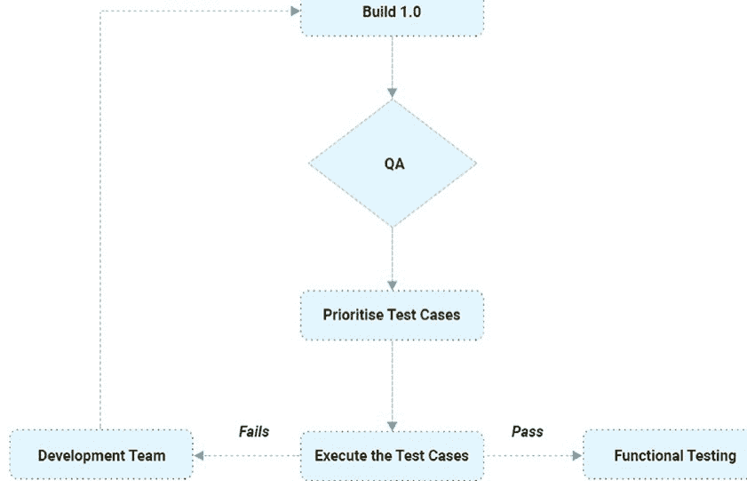

图 4-17. 烟雾测试工作流程

## 功能和性能测试

这种形式的测试已实践了相当长的时间，QA 测试人员在此期间根据应用程序的功能和性能对其进行测试。这被称为 *黑盒测试*。这是一种测试类型，QA 部门对其应用程序的开发方式一无所知。测试人员有一份测试场景和测试用例列表，这些场景和用例要么手动执行，要么使用自动化工具执行，结果指定为通过或失败。商业工具如 HCL 的 OneTest（功能、性能、服务虚拟化和 API 测试的集成套件）、HP UFT（统一功能测试）、HP LoadRunner，或开源工具如 Selenium、JMeter 等，通常被使用。见图 4-18。

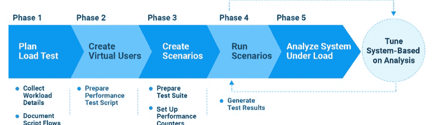

图 4-18. 开发性能测试套件

## 安全测试

此测试类别揭示系统中的漏洞，并确定系统的数据和资源免受可能的入侵。它专注于查找可能导致信息丢失的系统的所有可能漏洞和弱点。它还确保系统免受可能导致数据丢失的威胁或风险。随着数字化程度的提高，组织面临的安全威胁不断增加，因此正在投资各种软件解决方案，这些解决方案可主动扫描此类威胁并及时向团队提供这些漏洞。有不同形式的安全测试由不同专家在不同层级执行，以确保发布的产品经过充分测试，并且在上线后仍能继续监控系统。Nessus、HCL AppScan、Qualys、Veracode 等工具是该领域常用的一些工具。事实上，这种类型的测试已引入基础设施即代码管道中，其中安全扫描被自动化以避免人工检查。例如，镜像加固过程需要合规性检查，即组织对包含组织合规规则集的 VM 镜像进行加固的过程。这是因为组织不允许直接从互联网使用 VM 镜像以避免任何安全问题；这可以很容易地使用现有安全工具实现自动化。如果一切顺利且管道获得安全团队的批准，则镜像将被移至共享库，组织内所有人均可访问。见图 4-19。

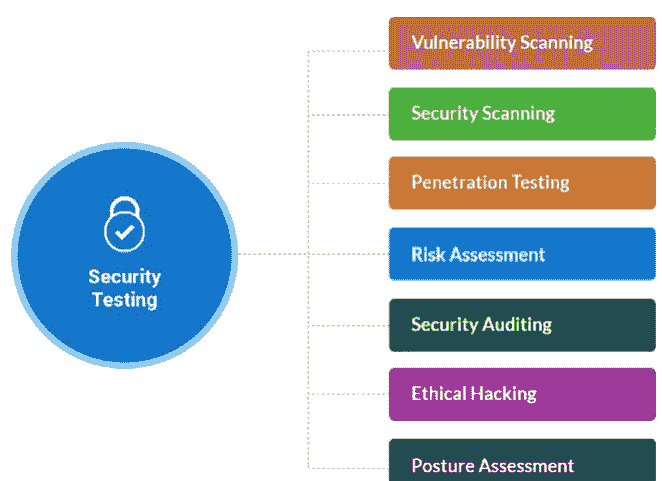

图 4-19. 安全测试类型

## 用户验收测试

用户验收测试（UAT）是另一种由最终用户执行的测试形式。这是在生产环境实际发布前进行的。实际用户会被授予访问新设置权限，以根据其真实场景验证应用程序功能。UAT 环境已为最终用户准备就绪，以便他们使用新应用程序版本执行此测试。UAT 测试人员拥有自己的测试用例集，这些用例在此环境中执行，结果被记录下来。如果用户验收测试通过，则最终用户或客户将为生产环境中的实际部署提供签批；否则，产品团队会被通知采取改进措施。见图 4-20。

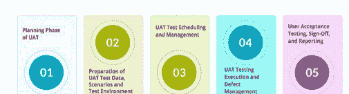

图 4-20. UAT 测试阶段

## 混沌测试

Netflix 于 2011 年通过其名为 Chaos Monkey 的测试工具构想了一种新的测试形式。此测试的目的是测试基础设施的弹性。这有助于团队检查其现有基础设施在出现任何故障时是否能够扩展和恢复。该概念依赖于主动识别问题以避免停机。这种测试类型也被称为 *混沌工程*，并且有许多工具可供团队在系统中引入混沌并监控行为。这样的分析有助于团队构建更好的系统。见图 4-21。

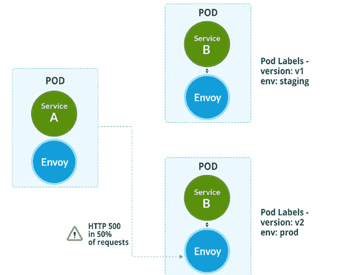

图 4-21. 混沌工程/测试

## A/B 测试

也称为 *分桶测试* 或 *拆分运行测试*，A/B 测试是对应用程序的两个变体进行的随机实验。术语 *A* 指控制组或原始变体，而术语 *B* 指新变体。表明积极业务影响的版本将是真正的赢家。这使产品团队能够优化其 Web 应用程序或网站并提高投资回报率。因此，利用统计数据，团队分析其网站的性能并根据访客行为确定优化方式。作为一个简单的例子，如果 50% 的访客访问该变体，并且该变体产生的销售额高于其他变体，则变体 A 为赢家。见图 4-22。

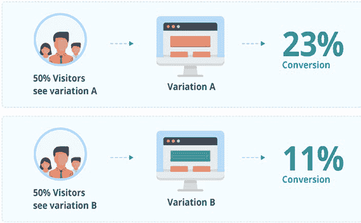

图 4-22. A/B 测试

理想情况下，产品团队应从产品构思开始在所有层级实践测试。有可用的工具可自动化这些测试类别，从而加快敏捷开发速度。即使在基础设施即代码中，团队也会开发脚本、利用编码规范、检查技术债务，并自动化他们遇到的任何事物以实现更快的交付时间。

## 影响运营的架构变化

导致需要敏捷运营的另一个方面是常见架构的变化。为了处理配置更改，基础设施和平台领域已转向幂等性模型。简单来说，它是一种无论执行多少次都能产生相同结果的操作。在此模型中，像 Puppet 和 Chef 这样的工具会生成在脚本中创建的配置，这些配置应用于服务器和端点。如果在单个服务器级别或端点上对配置进行了未经授权或未通过配置管理工具发起的更改，工具代理将简单地将配置恢复为根据服务器在架构中可能执行的角色分配给该服务器的期望状态。因此，Web 服务器角色具有期望状态配置，除非通过配置管理工具修改该角色的期望状态配置，否则它不会更改。这大大减少了因配置错误或开发系统与生产系统之间的配置冲突而产生的事件。这也带来了标准化，因此运营团队将知道特定服务器配置的预期情况。配置更改变得更简单且自动化，因更改而导致的事件大幅减少在此模型中。然而，仍需要维护期望状态配置，并根据修补、安全和合规需求保持服务器更新。

随着容器化和微服务的出现，幂等性概念让位于不可变基础设施概念。不可变基础设施简单地意味着不会改变的基础设施，因此你不会更新或升级容器，而是在有更新时关闭它们并启动其他容器。结合编排和自动化以及 DevOps 实践，你可以使用金丝雀部署或蓝绿部署进行发布，并且该模型易于使用，无需管理配置的开销。容器可以在几秒钟内启动和关闭，而虚拟机启动需要几分钟。容器轻量级，不会带来整个操作系统的开销，从而实现了不可变基础设施的理念。

虚拟机更像是宠物。容器更像是牲畜。我们爱我们的宠物，给它们命名并维护它们，并且我们与宠物有着长期关系。这与虚拟机和幂等基础设施同义，这些基础设施需要维护、保持最新，并且实例需要长时间保持运行。虽然容器更像是牲畜，但它们是短暂的。随着容器化以及敏捷性、高可用性和可扩展性的概念，应用程序开发和部署模型正迅速从“宠物”思维转向“牲畜”思维。容器镜像只是被新的更新镜像替换，而不是更新旧镜像。

影响敏捷运营的另一个重要方面是基于容器的应用程序和架构易于在云环境之间移植，因为它们与底层基础设施组件解耦。当前部署在 AWS 上的应用程序可以轻松移植到 Google Cloud 或 Azure，而无需修改。因此，这些模型中不再存在应用程序与基础设施之间存在的配置依赖关系。Kubernetes 对基础设施的出色抽象意味着基础设施和开发团队可以专注于各自的专业领域。

因此，基础设施团队可以专注于诸如数据中心基础设施、网络基础设施、存储基础设施、云基础设施、集群基础设施、容量管理、监控、灾难恢复和安全等事务。应用团队可以专注于开发应用程序、为部署和配置构建容器镜像等。

在新的模式下，应用团队过去需要与不同团队协调以完成工作并等待基础设施和正确配置而存在的依赖关系和流程突然消失了。基础设施在幕后为应用团队存在，可通过 YAML 脚本进行编排和控制。

因此，在新的模式下，应用团队和基础设施团队的角色和职责发生了变化。有人需要使用清单文件（通常是 YAML 脚本）部署应用程序并管理 Kubernetes、Terraform 等新工具和技术。团队可以采用多种结构来完成这一最终目标。

成熟的组织正在转向基础设施即代码，其中云和容器环境的配置以脚本形式表示，整个云环境可以通过软件代码创建和销毁。对基础设施世界的改变是巨大的。从使用基于 GUI 的屏幕到编写配置和自动化脚本，基础设施管理员的角色在新模式中已完全转变。

## Summary

虽然传统运维是成功的，但云计算、微服务、CI/CD、左移测试和基础设施即代码的出现迫使组织向敏捷运维转型。基础设施运维不能孤立存在；它必须与新技术协作并随之改变。开发领域效果良好的敏捷框架也在基础设施领域得到实施。使用 ITSM 的团队正转向敏捷 ITSM 框架。向新模式的过渡是组织需要考虑、规划和执行的重要一步，以确保新运营结构中的任何团队都不被落下。在我们了解如何开始并迈向敏捷运维之前，我们首先应了解不同的敏捷框架和方法。

# CHAPTER 5

## Introduction to Agile Methods

在本章中，我们将详细介绍广泛使用的敏捷方法，包括最佳实践、角色、工件、指标和仪式。本章将涵盖的主题如下：

- Scrum
- Kanban
- Scrumban
- Scrum、Kanban 和 Scrumban 的比较

### Scrum

在传统的基础设施工作模式中，基础设施团队负责所有手动的运维任务。这些任务是重复性的，并且每次解决时都遵循相同的步骤。环境构建或停用活动被视为项目，以模板形式作为需求出现。需要与利益相关者多次开会以最终确定需求。由于需要不同人员的技能来完成任务，并且由于人员分属不同团队、每个团队都有自己的优先级，因此协调不足，构建服务器及其所有所需配置需要数周时间。此外，需求不断变化，需要大量返工。所有计划中的活动都被视为项目。随着客户期望的变化，需要更快交付。

在新的工作模式中，基础设施运维团队不仅是系统和环境的看护者，还负责为开发团队引入自动化并简化流程。需求被称为 epics，并进一步细分为 *user stories* 和 *tasks*。会议有计划、有条理，并且有固定的交付模式。团队沟通更多且联系紧密。此外，整个团队朝着共同目标努力。

Scrum 是一种非常适合从事“改变业务”（CTB）活动（如基础设施即代码）的团队的方法论。基础设施即代码（IaC）的概念已在大多数组织中被接受超过十年，它帮助团队做到以下几点：

- 标准化配置和停用流程
- 跟踪和控制环境构建
- 将基础设施管道与开发管道扩展
- 利用安全标准
- 减少上市时间

### Adopting Scrum in IT Ops

Scrum 流程的实施方式与在开发项目中的实施方式相似。负责自动化的基础设施团队需要从各个角度规划其实施。涵盖人员、流程、工具和自动化的完善战略将确保团队快速学习和扩展。参见表 5-1。

### Table 5-1. Pillars of Scrum

| Perspective | Inputs |
|---|---|
| People | - Mentor teams on the need for agile practices and their usage. - Identify and plan for new roles in the team (the Scrum team comprises a product owner, a Scrum master, and the team). |
| Process | - Define the workflow for automating the processes of provisioning and decommissioning. - Identify other infrastructure processes that can be automated. |
| Tools and automation | - Identify the tool to be used by the team for referring to stories, status, increments, and feedback. |

### Getting Started with Scrum

Scrum 方法论是一个通用框架，可轻松用于产品开发团队以及部署基础设施即代码或通过运行手册自动化标准操作程序的运维项目。该框架具有定义的角色、仪式和职责，促进团队成员之间迭代开发、信任和透明的文化。有时基础设施团队指定一个小型团队作为 DevOps 团队，其核心目标是加强自动化并建立基础设施即代码，以在小规模冲刺中反复交付功能。团队与业务和重要利益相关者密切合作，后者会在待办事项中分享需求，这些需求会被分配优先级并遵循常规的敏捷产品生命周期。参见图 5-1。

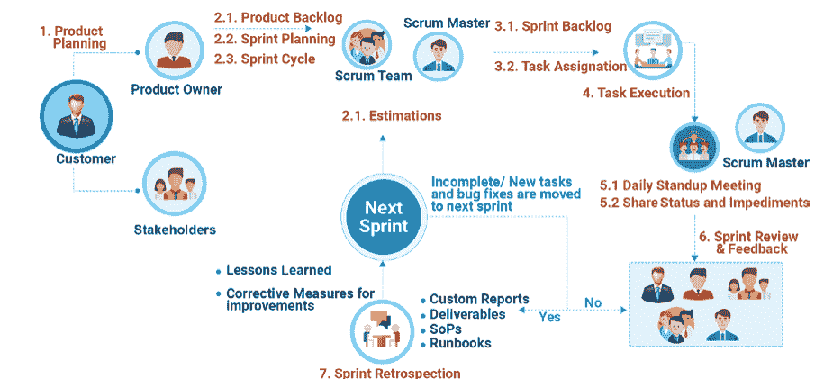

Figure 5-1. Scrum model

该框架以冲刺运行并持续交付价值。

- *Product planning:* 这是产品待办事项创建阶段。产品待办事项是利益相关者共享的需求队列。在此阶段，客户和利益相关者与产品负责人互动并分享需求。在敏捷世界中，这些是称为 *themes* 或 *epics* 的高层次需求。产品负责人理解需求并说明这些需求的优先级和重要性。

- *Product backlog grooming:* 冲刺计划会议是团队挑选高优先级需求、提供估算并开始冲刺的地方。产品负责人与包括 Scrum 主持人在内的 Scrum 团队一起审阅需求。此外，他们还将高层次需求或 epics 进一步细分为称为 *stories* 的更小单元。
- *Sprint backlog:* 冲刺待办事项是产品待办事项的子集的另一个需求队列。在冲刺计划会议结束时，故事从产品待办事项移至冲刺待办事项。团队被分配故事并每日开会以解决进展。
- *Task execution:* 故事是需要实现的最小编号单元，每个故事有一个或多个任务，说明要执行的活动或工作。团队定期更新其故事。
- *Daily meets:* 这是称为 *standup meeting* 的每日会议。Scrum 主持人推动冲刺周期并接受变化并解决任何团队问题。每天团队开会分享工作状态并讨论任何风险或阻碍。
- *Sprint review:* 这被称为冲刺演示或评审。在冲刺周期结束时，工作会向产品负责人演示，并收集和跟踪所有利益相关者的反馈。冲刺评审会议的结果是对所生产 MVP 的“通过”或“不通过”决策。这些 MVP 可能是运行手册、脚本、SOP 等。
- *Sprint retrospective:* 这是冲刺周期的最后一次会议，团队再次聚会研究周期流程、已完成并获批准的故事、未完成的故事或相关利益相关者分享的反馈。所有学到的经验都作为下一次冲刺周期改进的输入。

让我们进一步详细说明 Scrum 模型中重要的角色、工件、会议和实践。

## Scrum 角色
为了在基础设施 IT 运维领域实施 Scrum 方法论，需要以下角色。

*产品负责人：*
- 创建、跟踪和管理产品待办事项列表的人员，包括推动基础设施搭建、基础设施迁移、云实施、云迁移、基础设施即代码类型项目所需的工作项
- 有权为所有客户和用户做出决策
- 保护团队免受外部影响
- 向团队展示并解释产品待办事项列表

*利益相关者：*
- 与产品负责人协作并共同工作
- 通过产品负责人向团队提供输入
- 提供业务视角，帮助产品负责人对待办事项列表进行优先级排序

*Scrum 精通者：*
- 负责最大化团队生产力
- 组织并促进各种迭代会议
- 保护团队免受外部影响
- 消除障碍

*Scrum 团队：*
- 由开发人员和测试人员组成
- 负责估算工作并做出承诺
- 自组织且跨职能
- 拥有完全的自主权和权限来运行冲刺
- 与产品负责人协作

一个典型的 Scrum 团队不应超过八到十名成员。合理配置团队规模对于确保责任明确和便于冲刺跟踪非常重要。

## 工作项
工作项可以被视为交付物。与传统开发中需求一次性进行分析、设计、架构、开发、测试和部署并遵循工作分解结构（WBS）不同，在 Scrum 世界中，工作项是迭代交付的，并遵循图 5-2 所示的层级结构。因此，史诗是一个必须交付的大需求。它被分解为功能，然后进一步分解为称为用户故事的实际需求，用户故事与任务相关联。虽然史诗和功能可以跨多个冲刺展开，但故事和任务与特定的冲刺相关联。

图 5-2. 示例需求分解

## 待办事项列表
所有史诗都保存在待办事项列表中。这些史诗和用户故事由产品负责人进行优先级排序。存在三种待办事项列表：产品待办事项列表、发布待办事项列表和冲刺待办事项列表。优先级的史诗从产品待办事项列表中提取并放入发布待办事项列表中，后者反过来会包含功能和用户故事。冲刺待办事项列表是最底层，是当前冲刺的待办事项列表。

史诗和用户故事保留在待办事项列表中，直到它们被优先级排序并根据产品负责人和团队的约定移入发布和冲刺待办事项列表。一旦它们进入发布待办事项列表，我们就开始对交付时间线进行估算。用户故事会被分配故事点，故事点是完成该故事所需工作量的衡量标准。进行故事点估算的方法有很多，例如规划扑克、T 恤尺码等。我们将在第 8 章详细介绍这些内容。

## Scrum 冲刺
Scrum 项目首先开始的阶段是发现阶段。这是讨论项目需求并并行编写用户故事以获得初步确认的阶段。发现阶段结束后，冲刺开始。

当我们谈论冲刺时，它是一个 3-4 周的固定迭代，在冲刺结束时需要实现冲刺目标。你也可以将其理解为迭代。在开发团队中，每个冲刺都可能交付应用程序功能，例如在冲刺 1 中目标可能是启动基础云平台功能，而在冲刺 2 中目标可能是添加云上的安全和合规等新功能。因此，随着后续冲刺的进行，平台不断增长并提供更多功能和能力。关于哪个功能先进行的问题由产品负责人和与客户保持密切联系的利益相关者来回答。与开发团队的冲刺交付相比，针对基础设施即代码的团队将以迭代/冲刺的方式交付基础设施搭建，例如在冲刺 1 中目标可能是自动配置特定云上具有最低规格的测试环境。对于冲刺 2，目标可能会扩展到覆盖在多个云上自动配置具有自定义规格的测试环境，等等。因此，想法是交付经过充分测试并部署的工作功能。由于基础设施项目与应用程序项目不同，Scrum 团队规模和冲刺持续时间可能是与 Scrum 中应用程序开发团队组织方式不同的方面。由于缺乏实证数据，组织明智的做法是根据实施的项目类型对建议进行调整以满足自身需求。一般来说，基础设施即代码类型的项目在很大程度上与软件开发项目的冲刺周期和团队规模保持一致；然而，更复杂的基础设施项目可能需要调整团队规模、技能、外部专业知识和冲刺周期。

## 冲刺仪式
每个冲刺都有四个遵循的仪式。

- 第一个仪式是 *冲刺计划会议*。这是确定冲刺范围的会议。它根据团队可用的带宽可以完成的总故事点来定义将挑选哪些故事。会议中定义的人工制品是待办事项列表，其中列出了冲刺的用户故事。产品负责人必须与 Scrum 精通者和团队一起出席。
- 第二个仪式是 *每日站会*。这是一个每日 15 分钟的会议，整个团队参与并回答三个重要问题：昨天完成了什么？今天计划做什么？是否有任何阻碍？这有助于提高团队的透明度，并带来实现冲刺目标的主人翁意识和动力。产品负责人不必每天出席，但必要时可以加入。Scrum 精通者和团队参与会议。
- 第三个仪式是 *冲刺演示* 或 *冲刺回顾*。团队向产品负责人展示冲刺产品或增量。这是如果团队之前未能获得反馈时获取反馈的时间。
- 第四个也是最后一个仪式是 *冲刺回顾*。这是团队反思做得好的地方、做得不好的地方、可以做得更好的地方以及行动项的时间。这有助于团队在下一个冲刺中改进。

## 信息辐射器
在其他 SDLC 模型中我们跟踪和控制的方式，在敏捷中我们也同样如此。*信息辐射器* 用于跟踪发布和冲刺的状态。让我们看看一些有用的信息辐射器：

- *Scrum 看板* 直观地显示与当前冲刺周期相关的用户故事和任务的进展。它们还用于有效的沟通和协作以及待办事项和冲刺计划。见图 5-3。

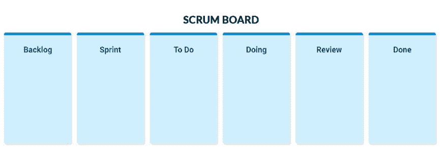

图 5-3. Scrum 看板示例模板

- *燃尽图* 用于显示每日已完成工作与计划工作的对比。它传达还有多少故事点需要完成。团队在燃尽图上跟踪故事点，以查看计划的故事是否会按计划完成。它有助于在调整或计划需要采取的任何行动以实现冲刺目标时提供帮助。见图 5-4。

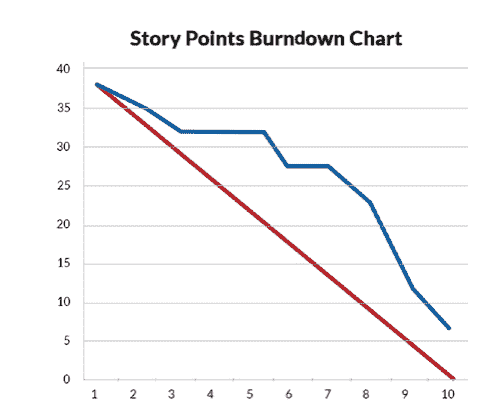

图 5-4. 燃尽图示例

- *燃起图* 从另一个角度跟踪，包括相对于目标已完成多少点。见图 5-5 和图 5-6。

## 故事点燃起图
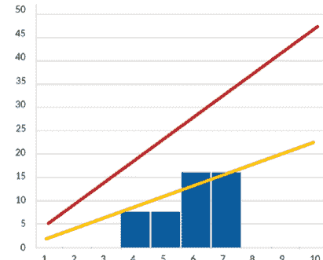

图 5-5. 燃起图示例

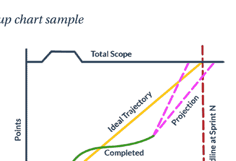

图 5-6. 冲刺绩效示例

- *仪表板* 以摘要形式展示项目的所有相关信息。仪表板根据需要创建，提供汇总信息和下钻功能。它们显示项目的当前进行中信息。见图 5-7。

## 冲刺仪表盘

## 冲刺健康小工具

PRAC冲刺1 - PRAC看板
剩余1天
整体冲刺进度（故事点）
5 5
时间已用 80%
工作完成 36%
范围变更 0%
0 最高
0 标记
冲刺参与者

## 冲刺燃尽图小工具

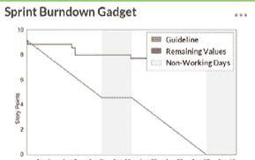

## 筛选结果：按PRAC看板短期估算筛选

| 键 | 摘要 | P | 状态 |
|---|---|---|---|
| PRAC-12 | 禁用时按钮颜色不改变 | ↑ | 已完成 |
| PRAC-11 | 调整落地页横幅的蓝色色调 | ↑ | 已完成 |
| PRAC-9 | UI内容 | ↑ | 已完成 |
| PRAC-4 | 作为用户，我希望记住我最后查看的帮助页面，以便我可以轻松再次参考 | ↑ | 已完成 |
| PRAC-3 | 禁用时按钮颜色不改变 | ↑ | 进行中 |

## 夏洛特的工作

| 键 | 摘要 | P |
|---|---|---|
| PRAC-6 | 为演练选择的部分 | ↓ |
| PRAC-10 | 为帮助添加视频 | ↓ |
| 1-2 of 2 | | |

## 图5-7. Scrum看板示例

- *速度图*描绘了已完成冲刺的速度。这有助于团队进行产能规划。参见图5-8。

## 速度图

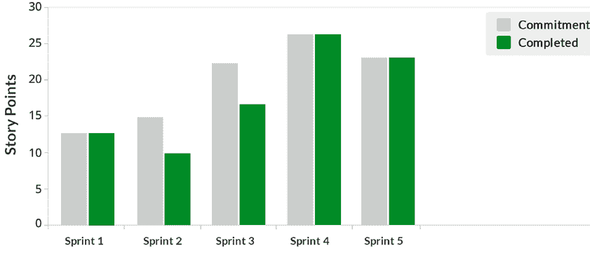

| 冲刺 | 承诺 | 完成 |
|---|---|---|
| Sprint 1 | 13 | 13 |
| Sprint 2 | 15 | 10 |
| Sprint 3 | 22 | 17 |
| Sprint 4 | 26 | 26 |
| Sprint 5 | 23 | 23 |

图5-8. 速度图示例

现在让我们从基础设施和云运营中的一个简单示例开始，创建一个基础设施即代码项目，用于配置和停用虚拟机。

首先创建史诗和用户故事，这些需要添加到JIRA的产品待办事项列表中。参见图5-9和参见图5-10。

## 图5-9. 史诗示例

服务器配置待自动化

类型：史诗
状态：待办（查看工作流）
优先级：中等
解决状态：未解决
标签：无
史诗名称：自动化：服务器配置
冲刺：

描述
Given：所有服务器均手动配置
When：针对新服务器设置的JIRA请求进行自动服务器配置
Then：为服务器配置期间所需的步骤创建工作流

附件
拖放文件以附加，或浏览

人员
经办人：未分配
分配给我
报告人：Udita Agrawal
票数：0
关注者：1 停止关注此问题

日期
创建：19分钟前
更新：19分钟前

待办事项
仅我的问题  最近更新  清除全部

| 任务 | ID | |
|---|---|---|
| 在服务器上创建NIC卡并分配新IP | IN-6 | 5 |
| 开发分配NIC的工作流 | IN-7 | 5 |
| 开发分配磁盘的工作流 | IN-8 | 3 |
| 提供NAS存储挂载分配的解决方案 | IN-9 | 8 |

## 图5-10. 产品待办事项列表示例

# 第5章 敏捷方法简介

现在我们有了产品待办事项列表，下一步是在冲刺计划会议期间定义冲刺待办事项列表。参见图5-11。

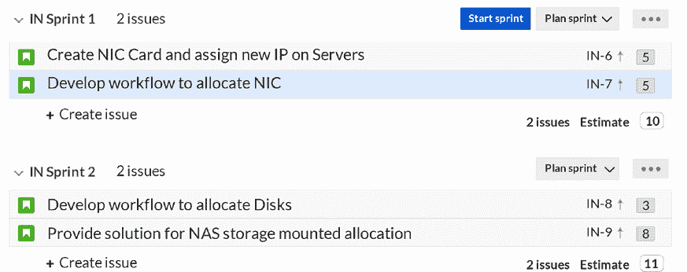

## 图5-11. 冲刺待办事项列表示例

冲刺1开始，计划每日站会。随着冲刺的进展，项目将从待办推进到进行中再到测试中最后到已完成，这可以从为项目设置的信息面板中轻松看到，如图5-12所示。

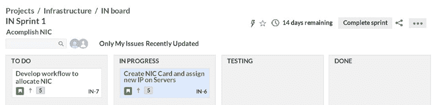

## 图5-12. 活跃冲刺快照

可以使用可在JIRA中创建的信息面板轻松跟踪冲刺执行情况。您可以根据项目需求在信息面板中添加多个小工具。参见图5-13。

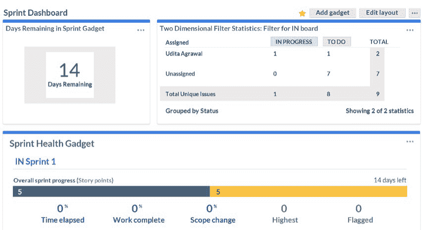

图5-13. JIRA信息面板示例

除了信息面板外，还使用信息辐射器燃尽图来跟踪冲刺。

## Scrum最佳实践

这里有一些最佳实践：

- 拥有一个单一的优先级排序的产品待办事项列表，供团队从中提取史诗和用户故事。
- 创建单独的产品待办事项列表和冲刺待办事项列表。
- 团队之间使用通用的协作和沟通工具。应使用支持视频会议的工具来建立全球团队之间的面对面联系。
- 启用每日站会和频繁协作。
- 应使用信息辐射器如Scrum看板和燃尽图以更好地跟踪和控制冲刺。
- 应在每个阶段启用客户反馈循环以实现早期反馈。
- 应将持续测试嵌入到流程中以实现早期缺陷检测并确保产品质量。
- 对运营工作进行自动化和编排，以实现更快、质量更高、更频繁的迭代交付给客户。
- 制定指标和成熟度评估以识别流程和交付的持续改进。

## Scrum总结

敏捷Scrum流程可以调整并用于基础设施和云运营领域，在此领域团队以代码形式构建基础设施并以冲刺方式运行交付物。这种运营模式使运营团队能够以短冲刺工作并按优先级交付。无论是需要升级其全球网络的网络团队，还是需要在所有区域分阶段进行补丁的数据库团队，Scrum原则都可以帮助这些团队从老式方式转向现代方式以快速交付。开源领域和商业产品中都有各种工具可用于实施Scrum并实践仪式，如站会、回顾、演示等。

## 看板

Kanban一词是日语，意为看板。该概念在1940年代的丰田生产等制造公司中实践，但其在软件行业的实际实施始于2000年代初。利用该方法论的关键原因是能够可视化工作项，这些工作项可以是问题或变更请求等。与Scrum相比，Kanban非常适合日常运营活动，包括事件解决、问题检测、服务请求履行等。自其诞生以来，Kanban已被多个组织采用，并随着新的实践和变体如scrumban（Scrum和Kanban的混合）而演进。

在我们深入了解为运营团队实施Kanban的实际操作之前，让我们先看看该框架的一些关键方面。

- 客户想法被整合到队列或待办事项列表中，由团队持续处理。
- 该框架包含三个关键角色，共同解决issues、事件、变更请求和缺陷。请求经理与客户对接并优先排序待办事项。
- 流程经理的工作方式类似于Scrum Master，负责消除障碍并支持团队顺利执行和按时交付。
- 团队是一个高度跨技能的团队，从待办事项列表中提取工作并推进。
- 进入系统的每个工作项都会经过各个阶段，这些阶段在看板上以泳道的形式显示。
- 使用看板的主要目标是实现由团队驱动的实时项目可见性。
- 看板上的不同阶段都有定义的限制，这反过来让团队可以看到工作负载和所需产能。
- 看板框架适用于团队中拥有跨技能专家的运营团队。
- 该框架还通过一些经常查看的指标来衡量团队的成功，如周期时间、等待时间、吞吐量等。参见图5-14。

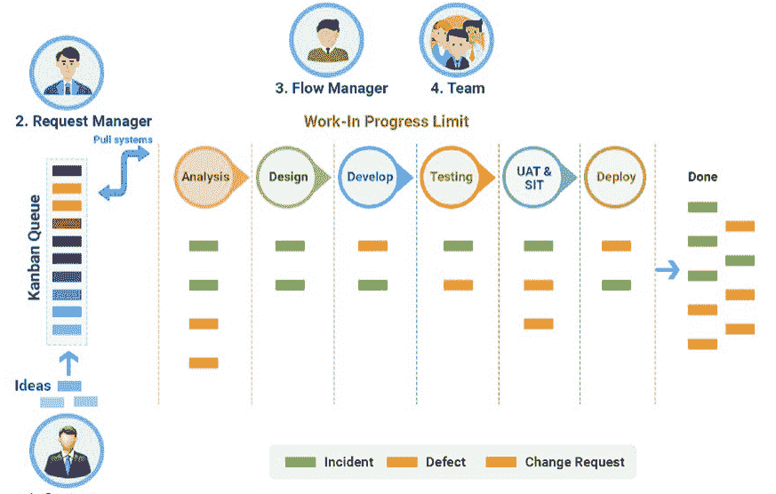

图5-14. 看板模型

让我们深入探讨该框架的细节。

## 看板角色

这里是看板角色：

- 流程经理（在某些团队中也称为*服务交付经理*[SDM]）是专注于提高工作流程效率的角色。流程经理确保工作持续流动，如果有道路阻碍，他们会努力消除该阻碍。该角色听起来可能类似于Scrum Master，但它不仅仅是那样。事实上，该角色预计不仅要跟踪工作项，还要为团队成员提供帮助、进行政策检查并确保目标按时高质量完成。该角色在传统的IT运营环境中已存在，因此升级该角色为

在敏捷环境中，实现看板并采用最佳实践所需要的只是正确的指导。为了总结，流程经理的角色应针对以下目标：

- 跟踪系统中流动的工作
- 消除阻塞或风险
- 促进变革并及时交付
- 持续改进并支持团队

请求经理（在某些团队中也称为 *服务请求经理* [SRM]）是一个类似于 Scrum 方法论中产品负责人角色的角色。该角色管理团队内工作的流程，并在不同团队和利益相关者之间推动讨论。该角色的关键期望是改善客户互动。

- 在流程中排序工作项
- 拥有政策
- 确保治理
- 跟踪风险

- 团队
  - 跨技能成员
  - 从工作流中拉取工作
  - 每个团队限制在 15 名成员以内

在基础设施领域，SRM 和 SDM 的角色已经存在，但它们遵循僵化的流程。通过一点看板指导，这些角色将变得灵活，并将采用新的工作方式。事实上，理想的情况是团队中的每个人都应成为 SDM，因为目标是观察流入的工作、挑选工作并确保其快速解决。这是团队成为自主驱动和自组织的最终状态，无需治理和流程管理。

## 看板仪式

与 Scrum 方法类似，看板团队也实践一些仪式，帮助他们了解计划、查看进度、缓解风险并根据需要优先排序用户故事。参见表 5-2。

### 表 5-2. 看板仪式

| 仪式 | 频率 | 目的 |
|---|---|---|
| 迭代计划 | 每月（2 至 3 小时） | 审查产能、吞吐量、提前期 |
| 故事优先级排序 | 每周（1 至 2 小时） | 根据客户需求重新审视待办事项并进行优先级排序 |
| 每日站会 | 每日（15 分钟） | 团队就风险进行沟通并规划当天计划 |

除这些仪式外，构建基础设施即代码的团队还有向利益相关者演示其 MVP 的仪式。如果演示获得利益相关者批准，则目录项将被移至生产环境。

## 看板板

看板团队通过看板可视化其工作。这些看板帮助团队查看其流中的工作流并决定适当的行动。这些看板类似于具有定义列的表格，其中每列代表一个状态，如待办、进行中、部署中等。看板上表示的每个状态称为 *泳道*，并且也可能有定义的限制。例如，在任何给定时间，部署状态中不能超过四个问题。这被称为 *在制品（WIP）限制*。这些看板是展示项目状态的绝佳媒介，不仅可以设置限制，还可以确保团队在特定时间范围内交付所处理任务/问题数量的能力可见。图 5-15 是一个示例，代表管理操作系统的典型基础设施运营团队。每个泳道都有一个名称，并在其下方显示问题。虽然这些看板可以手工绘制，但像 JIRA 这样的工具可以帮助团队更好地可视化这些看板。团队可以查看看板，因此鼓励他们拉取工作并将其从一个状态移动到另一个状态。参见图 5-15。

Windows/VMWare/VDI

### 看板板

快速筛选：仅我的问题 最近更新

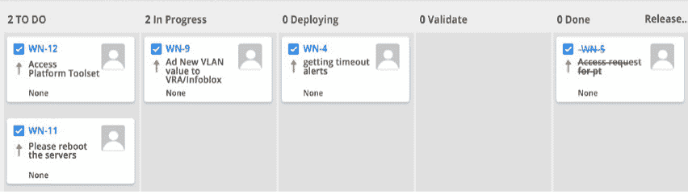

图 5-15. 看板示例

因此，看板方法论基于三个关键原则：可视化工作、限制工作，以及与自我维持的团队迭代改进。

## 看板指标

请参阅表 5-3 和图 5-16 中常用的看板指标。

### 表 5-3. 看板指标

| 指标 | 描述 |
|---|---|
| 周期时间 | 客户提交请求到解决所需的时间 |
| 前置时间 | 基础设施 IT 团队开始处理该工单到解决所花费的实际时间 |
| 吞吐量 | 单位时间内完成的工件数量 |

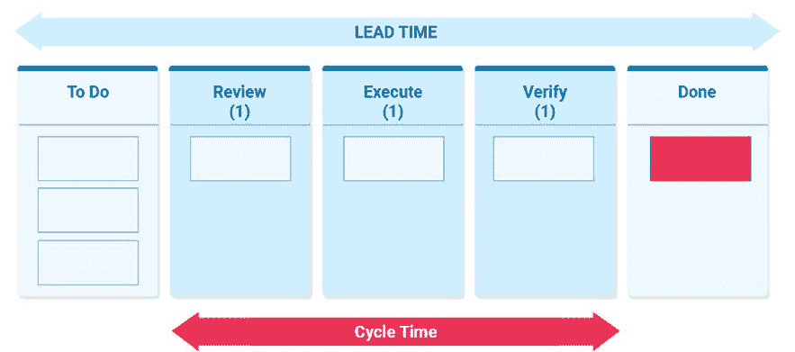

图 5-16. 看板中的前置时间与周期时间对比

## 开始使用看板

有各种工具可帮助团队实践看板。Atlassian JIRA 就是这样一种常用的工具，它提供实施看板方法的模板。该工具可以安装并作为本地解决方案使用，也可以通过云服务使用。

该工具具有用户友好的模板用于实践看板。在 JIRA 中创建的每个项目具有以下规范：

- 工作流
- 名称
- 唯一键/标识符

每次在 JIRA 中创建新项目时，都会提示项目模板、要实施的工作流以及用于识别工单的键的项目名称。参见图 5-17。

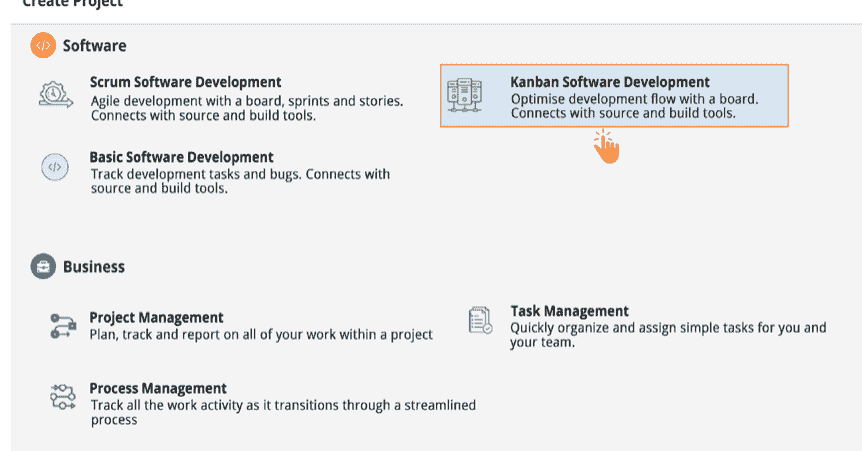

图 5-17. 在 JIRA 中创建看板项目

每个项目模板都关联着一个定义工单流程的工作流。作为初学者，团队可以利用图 5-18 所示的现有工作流，或创建满足项目需求的自定义工作流。

## 看板软件开发

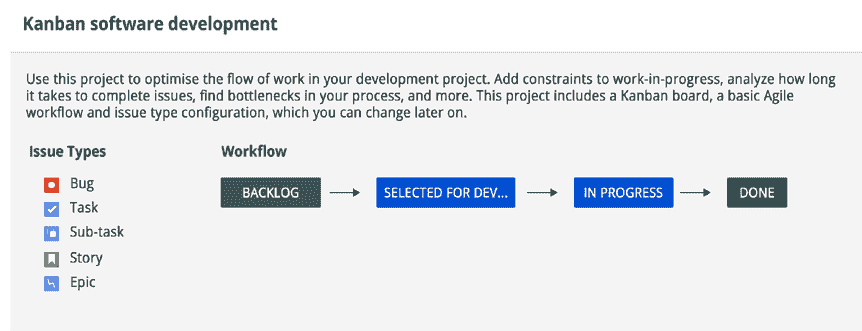

图 5-18. JIRA 中的看板工作流

所示的工作流描述了工单如何被放置到待办事项中，然后由团队成员如何将其移动到不同状态。工作流中提到的状态为“开发中选定”、“进行中”和“已完成”。这些状态可自定义，并可为不同问题类型设置，例如本例中的 Bug、Task、Sub-task、Story 和 Epic。

选择工作流后，下一步是为项目命名并指定标识符。例如，如果项目名称为 Custom-Kanban-Project，则工具会自动生成一个三字母缩写作为标识符。该标识符会附加到每种问题类型。例如，本项目中现在编写的故事将带有键附加的故事编号。如果将其修改为 OPS 之类的值，则故事编号将生成为 OPS-1、OPS-2 等。参见图 5-19。

## 看板软件开发

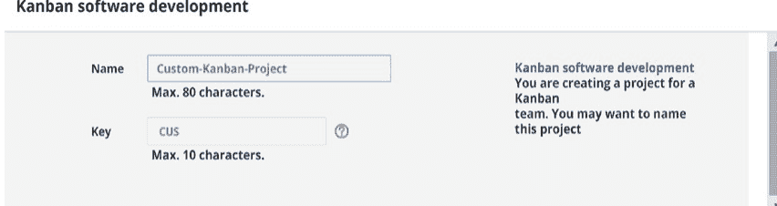

图 5-19. 在 JIRA 中命名看板项目

看板项目的创建非常重要，需要深思熟虑。如果需要自定义状态、问题类型、标识符等，则应在项目看板实践设置期间完成。

项目设置完成后，下一步重要的设置是 WIP 限制。WIP 限制定义为团队在任何给定时间处理最小和最大任务数量的能力。这有助于团队避免在故事或问题的整个生命周期各阶段出现过载。根据当前团队规模、技能组合和工作时间，为每个泳道定义最大限制。让我们研究如何计算 WIP 限制的过程。

## 定义 WIP 限制的步骤

假设我们在看板上创建了四个名为 Development、Review、Testing 和 Deployment 的泳道。我们将为这四个阶段中的每一个设置 WIP，这意味着找到在每个阶段可以管理的最大问题或工单数量。在开始计算 WIP 的过程之前，首先让我们将每个阶段分为两个部分，以体现增值（VA）活动和非增值（NVA）活动。

VA 活动表示实际完成的工作，而 NVA 活动是指工作执行期间发生的等待或延迟时间。例如，让我们将开发阶段分为名为“准备开发”的 NVA 和“开发中”的 VA 活动。“准备开发”状态表示实际开发开始前需要完成的一系列前提条件，而“开发中”状态则指实际开发状态。因此，生命周期中的每个阶段都将具有 VA 和 NVA，这种划分将帮助我们估算合适的 WIP。请按照表 5-4 所示划分其他阶段。

### 表 5-4. 看板阶段中的活动分类

| 开发 |  | 评审 |  | 测试 |  | 部署 |  |
|---|---|---|---|---|---|---|---|
| 准备开发 | **开发中** | 准备评审 | **评审阶段** | 准备测试 | **测试中** | 准备部署 | **部署阶段** |

增值活动

非增值活动

借助此更新后的看板，我们现在将继续估算所有 VA 状态的 WIP。计算看板 WIP 的公式如下：

**WIP = Total Tasks * Time %**

*前提条件 1 是 总任务数 = 团队规模 / 效率 => 指可以保留在看板上的最大工单数。该公式需要团队规模（在我们的示例中我们将其设为五）和效率系数（需要计算，描述为前提条件 1）。*

*前提条件 2 是 时间% = [VA / VA 总和 ] * 100 => 指花费在 VA 上的时间百分比。要计算此值，我们需要找出所有状态的 VA 值（描述为前提条件 2）。*

## 前提条件 1：总任务数（计算步骤）

### 步骤 1.1 → 计算整体效率系数。

在明确了 VA 和 NVA 后，我们将计算工程师同时可以处理的任务数量。计算该值时，我们需要先找出四个阶段所有 VA 和 NVA 活动的耗时，然后估算效率值，该值使用以下公式计算：

**效率 = VA 时间 / (VA 时间 + NVA 时间)**

效率值由 VA 和 NVA 时间值构成。让我们将此公式进一步分解，并为我们的示例看板进行计算。

查找 VA 和 NVA 值：与团队讨论在所有八个泳道中花费的平均工作量。例如，团队确认“准备开发”泳道中的工单需要一天时间，但一旦进入“开发中”阶段，就需要三天。记录其他所有阶段的工作量；表 5-5 显示了作为示例对所有阶段估算的工作量。

### 表 5-5. 看板阶段中的 VA 和 NVA 活动工作量

| 开发 |  | 评审 |  | 测试 |  | 部署 |  |
|---|---|---|---|---|---|---|---|
| 准备开发 | 开发中 | 准备评审 | 评审中 | 准备测试 | 测试中 | 准备部署 | 部署中 |
| 1 天 | 3 天 | 0.5 天 | 0.5 天 | 0.5 天 | 1 天 | 0.5 天 | 0.5 天 |

VA 活动

NVA 活动

汇总所有 VA 和 NVA 的总工作量如下：

所有阶段 VA 活动的耗时 = 3 + 0.5 + 1 + 0.5 = 5 天

所有阶段 NVA 活动的耗时 = 1 + 0.5 + 0.5 + 1 = 3 天

现在，我们将找出效率值，如下所示：

**效率 = VA / (VA + NVA) => 5 / (5 + 3) => .62**

**效率 % = .62 * 100 => 62%**

该值表示工程师在看板上同时可以拥有的任务数量。100% 效率的看板表示没有等待时间，工程师一次只专注于一个问题（理想情况）。

### 步骤 1.2 → 计算总任务数。

现在，我们知道了团队规模值，并且也找到了效率值。我们现在将计算总任务值（WIP 公式的第一部分）。计算方法如下：

**总任务数 = 团队规模 / 效率**

**总任务数 = 5 / .62 = ~8 个任务。**

这意味着我们的看板在任何给定时间可以有大约八个任务，可以分布在不同的泳道或阶段中。

## 前提条件 2 - 时间%（计算）

### 步骤 2.1 → 估算所有 VA 的时间百分比。

要计算每个阶段所有 VA 活动的时间百分比，我们需要使用以下公式：

**时间 % = [VA / VA 总和 ] * 100**

我们将按表 5-6 所示估算所有 VA 的该值。

### 表 5-6. 看板阶段中 VA 活动的时间 % 计算

| 开发 |  | 评审 |  | 测试 |  | 部署 |  |
|---|---|---|---|---|---|---|---|
| 准备开发 | 开发中 | 准备评审 | 评审中 | 准备测试 | 测试中 | 准备部署 | 部署中 |
| 1 天 | 3 天 | 0.5 天 | 0.5 天 | 0.5 天 | 1 天 | 0.5 天 | 0.5 天 |
|  | **时间% = 3 / 5 =60%** |  | **时间% =0.5/5 =10%** |  | **时间% =1 / 5 =20%** |  | **时间% =0.5 / 5 =10%** |

VA 活动

NVA 活动

基于我们的假设，“开发中”状态的 VA 值为三天。我们将其除以总 VA 值，即五，得出的值为 60%。这表明生命周期中该状态需要或将花费 60% 的总时间。同样，我们对其他状态也这样做，你会看到评审阶段的值为 10%，测试中状态的值为 20%，最后部署阶段状态的值为 10%。将所有这些值相加，总和应为 100%。

### 计算 WIP

最后，我们根据从前提步骤 1 和 2 派生的值，使用以下公式计算每个 VA 列的 WIP 限制：

**WIP = 总任务数 * 时间 %**

见表 5-7。

### 表 5-7. 看板阶段中 VA 活动的 WIP 计算

| 开发 |  | 评审 |  | 测试 |  | 部署 |  |
|---|---|---|---|---|---|---|---|
| 准备开发 | 开发中 | 准备评审 | 评审中 | 准备测试 | 测试中 | 准备部署 | 部署中 |
| 1 天 | 3 天 | 0.5 天 | 0.5 天 | 0.5 天 | 1 天 | 0.5 天 | 0.5 天 |
|  | 时间% = 3 / 5 =60% 总任务数 =8 WIP = .6 * 8 ~4 个任务/工单 |  | 时间% =0.5/5 =10% 总任务数 =8 WIP = .1 * 8 1 个任务/工单 |  | 时间% =1 / 5 =20% 总任务数 =8 WIP = .2 * 8 ~2 个任务/工单 |  | 时间% =0.5 / 5 =10% 总任务数 =8 WIP = .1 * 8 1 个任务/工单 |

如果将所有 WIP 值相加，结果为八，这证实了我们的计算（根据前提步骤 1 定义的流程）。此外，通过查看看板，可以清楚地看出生命周期中哪些状态需要更多关注。让我们总结一下五个工程师以看板模式工作的示例：

- 看板上的每个问题或工单将经历四个关键阶段：开发、评审、测试和部署。
- 这些阶段 each 都会有一些空闲时间，工程师在实际工作开始前会等待或准备。
- 因此，每个阶段将有两个组成部分：VA 和 NVA。每个 VA 和 NVA 所花费的工作量与团队一起讨论并记录。
- 我们计算四个阶段中所有 VA 的 WIP 限制，该限制取决于时间百分比和总任务数的数值（WIP = 总任务数 * 时间%）。
- 总任务数计算为 总任务数 = 团队规模 / 效率。
- 效率计算为 VA / (VA + NVA)。
- 时间% 计算为 [VA / VA 总和] * 100。
- 对于我们的示例，开发中的最大限制为四个任务或工单，而评审可以有一个工单，测试最多可以有两个工单，部署只能有一个工单。但总共最多有八个工单可以由五个工程师的团队处理。

作为初学者，从基本值开始并做出假设是可以的；随着成熟，这些值会收敛到最适合您的工作和团队规模的效率水平。见图 5-20。

## 你知道吗？

### NVA 的 WIP 限制？

NVA 列会引入浪费，因为它们表示等待时间和延迟，因此这些列中的任务应保持最小。起初，团队应在看板上的每个 NVA 列中设置值为 1。随着团队的成熟，该列值应减少或趋向于零值。

图 5-20. 你知道吗？

JIRA 等工具允许负责人为所有泳道设置 WIP 限制。见图 5-21。

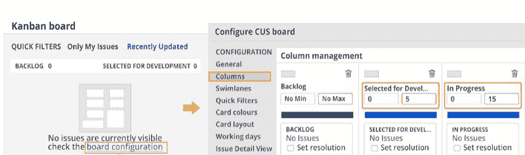

图 5-21. 在 JIRA 中配置 WIP 限制

让我们再举一个例子，看看 WIP 限制如何在 JIRA 等工具中体现，以及如果分配给 VA 列的任务更多并超过 WIP 限制会发生什么。工作流状态“选定用于开发”的队列中不会超过五个工作项。“进行中”状态也一样；设定的最大限制为 15。现在如果问题数量超过设定的最大限制，则该泳道会以红色高亮显示。例如，假设我们有一个任务需要完成，其中 RHEL 系统需要升级到更高版本。为了执行此项目活动，我们将创建几个史诗，进一步细分为任务。每当创建问题时，它们都会被放置在积压工作中。团队成员或负责人根据其带宽和这些问题的紧迫性在泳道之间移动这些问题。图 5-22 是所述示例的快速说明。

## Kanban board
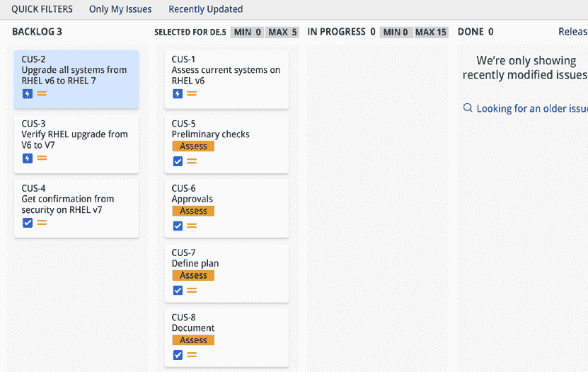

### 图 5-22. 在 JIRA 中查看 WIP 限制
已选定开发泳道的最大限制为五个问题，一旦你从待办事项中拖动一个新问题，它就会变红。这提醒用户无法再放置更多工作项。这是一种很好的方法来审查团队产能，带来透明度并帮助跟踪和优先处理工作。参见图 5-23。

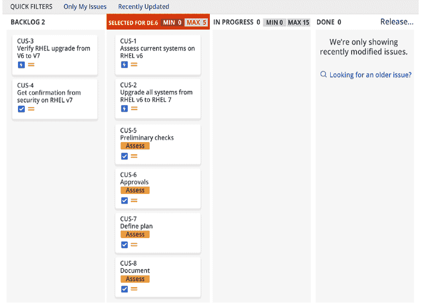

### 图 5-23. 在 JIRA 中查看带有 WIP 限制的看板
通过定义这些 WIP 限制，团队可以专注于需要关注的内容，防止任务在任何步骤中累积。它也让团队了解自己的产能。这种工作模式还能突出低效率和瓶颈。这些数值应经常重新审视，以确定是否需要更新。

起初，运维团队可能为 Linux 和 Windows、数据库、备份等各个领域分别维护待办事项，随着团队成熟并逐渐熟悉这些实践，待办事项和团队可以合并（一个共同的待办事项），从而形成跨职能团队。随着团队规模扩大，他们还应自行进行回顾，并根据实际情况未按计划运行的情况更新工作方式。

当工单不断涌入待办事项并被成员领取时，创建水平泳道以区分简单事件和加急事件也是一个好主意。这可以通过配置看板在工具中设置。例如，你需要设置两个泳道：一个处理简单事件，另一个需要立即关注（优先级最高的工单）。点击“配置看板”选项以查看泳道，如图 5-24 所示。

### 图 5-24. 在 JIRA 中配置看板
一旦你查看可以配置工作流和相关状态的页面，请选择更新泳道的选项，并说明泳道及其区分标准。参见图 5-25。

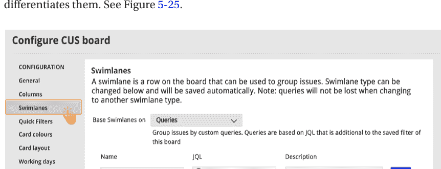

### 图 5-25. 在 JIRA 中定义水平泳道
默认情况下，JIRA 看板项目提供加急泳道；你可以根据需要自定义或重命名它，或创建更多泳道。对于前面的示例，我们提到加急泳道将包含优先级为最高的事件，其余工单将在另一个泳道中。随着工单的创建，工具将根据其优先级对工单显示进行分类，以便团队即时查看状态。参见图 5-26。

快速筛选  仅我的问题  最近更新

待办 3  已选定开发 3  最小 0 最大 5  进行中 2  最小 0 最大 15  已完成 0

加急  1 个问题

常规运维  7 个问题

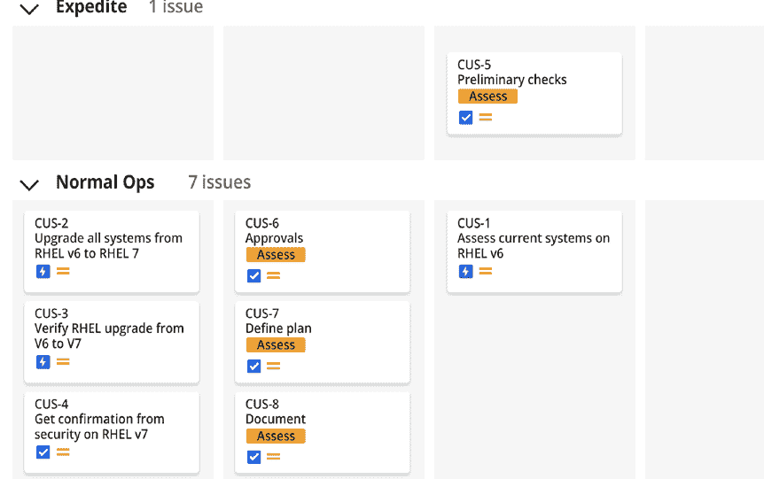

图 5-26. 看板状态

注意：团队在熟悉工作流、泳道和工单类型的基本概念，并能实践“拉取”工作而非被动接受推送工作的文化时，才能在看板采用中取得成功。看板是对团队工作量的动态可视化，有助于团队有效地规划和工作。

## 看板最佳实践
### 尽早确定工作流状态
对于刚开始使用看板的 IT 基础设施运维团队，他们可以从仅三个工作流状态开始：待办、进行中和已完成。如果他们计划构建和部署新的基础设施组件，或进行补丁活动等，则可以定义生命周期阶段为排队中、设计、编码、测试和已完成。有些团队还设有额外的状态，涉及审批状态或等待时间。建议在与团队充分讨论后，再实施工作流状态。参见图 5-27。

*图 5-27. 看板工作流状态*

### 确定 WIP 限制
看板的概念在于放大团队的可见性并分析产能时间。找到所有工作流状态的 WIP 限制将使团队受益，并有助于在需要时规划产能提升。定义 WIP 限制有两种方法。参见表 5-8 和表 5-9。

*表 5-8. 方法 1：为每个工作流状态定义 WIP*

|  | WIP 限制 =2 设计人员数量=2 | WIP 限制=3 程序员数量 = 3 | WIP 限制=1 测试人员数量=1 |  |
|---|---|---|---|---|
| 未开始 | 设计 | 编码 | 测试 | 已完成 |
|  |  |  |  |  |

*表 5-9. 方法 2：为整个工作流而非每个工作流状态定义 WIP 限制*

|  | WIP 限制 =6 |  |  |  |
|---|---|---|---|---|
| 未开始 | 设计 | 编码 | 测试 | 已完成 |
|  |  |  |  |  |

### 其他最佳实践
- WIP 工作限制需要根据项目的当前需求进行配置，并应持续监控和更新。
- 前置时间和周期时间受项目启动时承诺的影响。因此，跟踪这些指标并采取必要措施加以改进非常重要。
- 每天监控瓶颈并积极应对。鼓励团队成员在发现阻碍时主动发声。

制定一个与团队共享并与产品团队良好协调的发布计划。例如，发布补丁可以与应用程序部署合并。

## 看板总结
看板模型非常适合刚开始采用敏捷并希望转变为新运营模式的基础设施运维团队。与传统方式运行运维不同，看板为团队提供更广的可见性和问责制，其中工作是由团队主动拉取而非被动推送。这种工作模式建立了信任和透明的文化。此外，该模型通过在 IT 运维的关键阶段定义在制品限制，使基础设施运维团队能够主动分析产能。Atlassian JIRA 等工具为团队提供了内置模板以便开始使用。在正确的指导和向敏捷工具的过渡下，基础设施运维团队的效率将随着时间的推移而提高。

## Scrumban
Scrum 和看板是两种广泛实践的敏捷方法，针对不同的团队类别。如果 Scrum 是由开发团队推崇的，那么看板则是基础设施运维团队的理想选择。两种方法各自使团队受益。但随着时间的推移和 DevOps 需求的出现，IT 组织开始寻找一种混合方法，将两种方法的优点结合起来。随着开发团队开始与基础设施运维团队密切合作，且一些团队开始组建 DevOps 团队，这一需求变得突出。这导致设计出一种名为 scrumban 的新型混合敏捷方法，由 Corey Ladas（精益看板实践者）提出。该方法结合了 Scrum 的可预测性元素和看板的灵活性。它非常适合 DevOps 和维护团队或大型项目。参见图 5-28。

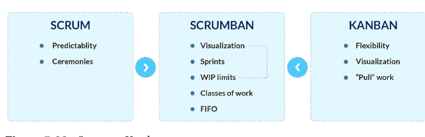

### 图 5-28. Scrum + 看板
Scrumban 是一种混合方法，以持续方式交付并随时接受变更。它像看板方法一样灵活，同时也采用了 Scrum 的最佳实践。该方法引入了一种名为 *桶规划* 的新概念，其中团队规划活动并将其放入桶中。

- *一年桶*: 长期愿景目标
- *六个月桶*: 已批准的计划
- *三个月桶*: 准备执行的计划
- *当前桶*: 实际执行计划，团队正在处理任务

这种方法适合那些不仅关注当前工作量和绩效，还希望有明确目标的团队。例如，实践 Scrumban 的基础设施团队可以在一年桶中设定采用 AIOps 等长期目标，在六个月/三个月桶中进行工具投资和实施，并在当前桶中进行实际运维任务和基础设施流水线工作。这种方法带来透明度，因为团队可以与路线图保持一致。这是一种理想的敏捷方法，适用于优先级变化非常频繁的团队。让我们更深入地了解这种方法并理解其关键构成。参见图 5-29。

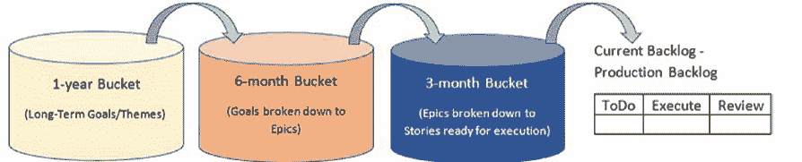

图 5-29. 积压工作

## Scrumban 角色
实施 scrumban 时没有定义好的角色。现有的任何角色都可以被考虑并升级以满足期望。团队中的每个成员都对故事负责，这也是工作在制品限制发挥作用的地方。像 Scrum Master、产品负责人、专家以及 Scrum 团队等现有角色都可以在此模型中继续运作。唯一的先决条件是团队应具备有效使用此方法的能力。

## Scrumban 仪式
在实践 scrumban 时推荐的基本仪式是每日站会。站会每天进行，以跟踪进度并对当前桶中识别出的任何风险进行头脑风暴。团队参考 scrumban 看板来跟踪 WIP 限制，并且他们的积压工作通过去除严格遵守产品积压清单中现有内容的约束而实现准时驱动。只有在团队认为有需要时，才会安排规划会议或回顾会议等额外会议。

## 开始使用 Scrumban
显而易见，scrumban 专注于目标、工作可见性和流程改进，当然其成功的关键基础是“团队”。也有观察到一些组织会以最适合其团队的方式定制 scrumban。像 Atlassian JIRA 这样的敏捷管理工具为 Scrum 和 Kanban 提供了模板，但在工具中并没有为 scrumban 明确定义。团队利用 Kanban 或 Scrum 作为基础模板，然后定制模板以解决 scrumban 工作方法。最近出现了一些新工具，如 Method Grid、Monday.com、ClickUp、Kanban Tool、Favro 等，它们提供 scrumban 模板以及 Scrum 和 Kanban 模板。大多数都是基于云的应用程序。因此，如果团队拥有 JIRA 的许可证，则可以利用它们来实践 scrumban；否则，他们可以选用可用的新工具。

需要记住的一件重要事情是，使团队具备 scrumban 能力的关键要求是“看板”。这个 Scrumban 看板将成为团队查看任务、标记任务以及监控整体项目状态以及查看近期将要进行的内容的可视化工具。见图 5-30。

## Scrumban 看板
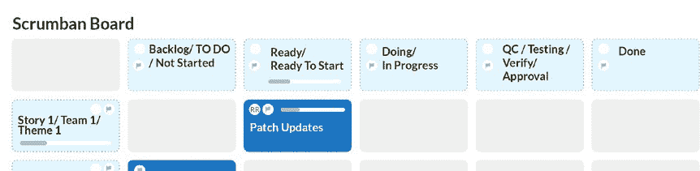

图 5-30. 示例 Scrumban 看板，按团队视图

假设你已选定工具，以下步骤推荐用于实践 Scrumban。

## 设计 Scrumban 看板
看板是 Scrumban 中最重要的方面，它将反映团队进度。这就像 Kanban 看板，显示故事和任务在状态之间流动（如待办、进行中、已完成）。一些团队定义的状态或阶段类似于 Scrum 方法中定义的转换状态（如待办、设计、开发、验证、部署）。

该看板应显示当前桶中的项目，可进一步细分为反映通用运营任务与新基础设施请求的部分。

图 5-31 中的看板示例显示了两个团队的活动，一个团队执行常规的业务照常活动，另一个团队处理对业务需求变更的自动化，如设置新基础设施或停用陈旧环境。第三个部分突出显示了需要讨论和计划的临时查询和请求。

## Scrumban 看板
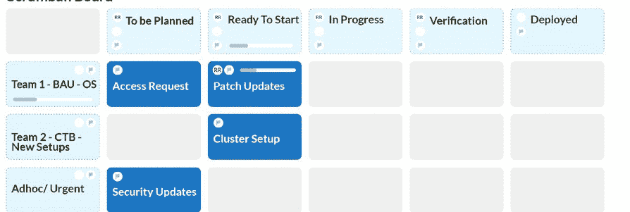

图 5-31. Scrumban 看板另一示例，当前桶

## 定义 WIP 限制
工作在制品限制遵循 Kanban 中实践的相同模式。这些限制应在看板上定义，并应根据团队的表现定期重新审视。这些限制使团队能够基于其可用产能进行“拉取”机制。对于图 5-32 中的看板，每个状态都定义了限制。

| 准备开始 |  | 进行中 |  | 验证 | 部署中 |
|---|---|---|---|---|---|
| 待讨论 4/4 | 批准开始 0/2 | 进行中 1/5 | 同行评审 1/1 | 2/3 | 2/2 |

图 5-32. Scrumban 看板上的 WIP 限制

## 安排会议
像每日 Scrum 一样，为团队安排每日聚会。这种沟通方式应集中进行，每一天都有明确的议程。团队通过分享工作量和需要关注的风险进行互动。除了这些每日聚会外，团队还可以触发冲刺会议来讨论新需求并对其进行优先级排序。这不必每两周一次。规划活动在需要时触发，这也可以在看板上显示。例如，在图 5-33 的看板中，如果第一个状态的 WIP 限制超过 4，则表示需要召开规划会议。

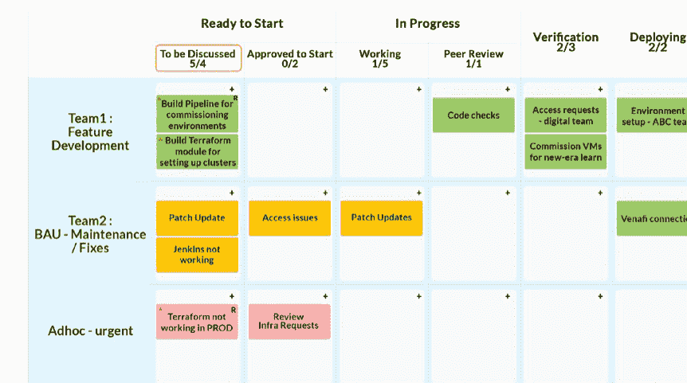

图 5-33. 带限制的 Scrumban 看板

## Scrumban 最佳实践
以下是 scrumban 的最佳实践：
- 定义并确定 WIP 限制以限制积压工作。这将帮助团队保持专注并避免错过任何截止日期。
- 看板应易于理解并保持相关性。避免使用多个泳道或转换状态。
- 避免多任务处理，专注于完成在制品而不是开始新的工作项。识别任何未计划的任务和风险并进行沟通以满足截止日期。见图 5-34。

## 你知道吗？

## Scrumban 中何时安排 Triage？
在功能冻结后安排 triage（这意味着不会再挑选新功能，因为团队正在开发产品）。这是为了检查将要完成且具有优先级的特性或故事。

图 5-34. 你知道吗？

## Scrumban 总结
渴望采用 Scrumban 的团队应根据以下关键因素评估需求：
- 他们曾尝试用 Scrum，但由于故事频繁变更而未能成功。
- 优先级不断变化，很难按计划交付。
- 团队需要跟踪增强功能以及一般的产品运营支持。
- 迫切需要使团队对其交付负责并培养敏捷思维。
- 团队正在寻找一种灵活的工作负载运营模式。重点是拉取工作而不是推动工作。

因此，这种方法适用于那些在敏捷方面遇到困难但无法遵循原则且需要一定灵活性的项目。“拉取”工作的文化也是团队进展中的重要实践。通过持续练习，这样的团队变得自给自足，因为他们学会了管理和优先排序工作的艺术。

## 总结
让我们看看 Scrum、Kanban 和 scrumban 之间的关键差异。见表 5-10。

## 表 5-10. 敏捷方法比较
| 描述 | Scrum | Kanban | Scrumban |
|---|---|---|---|
| 定义 | 针对 IT 项目的敏捷方法，专注于以频繁的间隔交付成果 | 针对 IT 项目的敏捷方法，专注于通过限制工作在制品来可视化工作 | 结合 Scrum 和 Kanban 最佳实践的敏捷方法 |
| 核心目标 | • 跨职能团队 • 频繁交付（基于冲刺） • 规定性强 | • SRE 团队 • 频繁变更 • 流程改进 | • 以小间隔交付工作并限制工作在制品 • 建立专业化团队 |
| 关键角色 | • Scrum Master • 产品负责人 • 团队 | 无预定义角色，但项目经理将连接团队成员。 | Scrum 团队 + 如需的额外角色 |
| 基本构成 | • Scrum 团队 • 冲刺看板 • 积压工作 | • Kanban 团队 • Kanban 看板 | Scrumban/Kanban 看板 |
| 关键仪式 | • 冲刺计划 • 每日站会 • 冲刺评审 • 回顾 | • WIP 评审 | 每日 Scrum |
| 关键指标 | • 燃尽图 • 速度图 | • 前置时间 • 周期时间 | • 前置时间 • 周期时间 |
| 节奏 | 固定长度的冲刺 | 持续流动 | 持续流动并频繁发布 |

在了解了基础设施和 DevOps 团队可用的各种敏捷方法论之后，让我们现在了解如何在基础设施和云运营中利用这些方法论。

