# 第6章
## 敏捷框架简介

在本章中，我们将讨论不同的交付模式，这些模式定义了敏捷的工作方式，同时也在系统中引入了新的角色。本章将涵盖以下主题：

- 敏捷 ITSM
- IT4IT
- 精益 IT
- 规模化敏捷框架 (SAFe®)
- Spotify
- 大规模 Scrum (LeSS)
- Nexus
- 纪律敏捷交付 (DAD)
- 站点可靠性工程

## 敏捷 ITSM

随着 ITSM 的发展，出现了补充快速数字化以及新兴需求的需要。组织识别出了需要关注的差距，例如碎片化的 ITSM 工具、有限的标准化和等等，并寻找 ITSM 的替代方案。虽然经典 ITSM 已被许多组织广泛接受，但对敏捷性的需求日益增长。组织寻求指导，以敏捷的方式有效地运行其服务交付阶段。这催生了敏捷 ITSM，它借鉴了敏捷的一些重要原则，并构建了一种强调精简、优化和集成的[content]
## 第6章
### 敏捷框架简介

在本章中，我们将讨论不同的交付模式，这些模式定义了敏捷的工作方式，同时也在系统中引入了新的角色。本章将涵盖以下主题：

- 敏捷 ITSM
- IT4IT
- 精益 IT
- 规模化敏捷框架 (SAFe®)
- Spotify
- 大规模 Scrum (LeSS)
- Nexus
- 纪律敏捷交付 (DAD)
- 站点可靠性工程

## 敏捷 ITSM

随着 ITSM 的发展，出现了补充快速数字化以及新兴需求的需要。组织识别出了需要关注的差距，例如碎片化的 ITSM 工具、有限的标准化和等等，并寻找 ITSM 的替代方案。虽然经典 ITSM 已被许多组织广泛接受，但对敏捷性的需求日益增长。组织寻求指导，以敏捷的方式有效地运行其服务交付阶段。这催生了敏捷 ITSM，它借鉴了敏捷的一些重要原则，并构建了一种强调精简、优化和集成的[content]
## 第6章
### 敏捷框架简介

在本章中，我们将讨论不同的交付模式，这些模式定义了敏捷的工作方式，同时也在系统中引入了新的角色。本章将涵盖以下主题：

- 敏捷 ITSM
- IT4IT
- 精益 IT
- 规模化敏捷框架 (SAFe®)
- Spotify
- 大规模 Scrum (LeSS)
- Nexus
- 纪律敏捷交付 (DAD)
- 站点可靠性工程

## 敏捷 ITSM

随着 ITSM 的发展，出现了补充快速数字化以及新兴需求的需要。组织识别出了需要关注的差距，例如碎片化的 ITSM 工具、有限的标准化和等等，并寻找 ITSM 的替代方案。虽然经典 ITSM 已被许多组织广泛接受，但对敏捷性的需求日益增长。组织寻求指导，以敏捷的方式有效地运行其服务交付阶段。这催生了敏捷 ITSM，它借鉴了敏捷的一些重要原则，并构建了一种强调精简、优化和集成的[content]
## 第6章
### 敏捷框架简介

在本章中，我们将讨论不同的交付模式，这些模式定义了敏捷的工作方式，同时也在系统中引入了新的角色。本章将涵盖以下主题：

- 敏捷 ITSM
- IT4IT
- 精益 IT
- 规模化敏捷框架 (SAFe®)
- Spotify
- 大规模 Scrum (LeSS)
- Nexus
- 纪律敏捷交付 (DAD)
- 站点可靠性工程

## 敏捷 ITSM

随着 ITSM 的发展，出现了补充快速数字化以及新兴需求的需要。组织识别出了需要关注的差距，例如碎片化的 ITSM 工具、有限的标准化和等等，并寻找 ITSM 的替代方案。虽然经典 ITSM 已被许多组织广泛接受，但对敏捷性的需求日益增长。组织寻求指导，以敏捷的方式有效地运行其服务交付阶段。这催生了敏捷 ITSM，它借鉴了敏捷的一些重要原则，并构建了一种强调精简、优化和集成的[content]
## 第6章
### 敏捷框架简介

在本章中，我们将讨论不同的交付模式，这些模式定义了敏捷的工作方式，同时也在系统中引入了新的角色。本章将涵盖以下主题：

- 敏捷 ITSM
- IT4IT
- 精益 IT
- 规模化敏捷框架 (SAFe®)
- Spotify
- 大规模 Scrum (LeSS)
- Nexus
- 纪律敏捷交付 (DAD)
- 站点可靠性工程

## 敏捷 ITSM

随着 ITSM 的发展，出现了补充快速数字化以及新兴需求的需要。组织识别出了需要关注的差距，例如碎片化的 ITSM 工具、有限的标准化和等等，并寻找 ITSM 的替代方案。虽然经典 ITSM 已被许多组织广泛接受，但对敏捷性的需求日益增长。组织寻求指导，以敏捷的方式有效地运行其服务交付阶段。这催生了敏捷 ITSM，它借鉴了敏捷的一些重要原则，并构建了一种强调精简、优化和集成的[content]
## 第6章
### 敏捷框架简介

在本章中，我们将讨论不同的交付模式，这些模式定义了敏捷的工作方式，同时也在系统中引入了新的角色。本章将涵盖以下主题：

- 敏捷 ITSM
- IT4IT
- 精益 IT
- 规模化敏捷框架 (SAFe®)
- Spotify
- 大规模 Scrum (LeSS)
- Nexus
- 纪律敏捷交付 (DAD)
- 站点可靠性工程

## 敏捷 ITSM

随着 ITSM 的发展，出现了补充快速数字化以及新兴需求的需要。组织识别出了需要关注的差距，例如碎片化的 ITSM 工具、有限的标准化和等等，并寻找 ITSM 的替代方案。虽然经典 ITSM 已被许多组织广泛接受，但对敏捷性的需求日益增长。组织寻求指导，以敏捷的方式有效地运行其服务交付阶段。这催生了敏捷 ITSM，它借鉴了敏捷的一些重要原则，并构建了一种强调精简、优化和集成的[content]
## 第6章
### 敏捷框架简介

在本章中，我们将讨论不同的交付模式，这些模式定义了敏捷的工作方式，同时也在系统中引入了新的角色。本章将涵盖以下主题：

- 敏捷 ITSM
- IT4IT
- 精益 IT
- 规模化敏捷框架 (SAFe®)
- Spotify
- 大规模 Scrum (LeSS)
- Nexus
- 纪律敏捷交付 (DAD)
- 站点可靠性工程

## 敏捷 ITSM

随着 ITSM 的发展，出现了补充快速数字化以及新兴需求的需要。组织识别出了需要关注的差距，例如碎片化的 ITSM 工具、有限的标准化和等等，并寻找 ITSM 的替代方案。虽然经典 ITSM 已被许多组织广泛接受，但对敏捷性的需求日益增长。组织寻求指导，以敏捷的方式有效地运行其服务交付阶段。这催生了敏捷 ITSM，它借鉴了敏捷的一些重要原则，并构建了一种强调精简、优化和集成的[content]
## 第6章
### 敏捷框架简介

在本章中，我们将讨论不同的交付模式，这些模式定义了敏捷的工作方式，同时也在系统中引入了新的角色。本章将涵盖以下主题：

- 敏捷 ITSM
- IT4IT
- 精益 IT
- 规模化敏捷框架 (SAFe®)
- Spotify
- 大规模 Scrum (LeSS)
- Nexus
- 纪律敏捷交付 (DAD)
- 站点可靠性工程

## 敏捷 ITSM

随着 ITSM 的发展，出现了补充快速数字化以及新兴需求的需要。组织识别出了需要关注的差距，例如碎片化的 ITSM 工具、有限的标准化和等等，并寻找 ITSM 的替代方案。虽然经典 ITSM 已被许多组织广泛接受，但对敏捷性的需求日益增长。组织寻求指导，以敏捷的方式有效地运行其服务交付阶段。这催生了敏捷 ITSM，它借鉴了敏捷的一些重要原则，并构建了一种强调精简、优化和集成的[content]
## 第6章
### 敏捷框架简介

在本章中，我们将讨论不同的交付模式，这些模式定义了敏捷的工作方式，同时也在系统中引入了新的角色。本章将涵盖以下主题：

- 敏捷 ITSM
- IT4IT
- 精益 IT
- 规模化敏捷框架 (SAFe®)
- Spotify
- 大规模 Scrum (LeSS)
- Nexus
- 纪律敏捷交付 (DAD)
- 站点可靠性工程

## 敏捷 ITSM

随着 ITSM 的发展，出现了补充快速数字化以及新兴需求的需要。组织识别出了需要关注的差距，例如碎片化的 ITSM 工具、有限的标准化和等等，并寻找 ITSM 的替代方案。虽然经典 ITSM 已被许多组织广泛接受，但对敏捷性的需求日益增长。组织寻求指导，以敏捷的方式有效地运行其服务交付阶段。这催生了敏捷 ITSM，它借鉴了敏捷的一些重要原则，并构建了一种强调精简、优化和集成的[content]
## 第6章
### 敏捷框架简介

在本章中，我们将讨论不同的交付模式，这些模式定义了敏捷的工作方式，同时也在系统中引入了新的角色。本章将涵盖以下主题：

- 敏捷 ITSM
- IT4IT
- 精益 IT
- 规模化敏捷框架 (SAFe®)
- Spotify
- 大规模 Scrum (LeSS)
- Nexus
- 纪律敏捷交付 (DAD)
- 站点可靠性工程

## 敏捷 ITSM

随着 ITSM 的发展，出现了补充快速数字化以及新兴需求的需要。组织识别出了需要关注的差距，例如碎片化的 ITSM 工具、有限的标准化和等等，并寻找 ITSM 的替代方案。虽然经典 ITSM 已被许多组织广泛接受，但对敏捷性的需求日益增长。组织寻求指导，以敏捷的方式有效地运行其服务交付阶段。这催生了敏捷 ITSM，它借鉴了敏捷的一些重要原则，并构建了一种强调精简、优化和集成的[content]
组织采用敏捷原则后，发现很容易将其与各种 ITIL 阶段联系起来，并使用这种新的敏捷 ITSM 工作方式。

### 敏捷 ITSM = 敏捷软件开发 + ITSM

如果敏捷谈论的是“可工作的软件”，那么 ITIL 则强调“关注价值”。因此，组织发现将敏捷和 ITIL 原则融合起来很容易。如图 6-1 所示，一种敏捷方法如 Scrum 被关联到 ITIL 的不同阶段。虽然产品愿景与服务战略阶段相对应，实际的 Scrum 流程从服务设计阶段开始，在此阶段用户故事需求被记录并在待办列表中优先排序。服务过渡阶段包含在时间盒计划中的冲刺。最后阶段是服务运营，产品通过经批准的变更请求 RFC 部署。

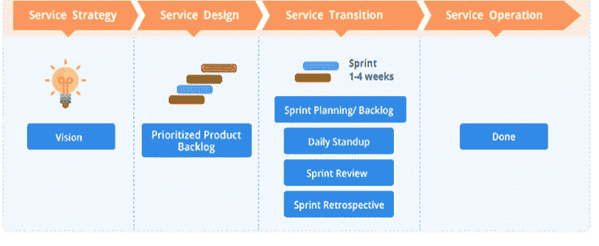

图 6-1. ITIL 与敏捷原则

最初这种方法唯一的顾虑是敏捷侧重迭代而 ITIL 以顺序方式执行。采用敏捷 ITSM 的组织也找到了解决办法。他们激励团队以 DevOps 思维工作，始终以稳定性和敏捷性为目标。基础设施运营团队参与服务设计阶段，并提供满足保修要求所需的所有必要输入。如果 ITSM 围绕严格的发布和变更管理来控制变更，那么这种敏捷 ITSM 是通过决定需要多少以及多频繁的变更控制来处理的。这种变更控制通常由产品负责人主导，以管理产品以及冲刺待办列表。事实上，批准 CAB 请求的是产品负责人，因为产品负责人管理冲刺待办列表。

敏捷 ITSM 方法之所以成功，是因为它将 ITIL 和敏捷两界的最佳实践联系起来，并由 DevOps 思维驱动。两种方法中的相关角色也趋于融合。例如，Scrum 方法论中的产品负责人角色和 ITIL 中的服务负责人角色被合并，因为对这两个角色的期望都是成为客户的声音。

## IT4IT

IT4IT 是一个说明管理 IT 的运营模型的参考架构。它是一个强大的现代工具，帮助组织管理其数字化旅程。该标准正被不同规模的组织接受和实施，重点在于推动互操作性、改进现有能力以及合理化应用。该标准还旨在解决诸如与代码管理、打包、部署和配置管理相关的缓慢和手动活动等问题。 (IT4IT 框架及其价值流来自 https://www.opengroup.org/it4it，且 IT4IT 是 Open Group 的商标。) 该框架包含四个价值流，这些价值流迭代运行以交付价值并进行改进措施，如图 6-2 所示。

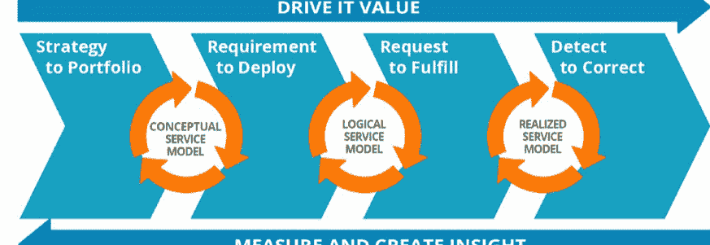

图 6-2. IT4IT 价值流 (参考: https://www.opengroup.org/it4it)

- *策略到组合 (S2P)*: 互联参与管理服务组合以实现企业战略的不同职能。该价值流使 IT 能够为企业战略和规划做出贡献。它还对 IT 组合活动提供整体视图，以了解 IT 伞下所有团队之间的关系。它还包含驱动关键活动的关键功能和辅助组件。
- *需求到部署 (R2D)*: 控制服务的质量、进度和成本，而不论交付模式。这一价值流背后的想法是以最佳实践加速采购和服务交付。通过对范围、服务蓝图、政策和问题陈述的明确定义，可以实现成功的 R2D。与 S2P 一样，R2D 也有各种功能组件来处理和部署数据对象。
- *请求到履行 (R2F)*: 强调需要 IT 服务支持的客户的时间价值、可重复性和一致性。它侧重于部署标准变更的相关性，而非交付正常或定制变更。它帮助组织向服务经纪人模式转变。它主要侧重于功能组件之间的记录系统集成。
- *检测到纠正 (D2C)*: 提高效率、降低成本和风险，并推动持续改进。这是通过自动化、自助服务、更快的上市时间、减少 MTTR、定义明确的所有权和改进管理来实现的。D2C 的一个关键目标是通过监控和自动化关键服务、关联并有效地快速管理事件或事件来高效管理 IT。见图 6-3。

服务生命周期 - 在可重复、可预测、连贯且面向未来的参考架构上

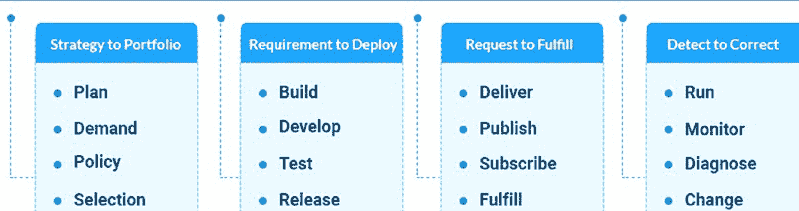

图 6-3. IT4IT 概览

每个流都提供了一系列关键绩效指标 KPI，有助于定义组织对其采用的成功程度，如表 6-1 所示。

### 表 6-1. 价值流及其 KPI

| 价值流 | 关键 KPI |
|---|---|
| S2P | • 资本支出与运营支出 • 软件许可消耗百分比 • 安全评估频率 • 平均成本/服务或应用 |
| R2D | • 实际执行测试与计划执行测试百分比 • 自动化测试百分比 • 计划成本与实际成本 • 返工减少百分比 |
| R2F | • 已完成的服务请求数量 • SLA 内在制品百分比 • SLA 内完成工作百分比 • 请求履行的事件数量 |
| D2C | • OLA 与 SLA • 中断减少 • 识别并移除的问题数量 • 投入在业务关键服务上的时间百分比 |

各种组织使用 SAFe® 在企业规模上采用 IT4IT，这有助于他们提高发布速度。IT4IT 描述了实现 SAFe®/敏捷和 DevOps 的有效实施所需的最佳工具架构和相关集成。该框架还为 IT 转型项目、工具互操作性和涵盖 IT 中所有内容的服务管理提供了开源模板。见图 6-4 和表 6-2。

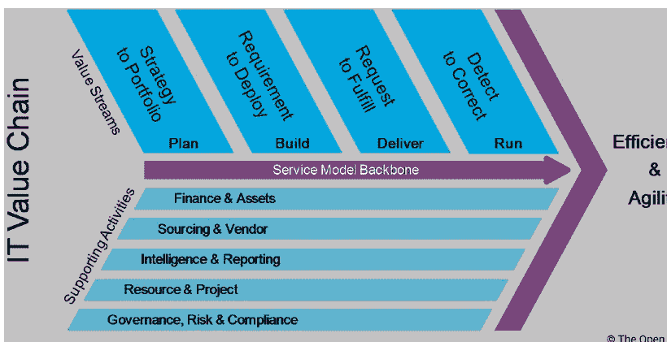

图 6-4. IT4IT 参考架构 (参考: https://www.opengroup.org/it4it)

### 表 6-2. IT4IT 工作方式

| 流程领域 | 传统方式 | 现代方式 |
|---|---|---|
| S2P | 瀑布 | 敏捷 |
| R2D | 流程繁重 | 优化 |
| R2F | 手工 | 自动化 |
| D2C | 孤岛 | 连接 |

IT4IT 是一个与 ITIL 类似的参考框架；虽然 ITIL 专注于管理 IT，IT4IT 专注于 IT 服务管理 (见图 6-5)。在基础设施 IT 运营领域，两者都已大规模使用，企业已通过这些流程和最佳实践获得了标准化的好处。

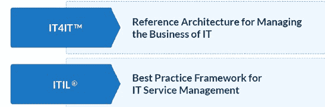

图 6-5. IT4IT 与 ITIL 对比

## 精益 IT

精益是一个基于赋能前线并推动对完美客户价值创造的不懈追求的运营卓越原则、实践和技术集成系统。精益 IT 框架扩展了精益服务的原则。它承诺识别并消除浪费，从而改善客户服务。IT 服务的需求出现了显著增长，这带来了服务供给的多样性。专业知识和环境搭建的成本也在增长。随着复杂性和需求的增加，需要关注改善流程并消除浪费。见图 6-6。

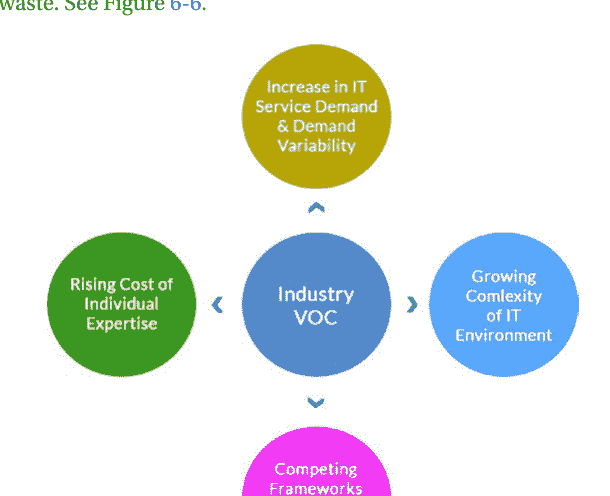

图 6-6. Lean IT 概述

什么是 *不是* 精益 IT？

- 它不仅仅是流程再设计。
- 它不仅限于工具和技术。
- 它不是一次性改进计划。
- 它不是六西格玛的新口味。

那么 IT 中的浪费是什么？可能存在各种类型的浪费，可以用缩写 DOWNTIME 来记忆。

- *缺陷*: 在生产中发现问题是由于测试不足。缺陷是软件中存在的错误、bug 或失误。生产中泄漏的缺陷成本高昂，需要返工。
- *过度生产*: 在当前时代，客户会优先考虑需求，并期望以更频繁、更短的周期交付。将价值较低或优先级低于更高优先级需求的需求发布出来，并不是客户所要求的。这就是为什么要为需求使用优先化的积压。
- *等待*: 这与流程中各步骤之间的空闲时间以及不同团队在任务上的转换工作流程有关。
- *非增值处理*: 工作流程中任何不增加价值的流程或步骤都是浪费。在敏捷的当前时代，过度的文档是不需要的。
- *运输*: 当知识在团队内部或外部转移给其他人时，会出现知识流失。需求从一个人共享给另一个人时，有时会因理解差异而发生变化。这导致需求被误解。
- *库存*: 有一句说法，“停止开始，开始完成。”这对于任务是相关的，任务在被接手后应完成后再接手新任务，因为客户要求交付价值。库存的一些例子是未利用的资源，例如不需要且未使用的大量存储库或分支。
- *动作*: 这指向大量手动和单调的重复性活动，这些活动占用大量时间，否则本可用于思考和创建新服务或改进现有服务。
- *员工知识*: 人员的技能组合与工作不匹配。需要对正确的做法进行调整，以便员工知识在正确的地方得到使用。

现在我们已经了解了浪费的类别，让我们了解精益 IT 的五项核心原则。

- *价值*: 价值需要从客户的角度定义。重点是交付的服务。
- *绘制价值流*: 价值流映射所有增值或非增值的步骤、努力、输入和输出。
- *流动*: 服务和信息通过流程从端到端流动。流程应定义为实现服务顺畅交付。
- *拉动*: 在客户提出需求并需要时开展工作并交付。
- *追求完美*: 这是通过所有任务为客户提供价值的完全消除浪费。这可以通过持续改进和持续反馈来实现。见图 6-7。

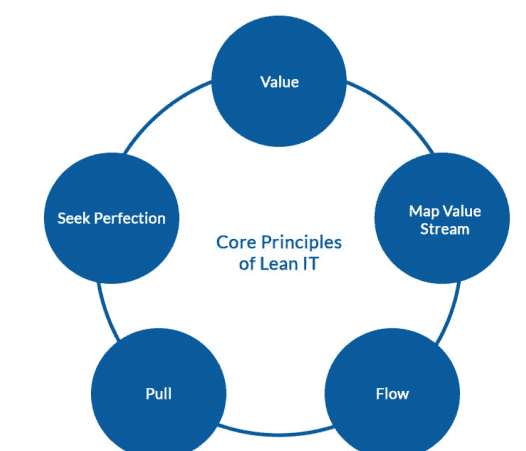

图 6-7. Lean IT 核心原则

精益 IT 的核心原则在下一节中介绍的 SAFe® 敏捷方法中得到体现。虽然团队以敏捷模式工作，但它们以灵活性、适应性和提高客户满意度为目标。为了加快交付速度，需要分析工作流程并识别消耗时间并阻碍交付计划的领域。因此，敏捷和精益都帮助团队可视化工作、持续学习和协作，并在每次迭代中衡量项目进展。精益还提供了一个重要的原则，称为 *价值流处理*，有助于识别浪费以使流程更高效。这是通过价值流评估流程完成的，该流程用于评估企业价值流的优势和劣势。

价值流评估流程的步骤如下：

- 1. 选择产品/服务/流程。
- 2. 涉及利益相关者。
- 3. 了解客户的声音。
- 4. 开发当前状态价值流图。
- 5. 识别浪费。
- 6. 开发未来状态价值流图。
- 7. 确定收益。
- 8. 开发实施计划。
- 9. 实施未来状态 VSM。
- 10. 分析并微调未来状态 VSM。

有趣的是，价值流图也被用作衡量组织在 DevOps 上的成熟度的指标。各种模板可帮助团队记录当前状态，重点关注交付工作的质量、返工的百分比、交付可工作软件的提前期和周期时间等。见图 6-8。

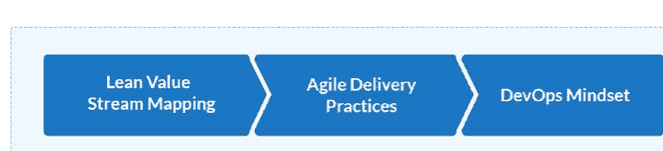

图 6-8. 成功产品开发的要素

成功产品开发的关键要素取决于团队如何采用和实践精益、敏捷和 DevOps。这三个部分相互补充并定义了新的工作方式。核心基础是客户需求，或需要在优化成本模型内交付的价值。

精益侧重于以优化的方式构建正确的事情，而敏捷侧重于正确地构建事物。从传统方式向现代方式的转变是日益增长的期望，不可再搁置。流程繁重、手动活动需要优化和自动化。孤立的团队需要持续连接和协作。精益 IT 是一种将 IT 与业务对齐的方法。它是一个以目标为导向的框架，侧重于团队赋能。当与敏捷和 DevOps 相结合时，它对组织来说效果惊人。见图 6-9。

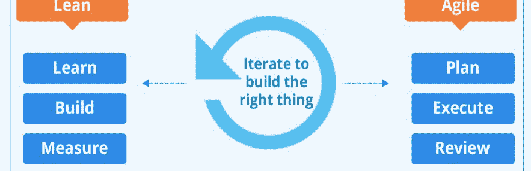

图 6-9. 精益与敏捷

## 规模化敏捷框架® (SAFe®)

规模化敏捷框架® (SAFe®) 是寻求拥抱业务敏捷并在后数字经济中蓬勃发展的组织的领先框架。SAFe® 由 Dean Leffingwell 等人于 2011 年推出。认识到大规模解决方案提供商在上市时间和质量方面的挑战，作者寻求为即使是最复杂的业务和技术组织带来一致性、协作和透明度。该框架是一系列流程和工具，源于多年观察企业中的模式，植根于精益-敏捷思维、核心价值观和十项不可变的精益-敏捷原则；这些是 -

- #1 采取经济视角
- #2 应用系统思维
- #3 假设变异；保留选择
- #4 以快速集成学习周期逐步构建
- #5 基于对工作系统的客观评估确定里程碑
- #6 可视化并限制在制品、减少批大小并管理队列长度
- #7 应用节奏，与跨领域规划同步
- #8 释放知识工作者的内在动机
- #9 分权决策
- #10 以价值为中心组织

SAFe® 高度可配置，以满足每个组织的意图和目的。它提供不同的配置（基础、大型解决方案、投资组合和完整），任何组织都可以轻松采用。这些配置中共同的一个关键要素是敏捷发布列车（ART）的概念。ART 向组织交付价值流；它由 5-12 个敏捷团队组成（跨不同部门约 50-125 名跨职能专家），他们在称为程序增量的迭代中共同工作。计划在 PI 中交付的所有功能都通过列车交付。如果功能不是计划 PI 的一部分，则在下一个增量开始之前不会启动。此外，ART 与冲刺周期映射。由于 ART 内的团队应保持一致，它们需要遵循相同的冲刺开始和结束日期。每个 ART 都有一个名为发布列车工程师（RTEs- 功能类似于 Scrum Master）的角色；负责促进发布周期。

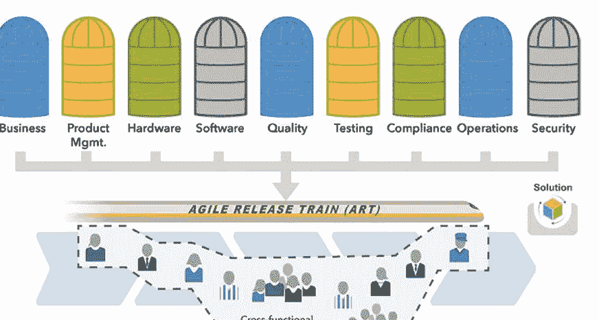

图 6-10. SAFe® 中的 ART

## Spotify

Spotify 是世界上最受欢迎的音频流媒体服务之一。Spotify 模型完全关乎公司提升团队敏捷性的方法。该模型首次于 2012 年推出。该模型关注人员、文化以及扩展敏捷的自主方法。它是产品开发组织中通过文化变革来组织多个团队以及我们如何协作和建立网络的示例。

该模型与其他模型不同，因为它侧重于围绕工作进行组织，并基于业务重组组织以增强敏捷性，而非遵循特定的实践集合，如每日站会、计划会议等。

Spotify 模型中的团队决定采用哪种框架，无论是看板、Scrum、Scrumban 等。团队的结构方式与传统的敏捷框架非常不同。让我们了解该框架中使用的基本术语。见图 6-11。

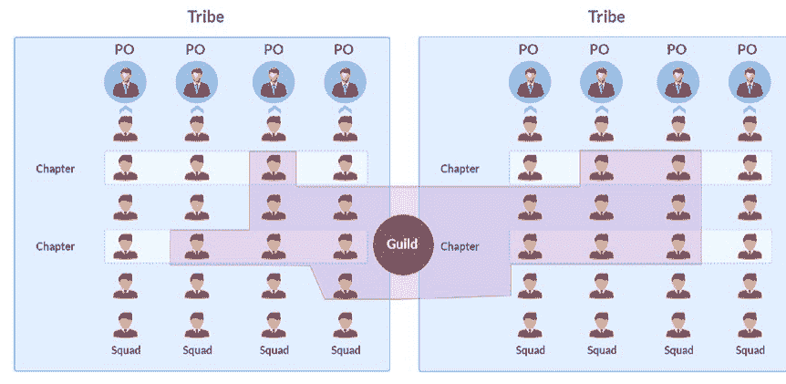

图 6-11. Spotify 框架

**小队：** 小队团队是拥有六到十名成员的跨职能团队。团队有一个使命，并得到敏捷教练和产品负责人的支持。

**部落：** 有时，某些人员需要在小队之间就功能进行协作，因此他们组成一个部落。与小队不同，部落由大量人员组成。每个部落都有一个部落负责人，负责在小队之间进行协调、对齐并促进协作。

**章节：** 章节是使团队能够开展工作的标准和最佳实践。通常，章节有一个负责人，多为高级技术负责人或架构师。章节在部落内部形成。

**行会：** 行会是一个论坛，人们因对特定主题感兴趣而加入。这是自愿的，并且跨越部落，不像章节。行会没有特定的负责人，但任何人都可以自愿协调行会的活动并将大家聚集在一起。

**三人组：** 三人组由部落负责人、产品负责人和设计负责人组成。三人组是每个部落的一部分，并在产品的三个核心领域确保部落内部的一致性。

**联盟：** 当多个部落需要共同工作时，三人组有时会为组织的更大共同目标而共同努力。

假设企业 Alpha 需要转型为 Spotify 模型。如图 6-12 所示，组织将拥有各种产品团队，每个团队都将拥有垂直或水平运行的小队和章节。

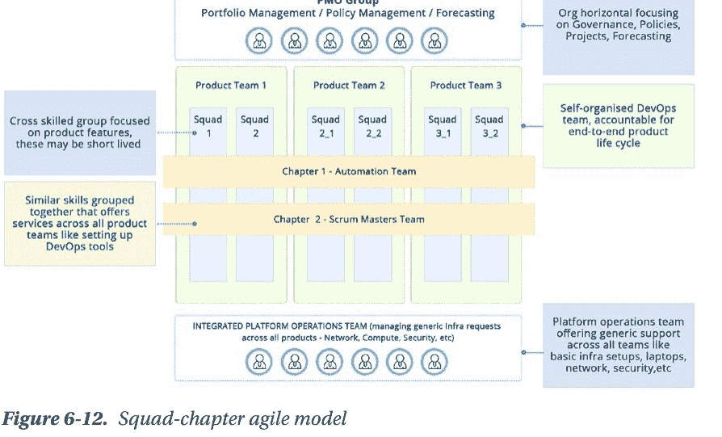

## 图 6-12. 小队-章节敏捷模型

每个产品团队可以根据需求拥有多个小队团队，一旦完成产品功能后，他们可以重新分组以规划另一个产品功能。每个小队都是一个专门的团队，知道要开发什么并据此进行规划。章节另一方面关注的是如何交付事物。例如，它们可以被视为像 Scrum 大师这样的实践社区。这些 Scrum 大师与产品团队保持一致，以指导和实施敏捷实践，当团队自给自足时，他们会返回社区并与另一个产品团队保持一致。这些小队和章节可以采用最适合自己的敏捷方法。每个产品团队可以拥有多个小队，它们共同工作以确保产品能够利用可用的 DevOps 工具从头到尾交付。除了这些小队和章节之外，当然还有其他重要职能，如 PMO、安全和平台运营，它们横向为组织中的每个人提供支持。

这种模型最初似乎难以实施，但分阶段计划有助于企业在规定时间内顺利实现这一目标。需要注意的是，新结构需要新的角色、新工具和培训需求，这应该是跳入新模型之前的先决条件。目标是确保敏捷性是每个团队的核心原则，这可以通过正确的流程挖掘、目标设定、新角色定义以及引入新技术来节省时间和精力来实现。

## 表 6-3. Spotify 中的角色

| 新角色 | 组合级别 |
|---|---|
| **小队负责人** | • 协调工作并建立协作团队 • 指导团队并提供改进反馈 • 拥抱问责文化 • 与章节负责人协作 |
| **章节负责人** | • 担任直线经理 • 为不同小队提供专业支持 • 跟踪并交付高质量服务 |
| **SRE** | • 跨技能工程师，隶属于章节 • 专注于 IaC、DevOps、云等新兴技术 |

Spotify 模型是经过充分验证的框架，适用于可在冲刺中扩展并重新定义其运营组织结构的<|message|>基础设施运营团队。要将示例公司 Alpha 转型为 Spotify 工作组织，首先需要解决以下事项：

- 教导所有团队成员敏捷概念。具有“推”文化的现有运营团队需要得到指导，学习“拉取工作”并承担责任。
- 鼓励他们提问并拥抱即将到来的变革。团队需要被鼓励走上将使他们受益的新敏捷道路。
- 确定新生态系统所需的工具。随着团队学习敏捷方法，他们也需要学习新的工具，使其更有效。他们应接受培训，了解如何创建和参考仪表板、查看团队进度、理解“在制品”的基本概念，以及他们的贡献如何导致项目的成功。
- 形成由小队、章节、行会和部落组成的新组织结构。这一结构也应向团队传达，使他们了解每个团队的目的。
- 选择小队将实践的敏捷方法。方法应考虑团队对 Scrum、看板、Scrumban 等方法的理解成熟度及其实施情况。只有小队定期实践，敏捷采用才能成功。
- 确定要引入的新角色并将其与现有角色映射；否则，计划招聘。随着现有运营团队接受培训，团队应被告知新结构将带来新的角色和职责。他们应有机会自愿担任这些新角色。
- 定义映射新角色并标注团队成员的新运营组织结构。与组织变革管理协作以广播这一新变化。计划并运行研讨会让团队了解新变化，这将避免团队内部的混乱。或者，试点并扩展结构。新的运营结构可以分阶段推广，而不是一次性推行。这一决定应由高管根据其对生态系统的深入了解来做出。

假设 Alpha 正在为这一新旅程做准备，先决条件正在得到处理，现在我们需要为新模型起草一个大纲。

- 新角色 = 产品负责人、小队负责人、章节负责人、SRE、云工程师和架构师。你可以识别出可以扩展到这些新角色的现有角色；例如，塔台负责人可以培养成小队负责人。
- 横向团队 = 章节、行会。这些服务组贯穿所有小队，成员在不同小队之间流动。现有的运行治理、合规等团队可以扩展到这些新角色。
- 纵向团队 = 部落、小队。这些团队可以被视为产品团队，具有披萨大小的团队分布在不同地区并为不同功能工作。

对于 Alpha，我们将计划两个部落。第一个部落将满足本地基础设施的请求，第二个将满足云请求。我们将称它们为本地部落和云转型。

让我们了解组织结构，如图 6-13 所示。

- 本地部落将支持本地环境，云转型部落将支持云环境。
- 团队成员将被分组到小队中，每个小队将拥有 SRE，他们是 Unix、Wintel、消息传递、备份、VMware、网络、自动化等的跨技能专家。
- 每个部落将有三个小队。部落中的小队针对一组定义的 workload。
- 一个通用小队将致力于自动化用例。
- 创新小队将致力于新集成和试点。
- 一个全球小队将处理所有地区的操作任务。
- 小队将由导师或负责人领导，他们将赋能团队在这一新组织结构和工作方式下开展工作。负责人还将决定他们将实践的敏捷方法。
- 每个小队将有自己的产品负责人，他们将与敏捷团队合作。
- DC 通用/云通用团队将遵循 Scrum 来处理自动化线程上的开发故事和任务。
- DC 创新/云创新团队将遵循 Scrumban 方法来处理试点推广和持续研发的开发和运营故事和任务。
- DC 全球/云全球团队将遵循看板方法，其中运营用户故事和任务将被跟踪和解决。

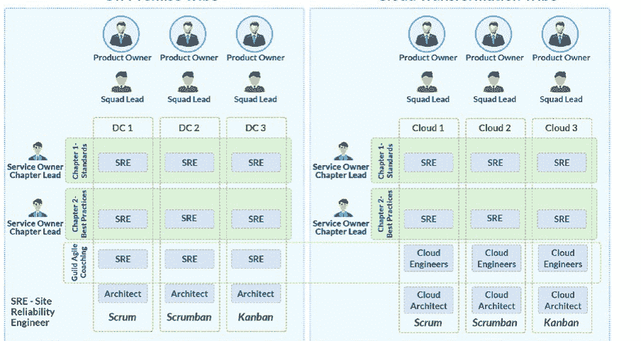

图 6-13. InfraOps 的 Spotify 模型

也将存在两个作为横向服务的章节和公会。

-   由架构师组成的标准，负责定义模式、命名规范、治理规则等。
-   最佳实践作为所有小队之间的实践社区，分享运行高效流水线或运营所需的有效方法和工具。
-   每个章节将由服务负责人或章节负责人协调和管理。
-   标准和最佳实践两个章节都将拥有来自该特定部落所有小队的成员。在我们的示例中，本地部署部落所有小队中的一些成员将成为标准和最佳实践章节的一部分。同样，这也适用于另一个部落。
-   在我们的示例中，公会专门用于敏捷教练。该公会将拥有来自两个部落的成员。

这些只是示例；还可以有更多部落，例如风险与合规、发布与自动化、服务台等，它们各自也会拥有小队、章节和公会。

Spotify 模型的成功可以通过拥有正确的文化心态、给予团队自主权、选择最适合团队的框架、采用对他们有益的工具、鼓励团队参与公会、建立信任、激励和[content]

图 6-13. InfraOps 的 Spotify 模型

也将存在两个作为横向服务的章节和公会。

-   由架构师组成的标准，负责定义模式、命名规范、治理规则等。
-   最佳实践作为所有小队之间的实践社区，分享运行高效流水线或运营所需的有效方法和工具。
-   每个章节将由服务负责人或章节负责人协调和管理。
-   标准和最佳实践两个章节都将拥有来自该特定部落所有小队的成员。在我们的示例中，本地部署部落所有小队中的一些成员将成为标准和最佳实践章节的一部分。同样，这也适用于另一个部落。
-   在我们的示例中，公会专门用于敏捷教练。该公会将拥有来自两个部落的成员。

这些只是示例；还可以有更多部落，例如风险与合规、发布与自动化、服务台等，它们各自也会拥有小队、章节和公会。

Spotify 模型的成功可以通过拥有正确的文化心态、给予团队自主权、选择最适合团队的框架、采用对他们有益的工具、鼓励团队参与公会、建立信任、激励和赞赏员工，以及从错误中学习来实现。

## LeSS

LeSS 由 Bas Vodde 和 Craig Larman 于 2005 年提出。LeSS 框架通过规模化将一个团队的 Scrum 扩展到多个团队。 （参考资料取自 https://less.works/less/framework。）LeSS 在多个团队在同一产品上工作的较大团队环境中应用 Scrum 原则、流程和要素。所有 Scrum 团队遵循相同的冲刺，使用相同的产品待办事项列表，并拥有相同的产品负责人。

LeSS 中的客户需求被归类为需求领域。每个产品待办事项仅属于一个需求领域。特定领域中的需求被归为一组。这形成了一个区域产品待办事项列表，它是产品待办事项列表的子集。与产品待办事项列表相比，区域产品待办事项列表中的项目更小，因为它们被拆分为可在一次冲刺中完成。来自区域产品待办事项列表的产品待办事项将由在该待办事项上工作的多个团队挑选出来。这与其他规模化框架相比是一种不同的方法。

还有其他 LeSS 框架，例如 Basic LeSS，拥有两到八个团队，以及 LeSS Huge，拥有超过八个团队。参见图 6-14。

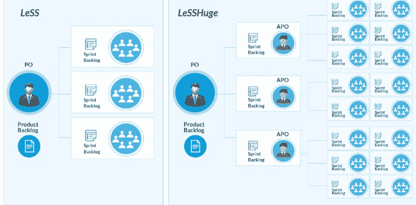

图 6-14. LeSS 概览

LeSS 有指南和实验，这些都是由提出 LeSS 的人在多个组织中实施规模化敏捷后开展的。

除了 Scrum 的产品负责人、Scrum Master 和开发团队角色外，LeSS 还有一个额外的经理角色。

LeSS 中的经理为团队提供实验的自主权，并协助团队消除障碍并持续改进。

LeSS Huge 框架中的区域产品负责人（APO）关键角色协助并与产品负责人（PO）协调，并在业务与技术团队之间架起桥梁。APO 的角色和职责与 PO 类似。需求的最终决策及其在产品待办事项列表中的优先级由 PO 而非 APO 决定，尽管两者共同工作。APO 还帮助 PO 避免不堪重负。APO 专注于以客户为中心的产品特性并与产品负责人一起开展工作。区域产品待办事项列表由 APO 管理，随后被该区域内的多个团队使用。此外，APO 还领导该区域内的所有这些团队。参见图 6-15。

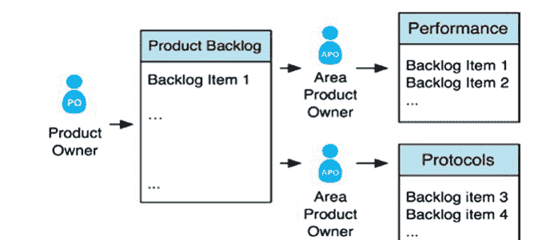

图 6-15. 产品负责人和区域产品负责人
（参考：https://less.works/less/less-huge/area-product-owner）

除了常规的 Scrum 仪式外，还有一个额外的产品待办事项细化会议，重点关注产品待办事项细化，考虑优先级、估算、拆分更大的用户故事、识别风险和依赖关系。

### 一个示例

让我们考虑我们之前提到的企业 Alpha，它需要从传统方法过渡到 LeSS Huge 框架。该企业同时拥有本地部署和云环境，我们需要创建一个由将通过 IaC 工作于自动化的团队组成的新结构。推出 LeSS 框架所需的角色和团队结构如下：

-   新角色 = 产品负责人将管理由区域产品负责人领导的团队组。每个小队将由小队负责人或 Scrum Master 领导，每个小队将拥有架构师和被称为 SRE 的跨技能工程师，他们管理两种类型的环境。
-   垂直结构 = 团队组。这些团队进一步由具有明确目的的小队组成。此外，每个小队都可以选择最适合其工作文化的敏捷方法。参见图 6-16。

图 6-16. LeSS 结构

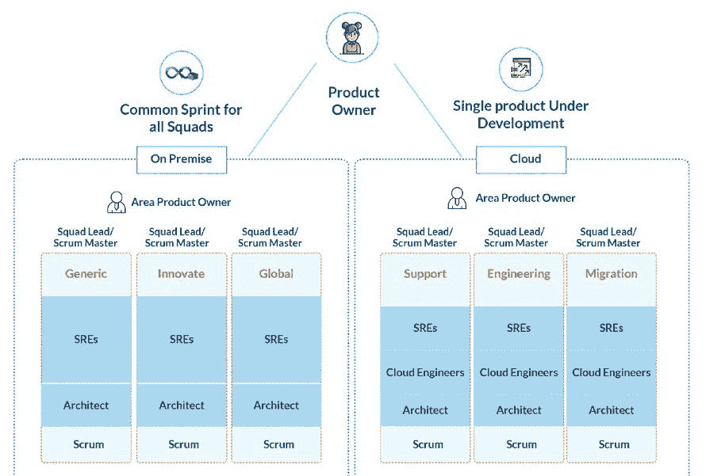

为了实施 LeSS，我们需要组建两个小队组。本地部署小队组将称为 Generic、Innovate 和 Global，每个小队都有 Scrum Master、SRE 和基础设施架构师。新的基础设施小队将拥有具备 Unix、Windows、VMware、AppOps、DBA 和网络技能的跨技能人员。同样，云组将有另外三个小队共同协作，支持云相关任务，例如支持现有团队、将本地部署应用程序迁移到云，以及在扩展和集成方面进行工程工作。本地部署和云组将各自拥有区域产品负责人（APO）。该 APO 将与团队非常紧密地合作以共享产品需求。只有一个产品负责人（PO）将管理此服务。此处的 PO 负责所有基础设施支持和自动化活动，无论是在本地还是在云上。因此，在此示例中，有两个团队组继续支持业务照常运行的工作活动，同时开发用于将应用程序迁移到云的自动化流水线。单一的产品待办事项列表将由该产品负责人管理并确定优先级。所有小队将遵循相同的冲刺并朝着共同的业务目标努力，即
最大化基础设施自动化。因此，LeSS 专注于通过多个团队在同一产品上共同工作、遵循相同的冲刺但在不同团队组中工作来构建端到端产品。

## Nexus

Nexus 框架由 Scrum 框架的联合创建者 Ken Schwaber 于 2015 年提出，可在 [Scrum.org](https://www.scrum.org/resources/scaling-scrum) 获取。Nexus 基于 Scrum 框架并使用迭代和增量的产品交付方法。它适用于多个团队在同一产品上工作并作为更大团队集成的组织。

它适用于三到九个团队，每个团队又是八到十人的小型团队，所有团队共同在同一产品上工作。所有团队都朝着共同目标努力。参见图 6-17。

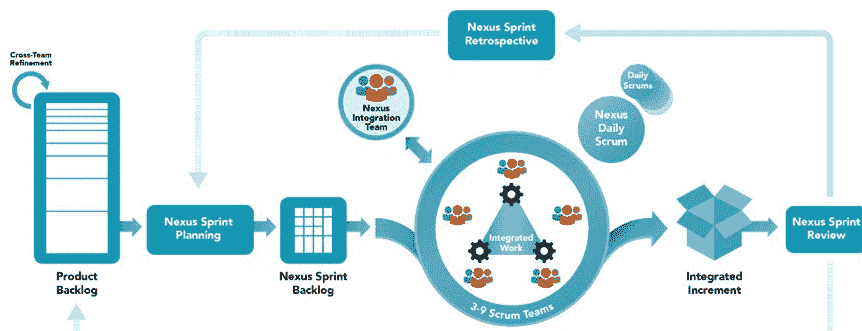

图 6-17. Nexus 框架（参考：https://www.scrum.org/resources/scaling-scrum）

它与 Scrum 不同之处在于它没有为每个团队设置产品负责人；相反，所有团队只有一个产品负责人。有一个由产品负责人管理的通用产品待办事项列表，Scrum 团队从中提取工作。除了 Scrum 的常规角色如 Scrum Master、产品负责人和开发人员外，Nexus 还有一个新的问责角色，即 Nexus 集成团队。

Nexus 集成团队确保每个冲刺都是来自所有团队的集成产品并且已准备好交付。Scrum 团队集成代码，但对于冲刺集成产品，重点和问责在于集成团队。集成团队拥有产品负责人、Scrum Master 和必要的集成团队成员，他们在需要时解决技术问题。集成团队还负责指导和指导 Scrum 团队遵循并学习实践和工具，以高质量地实施和开发产品。因此，该模型的关键区别在于，与通过 ART 进行集成不同，存在一个专门负责集成的独立团队。

事件与 Scrum 相似；它们包括 Nexus 计划会议、Nexus 每日 Scrum、Nexus 冲刺评审、Nexus 冲刺回顾以及跨团队细化。

跨团队细化针对产品待办事项列表进行，以帮助识别团队之间的依赖关系，并规划哪些 Scrum 团队将交付产品待办事项列表中的哪些项目。

### 一个示例

在传统模型中，当需要集成多个代码库时，代码集成是一个很大的挑战。在集成期间，会发现许多隐藏缺陷。在代码集成和解决代码合并问题方面工作的集成团队在这种情况下帮助很大。参见图 6-18。

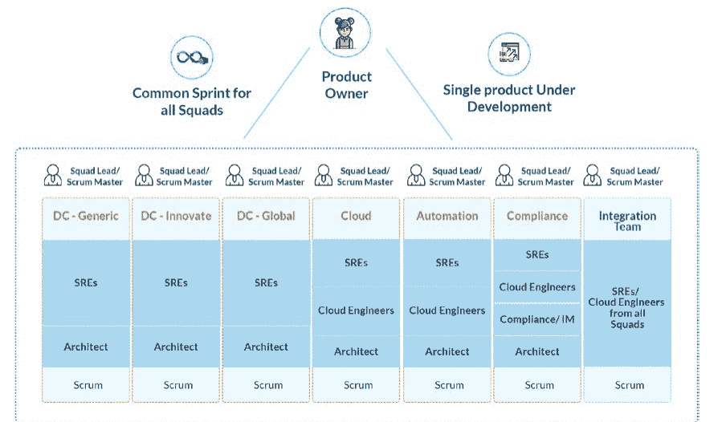

图 6-18. Nexus 结构

让我们将我们想象中的传统公司 Alpha 转变为 Nexus 框架。以下将是引入系统的新元素：

- 新角色 = 产品负责人、squad 负责人/Scrum 主管、SRE、架构师和云工程师。
- 垂直结构 = 小队。可能有多个小队协同工作以交付企业主题或史诗，例如交付自助服务目录。

团队将被转变为六个小队或团队，每个团队拥有 Scrum 主管、SRE、云工程师和架构师。将有三个名为 Generic、Innovate 和 Global 的 DC 小队。这些 DC 小队将拥有具备 UNIX、VMware、网络、Windows、DBA 和 AppOps 技能的跨技能人员。云小队将管理和交付云上的组件和服务。其他两个小队用于自动化和合规，拥有自动化、DevOps、云、IM 和合规管理技能，与基础设施分离。所有小队将有一个共同的产品负责人，因为只有一个产品需要管理和开发。单一的产品待办事项列表将由产品负责人管理和优先级排序。与其他规模化敏捷团队结构不同，Nexus 还有一个额外的集成团队，该团队将拥有来自 DC、云、自动化和合规小队的成员。他们负责处理来自所有小队的集成冲刺交付物的集成问题。所有小队将遵循相同的冲刺并朝着共同的业务目标努力。

因此，对于 Scrum 已完全实施且只有一个产品需要开发的团队，Nexus 模型是最好的采用方式。

## 受控敏捷交付 (DAD)

DAD 框架由 IBM 于 2009 年在 Scott Ambler 和 Mark Lines 的指导下引入。它在采用精益和敏捷原则时也类似于 SAFe®。它是一个以流程驱动的框架，专注于人与人之间以及组织内部的互动。参见图 6-19。

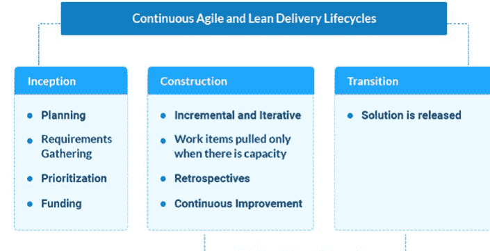

### 图 6-19. 受控敏捷交付框架

其交付周期由三个不同的阶段组成：

Inception: 在 Inception 阶段，团队组建，项目愿景形成并与组织愿景保持一致，范围被确定，架构和技术战略以及测试战略形成，初始计划和发布被决定，资金得到保障，并且识别风险。

Construction: 这全部是关于开发可消费的解决方案、创建架构、改进质量、解决利益相关者需求、更接近发布并交付价值。

Transition: 这是团队确保解决方案准备好部署并执行部署的阶段。

存在主要和次要团队角色。主要角色是团队负责人、产品负责人、架构负责人、团队成员和利益相关者，而次要角色是测试人员、技术专家等，他们与团队和环境互动以开发可行的解决方案。仪式也类似于 Scrum 框架。

DAD 有两个扩展角度。

*Tactical agility at scale:* 这通过应用流程和标准来解决团队规模、地理位置、项目复杂性等因素的扩展。

*Strategic agility at scale:* 这通过敏捷和精益策略解决组织不同领域的扩展。

因此，组织可以根据适用性决定需要哪种 DAD 扩展方法。

表 6-4 突出了迄今为止提到的一些框架的关键差异。

### 表 6-4. 一些敏捷框架的快速差异

| 描述 | LeSS | Spotify | Nexus |
|---|---|---|---|
| **定义** | 一个用于将 Scrum 扩展到多个团队的敏捷 Scrum 框架。它提供两种变体：LeSS，最多八名成员的团队，以及 LeSS HUGE，一个产品中多达数千人。 | 一种以人为驱动、自主的敏捷扩展方法，强调文化和网络的重要性。 | 一个敏捷 Scrum 框架，其中多个团队在一个产品组合上工作并创建集成增量。 |
| **核心目标** | 1. 精益思维 2. 系统思维 3. 整体产品关注 4. 以客户为中心 5. 持续改进 | 1. 自我管理 2. 通过关注组织工作实现灵活性 3. 关注文化 | 1. 经验主义和自我管理 2. 以价值为中心组织 3. 确保透明度 4. 关注持续集成和持续改进 |

### 表 6-4.（续）

| 描述 | LeSS | Spotify | Nexus |
|---|---|---|---|
| **关键角色** | 1. 产品负责人 2. Scrum 主管 3. 团队 4. 区域产品负责人 | 1. 小队（6–7 名成员） 2. 部落（40–150 名成员） 3. 章节（来自同一部落的专家） 4. 行会（兴趣社区） 5. 三人组（部落负责人、产品负责人、设计负责人） 6. 首席架构师 | 1. 产品负责人（一人负责全部） 2. Scrum 主管 3. 团队 4. Nexus 集成团队 |
| **基本构建** | 1. 一个团队 Scrum 2. 所有团队一个 DoD 3. 一个冲刺 | 1. 部落工程模型 2. 行会和章节 | 1. 所有团队一个冲刺 2. 团队（三个到九个 Scrum 团队） 3. Nexus 集成团队用于集成每个团队的增量 4. 所有团队一个产品负责人 |
| **关键仪式** | 1. 冲刺计划（第 1 部分和第 2 部分） 2. 每日 Scrum 3. 冲刺回顾 4. 产品待办事项精炼（PBR） 5. 整体回顾 | 1. 小队采用 Scrum 或 Kanban 并遵循仪式 2. 回顾 | 1. Nexus 冲刺计划 2. Nexus 冲刺回顾 3. Nexus 冲刺回顾会议 4. 精炼 5. Nexus 每日 Scrum |

### 表 6-4.（续）

| 描述 | LeSS | Spotify | Nexus |
|---|---|---|---|
| **关键指标** | 1. 燃尽图 2. 速度图 | 1. 前置时间 2. 周期时间 3. 速度图 | 1. Nexus 冲刺目标（所有工作和冲刺目标的总和） 2. Nexus 集成增量（已完成的集成工作的当前总和） |
| **节奏** | 固定长度冲刺 | 周 | 2 到 4 周 |

## 站点可靠性工程

SRE 是一种以应用为先、可靠性为先的 IT 运营方法，以及一套最佳实践，包括关注可用性和错误度量的指标。SRE 概念起源于 2000 年代初的 Google，旨在为 Google 的复杂和全球基础设施提供支持。该术语由 Google 工程副总裁 Treynor Sloss 提出。

顾名思义，SRE 的主要关注点是系统可靠性。SRE 团队还专注于开发健康监控、部署自动化和其他增强整体系统可靠性的任务。

## SRE 指导原则

现在让我们看看描述实施 DevOps 原则所需流程的七个关键 SRE 原则。

Embrace risk: 我们都承认服务不可能 100% 可靠。团队不断努力改进和维护可靠性评分，因为它影响客户满意度。当然，改进可靠性需要投资。当风险被接受时，我们就能知道何时投资是不必要的，何时是真正需要的。过度支出可靠性可能会降低开发速度，组织不会青睐这一点。接受风险的原则也有文化成分（通往 DevOps 采用的关键），其中团队在承担风险以加速开发时应感到安全。这可以通过确定团队可以随时参考的以下因素来实现：

- 未实施改进请求的风险。分析变更请求未实施时的连锁反应；这将导致重大影响，可能使客户不满意。
- 客户对可靠性的接受水平。查看使用模式，收集反馈，并定义 SLO 和 SLI（在下一原则中描述）值以增强团队信心。
- 实施可能提高可靠性的变更的成本。研究改善服务所需的关联成本，这些服务将对业务产生积极影响。
- 估算与风险相关的成本并与团队分享，以便他们了解影响并做出明智的决定。
- *Define service level objectives (SLOs)*: 每个组织与其客户签署的法律协议包含一组服务等级协议（SLAs）。这些 SLA 是与客户的承诺，确保服务可供其消费。例如，服务器 99.9% 的时间可用。为了确保这些 SLA 不被违反，公司将这些 SLA 映射为内部目标，称为 SLO，并进一步将其转化为服务等级指标（SLIs）。虽然 SLO 有助于团队管理风险并为任何错误预算，但 SLI 在服务给客户造成痛苦之前通知团队采取行动。参见表 6-5。

## 表 6-5. 服务等级比较

| 服务等级指标 (SLI) | 服务等级目标 (SLO) | 服务等级协议 (SLA) |
|---|---|---|
| 实际构成关键度量的性能如下：
- 包括等待时间的响应时间
- 每秒请求中的错误率
- 每秒请求中的请求率
- 利用率百分比 | 为必须满足 SLA 的团队定义目标。一些目标可以如下：
- 为 SLI 定义下限和上限
- 定义 SLI 需要小于该目标值的目标 | 与客户共享的对外协议，列出团队同意的承诺 |

团队应基于客户的痛点构建有效的 SLO 和 SLI，并且应随着服务的成熟而修订（与 DevOps 的持续反馈原则保持一致）这些值。

- *最小化琐事*：琐事是指团队经常重复进行的工作量。在 SRE 中，消除琐事是另一个重要原则，有助于推动加速开发和运营。这可以通过自动化和优化技术实现。团队可以通过观察耗时且重复的任务列表来消除琐事。通过创建具有指南和模板的有效自动化，可以大幅减少琐事，从而使团队能够专注于需要关注的其他领域。消除琐事应在冲刺中进行（与 DevOps 的持续改进原则保持一致），以便团队能够监控收益。

- *监控*：系统会产生大量有意义的数据，并非所有数据都需要团队关注。现有的监控工具可用于跟踪、提取和整合这些数据，形成有助于团队做出决策或采取行动解决问题的有用指标。对于 SRE 来说，跟踪以下指标（与 DevOps 的持续改进原则保持一致）非常重要，这些指标反过来又需要用于衡量 SLI。

- *错误率*：请求导致服务失败
- *延迟*：响应时间
- *流量*：服务负载量
- *饱和度*：资源可持续的时长

- *自动化*：当利用自动化工具时，开发速度可以提高（这有助于与 DevOps 的持续集成、持续测试和持续部署原则保持一致）。团队需要查看产品生命周期中需要自动化和优化的流程。这需要投资新工具并引入诸如左移测试、自动化部署模式等实践。自动化有助于团队减少琐事并提高团队速度。应鼓励 SRE 在不同领域识别和实施自动化解决方案，以帮助他们提高周转时间。例如，剧本或运行手册是列出并描述诊断和补救程序的文档，以便团队中的每个人都知道在出现情况时需要做什么。这导致平均解决时间降低，并在各种资源和团队中实现行动标准化。重要的是，剧本应根据基础设施和应用环境及版本的变化进行维护和更新。现代数字组织现已转向可执行剧本，这些剧本在运行手册自动化或配置管理工具（如 Operations Orchestrator、Ansible、Puppet 和 Chef）中配置为剧本。像 DRYiCE iAutomate 这样新一代的 AI 驱动智能自动化工具提供了利用 NLP 和 AI 技术的能力，以进一步增强运行手册自动化能力，快速在环境中部署正确的运行手册，并在持续的基础上帮助自动维护运行手册。

- *发布工程*：随着产品和服务的频繁发布，管理发布变得繁琐。无论发布次数多少，SRE 都需要确保发布能够通过优化的流程工作流（同时利用自动化工具）一致地部署（与 DevOps 的持续部署原则保持一致）。为了更快地部署，在不同发布类型中达成一致并实践指南非常重要。当团队使用相同的标准、政策和协议来发布其服务时，这是可能的。随着发布数量的增加，SRE 应监控发布统计数据并分析发布策略，以防需要更改。例如，金丝雀发布使发布更安全、更快。通过金丝雀发布，新功能会引入给一小部分用户。这会产生关于性能和应用程序用户体验的反馈，一旦发布成功，新功能就会发布给所有用户。这种方法降低了发布的风险，因为并非所有用户同时受到影响。金丝雀发布通过在真实用户（总用户群的一部分）使用应用程序时快速暴露问题，从而将检测问题（MTTD）的平均时间缩短。

- *简洁性*：可靠性通常与简洁性相辅相成。任何部署、监控、修复和改进都简单的服务都是可靠的候选者。简单系统易于管理和更新。SRE 可以对系统建模以分析复杂性区域并找到简化方法。应鼓励团队协作（与 DevOps 的协作原则保持一致）并设计简单系统，同时也应让他们意识到复杂系统需要巨大的投资，例如移除不需要的节点和连接。

除这七项原则外，还有其他对 SRE 实践也很重要的原则。

- *将运营视为软件问题*：这一方面与 DevOps 中的“no more silos”原则相当吻合，该原则旨在将基础设施和应用程序结合起来。当 SRE 最初引入时，并非许多组织拥有软件定义的基础设施和基础设施即代码；然而，今天随着技术的发展以支持基础设施像软件一样发生变化，这一原则可以被采用。

- *查找错误预算*：这是 SRE 运营中的另一个重要原则，这一方面与 DevOps 中的“metrics”原则相当吻合，其目标是捕获指标以改进。SRE 的目标是提供在错误预算范围内良好的服务；这作为指导指标，帮助 SRE 确定服务的架构和运营方面。SRE 在不影响可用性的前提下平衡快速交付功能的能力。错误预算用于监控发布和速度，这意味着如果没有错误预算，SRE 团队将停止可能进一步影响可用性的发布。SRE 需要与产品管理团队讨论错误预算并为服务定义可用性目标。他们还需要讨论额外成本，例如增加更多容错能力（如有需要）或减少频率或测试时间等事项。

有趣的是，系统的可接受风险决定了 SLO，而 SLO 反过来驱动错误预算。例如，如果服务出现太多停机时间，则应降低风险以保持在 SLO 范围内。应根据产品功能、可用性和使用情况定义正确的 SLO。例如，99.9 percent SLO 表示系统应 99.9% 的时间可用。因此，在一个月内，仅允许 0.1% 的停机时间，如果我们将其换算成分钟，结果如下：

= [0.001] * [30 天] * [24 小时] * [60 分钟]
=43.2 一个月允许的停机分钟数。

因此，如果系统停机超过 43.2 分钟，则将违反承诺。因此，了解产品供应和服务可用性水平非常重要，这将有助于计算错误预算。让我们通过一个示例进一步探讨，其中可用性和 SLO 已定义，我们需要找到错误预算。

- a. 系统可用性 = 90%
- b. SLO = 80%
- c. 因此，错误预算 = 可用性 – SLO；根据 (a) 和 (b) 中的数值计算，即 90% - 80%；结果为 10%。因此，错误预算值为 10%。
- d. 换算成月度即为每月 72 小时。

这意味着即使产品在某个月内停机长达三天，也不会违反 SLA。

- *降低故障成本*：这一方面对应于 DevOps 中的两个指导原则，即“渐进式变更”和“故障是正常的”。SRE 团队专注于在开发周期的早期解决问题，以便故障不会影响生产系统。SRE 团队使用各种流程和实践来实现这一最终目标。SRE 在设计和架构阶段的参与有助于主动规划高可用性，并在发生故障时快速恢复，从而降低故障成本。
- *尽早回滚，经常回滚*：当发现或怀疑存在错误时，团队首先做的是回滚到上一个版本，然后继续探索问题。因此，第一步是恢复系统，然后专注于探索问题并进行问题管理。这导致系统和服务的可用性更高，以及更低的平均解决时间。见图 6-20。

## 你知道吗？

## MTTD 与 MTTF 与 MTBF 与 MTTR？

MTTD - 平均检测时间，发现问题所需时间的平均值。
MTTF - 平均失效时间，有缺陷的系统在失效前可继续运行的平均时间。
MTBF - 平均故障间隔时间，用于衡量系统在规定条件下执行所需功能的能力的指标。
MTTR - 平均修复时间，修复系统所花费的时间。

*图 6-20. 你知道吗？*

近年来，SRE 和 DevOps 已成为组织中极其重要且备受追捧的技能。每个人对该团队的角色或职责都有自己的定义，并且这些团队的结构各不相同。DevOps 工程师或 SRE 并没有通用定义，并且在技能和职责方面存在重叠。让我们尝试描述这两个角色，包括它们之间的差异和重叠。

## SRE 与 DevOps 结构

在 SRE 团队中，预计每个团队成员都精通所有领域，并在技能方面成为多技能或 E 型人才。在 DevOps 中，拥有不同技能的不同团队成员通过文化、流程、最佳实践、工具和技术共同合作，提供一体化的开发和运维体验。

团队结构因公司而异，通常具有以下专业人员：

- *产品负责人*：此人是业务与产品之间的接口，负责管理产品的路线图和战略。
- *基础设施架构师*：此人负责云和非云基础设施架构，包括网络、存储、计算和其他元素。
- *软件开发人员*：此人创建代码和测试用例，可能没有单独的测试团队，开发人员可能兼任测试人员编写自动化测试。
- *QA 工程师*：此人负责产品的整体质量，并确保第三方测试等 QA 流程得到处理。
- *发布经理*：此人负责发布管理职能，包括发布计划和排期。
- *管理员（系统和应用）*：此人负责监控、管理、补丁活动以及基础设施的配置和取消配置自动化，以及这些系统的可用性。

从之前的角色可以看出，在采用 SRE 路线的组织中，系统管理员角色演变为 SME 角色。此外，当 SRE 成为 DevOps 团队的一部分时，可能会有一些活动由其他团队而非 SRE 团队完成，尤其是部署发布。

## DevOps 和 SRE 领域的工具与技术

由于 SRE 和 DevOps 之间存在重叠，并且团队和个人围绕小组的结构方式因组织而异，因此以下技能对两个团队都至关重要。唯一的区别是，在 SRE 模型中，资源可能在其中一些方面具备跨技能，而在 DevOps 模型中，文化、最佳实践和指导原则将使 DevOps 团队能够无缝处理交付端到端服务所需的技术全谱系。见图 6-21。

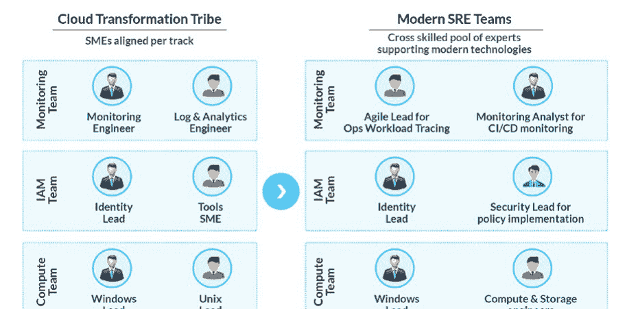

图 6-21. SRE 的演进

容器和微服务：Docker 和 Kubernetes 服务可作为 AWS、GCP 和 Azure 等各种云提供商的 SaaS 方案提供。

*监控工具：* Prometheus、Zabbix 等工具是交付持续运营所需服务的关键要素。各种组织可能使用来自 CA Broadcom、IBM、Microfocus、BMC、Solarwinds 和 Zenoss 等 COTS 厂商的工具。

*CI/CD/测试工具：* Jenkins、Git、Gitlab、One Test Suite、Selenium、AppScan、Whitesource、SonarQube、Microsoft TFS、Azure DevOps 以及其他云原生 DevOps 工具链，以及 Ansible、Puppet 和 Chef 等部署和配置管理工具均属于此类。

*基础设施即代码 (IaC)：* Cloud Formation 模板、Deployment Manager 模板和 ARM 模板等原生云技术，以及 Terraform、Puppet、Chef 和 Ansible 等第三方工具是自动化的支柱。此外，像 DRYiCE iAutomate 和 DRYiCE MyCloud 这样的 AI 驱动的 COTS 工具也在客户中获得关注。

*弹性测试：* 这是 SRE 团队尤其是手中的关键工具。这些工具通过关闭组件并测试服务或应用程序是否能承受这些组件的故障，对生产系统进行端到端测试以检验其弹性。最初由 Netflix 创建的 Chaos Monkey 是一种广泛使用的工具。

## 你知道吗？

## 什么是 Chaos Monkey？

混沌工程是一门学科，用于试验系统在生产环境中承受动荡场景的能力。Chaos Monkey 是一种工具，用于随机终止生产系统以测试弹性。

*图 6-22.* 你知道吗？

## 开发与运维工作之间的平衡

当你转向 DevOps 运营模式并整合团队或让开发人员负责各种运营时，另一个挑战就会出现。开发人员现在会被非计划工作、客户升级、基础设施的可用性和停机时间以及常规维护工作所淹没。这可能导致开发团队不满，团队也可能从开发功能的核心工作中分心。因此，SRE 在这里发挥着重要作用。他们专注于弹性方面的工作，并负责监控和确保从基础设施到应用程序的整个 IT 景观处于运行状态。

在此模型中，由于可用性 SLA 已明确定义并且定义了错误预算，SRE 对可用性和弹性的关注确保了通过指标系统地进行优先级排序。另一个需要注意的点是，错误预算或可用性目标的违反将自动使系统稳定性优先于功能发布，团队的重点是确保可能影响可用性并影响指标的发布与开发团队一起规划和协调。

SRE 团队使用基于敏捷的 Scrum 积压工作来处理自动化和工程活动，例如问题管理和变更管理。此外，与可用性和使用优先级和严重性（以及响应和解决时间）进行优先级排序相关的基于 ITIL 的 SLA 是用于优先处理 IT 景观中发生的事件的指标。这在两者之间创造了平衡，确保在保持系统运行并确保服务对最终用户可用时保持敏捷和速度。以下方法定义了优先级：

- 从分诊队列中提取事项。
- 如果没有分诊项目，则处理冲刺积压工作中的下一个项目。

最初，团队可能在以 SLA 为驱动的工作流程和基于敏捷的冲刺工作之间存在冲突。在初始阶段你可能会遇到的问题是“如果支持工作很多；我们如何抽出时间完成冲刺交付物？”一旦你能够克服最初的挑战，你很快就会发现工作会在更长的时间范围内达到平衡，团队将能够完成冲刺任务以及取

关注工作流的流转。随着团队对技术环境和新流程的熟悉，工作流变得更加可预测。由于 SRE 冲刺将包含自动化活动，您将逐渐看到这种专注方法的益处，即可用性和性能问题会越来越少。在 SRE 模型中，问题管理职能通常在以事件管理和服务请求管理为重点的交付中处于次要地位，而在 SRE 模型中获得了所需的关注，并消除了重复工作和重复事件。

由于基于流的工作不可预测，并且在某些时期可能没有可处理的事件或服务请求，SRE 团队能够利用这段时间运行用于自动化和服务改进的冲刺。

混合流式工作和冲刺式工作时需要考虑的另一个重要方面是，如果正在进行冲刺的工程师被中断，通常需要花费时间从中断处重新开始工作，因此需要一些智能路由，根据资源可用性和流队列来平衡冲刺工作和工作流，以减少从事冲刺交付物的工程师所面临的中断次数。轮换资源以承担更多冲刺工作与流工作是一种实现此目标的技术。最终，与两个不同团队分别负责冲刺和基于流的工作相比，该模型中资源的整体利用率将高得多，而对持续服务改进的关注将带来加速成熟、高度可用且事件更少的路径。

在该模型中，您将实现以下目标：

- 工作流的 SLA 随之改善，以及平均响应时间和解决时间等其他指标。
- 随着团队能够更好地预测工作负载和进行规划，冲刺速度得到提升。
- 开发人员和行政团队的满意度评分有所提高。
- 客户满意度评分提高。
- 团队的积极性和协作水平更高。

## Summary

## 摘要

本章涵盖的所有框架都有独特的用途和采用模式。任何有意采用这些框架之一的组织首先需要确定最适合其需求的框架。这取决于多个因素，例如团队结构、分布、构成、技术环境、发布周期、敏捷能力以及理解程度。如此深入的分析有助于组织做出正确的选择，然后推动在企业规模上定义其采用路线图。此旅程需要有里程碑和指标来衡量采用情况和成功。企业还应为团队规划培训和指导，以便他们避免抵触。团队应了解诸如基础设施即代码、弹性测试、监控和可观测性以及 DevOps 主导的 CI/CD 工具等新工程技术，以便他们感受到自己在系统中的重要性并为转型做出贡献。一旦确定了框架并团队开始新的旅程，他们就需要确定将如何运作。新的工作方式需要方法定义和流程改进。要从事敏捷基础设施运营，我们需要新的团队结构、角色和职责、流程变更、新的工作方式以及工具和技术。我们将在接下来的几章中深入探讨这些方法和其使用情况。

## CHAPTER 7

## 第 7 章

## Using Agile for Infrastructure Operations

## 使用敏捷进行基础设施运营

本章将详细介绍在企业中采用敏捷进行基础设施运营的分步方法。本章将涵盖以下主题：

- The starting point
- 起始点
- Summarizing the transformation plan
- 总结转型计划

我们谈到了 IT 世界如何从传统运营结构演变并转向基础设施运营领域的新敏捷结构。我们还研究了企业在提升基础设施运营团队到新角色和职责时所采用的各种敏捷框架和方法。虽然敏捷是前进的方向，但其目的在于提供一种新的运营方式，使团队能够得到赋能，从而在迭代中快速交付。但您会有一个关键问题：“从哪里开始？”这是运行复杂且大型基础设施和云运营的组织所面临的问题，他们希望快速转向敏捷基础设施运营，以满足客户日益增长的需求。此类企业转向新模式的其他原因包括沿成熟度曲线向上移动，并在节省成本的同时获得更高的可用性和韧性带来的益处。实施敏捷基础设施运营可提供所有先前的益处，同时使团队更具协作性、凝聚力、生产力和积极性。

## The Starting Point

## 起始点

首先，重要的是通过验证当前方法和流程的有效性，找出我们在流程、职能、工具和资源成熟度方面的现状。这正是自我评估发挥作用的地方。评估后，是时候根据当前差距和经验教训制定计划，并从团队层面的改进开始，以小步过渡到新的工作方法。见图 7-1。

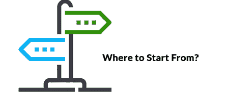

Figure 7-1. Starting point for AgileOps
图 7-1. AgileOps 的起始点

但在所有这些之前，需要对以下内容有需求、承诺和组织的认可（见图 7-2）：

- Agility is important, and every department in the organization should prepare for it.
- 敏捷很重要，组织中的每个部门都应为此做好准备。
- We need to ensure resiliency in our systems and be ready to fail and recover quickly.
- 我们需要确保系统的弹性，并准备好快速失败并恢复。
- There is also a need to relook at the team size and the technologies at play.
- 还需要重新审视团队规模和所使用的技术。
- Focus on real-time performance analysis and agree to continuously monitor it.
- 关注实时性能分析并同意持续监控。
- Encourage teams to embrace the new change and adopt agile ways of working.
- 鼓励团队拥抱新变化并采用敏捷工作方式。

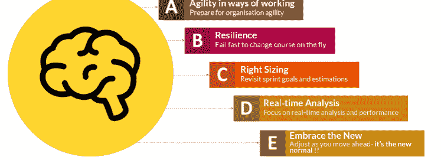

## Figure 7-2. Defining new ways of working
## 图 7-2. 定义新的工作方式

实施 AgileOps 需要提升技能、更好的协作技巧，以及对合适的工具和技术的投资，以便团队准备好采用并实践文化转变。

让我们来看看一些能够使组织采用敏捷文化和实践的构建模块。

## Adopting the Right Agile Framework and Methodology

## 采用合适的敏捷框架和方法

根据组织的团队结构、角色定义、职责、使用的技术平台等，组织应选择如第 6 章所述的合适的敏捷框架。确定正确的框架非常重要，并作为新旅程的基础构建块。该框架可以让团队在不同的敏捷方法中运行。虽然有各种敏捷方法可用，但就软件开发和基础设施运营而言，Scrum 和 Kanban 已成为常用的方法。这些方法在项目层面和团队层面提供可见性，并培养“拉取工作”而非“推动工作”的文化。见图 7-3。

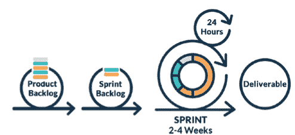

| Kanban | Scrum |
|---|---|
| Visual boards | Fixed timeboxed sprints |
| 可视化看板 | 固定时间盒冲刺 |
| Ideal for production operations | Ideal for development with fixed sprints |
| 适用于生产运营 | 适用于具有固定冲刺的开发 |
| No mandate on standups | Standups are mandatory |
| 无站会强制要求 | 站会是强制性的 |
| Focus on cycle time | Focus on velocity |
| 关注周期时间 | 关注速度 |
| Changes can be made at any time | No changes allowed mid-sprint |
| 任何时候都可更改 | 冲刺中不允许更改 |

## Figure 7-3. Agile models
## 图 7-3. 敏捷模型

简单回顾一下，Scrum 是一种适合需要在固定周期内交付工作的团队的方法，而 Kanban 适用于需要立即解决问题的运营团队。因此，在开始敏捷之旅之前，重要的是根据团队的交付物确定团队的正确方法。如果团队需要在称为冲刺的固定间隔内交付工作，这可能是一个应用程序服务或基础设施即代码，那么 Scrum 就是正确的方法。两种方法都应彻底评估。团队也可以同时采用两种方法；例如，80% 的团队专注于运营任务并采用 Kanban，而另外 20% 的团队专注于每两周交付的新工作。在这里 Scrum 是理想的选择。Scrum 和 Kanban 的结合称为 scrumban，它利用了两种方法的优点。

重要的是团队也应接受指导，正确使用这些方法。仅仅为了名称而采用该方法并无帮助。它必须全面实践。这不是将现有会议重新命名为站会和 Scrum 会议，而是使用经过验证的组织变革管理技术和实践来改变组织的文化。期望在短时间内实现文化变革是不现实的；因此，我们需要分步规划这一变革。团队需要“拉取”工作而不是“推动”。他们需要被鼓励对工作项负责并确保其在没有阻碍的情况下交付。这就是文化...

学习和培养敏捷方法变得很重要。我们需要明白，第一步是先摒弃原有的文化、流程和工作方式，然后再学习新的文化和工作方式；由于这涉及的不是技术而是人，因此是一个缓慢的过程。我们需要定义一个循序渐进的旅程，让人们能够实施新的工作方式并达到更高的成熟度。

对于在 ServiceNow、BMC Remedy 或 Atlassian Jira 等工具中提交工单的 IT 运维团队，工单会被路由到团队负责人，然后由负责人分配给相应的专家进行解决，Kanban 是一个理想的方法。与传统运维中工单被推送的情况相比，在 Kanban 中工单由团队专家自行领取。这种文化转变要求团队内部进行跨技能培养，以便知识不局限于一组专家。事实上，知识掌握在团队手中。一些组织将这些跨技能专家称为站点可靠性工程师，并将他们的团队更名为小队。然而，仅将团队或一组职能改名为另一个名字并不会使运维变得敏捷；要实现敏捷方法和实践的成熟度，必须有一个循序渐进的旅程。

所以，采用和实施敏捷需要哪些？

## 识别敏捷方法
假设框架已经选定，敏捷方法需要进行筛选。我们在第 5 章详细介绍了敏捷方法。团队应根据其当前成熟度水平、团队构成、外包与内部环境以及其他参数，评估适合其组织需求的正确方法。常用的方法有 Scrum、Kanban 以及称为 scrumban 的混合版本。根据当前的工作方式和期望，应为团队选择合适的方法。组织可以先用一个团队试点该方法，评估其效率，然后再扩大范围。一旦一线团队习惯了敏捷工作方式，就可以在企业层面轻松扩展。大型且复杂的组织可能在不同部门、地理区域或组织的不同部分最终采用混合的敏捷方法。应努力在一定程度的中央指导下建立协同效应和共同的最佳实践，以便差异最小，并且基于特定部门的真实需求，而不是个人偏好。我们需要从小处着手然后再扩展；途中可能会遇到挑战。当这种情况发生时，回到原点使用《敏捷宣言》、原则以及来自 DevOps 和精益的文化指导，你将能够解决这些挑战。

## 识别实施工具
与方法和框架类似，多个工具可用于帮助团队实践敏捷仪式、跟踪工作、实现工作可见性等。表 7-1 描述了关键特性。见图 7-4。

### 表 7-1. 敏捷项目管理工具
| 厂商 | 工具 | 主要特性 |
|---|---|---|
| Atlassian | Jira Agile | - 提供敏捷项目采用的模板 - 与其他 Atlassian 工具集成，如用于版本控制的 BitBucket、用于持续集成和部署的 Bamboo、用于协作的 HipChat、用于文档的 Confluence 等 - 提供出色的报告和仪表板功能 - 可作为本地部署和 SaaS 解决方案提供 |
| Collabnet | VersionOne | - 专为敏捷和精益实施而设计 - 提供 openAgile API 以与其他工具集成 - 一款企业应用生命周期管理工具 |
| Planview | Leankit | - 实施 Kanban - 强调精益原则 - 通过有效的流程直观传达阻塞的工作并识别流程瓶颈 - 提供与其他企业级工具（如 ITSM、PPM 等）的集成 |

### 你知道吗？

NASA 喷气推进实验室（负责测试新兴火箭技术和开发机器人航天器的实验室）使用 Atlassian 产品来构建飞行任务规划软件，并对在卫星和火星之间传输的数据进行建模。

图 7-4. 你知道吗？

## 识别扩展集成的需求
虽然有用于敏捷管理的独立工具，但重要的是该工具能够与其他产品开发中使用的工具集成。例如，在大多数组织中，开发团队使用 Jira，而运维团队使用 ServiceNow。为了弥合这两个团队之间的差距，我们需要构思如何弥合流程差距，并鼓励团队查看集成的仪表板和工作负载。如果这两个工具集成，则可以实现双向可追溯性。两个团队都有可见性并共享通用流程。另一个用例是故事需要与代码文件关联。如果源代码存储在 Git 或 BitBucket 等工具中，则 definitely 需要在工具之间进行集成。最终，产品团队可以对其工作项获得端到端的可见性。见图 7-5。

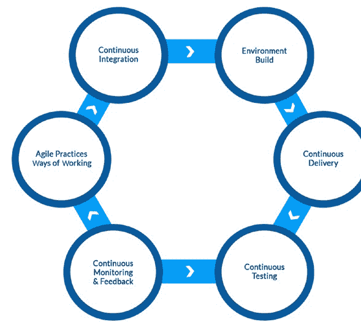

图 7-5. 工具之间的端到端集成

## 在敏捷方法使用上提升团队
团队在采用敏捷方法或工具时需要接受指导。重要的是团队应由经验丰富的敏捷教练监督和指导，帮助他们有效地使用工具。敏捷和 DevOps 领域的认证专家将成为团队的优秀教练或导师。这些专家还有助于阐明路线图、衡量成熟度并持续监控敏捷采用情况。
由于关于将敏捷用于云运维以及与 DevOps 和站点可靠性工程集成方面的指导很少，可能会存在技能差距，但本书可以作为你实施计划的最佳实践指南。

## 重新定义团队角色和职责
新方法和框架可能会遭到员工的抵制，这可以通过组织变革管理技术和实践以及认识到通往敏捷的旅程是团队努力的事实来软化。应在团队内部引入新角色以提高热情。团队成员应有机会表达自己的兴趣并转向新角色。新的职责将鼓励团队成员并创造兴奋感。以基础设施运维领域为例，经过使用敏捷进行运维的最佳实践培训后，服务请求经理可以转向产品负责人角色。随着新角色的出现，应采用自我管理和透明度的概念，因为这些是敏捷的核心原则。

## 培养“主动领取工作”的文化
加强敏捷实践的另一个方面是团队成员主动领取工作而不是等待别人分配工作的艺术。这是传统模式与敏捷工作方式的关键区别。几十年来，团队层级是按照自上而下的方法创建的。在敏捷世界中，层级应最小化，任何企业结构都应激励团队采用变革。目标应是逐步发展为自给自足的团队。

## 基线化初始周期时间和相关指标
如果敏捷是一段旅程，那么我们就需要跟踪这段旅程的进展。与 DevOps 和站点可靠性实践结合后，这就成为持续改进的旅程。为了跟踪此类进展，需要定期进行自我评估。这可以在团队、产品或企业层面进行。在团队层面，我们需要指标，这就是我们应基线化指标并经常重新审视它们以查看团队是否从采用中受益以及是否需要改变方向的地方。这些指标可以包括简单的测量，例如工作项数量或实现一个故事所需的时间。如果一段时间以来工作项数量没有增加，则可能表明团队无法承担负载或需要纠正。按照精益原则对流程进行详细分析将有助于识别根本原因并采取纠正措施。

图 7-6 解释了评估以 Scrum 模式运行的团队进展的示例方式。该团队管理四个应用程序，每个应用程序都有功能、故事和缺陷。故事还具有其关联的任务和复杂性。开始时，团队可以每两个月针对一组团队成员捕获指标。这些数据有助于分析交付的功能数量和故事点是否在增加，这意味着团队能够吸收更多工作，因为他们正在积累经验。平均而言，如果在相同团队规模下交付的功能数量和故事点在增加而缺陷数量在减少，则表明团队能够以更高的质量交付更多。这也称为团队吞吐量/速度，应对其进行监控以实现持续改进。如果吞吐量/速度没有改善，则 Scrum Master 应分析原因并与产品负责人协商制定适当步骤。影响团队吞吐量/速度的原因可能有很多，如能力有限或依赖关系、工作复杂性等。

### 项目概览
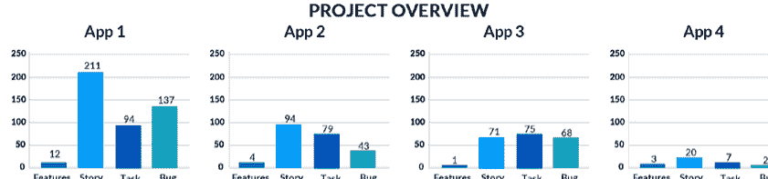

|  | 功能 |  | 故事 |  | 任务 |  | 缺陷 |  |
|---|---|---|---|---|---|---|---|---|
| 项目 | 2019年11月 | 2020年1月 | 2019年11月 | 2020年1月 | 2019年11月 | 2020年1月 | 2019年11月 | 2020年1月 |
| 应用 1 | 12 | 14 | 211 | 250 | 94 | 107 | 137 | 154 |
| 应用 2 | 4 | 8 | 94 | 115 | 79 | 117 | 43 | 49 |
| 应用 3 | 1 | 2 | 71 | 86 | 75 | 85 | 68 | 83 |
| 应用 4 | 3 | 3 | 20 | 44 | 7 | 12 | 2 | 2 |

图 7-6. 示例指标跟踪

## 识别自助服务的候选对象

在团队为新常态做准备的同时，设定团队的目标和愿景声明也很重要。使命声明定义了组织的工作、目标及其执行方法。愿景声明描述了组织的期望未来。对于运营团队而言，愿景和使命声明可能包含可用性、弹性、敏捷性、安全、运营成本、客户满意度、业务增长等要素。使命是需要完成的事情；因此，更广泛的使命需要被转化为形成敏捷运营团队待办事项的细粒度用例。参见图 7-7。

| 用例 #1 | 用例 #2 | 用例 #3 |
|---|---|---|
| 开发人员应能够自行配置开发环境 | 测试人员应能够按需创建和停用测试环境 | 开发人员应能够触发 CI 流水线 |

图 7-7. 示例用例

## 为可视性创建团队仪表板

当教练加入团队时，他们需要为团队设置初始的报告和仪表板以供参考并设定基线。这些仪表板应反映实时项目统计数据并帮助团队提取工作。已设基线的指标应在此类仪表板上可见。仪表板也可以分层以满足不同利益相关者。例如，像 Confluence 这样的工具可以用来创建和展示项目级和团队级仪表板。这些仪表板在各种仪式中也充当快速参考点。

## 试点并扩展方法

有时大爆炸式实施可能没有帮助，因为它会在组织中造成混乱。因此，先从小处着手然后再扩展是好的。尽管如此，团队需要理解保持敏捷的需求。项目管理办公室以及组织变革管理团队在跟踪转型项目和扩展其范围方面发挥着至关重要的作用。这就是组织可以先确定一个试点组，然后根据经验将实践扩展到其他团队的地方。试点始终充当其他团队的学习平台。选择试点团队也是定义转型成功的关键步骤。避免选择正在处理关键环境或应用程序的团队。选择低到中等级别的团队，该团队有时间提升技能并采用新的工作规范。此次试点的经验应被记录并在组织中展示，其他团队可以看到成功并开始迈向敏捷的旅程。

## 持续衡量指标并重新规划

初始阶段团队会遇到障碍，但为了确保团队走在正确的轨道上，教练应重新审视已启动的工作以及团队的演变情况。这将帮助他们根据需要改变行动方案，并识别缺失的差距并从中学习。其他团队和管理层的反馈对于观察绩效也很关键。在重新审视变更时，范围不应仅限于工具和自动化；还应关注可以简化的领域，换句话说，是团队需要提升技能的领域。

## 总结转型计划

前面提到的步骤可以分三个阶段推出，如图 7-8 所示。

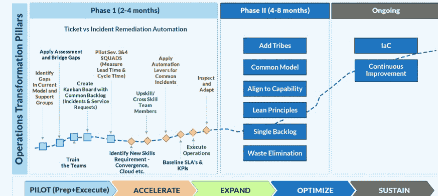

图 7-8. 分阶段转型计划

### 阶段 1：试点并加速

这一初始阶段是作为构建基块的基础支柱。通常持续两个月到四个月，但这可能根据多种因素而延长。为了确保本阶段得到成功管理和实施，重要的是确定合适的试点团队，并对团队进行所需技能和实践的指导。参见表 7-2。

### 表 7-2. 里程碑

| 里程碑 | 描述 |
|---|---|
| 识别差距 | 基准测试运营领域的当前支持模式和工作方式。分析团队如何协作，使用了哪些流程和工具，以及什么阻碍了更快交付。人员、流程和工具方面的 identified gaps 被汇总，这些成为通过敏捷驱动的持续改进路线图制定的重要输入。 |
| 应用评估 | 创建解决差距的路线图。确定应使用新的敏捷模型进行试点的团队。这些新团队将被称作 *squads*。路线图必须重点解决已评估的差距非常重要。 |
| 为团队（squad）培训 | 为已确定的运营团队提供敏捷方法和最佳实践的培训。例如，如果 Kanban 已被确定为运营的目标模型，则指导并使团队学习新的术语以及如何应用新方法。新的 squad 应被鼓励自行提取工单并工作，而不是由负责人推送工单给他们。在初始阶段拥有教练来指导团队并建议最佳实践是很好的。 |
| 创建 Kanban 看板 | 像 Atlassian Jira、VersionOne 等工具帮助团队使用敏捷方法论。这些工具具有可根据需要轻松定制的内置模板。一旦工具被确定并安装，设置一个新的 Kanban 项目并向团队提供项目访问权限。 |
| 试点严重程度 3 和 4 的工单 | 一旦 squad 准备好以敏捷模式运行，就为严重程度 3 和 4 的事件或服务请求启动新模型。随着工单进入待办事项，squad 将能够查看待办事项并根据其带宽提取工单/事件。教练或负责人可以与团队一起推动工单流程并观察需要关注的领域，例如成员在将工单从一个状态移动到另一个状态时遇到问题，或成员在提取工单和理解新流程时遇到问题。 |
| 识别新技能 | 随着新的 squad 团队学习在新的工作模式下工作，负责人会了解团队速度并识别 squad 需要改进的领域。可能存在组织转向云时也需要提升技能以支持新平台的场景；因此，除了敏捷方法外，团队还应接受云和基础设施即代码等新技术的培训。 |
| 跨技能培养 | 随着 squads 获得提升技能，他们也需要进行跨技能培养。例如，团队成员应了解基础设施如何设置以及相关组件如何创建和跟踪的完整流程。另一个例子是，在云计算领域可能存在多技能资源，每个资源都可以在云运营、云架构、云部署、网络和平台方面进行跨技能培养。 |
| 应用自动化 | 推动基础设施运营敏捷性的一个最佳实践是尽可能自动化。采用基础设施即代码是一个良好的开端，它标准化了基础设施部署流程并避免了设置和基础构建期间的手工错误。利用开箱即用的工具来加快自动化流程。 |
| 基线化 SLA 和 KPI | 为了衡量成功，重要的是注意所选择的方法。为了跟踪敏捷采用情况，必须识别并基线化 SLA 和指标。这些值应定期审视，以确保实施新方法后有所改进。例如，首先基线化解决工单所需的前置时间，然后频繁跟踪该前置时间以查看是否有所改善。如果之前是八小时，则是否被减少。显然，会有一些注意事项，如工单的复杂性和类型。但定期衡量指标有助于团队回顾其在通往自动化和敏捷的道路上的进展。 |
| 在新模型中执行运营 | 一旦试点模型成熟，就将这种新的工作模式扩展到其他工单类别。团队可能在一段时间内继续并行使用旧方法，直到完全切换到新模型。这种工作模式称为 Bimodal IT Operations ——传统和新的工作模式在一段时间内共存。 |
| 检查与适应 | 持续反馈是这一旅程的重要组成部分。随着团队习惯新方法、指标和工作方式，分析并获取他们关于什么最有效、什么无效、需要纠正什么以及应添加什么的反馈非常重要。这成为其他团队可以参考、学习并相应扩展的良好案例研究。 |

### 阶段 2：扩展与优化

一旦试点在某个团队中取得成功，就该将其扩展到其他运营团队了。事实上，试点团队为其他人理解敏捷运营的利弊提供了极佳的媒介。顾名思义，本阶段重点是将新的工作方式扩展到其他团队，并检查可以优化的领域。优化可以通过采用合适的工具和自动化来实现。本阶段通常持续四到八个月，但可能根据团队实力和能力而变化。表 7-3 中的关键实践被添加并成熟。

## 表 7-3. 关键实践

| 关注领域 | 描述 |
|---|---|
| **增设部落** | 在阶段 1，我们定义了小队团队；这些是自组织的团队。当相似的小队团队一起工作时，它们形成一个部落。因此，部落是一个由多个小队组成的集合。随着方法论扩展到其他团队，定义新的团队结构及其角色和职责非常重要。 |
| **定义通用模型** | 协作的团队努力带来敏捷成功。随着团队在敏捷方法上扩展并定义新的团队结构（小队、部落、章节等），它们共享一个通用模型作为参考至关重要。这有助于将团队聚集在一起并培养学习文化。运营模型应是一个简化版本，易于团队采用和扩展。 |
| **按能力对齐团队** | 在其他领域引入部落并将其与能力对齐以实现快速响应时间。来自能力的持续反馈将使部落能够根据需要即兴发挥。 |
| **采用精益原则** | 随着越来越多的团队采用敏捷并实施自动化，需要拥抱精益原则。精益的五项原则（定义价值、映射价值流、创造流动、建立拉动以及追求完美）专注于创造价值。像 HCL Accelerate 这样的工具可以用于价值流管理。 |
| **采用单一待办清单** | 最初在小队入职时，每个小队都有自己的待办清单。但随着部落的形成和团队获得跨技能，负责人和教练应致力于拥有一个共同的待办清单。例如，一个部落有一个共同的待办清单。 |
| **消除浪费** | 随着精益原则的实施，必须消除浪费。这正是自动化发挥关键作用的地方。负责人应监控那些自动化后会受益的领域。追踪浪费是推动敏捷采用成功的另一个因素。 |

## 阶段 3：维持

最后阶段是一个持续的阶段——一个持续学习和改进的阶段。本阶段涉及成熟且具备跨技能的高效团队。虽然团队现在已在基础设施和云运营方面成熟，但同一团队应拓宽视野，寻找促进速度和韧性的自动化机会。他们需要逐步识别更多的小队团队并创建新的角色和职责。

以下是推动本阶段走向成熟并实现持续改进的关键因素：

- *自助服务：* 团队可以使用基础设施即代码模板来扩展和缩减环境。这就像测试人员能够在流水线中构建和退役测试环境，而无需依赖运营团队来启用环境。这减少了测试和部署新功能所需等待时间。
- *零接触部署：* 这是通过 CI/CD 流水线的端到端自动化实现的。应鼓励团队在生产环境中实践流水线部署而非手动部署。自动化部署不仅避免了错误操作，还加快了交付时间并缩短了反馈循环。这使团队能够专注于创新领域，例如加强安全性和提高测试、合规性和防护措施的覆盖率。
- *标准化和优化：* 随着越来越多的机会被识别并通过自动化实施，团队变得更高效，流程得到更优化，标准化的团队强调交付可靠且具有韧性的系统。
- *持续评估：* 还记得我们谈到开始前对团队状态进行基准测试吗？因此，我们有了初始指标，现在应重新评估。团队需要收集有关其表现如何以及如何改进的反馈。在这种情况下，评估是有帮助的；它使团队能够重新审视其团队结构、流程工作流、方法论、指标和技能水平。这有助于他们识别并自动化新的机会以提高效率，并在需要时更新行动方案。企业应采用基线化并定期重新审视的评估计划，例如每六个月一次。之后，每次评估迭代都会被评分，然后与之前的评级或分数进行比较。

图 7-9 显示了一个包含五个阶段的示例评估，每个阶段都标记有一组定义好的实践。例如，一个团队在 1 级进行自我评估和基线化（因为它完全是传统的）。但在六个月后，他们会进展到 2 级并在此后缓慢持续进展。2 级的初始化阶段表明团队中的每个人都了解敏捷概念并理解其重要性，同时也开始利用敏捷方法，如使用 Scrum 看板、仪式等。此类评估应定期进行，以捕捉当前成熟度水平并帮助团队规划变更。

- 开展研讨会以指导敏捷的目的以及采用自动化来改进团队绩效。
- 重新审视组织路线图和里程碑。
- 规划新的能力培养项目。
- 识别需要现代化的应用程序。
- 投资新工具和自动化。
- 在整个生命周期中标准化工具平台。
- 定义端到端集成和流水线策略。
- 识别自动化和优化的流程。
- 向更大群体扩展支持和沟通。
- 跟踪并改进团队的吞吐量/周期时间及其他指标。

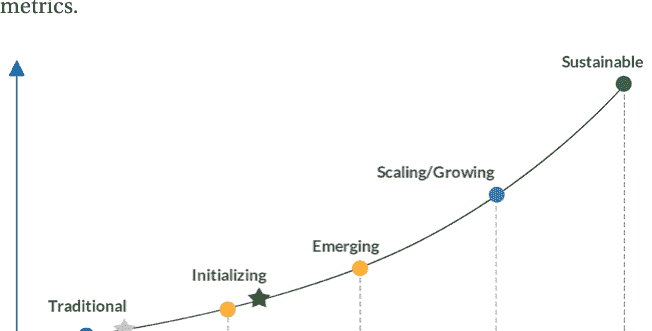

图 7-9. 持续评估示例输出

## 表 7-4. 成熟度评估等级

| 等级 | 名称 | 关键特征 |
|---|---|---|
| 1 | 传统 | - 瀑布方法
- 孤立且被动的团队
- 多个工具且无/有限集成 |
| 2 | 初始化 | - 理解敏捷及相关概念
- 识别用于集成的标准工具
- 团队开始实践敏捷仪式 |
| 3 | 新兴 | - 开始流水线开发
- 团队绩效的基线指标
- 基础基础设施运营已自动化 |
| 4 | 扩展/成长 | - 定义服务目录
- 识别自动化的用例
- 自动化交付流水线
- 协作且主动的团队
- 使用开发流水线扩展基础设施即代码 |
| 5 | 可持续 | - 自助服务目录发布
- 自我修复
- 持续评估和改进
- 迈向 AIOps |

## 总结

敏捷基础设施运营之旅是一个有计划的、分步的过程，将团队推向敏捷、自动化和韧性。成功的计划应在团队中植入动力，并在其成长时扩展。因此，先试点几个团队然后再扩展到运营领域的其他团队是好的。当然，会出现失败，这表明计划需要改变。敏捷计划可能有多个阶段驱动，但应根据组织章程和期望进行设计。组织应致力于实现以下目标集合：

- 基于迭代的短期工作负载
- 标准化与优化
- 自助服务
- 自动化
- 持续监控并收集反馈以实现成长

假设基础设施运营团队已采用 Kanban，并且新的运营模式正在成熟度曲线上向前推进，我们需要分析并迈向转型之旅的下一步。现在是引入基础设施即代码并实现基础设施流水线与应用流水线设计和集成的时机。此步骤可以根据团队带宽按顺序进行或并行进行。我们现在将深入探讨基础设施即代码的概念，并了解使用敏捷-Scrum 方法所需的关键构建模块。

## 使用基础设施即代码转向敏捷

本章中，我们将讨论如何开始使用基础设施即代码。本章将涵盖以下主题：

- 使用 Scrum 开始基础设施即代码
- 估算用户故事
- 定义验收标准
- 一个基础设施构建示例
- 工具流水线
- 基础设施即代码示例
- 将基础设施即代码 (IaC) 与开发流水线集成
- 扩展 IaC 示例
- 使用 Scrum 采用 IaC 时的关键敏捷实践

过去十年中，基础设施即代码的诞生已成为 IT 行业的变革性趋势之一。其背后的思路是，如果应用程序可以自动部署，那么为什么基础设施不行呢？为什么服务器必须手动构建和配置？随着越来越多的组织转向云，期望是加快交付速度，而基础设施即代码在此采用中发挥着至关重要的作用。

> *基础设施即代码 (IaC) 是通过机器可读的定义文件而不是物理硬件配置或交互式配置工具来管理和配置计算机的过程。*
> 
> —摘自维基百科的定义

传统运营模式必须改变，这催生了许多配置工具，帮助组织采用基础设施即代码。这也为 IT 运营团队升级到 Chef、Puppet、Ansible、Terraform 等新技术铺平了道路。此外，许多云服务提供商提供原生的基础设施即代码工具（如 AWS CFN、Google SDKs、Azure ARM 模板等）。还有 DRYiCE MyCloud 等企业云生命周期管理工具，可加快迈向基础设施即代码的进程。这有助于团队快速适应并通过代码实现基础设施自动化。

它还有助于 IT 运营变得敏捷并提供灵活且可靠的服务。通过代码设置新基础设施不仅创建了部署应用程序的基础设施，还创建了网络、防火墙、存储等支持性和强制性组件。创建了一个中央存储库，对由脚本、模板和策略组成的全部代码进行版本控制。这些脚本可以直接触发，或通过 Jenkins、TeamCity 等编排工具调用，并使用 Git、GitHub 等工具进行版本控制。事实上，在某些组织中，这些存储库会与开发团队共享，以便编写构建新基础设施的代码。这是一个将开发团队和运营团队联系在一起的绝佳媒介。见图 8-1。

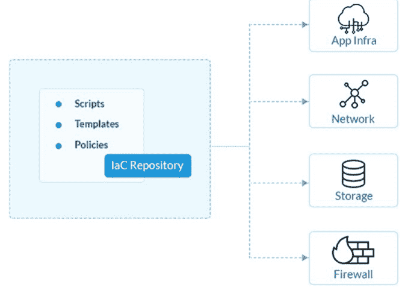

图 8-1. 使用 IaC 控制和管理基础设施

在云世界中实现这一目标的另一种更快的方法是使用云生命周期管理工具，这些工具可与基于 ITIL 的现有流程集集成，并通过易于使用的界面以及与多个云提供商和模板的即开即用集成提供基础设施即代码功能。DRYiCE MyCloud 等工具帮助组织以最少的设置时间实现基础设施即代码并缩短上市时间。MyCloud 平台支持 VMware、SCVMM、AWS、Azure 和 GCP 环境，并与 IT 服务管理、服务目录、监控和管理工具以及 CI/CD 工具集成，以在开发团队和运营团队之间提供集成。

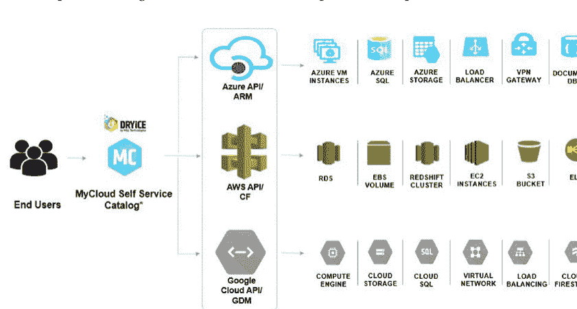

### 图 8-2. HCL DRYiCE MyCloud，CLM 工具

通过代码管理和控制基础设施的组织可以通过自动化节省大量工作并避免人为错误。直接通过代码操作基础设施还能让团队跟踪谁做了更改、何时更改以及修改了哪些组件。随着基础设施的成熟，团队还会实施策略以确保基础设施中不会进行手动更改。如果执行手动更改，工具将撤消这些更改并提醒管理员。

### 表 8-1. IaC 的优势

| 使用基础设施即代码的优势 |
|---|
| 快速上市——服务器即时部署 |
| 促进协作——弥合团队之间的差距 |
| 标准化运营方法——最大限度降低风险 |
| 可追溯性——审计并跟踪每个组件 |
| 优化成本——降低运营支出 |

## 使用 Scrum 开始基础设施即代码

迈向基础设施即代码的旅程始于组建一个新团队。该团队通常称为自动化或 DevOps 或 IaC 团队。该团队的职责是使用基础设施即代码工具并与开发团队协作构建新的自动化用例。Scrum 是构建组件团队的理想敏捷方法。这个 DevOps/自动化团队在与利益相关者讨论后，在团队中讨论并优先排序待办事项中的用户故事。他们构建基础设施流水线，这些流水线作为目录服务提供，并具有与开发流水线集成的灵活性。基础设施组件以模块化方式交付。团队首先创建史诗，进行评审、优先级排序和预算编制，然后再将其分解为在冲刺中运行的功能/用户故事。团队实践 Scrum 仪式，并在冲刺结束时经常交付最小可行产品 (MVP)。该 MVP 在冲刺结束时进行演示。MVP 中的任何问题或增强功能都会放回待办事项。见图 8-3。

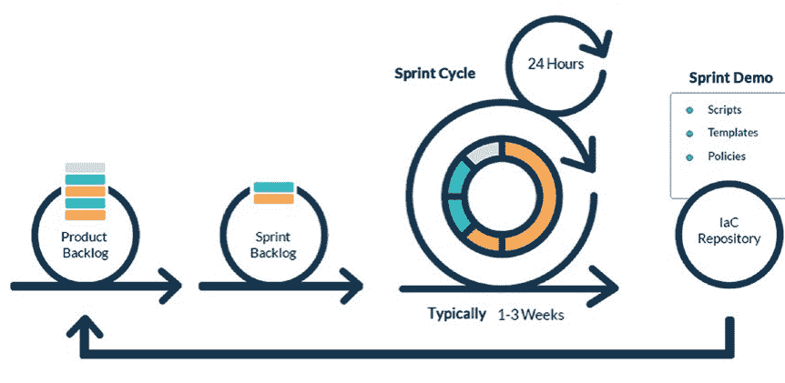

### 图 8-3. 通过 Scrum 规划 IaC

要开始这段旅程，第一步是对团队进行新方法的技能提升，使团队成员能够舒适地采用 Scrum。创建了与敏捷流程相一致的新角色定义，如 Scrum 主管、产品负责人、AgileOps Scrum 团队等。产品负责人负责定义需求，是业务、客户、应用开发团队与 AgileOps Scrum 团队之间的接口。该团队的最终目标是以敏捷的方式标准化和自动化基础设施。当团队准备以 Scrum 模式工作时，还会确定一个平台，在该平台上创建、更新和跟踪史诗和用户故事。团队学习操作该工具并能够可视化产品旅程非常重要。

让我们快速了解一下该结构中的关键术语；见表 8-2。

### 表 8-2. Scrum 术语

| Scrum 术语 | 描述 |
|---|---|
| 产品待办事项 | 它包括用于构建基础设施组件的史诗和用户故事。这些项目与关键利益相关者讨论后记录在此待办事项中。 |
| 冲刺待办事项 | 在每个冲刺开始之前，会识别出高优先级的用户故事并移至冲刺待办事项。该待办事项中的故事将由团队实施。 |
| 每日站会 | 随着冲刺的进行，团队每天会花 15 到 20 分钟开会讨论工作量和需要关注的风险。 |
| 冲刺周期 | 每个冲刺都有持续时间；有些团队以两周为一个冲刺，而少数团队以三周为一个冲刺。但一旦确定持续时间，团队就不应被允许更改。由于基础设施运营冲刺的经验数据很少，您需要根据项目、团队规模和技能调整冲刺持续时间。 |
| 冲刺演示 | 在冲刺结束时，开发的产品或脚本由关键利益相关者运行。任何缺陷或问题都会被记录并放回待办事项。 |

在开始使用 Scrum 时的一个良好做法是从 sprint 0 开始，它可作为团队的试金石。团队还可以重新审视冲刺的持续时间以及在一个冲刺中可以交付的用户故事数量。例如，团队决定以七名成员进行为期两周的冲刺周期。他们确定了一些用户故事，并在冲刺结束时意识到两周的冲刺周期是不够的。他们要么需要减少冲刺中的用户故事数量，要么将冲刺周期延长至三周。在完成 sprint 0 后，后续冲刺应坚持这些原则。要求类型（史诗、功能、用户故事）之间的可追溯性定义非常重要。团队需要就所需的各种需求类型达成一致。有些团队有四种类型，而另一些团队仅坚持史诗、用户故事和任务三个层级，这足以满足他们的需求。Azure DevOps、JIRA 等工具提供此功能，可声明这些不同的需求类型并创建自定义类型。在投资组合模型中，会在投资组合级别创建主题，然后进一步分解为跨项目和团队级别的史诗、功能、用户故事和任务。见图 8-4。

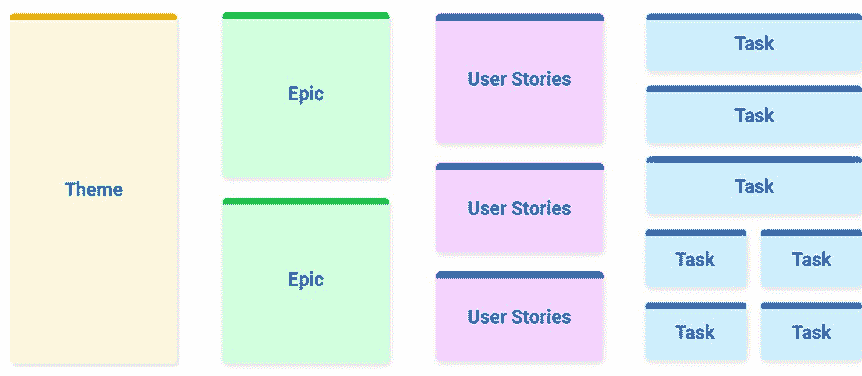

## 图 8-4. 敏捷组件

另一个冲刺交付成功的因素是做出正确的估算。是团队集体估算待交付的故事，但利用正确的方法会产生关键差异。这些估算是在冲刺计划会议期间进行的。每个团队成员都会分享他们对估算的看法，并做出集体决定。在冲刺计划会议结束时，团队需要确保所有故事都已审查并准备好实施，并且每个故事都已估算并与史诗或父实体关联。Scrum 主管在初始阶段通过手把手指导团队遵循敏捷最佳实践。Scrum 主管和团队检查团队中的每个人是否有待处理的故事，且没有成员被落下。还强调确保有足够的产能完成故事，并且它们不会延续到下一个冲刺。

## 估算故事

可用于估算故事的各种方法。一些常用的技术是 T-shirt sizing（XS 表示超小，S 表示小，M 表示中，L 表示大，XL 表示超大）、numeric sizing（1 到 10）、斐波那契数列（1, 2, 3, 5, 8, ...）等。为了运行这些技术，有可用的流程可以帮助团队获得尽可能接近的估算。像 Planning Poker 这样的方法可以帮助团队以协作的方式选择合适的努力规模（见图 8-5）。该方法基于团队的相互共识。在冲刺计划会议期间，每个团队成员阅读同一个故事并使用编号卡片分享他们的估算。然后他们分享自己是如何以及为何得出特定数字的理由。Scrum 主管记录该故事的高估算数和低估算数（针对所有成员），并重复该过程，直到团队就该故事的数字达成相互一致。

## 图 8-5. Planning Poker，故事估算方法

另一种常用方法，主要是开发团队使用的是功能点分析（FPA）方法，其中功能根据其复杂性被标记为功能点，并且也包括测试工作。例如，一个应用程序有四个关键功能需要编码或测试，如用户界面、业务逻辑、数据库连接和测试。这些功能中的每一个都根据其复杂性（低、中、高和复杂）定义了点。见图 8-6。

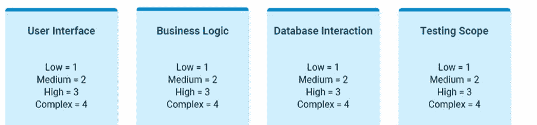

## 图 8-6. 示例功能点分析

对于基础设施驱动的故事，T-shirt sizing 是推荐的技术，易于采用和实践。每个 T-shirt size 代表复杂程度。例如，小型故事意味着可以快速开发且简单。另一方面，M 或 L 表示故事比 S 尺码更复杂，需要更多开发时间。这些尺码与表 8-3 中显示的斐波那契数列相关联。

## 表 8-3. T-Shirt Sizes 和等效故事点

| 尺码 | 描述 | 故事点 |
|---|---|---|
| X-Small | 在非常短的时间内交付且非常简单。 | 1 |
| Small | 在较短时间内交付且简单。 | 3 |
| Medium | 可在发布范围内交付且复杂度较低。 | 5 |
| Large | 可能在发布范围内交付且复杂。 | 8 |
| X-Large | 非常大，但通常可以理解。需要在多个发布中进一步分解，且非常复杂。 | 13 |
| XXL | 非常大且不确定的领域。需要在多个发布中进一步分解为可管理的部分，且极其复杂。 | 21 |

我们有 XL 和 XXL T-shirt 尺码，但应避免使用，因为冲刺周期为两到三周，很难在一个冲刺中完成这些故事。因此，XL 和 XXL 用户故事应分解为多个 S、M 或 L 用户故事。

假设这个示例用户故事：

> *作为管理员，我应该能够监控服务器的 CPU 利用率并生成警报，以便我能主动纠正问题。*

估算此故事时，应考虑以下几点：

- 了解范围，需要什么。
- 明确最终产品，即脚本或 playbook。
- 为此故事创建需要执行的任务。这可能包括获取访问某些工具、服务器等，以便监控其 CPU 利用率。
- 提供估算。如果工具集成已就位，则只需开发和测试脚本。然后尺码可以是 S 或 M，具体取决于脚本需要支持的操作系统数量。

**注意** 请记住，每个故事都应该是独立的、简单且可测试的。最初，团队可能会回避估算流程，但通过正确的培训和指导，团队将学会该方法并认识到其好处。毕竟，这对于有效的产能规划是必要的。

## 定义验收标准

敏捷故事的另一个重要方面是定义验收标准。这意味着如果用户故事要推进或被认为已完成，则必须彻底测试。这可以通过定义验收标准来实现。这可以在史诗级别或故事级别进行。在像 JIRA 这样的工具中，您可以定义字段，提示用户/业务分析师列出这些验收标准。如果所有列出标准的結果都为真，则意味着故事可以继续。测试应包括功能和非功能领域。黄金法则是每个故事都应至少链接一个验收标准。每个标准都以“given-when-then”格式编写，提及场景和预期结果。最好在构建用户故事的同时构建验收标准。表 8-4 显示了一个示例用户故事。

## 表 8-4. 示例用户故事

| 故事 | 验收标准 |
|---|---|
| As a: 系统管理员
I want to: 通过 REST API 模块将工具 1 与工具 2 集成
So that: 警报通知可见且能高效管理。 | **最佳情况：**
Given: 工具 1 已与工具 2 集成。
When: 使用 REST API。
Then: 通知对系统管理员可见。

**最坏情况：**
Given: 工具 1 和工具 2 的集成未激活。
When: REST API 被停用/不工作。
Then: 系统管理员会收到关于集成分离的通知。

**非功能情况：**
Given: 工具 1 和工具 2 已集成。
When: 使用 REST API。
Then: 通知应每分钟推送一次。 |

## 一个基础设施构建示例

让我们看一个史诗的示例，该史诗说明了使用基础设施即代码 provision 基础基础设施（如 RHEL Linux）的需求。这个史诗是一个大的需求，被分解为故事，并且每个故事都经过深思熟虑并进行了估算。

有多种方法可用于编写有效的故事；图 8-7 显示了最常见的一种。

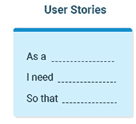

图 8-7. 用户故事格式

想法是说明需要为特定目的执行活动的用户角色。团队必须理解，虽然敏捷强调“工作软件优于全面的文档”，但仍需要一些最低限度的文档来支持实施。对需求的清晰解释有助于有效跟踪未来的变更。这是 InfraOps 团队需要指导的领域。他们可能会发现此类文档会耗时。教练可以帮助培训这些团队，并使他们能够以正确的方式实施该技术。例如，已创建了一个名为“Provision basic infra”的史诗（高层需求）。在此史诗下，团队创建相关的用户故事。每个故事都是一个独立的功能，团队将针对其构建自动化。团队还花费时间估算每个故事，并确保其经过充分测试并按时部署。

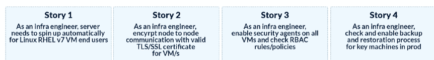

图 8-8. IaC 史诗及相关故事示例

随着团队的发展并逐渐熟悉 Scrum 方法论，他们也学会了更有效地估算用户故事并变得更加熟练。拥有敏捷实践者或教练可以加速敏捷方法和实践的采用。该教练与敏捷负责人和团队一起工作，指导他们如何编写有效的用户故事、执行估算、通过仪表板跟踪团队进度，并帮助团队识别改进和自动化的机会。

## 工具管道

变化的另一个重要要素是，无论是构建基础设施组件（如 VM 或防火墙）还是安装安全代理，其生命周期都应像在应用世界中那样实践 CI/CD。这意味着应像应用管道一样构建基础设施管道。因此，每当编写或修改新代码时，基础设施管道就会被触发，并经过自动构建过程、单元测试、代码覆盖率检查以及安全漏洞检查。CI/CD 自动化可通过与像 Jenkins 这样的编排器链接的自动化工具来实现，后者可从头到尾运行整个管道。因此，在团队提升方法论技能的同时，他们也需要提升构建基础设施管道所需的工具技能。

表 8-5 中的工具在产品生命周期中普遍使用。这里所指的产品是特定领域的基础设施即代码脚本集合。许多组织都有一个定义明确的原型工具包，并在组织内标准化。当然，对于遗留基础设施也会有参考工具。开始时选择合适的工具是成功实施的关键步骤。有些工具对团队来说可能是新的，因此他们应提升对新工具和技术的能力，以便在冲刺执行期间不会遇到问题。随着越来越多的用户故事交付，团队将逐步将其管道与服务目录集成。

### 表 8-5. 管道阶段和常用工具

| 区域 | 常用工具 |
|---|---|
| 规划 | JIRA/ServiceNow |
| 版本控制 | Git/GitHub |
| 开发 | IDEs/SDKs |
| 构建 | Ant/Maven |
| 制品库 | JFrog |
| 测试 | SonarQube/Selenium/Wireshark |
| 编排 | Jenkins |
| 基础设施构建 | Terraform, DRYiCE MyCloud |
| 部署 | Terraform/Ansible, HCL Launch |
| 监控 | SolarWinds/Nagios/Zabbix |
| 安全 | HCL AppScan |
| 仪表盘 | Grafana/APIs |
| 文档 | SharePoint/Confluence |

## 基础设施即代码示例

让我们看一个工程师需要上线一台新 VM 的场景。他们访问像 ServiceNow 这样的 ITSM 工具并查找允许他们提交 VM 供应申请的目录项。一旦请求获批，相关的基础设施管道就会自动触发并在无需人工干预的情况下设置 VM。过去此类请求需要两到三周时间，现在只需一个小时。许多组织已意识到此类好处，并旨在首先标准化和自动化不需要人工输入的基础设施基本需求。图 8-4 中的工作流展示了用户如何通过 ITSM 工具上线和下线 VM。一旦其请求被审批人批准，请求就会被定向到像 Jenkins 这样的编排工具以触发相应的作业。作业随后从存储库调用脚本进行执行。完成后状态会更新到 ITSM 工具中，从而通知提交工单的用户。支持团队会立即获知工作流中的任何问题。类似用例在 ITSM 中被识别并实施，以促进自助服务文化。

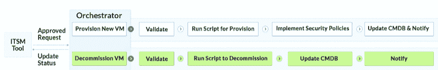

### 图 8-9. 使用 IaC 实现自助服务

有多个工具如 Jenkins、TravisCI 等可用于此类编排，并作为 ITSM 与其他工具之间的集成桥梁。这些工具通过调用完成操作的相应作业来触发自动化。此操作可由一个或多个工具执行。例如，假设我们有一个构建 Amazon Machine Image（AMI）的用例。这可以通过首先在 AWS 上启动一台新虚拟机、安装所需软件，然后构建一个黄金 AMI 来实现，该 AMI 随后成为可重用的模板。

我们将设计一个管道，利用云原生工具来自动化如表 8-6 所述的一系列作业。

### 表 8-6. 使用云原生工具创建管道

| 工具名称 | 用途 |
|---|---|
| AWS CodeCommit | 另一个托管安全基于 Git 的存储库的 AWS 服务。 |
| Jenkins | 一个用于设计和实现管道（构建 CI 和 CD）的开源工具。 |
| AWS CloudFormation | 一个有助于设计易于管理和可重复的模板的 AWS 服务。它有助于实现基础设施即代码。 |

图 8-10 描述了这些接口之间的集成点。IaC 脚本在 AWS CodeCommit 中进行版本控制，并且 Jenkins 配置为在 AWS CodeCommit 中更新新更改时触发编排。

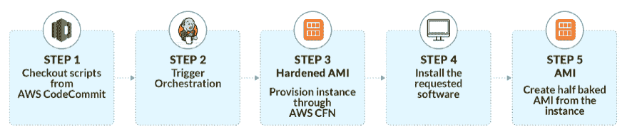

### 图 8-10. AWS 上的 IaC 示例

以下是此简单 IaC 管道的详细说明：

- 1. Jenkins 将从 CodeCommit 检出脚本，以获取存储库中出现的任何新更改。存储库是一个容器，保存可能包含脚本、配置工件等的源代码，并且还包含 IAM 权限以控制对 Git 存储库的访问。
- 2. Jenkins 配置为在 Git 存储库中的新更改时触发管道。与调用脚本的方式类似，Jenkins 可以轻松配置为调用其他工具。
- 3. AWS CFN 脚本执行并使用加固的 AMI 配置 AWS 实例。CFN 脚本的位置也可以使用其他脚本，如 Ansible playbook 或 Terraform 脚本或 DRYiCE MyCloud 模板来启动实例。
- 4. 一旦实例投入使用，脚本将进一步安装已请求的软件，如软件、配置文件或平台和数据库等，根据需要。
- 5. 脚本最终会生成一个 AMI（已配置），然后用于创建 AMI 的实例将被退役。

类似用例被设计并与多个基础设施即代码管道相关联。每个管道都有助于团队加快交付时间并减少应用开发和测试团队的等待时间。随着管道的实施，团队的下一步是将基础设施管道与应用管道集成。其思想是培养 DevOps 文化，其中两个团队都了解产品和底层基础设施需求。IaC 仓库也对开发团队开放，以便在基础设施上实施更多用例。通过这种方法，开发团队可以使用基础设施即代码工具提供的 API，并在其开发管道中调用这些 API 以按需启动基础设施。

## 将 IaC 与开发管道集成

随着组织中 IaC 的成熟，下一步是将 IaC 管道与其他团队集成并扩展。集成应用和基础设施管道的一个绝佳示例是蓝绿部署的需求（见图 8-11）。这是一种最佳实践，实现了 CD 原则，当整个端到端生命周期通过管道自动化时即可实现。蓝绿部署针对需要在生产环境中进行的每次新部署实施。因此，会设置一个新环境，并在其上部署新应用版本。一旦验证通过，即移除现有基础设施，并将流量路由到此新基础设施。

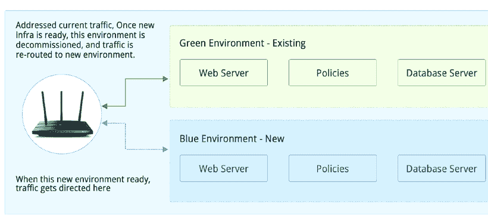

### 图 8-11. 蓝绿部署

随着新环境取代旧环境，这有助于避免在同一环境上部署工件时通常出现的配置问题或兼容性问题。所有这些都得益于集成在管道中的自动化工具的帮助。当开发人员签入代码时，CI 管道会验证代码的完整性并执行单元测试。所有这些工作都在开发分支上管理，该分支派生自功能分支或主分支。

一旦代码集成并测试后，会移至开发环境，在此环境中执行进一步的测试并检查代码质量。CI 成功后，我们进入 CD，进一步实现二进制文件在不同环境之间的迁移。在将二进制文件迁移到需按需构建的环境时，会调用 IaC 流水线。IaC 流水线启动所需的基础设施后，即在此新基础设施上部署应用程序代码并通知相关利益方。部署失败时将回滚，并通知相应团队进行适当修改以重新运行流水线。参见图 8-12。

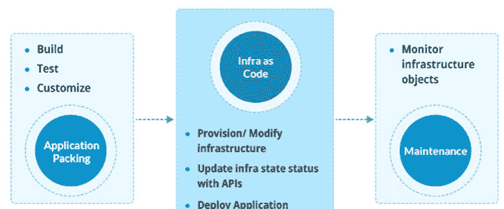

图 8-12. 连接应用和基础设施工作流

另一方面，成功的部署会启用监控代理，持续监控应用程序和基础设施。该循环会重复执行 “n” 次，每次执行时团队都能发现差距并进行改进。

## 扩展 IaC 示例

IaC 流水线准备就绪后，可扩展至开发团队等其他团队。首先，让我们来看一个基础的应用流水线，该流水线集成并测试任何签入源代码仓库的新代码。稍后我们将深入探讨如何使用以下工具集将应用流水线与 IaC 流水线扩展：

- AWS CodeCommit：源代码版本控制
- Jenkins：编排流水线
- *ASOC/SonarQube*：静态代码分析
- *JUnit/NUnit*：Java 和 .NET 源代码的单元测试
- *Maven*：构建应用程序源代码
- *JFrog Artifactory*：二进制仓库

应用流水线旨在持续集成新代码，从而实践持续集成原则。针对以下各步骤创建并估算用户故事：

- 1. 从 AWS CodeCommit 仓库检出最新源代码。
- 2. Jenkins 触发流水线并编排 CI 工作流。
- 3. SonarQube 分析源代码的代码复杂度、代码覆盖率等。这是质量检查的第一步，也称为 *静态应用程序安全测试*（SAST）。这是鼓励左移测试的关键实践，有助于在生命周期早期分析代码缺陷。HCL ASoC、Fortify、Parasoft JTest 等工具也是该领域知名的其他工具。
- 4. Junit 和 Nunit 测试框架在检出的代码上运行单元测试用例，以扫描覆盖率和功能检查。这是主动测试的另一步。
- 5. Apache Maven 构建源代码生成二进制文件。这些二进制文件被推送到 JFrog Artifactory 等工具中，并在 CD 流水线触发时被拉取。参见图 8-13。

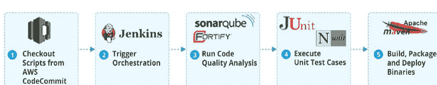

*图 8-13. AWS CI 流水线示例*

前述应用流水线的输出是包含最新二进制文件的制品。这些二进制文件随后部署到测试环境中进行功能和性能测试。不再需要为测试而阻塞测试环境的日子。如今，这些环境使用 IaC 流水线按需配置。IaC 流水线配置并设置新基础设施，从 JFrog Artifactory 获取最新二进制文件并部署代码。该环境现可通过 Selenium、Fortify 等工具调用功能/性能测试脚本。随着流水线的创建和集成，它们也可以与 ITSM 工具集成以支持基于目录的服务请求。

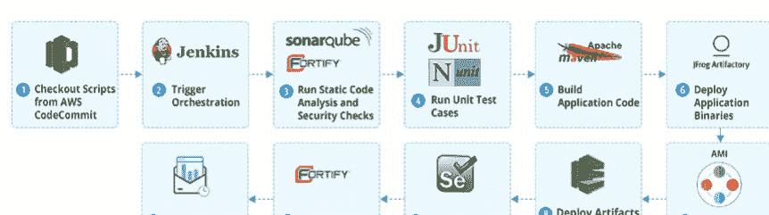

图 8-14. 集成基础设施和应用流水线

图 8-13 描述了 Jenkins 如何首先触发应用流水线并部署二进制文件。这完成了 CI 方面的工作。二进制文件准备部署后，基础设施组件将被配置和设置。在此示例中，配置的是 AWS AMI。环境就绪后，制品将被部署，这启动了 CD 方面。在此新的测试实例上，使用 Selenium 等工具对应用程序进行回归和功能测试。测试完成后，结果将被发布。完成此步骤后，用于测试的配置环境可以退役。此简单场景包含不同的步骤，每个步骤都通过 Jenkins 触发的脚本进行管理。实现此类场景需要一个明确的计划，确定应自动化并加入流水线的关键用例。如前所述，这些流水线也可以通过 ITSM 工具触发。

## 使用 Scrum 采用 IaC 时的关键敏捷实践

以下是关键实践：

- 定义高层级史诗。之前的示例可以表述为一个史诗。这是一个大型需求，将包含多个用户故事。
- 创建与史诗关联的用户故事，并指定负责人按既定时间线工作。
- 构建流水线时的议题或风险应在与团队的每日会议中提出。
- 在冲刺计划时，与团队明确期望和交付成果。
- 不要试图在一个冲刺中交付完整的流水线；相反，应跨冲刺定义并作为 MVP 持续交付。
- 每个用户故事都需要有明确的描述和验收标准。
- 冲刺开始前应使团队产能可见。
- 鼓励团队成员主持日常会议并对自己的用户故事负责。
- 用户故事可以包含任务并避免子任务，因为随着时间的推移子任务难以管理。
- 在每次冲刺计划会议中练习用户故事估算。

## 总结

以代码管理基础设施的方式正在取代传统的基础设施配置、退役、修补和升级流程。一旦基础设施团队接受了敏捷概念和工具的培训，他们就可以开始创建优先并执行的用户故事积压。有数十种工具可供团队采用来实现基础设施即代码，例如 Terraform、Azure Resource Manager（ARM）、Puppet、Chef、HCL MyCloud 以及其他云原生工具。新模型为基础设施运营带来工程化方面并利用敏捷开发方式。IaC 流水线与开发流水线功能相同，可与版本控制、静态代码分析、安全分析、单元测试、构建和部署、测试等多种工具集成。为了快速采用基础设施即代码并转向敏捷开发，组织需要关注以下关键领域：

- 具有 IaC 采用愿景的明确路线图
- 源代码控制、测试、部署、扩展等工具的识别
- 提升团队对 IaC 概念和工具的理解
- 待实现和集成的用例识别
- 企业何时以及如何提供自助服务的时限
